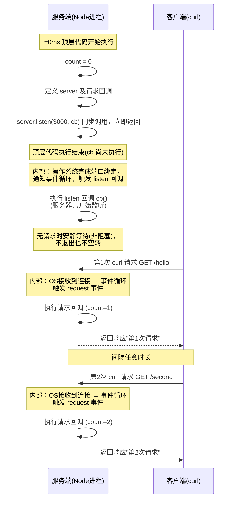
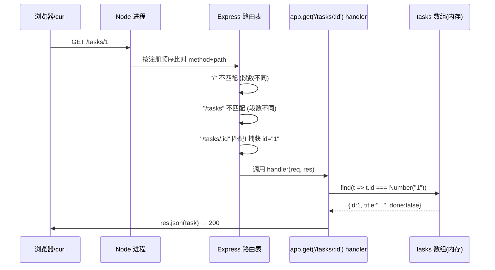
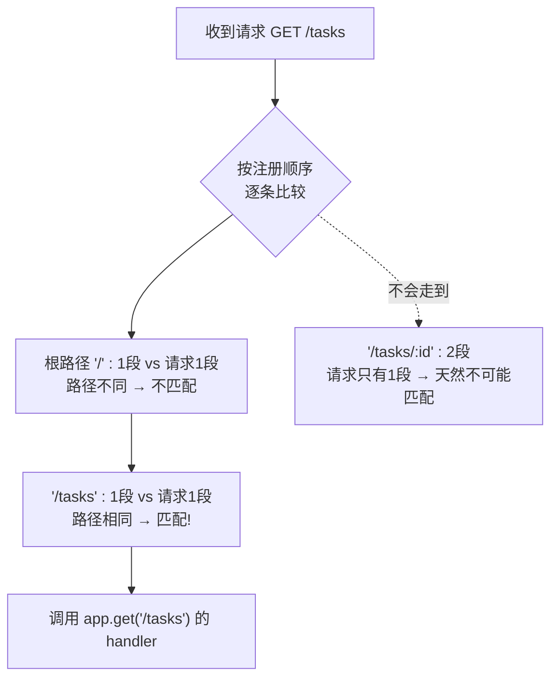
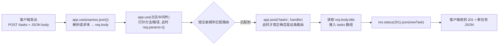
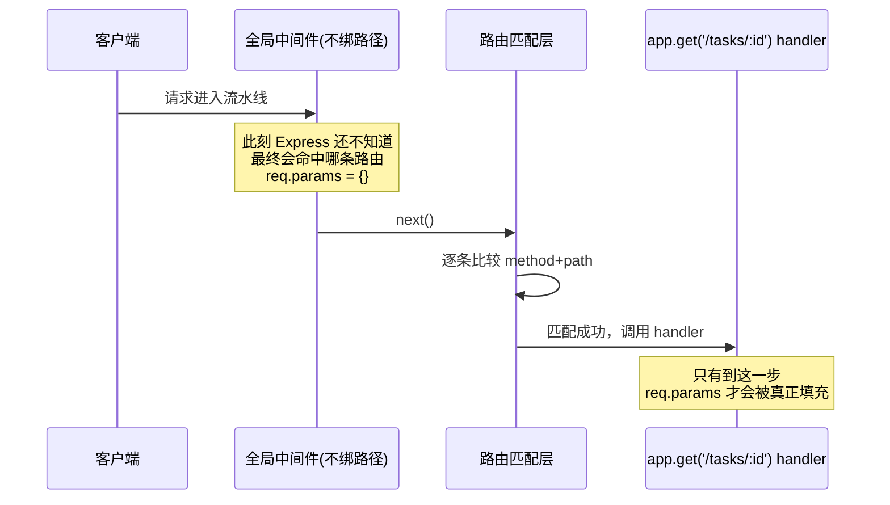
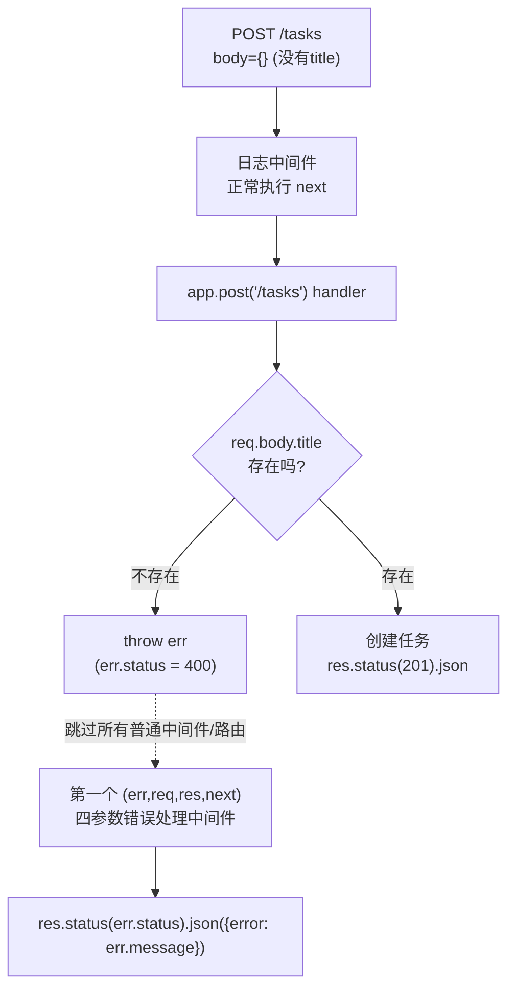
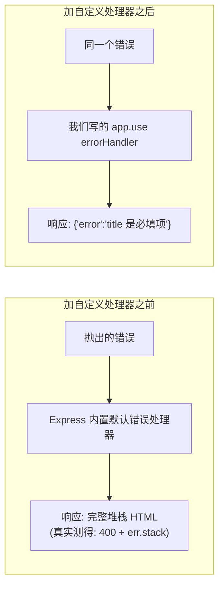
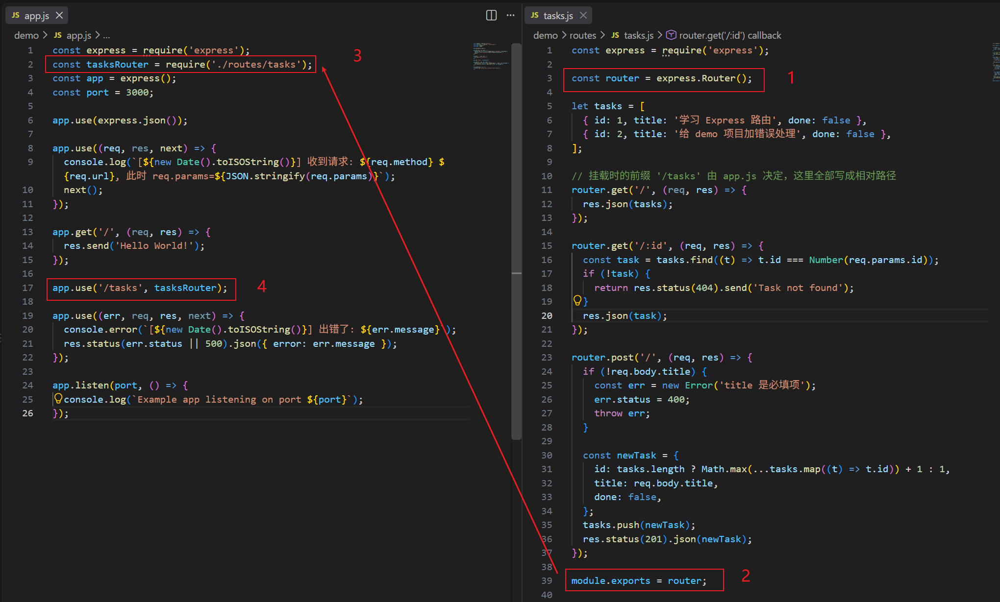

## Node HTTP模块


 三行代码，一个服务器

```js
const http = require('node:http');

const server = http.createServer((req, res) => {
  res.writeHead(200, { 'Content-Type': 'text/plain; charset=utf-8' });
  res.end('你好\n');
});

server.listen(3000);
```

- 顶层代码（`require`、`http.createServer(...)`、`server.listen(3000)` 这几行本身）—— 只在你执行 `node server.js` 的那一刻运行一次。

- 传给 `createServer` 的回调函数 —— 这一刻不会执行。它只是被登记成"以后每次收到 HTTP 请求时该调用谁"，Node.js 内部把它订阅到了 server 的 `'request'` 事件上。
- 回调函数真正执行 —— 发生在未来某个不确定的时刻：只要有一个 HTTP 请求真的到达了这个端口。可能是 1 毫秒后，可能是 1 小时后，可能永远不发生。


代码在时间维度上的执行顺序

```js
const http = require('node:http');

count = 0

server = createServer((req, res) => {
  count++
  respond(res, count)
})

server.listen(3000, () => {
  // 监听已就绪
})

// 顶层代码到此结束
console.log(`[顶层代码] 执行结束，listen() 已经返回（但监听回调不一定已经跑完）  t=${Date.now()}`);
```

顶层代码跑完最后一行 —— 注意，此时`server.listen(3000, cb)`这一整行调用已经返回了，但传给它的回调`cb`还没有执行。

因为`listen()`本身是"发起监听"的同步调用，但"确认监听成功"这件事是异步通知回来的。


时间维度上的执行顺序图：




## Express 是什么

Node.js 内置的 `http` 模块已经能创建服务器，但必须自己写 if/else 去判断 "这是什么方法、什么路径，该调用哪个函数"。

Express 的核心哲学就是把这件事标准化： 它在 `http` 之上加了一层薄薄的骨架——一张"方法 + 路径 → 处理函数"的路由表，外加 一套贯穿始终的 中间件（middleware）流水线。

 `req`、`res` 底层还是 Node 原生对象，Express 只是让开发者更方便地表达路由和逻辑。


代码：demo/app.js

```js
const express = require('express');
const app = express();
const port = 3000;

app.get('/', (req, res) => {
  console.log(`[${new Date().toISOString()}] 收到请求: ${req.method} ${req.url}`);
  res.send('Hello World!');
});

app.listen(port, () => {
  console.log(`Example app listening on port ${port}`);
});
```

- `express()` 是一个工厂函数，调用它会创建一个全新的应用实例 `app`——它本身还不是服务器，只是一个还没绑定端口的"路由 + 中间件容器"。
- `app.get(PATH, HANDLER)` 往这个容器的路由表里追加一条记录：*方法=GET，路径=PATH* 时，运行 HANDLER。这就是官方文档里 `app.METHOD(PATH, HANDLER)` 的通用结构。
- `app.listen(port, callback)` 真正让操作系统开始监听 TCP 端口的那一步；回调只在"监听成功"那一刻执行一次


现实中发生了什么：一条时间线

```mermaid
sequenceDiagram
    autonumber
    participant Dev as 开发者(终端)
    participant Node as Node 进程
    participant Express as Express(app)
    participant OS as 操作系统(TCP)
    participant Browser as 浏览器/客户端

    rect rgb(38, 50, 56)
    Note over Dev,Express: t0 · 启动执行 node app.js
    Dev->>Node: 执行 node app.js
    Node->>Express: require('express') 并调用 express()
    Express-->>Node: 返回 app 实例（路由+中间件容器）
    Node->>Express: app.get('/', handler) 注册路由
    end

    rect rgb(38, 50, 56)
    Note over Node,OS: t1 · 监听端口
    Node->>OS: app.listen(3000, cb)
    OS-->>Node: 打开 TCP 监听 socket
    Note right of Node: 同步代码执行完毕，但进程不退出<br/>（事件循环靠监听句柄保活）
    end

    rect rgb(38, 50, 56)
    Note over Node: t2 · 回调触发
    OS-->>Node: 监听成功
    Node->>Node: 执行 cb()
    Node-->>Dev: 打印 "Example app listening on port 3000"
    end

    rect rgb(38, 50, 56)
    Note over Browser,Express: t3 · 请求命中路由 GET /
    Browser->>OS: 发起 TCP 连接 + HTTP 请求 GET /
    OS->>Node: 转交连接数据
    Node->>Express: 解析为 HTTP 请求，交给 Express
    Express->>Express: 遍历路由表，method=GET path=/ 命中
    Express->>Express: 调用 handler(req,res)
    Express-->>Dev: console.log 打印请求日志
    Express-->>Browser: res.send('Hello World!') → 200
    end

    rect rgb(38, 50, 56)
    Note over Browser,Express: t4 · 请求未命中路由 GET /nope
    Browser->>OS: 发起请求 GET /nope
    OS->>Node: 转交连接数据
    Node->>Express: 解析为 HTTP 请求，交给 Express
    Express->>Express: 遍历路由表，无匹配项
    Note right of Express: 写的 handler 从未被调用<br/>console.log 不会执行
    Express-->>Browser: 走内置默认处理器 → 404
    end
```



> 关键心智模型：一次 HTTP 请求进来后，Express 做的第一件事永远是"拿方法+路径去路由表里找匹配"， 只有找到匹配，写的函数才会被调用。


## 路由进阶 

用方法 + 路径表达"对哪个资源做什么"


方法表达"做什么动作"——先只用 `GET`（读取），后面再引入 POST/PUT/DELETE。

路径表达"对哪个资源"，路径里可以放一个 `:id` 这样的命名参数， Express 会把 URL 里对应位置的那一段捕获下来，存进 `req.params`

- 比如： `/users/:userId/books/:bookId`，访问 `/users/34/books/8989` 时 `req.params` 会是 `{ userId: "34", bookId: "8989" }`—— 注意，捕获到的值永远是字符串，哪怕看起来像数字。


demo/app.js 新增了两条路由

```js
let tasks = [
  { id: 1, title: '学习 Express 路由', done: false },
  { id: 2, title: '给 demo 项目加错误处理', done: false },
];

app.get('/tasks', (req, res) => {
  res.json(tasks);
});

app.get('/tasks/:id', (req, res) => {
  const task = tasks.find((t) => t.id === Number(req.params.id));
  if (!task) {
    return res.status(404).send('Task not found');
  }
  res.json(task);
});
```


一次 `GET /tasks/1` 请求的时间线




路径段数决定谁能匹配谁




## 中间件 

Express 应用其实是一串函数的流水线


思想：中间件是"请求经过的每一道关卡"

官方文档对 Express 的定义很直白：*"an Express application is essentially a series of middleware function calls executed during the request-response cycle"*


中间件函数长这样：`(req, res, next)`。它能做四件事之一：

- 执行任意代码（比如打日志、校验、解析请求体）
- 修改 `req`/`res`（比如给 `req` 挂一个新属性）
- 结束请求-响应周期（调用 `res.send()`/`res.json()` 等）
- 调用 `next()`，把控制权交给流水线里的下一个函数

顺序：先注册的中间件先执行。如果一个中间件既不结束响应、 也不调用 `next()`，请求就会一直挂起，客户端永远等不到响应。


代码：demo/app.js 加了两个"关卡" + 一条新路由

```js
app.use(express.json());

app.use((req, res, next) => {
  // 打印日志.....
    
  next();
});

app.post('/tasks', (req, res) => {
  /**
    * 存储、更新数据的代码，不用管
  const newTask = {
    id: tasks.length ? Math.max(...tasks.map((t) => t.id)) + 1 : 1,
    title: req.body.title,
    done: false,
  };
  tasks.push(newTask);
  ......
  */
    
  res.status(201).json(newTask);
});
```

- `express.json()` 是 Express 内置中间件之一： 它读取请求体里的原始字节流，按 JSON 解析，挂到 `req.body` 上。没有它，`req.body` 会是 `undefined`，`POST /tasks` 里的 `req.body.title` 就会直接报错。
- 第二个 `app.use(...)` 是日志中间件，注意它没有绑定路径， 所以对每一个请求都会执行一次，且排在所有路由处理函数之前。这样就不需要再每个路由 handler 里各写一行 `console.log` 来打印日志。把重复代码提到中间件里，正是中间件"横切关注点"的典型用法。
- `app.post('/tasks', ...)` 是新增的路由：从 `req.body.title` 里取出标题， 分配一个新 id，推入 `tasks` 数组，用 `res.status(201).json(newTask)` 返回—— `201 Created` 是"成功创建了新资源"的标准状态码。


一次 `POST /tasks` 请求在流水线里的完整路径




现实中发生了什么：一次 POST 请求的真实前后对比

POST 之前，`GET /tasks` 的真实响应：

```json
[
    {"id":1,"title":"学习 Express 路由","done":false},
    {"id":2,"title":"给 demo 项目加错误处理","done":false}
]
```

发送 `POST /tasks`，请求体 `{"title":"Buy milk"}`；服务器终端真实打印：

POST 之后再次 `GET /tasks`，数组真的多了一项（这是运行中进程内存里的状态，重启进程就会重置回种子数据）：

```json
[
    {"id":1,"title":"学习 Express 路由","done":false},
    {"id":2,"title":"给 demo 项目加错误处理","done":false},
    {"id":3,"title":"Buy milk","done":false}
]
```


req.parmas何时被被填充？比如 `GET /tasks/1`（对应 `/tasks/:id`）




## 错误处理

思想：错误处理中间件是"专门接错误的关卡"

官方文档：*"Express comes with a default error handler so you don't need to write your own to get started"*——哪怕你什么都不写，Express 也会兜底处理错误。 但兜底不等于合适


错误处理中间件有四个参数，签名固定是 `(err, req, res, next)`

同步代码里的 `throw`， Express 会自动帮你捕获，不需要手写 `try/catch` 再调用 `next(err)`。只有异步代码 （比如 `setTimeout` 里的错误，或者没有 `return` 的 Promise 链）才需要你手动把错误 传给 `next(err)`，否则 Express 根本不知道这个错误存在。


代码：给 POST /tasks 加校验，给 app.js 加错误处理器

```javascript
app.post('/tasks', (req, res) => {
  if (!req.body.title) {
    const err = new Error('title 是必填项');
    err.status = 400;
    throw err; // 同步 throw，Express 5 会自动捕获
  }

  // 如果有title，就处理数据...
    
  res.status(201).json(newTask);
});

// 错误处理中间件必须写在所有路由之后
app.use((err, req, res, next) => {
  console.error(`[${new Date().toISOString()}] 出错了: ${err.message}`);
  res.status(err.status || 500).json({ error: err.message });
});
```

- `err.status = 400`：Express 默认错误处理器（以及我们自己写的这个）都会优先读 `err.status`/`err.statusCode` 来决定响应状态码，读不到才退回 500。
- 错误处理中间件必须注册在所有路由之后——Express 只会把错误往"后面"传，写在前面的话， 路由抛出的错误根本传不到它这里。

> 关键心智模型
> 一个 `throw` 出现之后，Express 会把它当成"一次特殊的 next 调用"（相当于 `next(err)`）， 直接跳过所有普通中间件和路由，去找**下一个四参数签名**的错误处理器。找到我们写的这个就停在这里； 如果我们没写，它就一路找到 Express 内置的那个兜底处理器。


`throw` 之后，错误是怎么跳过其他中间件、找到错误处理器的




加错误处理中间件前后，同一个错误走的是两条不同的路




## express.Router 拆分路由文件

`express.Router` 官方文档把它称为"mini-app"：因为它是一套完整的中间件 + 路由系统，可以独立定义路由和中间件，再整体挂载到主 app 的某个路径前缀下


- modular（模块化）：每种资源自己的路由可以单独写在自己的文件里。
- mountable（可挂载）：写好之后，用 `app.use(前缀, router)` 把整个 router 接到主 app 的某个路径前缀下——就像给这个"迷你 app"接上一根管子。

路径是相对于挂载点计算的：一旦用 `app.use('/tasks', tasksRouter)` 挂载， router 内部写的 `'/'` 实际对应的就是 `/tasks`，`'/:id'` 对应的就是 `/tasks/:id`——前缀已经由挂载这一步负责了，router 内部不需要、也不应该重复写 `/tasks`。

所以 `routes/tasks.js` 里的路由要写成 `router.get('/', ...)` 和 `router.get('/:id', ...)`，而不是像原来那样写 `'/tasks'` 和 `'/tasks/:id'`？




- `tasks` 数组本身也搬进了 `routes/tasks.js`——这是"资源模块拥有自己的数据"的 自然结果，`app.js` 不再需要知道 `tasks` 长什么样。
- 日志中间件、`express.json()`、错误处理器仍然留在 `app.js`：它们是全局 关卡，对所有资源都生效，不属于某一个资源模块。
- 整个应用对外暴露的 URL 一个都没变——`GET /tasks`、`GET /tasks/:id`、 `POST /tasks` 照旧，改变的只是代码的组织方式。


## 给 Router 加专属中间件

思想：router-level 中间件只对"这个迷你 app"生效

官方文档：*"Router-level middleware works the same way as application-level middleware, except it is bound to an instance of express.Router()"*。

也就是说， 写法和用法跟我们在 `app.js` 里用的 `app.use(...)` 几乎一样，唯一区别是挂在 `router` 上而不是 `app` 上——用 `router.use()` 和 `router.METHOD()` 来加载。

写在 `routes/tasks.js` 里的 `router.use(...)`，只有当请求先匹配上 `app.js` 里的挂载点 （`app.use('/tasks', tasksRouter)`）、真正"进入"这个 router 之后，才会执行。


在 routes/tasks.js 里加一个只属于它的中间件

```js
const express = require('express');
const router = express.Router();

let tasks = [
  { id: 1, title: '学习 Express 路由', done: false },
  { id: 2, title: '给 demo 项目加错误处理', done: false },
];

// router 专属中间件：只对挂载到这个 router 下的请求生效，不会对 app.js 里的 /
router.use((req, res, next) => {
  console.log(`[tasksRouter] req.originalUrl=${req.originalUrl} req.baseUrl=${req.baseUrl} req.url(已按挂载点重写)=${req.url}`);
  next();
});

// 挂载时的前缀 '/tasks' 由 app.js 决定，这里全部写成相对路径
router.get('/', (req, res) => {
  res.json(tasks);
});
// ...（其余路由不变）
```

`app.js` 完全不需要改动——挂载方式还是原来那一行：

```js
app.use('/tasks', tasksRouter);
```

依次真实访问 `GET /`、`GET /tasks`、`GET /tasks/2`，服务器终端的真实日志：

```
Example app listening on port 3000
[2026-09-13T09:39:43.627Z] 收到请求: GET /, 此时 req.params={}

[2026-09-13T09:39:46.754Z] 收到请求: GET /tasks, 此时 req.params={}
[tasksRouter] req.originalUrl=/tasks req.baseUrl=/tasks req.url(已按挂载点重写)=/

[2026-09-13T09:39:49.746Z] 收到请求: GET /tasks/2, 此时 req.params={}
[tasksRouter] req.originalUrl=/tasks/2 req.baseUrl=/tasks req.url(已按挂载点重写)=/2
```

`GET /tasks` 触发了 `[tasksRouter]` 日志，此时 `req.baseUrl` 是 `/tasks`（挂载点本身），而 `req.url` 已经被改写成了 `/`——挂载前缀被"吃掉"了。

`GET /tasks/2` 同理