# 数据处理


### sort()  数组排序

方法就地对数组的元素进行排序，并返回对相同数组的引用

默认排序（字典序）：

```JavaScript
const arr = [3, 1, 10, 2];
arr.sort();
console.log(arr);
// 输出: [1, 10, 2, 3]  ← 按字符顺序，不是数值
```


数值排序（升序）：

```javascript
const arr = [3, 1, 10, 2];
arr.sort((a, b) => a - b);
console.log(arr);
// 输出: [1, 2, 3, 10]
```


数值排序（降序）：

```JavaScript
const arr = [3, 1, 10, 2];
arr.sort((a, b) => b - a);
console.log(arr);
// 输出: [10, 3, 2, 1]
```


对象数组排序：

```javascript
const users = [
  { name: '张三', age: 30 },
  { name:  '李四', age: 25 },
  { name: '王五', age: 35 }
];

// 按年龄升序
users.sort((a, b) => a.age - b.age);
console.log(users);
// 输出: 25, 30, 35
```


结合


```javascript
const state = {
  timeIndexMap:  {
    "10":  "a",
    "2": "b",
    "1": "c",
    "20": "d"
  }
};

const times = Object.keys(state.timeIndexMap).sort();
console.log(times);
// 输出: ["1", "10", "2", "20"]
```

**解释：**

- 键是 `"10", "2", "1", "20"`
- 用 `.sort()` 排序后变成 `["1", "10", "2", "20"]`
- 这是**字典序排序**，不是数值顺序
- 如果你想要 `["1", "2", "10", "20"]` 这样的数值排序，需要：

```JavaScript
const times = Object.keys(state.timeIndexMap).sort((a, b) => a - b);
console.log(times);
// 输出: ["1", "2", "10", "20"]
```


### 正则表达式

元字符

| 符号 | 含义                   | 例子                     |
| ---- | ---------------------- | ------------------------ |
| `^`  | 匹配字符串开头         | `^M` 匹配以M开头         |
| `$`  | 匹配字符串结尾         | `Z$` 匹配以Z结尾         |
| `\d` | 匹配数字 (0-9)         | `\d+` 匹配一个或多个数字 |
| `+`  | 匹配1个或多个          | `\d+` 匹配"123"          |
| `*`  | 匹配0个或多个          | `\d*`                    |
| `()` | 捕获组                 | `(\d+)` 捕获数字         |
| `.`  | 匹配任意字符（除换行） | `a.c` 匹配"abc"          |


代码详解

exec() 方法在一个指定字符串中执行一个搜索匹配。返回一个结果数组或 null。

```js
const match = /^(\d+)_X$/.exec(colName);

/^(\d+)_X$/
 ^ 开头
  (\d+) 捕获1个或多个数字 → 捕获组1
        _ 匹配下划线
         X 匹配字母X
          $ 结尾
    

const colName = "123_X";
const match = /^(\d+)_X$/.exec(colName);
console.log(match);
// 输出: ["123_X", "123"]
//       ↑整个匹配  ↑捕获组1
```


正则的两种创建方式

方式1：字面量（推荐）

```javascript
const reg = /^(\d+)_X$/;
const match = reg. exec(colName);
```

方式2：构造函数

```javascript
const reg = new RegExp('^(\\d+)_X$');  // 注意：\d 要写成 \\d
const match = reg. exec(colName);
```


### parseInt() -- 解析字符串

```js
parseInt('1111000011110000', 2) 
'1111000011110000' — 一个二进制数字字符串（只含 0 和 1）
2 — 基数（radix），表示按2进制解析

parseInt('1010', 2) → 10
parseInt('17', 8) → 15
parseInt('255', 10) → 255
parseInt('FF', 16) → 255

parseInt(string, radix),就是假定string是一个radix进制的字符串，然后把它转成10进制整数并返回
```


### parseFloat - 解析浮点数

**作用：** 将字符串转换为浮点数（小数）

```javascript
parseFloat("123");       // 123
parseFloat("123.45");    // 123.45
parseFloat("123.45.67"); // 123.45 （停在第二个点）
parseFloat("123abc");    // 123    （解析到非数字停止）
parseFloat("abc123");    // NaN    （无法解析）
```


### 箭头函数忽略参数

```js
// 完整写法
const arr = [10, 20, 30];
arr.map((value, index) => {
  console.log(index);  // 只用 index，不用 value
});

// 简化写法（用 _ 表示不用 value）
arr.map((_, index) => {
  console.log(index);
});

// 输出:  0, 1, 2
```


### `Array.from()` 转真数组

**`Array.from()`** 把类数组对象转成真实数组，第二个参数是映射函数，对每个元素进行转换。

```js
// 例子1：基础用法 - 生成指定长度的数组
const arr = Array.from({ length: 3 }, (_, i) => i);
console.log(arr); // [0, 1, 2]

// 例子2：你的代码简化版
const n = 3;      // 生成3个Float64Array
const m = 2;      // 每个包含2个元素
const data = Array.from({ length: n }, () => new Float64Array(m));

console.log(data.length);        // 3
console.log(data[0]);            // Float64Array(2) [0, 0]
```


### `Float64Array`

Float64Array.map() 返回 Float64Array，不是普通数组 → 字符串被强制转为 NaN

```js
// ❌ Float64Array.map() 返回 Float64Array
const nums = new Float64Array([1.1, 2.2]);
const strs = nums.map(n => `val${n}`);
console.log(strs);        // Float64Array [NaN, NaN] ← 字符串被转成了NaN！
console.log(strs[0]);     // NaN

// ✅ 先转普通数组，再 map
const strs2 = Array.from(nums).map(n => `val${n}`);
console.log(strs2);       // ['val1.1', 'val2.2'] ✓
```


### isFinite() 判断有限数

```js
Number.isFinite() 判断是否为有限数字（排除 NaN 和 Infinity）

Number.isFinite(42);        // true
Number.isFinite(Infinity);  // false
Number.isFinite(NaN);       // false
```


### 展开运算符 (...)

展开运算符（Spread Operator），作用是把对象或数组的内容**铺平展开**。


对象展开

```js
const obj1 = { a: 1, b: 2 };
const obj2 = { ...obj1, c: 3 };

console.log(obj2);
// { a: 1, b: 2, c: 3 }
```


逐步展开

相当于铺平复制

```js
const cfg = {
  id: "sat",
  name: "Sat 16",
  model: { gltf: 'a.gltf', scale: 100 }
};

// 方式1：手动复制（重复、容易出错）
const entity1 = {
  id: cfg.id,
  name: cfg.name,
  model: {
    gltf: cfg.model.gltf,
    scale: cfg.model.scale,
    articulations: {}
  }
};

// 方式2：用展开运算符（简洁、清晰）
const entity2 = {
  ...cfg,
  model: {
    ...cfg.model,
    articulations: {}
  }
};

// entity1 和 entity2 完全相同！
```


展开运算符会进行浅拷贝

```js
function getKeyframe() {
  ...
  return keyframe[0];  // 直接返回原对象的引用
}

const result = getKeyframe()
result.opacity = 999; // 此时修改会修改原数据

如果是：
return { ...keyframes[0] }; // 创建一个新对象，属性值从 keyframes[0] 复制过来
esult.opacity = 999; // ✅ keyframes[0] 不受影响
```


### 解构

拆分原有的解构，从中提取需要的部分

```js
const person = { name: '张三', age: 18, city: '北京' };
const { name, age, city, gender = "未知" } = person;

console.log(name); // '张三'
console.log(age);  // 18
console.log(city); // '北京'
console.log(gender); // '未知'，person没有gender属性，用默认值兜底
```


传统写法

```js
const person = { name: '张三', age: 18, city: '北京' };

// 要取值，得一个个手动赋值：
const name = person.name;
const age  = person.age;
const city = person.city;
```


### 对象解构传参

对象解构传参：无顺序限制，按需传入

```js
function modern({ parent, title = 'Controls', width, closed = false } = {}) {}
modern({ parent: el, closed: true }) // 清晰，语义明确
```


传统位置参数：顺序固定，可选参数难处理

```js
function old(parent, title = 'Controls', width, closed = false) {}
old(el, undefined, undefined, true)  // 难看，容易出错
```


解构传参语法糖

```js
function foo({ title = 'Controls', closed = false } = {}) {}

相当于下面这种说法：

function foo(options= {}) {
  const { title = 'Controls', closed = false } = options 
  // options没有title和closed属性，就使用默认值
}
```


### 位运算与颜色格式


#### Hex 颜色格式

`#rrggbb` — 每两位十六进制数代表一个通道（0x00–0xFF，即 0–255）：

```
#FF8020
^^       FF = 255 (红)
  ^^     80 = 128 (绿)
    ^^   20 =  32 (蓝)
```


#### RGB 颜色格式

三个独立的 0–255 整数：`[255, 128, 32]`


对应关系：parseInt 后的内存布局

`parseInt('FF8020', 16)` 得到一个 24 位整数，在内存中是：

```js
二进制：  1111 1111  1000 0000  0010 0000
         ─────────  ─────────  ─────────
位区间：  [23..16]   [15..8]    [7..0]
通道：      R          G          B

三个颜色通道紧密打包在一起，要单独取出某个通道，就需要"搬运"它到最低8位再读取。
```


#### 位运算符：rgb -> hex


`>>`是位移运算符，原理如下

```js
const n = 0xFF8020;  

// 取红色 (高8位，第23~16位)
(n >> 16) & 0xff

第一步 >> 16：整体向右平移16格
移动前:  [  R=FF  ][  G=80  ][  B=20  ]
         23    16   15    8   7     0

移动后:  [ 000000 ][ 000000 ][  R=FF  ]
         23    16   15    8   7     0
                              ↑ 想读的8位
                              
第二步 & 0xff：用掩码盖住高位，只留最低8位
        [ 000000 ][  R=FF  ][  G=80  ]
& 掩码  [ 000000 ][ 000000 ][ 111111 ]  (0xff = 低8位全1)
        ─────────────────────────────
结果    [ 000000 ][ 000000 ][  R=FF  ]  = 255 ✓


// 取绿色 (中8位，第15~8位)
(n >> 8) & 0xff
// n >> 8   → 0x00FF80  (把绿色移到最低8位，红色在上面)
// & 0xff   → 0x80 = 128

// 取蓝色 (低8位，第7~0位)
n & 0xff
// 直接掩码  → 0x20 = 32
```


### `||` `&&` `??`

```js
let a = 表达式1 || 表达式2 || 表达式3
按顺序找一个“成立的”，作为结果
“或”的本意是：有一个成立，整体就成立。
false / 0 / "" / null / undefined / NaN这些值表示不成立


let a = 表达式1 && 表达式2 && 表达式3
层层检查，任何一关不通过，就不继续。
“与”的本意是：必须全部成立。已经有一个不成立，后面再成立也没用了。
比如: 已登录 && 显示个人主页();已登录，才执行右边；没登录，就到此为止。


?? 就是 || 的升级版，仅 null / undefined 表示不能用
```


## Object

### Object() 值 -> 对象

```js
// Object()方法可以将一个值转换为对象
console.log(Object('hello')); // [String: 'hello']
```


### Object.keys：["键"，..]

- `Object.keys()` 获取对象的所有**键**（属性名）
- 返回一个**数组**
- 数组里只有键，不包含值

```javascript
const obj = {
  name: "张三",
  age: 30,
  city: "北京"
};

const keys = Object.keys(obj);
console.log(keys);
// 输出: ["name", "age", "city"]
```


### Object.entries()：对象 -> [[’键‘: 值], [], ...]

```js
const obj = { a: 1, b: 2, c: 3 };

Object.entries(obj);
// 返回：
// [
//   ['a', 1],
//   ['b', 2],
//   ['c', 3]
// ]

for (const [k, v] of Object.entries(obj)) {
  console.log(k, v);
}

/* 输出：
a 1
b 2
c 3
*/
```


### Object.values()：[值，值，..]

Object.values() - 获取对象的值

`Object.values()`返回一个**数组**，包含对象所有属性的值。

```javascript
const person = {
  name: '张三',
  age: 25,
  city: '北京'
};

const values = Object.values(person);
console.log(values);  // 输出: ['张三', 25, '北京']
```


## Number

#### Math.floor()：值 -> 向下取整

```js
Math.floor(3.9)  // 3
Math.floor(-1.1) // -2
```


#### Math.ceil()：值 -> 向上取整

```js
Math.ceil(3.1)  // 4
Math.ceil(-1.9) // -1
```


#### Math.round()：值 -> 四舍五入

```js
Math.round(3.4) // 3
Math.round(3.5) // 4
```


#### Math.trunc()：11.22 -> 11

直接砍掉小数点后面的部分

```js
Math.trunc(3.9)  // 3
Math.trunc(-1.9) // -1  ← 注意区别于 floor 的 -2
```


#### num.toFixed(n)：数字 -> 保留 n 位小数的字符串

```js
(3.14159).toFixed(2) // "3.14"
(3.1).toFixed(4)     // "3.1000"  位数不够补 0
```


#### Math.random()：-> 0~1 随机数

```js
Math.random() // 0.7263929183...

// 常见用法：生成 0~9 的随机整数
Math.floor(Math.random() * 10) // 0, 1, 2 ... 9
```


#### Math.max(a, b, ...)：多个数字 -> 最大值

```js
Math.max(1, 5, 3, 2) // 5
```


#### Math.min(a, b, ...)：多个数字 -> 最小值

```js
Math.min(1, 5, 3, 2) // 1
```


#### Math.pow(n, power)：底数, 指数 -> 幂次结果

```js
Math.pow(3, 2) // 9   即 3²
```


## Array

原始数据不应该轻易被改变，这是函数式编程的准则，所以数组方法不会改变原始数组


#### arr.forEach()：只遍历

foreach仅仅是遍历数组的简便写法，核心价值在于遍历是能拿到每个元素的值作为某个工序的材料

```js
arr.forEach((item, index, array) => {
  // item: 当前元素的值
  // index: 当前元素的索引
  // array: 原数组（可选参数）
  // 这里可以执行任何操作，但不能 return 值
});
```


#### arr.map()：[x, y, t] → [2x, 2y, 2t]

map的回调函数必须return，相当于把数组中的元素按照既定工序处理后，放到一个新数组中，元素在新数组中的位置和原来的位置一模一样

```js
arr.map((item, index, array) => {
  // item: 当前元素的值
  // index: 当前元素的索引
  // array: 原数组（可选参数）
  // 必须 return 一个新值，这个值会成为新数组对应位置的元素
});
```


#### arr.filter()：[5×,  12✓,  8×] → [12]

filter中的回调函数也必须return，filter可以想象成一个门框过滤器，filter会让数组中的每个元素轮流在门槛前等待，如果回调返回的内容可以判定为true，该值就能被保留，并放在新数组中，如果回调返回的内容被判定为false，该值就不能经过，被舍弃

```js
arr.filter((item, index, array) => {
  // item: 当前元素的值
  // index: 当前元素的索引
  // array: 原数组（可选参数）
  // 必须 return，隐式转换为布尔值，true 保留该元素，false 丢弃
});
```


#### arr.find()：[5,  12✓,  8,  44] → 12

直接返回数组中第一个符合条件的值

```js
arr.find((element, index, array) => {
  element：当前正在处理的元素
  index：当前正在处理的元素的索引
  array：调用 find 的数组本身
  // 返回 第一个满足条件的元素，否则返回 undefined
})


[5,  12,  8,  130,  44]  原数组
 ✗    ✓   停止遍历
      12                 返回元素本身（不是数组）
```


#### arr.slice()：['A','B'↑,'C','D'↑,] → ['B','C']

slice()方法处理数组的语法为：`array.slice(start,end)`，start表示开始位置的索引，end表示结束位置的索引，左闭右开，[start,end)，如果传负数：`slice(-3) = 最后三个`

```js
const arr = ['A','B','C','D','E','F']
console.log(arr.slice(2,5)) // [ 'C', 'D', 'E' ]


['A','B','C','D','E','F'].slice(2, 5)
          ↑           ↑
         包含[2]      不含[5]
           → ['C','D','E']  (新数组)
```


#### arr.indexOf()：['A'×,'C'✓,'C'] → 1

`arr.indexOf(searchElement, fromIndex)`

参数说明：

searchElement：必需。需要查找的元素。

fromIndex：可选。开始查找的位置，默认为0，如果该参数为负数，则表示从数组末尾开始查找，-1表示从最后一个元素开始查找，-2表示从倒数第二个元素开始查找，以此类推。

返回值：

如果找到 searchElement，则返回它在数组中的第一个索引；如果没有找到，则返回 -1。


就好用一根手指从左到右开始扫描，找到就立刻停手返回索引，没找到就返回 -1

```js
const arr = ['A','B','C','D']
console.log(arr.indexOf('C')) // 2


['apple', 'banana', 'cherry', 'banana']
    ✗         ✓  ← 停！返回 1，后面的 banana 不会再看
```


#### arr.join('-'): [a, b, c] → "a-b-c"

`array.join(separator)`

`separator`（可选）：用于分隔数组元素的字符串

- 如果省略，默认使用逗号 `,`
- 如果是空字符串 `""`，元素之间没有分隔符

```js
nst arr = [5, 12, 8];
arr.join()        // "5,12,8" (默认逗号分隔)
arr.join('-')     // "5-12-8"
arr.join('')      // "5128"
arr.join(' ')     // "5 12 8"
```


#### arr.splice()：['A','B','C','D'] → 定位、切除、缝合

array.splice(start, deleteCount, item1, item2, ...)

- `start`：开始"动刀"的位置索引。负数表示从末尾算起，`-1` 是最后一个元素。
- `deleteCount`：可选。从`start`开始删除的元素个数。省略则从 `start` 删到末尾；为 `0` 则不删除。
- `item1, item2, ...`：可选。要在 `start` 位置插入的新元素。

返回值：被删除元素组成的新数组（没删除则返回 `[]`）。

```js
const arr = ['A','B','C','D','E']

// 1. 删除：从索引1开始删2个
const re = arr.splice(1, 2)          // 返回 ['B','C']，arr 变为 ['A','D','E']
console.log(re)   // 输出 ['B','C']

// 2. 插入：从索引1开始，删0个，插入 'X','Y'
arr.splice(1, 0, 'X','Y') // 返回 []，arr 变为 ['A','X','Y','B','C','D','E']
```

把数组想成一排排好队的人，`splice()` 是一把手术刀：

1. 定位（start）：刀落在第几个位置。
2. 切除（deleteCount）：从刀口往后切掉几个，切下的人装进"托盘"（返回值）。
3. 缝合（items）：在刀口处塞进新的人，队伍自动重新排好、补齐空位。


# 代码心智模型

顺序、区域、布尔组合、分类组合、执行优先级、状态迁移、区间关系。

使用查询

| 模型       | 什么时候用                   |
| ---------- | ---------------------------- |
| ① 尺子     | 大小、先后、等级、进度       |
| ② 平面区域 | 两个数值条件，以及与、或、非 |
| ③ 立方体   | 三个布尔条件交织             |
| ④ 棋盘     | 角色、归属等分类条件组合     |
| ⑤ 筛子     | 连续的 `if (...) return`     |
| ⑥ 路线图   | 状态、事件、迁移条件         |
| ⑦ 时间带   | 时间冲突、范围覆盖、区间相交 |


## 顺序

一个有序变量，被多个阈值分段代码

查询阶段3 → done

查询阶段4 → current

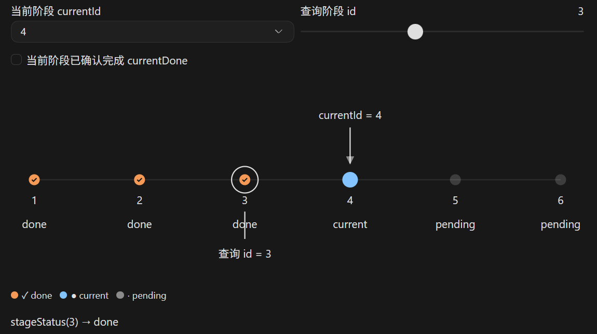

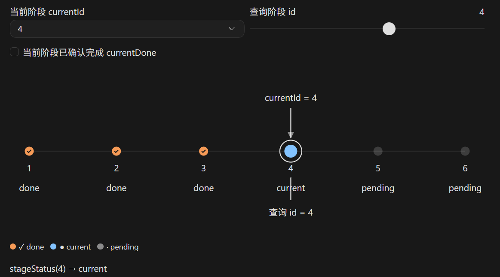


例如，许可证有生效时间、到期时间、宽限期结束时间：

```js
// 假设 startsAt < expiresAt < graceEndsAt，均为时间戳
function licenseStatus(now, license) {
  const {
    startsAt,
    expiresAt,
    graceEndsAt,
    revoked,
  } = license;

  if (revoked) {
    return "revoked";
  }

  if (now < startsAt) {
    return "scheduled";
  }

  if (now >= graceEndsAt) {
    return "disabled";
  }

  if (now >= expiresAt) {
    return "grace";
  }

  return "active";
}
```


## 区域

两个数值条件，以及与、或、非

条件：年龄≥18 && 分数≥60，同时成立

年龄 42 / 分数 21 → 假

原点是当前输入

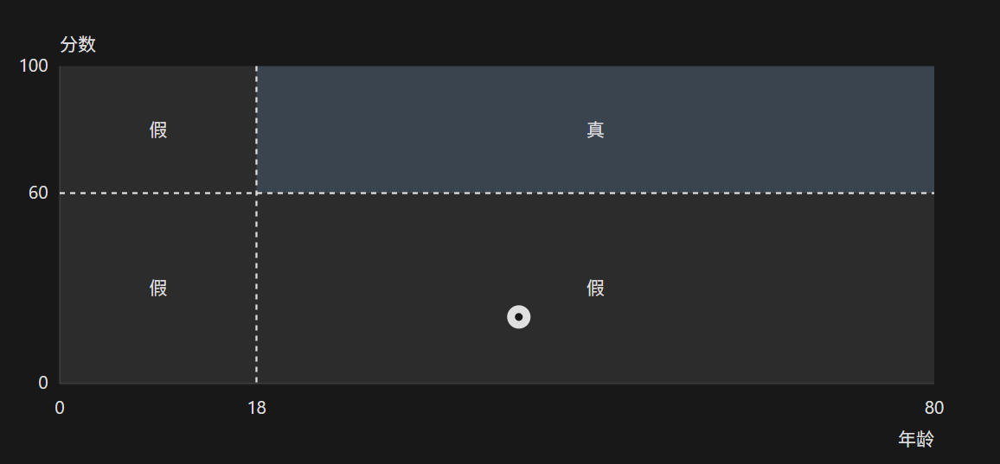


条件：年龄≥18 || 分数≥60，至少一个成立

年龄 42 / 分数 21 → 真

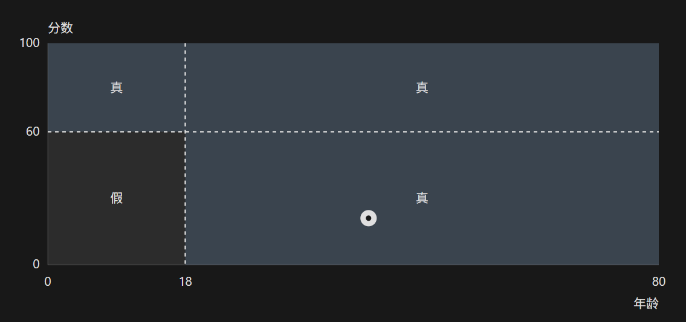


条件：!(年龄≥18 || 分数≥60)，不同时成立

年龄 42 / 分数 21 → 真

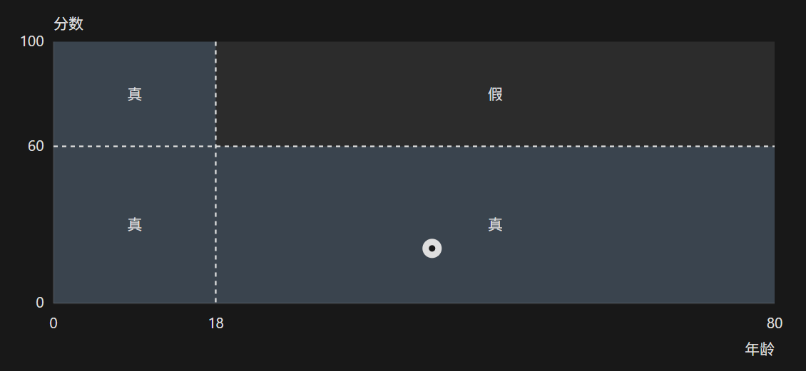


例如，金额和风险分数共同决定是否人工审核：

```js
function needsManualReview(amount, risk) {
  return (
    (amount >= 5000 && risk >= 0.8) ||
    (amount >= 20000 && risk >= 0.5)
  );
}
```

把金额放在横轴，风险分数放在纵轴：

- `amount >= 5000`：竖线右侧。
- `risk >= 0.8`：横线上方。
- 两者 `&&`：取右上方的交集。
- 两组条件 `||`：把两个区域合起来。

最终得到一个“阶梯形”的审核区域。


## 布尔组合

三个布尔条件交织，八个顶点代表全部组合；沿一条边走，只改变一个条件

立方体的八个顶点，就是从 `000` 到 `111` 的全部组合。允许编辑的只有：

```
110：已登录，是所有者
101：已登录，是管理员
111：已登录，两种身份都有
```

ABC = 010 → 拒绝

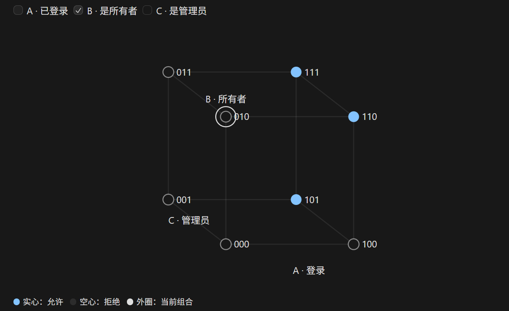


常见于权限、功能开关、资格组合。

例如：

```js
function canEdit({ loggedIn, isOwner, isAdmin }) {
  if (!loggedIn || (!isOwner && !isAdmin)) {
    return false;
  }

  return true;
}
```

逐字读时，需要处理三个否定和两层括号。先翻译成正面规则：

```js
function canEdit({ loggedIn, isOwner, isAdmin }) {
  return loggedIn && (isOwner || isAdmin);
}
```


## 分类组合

这里可以让角色做行、文档状态做列。先固定 `isOwner = true`：


- 已归档的整列都是只读，管理员也受限制。
- 编辑者对草稿和已发布文档的能力不同。

常见于角色权限、订单类型、文档状态、不同渠道策略。

例如：

```js
function documentAction({ role, status, isOwner }) {
  if (status === "archived") {
    return "read";
  }

  if (role === "admin") {
    return "edit";
  }

  if (role === "editor" && isOwner && status === "draft") {
    return "edit";
  }

  if (role === "editor" && status === "published") {
    return "comment";
  }

  return "read";
}
```


## 执行优先级

输入像一颗球，从上往下通过筛子：

```
已封禁？──── 是 → deny
   否
未验证？──── 是 → verify
   否
余额不足？── 是 → topup
   否
高风险？──── 是 → review
   否
   pay
```


常见于校验、支付拦截、路由匹配、降级策略。

例如：

```js
function paymentDecision(user, amount) {
  if (user.blocked) {
    return "deny";
  }

  if (!user.verified) {
    return "verify";
  }

  if (user.balance < amount) {
    return "topup";
  }

  if (user.risk >= 0.8) {
    return "review";
  }

  return "pay";
}
```


## 状态迁移

同一个事件，在不同状态下有不同意义

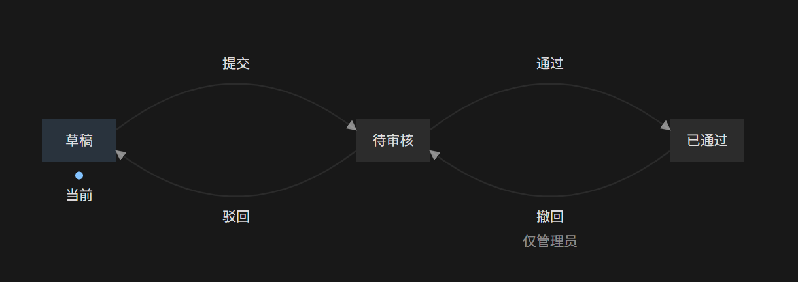


常见于审批、订单、连接状态、上传重试、异步任务。

例如：

```js
function nextState(state, event, context) {
  switch (state) {
    case "draft":
      if (event === "SUBMIT" && context.complete) {
        return "review";
      }
      break;

    case "review":
      if (event === "APPROVE" && context.isReviewer) {
        return "approved";
      }

      if (event === "REJECT" && context.isReviewer) {
        return "draft";
      }
      break;

    case "approved":
      if (event === "REVOKE" && context.isAdmin) {
        return "review";
      }
      break;
  }

  return state;
}
```


## 区间关系

A [3,7) / B [5,9) → 重叠

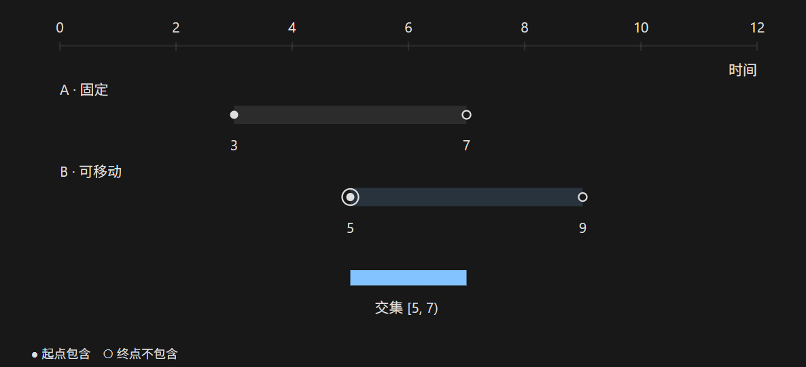


常见于会议冲突、排班、预约、数据范围查询。

有人会分别判断“谁的起点落在谁里面”：

```js
// 假设两个区间都满足 start < end
// 使用半开区间：[start, end)
function overlaps(a, b) {
  const aStartsInsideB =
    b.start <= a.start &&
    a.start < b.end;

  const bStartsInsideA =
    a.start <= b.start &&
    b.start < a.end;

  return aStartsInsideB || bStartsInsideA;
}
```


# ES新笔记体系

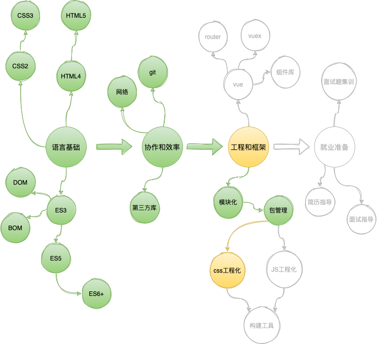


## Javascript运行机制


### AO/GO对象（不重要）

es6之前的三个概念:

1. 执行上下文：存变量和函数声明、this是谁、当前执行上下文的父级
2. GO（Global Object）是全局执行上下文用来存储变量的对象
3. AO（Activation Object）是函数执行上下文用来存储变量的对象


AO对象发生在预编译的时刻，预编译发生在函数执行前一刻，具体细节：

1. 创建AO对象，也就是执行期上下文
2. 找形参和变量声明，将变量名和形参作为AO的属性名，值为undefind
3. 将形参个实参统一，也就是把形参属性名对应的值从undefind设置为函数传入值
4. 在函数体里找函数声明，函数名作为AO对象的属性名，函数体作为值

属性值相同，比如函数名和形参名相同，后面步骤的属性值会进行覆盖

当GO和AO对象创建完毕后，JavaScript引擎就会进入代码执行阶段，在执行阶段，就会在执行上下文中的GO和AO对象里查找变量，如果当前执行上下文的AO对象里没有找到变量，就会去`[[scope]]`指向的父级执行上下文里查找。


例子

假如有个js文件模块A.js，代码如下，包括几个变量和若干函数：

```js
var a = 1;
var b = 2;

function foo(e, f) {
  var c = 3;
  function bar() {
    var d = 4;
    console.log(a, b, c, d);
  }
  console.log(e, f);
}

foo(5, 6);
```

当执行A.js时，JavaScript引擎会创建一个全局执行上下文

1. 创建GO对象 GO = {}
2. 找形参和变量声明、并赋值为undefined，GO = {a: undefined, b: undefined}
3. 将形参和实参统一并赋值（预编译GO没有这一步）
4. 找函数声明，函数名作为GO对象的属性名，函数体作为值，GO = {a: undefined, b: undefined, foo: function foo(e, f) {...}}


进入执行阶段，逐行赋值

1. var a = 1，GO = {a: 1, b: undefined, foo: function foo(e, f) {...}}
2. var b = 2，GO = {a: 1, b: 2, foo: function foo(e, f) {...}}
3. function foo(e, f) {...}，GO = {a: 1, b: 2, foo: function foo(e, f) {...}},这里我有一点不确定，因为GO已经在预编译阶段为foo函数声明了属性名foo, 值为函数体，所以在执行阶段遇到函数声明时，是不是GO或者说AO对象什么都不用做？
4. foo(5, 6)，foo函数被调用


创建一个新的函数执行上下文

1. 创建AO对象 AO = {}
2. 找形参和变量声明、并赋值为undefined，AO = {e: undefined, f: undefined, c: undefined}
3. 将形参和实参统一并赋值，AO = {e: 5, f: 6, c: undefined}
4. 找函数声明，函数名作为AO对象的属性名，函数体作为值，AO = {e: 5, f: 6, c: undefined, bar: function bar() {...}}


进入执行阶段，逐行赋值

1. var c = 3，AO = {e: 5, f: 6, c: 3, bar: function bar() {...}}
2. function bar() {...}，AO = {e: 5, f: 6, c: 3, bar: function bar() {...}}
3. console.log(e, f)，输出5, 6


### let / const 块级作用域


在es6之前，js只有全局作用域和函数作用域，所以通过var声明的变量会被记录到GO或者AO对象中，导致变量提升，产生一系列问题。比如：**同名变量合并**，反直觉的**先声明后使用**现象

``` js
function foo() {
  console.log(a); // undefined
  var a = 1;
} 

function foo1() {
  var x = 1;
  // ... 100行代码后 ...
  var x = 2; // 不报错，静默覆盖，埋下 bug
}
```

如果使用`let/const`定义了同名变量，就会在语义检查期间报错，提早发现问题。

在不同作用域复用同一个短变量名是标准实践，强制要求全局唯一反而破坏了代码局部可读性，增加了思维负担。

``` js
// 两个 if 分支各自用 result，清晰合理
if (cond) {
  let result = fetchA();
  process(result);
} else {
  let result = fetchB(); // 这里的 result 与上面毫无关联，理应允许
  process(result);
}
```

所以es6引入了新机制：

1. 块级作用域：let/const声明的变量只在{}内有效
2. 暂时性死区：在let/const声明之前访问变量会报错
3. 不允许重复声明：同一作用域内不能使用let/const声明同名变量


### JS运行机制

V8引擎本质上是一个C++程序，内部主要维护两块内存区域：

```
┌─────────────────────────────────────────────────────┐
│                    进程内存                          │
│                                                     │
│  ┌─────────────┐          ┌──────────────────────┐  │
│  │  调用栈      │          │       堆 (Heap)      │  │
│  │ (Call Stack)│          │                      │  │
│  │             │          │  所有对象都住在这里    │  │
│  │ 固定大小     │          │  大小动态增长         │  │
│  │ (~几MB)     │          │  由 GC 管理           │  │
│  └─────────────┘          └──────────────────────┘  │
└─────────────────────────────────────────────────────┘
```

#### 调用栈

CPU硬件直接支持的一块连续内存，相当于函数调用的记录器，每当函数调用时，都会在调用栈上压入一帧，当函数return时，弹出一帧。每一帧中会记录函数中return语句所在行，函数执行上下文在堆中的地址。


#### 堆

动态内存池，所有的 JS 对象都分配在这里。生命周期由GC管理，不会在函数return时就自动消失


#### GC

垃圾回收器，负责回收堆上不再被引用的对象，释放内存空间


#### 函数调用的内存模型

函数调用时，进程内存中实际发生了下列情况：

每次函数调用 → 调用栈压入一帧 + 堆上新建一个执行上下文 → 这样子函数每次调用时都能有一个独立的环境来存储自身作用域中的信息，递归调用时互不干扰

```
C++ 调用栈          堆
┌──────────────┐   ┌────────────────────────────────────────┐
│ 栈帧          │   │ 执行上下文（堆上对象）                  │
│ - 返回地址    │   │  - 词法环境（局部变量 + outer, 堆上对象）│
│ - 指针        │   │  - this                               │
└──────────────┘   │  - 当前行号                            │
                   └────────────────────────────────────────┘
指针是执行上下文这个对象的地址
```

这里的指针指向调用时创建的执行上下文


#### 执行上下文

包含了函数执行时的详细细节，如当前行号、this指向、词法环境等


#### 词法环境

记录作用域参数，变量，函数声明信息，outer记录了外部词法环境，外部词法环境就是函数定义处的作用域词法环境，和es6之前的AO对象一样

```
┌─────────────────────────────────────────┐
│           词法环境 (Lexical Environment) │
├─────────────────────────────────────────┤
│  环境记录 (Environment Record)           │
│  ┌──────────────────────────────────┐   │
│  │  变量名  │  值                    │   │
│  │  x      │  10                   │   │
│  │  name   │  "John"               │   │
│  │  say    │  function             │   │
│  └──────────────────────────────────┘   │
├─────────────────────────────────────────┤
│  outer ──────────────────────────────── ┼──→ 外部词法环境
└─────────────────────────────────────────┘
```

对应代码

```js
function foo(name) {
  let x = 10;

  function say() {
    console.log(name);
  }

  // 调用时传入 "John", 所以环境记录中 name = "John"
}

foo("John"); // 这一步触发了图示中词法环境的创建
```


#### 外层作用域

为什么外层作用域由函数定义时的位置决定，而不由函数调用的位置决定，因为定义的位置只有一个，能保证函数功能稳定


### 例子

```js
let x = 2;
function foo() {
  let x = 1;
  console.log(x);
}
foo();
```


第一步：解析阶段结束，开始一行行执行代码

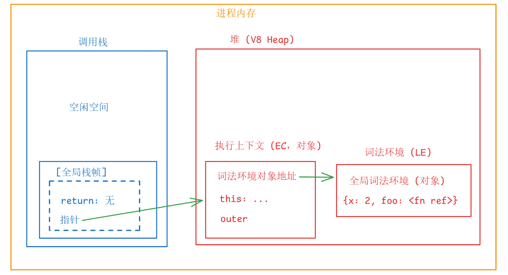


第二步：执行到第六行调用foo函数

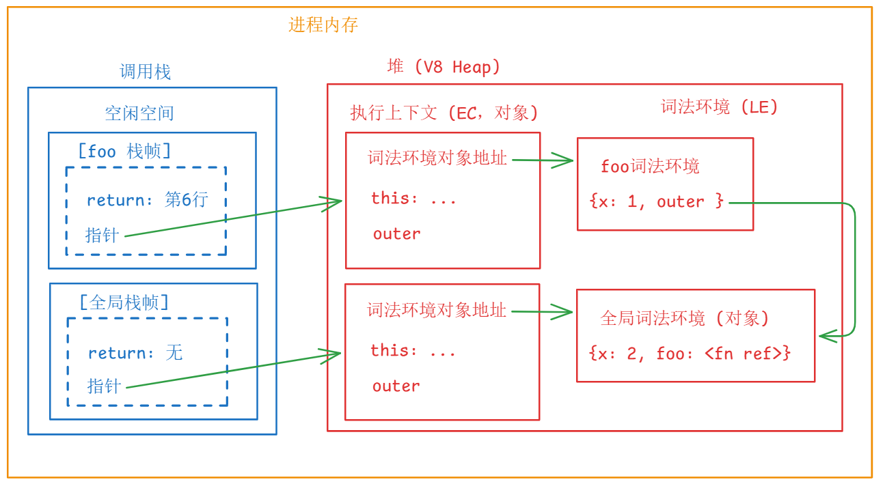


第三步：foo()内部执行console.log(x) → 查找变量x

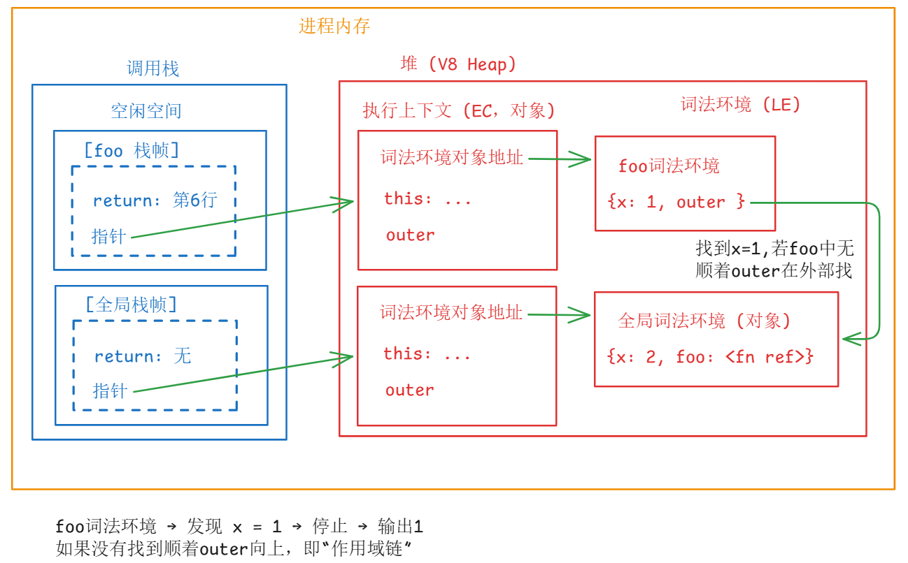


第四步：foo() 执行 return → foo 帧弹栈 POP

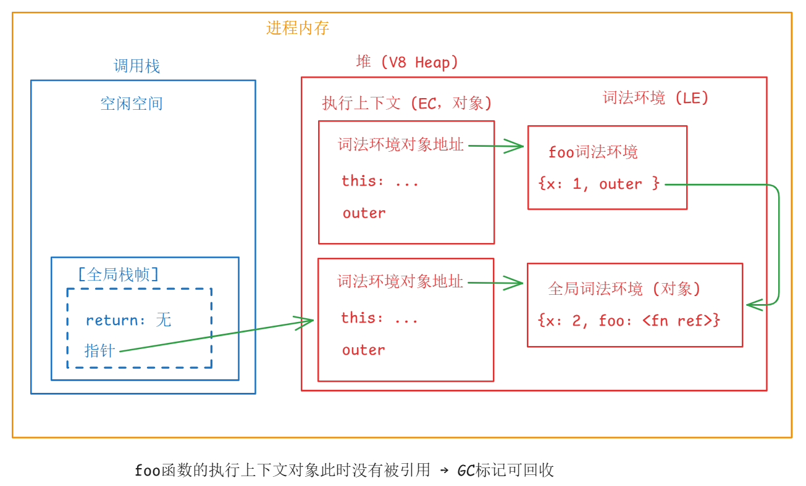


## 声明VS命令

和HTML、CSS不同，JS是一门 _命令式编程语言_，和其他命令式编程语言一样，它的本质是**处理数据**


让盒子慢慢变红（动画）


css只需声明两个状态 + 过度规则，中间怎么变的完全不用管

```css
.box {
  transition: background 1s;
}
.box.active {
  background: red;
}
```


js要实现同样的效果（体现过程感）

```js
let r = 0;

function step() {
  r += 5;                                  // 第1步：红色值增加
  box.style.background = `rgb(${r},0,0)`;  // 第2步：应用当前颜色
  if (r < 255) {                           // 第3步：判断是否结束
    requestAnimationFrame(step);           // 第4步：没结束就继续下一帧
  }
}

step(); // 启动
```

- 从哪里开始（r=0）
- 每步怎么变（r+=5）
- 什么时候停（r<255）
- 怎么驱动循环（requestAnimationFrame）


## 数据表达方式

JS 提供了三种方式来表达一个数据：

- 变量
- 字面量
- 表达式

程序中任何需要数据的地方，都可以使用上面任意一种数据表达。


字面量 —— 直接看到值本身

```js
42
"Hello"
true
[1, 2, 3]
```


变量 —— 给字面量贴标签，能通过名字访问数据

```js
let age = 18;        // age 是变量，18 是字面量
let name = "Alice";
```


表达式 —— 由变量、字面量、运算符组成，能够计算出一个值

```js
age + 2              // 结果是 20
name.length > 3      // 结果是 true
age * 2 + 1          // 结果是 37
```


当然不止上面三种，还有函数调用返回值，对象和集合


**作用**

定义变量可以让字面量被方便的复用，字面量是所有数据的源头，

```js
// 有变量 ✅ 清晰、可复用
let price = 99;
let total = price * 3;
console.log(total);

// 没有变量 ❌ 只能反复写字面量，一旦 price 改变，要改所有地方
console.log(99 * 3);  // 若 price 改成 88，要找遍所有的 99
```


没有字面量，连初始值都没法赋予

```js
// 没有字面量，你连初始值都没法给变量赋值
let age = ???;   // 18 从哪来？没有字面量就无法表示具体值
```


如果没有表达式，所有的值都要自己计算出来后，再进行变量赋值，相当于没法动态计算，就跟记事本一样

```js
// 有表达式 ✅
let discountPrice = price * 0.8;

// 没有表达式 ❌ 所有计算都要手动算好再写字面量
let discountPrice = 79.2;  // 需要自己心算，且 price 一变就全错
```


### 标识符--变量命名

程序中有些可以自行命名的地方，称之为**标识符**

> 常见的标识符有：变量名、函数名、参数名

_js_ 的标识符必须符合以下规则：

- 允许数字、字母、下划线、\$符号
- 不得以数字开头
- 不能和关键字冲突
- 建议使用驼峰命名法

一个完整的程序中，会涉及成百上千的标识符，好的名称不仅可以减少名称冲突，更有利于程序的阅读和维护。

名称要做到**望文知意**


词法分析的经典设计问题

标识符的字符集 = 所有字符集 - 被语法占用的字符

词法分析器（Lexer）在扫描源码时，看到第一个字符就要决定"我读的是什么东西"：

| 第一个字符       | Lexer 的判断   |
| ---------------- | -------------- |
| `"` 或 `'`       | 字符串         |
| 数字 `0-9`       | 数字字面量     |
| 字母 / `_` / `$` | 标识符或关键字 |
| `+`, `-`, `*`... | 运算符         |


如果允许字符开头，比如读 `123abc`：，看到1时，就假定这是在读数字，当读到a时，就无法判断当前是数字结束了，还是要组合起来读，这样的话，Lexer 就必须**回溯（backtrack）**或引入复杂的前瞻逻辑来判断这到底是数字还是标识符。而在当前的js命名规则下，无需这么做，可以用最简单的**有限状态机（DFA）** 实现，性能极好。


### 转义符

| 转义符 | 含义           |
| ------ | -------------- |
| `\'`   | 普通英文单引号 |
| `\"`   | 普通英文双引号 |
| `\r`   | 回车           |
| `\n`   | 换行           |

> 小技巧：常用`\r\n`表示换行


### 代码风格

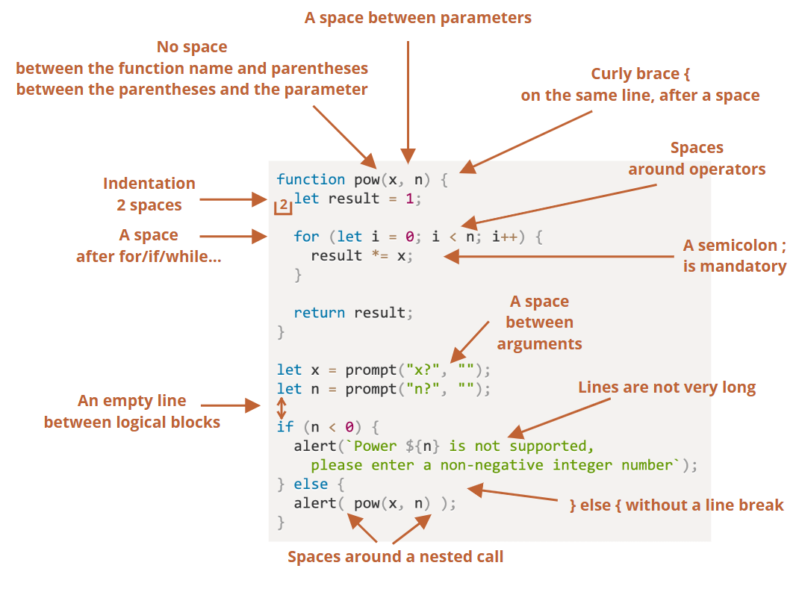


## 原始数据类型

JavaScript 中有八种基本的数据类型。

- 七种原始数据类型（基本数据类型）：
  - `number` 用于任何类型的数字：整数或浮点数，在 `±(253-1)` 范围内的整数。
  - `bigint` 用于任意长度的整数。
  - `string` 用于字符串：一个字符串可以包含 0 个或多个字符，所以没有单独的单字符类型。
  - `boolean` 用于 `true` 和 `false`。
  - `null` 用于未知的值 —— 只有一个 `null` 值的独立类型。
  - `undefined` 用于未定义的值 —— 只有一个 `undefined` 值的独立类型。
  - `symbol` 用于唯一的标识符。
- 以及一种非原始数据类型（复杂数据类型）：
  - `object` 用于更复杂的数据结构。


### Number 类型

```javascript
let n = 123;
n = 12.345;
```

*number* 类型代表整数和浮点数。

`Infinity` 代表数学概念中的 无穷大 ∞

我们可以通过除以 0 来得到它：

```javascript
alert( 1 / 0 ); // Infinity
```

`NaN` 代表一个计算错误。它是一个不正确的或者一个未定义的数学操作所得到的结果，比如：

```javascript
alert( "not a number" / 2 ); // NaN，这样的除法是错误的
```


### BigInt 类型

在 JavaScript 中，“number” 类型无法安全地表示大于 `(2^53-1)`（即 `9007199254740991`），或小于 `-(2^53-1)` 的整数。

可以通过将 `n` 附加到整数字段的末尾来创建 `BigInt` 值。

```javascript
// 尾部的 "n" 表示这是一个 BigInt 类型
const bigInt = 1234567890123456789012345678901234567890n;
```


### String 类型

JavaScript 中的字符串必须被括在引号里。

```javascript
let str = "Hello";
let str2 = 'Single quotes are ok too';
let phrase = `can embed another ${str}`;
```

在 JavaScript 中，有三种包含字符串的方式。

1. 双引号：`"Hello"`.
2. 单引号：`'Hello'`.
3. 反引号：`Hello``.

反引号是 **功能扩展** 引号。它们允许我们通过将变量和表达式包装在 `${…}` 中，来将它们嵌入到字符串中。例如：

```javascript
let name = "John";

// 嵌入一个变量
alert( `Hello, ${name}!` ); // Hello, John!

// 嵌入一个表达式
alert( `the result is ${1 + 2}` ); // the result is 3
```


### Boolean 类型（逻辑类型）

boolean 类型仅包含两个值：`true` 和 `false`。


### null 和 undefined

```js
let a;          // undefined —— 声明了但没赋值，引擎给的默认值
let b = null;   // null     —— 我明确告诉你，这里现在没有值
```


## 运算符


**运算元** —— 运算符应用的对象。比如说乘法运算 `5 * 2`，有两个运算元：左运算元 `5` 和右运算元 `2`。所以`*`被叫做二元运算符。


数学运算

```js
加法 `+`,

减法 `-`,

乘法 `*`,

除法 `/`,  js中整数相除可以得到小数

取余 `%`,

求幂 `**`.
```


1.赋值运算符

```js
let a = 10;
a += 5;   // a = a + 5  → 15
a -= 5;   // a = a - 5  → 10
a *= 2;   // a = a * 2  → 20
a /= 4;   // a = a / 4  → 5
a %= 3;   // a = a % 3  → 2
a **= 3;  // a = a ** 3 → 8
```


2.比较运算符

```js
5 > 3       // true   大于
5 < 3       // false  小于
5 >= 5      // true   大于等于
5 <= 4      // false  小于等于
```


3. 逻辑运算符

```js
true && false   // false  与：两个都为真才为真
true || false   // true   或：有一个为真就为真
!true           // false  非：取反


let count = userCount ?? 100;  // ?? 空值合并，只有左边是 null 或 undefined 才取右边，userCount = 0   → 得到 0 


短路求值: 
let a = 变量1 && 变量2 && 变量3
&&：从左往右找，遇到第一个假值就立刻返回它的实际值，如果所有值都是真的，就返回最右边那个值的实际值。
let a = 变量1 || 变量2 || 变量3
||：从左往右找，遇到第一个真值就立刻返回它的实际值，如果所有值都是假的，就返回最右边那个值的实际值。

// 传统写法
if (isLogin) {
    showPage();
}
// && 简写
isLogin && showPage();
```


4.三元运算符

```js
let status = age >= 18 ? "成年" : "未成年";  // 语法：条件 ? 值A : 值B
```


5.位运算符

```js
5 << 1   // 10 左移（相当于 × 2）
5 >> 1   // 2  右移（相当于 ÷ 2）
```


6.类型运算符

```js
typeof 42           // "number"   判断类型
instanceof          // 判断对象是否属于某个类
[] instanceof Array // true
```


### 自增自减(不建议使用)

**自增** `++` 将变量与 1 相加:  counter`++` 相当于 counter = counter + 1

**自减** `--` 将变量与 1 相减:  counter`--` 相当于 counter = counter - 1


`++`再前,使用自增后的值,  

`++`在后,使用的是自增前的值

```js
    let num = 1
    console.log(++num)  //2

    let num1 = 1
    console.log(num1++)  //1
```


现在的通行写法

```
// ✅ 现代写法，99% 的场景只用这个，没有歧义
i += 1

// ✅ for 循环里的 i++ 可以接受，因为它的返回值被丢弃，前后置没有区别
for (let i = 0; i < 10; i++) { }

// ❌ 避免在表达式中混用，纯粹制造困惑
let a = i++  // 这种写法应当拆成两行
```


### 运算符优先级

```js
括号 ()
↓
一元运算符：! ++ --
↓
算术：** （求幂）
↓
算术：* / %
↓
算术：+ -
↓
比较：> < >= <=
↓
相等：== === != !==
↓
逻辑与：&&
↓
逻辑或：||
↓
空值合并：??
↓
三元：? :
↓
赋值：= += -= ...
```


一元高于二元是数学的习惯，因为数学里 -3² 的负号只作用于 3

`&&` 高于 `||`：类比乘法高于加法，在布尔代数中，AND  对应  乘法（× ），OR   对应  加法（＋）

赋值优先级最低

```js
let a = 1 + 2 * 3   // 必须先把 1+2*3 算成 7，再赋给 a
                     // 如果赋值优先级高，就变成 (a=1) + 2*3，毫无意义
```


设计优先级 = 数学习惯 + 布尔代数规则 + 减少括号的工程目标


### 隐式转换

每个运算符都有自己期望的数据，比如`*`期望两端都是数字

一旦数据不符合运算符的期望，js就会悄悄的对数据进行类型转换，把它转换成期望的值后进行运算。

值得注意的是，这种转换是 _临时_ 的，并不会对原数据造成影响


## 数据的流程

顺序、分支、循环，如果有无限的储存，就能够计算所有的事物

顺序：把"执行"交给机器，就好比我按一个键，它执行一次

分支：把"判断"交给机器，就好比人看到结果后，决定下一步按什么键

循环：把"我也不知道要重复多少次，你自己看着办" 交给机器，就好比人对计算器说："**你自己反复算，直到结果满足条件再停**"


### `if / else if / else` 

最基本的"遇到岔路怎么走"

```javascript
const y = 18; 

if (y >= 20) {
    // 如果y大于等于20，执行这里的代码
} else if (y >= 15) {
    // 默认前提是y小于20，如果y大于等于15，执行这里的代码
} else {
    // 前面的条件都不满足，执行这里的代码
}
```


### `switch` 

"对号入座"，适合一个值对应多种情况

```javascript
const shape = 'T'; // 当前方块形状

switch (shape) {
    case 'I':
        // 渲染I形方块
        break;
    case 'T':
        // 渲染T形方块
        break;
    case 'O':
        // 渲染O形方块
        break;
    default:
        // 未知形状，渲染默认方块
}
```

**现实含义：** `if/else` 是"一个条件一个条件地排查"，`switch` 是"直接拿着值去对照表里找"。当分支很多时，后者就像个菜单，可读性更强


### 三元运算符 `? :`

分支的"压缩版"，只适合简单的二选一

```javascript
const status = y >= 20 ? '已触底' : '下落中';
```


### `while`

"只要条件成立，就一直做"，最接近循环本质

```JavaScript
let y = 0;

while (y < 20) {   // 条件：没到底
    y++;           // 下落一格（状态改变）
}
// 退出时，y === 20，方块触底
```


### `for`

"知道要重复多少次"时的标准写法

```javascript
// 渲染游戏板的20行
for (let row = 0; row < 20; row++) {
    renderRow(row);
}
```

它其实是 `while` 的结构化版本，把三件事写在一起：

```Code
for (初始状态 ; 继续条件 ; 每次之后状态怎么变)
  ↓
for (let row = 0 ; row < 20 ; row++)
```


### `break / continue`

对循环"折叠"过程的**干预**


`break` ——"我找到我要的了，不用继续了"

```javascript
const shapes = ['I', 'T', 'O', 'S', 'Z'];
let found = null;

for (const shape of shapes) {
    if (shape === 'T') {
        found = shape;
        break; // 找到了，立刻跳出循环，后面的不看了
    }
}
```

**现实含义：** 你在一排抽屉里找钥匙，打开第三个抽屉找到了——你不会再去打开第四、第五个。`break` 就是"找到了，停手"。


`continue` ——"这个跳过，直接看下一个"

```javascript
const rows = [0, 1, 2, 3, 4];

for (const row of rows) {
    if (row === 2) {
        continue; // 第2行是空行，跳过渲染，直接去处理第3行
    }
    renderRow(row);
}
```

**现实含义：** 同样是在翻抽屉，打开一个发现是空的——你不会在这里停下来，但也没必要做任何事，直接去开下一个。`continue` 是"这个不符合，跳过，继续折叠"。


## 函数

#### 函数的表示方式

```js
// 1、函数声明
function greet(name) {
  return `Hello, ${name}!`;
}

// 2、函数表达式
const greet = function(name) {
  return `Hello, ${name}!`;
}

// 3、箭头函数
const greet = (name) => {
  return `Hello, ${name}!`;
}
```


#### 函数是个值，就像变量

它和字符串值：`let str = 'Hello'`，数字值：`let num = 42`一样

可以被赋值、传递、复制，唯一的特殊之处是函数这个值里面封装了一段逻辑而已，所以ES6就出现了箭头函数`const fn = () => {}`，它仅仅封装了一段逻辑，避免了函数既是对象又是函数的二义性。

```js
// 通过函数声明创建,这里的fn
function fn() {
  console.log('这是一个函数');
}
let a = fn; 	  // 在这里，函数被复制了，并被复制给了变量a
console.log(a)    // [Function: fn]，这是JavaScript打印函数值的显示方式，表达的含义是，这是一个函数类型的值，名字叫fn
a()               // a可以被调用


fn = '这是一个字符串' // 函数值fn被覆盖了，变成了一个字符串值
console.log(fn) // 这是一个字符串
```


#### 函数声明和函数表达式的关系

1、函数声明 function foo() {} 是个历史遗留的语法糖，只是借鉴了C/java的语法习惯，让开发者觉得亲切，这仅仅是语言的便利，而不是函数的本质

2、函数表达式能做函数声明的一切，函数表达方式里的1和2，完全是等价的，比如在对象中定义方法：

```js
const obj = {
  greet: function(name) { return `Hello, ${name}!`; }
}
```

3、函数表达式可预测性更好，函数声明会被提升（hoist）,而函数表达式不会，所以函数声明可以在定义之前被使用，而函数表达式必须按照顺序书写，所以很多团队的代码规范都禁止使用函数声明。

```js
greet('Alice'); // 可以在函数声明之前调用
function greet(name) { return `Hello, ${name}!`; }

greet('Alice'); // 函数表达式之前调用，会抛出错误
const greet = function(name) { return `Hello, ${name}!`; }
```


#### 匿名函数（Anonymous Function）

是什么：没有名字的函数。

普通函数用 `function foo() {}` 声明并有名字；匿名函数只有函数体，靠"赋值给变量"或"直接作为参数传入"来使用。

```js
// 函数表达式形式
const greet = function (name) {
  return `Hello, ${name}`;
};

// 箭头函数形式（现在更常用，写法更短）
const add = (a, b) => a + b;
```

箭头函数本身就是匿名函数的一种写法

最典型的用途——当回调函数传入：像 `forEach`、`map` 这类方法需要一个函数作为参数，这个函数往往只用一次，没必要单独起名字：

```js
[1, 2, 3].forEach(function (n) {
  console.log(n * 10);
});
// 或用箭头函数，更简洁
[1, 2, 3].forEach((n) => console.log(n * 10));
```


## 对象

### 设计目的

设计理由：把散装的相关数据绑定在一起

```js
// 没有对象：散装数据，关联关系只存在于程序员的脑子里
const userName = "Alice";
const userAge = 25;
const userEmail = "alice@example.com";

// 有对象：关联关系被"物化"进代码结构本身
const user = {
  name: "Alice",
  age: 25,
  email: "alice@example.com"
};
```

将变量散装时，`userName / userAge / userEmail` 之间的关系只存在记忆里，一旦代码变长，变量变多，这种隐含关系就很快会丢失

对象的存在就是为了对抗人类的认知局限，将这些变量同属于一个概念的事情，从脑子里去掉，让代码结构来承担这部分认知负荷，也就是不让人脑记，让结构去记忆


### 对象是引用类型

原始类型（string、number 等），栈内存（直接存值），赋值行为彼此独立

引用类型（object、array、function），栈内存存地址，堆内存存实际数据，复制行为相当于复制地址（引用），多个变量通过相同的地址指向同一个值，彼此不再独立

```js
栈内存 (Stack)              	堆内存 (Heap)
┌─────────────────┐         ┌──────────────────────┐
│  变量名  │  值   │         │                      │
├─────────────────┤         │  { name: "Tom",      │
│   obj   │ 0x001 │ ──────▶ │    age: 18 }         │
├─────────────────┤         │                      │
│   num   │  42   │         │                      │
├─────────────────┤         │   [1, 2, 3]          │
│   arr   │ 0x002 │ ──────▶ │   ↑                 │
└─────────────────┘         └──────────────────────┘
  基本类型直接存值              引用类型的真实数据
```


### 属性描述符

在 ECMAScript 规范里，每个属性底层是一串键值记录，带四个内部字段的记录（规范写作 `[[Value]]`、`[[Writable]]`、`[[Enumerable]]`、`[[Configurable]]`）。平时看不到，是因为**用普通方式创建时它们默认全是 `true`**。

```js
let user = { name: "John" };
console.log(Object.getOwnPropertyDescriptor(user, "name"));
// { value: "John", writable: true, enumerable: true, configurable: true }
```

- `writable` → 能不能**改值**
- `enumerable` → 能不能被**遍历列出**
- `configurable` → 能不能**删除 / 改这些开关**

**属性标志**（flags）= 专指三个布尔开关：`writable`、`enumerable`、`configurable`


#### 读取：`getOwnPropertyDescriptor`

```js
let d = Object.getOwnPropertyDescriptor(user, "name");
// 复数版：一次拿全部
let all = Object.getOwnPropertyDescriptors(user);
```

注意方法名里的 **Own**：只看**自身属性**，不看原型链继承来的。

**属性描述符**（descriptor）= 包含 `value` + 三个标志的**完整对象**，就是 `getOwnPropertyDescriptor` 返回的那个东西

```js
// 这整个对象叫"属性描述符"
{
  value: 30,         // 值本身
  writable: true,    // ← 这三个
  enumerable: false, // ← 才叫
  configurable: true // ← "属性标志"
}
```


#### 新建：`defineProperty`

用 `defineProperty` **新建**属性时，你没写的开关默认是 `false`（跟普通赋值恰好相反！）。

```js
let user = {};
Object.defineProperty(user, "name", { value: "John" });

console.log(Object.getOwnPropertyDescriptor(user, "name"));
// { value:"John", writable:false, enumerable:false, configurable:false }  ← 全 false！
```

新建时如果想要正常属性，得手动补全：

```js
Object.defineProperty(user, "name", {
  value: "John",
  writable: true,
  enumerable: true,
  configurable: true
});
```

可用来覆盖原属性

```js
let user = {
  name: "John Doe",
};

Object.defineProperty(user, "name", { // 对name属性进行覆盖操作
  value: "John1111 Doe",
  writable: true,
  enumerable: true,
  configurable: true
});
console.log(user.name); // John1111 Doe
```


#### `writable: false` —— 只读

```js
"use strict";
let user = { name: "John" };
Object.defineProperty(user, "name", { writable: false });

user.name = "Pete"; // 严格模式：TypeError；非严格模式：不报错，但赋值失败

// 报错：TypeError: Cannot assign to read only property 'name' of object '#<Object>'
```


#### `enumerable: false` —— 隐身

设为`false`后，属性还在、还能访问，但“点名遍历”时不出现

```js
let user = {
  name: "John Doe",
};
Object.defineProperty(user, "age", {
  value: 30,
  writable: true,
  enumerable: false,
  configurable: true
});

for (let key in user) console.log(key); // 只有name
console.log(Object.keys(user)); // [ 'name' ]
console.log(JSON.stringify(user)); // {"name":"John Doe"}，age被排除
console.log(user.age); // 30，age属性仍然可以访问
```

**影响范围**（谁会跳过不可枚举属性）：`for..in`、`Object.keys`、`JSON.stringify`、展开运算符 `{...user}`。


#### `configurable: false` —— 上锁

```js
let d = Object.getOwnPropertyDescriptor(Math, "PI");
// { value:3.14159..., writable:false, enumerable:false, configurable:false }

Math.PI = 3;                                             // 改不动
Object.defineProperty(Math, "PI", { writable: true });  // TypeError,同样无法修改
```


### 对象属性

在 JS 引擎里,一个对象属性只能是以下**二选一**:

| 类型                               | 描述符字段                                        | `[[Get]]/[[Set]]` 内部怎么实现 |
| :--------------------------------- | :------------------------------------------------ | :----------------------------- |
| **数据属性 (data property)**       | `value`、`writable`、`enumerable`、`configurable` | 直接读/写存储的 `value` 值     |
| **访问器属性 (accessor property)** | `get`、`set`、`enumerable`、`configurable`        | 调用你提供的 `get`/`set` 函数  |

`enumerable` 和 `configurable` 两类共有;真正互斥的是 **`value`+`writable`** 对上 **`get`+`set`**。


### getter/setter


#### 使用

```js
let user = {
  name: "John",
  surname: "Smith",
  get fullName() {          // 读 user.fullName 时，这个函数被调用
    return `${this.name} ${this.surname}`;
  },
  set fullName(value) {     // 写 user.fullName = "..." 时，这个函数被调用
    [this.name, this.surname] = value.split(" ");
  }
};
```

`user.fullName` 看起来是在「读一个属性」，但其实是在「偷偷调用一个函数」


```js
console.log(user.fullName); // "John Smith"  ← 没有加括号，却执行了函数
user.fullName = "Alice Cooper";
console.log(user.name);     // "Alice"
```


#### 原理

在 JS 引擎内部，每次访问属性都会走两个内部方法：

```
读 obj.prop 时,引擎执行 [[Get]]:
  如果是数据属性  → 返回描述符里存的 value
  如果是访问器属性 → 调用描述符里的 get 函数,把返回值给你

写 obj.prop = x 时,引擎执行 [[Set]]:
  如果是数据属性  → 检查 writable,然后把 value 改成 x
  如果是访问器属性 → 调用描述符里的 set 函数,把 x 作为参数传进去
```


属性描述符对象里有4个字段：value`、`writable`、`enumerable`、`configurable

访问器属性把前两个换成了函数：

- `get` —— 无参函数，读取时调用
- `set` —— 单参函数，赋值时调用


一个属性要么是「数据格子」（存 value），要么是「函数入口」（存 get/set），**二者互斥**。

```js
// ❌ Error: Invalid property descriptor
Object.defineProperty({}, 'prop', {
  get() { return 1; },
  value: 2          // get 和 value 不能共存
});
```

用 `getOwnPropertyDescriptor` 可以亲眼看到区别：

```js
let obj = { get x() { return 1; } };
console.log(Object.getOwnPropertyDescriptor(obj, 'x'));

/**
{
  get: [Function: get x],
  set: undefined,
  enumerable: true,
  configurable: true
}
↑ 没有 value / writable，只有 get / set
*/
```


#### 用途

- **虚拟属性**：数据不该重复存储，能算出来的就别存（`fullName` 由 `name`+`surname` 算出）。
- **校验包装**：给赋值加一道"关卡"，拦截非法数据。
- **兼容适配**：对外接口（`age`）不变，对内实现（`birthday`）可以随时替换——这是**开闭原则**的经典体现。


能算就别存

```js
const person = {
  firstName: '三',
  lastName:  '张',

  get fullName() {
    return this.lastName + this.firstName;   // 实时拼接，不占额外存储
  }
};

console.log(person.fullName);  // '张三'

person.firstName = '伟';
console.log(person.fullName);  // '张伟'  ← 自动跟着变，不需要手动同步
```


校验

```js
let user = {
  get name() { return this._name; },      // 读的是 _name
  set name(value) {
    if (value.length < 4) {
      console.log("Name 太短了");
      return;
    }
    this._name = value;                    // 存到 _name，不是 name！
  }
};
```


兼容适配

直接存age

```js
// v1: 简单粗暴，直接存年龄
const user = {
  name: 'Alice',
  age: 20,           // 存的是数字
};

// 业务代码里到处这样用:
console.log(user.age);         // 20
if (user.age >= 18) { ... }
```

上线半年后，产品说"要存生日，用生日算年龄更准"……

```js
// ❌ 如果直接改，所有调用 user.age 的地方全部报错/行为变化
const user = {
  name: 'Alice',
  birthday: '2005-03-15',   // 改成存生日了
  // age 没了 → 所有 user.age 全挂了
};
```

如果使用的是访问器写的属性，只需要修改`age()`函数的计算逻辑

```js
// v2: 对外接口完全不变，内部偷偷换掉
const user = {
  name: 'Alice',
  birthday: new Date('2005-03-15'),  // 内部改为存生日

  get age() {
    // 改成用生日算age的逻辑就行
  }
};

// ↓↓↓ 业务代码一行都不用改 ↓↓↓
console.log(user.age);       // 仍然是数字，仍然正确
if (user.age >= 18) { ... }  // 完全没感知到内部变了
```


### Proxy和Reflect

Proxy = 站在对象门口的"门卫"。 对对象做的每一个动作（读、写、删、`in`、`new`、函数调用……）都先经过门卫，门卫可以放行、篡改、拒绝。

> 在 JS 里写的每一个操作，引擎都会翻译成一个"内部方法"调用。
> `obj.x` → 引擎执行 `obj.[[Get]]('x')`；`obj.x = 1` → `obj.[[Set]]('x', 1)`；`'x' in obj` → `obj.[[HasProperty]]('x')`。
>
> Proxy 就是在这些内部方法上装钩子（trap，捕捉器）

配套的 `Reflect` = 一套"标准动作库"，让门卫能把底层动作"原样照做"。`Proxy` 有什么捕捉器，`Reflect` 就有同名同参的方法。


#### Proxy 基础

```js
let proxy = new Proxy(target, handler)
```

- `target` —— 是要包装的对象，可以是任何东西，包括函数。
- `handler` —— 一个**普通对象**，里面可以定义一系列**捕捉器方法（traps）**，用来拦截对 `target` 对象的各种操作。
- 返回：**代理对象proxy**，之后所有读写都要走代理 `proxy`，操作原对象是不会被拦截的


#### 对象操作 ↔ 捕捉器方法

| 执行操作                  | 内部方法              | 捕捉器方法       |
| ------------------------- | --------------------- | ---------------- |
| `obj.x` / `obj['x']`      | `[[Get]]`             | `get`            |
| `obj.x = v`               | `[[Set]]`             | `set`            |
| `'x' in obj`              | `[[HasProperty]]`     | `has`            |
| `delete obj.x`            | `[[Delete]]`          | `deleteProperty` |
| `f(...)`                  | `[[Call]]`            | `apply`          |
| `new F(...)`              | `[[Construct]]`       | `construct`      |
| `for..in` / `Object.keys` | `[[OwnPropertyKeys]]` | `ownKeys`        |

执行操作 → JS引擎调用内部方法 → 触发捕捉器（钩子）


#### get

```js
let dictionary = { Hello: 'Hola', Bye: 'Adiós' };
dictionary = new Proxy(dictionary, {
  get(target, phrase) {
    return phrase in target ? target[phrase] : phrase; // 查不到就返回原词
  }
});
console.log(dictionary['Hello']);            // Hola
console.log(dictionary['Welcome to Proxy']); // Welcome to Proxy（兜底）
```

**三个参数**：`get(target, property, receiver)`

- `target` —— 是目标对象，该对象被作为第一个参数传递给 `new Proxy`
- `property` —— 目标属性名，

**现象**：读不存在的键不再是 `undefined`，而是你定义的默认逻辑。


#### set：校验

必须 `return true`

```js
let numbers = new Proxy([], {
  set(target, prop, val) {
    if (typeof val === 'number') { target[prop] = val; return true; }
    return false; // 拒绝
  }
});
numbers.push(1);        // ✅
numbers.push('test');   // ❌ TypeError
```

set参数：

- `target` —— 是目标对象，该对象被作为第一个参数传递给 `new Proxy`，
- `property` —— 目标属性名称，
- `value` —— 目标属性的值

必须 `return true`：不变量规定 `[[Set]]` 成功要返回 `true`。返回假值 → 触发 `TypeError`


#### has：让 `in` 支持范围判断

```js
let range = new Proxy({ start: 1, end: 10 }, {
  has(target, prop) { return prop >= target.start && prop <= target.end; }
});
console.log(5 in range);  // true
console.log(50 in range); // false
```

现象：`in` 从"有没有这个键"变成了"在不在区间内"——纯语法糖，但很直观。


#### ownKeys：迭代过滤

让 `for..in` / `Object.keys` 跳过 `_` 开头的私有属性：

```js
let user = new Proxy({ name: 'John', age: 30, _password: '***' }, {
  ownKeys(target) {
    return Object.keys(target).filter(k => !k.startsWith('_'));
  }
});
console.log(Object.keys(user)); // ['name', 'age']  —— _password 被过滤
```


#### deleteProperty：保护 `_` 私有属性

把 `get`/`set`/`deleteProperty`/`ownKeys` 四个捕捉器组合，彻底锁死 `_` 开头属性：读/写/删都抛错、遍历时隐藏。

```js
let user = {
  name: "John",
  _password: "***"
};

user = new Proxy(user, {
  get(target, prop) {
    if (prop.startsWith('_')) {
      throw new Error("Access denied");
    }
    let value = target[prop];
    return (typeof value === 'function') ? value.bind(target) : value; // (*)
  },
  set(target, prop, val) { // 拦截属性写入
    if (prop.startsWith('_')) {
      throw new Error("Access denied");
    } else {
      target[prop] = val;
      return true;
    }
  },
  deleteProperty(target, prop) { // 拦截属性删除
    if (prop.startsWith('_')) {
      throw new Error("Access denied");
    } else {
      delete target[prop];
      return true;
    }
  },
  ownKeys(target) { // 拦截读取属性列表
    return Object.keys(target).filter(key => !key.startsWith('_'));
  }
});

// "get" 不允许读取 _password
try {
  alert(user._password); // Error: Access denied
} catch(e) { alert(e.message); }

// "set" 不允许写入 _password
try {
  user._password = "test"; // Error: Access denied
} catch(e) { alert(e.message); }

// "deleteProperty" 不允许删除 _password
try {
  delete user._password; // Error: Access denied
} catch(e) { alert(e.message); }

// "ownKeys" 将 _password 过滤出去
for(let key in user) alert(key); // name
```


#### Proxy包装函数

能透明转发原函数所有属性，而普通包装做不到这一点

普通包装

```js
function delay(f, ms) {
  return function(...args) {
    setTimeout(() => f.apply(this, args), ms);
  };
}
```

proxy包装

```js
function delay(f, ms) {
  return new Proxy(f, {
    apply(target, thisArg, args) {
      setTimeout(() => target.apply(thisArg, args), ms);
    }
  });
}

```

| 属性/行为              | 原函数 `sayHi` | 普通包装后                  |
| :--------------------- | :------------- | :-------------------------- |
| `length`               | `1`            | `0`（包装函数没有具名参数） |
| `name`                 | `"sayHi"`      | `""` 或 `"anonymous"`       |
| 自定义属性 `sayHi.xxx` | 可访问         | ❌ 丢失                      |

```js
function sayHi(user) { console.log(`Hello, ${user}!`); }
sayHi = delay(sayHi, 3000);
console.log(sayHi.length); // 1 ← 传统包装函数这里会变成 0，Proxy 保住了
sayHi('John');             // 3 秒后 Hello, John!
```


#### Reflect

Proxy 负责"拦截"，Reflect 负责"执行原本该做的事"

之前Proxy里执行的get、set、has方法，Reflect都有对应的同名方法

实际上，就是`Reflect`:把 JS 引擎的底层操作(读 / 写 / 删 / `new`…)包装成了**普通函数**

但是调用捕捉器的依然是JS引擎


`Reflect` 多一个参数**`receiver`**

**`receiver`**:一次属性访问里,**"最初是谁发起的"**那个对象。receiver可以解决在对象继承过程中，谁是get或者set的发起者，可以看下面的例子。


Reflect 的每个方法，都和一个 Proxy 捕捉器一一对应：

| Proxy 捕捉器                      | 对应的 Reflect                            |
| :-------------------------------- | :---------------------------------------- |
| `get(target, key, receiver)`      | `Reflect.get(target, key, receiver)`      |
| `set(target, key, val, receiver)` | `Reflect.set(target, key, val, receiver)` |
| `has(target, key)`                | `Reflect.has(target, key)`                |
| `apply(target, thisArg, args)`    | `Reflect.apply(target, thisArg, args)`    |
| `deleteProperty(target, key)`     | `Reflect.deleteProperty(target, key)`     |


例子

```js
'use strict';

// ━━━━━━━━━━━━━━━━━━━━━━━━━━━━━━━━━━━━━━━━━━━━━━━━━━━━
// Demo 1: set trap 必须返回 true/false
//         严格模式下，trap 不返回 true → 外部调用者抛 TypeError
//         Reflect.set 天然返回布尔，不用手写 return true
// ━━━━━━━━━━━━━━━━━━━━━━━━━━━━━━━━━━━━━━━━━━━━━━━━━━━━
{
  const buggy = new Proxy({}, {
    set(target, prop, val) {
      target[prop] = val;
      // ← 没有 return true → 严格模式抛 TypeError
    }
  });

  const good = new Proxy({}, {
    set(target, prop, val, receiver) {
      return Reflect.set(target, prop, val, receiver); // 天然返回 true/false
    }
  });

  console.log('── Demo 1: set trap 返回值 ──');
  try   { buggy.x = 1; console.log('buggy: ok'); }
  catch (e) { console.log('buggy: 崩了 →', e.message); }

  good.x = 1;
  console.log('good:  x =', good.x, '\n');
}


// ━━━━━━━━━━━━━━━━━━━━━━━━━━━━━━━━━━━━━━━━━━━━━━━━━━━━
// Demo 2: receiver — getter 里的 this 丢失问题
//         target[prop]  → this 被钉死成 target（原始对象）
//         Reflect.get(target, prop, receiver) → this 是真正的发起者
// ━━━━━━━━━━━━━━━━━━━━━━━━━━━━━━━━━━━━━━━━━━━━━━━━━━━━
{
  const user = {
    _name: 'Guest',
    get name() { return this._name; }   // this 是谁，返回谁的 _name
  };

  const proxyBad = new Proxy(user, {
    get(target, prop) {
      return target[prop];              // 丢掉 receiver，this = target = user
    }
  });

  const proxyGood = new Proxy(user, {
    get(target, prop, receiver) {
      return Reflect.get(target, prop, receiver); // 把 receiver 送进 getter
    }
  });

  const adminBad  = { __proto__: proxyBad,  _name: 'Admin' };
  const adminGood = { __proto__: proxyGood, _name: 'Admin' };

  console.log('── Demo 2: receiver / getter this ──');
  console.log('target[prop]          →', adminBad.name,  ' ❌ (this = user，拿到 Guest)');
  console.log('Reflect.get+receiver  →', adminGood.name, ' ✅ (this = admin，拿到 Admin)\n');
}
```


第三个例子等学会Symbol再说

```js
// ━━━━━━━━━━━━━━━━━━━━━━━━━━━━━━━━━━━━━━━━━━━━━━━━━━━━
// Demo 3: Reflect.ownKeys 不漏 Symbol
//         Object.keys 只返回可枚举字符串键
//         Reflect.ownKeys 返回全部键（字符串 + Symbol）
//         写 ownKeys trap 时直接 Reflect.ownKeys 完整转发
// ━━━━━━━━━━━━━━━━━━━━━━━━━━━━━━━━━━━━━━━━━━━━━━━━━━━━
{
  const id = Symbol('id');
  const obj = { name: 'Alice', [id]: 42 };

  console.log('── Demo 3: Reflect.ownKeys vs Object.keys ──');
  console.log('Object.keys      →', Object.keys(obj));      // ['name']  — 漏了 Symbol
  console.log('Reflect.ownKeys  →', Reflect.ownKeys(obj));  // ['name', Symbol(id)]

  const proxy = new Proxy(obj, {
    ownKeys(target) {
      return Reflect.ownKeys(target); // 完整转发，不漏 Symbol
    }
  });
  console.log('proxy ownKeys    →', Reflect.ownKeys(proxy));
}
```


## this指向

只有一条规则：this只在函数中存在，也只有在函数中才被使用，this只取决于谁调用了了这个函数

箭头函数除外，因为其仅仅是个逻辑封装器，this直接用外层。


| 调用方式                                | `this` 是谁                                                  |
| --------------------------------------- | ------------------------------------------------------------ |
| `obj.fn()`                              | `obj`，因为调用者是`obj`                                     |
| `fn()`                                  | 这种情况下，调用者是全局对象，浏览器环境下是`window`，`node.js`环境下是`global`，但是在严格模式下，函数中的this将这些调用者视为`undefined` |
| `new fn()`                              | 新建的实例对象                                               |
| `fn.call(x)` / `.apply(x)` / `.bind(x)` | `x`,因为调用者被切换为了对象`x`                              |
| 箭头函数                                | 词法外层的 `this`                                            |


call/apply/bind方法的使用方式

`fn.call(x)` / `.apply(x)` / `.bind(x)`就是以指定的`this`调用`fn`

```js
// 1. call方法
function callExample(a, b) {
  console.log(this.name, a, b);
}
const obj1 = { name: 'obj1' };
callExample.call(obj1, 1, 2); // 输出: obj1 1 2


// 2. apply方法,与call方法类似，但是参数需要以数组的形式传递
function applyExample(a, b) {
  console.log(this.name, a, b);
}
const obj2 = { name: 'obj2' };
applyExample.apply(obj2, [3, 4]); // 输出: obj2 3 4
applyExample(5, 6); // 输出: undefined 5 6,


// 3. bind方法，bind方法会返回一个新的函数，这个函数的this值永远被绑定位bind方法传入的第一个参数
function bindExample(a, b) {
  console.log(this.name, a, b);
}
const obj3 = { name: 'obj3' };
const boundFunction = bindExample.bind(obj3);
boundFunction(7, 8); // 输出: obj3 7 8
```


## 原型

就是这张图

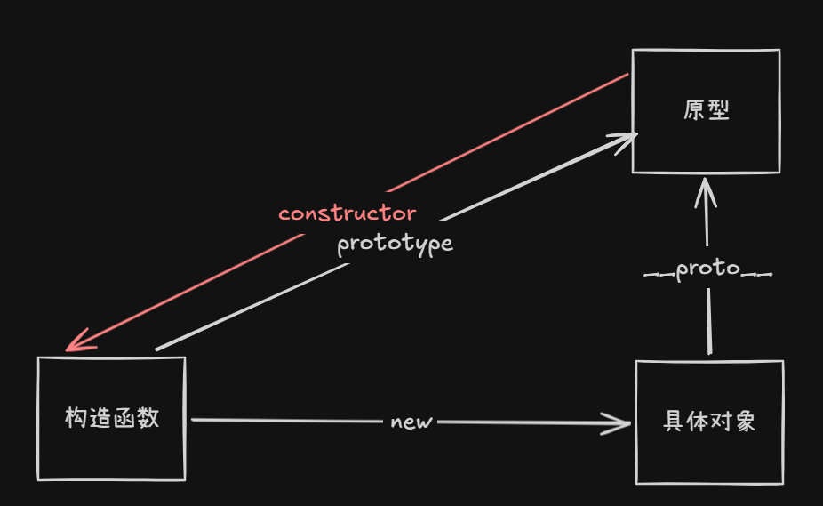

构造函数本身是个对象，其中prototype属性的属性值是一个对象，这个对象就是原型，

原型对象中有一个constructor属性，这个属性的值又是构造函数本身，

然后new 构造函数又能够创建一个对象，这个对象通常称为实例，实例的_proto_属性的属性值就是原型，

这样就构成了一个三角关系。


### 构造函数

方便批量创建重复对象

**节省内存** —— 公共方法只存一份

```js
function User(name, age) {
  this.name = name;
  this.age = age;
}
// 方法挂到原型上，所有实例共享同一个函数引用
User.prototype.greet = function() {
  console.log("Hi, " + this.name);
};

const user1 = new User("Alice", 18);
const user2 = new User("Bob", 20);
const user3 = new User("Carol", 22);
```


如果没有构造函数，每个对象都要手写

```js
const user1 = { name: "Alice", age: 18, greet() { console.log("Hi, " + this.name) } }
const user2 = { name: "Bob",   age: 20, greet() { console.log("Hi, " + this.name) } }
const user3 = { name: "Carol", age: 22, greet() { console.log("Hi, " + this.name) } }
// 问题：greet 方法被重复创建了 3 次，浪费内存
```


创建对象的时候发生了什么

```js
function User(name) {
  this.name = name;
}

new User("Alice") 等价于：
1. 创建一个空对象 {}
2. 将这个空对象{}的 __proto__ 属性指向 User.prototype  ← 建立原型链！
3. 将 this 绑定到这个新对象，执行构造函数
4. 返回这个新对象
```


### 原型链的产生

就是上面构造函数、实例对象、原型对象三角关系的连接，因为原型对象既可以作为一个对象的原型，同时又可以是另一个原型对象的实例

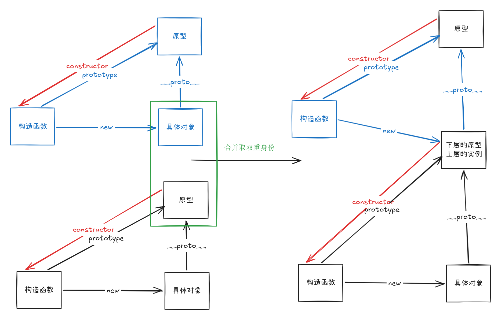


例子

```js
Object.prototype        ← 原型链顶端（__proto__ === null）
       ↑ [[Prototype]]
Animal.prototype        ← 中间对象：是 Object 的实例，也是 Dog 实例的原型
       ↑ [[Prototype]]
Dog.prototype           ← 中间对象：是 Animal 的实例，也是 dog 实例的原型
       ↑ [[Prototype]]
dog（实例）              ← 底层，只有"实例"身份
```

代码

```js
function Animal() {}
function Dog() {}

Dog.prototype = Object.create(Animal.prototype); // 建立原型链

const dog = new Dog();

// dog 的视角：Dog.prototype 是它的原型
console.log(Object.getPrototypeOf(dog) === Dog.prototype);     // true

// Dog.prototype 的视角：它自己是 Animal.prototype 的实例
console.log(Object.getPrototypeOf(Dog.prototype) === Animal.prototype); // true

// Animal.prototype 同理：它是 Object.prototype 的实例
console.log(Object.getPrototypeOf(Animal.prototype) === Object.prototype); // true
```


### Object如何作为顶层对象

1、**语言补偿机制**：如果不手动创建构造函数再创建对象，语言本身会提供一个Object对象，然后通过`new Object`帮开发者补全`new 构造函数`的过程

```js
var u2 = { // 对象 u2 通过 new Object 创建
  firstName: '莫',
  lastName: '妮卡'
}
// 等效于
var u2 = new Object(); 
u2.firstName = '莫';
u2.lastName = '妮卡';
```


2、**JS规范**：每当开发者创建构造函数时，js引擎就会给构造函数的 prototype 属性进行赋值，帮构造函数创建一个原型，这里的原型也是个对象，这里的对象是通过`new Object`创建的，就是1中提到的`构造函数 Object`，这样就有了两层原型图，原型链也就出来了

```js
function User(name) {
  this.name = name
}

// js引擎自动做了这件事，User.prototype = new Object(); 
// 所以通过User创建的具体对象（假如是user1）,user1原型的原型就是Object的原型

console.log(User.prototype.__proto__ === Object.prototype) // true
```

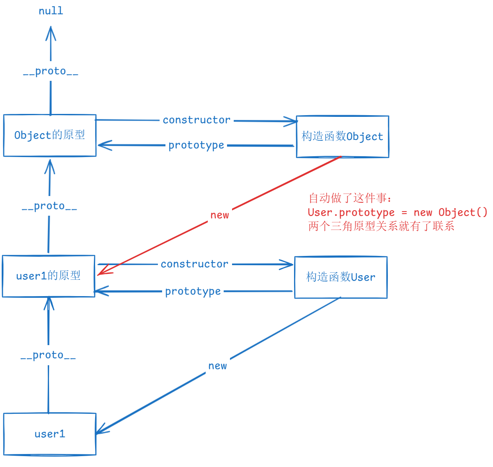


### 原生的原型

js中所有的东西都是对象创建的，像Array、function这些，其实都是内建原型，平时创建时用的都是语法糖,实际上也能够通过对象进行创建。


函数也有自己的构造函数，就是 `Function`，语法`new Function(参数1, 参数2, ..., 函数体字符串)`

```js
// 平时都是这样写函数
function fn() {
  console.log('hello world');
}

// 本质上等同于
let fn = new Function('console.log("hello world")');

console.log(fn.__proto__ === Function.prototype); // true
```

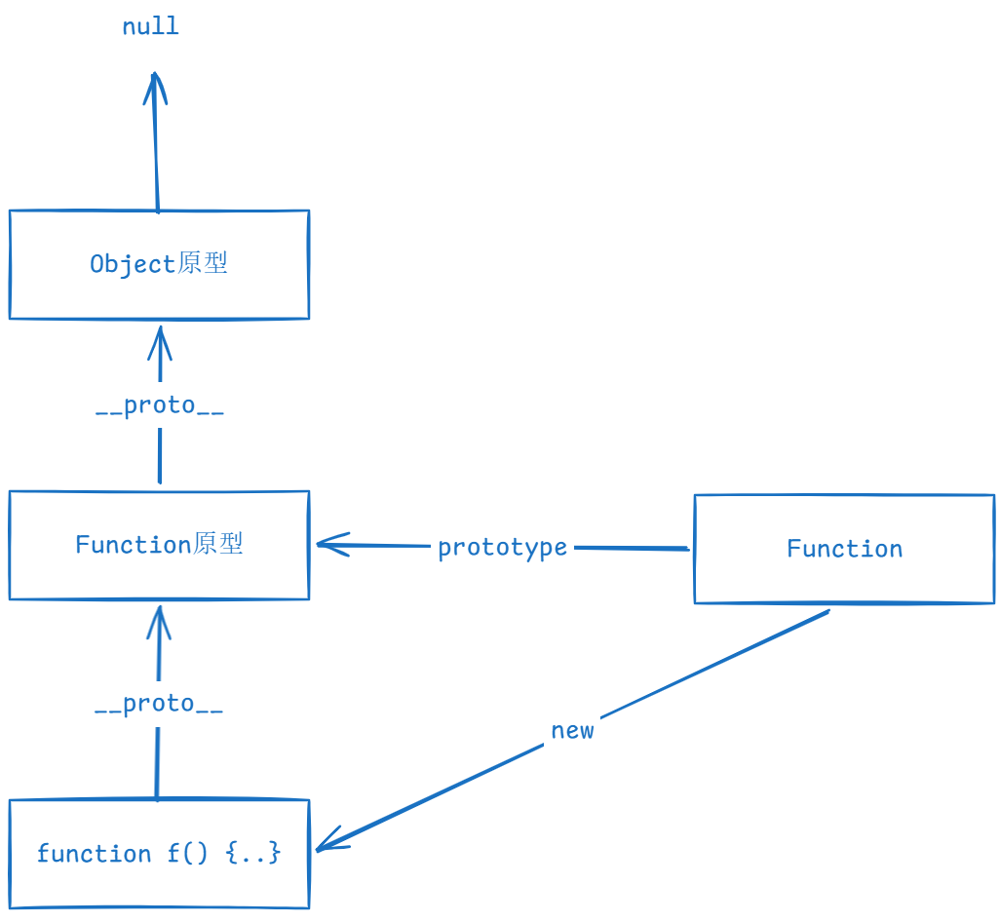


数组也是同理

```js
// 数组字面量写法
let arr = [1, 2, 3];

// 等同于
let arr = new Array(1, 2, 3);

console.log(arr.__proto__ === Array.prototype); // true
```


单个原始数据类型

```js
// 数字
let num = 5;

let num = new Number(5);

console.log(num.__proto__ === Number.prototype); // true
```


所有的类型都汇聚到Object.prototype这里，然后Object的原型指向null

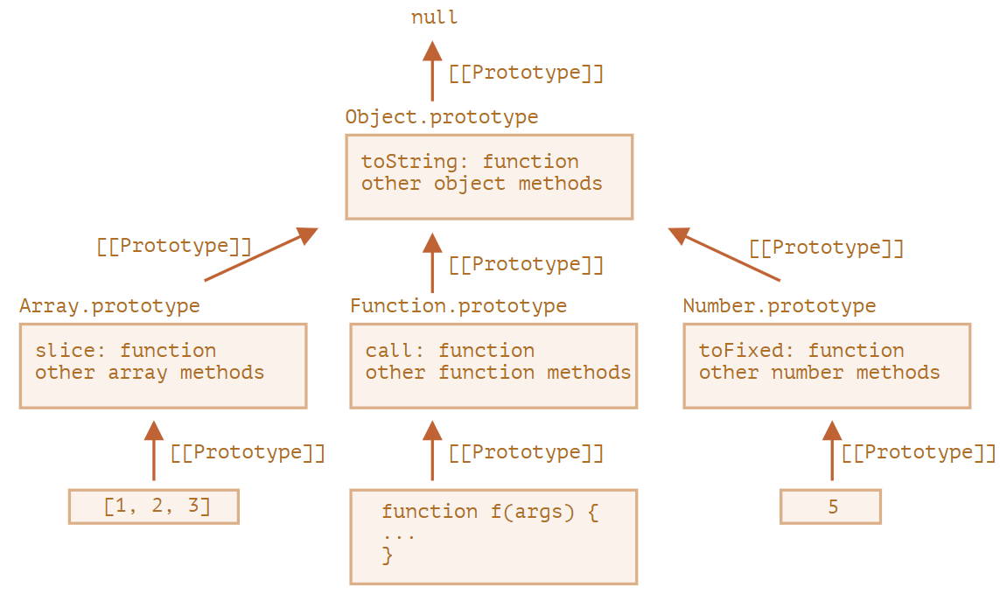


类

class语法糖

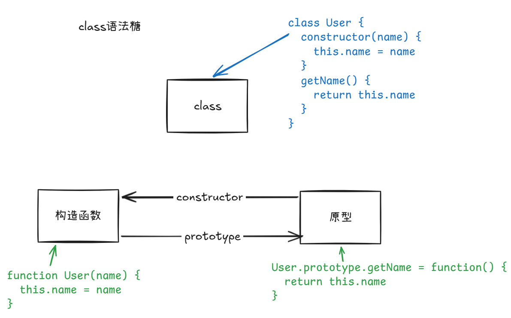


### 继承

再es6之前，没有class的时候，是如何通过“构造函数+原型链”来模拟面向对象的继承的

```js
/**
先说继承的概念：
  "用户1"一定是"用户"，"用户"不一定是"用户1" → "用户1"是"用户"的子类，"用户1"继承了"用户"

性质：
  1、单根性：一个子类只能有一个父类（如果B同时继承A和C，A和C上面的同名方法就会产生冲突，会增加代码维护难度）
  2、传递性：爷爷的方法孙子也能用（这样很方便，只要知道它是谁的子类，自然知道他能用哪些方法)
 */


// 如何模拟继承，我们先定义一个父类（构造函数），方法挂在原型上
function User(name, age) {
  this.name = name;
  this.age = age;
}
User.prototype.sayHi = function () {
  return 'hi';
}


// 定义一个子类（构造函数）进行继承，这里要解决两个问题，属性的复用和方法的复用：
// 1、属性复用：在子类的构造函数中调用父类的构造函数，改变this的指向（call/apply）就行
function VIPUser(name, age, expires) {
  User.call(this, name, age);
  this.expires = expires;
}

// 2、方法复用：改变子类原型对象的指向（Object.setPrototypeOf）
Object.setPrototypeOf(VIPUser.prototype, User.prototype);
```


方法复用就是将红线改成绿线，橙色线条会自动消失

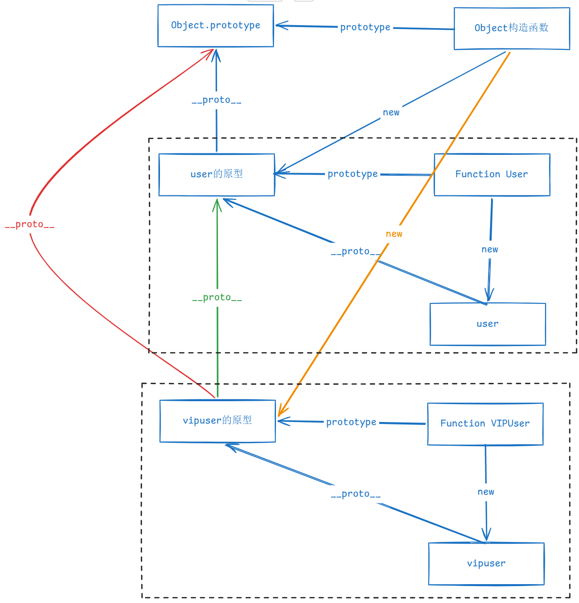


## 事件循环

1. 先说结构，前端页面在浏览器中主要就是操作数据结构，为了避免多线程造成的数据混乱（虽然可以通过加锁来限制，但是这样必然导致复杂性增加），浏览器选择了单线程模式，这样稳定又简单。
2. 为了避免耗时操作长时间的阻塞渲染主线程，消息队列应运而生，浏览器会将耗时操作放到消息队列中存储，等主线程空出来再执行，这就是异步。
3. 浏览器有一个渲染主线程，加一个消息队列，消息队列里主要分三种，微队列、任务队列、延时队列，优先级为：微队列 > 任务队列 > 延时队列。当然还有其它的队列，比如网络，一般放在延时队列中，但是用到的很少，所以我这里主要说这三种队列。队列里的任务一般以一个回调函数为最小单位。
4. 事件循环的过程，第一轮，主线程会跑一遍初始脚本
   1. 主线程会把promies的then回调放到微队列中
   2. 事件监听器里的回调函数放到任务队列中
   3. 定时器的回调放到延时队列中
   4. 当主线程清空后，根据优先级从消息队列中取出一个任务放到主线程中执行，执行完毕后一轮结束
5. 第二轮上述操作，直到消息队列中所有的任务都完成了。因为微队列优先级最高，所以看上去每轮都是先清空微队列。


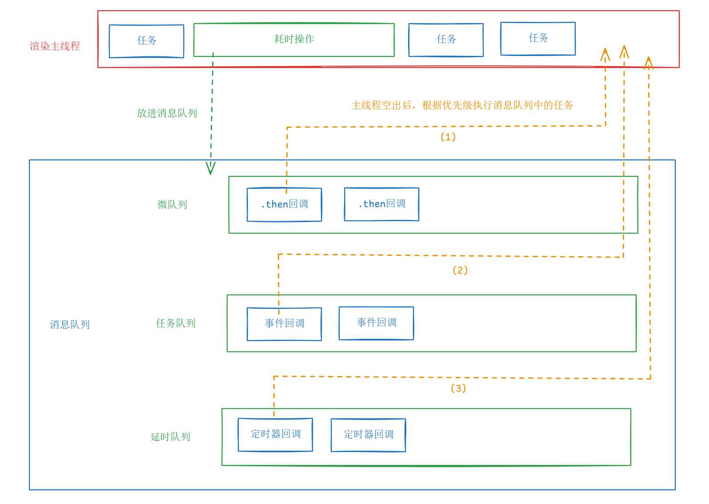


**为什么浏览器是单线程**

核心原因是 **DOM 的线程安全问题**。

浏览器的核心工作是操作 DOM（读取、修改 HTML 结构和样式）。如果允许多个线程同时操作 DOM，就会出现经典的竞争条件：

```code
线程 A：读取 <div> 的文本内容，准备修改
线程 B：在同一时刻把这个 <div> 删掉了
线程 A：???  → 崩溃 / 数据错乱
```

要解决这个问题，要么加锁（复杂、容易死锁、性能差），要么干脆规定**只有一个线程能碰 DOM**。浏览器选择了后者——更简单，更可靠。


**消息队列的设计目的**

消息队列是为了让单线程不被阻塞而诞生的

```
必须单线程操作 DOM
        ↓
单线程遇到耗时操作（网络、计时）会阻塞
        ↓
阻塞时页面完全卡死，无法响应用户
        ↓
解法：把耗时操作交给其他线程，
完成后把回调放入消息队列排队
        ↓
主线程永不阻塞，用无限循环持续消费队列
```


## Promise，async/await

### 学习进度记录

| 单元                      | 状态   | 卡住最久的地方                                               |
| ------------------------- | ------ | ------------------------------------------------------------ |
| 1. Promise 是一个对象     | ✅ 完成 | "拿到对象之后怎么用结果"——这个问题推不动，但它本身就是后续单元的引子 |
| 2. Promise 的三态机       | ✅ 完成 | 成功/失败的定义标准——最初以为是"合法/非法"，后来推导出应由开发者自己决定 |
| 3. executor 与状态转移    | ✅ 完成 | 无明显卡点，从已有观察直接推导出结论后验证                   |
| 4. 状态不可逆性           | ✅ 完成 | 最初以为 executor 会提前 return，实验后发现是"调用了但静默忽略"——机制完全不同 |
| 5. .then() 返回新 Promise | ✅ 完成 | 最初以为 then 回调立即入微任务队列，实验后明确：只有 resolve/reject 调用后才推入队列 |
| 6. 链式传播规则           | ✅ 完成 | 未考虑到 resolve() 内传入 Promise 时会自动展开的行为         |
| 7. Promise 静态方法       | ✅ 完成 | 无明显卡点，从业务场景直接推导出两种机制的行为差异           |
| 8. async/await 的脱糖     | ✅ 完成 | 无明显卡点，从 Promise/then 对应关系直接推导出 async/await 的行为 |


### 单元 1 · Promise 出现的原因

#### 我的解释

<!-- 在这里用一段话回答：
     这个机制存在之前，世界是什么样的？它解决了什么问题？它是怎么解决的？
     要求：向一个懂编程但从没听说过 Promise 的人解释 -->
1、promise机制出现之前，处理耗时操作的唯一方法就是通过回调函数

```js
function doSomethingAsync(callback) {
  //... 执行一些耗时操作,比如从服务器拿到一些数据
  setTimeout(() => {
    callback(result); // 估计一秒后一定能拿到数据，所以一秒后执行回调函数
  }, 1000);
}
```

如果只有一个这样的耗时操作还好，但是现实世界里的需求往往是：先拿用户→再用用户ID拿订单→再用订单ID拿商品→根据商品ID拿评论，因为某些操作必须等待某些值被拿到后才能进行，为了表示这个先后等待关系，就只能把这些操作放到回调函数里。
当然可以这些操作放到初始脚本中，让主线程（浏览器执行代码的模块）直接执行，但是这些耗时操作就会阻塞主线程，导致用户体验非常差。所以耗时操作必然是异步的，等待异步操作结果出来再执行的逻辑块便只能放到回调函数中。当结果出来后，自动执行。

```js
setTimeout(() => {
  var user = { id: 1, name: "Alice" }   // 模拟服务器1s后返回用户数据
  setTimeout((user) => {
    // 结合user数据，并经过耗时操作（用定时器模拟的1s），拿到订单数据：
    var orders = [{ id: 101, productId: 9 }]  
    setTimeout((orders) => {
      // 同理，结合订单数据，并经过耗时操作（用定时器模拟的1s），拿到商品数据：
      var product = { id: 9, name: "手机" } 
      setTimeout((product) => {
        // 到达最里层，经过1s的耗时操作，终于拿到最终结果并可以使用最终结果了
        var reviews = ["好评", "非常好"] 
      }, 1000)
    }, 1000)
  }, 1000);
}, 1000);
```

代码层层嵌套，不断向右缩进，这就是所谓的回调地狱，阅读和维护都非常困难，promise机制就是为了解决这个问题而诞生的。

2、promise出现之后，就可以像写同步代码一样写异步代码，比如上面的例子就可以改成下面这样：

```js
new Promise(resolve => {
  setTimeout(() => {
    var user = { id: 1, name: "Alice" }   // 模拟服务器1s后返回用户数据
    resolve(user);
  }, 1000);
})
.then(user => new Promise(resolve => {
  setTimeout(() => {
    // 结合user数据，并经过耗时操作（用定时器模拟的1s），拿到订单数据：
    var orders = [{ id: 101, productId: 9 }]  
    resolve(orders);
  }, 1000);
}))
.then(orders => new Promise(resolve => {
  setTimeout(() => {
    // 同理，结合订单数据，并经过耗时操作（用定时器模拟的1s），拿到商品数据：
    var product = { id: 9, name: "手机" } 
    resolve(product);
  }, 1000);
}))
.then(product => new Promise(resolve => {
  setTimeout(() => {
    // 到达最里层，经过1s的耗时操作，终于拿到最终结果并可以使用最终结果了
    var reviews = ["好评", "非常好"] 
    resolve(reviews);
  }, 1000);
}))
```


#### 我的推理链

<!-- 阶段D 填写 -->
1、浏览器处理代码的模块只有一个线程，那么为了用户的体验，必然不能让耗时操作阻塞的这个主线程，所以会把耗时操作放到另外的地方，能不耗时的操作做完之后，再回来处理耗时操作并得到结果。
2、但是假如有些逻辑块需要等待这个耗时操作的结果才能正常运行，那么只能把这些程逻辑块放到根据时机执行的函数中（也就是回调函数），等待耗时操作得出结果后再执行对应的逻辑块，那么如果每有一个耗时操作，相关的逻辑块就需要放到耗时操作的下一个层级中，这样代码的层级就会越来越深，因为阅读层级越深的代码就需要脑子里提前记住更多的前置条件，这样会导致阅读和维护非常困难。
3、目前只知道Promise能解决这个问题，它能接受一个装了耗时操作的函数作为参数传入，new一个Promise对象能立马获取到这个Promise对象本身，当其中的耗时操作还未完成时，打印这个对象能够看到“Promise { <pending> }”这个结果。


```js
const promise = new Promise((resolve, reject) => {
  setTimeout(() => {
    resolve('异步操作完成了');
  }, 1000);
});

console.log(promise);  // // Promise { <pending> }
```

---


### 单元 2 · Promise 的三态机

#### 我的解释

<!-- 向一个懂编程但从没听说过 Promise 的人解释：
     为什么需要"状态"这个概念？三种状态分别代表什么？状态之间的转换有什么规律？ -->
1、状态是作为一个标记，显示promise处理异步操作的过程中处于哪种状态，promise对象的状态有三种，分别是pending（等待中）、fulfilled（已完成）和rejected（已拒绝）。状态只能从pending转换成fulfilled或者rejected。

2、当一个Promise对象被创建时，如果当前promise中包裹的异步操作还没得到执行，还没法知道结果如何，那就是pending状态，但是如果执行了resolve(),对应的中文含义是解决，状态就会变成fulfilled，执行了reject(),对应的中文含义是拒绝，状态就会变成rejected,

3、所以开发者应该根据自己对返回值的预期，来决定程序应该执行哪个函数，如果异步操作得到的结果符合预期，就执行resolve(),将返回的promise对象的状态变成fulfilled，如果异步操作得到的结果不符合预期，就执行reject(),将返回的promise对象的状态变成rejected。


#### 我的推理链

<!-- 阶段D 填写 -->
1、Promise对象通过接受一个函数作为参数处理异步操作，异步操作就放在函数体里面，当Promise对象被创建然后被开发者拿到后，Promise需要一个状态属性向拿到自身作为对象的开发者展示，目前Promise处理的这个异步操作处在哪种状态。可能达到状态就三种，还没处理对应的状态就是pending，处理了并成功了对应的状态就是fulfilled、失败了状态就是rejected

2、那如何定义成功和失败呢？一开始我想到的是异步操作返回值是否合法，或者promise内部自己定的规则，但是如果开发者预期的值就是不合法的值呢？所以成功与否应该由开发者自己定义，所以Promise对象接受的函数有两个参数，分别是resolve和reject，如果异步操作得到的结果符合开发者的预期，就执行resolve(),让Promise对象的状态变成fulfilled，如果异步操作得到的结果不符合开发者的预期，就执行reject(),让Promise对象的状态变成rejected。


```js
const pendingPromise = new Promise((resolve, reject) => {
  setTimeout(() => {
    resolve('异步操作完成了');
  }, 1000);
});
console.log(pendingPromise); // 打印结果：Promise { <pending> }

const fulfilledPromise = new Promise((resolve, reject) => {
  resolve('异步操作完成了');
});
console.log(fulfilledPromise); // 打印结果：Promise { '异步操作完成了' }
```


### 单元 3 · executor 与状态转移

#### 我的解释

<!-- executor 是什么？它什么时候运行？它和状态转移是什么关系？ -->
`executor`就是创建`Promise`对象时传入的函数：`(resolve, reject) => { ... }`，只要一创建`Promise`对象，`executor`就执行，`excutor`函数接收两个参数，分别是resolve和reject,这连个参数都是函数，

如果在`excutor`函数体内执行了`resolve()`,Promise对象的状态就会从pending变成fulfilled，

如果在excutor函数体内执行了reject(),promise对象的状态就会从pending变成rejected。

<svg xmlns="http://www.w3.org/2000/svg" width="512" height="246" viewBox="0 0 512 246"><defs><style>@import url(https://fonts.googleapis.com/css?family=Open+Sans:bold,italic,bolditalic%7CPT+Mono);@font-face{font-family:'PT Mono';font-weight:700;font-style:normal;src:local('PT MonoBold'),url(/font/PTMonoBold.woff2) format('woff2'),url(/font/PTMonoBold.woff) format('woff'),url(/font/PTMonoBold.ttf) format('truetype')}</style></defs><g id="promise" fill="none" fill-rule="evenodd" stroke="none" stroke-width="1"><g id="promise-resolve-reject.svg"><path id="Rectangle-1" fill="#252732" stroke="#4b4e65" stroke-width="2" d="M1 91h182v70H1z"/><text id="new-Promise(executor" fill="#82807f" font-family="PTMono-Regular, PT Mono" font-size="14" font-weight="normal"><tspan x="2" y="82">new Promise(executor)</tspan></text><text id="state:-&quot;pending&quot;-res" fill="#7a7f9c" font-family="PTMono-Regular, PT Mono" font-size="14" font-weight="normal"><tspan x="13" y="115.432">state: "pending"</tspan> <tspan x="13" y="135.432">result: undefined</tspan></text><path id="Line" fill="#7a7f9c" fill-rule="nonzero" d="M196.51 134.673l.908.419 103.284 47.574 2.51-5.45L313 189.433l-15.644.5 2.509-5.45-103.283-47.574-.909-.418.837-1.817z"/><path id="Line-Copy" fill="#7a7f9c" fill-rule="nonzero" d="M297.38 56L313 57l-10.173 11.896-2.335-5.528-103.103 43.553-.921.39-.778-1.843.92-.39 103.104-43.552-2.334-5.527z"/><text id="resolve(value)" fill="#7a7f9c" font-family="PTMono-Regular, PT Mono" font-size="14" font-weight="normal" transform="rotate(-23 244.39 72.63)"><tspan x="185.59" y="77.13">resolve(value)</tspan></text><text id="reject(error)" fill="#7a7f9c" font-family="PTMono-Regular, PT Mono" font-size="14" font-weight="normal" transform="rotate(25 251.634 150.64)"><tspan x="197.034" y="155.141">reject(error)</tspan></text><path id="Rectangle-1-Copy" fill="#252732" stroke="#498e67" stroke-width="2" d="M323 10h182v64H323z"/><text id="state:-&quot;fulfilled&quot;-r" fill="#498e67" font-family="PTMono-Regular, PT Mono" font-size="14" font-weight="normal"><tspan x="338" y="34.432">state: "fulfilled"</tspan> <tspan x="338" y="54.432">result: value</tspan></text><path id="Rectangle-1-Copy-3" fill="#441b1b" stroke="#d55759" stroke-width="2" d="M323 177h182v64H323z"/><text id="state:-&quot;rejected&quot;-re" fill="#7a7f9c" font-family="PTMono-Regular, PT Mono" font-size="14" font-weight="normal"><tspan x="338" y="201.432">state: "rejected"</tspan> <tspan x="338" y="221.432">result: error</tspan></text></g></g></svg>


#### 我的推理链

<!-- 阶段D 填写 -->

1. 根据之前的测试，如果创建`promise`对象时，传入的函数体中包含耗时操作，比如setTimeout，在创建语句的一下条中立马打印这个`promise`对象，能看到Promise { <pending> }这个结果，所以可以推断出，只有executor函数在创建Promise对象时就运行，promise对象才能立马根据当前自己对异步操作的处理来展示自己的状态到底时pending、fulfilled还是rejected。
2. 接着又进行了代码测试，如果在executor函数体中添加一个`console.log()`语句，在n`ew Promise()`语句的下一句进行`console.log()`，结果显示前一个`console.log()`先执行，说明`executor`函数在创建`Promise`对象时就运行了，验证了我的猜想。


```js
const promise = new Promise((resolve, reject) => {
  console.log('executor 函数被执行了');
  resolve('异步操作完成了');
});

console.log(promise);

打印结果：
executor 函数被执行了
Promise { '异步操作完成了' }

executor中的consolo.log先打印出来

之所以没有打印出pending状态的promise，是因为executor中没有执行耗时操作，所以这个Promise立刻就把自己的状态变成fulfilled,把resolve的值包裹在对象中等待被使用
```


### 单元 4 · 状态不可逆性

#### 我的解释

<!-- 状态不可逆性是什么？它是怎么工作的？为什么需要这个约束？ -->

1. 一旦promise对象通过executor函数体内的resolve()或者reject()函数改变了状态，就不能再次进行状态改变。

2. 如果executor函数体内执行了resolve()函数或者reject()函数，promise对象的状态就会发生改变，变成fulfilled或者rejected,哪怕函数体中接下来的代码还有reject()或者resolve()函数，也仅仅是执行，并不会改变状态。

3. 如果状态变过了一次又变化一次，假如executor函数是这样的：

   ```JavaScript
   const promise = new Promise((resolve, reject) => {
     resolve('第一次改变状态');
     setTimeout(() => {
       reject('第二次改变状态');
     }, 1000);
   });
   ```

   那开发者就需要完全了解其中的代码才能预测这个promise对象最终会变成什么状态，认知负担太大，目前这种设计，只允许改变一次状态，简洁又好用。


实际执行效果

```JavaScript
const promise = new Promise((resolve, reject) => {
  resolve('异步操作完成了');
  console.log('reject 即将被调用')
  reject('异步操作失败了');
});

console.log(promise);

// 控制台打印结果为：
// Promise { '异步操作完成了' }
// reject 即将被调用
// 证明executor函数被完整的执行了，但是状态只改变了一次
```


#### 我的推理链

<!-- 阶段D 填写 -->

1. 我最初的理解是，promise对象的状态就应该根据对异步任务的处理是否符合开发者预期来改变，要么变成fulfilled，要么变成rejected,得到你想要的预期了就不应该再让状态进行改变了。
2. 根据状态只能改变一次的这个现象，我反推设计者本来的目的是想，一个promise对象只处理一个异步任务，处理完了就结束了，不应该再处理其他的异步任务了。但是设计者是没法限制开发者向executor函数体内添加其其它的异步任务，并添加多个resolve()或者reject()函数的, 所以通过状态只能通过这两个函数中的一个进行一次改变这个软约束，来达到一个promise对象只能处理一个异步任务的目的。我前面举得反例就相当与处理了两个异步任务，resolve()函数本应对应一个异步任务，只是我没有写上去。


### 单元 5 · .then() 返回新 Promise

#### 我的解释

<!-- 向一个懂编程但从没听说过 Promise 的人解释：
     .then() 是什么，它做了什么，它返回了什么，为什么要这样设计？ -->

1. 在一个Promise对象的executor中使用`resolve(表达式)`，返回的内容字面量形式是：`Promise { 值 }`，resolve括号中表达式的值被包裹在了Promise中。

2. 对`Promise { 值 }`这个对象调用then方法，这个值就能作为then中回调函数的参数，并在回调函数的函数体中进行取用和处理，但使用的时机并不是在主线程第一次执行初始脚本时候，而是当`promise`执行了`resolve`或者`rejected`之后，会把then方法推到微队列中，等主线程把当前同步代码全部执行完再拿出来执行。

3. `then()`方法会返回一个新的promise对象，并将自己括号里面包裹的回调函数作为这个新promise的executor。当在then回调中发起一个新的异步操作，就能以同样的方式，对这个新promise调用then方法进行处理，这样多个异步操作就可以平铺成链式调用，而不会陷入层层嵌套。

   ```JavaScript
   .then (value => {
     return 123
   })
   // 伪代码，类似这种转化：
   new Promise(resolve => {
     resolve(123)
   })
   ```


当promise里的executor得出了达到开发者预期的值，就会调用resolve()，让当前promise对象的状态变成fulfilled（已完成）


#### 我的推理链

<!-- 阶段D 填写 -->
1、当我创建了一个Promise对象，并用其处理异步操作时，当异步操作结束，获取到了我当前所期望的值，此时promise对象状态为fulfilled（已完成），但是值被包裹在了promise对象中，类似于`Promise { '值1' }`，无法直接取用，所以promise上应该有一个方法能让我们取用这个值

2、这个方法就是then()方法，then()方法接受一个回调函数作为参数，这个回调函数的参数就是resolve括号中包裹的值（异步操作得到的期望值通常放在resolve括号中），格式类似：`.then(value => { ... })`，在这个回调函数的函数体里，就可以使用这个值进行一系列操作了，如果在函数体中继续执行异步操作，该怎么办，如果重新在里面new 一个 promise对象来处理这个新的异步操作的话，就像下面这样：

```js
const p1 = new Promise((resolve, reject) => {
  setTimeout(() => {
    resolve('值1');
  }, 1000);
}).then(value => {
  const p2 = new Promise((resolve, reject) => {
    setTimeout(() => {
      resolve('值2');
    }, 1000);
  }).then(value => {
    console.log('值2', value); // 值2
  });
  ...
})
```

这样又会陷入层层嵌套的陷阱了

3、所以then()方法应该返回一个新的promise对象，并将自己括号里的回调函数作为这个新promise对象的executor,这样设计的话，如果在then回调中发起一个性的异步操作，直接在then()方法后面继续调用then()方法就可以了

4、为什么解决方案是通过在then方法中注册一个回调函数，让其参数取到这个值，而不是直接使用一个同步的getValue()方法来取这个值呢，这里进行假设，如果promise提供一个同步的 getValue() 直接把值读出来，类似下面的伪代码：

```js
const promise = new Promise((resolve, reject) => {
  setTimeout(() => {
    resolve('值1');
  }, 1000);
});
const value = promise.getValue();
console.log(value); // 值1
```

如果是这样的话，主线程在执行到`const value = promise.getValue();`这一行代码时，promise对象的状态还没有变成fulfilled（已完成），因为executor函数体内的setTimeout还没有执行完，所以这个时候promise对象中还没有值，getValue()方法就无法取到值了，所以getValue()方法是行不通的。

1. 首先then方法作为一个函数，是在promise的executor里执行力resolve或者rejected方法之后，才会把then方法推到微队列中等待执行
2. 所以当then方法执行的时候，executor函数体内的setTimeout已经执行完了，promise对象的状态已经变成fulfilled（已完成），值也已经被包裹在promise对象中了，所以then方法中的回调函数就能取到这个值了。


#### .then()设计的物理原因

问题的本质还是出现在执行的边界上

Promise 是 JS 线程与外部执行系统之间的协调令牌

**异步问题的本质原因**是因为值"正在另一个执行主体上被生产"，在它被送达 JS 线程之前，它在 JS 可访问的内存空间里根本不存在

`const x = 1 + 2;`之所以是同步，是因为值始终js可访问的内存空间里


如果想通过一个方法直接从Promise里获取值是不可能的，比如我之前设计的`getValue()`方法：

```js
const promise = new Promise((resolve, reject) => {
  setTimeout(() => {
    resolve('值1');
  }, 1000);
});
const value = promise.getValue();
```

在我调用`getValue()`的那一刻，这个值物理上不在 JS 线程的内存中。它在网卡缓冲、或者在OS 内核空间里，或者正在 TCP 协议栈里重组，总之不在这里。


##### 更加精准的 Promise 定义

Promise是 JS 线程与外部执行系统之间的协调令牌

持有三样东西：

| 字段          | 含义                                                 |
| ------------- | ---------------------------------------------------- |
| `state`       | 外部系统的工作进展（pending / fulfilled / rejected） |
| `value`       | 外部系统交付过来的值（交付前为空）                   |
| `callbacks[]` | 值被交付时应该通知谁（.then() 注册的就放在这里）     |

`.then(callback)`的本质是：

> 向协调系统登记：我知道值还在外面，等它被送达的时候，用这个 callback 处理它。

.then返回新 Promise，是因为有时候，then里的转换过程中，又来一个耗时操作，为了兼容即时操作和耗时操作两种可能，每个then统一返回一个新promise


### 单元 6 · 链式传播规则

#### 我的解释

<!-- 向一个懂编程但从没听说过 Promise 的人解释：
     .then() 回调返回普通值和返回 Promise，下一个 .then() 分别拿到什么？为什么区别对待？ -->
1、.then() 的回调里 return 一个普通值，在then返回的新的 Promise 对象中，直接resolve(普通值)，接着将后续的then回调直接放到微任务队列（一个暂存"等当前同步代码跑完再执行"的待办列表）中执行。

2、`.then()` 的回调里 return 一个新的 Promise，那当前then就会把这个新的 Promise 作为自己的返回值，但是下一个then不能知道这个promise会何时resolve（不像普通值那样拿到就能直接resolve），**所以需要先订阅这个新的 Promise 的状态变化，这个订阅本身又是一个微任务**，只有当订阅完成、内层Promise resolve之后，才会把下一个then回调放到微任务队列中执行，then里注册的回调参数为上一个then中返回的`Promise → executor → resolve(这里的值)`。

```JavaScript
const p2 = new Promise( resolve => {
  resolve('值2')
}).then(value => {
  return new Promise(resolve => {
    resolve('值3')
  })
}).then(value => {
  console.log(value); // 值3
})
```


3、区别对待的原因是：如果把return出来的Promise对象本身直接作为"值"传给下一个then，那下一个then拿到的就是一个还在pending（等待中）状态的Promise对象，想用里面的值就只能在这个then回调里继续嵌套调用then，这样又回到了回调地狱的问题。所以Promise设计成自动展开return值——如果是普通值直接传递，如果是Promise就等它resolve后再传递，这样链式调用才能保持平铺结构。


#### 我的推理链

<!-- 阶段D 填写 -->
1、从unit5知道，then()方法会返回一个新的promise对象，并将自己括号里面包裹的回调函数作为这个新promise的executor
2、所以如果我来设计，代价最小的方案就是：如果then回调里返回的是普通值，就直接在新的promise里直接resolve(普通值)，如果then回调里返回的是promise，就将这个新的promise作为返回值，下一个then拿到的是`new Promise( resolve => resolve(值) )`里面resolve括号里包裹的值
3、这点之前没有考虑到，如果resolve里面返回的是一个Promise对象：

```js
resolve(new Promise(resolve => {
  setTimeout(() => {resolve(100);}, 1000);
}))
```

外部的resolve()函数不会以这个Promise对象本身作为结果，而是会等待这个内层 Promise 完成，然后用内层的结果作为自己的结果


### 单元 7 · Promise 静态方法

#### 我的解释

1、`Promise.all` 这个静态方法会检测 promise 列表的 fulfilled 情况，如果全部 fulfilled，输出一个结果数组，其中的元素排列顺序与输入的 promise 数组一一对应；如果发现有 promise 执行完之后进行了 rejected，catch 直接捕获错误并抛出，不再等待其它未完成的 promise 任务。

2、`Promise.allSettled` 方法会等待所有的 promise 都变成 fulfilled 或者 rejected 状态，返回的结果数组每个元素包含 `status` 字段标记状态，fulfilled 的元素用 `value` 字段携带值，rejected 的元素用 `reason` 字段携带错误原因：

```js
[
  { status: 'fulfilled', value: 1 },
  { status: 'rejected', reason: 'error' },
  { status: 'fulfilled', value: 3 }
]
```

#### 我的推理链

1、用 `.then()` 链处理多个独立异步操作时，只能强行串行——代码表达的是依赖关系，但业务上三个操作完全独立，代码结构和业务逻辑不一致。
2、需要一个能接收 promise 数组、统一等待并汇报结果的机制。根据"全部缺一不可"还是"只需知道最终结果"两种场景，衍生出两种不同行为：`Promise.all` 遇 rejected 立刻失败，`Promise.allSettled` 等所有人都有结果再统一报告。

---

### 单元 8 · async/await 的脱糖

#### 我的解释与推理链

一个函数前面加上了 `async` 关键字之后，比如有这样一个伪代码：

```js
async function foo() {
  // 流程块1
  const result = await 表达式1;
  // 流程块2
}
```

`async` 函数和 Promise 的对应关系是这样的：`foo` 函数一旦调用就会执行流程块1，就像 Promise 的 executor 一样，直到遇到有 `await` 标识符的代码行。表达式1中通常放的就是耗时操作，比如一个返回 Promise 的函数。`await` 的行为和 `.then()` 一样——等待 Promise 的状态发生改变之后，再执行下面的流程块2。

注意 `await` 后面的表达式一定要是一个 Promise 对象，就像 `.then()` 会等待 Promise 对象的状态发生改变再执行，`await` 同样。因为 `async/await` 本身就是 Promise 的语法糖——所谓语法糖，就是在不改变原有底层功能的基础上，提供更直观、更方便书写的语法形式。

对于 Promise/then 来说，串行异步流程的写法是：

```js
new Promise(resolve => {
  // 耗时操作1放到这里
  resolve(耗时操作1的结果);
}).then(result1 => {
  // 等待耗时操作1完成后才执行
  // 如果还有耗时操作2，return 一个新 Promise
  return new Promise(resolve => resolve(耗时操作2的结果));
}).then(result2 => {
  // 等待耗时操作2完成后才执行，依次类推
});
```

`async/await` 的等价写法：

```js
async function fn() {
  const result = await 耗时操作1;
  // 流程块2：等待耗时操作1完成并拿到结果后才执行
  const result2 = await 耗时操作2;
  // 流程块3：等待耗时操作2完成并拿到结果后才执行，依次类推
}
```

**`async` 的含义：**

通过实验验证：

```js
async function f() {
  const result  = await new Promise(resolve => setTimeout(() => resolve(100), 1000));
  const result2 = await new Promise(resolve => setTimeout(() => resolve(200), 1000));
  return 1;
}
console.log(f()); // Promise { <pending> }
f().then(value => {
  console.log(value); // 1
});
```

被 `async` 标记的函数必须返回的是 Promise 对象。`return` 对应的就是 Promise 对象的 `resolve` 方法。

对于有 `await` 的函数来说，无论里面有多少个 `await`，可以看作是一个整体异步代码块的封装。最后的 `return` 就相当于开发者在 Promise 的 executor 中的异步操作得到了理想的值，然后通过 `resolve("理想的值")` 返还这个理想的值供 `.then()` 方法的回调函数使用。

设计者通过给函数加上 `async` 这个标识符，让编译器识别到这个函数里面有异步操作，直接封装成一个处理耗时操作的 Promise 对象——将函数看作一个整体的异步操作放到 executor 中，`return` 看作 `resolve`，逻辑完全自洽。


