## 数据库简介

为什么需要数据库？

一句话：程序的内存数据会消失，数据库把它存到硬盘里，并且查得快、管得严。


两大类数据库

|             | 关系型（SQL）      | 非关系型（NoSQL）    |
| ----------- | ------------------ | -------------------- |
| 代表        | **MySQL**, Oracle  | **MongoDB**, Redis   |
| 数据结构    | 表格（行列）       | 文档/键值对          |
| 强项        | 复杂查询、数据关系 | 海量读写、灵活结构   |
| 弱项        | 海量数据性能差     | 难以表达复杂关系     |
| Node.js场景 | 用户、订单、商品   | 缓存、日志、实时数据 |

直观理解：

- 关系型 = Excel表格，一行一条记录，表与表之间可以关联
- 非关系型 = JSON文件，结构随意，但不擅长跨文档查询


术语

```
DB   = 数据库本身（一个文件集合）
DBMS = 管理数据库的软件（MySQL就是DBMS）
DBA  = 管数据库的人
DBS  = 以上三个加在一起叫数据库系统
```


## MySQL命令


### 环境变量

路径PATH 的本质是：告诉系统去哪里找可执行文件

```
C:\Program Files\MySQL\MySQL Server 8.0\
├── bin\          ← 加入 PATH 的目录
│   ├── mysql.exe        ← 客户端命令行工具
│   ├── mysqld.exe       ← MySQL 服务进程
│   └── mysqladmin.exe   ← 管理工具
├── data\         ← 数据库文件，不需要命令行直接访问
├── lib\          ← 库文件
└── include\      ← 开发头文件
```

所以我为MySQL设置的系统环境变量就是：`C:\Program Files\MySQL\MySQL Server 8.0\bin`，这样就在任意目录下执行命令时，找到客户端命令行工具

配置环境变量

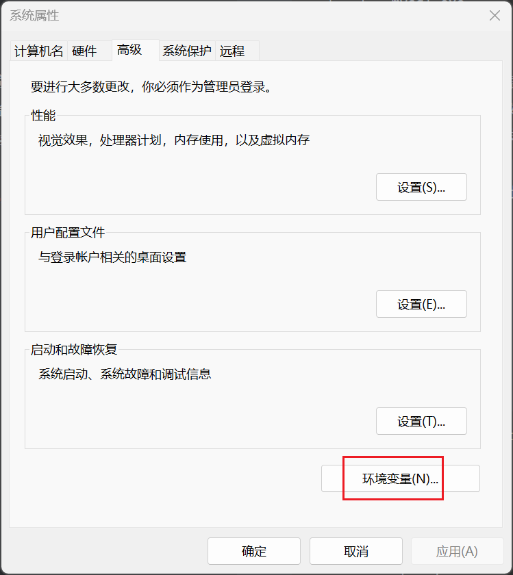

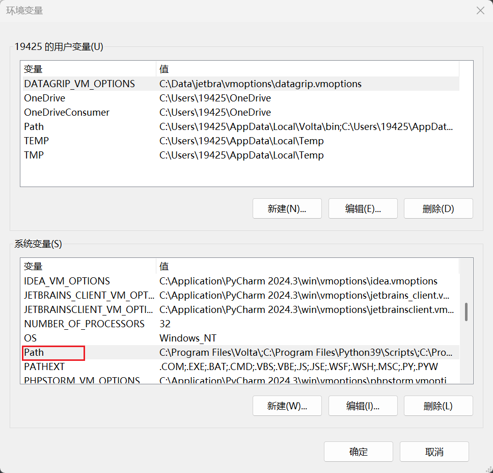

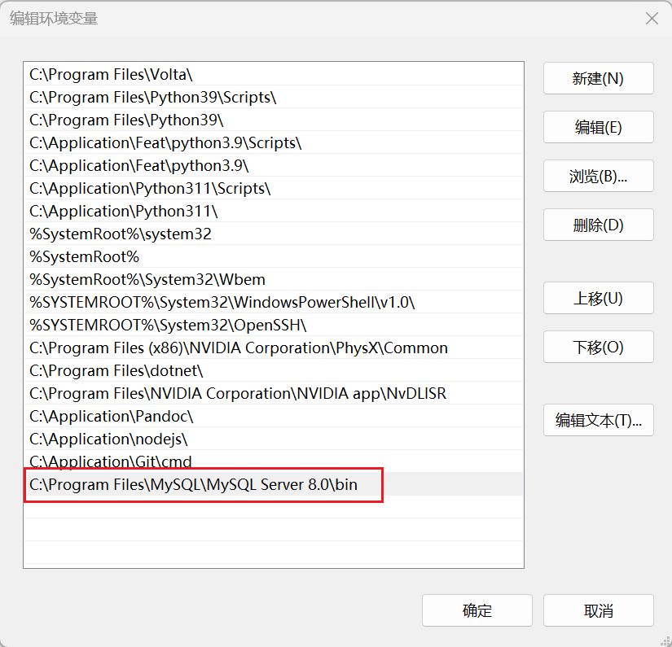


### 命令


`netstat -ano | findstr ":3306"`

```powershell
PS C:\Users\19425\Desktop\笔记\agnet讲解师> netstat -ano | findstr ":3306"
  TCP    0.0.0.0:3306           0.0.0.0:0              LISTENING       6176
  TCP    [::]:3306              [::]:0                 LISTENING       6176
  TCP    [::1]:3306             [::1]:59636            ESTABLISHED     6176
  TCP    [::1]:3306             [::1]:59637            ESTABLISHED     6176
  TCP    [::1]:59636            [::1]:3306             ESTABLISHED     12716
  TCP    [::1]:59637            [::1]:3306             ESTABLISHED     12716
```

 **命令作用**：查看哪个进程占用了 3306 端口（MySQL 默认端口）。**结果：** 3306端口正在 `LISTENING`（监听中），MySQL实际上已经在运行

LISTENING，正在等待连接（MySQL 服务已启动）

ESTABLISHED，已建立的活跃连接


`& "C:\Program Files\MySQL\MySQL Server 8.0\bin\mysql.exe" --version`

```powershell
PS C:\Users\19425\Desktop\笔记\agnet讲解师> & "C:\Program Files\MySQL\MySQL Server 8.0\bin\mysql.exe" --version

C:\Program Files\MySQL\MySQL Server 8.0\bin\mysql.exe  Ver 8.0.43 for Win64 on x86_64 (MySQL Community Server - GPL)
```

**路径解析：**

```
C:\Program Files\                    ← Windows 默认软件安装根目录
  MySQL\                             ← MySQL 厂商目录
    MySQL Server 8.0\                ← 当前安装的版本目录
      bin\                           ← 可执行文件目录（上一个问题提到的！）
        mysql.exe                    ← MySQL 命令行客户端程序
```

**命令作用：** 查看MySQL可执行文件版本。**结果：** 当前安装的是 `MySQL 8.0.43 Community Server`（Windows 64位版本）。


`Get-Content "C:\ProgramData\MySQL\MySQL Server 8.0\my.ini" | ...`

```powershell
PS C:\Users\19425\Desktop\笔记\agnet讲解师> Get-Content "C:\ProgramData\MySQL\MySQL Server 8.0\my.ini" | Select-String -Pattern "port|bind|datadir|user" | Select-Object -First 20

# ~/.my.cnf to set user-specific options.
# In this file, you can use all long options that the program supports.
# If you want to know the options a program supports, start the program
port=3306
# The next three options are mutually exclusive to SERVER_PORT below.
# The TCP/IP Port the MySQL Server will listen on
port=3306
datadir=C:/ProgramData/MySQL/MySQL Server 8.0\Data
# factor-related clauses of CREATE USER and ALTER USER statements used to manage M
ySQL account
# Modes affect the SQL syntax MySQL supports and the data validation checks it per
forms. This 
# This variable is used to limit the effect of data import and export operations, 
such as 
# LOAD_FILE() function. These operations are permitted only to users who have the 
FILE privilege.
# allow. One of these connections will be reserved for a user with
# Use this option if you have a MySQL server with InnoDB support enabled
# The TCP/IP Port the MySQL Server X Protocol will listen on.
mysqlx_port=33060
```

**路径解析：**

```
C:\ProgramData\                      ← Windows 系统级应用数据目录（隐藏文件夹）
  MySQL\
    MySQL Server 8.0\
      my.ini                         ← MySQL 的核心配置文件
      
      
      port=3306	3306	MySQL 监听端口（出现两次，分别在 client/server 段）
datadir	C:/ProgramData/MySQL/MySQL Server 8.0\Data	数据库文件实际存放位置
```

**命令作用：** 读取MySQL配置文件关键参数。**结果：** 确认端口为 `3306`，数据目录为 `C:/ProgramData/MySQL/MySQL Server 8.0/Data`。

| 配置项      | 值                                           | 含义                                                |
| :---------- | :------------------------------------------- | :-------------------------------------------------- |
| `port=3306` | 3306                                         | MySQL 监听端口（出现两次，分别在 client/server 段） |
| `datadir`   | `C:/ProgramData/MySQL/MySQL Server 8.0\Data` | 数据库文件实际存放位置                              |


`mysql.exe -u root -e "SELECT user, host FROM mysql.user;"`

```powershell
PS C:\Users\19425\Desktop\笔记\agnet讲解师> & "C:\Program Files\MySQL\MySQL Server 8.0\bin\mysql.exe" -u root -e "SELECT user, host FROM mysql.user;" 2>&1
+---------------+-----------+
| user          | host      |
+---------------+-----------+
| mysql.session | localhost |
| mysql.sys     | localhost |
| root          | localhost |
+---------------+-----------+
```

**命令作用：** 以 root 登录，查询所有 MySQL 账户和其允许连接的主机。**结果：** root用户无需密码即可连接，且只允许从 `localhost` 连接。

| user            | host      | 含义                                   |
| :-------------- | :-------- | :------------------------------------- |
| `mysql.session` | localhost | MySQL 内部系统账户，不可登录           |
| `mysql.sys`     | localhost | MySQL sys schema 专用账户，不可登录    |
| `root`          | localhost | **唯一可用管理员账户，且只允许本机连** |


`mysql.exe -u root -e "SHOW DATABASES;"`

```powershell
PS C:\Users\19425\Desktop\笔记\agnet讲解师> & "C:\Program Files\MySQL\MySQL Server 8.0\bin\mysql.exe" -u root -e "SHOW DATABASES;" 2>&1
+--------------------+
| Database           |
+--------------------+
| information_schema |
| day25db            |
| mysql              |
| performance_schema |
| smartcity          |
| student            |
| sys                |
+--------------------+
```

**命令作用：** 列出所有数据库。**结果：** 有 `day25db`、`smartcity`、`student` 等业务数据库，以及MySQL系统库。

| 数据库               | 类型                       |
| :------------------- | :------------------------- |
| `information_schema` | MySQL 系统库（元数据）     |
| `mysql`              | MySQL 系统库（用户权限等） |
| `performance_schema` | MySQL 系统库（性能监控）   |
| `sys`                | MySQL 系统库（可视化视图） |
| `day25db`            | ✅ 用户自建库               |
| `smartcity`          | ✅ 用户自建库               |
| `student`            | ✅ 用户自建库               |


`mysql.exe -u root -e "SELECT user, host, plugin, authentication_string FROM mysql.user WHERE user='root';"`

```powershell
PS C:\Users\19425\Desktop\笔记\agnet讲解师> & "C:\Program Files\MySQL\MySQL Server 8.0\bin\mysql.exe" -u root -e "SELECT user, host, plugin, authentication_string FROM mysql.user WHERE user='root';" 2>&1
+------+-----------+-----------------------+-----------------------+
| user | host      | plugin                | authentication_string |
+------+-----------+-----------------------+-----------------------+
| root | localhost | mysql_native_password |                       |
+------+-----------+-----------------------+-----------------------+
```

**命令作用：** 查询MySQL所有用户和允许连接的主机。**结果：** root用户无需密码即可连接，且只允许从 `localhost` 连接。

| 字段                    | 值                      | 含义                                        |
| :---------------------- | :---------------------- | :------------------------------------------ |
| `plugin`                | `mysql_native_password` | 使用传统密码认证方式（非新版 caching_sha2） |
| `authentication_string` | **空**                  | ⚠️ **root 账户没有设置密码！**               |


`-u root -e "DROP DATABASE day25db; DROP DATABASE smartcity; DROP DATABASE student;"`

```powershell
PS C:\Users\19425\Desktop\笔记\agnet讲解师> & "C:\Program Files\MySQL\MySQL Server 8.0\bin\mysql.exe" -u root -e "DROP DATABASE day25db; DROP DATABASE smartcity; DROP DATABASE student;" 2>&1
```

**命令作用：** 连续执行3条 `DROP DATABASE` 语句删除三个用户库。**结果：** 无报错输出，说明全部删除成功。


### user 和 host 的角色

把 MySQL 服务器想象成一栋有门禁的大楼：

| 门禁概念       | MySQL 对应 | 含义               |
| :------------- | :--------- | :----------------- |
| 你的姓名       | `user`     | 你是谁             |
| 你从哪个入口进 | `host`     | 你从哪台机器连过来 |
| 门禁卡密码     | `password` | 验证凭证           |

因为同一个名字，可以有不同来源，所以光知道你叫 "root" 还不够，还要看你**从哪里来**，两者加在一起才算一个完整的"通行证"。


`root@localhost` 的含义

```
root      @      localhost
 ↑                  ↑
用户名        只允许从本机发起的连接
```


## 连接到DataGrip

填写字段说明：

| 字段         | 填写内容                                       | 说明                                         |
| ------------ | ---------------------------------------------- | -------------------------------------------- |
| **名称**     | `@localhost`（保持不变）                       | 连接的别名，可自定义                         |
| **主机**     | `localhost`                                    | 已正确填写                                   |
| **端口**     | `3306`                                         | 已正确填写                                   |
| **身份验证** | 用户与密码（保持不变）                         |                                              |
| **用户**     | `root`                                         | 你唯一配置的普通用户账号                     |
| **密码**     | **留空**                                       | 当前root账号无密码，直接留空即可             |
| **数据库**   | 留空，或填 `day25db` / `smartcity` / `student` | 留空会显示所有数据库；填具体名称则只连接该库 |


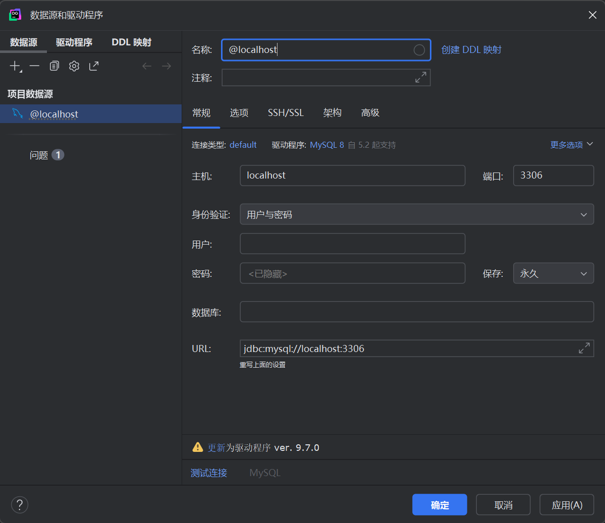

密码置为空


点击测试连接

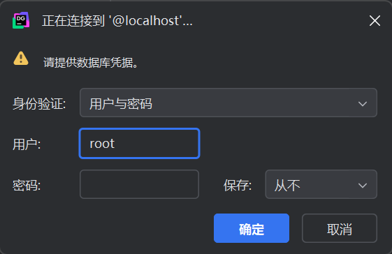

不要设置密码，因为 当前root账号无密码，直接留空即可

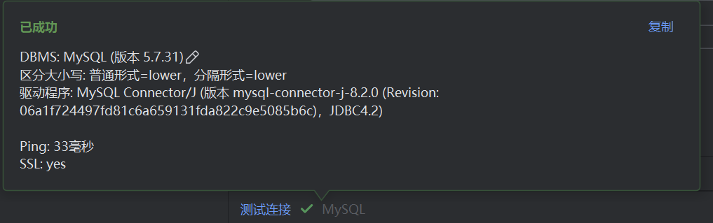


之后选择架构，选择所有架构，就嫩看到数据库中所有的表了

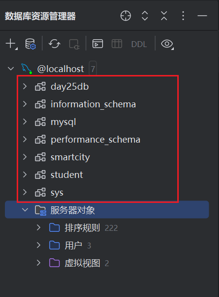


## 数据库设计

和前端类比

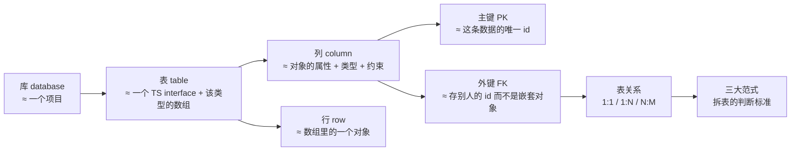


### SQL 与三个分支

SQL = Structured Query Language。关键认知：它是标准，各家（MySQL / PostgreSQL / SQLite）90% 语法通用

| 分支 | 全称                       | 管什么                     | 你的优先级           |
| ---- | -------------------------- | -------------------------- | -------------------- |
| DDL  | Data Definition Language   | 库、表、视图的**结构**     | ⭐⭐⭐ 必会             |
| DML  | Data Manipulation Language | 表里的**数据**（增删改查） | ⭐⭐⭐ 必会（日常 95%） |
| DCL  | Data Control Language      | **用户权限**               | ⭐ 知道有这东西即可   |


DCL最多用这两句

```sql
CREATE USER 'blog'@'%' IDENTIFIED BY 'xxx';
```

创建一个数据库用户：

- `'blog'` — 用户名为 `blog`
- `'%'` — 允许从**任意主机**连接（`%` 是通配符，表示不限制来源 IP）
- `IDENTIFIED BY 'xxx'` — 登录密码为 `xxx`


```sql
GRANT ALL ON blog_db.* TO 'blog'@'%';
```

授予该用户权限：

- `GRANT ALL` — 授予**所有权限**（增删改查、建表等）
- `ON blog_db.*` — 作用范围是 `blog_db` 数据库下的**所有表**
- `TO 'blog'@'%'` — 授权对象是上面创建的 `blog` 用户


### 管理库

```sql
-- 创建：字符集必须是 utf8mb4，这是唯一需要背的参数
CREATE DATABASE blog_db
  DEFAULT CHARACTER SET utf8mb4  -- 指定默认字符集为 utf8mb4（支持 emoji 等 4 字节字符）
  COLLATE utf8mb4_0900_ai_ci;    -- 指定排序/比较规则，比较时不区分大小写

SHOW DATABASES;        -- 看有哪些库
USE blog_db;           -- 切换当前库（之后写表名就不用带库前缀）
DROP DATABASE blog_db; -- 删库（不可逆，慎用）
```

MySQL 历史遗留问题导致 `utf8` 其实是个"残缺版"，**建库必须用 `utf8mb4`**，这是唯一需要记住的参数。

`utf8mb4_0900_ai_ci` 中：

- `ai` = accent insensitive，不区分重音
- `ci` = case insensitive，**不区分大小写**


### 管理表

字段 = 名 + 类型 + 约束

```sql
CREATE TABLE users (
  id       INT          NOT NULL AUTO_INCREMENT,
  username VARCHAR(50)  NOT NULL,
  balance  DECIMAL(10,2) NOT NULL DEFAULT 0.00,
  is_vip   TINYINT(1)   NOT NULL DEFAULT 0,
  bio      TEXT         NULL,
  born_on  DATE         NULL,
  created_at DATETIME   NOT NULL DEFAULT CURRENT_TIMESTAMP,
  PRIMARY KEY (id),
  UNIQUE KEY uk_username (username)
) ENGINE=InnoDB DEFAULT CHARSET=utf8mb4;
```

| 字段                                                     | 解析                                               |
| :------------------------------------------------------- | :------------------------------------------------- |
| `id INT NOT NULL AUTO_INCREMENT`                         | 整数主键，自动递增（1, 2, 3...），不能为空         |
| `username VARCHAR(50) NOT NULL`                          | 用户名，最多 50 个字符，不能为空                   |
| `balance DECIMAL(10,2) NOT NULL DEFAULT 0.00`            | 余额，最大 `99999999.99`，默认 0，不能为空         |
| `is_vip TINYINT(1) NOT NULL DEFAULT 0`                   | VIP 状态开关，0=否/1=是，默认非 VIP                |
| `bio TEXT NULL`                                          | 个人简介，长文本，允许为空                         |
| `born_on DATE NULL`                                      | 生日，只存日期，允许为空                           |
| `created_at DATETIME NOT NULL DEFAULT CURRENT_TIMESTAMP` | 创建时间，插入时**自动记录当前时间**               |
| `PRIMARY KEY (id)`                                       | 声明 `id` 为主键（唯一 + 不为空 + 有索引）         |
| `UNIQUE KEY uk_username (username)`                      | 用户名不允许重复，`uk_` 是命名约定前缀             |
| `ENGINE=InnoDB`                                          | 使用 InnoDB 引擎，支持事务和外键，MySQL 默认且推荐 |
| `DEFAULT CHARSET=utf8mb4`                                | 表级字符集，支持 emoji                             |


#### 字段类型

| SQL 类型       | 对应 JS        | 什么时候用                                   | 前端必知的坑                                                 |
| -------------- | -------------- | -------------------------------------------- | ------------------------------------------------------------ |
| `INT`          | `number`       | 主键 id、计数、年龄                          | 上限约 21 亿。**大 id 用 `BIGINT`，但 BIGINT 超过 `Number.MAX_SAFE_INTEGER` 时 JSON 传给前端会精度丢失 → 后端要转成字符串** |
| `TINYINT(1)`   | `boolean`      | 状态开关、软删除标记                         | 大纲写的 `BIT`：占 1 位确实更省，但 Node 的 `mysql2` 驱动读出来是 **`Buffer`** 不是 `true/false`，很恶心。**实战一律用 `TINYINT(1)`**，驱动会自动映射成 boolean |
| `DECIMAL(M,N)` | ⚠️ 字符串       | **只要是钱，无脑用它**                       | `M`=总位数，`N`=小数位。`DECIMAL(10,2)` → 最大 `99999999.99`。为什么不用 `FLOAT/DOUBLE`？就是你熟悉的 `0.1 + 0.2 !== 0.3`，二进制浮点存不下十进制小数。**注意：驱动为了防精度丢失，把它读成字符串返回给你** |
| `CHAR(n)`      | `string`       | 长度**恒定**：MD5(32)、手机号(11)、国家码(2) | 定长，不够会补空格。存短固定值时比 varchar 快一点点          |
| `VARCHAR(n)`   | `string`       | **95% 的字符串都用它**：用户名、标题、URL    | `n` 是**字符数**不是字节数。别无脑 `VARCHAR(255)`，`n` 影响索引和临时表大小，按业务给上限 |
| `TEXT`         | `string`       | 文章正文、长 JSON、富文本                    | **不能设 `DEFAULT` 值**；不能整列建索引；查询时会被单独存储，`SELECT *` 拖慢速度 |
| `DATE`         | `'2026-08-11'` | 生日、纪念日                                 | 只有日期                                                     |
| `DATETIME`     | `Date`         | **创建/更新时间首选**                        | 8 字节，**不带时区**，存进去什么样取出来什么样               |
| `TIME`         | `'12:30:00'`   | 营业时间段                                   | 只有时间                                                     |


- `DATETIME`：原样存储，不管时区。8 字节，年份 1000–9999。
- `TIMESTAMP`：存的是 UTC 时间戳，读写时会按连接的时区自动转换。4 字节

结论：**统一用 `DATETIME`**，并且在 Node 连接串里显式设 `timezone`。


#### 约束

字段的"修饰符"

| 约束             | 含义             | 类比 TypeScript          |
| :--------------- | :--------------- | :----------------------- |
| `NOT NULL`       | 字段必须有值     | `name: string`           |
| `NULL`           | 字段可以为空     | `name?: string`          |
| `AUTO_INCREMENT` | 插入时自动 +1    | —                        |
| `DEFAULT x`      | 不传值时的默认值 | 函数默认参数 `fn(x = 0)` |
| `UNIQUE`         | 值不能重复       | —                        |

`NULL` 在 SQL 中表示"**未知**"，而不是空字符串或 0，所以任何值和 `NULL` 比较结果都是"未知"，不是 true。

```
-- ❌ 永远查不出任何结果！NULL 不能用 = 比较
WHERE col = NULL

-- ✅ 正确写法
WHERE col IS NULL
```


#### 改表 / 删表

```sql
ALTER TABLE users ADD COLUMN avatar VARCHAR(255) NULL;      -- 加列
ALTER TABLE users MODIFY COLUMN username VARCHAR(80) NOT NULL; -- 改类型
ALTER TABLE users CHANGE COLUMN bio intro TEXT;             -- 改列名（要带完整定义）
ALTER TABLE users DROP COLUMN avatar;                        -- 删列
DROP TABLE users;                                            -- 删表
TRUNCATE TABLE users;                                        -- 清空数据但保留表，且自增归 1
```


### 主键

主键就是**唯一定位一行数据的标识**，就像现实中每个人的身份证号。

| 要求       | 反例                           | 为什么致命                                                   |
| ---------- | ------------------------------ | ------------------------------------------------------------ |
| 唯一       | —                              | 不唯一就没法定位一行                                         |
| 不能更改   | 用"用户名"做主键，用户改名     | 所有引用了它的表（外键）全部要跟着改，级联爆炸               |
| 无业务含义 | 用"手机号""身份证""学号"做主键 | 业务规则一定会变：手机号会换、学号会重排、"绝不重复"的东西早晚重复 |

```
users 表                          
┌────┬─────────────┬───────┐         
│ id │ username    │ phone │          
│ PK │             │       │        
├────┼─────────────┼───────┤       
│  1 │ 张三        │ 138...│
│  2 │ 李四        │ 139...│    
│  3 │ 王五        │ 137...│   
└────┴─────────────┴───────┘  

张三改名为"张三三" → 只改 username 列
张三换手机号       → 只改 phone 列
id 永远是 1，没人关心它的值，外键引用永远不需要改
                ✅ 稳如磐石
```


自增 id vs UUID 的选择

```
自增 INT/BIGINT                UUID
┌─────────────────────┐       ┌──────────────────────────────────────┐
│ id                  │       │ id                                   │
├─────────────────────┤       ├──────────────────────────────────────┤
│ 1                   │       │ a1b2c3d4-e5f6-7890-abcd-ef1234567890 │
│ 2                   │       │ 9f8e7d6c-b5a4-3210-fedc-ba9876543210 │
│ 3                   │       │ 3c2b1a09-8f7e-6d5c-4b3a-2190feda8b76 │
└─────────────────────┘       └──────────────────────────────────────┘
  ✅ 有序，索引效率高            ❌ 无序，索引碎片化，效率差
  ✅ 占 4~8 字节                ❌ 占 36 字节
  ✅ 单体应用无脑用它            ✅ 多服务离线各自生成 id 时才需要
```


###  外键与表关系

你在前端拿到过这两种数据：

```js
// 形态 A：嵌套（后端 join 好给你的，方便渲染）
{ id: 1, title: '文章', author: { id: 7, name: 'Tom' } }

// 形态 B：范式化 normalized（Redux/RTK 的标准写法）
posts: { 1: { id: 1, title: '文章', authorId: 7 } }
users: { 7: { id: 7, name: 'Tom' } }
```


**数据库只有形态 B。** `authorId` 就是外键 —— 一列，存的是另一张表主键的值。原因和 Redux 范式化完全一样：避免同一份数据被复制多份、改一处要改十处。

```
❌ 形态 A：嵌套存储（数据库不这么干）

posts 表
┌────┬────────┬────────────────────┐
│ id │ title  │ author             │
├────┼────────┼────────────────────┤
│  1 │ 文章1  │ {id:7, name:"Tom"} │  ← Tom 改名
│  2 │ 文章2  │ {id:7, name:"Tom"} │  ← 这里也要改
│  3 │ 文章3  │ {id:7, name:"Tom"} │  ← 这里也要改
└────┴────────┴────────────────────┘
                💥 同一份数据存了三份，改一处要改三处


✅ 形态 B：范式化存储（数据库实际做法）

posts 表                              users 表
┌────┬────────┬───────────┐          ┌────┬────────┐
│ id │ title  │ author_id │          │ id │ name   │
├────┼────────┼───────────┤          ├────┼────────┤
│  1 │ 文章1  │     7     │    	   │  7 │  Tom   │
│  2 │ 文章2  │     7     │          │  8 │  Jerry │
│  3 │ 文章3  │     7     │          └────┴────────┘
└────┴────────┴───────────┘
              		↑
           		  外键列        Tom 改名 → 只改 users 表一处 ✅
```


SQL语句示例

```sql
CREATE TABLE posts (
  id        INT NOT NULL AUTO_INCREMENT PRIMARY KEY,
  title     VARCHAR(200) NOT NULL,
  author_id INT NOT NULL,

  CONSTRAINT fk_posts_author          -- 给这个约束起个名字，方便以后删除/调试
    FOREIGN KEY (author_id)           -- 本表的 author_id 列是外键
    REFERENCES users(id)              -- 它引用 users 表的 id 列
    ON DELETE CASCADE                 -- 删用户时，他的文章一起删
    ON UPDATE CASCADE                 -- 用户 id 改变时，这里自动跟着改
) ENGINE=InnoDB;
```


外键约束替你保证：**不可能插入一条 `author_id = 999` 但 users 表里没有 999 的脏数据**。这就是数据库比 JSON 文件强的地方 —— 它替你守住数据完整性。

```
❌ 没有外键约束时，可以插入脏数据：

posts 表                              users 表
┌────┬────────┬───────────┐          ┌────┬────────┐
│ id │ title  │ author_id │          │ id │ name   │
├────┼────────┼───────────┤          ├────┼────────┤
│  1 │ 文章1  │   999     │          │  1 │  Tom   │
└────┴────────┴───────────┘          └────┴────────┘
                  ↑
           users 表根本没有 id=999 的用户！
           数据已经损坏，查询时会出现孤儿数据 💥


✅ 有外键约束时，数据库自动拦截：

INSERT INTO posts (title, author_id) VALUES ('文章', 999);

                    ↓
        ┌───────────────────────┐
        │   外键约束检查         │
        │                       │
        │  users 表有 id=999 吗？│
        │         NO            │
        └───────────────────────┘
                    ↓
        ERROR: Cannot add or update a child row:
        a foreign key constraint fails ✅ 脏数据被拦截
```


`ON DELETE` 三选一：`CASCADE`（级联删）、`RESTRICT`（有引用就不许删，默认）、`SET NULL`（置空，要求该列可 NULL）。

```
场景：删除 users 表中 id=7 的用户 Tom
      Tom 写过 3 篇文章

─────────────────────────────────────────────────────────

CASCADE（级联删）
┌──────────────────────────────────────────┐
│  删除 Tom                                │
│       ↓                                  │
│  posts 表中 author_id=7 的文章全部删除   │
│       ↓                                  │
│  Tom 和他的所有文章同时消失              │
└──────────────────────────────────────────┘
适合：用户注销，内容归属于他本人的场景（博客文章）


RESTRICT（默认，限制删除）
┌──────────────────────────────────────────┐
│  删除 Tom                                │
│       ↓                                  │
│  检查：posts 表还有引用 id=7 的行吗？    │
│       YES → 🚫 拒绝删除，报错            │
│                                          │
│  必须先删完他的文章，才能删这个用户      │
└──────────────────────────────────────────┘
适合：订单、财务记录等不能随便删的场景


SET NULL（置空）
┌──────────────────────────────────────────┐
│  删除 Tom                                │
│       ↓                                  │
│  posts 表中 author_id=7 → 全部变成 NULL  │
│       ↓                                  │
│  文章还在，但作者变成"匿名"             │
└──────────────────────────────────────────┘
  ⚠️ 要求 author_id 列必须允许 NULL
适合：内容平台，作者注销后文章仍保留的场景
```


### 三种表关系


#### 一对一：用户 ↔ 用户详情

**现实含义**：一个用户，有且只有一份详情;一份详情，只属于一个用户。

```
   users                        user_profiles
 +----+--------+              +---------+------------------+
 | id | name   |              | user_id | address          |
 +----+--------+              +---------+------------------+
 |  1 | 张三   | <----------- |    1    | 北京市...        |
 |  2 | 李四   | <----------- |    2    | 上海市...        |
 |  3 | 王五   |              +---------+------------------+
 +----+--------+                   ^
                                   |
                          这一列同时是 主键 + 外键
```

因为主键的规则是「不能重复」。所以张三永远最多只有一行详情 → 这就是 1:1。


创建用户详情表的代码

```sql
CREATE TABLE user_profiles (
  user_id INT NOT NULL PRIMARY KEY,
  -- PRIMARY KEY: 唯一 + 非空。这是"1:1"的保险丝。

  address VARCHAR(255),
  intro   TEXT,

  FOREIGN KEY (user_id) REFERENCES users(id) ON DELETE CASCADE
  -- FOREIGN KEY: 声明本表的 user_id 必须能在 users.id 里找到。
  --              你插入 user_id=999 但 users 里没有 999 → 直接报错。这叫"引用完整性"。
  -- ON DELETE CASCADE: 级联删除。删掉 users 里的张三 → 他的 profile 自动跟着删。
  --                    不写这句的话,默认是 RESTRICT: 只要还有 profile 引用他,就不让你删张三。
);
```


#### 一对多：用户 ↔ 文章(最常用)

外键永远放在「多」的那一方

```
   users (1 的一方)              posts (多的一方)
 +----+--------+              +----+----------+-----------+
 | id | name   |              | id | title    | author_id |
 +----+--------+              +----+----------+-----------+
 |  1 | 张三   | <----------- |  1 | 文章A    |     1     |
 |    |        | <----------- |  2 | 文章B    |     1     |
 |    |        | <----------- |  3 | 文章C    |     1     |
 |  2 | 李四   | <----------- |  4 | 文章D    |     2     |
 +----+--------+              +----+----------+-----------+
                                                   ^
                                    外键放这儿:每篇文章记住"作者是谁"
```

`author_id` 这一列允许重复(1 出现了三次),重复几次就代表张三有几篇文章。这就是"多"的来源。


如果硬要在 users 里存 `post_ids`:

```
 id | name | post_ids
 ---+------+-----------
  1 | 张三 | "1,5,9,22"     <- 灾难
```

| 问题           | 说明                                                         |
| :------------- | :----------------------------------------------------------- |
| 违反第一范式   | 一个字段只能存一个不可再分的值,这里塞了 4 个                 |
| 无法建索引     | 想查"文章 9 属于谁",只能全表 `LIKE '%9%'`,而且会误命中 `19`、`90` |
| 无法加外键约束 | 数据库不认识字符串里的数字,你写 `"1,999"` 它也不拦你         |
| 增删极其痛苦   | 删一篇文章要:读出字符串 → 切分 → 找到 → 拼回去 → 写回        |


#### 多对多：文章 ↔ 标签

**现实含义**:一篇文章有多个标签,一个标签也被多篇文章使用。**双向都是"多"**。

```
   posts                                        tags
 +----+--------+                            +----+--------+
 | 1  | 文章A  |----+                  +--->| 10 | Java   |
 | 2  | 文章B  |--+ |                  |    | 11 | MySQL  |
 | 3  | 文章C  |  | +------------------+    | 12 | 前端   |
 +----+--------+  +--------------------+    +----+--------+
                                       |
              交叉成一张网,两边都放不下外键
```

死结在于:外键该放哪儿?放 posts 里 → 一篇文章只能有一个标签;放 tags 里 → 一个标签只能配一篇文章。**两边都不行**,所以只能新开一张表专门记录"配对事实"。

```
  posts            post_tags (中间表)             tags
+----+------+     +---------+--------+        +----+--------+
| 1  |文章A |<----| post_id | tag_id |------->| 10 | Java   |
| 2  |文章B |     +---------+--------+        | 11 | MySQL  |
| 3  |文章C |     |    1    |   10   |        | 12 | 前端   |
+----+------+     |    1    |   11   |        +----+--------+
                  |    2    |   10   |
                  |    3    |   12   |
                  +---------+--------+
                     ↑           ↑
                  1:N 关系    N:1 关系
```

读这张表:**每一行 = 一条"连线"**。

- 第 1、2 行:文章A 同时有 Java 和 MySQL 两个标签
- 第 1、3 行:Java 这个标签同时被 文章A 和 文章B 使用


中间表创建的SQL代码

```sql
CREATE TABLE post_tags (
  post_id INT NOT NULL,
  tag_id  INT NOT NULL,
  -- 注意:这张表没有自己的 id,它不描述任何"实体",只描述"关系"

  PRIMARY KEY (post_id, tag_id),
  -- 联合主键(复合主键):约束的是"两列的组合"不能重复。
  --   (1,10) 和 (1,11) → OK,post_id 单独重复没关系
  --   (1,10) 和 (1,10) → ✗ 报错,组合重复了
  -- 效果:防止给同一篇文章重复贴同一个标签。

  FOREIGN KEY (post_id) REFERENCES posts(id) ON DELETE CASCADE,
  FOREIGN KEY (tag_id)  REFERENCES tags(id)  ON DELETE CASCADE
  -- 两个外键,分别指向左右两张主表。
  -- CASCADE 在这里特别关键:删掉文章A → 它的所有配对行自动清理,
  --                       不会留下指向不存在文章的"僵尸关系"。
);
```


### 表设计范式

核心：一个事实，只在一个地方存一次

起点：一张烂表

```
orders
+----+------+---------------------+-----------+---------+--------+------+
| id | 客户 | 联系方式            | 商品      | 单价    | 所在省 | 省会 |
+----+------+---------------------+-----------+---------+--------+------+
| 1  | Tom  | 手机:138…, QQ:123   | 键盘,鼠标 | 99,29   | 广东   | 广州 |
+----+------+---------------------+-----------+---------+--------+------+
        ↑           ↑                  ↑                    ↑       ↑
        |      一格塞两个值      一格塞两个值            这俩绑在一起
        |         (1NF ✗)           (1NF ✗)                (3NF ✗)
```


#### 1NF:每一格只能装一个值

```
   违规                              修正
+---------------------+       +-------------+--------+
| 联系方式            |  ==>  | phone       | qq     |
+---------------------+       +-------------+--------+
| 手机:138…, QQ:123   |       | 138…        | 123    |
+---------------------+       +-------------+--------+


+-----------+---------+       多值 → 竖过来变成"多行",而不是横着塞进一格
| 商品      | 单价    |
+-----------+---------+  ==>  order_items
| 键盘,鼠标 | 99,29   |       +----------+------------+------+
+-----------+---------+       | order_id | product_id | 数量 |
                              +----------+------------+------+
                              |    1     |    100     |  1   |  ← 键盘
                              |    1     |    101     |  1   |  ← 鼠标
                              +----------+------------+------+
```


#### 2NF:非主键列，必须依赖完整的主键

每一个非主键列，必须依赖**完整的主键**，不能只依赖主键的一部分。


只在**联合主键**时才可能违规。假设订单明细表主键是 `(order_id, product_id)`：

```
order_items   

主键 = (order_id, product_id)
+----------+------------+------+--------+
| order_id | product_id | 数量 | 商品名 |
+----------+------------+------+--------+
|    1     |    100     |  2   | 键盘   |
|    2     |    100     |  5   | 键盘   |   ← 重复
|    3     |    100     |  1   | 键盘   |   ← 重复
+----------+------------+------+--------+
     └──────────┬───────┘  ↑        ↑
           完整主键         |        |
                            |       └─ 商品名只依赖 product_id,跟 order_id 无关，部分依赖会造成数据重复
                            └─────────── 数量依赖两个主键，两个都要看,才知道买了几个 ✓
```

**修正**:谁只依赖 `product_id`,就把谁搬回 `products` 表。

```
order_items                    products
+----------+------------+----+  +-----+--------+
| order_id | product_id |数量|  | id  | name   |
+----------+------------+----+  +-----+--------+
|    1     |    100     | 2  |─>| 100 | 键盘   |   改名?只改这一行
+----------+------------+----+  +-----+--------+
```


#### 3NF：非主键列不能依赖另一个非主键列

症状:改 A 就必须跟着改 B。

```
+----+--------+--------+------+
| id | 客户名 | 所在省 | 省会 |
+----+--------+--------+------+
| 1  | Tom    | 广东   | 广州 |
| 2  | Amy    | 广东   | 广州 |   ← "广东→广州"这个事实,存了 N 遍
| 3  | Bob    | 广东   | 广州 |
+----+--------+--------+------+

依赖链:  id ──→ 所在省 ──→ 省会
         └─────传递依赖─────┘
              省会其实不认识 id,它只认识"所在省"
```

**修正**:把这条链断开,末端单独建表。

```
orders                          provinces
+----+--------+-------------+   +----+------+------+
| id | 客户名 | province_id |   | id | name | 省会 |
+----+--------+-------------+   +----+------+------+
| 1  | Tom    |     1       |──>| 1  | 广东 | 广州 |  ← 只此一份
| 2  | Amy    |     1       |──>| 2  | 江苏 | 南京 |
+----+--------+-------------+   +----+------+------+
```


## 表记录增删改


| 操作      | CRUD     | SQL 关键字                         | 类别              |
| --------- | -------- | ---------------------------------- | ----------------- |
| 建库/建表 | —        | `CREATE DATABASE` / `CREATE TABLE` | DDL               |
| 增        | Create   | `INSERT`                           | DML               |
| 查        | Retrieve | `SELECT`                           | DML（这次先跳过） |
| 改        | Update   | `UPDATE`                           | DML               |
| 删        | Delete   | `DELETE`                           | DML               |


### 建库

两种，图中表示在localhost主机下建库

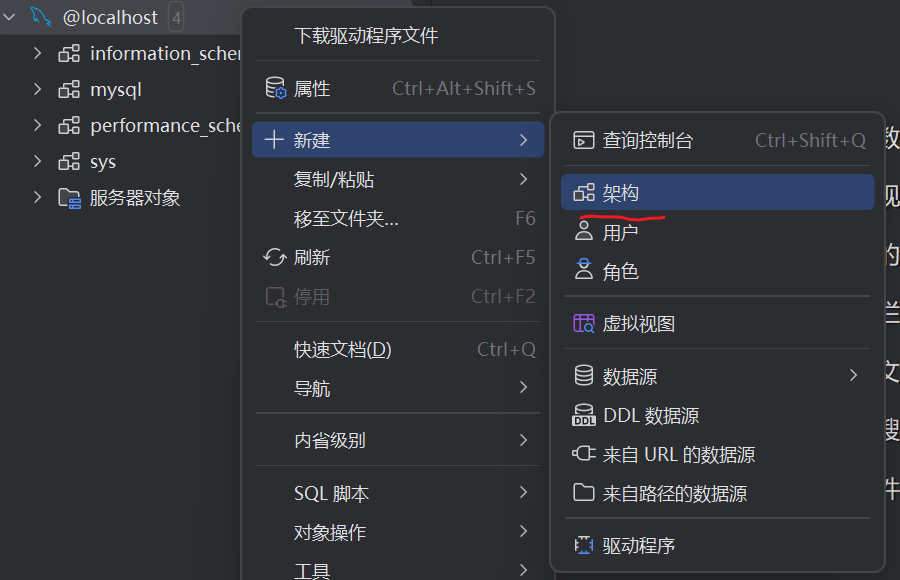


语句

```sql
CREATE DATABASE demo_school DEFAULT CHARACTER SET utf8mb4;
```

- `CREATE DATABASE demo_school` —— 建一个叫 `demo_school` 的数据库（可以理解成一个"文件夹"）
- `DEFAULT CHARACTER SET utf8mb4` —— 指定默认字符集。**必须写**，否则中文可能存不进去或乱码。`utf8mb4` 是真正的完整 UTF-8，能存中文和 emoji


语句输入到查询控制台中：

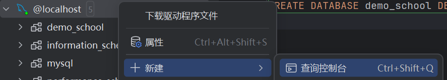

新增了数据库 demo_school

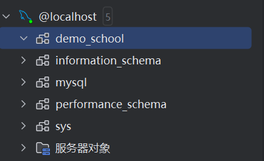


### 建表

通过软件

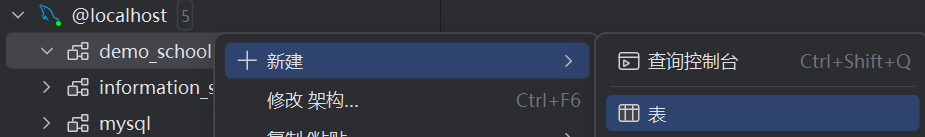


语句

```sql
CREATE TABLE student (
    id     INT PRIMARY KEY AUTO_INCREMENT,
    name   VARCHAR(20) NOT NULL,
    age    INT,
    gender CHAR(1),
    score  DECIMAL(5,2)
);
```

解析

| 语句                         | 含义                                                         |
| ---------------------------- | ------------------------------------------------------------ |
| `CREATE TABLE student (...)` | 建一张叫 `student` 的表，括号里是**列的定义**                |
| `id INT`                     | `id` 列，整数类型                                            |
| `PRIMARY KEY`                | 主键：这一列的值**唯一且不能为空**，用来定位某一行           |
| `AUTO_INCREMENT`             | 自增：插入时不用管它，MySQL 自动给 1、2、3…                  |
| `name VARCHAR(20)`           | 变长字符串，最多 20 个字符。`VARCHAR` 存多少占多少           |
| `NOT NULL`                   | 约束：这列不允许为空，插入时必须给值                         |
| `age INT`                    | 整数，没写 `NOT NULL` 所以允许为空（NULL）                   |
| `gender CHAR(1)`             | 定长字符串，固定 1 个字符。适合存"男/女"这种固定长度的值     |
| `score DECIMAL(5,2)`         | 精确小数：**总共 5 位数字，其中 2 位是小数**，即最大 `999.99`。存钱、存分数用 `DECIMAL`，别用 `FLOAT`（会有精度误差） |


输入到查询控制台中：


执行完毕后生成一张学生表

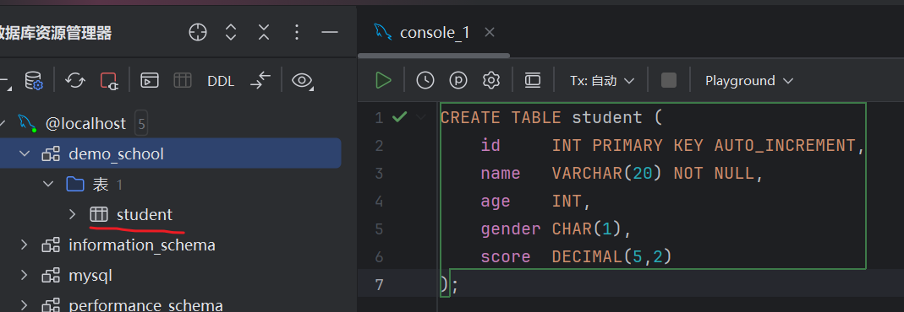


### 增：`INSERT`

同样打开对应表下的查询控制台

一次插入多行数据

```sql
INSERT INTO student (name, age, gender, score) VALUES
('张三', 18, '男', 88.50),
('李四', 19, '男', 92.00),
('王五', 18, '女', 76.50),
('赵六', 20, '女', 60.00);
```

- `INSERT INTO 表名 (列1, 列2, ...)` —— 指明**要往哪些列里塞值**
- `VALUES (...), (...), (...)` —— 每一个括号就是**一行数据**，顺序必须和上面的列名一一对应
- **没写 `id`**，因为它是 `AUTO_INCREMENT`，MySQL 会自动填 1/2/3/4
- 字符串和日期要用**单引号** `'张三'`，数字不用


执行完毕后，表中就有了数据

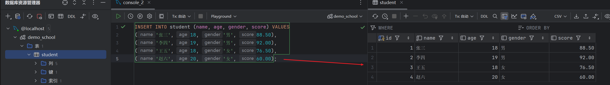


插入单行

```sql
INSERT INTO student (name, age, gender, score) VALUES ('孙七', 22, '男', 81.00);
```


### 改：`UPDATE`

改一列

```
UPDATE student SET score = 95.00 WHERE id = 1;
```

- `UPDATE student` —— 要改 `student` 表
- `SET score = 95.00` —— 把 `score` 列改成 95.00
- `WHERE id = 1` —— **只改 id 为 1 的那一行**

执行前

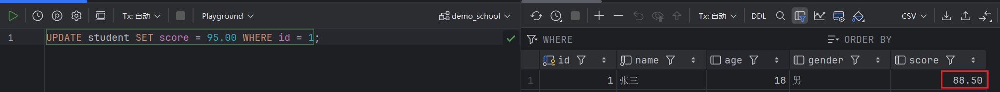

执行后

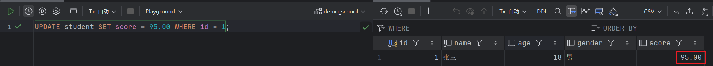


一次改多列

```sql
UPDATE student SET age = 21, score = 66.00 WHERE name = '赵六';
```

- `SET` 后面多个赋值用**逗号**分隔
- `WHERE` 的条件不一定是主键，任何列都行

修改前

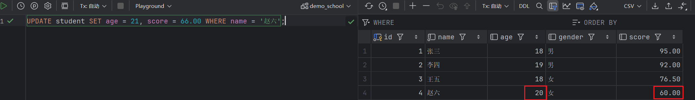

修改后

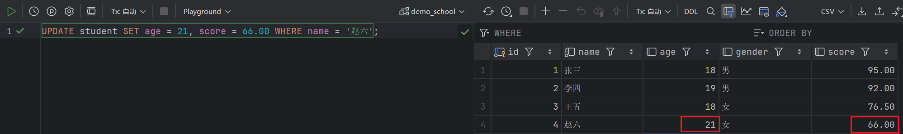


### 删：`DELETE`

```sql
DELETE FROM student WHERE id = 3;
```

- `DELETE FROM student` —— 从 `student` 表删除
- `WHERE id = 3` —— 只删 id 为 3 的那一行
- 注意 `DELETE` 删的是**整行**，不存在"只删某一列"的说法（那叫 `UPDATE ... SET 列 = NULL`）

> `DELETE FROM student;` 不带 `WHERE` 会清空整张表。

执行完毕后，中间少了一条记录

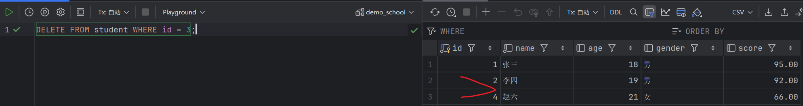


## 单表基本查询


### 关键字含义

```
select 要哪些列
from   从哪张表
where  只要满足条件的行
order by 按什么排序
limit  只要几条
```

只有 `select` 是必须的，其它都可省略。把它读成一句话：**从哪张表（from）、挑出哪些行（where）、显示哪些列（select）、怎么排（order by）、取几条（limit）**。


写的顺序：`select → from → where → order by → limit`

执行的顺序：`from → where → select → order by → limit`


当前有数据库`demo_school`中的`student`表如下：后面示例以本表为基础

| id   | name | age  | gender | score |
| ---- | ---- | ---- | ------ | :---- |
| 1    | 张三 | 18   | 男     | 95.00 |
| 2    | 李四 | 19   | 男     | 92.00 |
| 4    | 赵六 | 21   | 女     | 66.00 |
| 10   | 孙七 | 22   | 男     | 81.00 |
| 11   | 王五 | 20   | 女     | 78.50 |
| 12   | 周八 | 19   | 女     | NULL  |
| 13   | 吴九 | NULL | 男     | 88.00 |
| 14   | 郑十 | 21   | 女     | 59.00 |


###  select —— 决定"要哪些列"

`*` 表示全部列

```sql
select * from student;
```

`*` 是通配符，图省事时用，正式代码里不推荐（列变了结果就变了）。


指定列

```sql
select name, age from student;
```

只要name和age两列

| name | age  |
| ---- | ---- |
| 张三 | 18   |
| 李四 | 19   |
| 赵六 | 21   |
| 孙七 | 22   |
| 王五 | 20   |
| 周八 | 19   |
| 吴九 | NULL |
| 郑十 | 21   |


别名 as

```sql
select name as 姓名, age as 年龄 from student;
```

`as` 给列改个显示用的名字。**只影响结果集的表头，不改数据库里的字段名**

| 姓名 | 年龄 |
| ---- | ---- |
| 张三 | 18   |
| 李四 | 19   |
| ...  | ...  |


distinct 去重

```sql
select distinct gender from student;
```

取出 `gender` 列并去掉重复值。

| gender |
| ------ |
| 男     |
| 女     |

```sql
select distinct age from student;
```

注意：**NULL 也算一个"值"，会被保留一个**。

| age  |
| ---- |
| 18   |
| 19   |
| 21   |
| 22   |
| 20   |
| NULL |


case —— 在查询结果里做"如果…就…"

```sql
select name,
       score,
       case
           when score is null then '缺考'
           when score >= 90   then '优秀'
           when score >= 60   then '及格'
           else '不及格'
       end as 等级
from student;
```

`case ... end` 是一个**表达式**，它算出来的值当作一个新列。`when` 从上往下逐个判断，**第一个成立的就返回，后面不再看**；都不成立走 `else`。

| name | score | 等级   |
| ---- | ----- | ------ |
| 张三 | 95.00 | 优秀   |
| 李四 | 92.00 | 优秀   |
| 赵六 | 66.00 | 及格   |
| 孙七 | 81.00 | 及格   |
| 王五 | 78.50 | 及格   |
| 周八 | NULL  | 缺考   |
| 吴九 | 88.00 | 及格   |
| 郑十 | 59.00 | 不及格 |


### from —— 决定"从哪张表"

```sql
select * from demo_school.student;   -- 库名.表名，随时随地能用
```

```sql
use demo_school;                      -- 先切到这个库
select * from student;                -- 之后直接写表名
```


### where —— 决定"要哪些行"

`=` 等于

只保留 `gender` 等于 `'女'` 的行。字符串用单引号；SQL 里判断相等是**一个等号**，不是 `==`。

| id   | name | age  | gender | score |
| ---- | ---- | ---- | ------ | ----- |
| 4    | 赵六 | 21   | 女     | 66.00 |
| 11   | 王五 | 20   | 女     | 78.50 |
| 12   | 周八 | 19   | 女     | NULL  |
| 14   | 郑十 | 21   | 女     | 59.00 |


in —— 等于其中任意一个

```sql
select * from student where gender = '女';
```

> 等价于 `age = 18 or age = 19`，但更简洁。

| id   | name | age  | gender | score |
| ---- | ---- | ---- | ------ | ----- |
| 1    | 张三 | 18   | 男     | 95.00 |
| 2    | 李四 | 19   | 男     | 92.00 |
| 12   | 周八 | 19   | 女     | NULL  |


is null / is not null

```sql
select * from student where score is null;
```

**NULL 表示"没有值"，不能用 `=` 判断**。`score = null` 永远不成立（结果既不是真也不是假），必须用 `is null`。

| id   | name | age  | gender | score |
| ---- | ---- | ---- | ------ | ----- |
| 12   | 周八 | 19   | 女     | NULL  |

```sql
select * from student where score is not null;
```

反过来，只要有分数的。结果是除周八外的 7 行。


比较运算符 `>` `<` `>=` `<=`

```sql
select * from student where age > 20;
```

注意吴九（age 为 NULL）**没有出现**。NULL 参与任何比较都不成立

| id   | name | age  | gender | score |
| ---- | ---- | ---- | ------ | ----- |
| 4    | 赵六 | 21   | 女     | 66.00 |
| 10   | 孙七 | 22   | 男     | 81.00 |
| 14   | 郑十 | 21   | 女     | 59.00 |


between —— 区间

```sql
select * from student where score between 60 and 90;
```

等价于 `score >= 60 and score <= 90`，**两端都包含**。小的写前面，大的写后面，写反了查不出东西。

| id   | name | age  | gender | score |
| ---- | ---- | ---- | ------ | ----- |
| 4    | 赵六 | 21   | 女     | 66.00 |
| 10   | 孙七 | 22   | 男     | 81.00 |
| 11   | 王五 | 20   | 女     | 78.50 |
| 13   | 吴九 | NULL | 男     | 88.00 |


like —— 模糊匹配

```sql
select * from student where name like '张%';
```

`%` 匹配**任意个**字符（包括 0 个）。这条是"姓张的"。

| id   | name | age  | gender | score |
| ---- | ---- | ---- | ------ | ----- |
| 1    | 张三 | 18   | 男     | 95.00 |

```sql
select * from student where name like '_五';
```

`_` 匹配**恰好一个**字符。这条是"两个字、第二个字是五"的。

| id   | name | age  | gender | score |
| ---- | ---- | ---- | ------ | ----- |
| 11   | 王五 | 20   | 女     | 78.50 |

记忆：`%` 是"任意长度"，`_` 是"占一位"。`'%五%'` 就是"名字里带五"。


and —— 同时满足

```sql
select * from student where gender = '女' and age >= 20;
```

两个条件都成立才留下

| id   | name | age  | gender | score |
| ---- | ---- | ---- | ------ | ----- |
| 4    | 赵六 | 21   | 女     | 66.00 |
| 11   | 王五 | 20   | 女     | 78.50 |
| 14   | 郑十 | 21   | 女     | 59.00 |


or —— 满足其一

```sql
select * from student where gender = '男' or score > 90;
```

任一条件成立就留下。

| id   | name | age  | gender | score |
| ---- | ---- | ---- | ------ | ----- |
| 1    | 张三 | 18   | 男     | 95.00 |
| 2    | 李四 | 19   | 男     | 92.00 |
| 10   | 孙七 | 22   | 男     | 81.00 |
| 13   | 吴九 | NULL | 男     | 88.00 |

`and` 的优先级比 `or` 高。混用时**一定加括号**：`where (a or b) and c`，否则容易得到意料之外的结果。


### order by —— 排序

desc 降序

```sql
select * from student order by score desc;
```

按分数从高到低。`desc` = descending（降序）。**MySQL 里 NULL 被当作最小值**，所以降序时排最后。

| id   | name | age  | gender | score |
| ---- | ---- | ---- | ------ | ----- |
| 1    | 张三 | 18   | 男     | 95.00 |
| 2    | 李四 | 19   | 男     | 92.00 |
| 13   | 吴九 | NULL | 男     | 88.00 |
| 10   | 孙七 | 22   | 男     | 81.00 |
| 11   | 王五 | 20   | 女     | 78.50 |
| 4    | 赵六 | 21   | 女     | 66.00 |
| 14   | 郑十 | 21   | 女     | 59.00 |
| 12   | 周八 | 19   | 女     | NULL  |


asc 升序（默认）

```sql
select * from student order by age asc;
```

从小到大。`asc` 是默认值，不写也一样。NULL 最小，排最前面。

| id   | name | age  | gender | score |
| ---- | ---- | ---- | ------ | ----- |
| 13   | 吴九 | NULL | 男     | 88.00 |
| 1    | 张三 | 18   | 男     | 95.00 |
| 2    | 李四 | 19   | 男     | 92.00 |
| 12   | 周八 | 19   | 女     | NULL  |
| 11   | 王五 | 20   | 女     | 78.50 |
| 4    | 赵六 | 21   | 女     | 66.00 |
| 14   | 郑十 | 21   | 女     | 59.00 |
| 10   | 孙七 | 22   | 男     | 81.00 |


多字段排序

```sql
select * from student order by gender asc, score desc;
```

**先**按性别升序分组排列；性别**相同的**再按分数降序。后面的字段只在前面字段"打平"时才起作用。

| id   | name | age  | gender | score |
| ---- | ---- | ---- | ------ | ----- |
| 11   | 王五 | 20   | 女     | 78.50 |
| 4    | 赵六 | 21   | 女     | 66.00 |
| 14   | 郑十 | 21   | 女     | 59.00 |
| 12   | 周八 | 19   | 女     | NULL  |
| 1    | 张三 | 18   | 男     | 95.00 |
| 2    | 李四 | 19   | 男     | 92.00 |
| 13   | 吴九 | NULL | 男     | 88.00 |
| 10   | 孙七 | 22   | 男     | 81.00 |

（"女"排在"男"前面，是因为汉字按编码值比较，`女` 的编码比 `男` 小，不是按拼音。）


limit —— 取几条

```sql
select * from student limit 3;
```

只取前 3 条。等价于 `limit 0, 3`。

| id   | name | age  | gender | score |
| ---- | ---- | ---- | ------ | ----- |
| 1    | 张三 | 18   | 男     | 95.00 |
| 2    | 李四 | 19   | 男     | 92.00 |
| 4    | 赵六 | 21   | 女     | 66.00 |


```sql
select * from student limit 2, 3;
```

**跳过 2 条，再取 3 条**。第一个数是"偏移量"（从 0 开始数），第二个是"取几条"。

| id   | name | age  | gender | score |
| ---- | ---- | ---- | ------ | ----- |
| 4    | 赵六 | 21   | 女     | 66.00 |
| 10   | 孙七 | 22   | 男     | 81.00 |
| 11   | 王五 | 20   | 女     | 78.50 |

这就是**分页**：每页 `n` 条，第 `p` 页 → `limit (p-1)*n, n`。


## 关联查询

单表查询只能问"学生有哪些"。但真实业务里数据是分散的：学生一张表、班级一张表，通过一个**外键**串起来。要同时看到"张三 属于 一班"，就必须联表。


新建表并进行关联

```sql
USE demo_school;

-- 班级表：只有 id 和 name 两个字段，够简单
CREATE TABLE class (
  id   INT PRIMARY KEY AUTO_INCREMENT,
  name VARCHAR(20) NOT NULL
) ENGINE=InnoDB DEFAULT CHARSET=utf8mb4;

INSERT INTO class (id, name) VALUES
(1, '一班'),
(2, '二班'),
(3, '三班');   -- 三班故意不安排学生

-- 给 student 加一个"外键列"，指向 class.id
ALTER TABLE student ADD COLUMN class_id INT DEFAULT NULL;

UPDATE student SET class_id = 1 WHERE id IN (1, 2, 4);
UPDATE student SET class_id = 2 WHERE id IN (10, 11, 12);
-- id 13、14 保持 NULL，表示"还没分班"
```

执行位置：

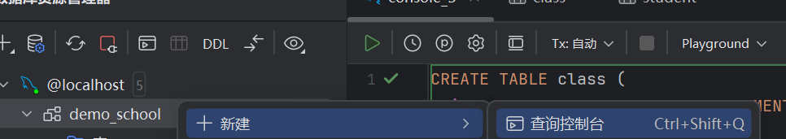

执行完毕，两张表长这样：

class

```
+----+--------+
| id | name   |
+----+--------+
|  1 | 一班   |
|  2 | 二班   |
|  3 | 三班   |   ← 无学生
+----+--------+
```

student

```
+----+--------+------+--------+-------+----------+
| id | name   | age  | gender | score | class_id |
+----+--------+------+--------+-------+----------+
|  1 | 张三   |   18 | 男     | 95.00 |        1 |
|  2 | 李四   |   19 | 男     | 92.00 |        1 |
|  4 | 赵六   |   21 | 女     | 66.00 |        1 |
| 10 | 孙七   |   22 | 男     | 81.00 |        2 |
| 11 | 王五   |   20 | 女     | 78.50 |        2 |
| 12 | 周八   |   19 | 女     |  NULL |        2 |
| 13 | 吴九   | NULL | 男     | 88.00 |     NULL |   ← 未分班
| 14 | 郑十   |   21 | 女     | 59.00 |     NULL |   ← 未分班
+----+--------+------+--------+-------+----------+
```


### 笛卡尔积（CROSS JOIN）

连接所有原材料

两张表**不加任何条件**硬拼，左表每一行去配右表每一行。

```sql
SELECT
    s.id   AS s_id,
    s.name AS student,
    s.class_id,
    c.id   AS c_id,
    c.name AS class
FROM student s, class c;
```

- `FROM student s, class c` —— 逗号分隔两张表，就是笛卡尔积。`s` 和 `c` 是**表别名**，后面用 `s.name` 指明"是学生表的 name"（两张表都有 `name` 列，不加前缀会报歧义错误）。
- `AS student` —— 给结果列改个显示名，避免两个 `name` 撞名。

**结果：24 行**（8 个学生 × 3 个班级）。节选：

```
+------+---------+----------+------+--------+
| s_id | student | class_id | c_id | class  |
+------+---------+----------+------+--------+
|    1 | 张三    |        1 |    1 | 一班   |   ← 有意义
|    1 | 张三    |        1 |    2 | 二班   |   ← 无意义！张三不在二班
|    1 | 张三    |        1 |    3 | 三班   |   ← 无意义
|    2 | 李四    |        1 |    1 | 一班   |
|    2 | 李四    |        1 |    2 | 二班   |
...（共 24 行）
```

24 行里只有 6 行是"对的"。笛卡尔积本身几乎没用，**它的价值是帮助理解——所谓连接，就是给笛卡尔积加上筛选条件**。


### 内连接 INNER JOIN

在笛卡尔积上加条件：只保留 `s.class_id = c.id`（班级id） 的那些行

```sql
SELECT s.id, s.name AS student, c.name AS class
FROM student s
INNER JOIN class c ON s.class_id = c.id;
```

- `FROM student s` —— 左表
- `INNER JOIN class c` —— 右表（`INNER` 可以省略，直接写 `JOIN` 就是内连接）
- `ON s.class_id = c.id` —— **连接条件**：学生的 `class_id` 必须等于班级的 `id`

结果：6 行

```
+----+---------+--------+
| id | student | class  |
+----+---------+--------+
|  1 | 张三    | 一班    |
|  2 | 李四    | 一班    |
|  4 | 赵六    | 一班    |
| 10 | 孙七    | 二班    |
| 11 | 王五    | 二班    |
| 12 | 周八    | 二班    |
+----+---------+--------+
```

- 吴九、郑十（`class_id` 是 `NULL`，匹配不上任何班级）→ 被丢弃
- 三班（没有任何学生指向它）→ 被丢弃


### 左连接 LEFT JOIN（左外连接）

**保留左表全部行**，右表匹配不上就用 `NULL` 填充。

```sql
SELECT s.id, s.name AS student, c.name AS class
FROM student s
LEFT JOIN class c ON s.class_id = c.id;
```

- `FROM student s` —— 左表
- `LEFT JOIN class c` —— 右表

**结果：8 行**

```
+----+---------+--------+
| id | student | class  |
+----+---------+--------+
|  1 | 张三    | 一班    |
|  2 | 李四    | 一班    |
|  4 | 赵六    | 一班    |
| 10 | 孙七    | 二班    |
| 11 | 王五    | 二班    |
| 12 | 周八    | 二班    |
| 13 | 吴九    | NULL    |   ← 多出来了！未分班
| 14 | 郑十    | NULL    |   ← 多出来了！未分班
+----+---------+--------+
```


### 右连接 RIGHT JOIN（右外连接）

反过来：**保留右表全部行**，左表匹配不上填 `NULL`。

```SQL
SELECT s.id, s.name AS student, c.name AS class
FROM student s
RIGHT JOIN class c ON s.class_id = c.id;
```

**结果：7 行**

```
+------+---------+--------+
| id   | student | class  |
+------+---------+--------+
|    1 | 张三    | 一班    |
|    2 | 李四    | 一班    |
|    4 | 赵六    | 一班    |
|   10 | 孙七    | 二班    |
|   11 | 王五    | 二班    |
|   12 | 周八    | 二班    |
| NULL | NULL    | 三班    |   ← 多出来了！空班级
+------+---------+--------+
```


## 函数和分组

为原有的`student` 表补一列 `birthday`。

```sql
USE demo_school;

-- ALTER TABLE 表名 ADD COLUMN 列名 类型 —— 给已存在的表追加一列
ALTER TABLE student ADD COLUMN birthday DATE NULL COMMENT '出生日期';

UPDATE student SET birthday = '2008-03-12' WHERE id = 1;
UPDATE student SET birthday = '2007-07-01' WHERE id = 2;
UPDATE student SET birthday = '2005-04-23' WHERE id = 4;
UPDATE student SET birthday = '2004-05-09' WHERE id = 10;
UPDATE student SET birthday = '2006-02-14' WHERE id = 11;
UPDATE student SET birthday = '2007-01-15' WHERE id = 12;
UPDATE student SET birthday = '2005-06-25' WHERE id = 14;
-- id=13 吴九 故意不给生日，用来演示 NULL

SELECT * FROM student;
```

基础数据（后面所有例子都基于它）

```
+----+------+------+--------+-------+----------+------------+
| id | name | age  | gender | score | class_id | birthday   |
+----+------+------+--------+-------+----------+------------+
|  1 | 张三 |   18 | 男     | 95.00 |        1 | 2008-03-12 |
|  2 | 李四 |   19 | 男     | 92.00 |        1 | 2007-07-01 |
|  4 | 赵六 |   21 | 女     | 66.00 |        1 | 2005-04-23 |
| 10 | 孙七 |   22 | 男     | 81.00 |        2 | 2004-05-09 |
| 11 | 王五 |   20 | 女     | 78.50 |        2 | 2006-02-14 |
| 12 | 周八 |   19 | 女     |  NULL |        2 | 2007-01-15 |
| 13 | 吴九 | NULL | 男     | 88.00 |     NULL | NULL       |
| 14 | 郑十 |   21 | 女     | 59.00 |     NULL | 2005-06-25 |
+----+------+------+--------+-------+----------+------------+

class 表：1=一班  2=二班  3=三班（三班没有学生）
```


### 数学函数（了解即可，用时再查）

```
ABS(-8.5)          -> 8.5      绝对值
CEILING(3.14)      -> 4        向上取整（天花板，只进不退）
FLOOR(3.99)        -> 3        向下取整（地板，只退不进）
MOD(10, 3)         -> 1        取余数，等价于 10 % 3
PI()               -> 3.141593 圆周率
RAND()             -> 0.4863   [0,1) 之间的随机小数
ROUND(3.14159, 2)  -> 3.14     四舍五入，保留 2 位小数
TRUNCATE(3.19, 1)  -> 3.1      直接砍断，保留 1 位小数（不进位）
```


重 `ROUND` 和 `TRUNCATE` 的区别：

```sql
SELECT ROUND(3.19159, 2)    AS 四舍五入,   -- 看第 3 位是 1，舍去 → 3.19
       TRUNCATE(3.19159, 2) AS 直接截断,   -- 不看后面，硬砍 → 3.19
       ROUND(3.15,    1)    AS 会进位,     -- 5 进位 → 3.2
       TRUNCATE(3.15, 1)    AS 不会进位;   -- 硬砍   → 3.1
```

结果：

```
+----------+----------+--------+----------+
| 四舍五入  | 直接截断  | 会进位 | 不会进位  |
+----------+----------+--------+----------+
|     3.19 |     3.19 |    3.2 |      3.1 |
+----------+----------+--------+----------+
```


**实际最常用的一个场景**：把小数分数变成整数。

```sql
SELECT id, name, score, ROUND(score) AS 取整分数
FROM student
WHERE score IS NOT NULL;
-- ROUND 只写一个参数时，等价于 ROUND(x, 0)，即保留 0 位小数
```

```
+----+------+-------+----------+
| id | name | score | 取整分数 |
+----+------+-------+----------+
|  1 | 张三 | 95.00 |       95 |
| 11 | 王五 | 78.50 |       79 |   <- 78.5 四舍五入成 79
| 14 | 郑十 | 59.00 |       59 |
+----+------+-------+----------+
（只截取了部分行）
```


### 字符函数

CONCAT —— 拼接

```sql
-- CONCAT(s1, s2, ..., sn)：把参数一个接一个连起来，中间不加任何东西
SELECT CONCAT(name, '(', gender, ')') AS 姓名性别
FROM student
LIMIT 3;
```

```
+----------+
| 姓名性别 |
+----------+
| 张三(男) |
| 李四(男) |
| 赵六(女) |
+----------+
```


CONCAT_WS —— 带分隔符拼接

`WS` = **W**ith **S**eparator。第一个参数是分隔符，后面才是要拼的内容。

```sql
-- 用 '-' 把 name、gender、age 串起来，省得自己写好几个 '-'
SELECT CONCAT_WS('-', name, gender, age) AS 拼接
FROM student
LIMIT 3;
```

```
+------------+
| 拼接       |
+------------+
| 张三-男-18 |
| 李四-男-19 |
| 赵六-女-21 |
+------------+
```


两者遇到 NULL 的差别

```sql
-- 周八(id=12) 的 score 是 NULL
SELECT CONCAT('姓名:', name, ' 分数:', score) AS 结果
FROM student WHERE id IN (1, 12);
```

```
+----------------------+
| 结果                 |
+----------------------+
| 姓名:张三 分数:95.00  |
| NULL                 |   <- 只要有一个参数是 NULL，CONCAT 整个结果就是 NULL
+----------------------+
```

```sql
-- 吴九(id=13) 的 age 是 NULL
SELECT CONCAT_WS('-', name, gender, age) AS 结果
FROM student WHERE id = 13;
```

```
+---------+
| 结果    |
+---------+
| 吴九-男 |   <- CONCAT_WS 会自动跳过 NULL，不影响其它部分
+---------+
```

`CONCAT` 一粒老鼠屎坏一锅汤；`CONCAT_WS` 会把老鼠屎挑出来。


TRIM 家族 —— 去空格

```
TRIM('  hi  ')   -> 'hi'      两头都去
LTRIM('  hi  ')  -> 'hi  '    Left，只去左边
RTRIM('  hi  ')  -> '  hi'    Right，只去右边
```

```sql
-- 用 CONCAT 加上 [ ] 包住，否则肉眼看不出空格有没有被去掉
SELECT CONCAT('[', TRIM('  hi  '), ']')  AS trim结果,
       CONCAT('[', LTRIM('  hi  '), ']') AS ltrim结果,
       CONCAT('[', RTRIM('  hi  '), ']') AS rtrim结果;
```

```
+----------+-----------+-----------+
| trim结果 | ltrim结果 | rtrim结果 |
+----------+-----------+-----------+
| [hi]     | [hi  ]    | [  hi]    |
+----------+-----------+-----------+
```

> 实战用途：清洗用户输入。比如 `UPDATE user SET name = TRIM(name);` 把历史脏数据里多余的空格洗掉。

软件实际执行结果图：

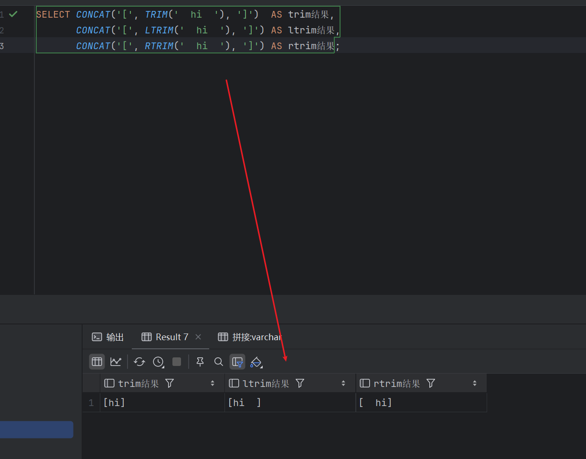


### 日期函数

取当前时间

```sql
SELECT CURDATE()        AS 今天,       -- 只有日期
       CURRENT_DATE()   AS 今天2,      -- CURDATE 的同义词，完全一样
       CURTIME()        AS 现在时间,   -- 只有时间
       NOW()            AS 日期时间;   -- 日期 + 时间（最常用）
```

```
+------------+------------+----------+---------------------+
| 今天       | 今天2       | 现在时间  | 日期时间            |
+------------+------------+----------+---------------------+
| 2026-08-15 | 2026-08-15 | 14:19:03 | 2026-08-15 14:19:03 |
+------------+------------+----------+---------------------+
```

> 最常见的用法是给表填时间戳：`INSERT INTO log(created_at) VALUES (NOW());`


TIMESTAMPDIFF —— 算时间差（重点）

```
TIMESTAMPDIFF(单位, 开始时间, 结束时间)
```

单位可以填：`MICROSECOND` / `SECOND` / `MINUTE` / `HOUR` / `DAY` / `WEEK` / `MONTH` / `QUARTER` / `YEAR`。

最经典的用途：由生日算周岁。

```sql
SELECT name, birthday,
       TIMESTAMPDIFF(YEAR,  birthday, CURDATE()) AS 周岁,
       TIMESTAMPDIFF(MONTH, birthday, CURDATE()) AS 活了几个月,
       TIMESTAMPDIFF(DAY,   birthday, CURDATE()) AS 活了几天
FROM student
WHERE birthday IS NOT NULL
ORDER BY birthday;
```

```
+------+------------+------+------------+----------+
| name | birthday   | 周岁 | 活了几个月  | 活了几天  |
+------+------------+------+------------+----------+
| 孙七 | 2004-05-09 |   22 |        267 |     8133 |
| 赵六 | 2005-04-23 |   21 |        255 |     7784 |
| 郑十 | 2005-06-25 |   21 |        253 |     7721 |
| 王五 | 2006-02-14 |   20 |        246 |     7487 |
| 周八 | 2007-01-15 |   19 |        235 |     7152 |
| 李四 | 2007-07-01 |   19 |        229 |     6985 |
| 张三 | 2008-03-12 |   18 |        221 |     6730 |
+------+------------+------+------------+----------+
（运行日期 2026-08-15，你自己跑的时候数字会变）
```

是「后面的减前面的」。

```sql
SELECT TIMESTAMPDIFF(DAY, '2026-01-01', '2026-03-01') AS 正数,  -- 1月 → 3月
       TIMESTAMPDIFF(DAY, '2026-03-01', '2026-01-01') AS 负数;  -- 3月 → 1月
```

```
+------+------+
| 正数 | 负数 |
+------+------+
|   59 |  -59 |
+------+------+
```


### 聚合函数（重点）


聚合函数把**多行压成一行**。

```
COUNT(col)  统计个数
SUM(col)    求和
AVG(col)    求平均
MAX(col)    求最大
MIN(col)    求最小
```


COUNT(*) 和 COUNT(列) 不一样

```sql
SELECT COUNT(*)     AS 总行数,        -- * 表示"数行"，NULL 也算
       COUNT(score) AS 有分数的行数,  -- 只数 score 不为 NULL 的行
       COUNT(age)   AS 有年龄的行数
FROM student;
```

```
+--------+--------------+--------------+
| 总行数  | 有分数的行数  | 有年龄的行数 |
+--------+--------------+--------------+
|      8 |            7 |            7 |
+--------+--------------+--------------+
```

规则：所有聚合函数（除了 `COUNT(*)`）都会自动忽略 NULL。


AVG 的隐藏陷阱

```sql
SELECT SUM(score) / COUNT(*)     AS 除以总人数,
       SUM(score) / COUNT(score) AS 除以有分数人数,
       AVG(score)                AS AVG结果
FROM student;
```

```
+------------+----------------+-----------+
| 除以总人数  | 除以有分数人数  | AVG结果   |
+------------+----------------+-----------+
|  69.937500 |      79.928571 | 79.928571 |
+------------+----------------+-----------+
```

`AVG(score)` = `SUM(score) / COUNT(score)`，分母是 **7**（有分数的人）不是 **8**（总人数）。周八缺考不会把平均分拉低——这通常是你想要的，但如果业务上"缺考按 0 分算"，就得自己写 `SUM(score) / COUNT(*)` 或者用 `IFNULL(score, 0)`。


常用组合

```sql
SELECT COUNT(*)                AS 人数,
       SUM(score)              AS 总分,
       ROUND(AVG(score), 2)    AS 平均分,   -- 平均分小数太长，套一层 ROUND
       MAX(score)              AS 最高分,
       MIN(score)              AS 最低分
FROM student;
```

```
+------+--------+---------+--------+--------+
| 人数 | 总分    | 平均分  | 最高分  | 最低分 |
+------+--------+---------+--------+--------+
|    8 | 559.50 |   79.93 |  95.00 |  59.00 |
+------+--------+---------+--------+--------+
```

```sql
-- COUNT(DISTINCT col)：去重后再数，统计"有几种"
SELECT COUNT(DISTINCT class_id) AS 班级数 FROM student;

-- class_id 的值有 1、2、NULL，NULL 不算，所以是 2
```

```
+--------+
| 班级数 | 
+--------+
|   2    |
+--------+
```


### 分组 GROUP BY（重点）

不写 `GROUP BY` 时，聚合函数把**整张表**压成一行。写了 `GROUP BY`，就变成**每组压成一行**。


基本分组

```sql
-- 按 class_id 分组，每组内部各自统计
SELECT class_id, COUNT(*) AS 人数, ROUND(AVG(score), 2) AS 平均分
FROM student
GROUP BY class_id;
```

```
+----------+------+--------+
| class_id | 人数 | 平均分 |
+----------+------+--------+
|     NULL |    2 |  73.50 |   <- NULL 也会自成一组
|        1 |    3 |  84.33 |
|        2 |    3 |  79.75 |   <- 二班 3 人但只有 2 人有分数，平均分 (81+78.5)/2
+----------+------+--------+
```


多列分组

```sql
-- GROUP BY 后面写多列 = 按"组合"分组，性别和班级都相同的才算一组
SELECT gender, class_id, COUNT(*) AS 人数
FROM student
GROUP BY gender, class_id;
```

```
+--------+----------+------+
| gender | class_id | 人数 |
+--------+----------+------+
| 女     |     NULL |    1 |
| 女     |        1 |    1 |
| 女     |        2 |    2 |
| 男     |     NULL |    1 |
| 男     |        1 |    2 |
| 男     |        2 |    1 |
+--------+----------+------+
```


WHERE 和 HAVING 

```sql
-- WHERE：分组【之前】过滤原始行 —— 先把不及格的人踢掉，再统计每班人数
SELECT class_id, COUNT(*) AS 人数
FROM student
WHERE score >= 60
GROUP BY class_id;
```

```
+----------+------+
| class_id | 人数 |
+----------+------+
|     NULL |    1 |   <- 郑十 59 分被 WHERE 踢掉了
|        1 |    3 |
|        2 |    2 |   <- 周八 NULL 分也被踢掉（NULL >= 60 结果不成立）
+----------+------+
```

```sql
-- HAVING：分组【之后】过滤分组结果 —— 先算出每班平均分，再筛掉平均分不到 80 的班
SELECT class_id, COUNT(*) AS 人数, ROUND(AVG(score), 2) AS 平均分
FROM student
GROUP BY class_id
HAVING AVG(score) > 80;
```

```
+----------+------+--------+
| class_id | 人数  | 平均分 |
+----------+------+--------+
|        1 |    3 |  84.33 |
+----------+------+--------+
```

|                        | WHERE           | HAVING          |
| ---------------------- | --------------- | --------------- |
| 时机                   | `GROUP BY` 之前 | `GROUP BY` 之后 |
| 操作对象               | 原始的每一行    | 分组后的每一组  |
| 能用聚合函数吗         | **不能**        | **能**          |
| 能用 SELECT 里的别名吗 | 不能            | 能              |


### SQL执行顺序

SQL 语法要求：

```
SELECT → FROM → JOIN ON → WHERE → GROUP BY → HAVING → ORDER BY → LIMIT
```

数据库真正的执行顺序：

```
1. FROM         找到表
2. JOIN ... ON  连表，拼成一张大宽表
3. WHERE        按行过滤（此时还没分组，所以没有"组"可聚合）
4. GROUP BY     分组
5. SELECT       计算表达式、聚合函数，此时【别名才诞生】
6. HAVING       按组过滤（别名已存在，可以用）
7. ORDER BY     排序（别名已存在，可以用）
8. LIMIT        截取行数
```


用它解释三个报错

**① WHERE 里不能用聚合函数**

```sql
SELECT class_id, COUNT(*) FROM student WHERE COUNT(*) > 2 GROUP BY class_id;
```

```
ERROR 1111 (HY000): Invalid use of group function
```

WHERE 在第 3 步，`GROUP BY` 在第 4 步。轮到 WHERE 时还没分组，`COUNT(*)` 没有"组"可以数。→ 改用 `HAVING`。


**② WHERE 里不能用 SELECT 的别名**

```sql
SELECT class_id, COUNT(*) AS 人数 FROM student WHERE 人数 > 2 GROUP BY class_id;
```

```
ERROR 1054 (42S22): Unknown column '人数' in 'where clause'
```

别名在第 5 步（SELECT）才诞生，第 3 步的 WHERE 还不认识它。


**③ HAVING 和 ORDER BY 里可以用别名**

```sql
SELECT class_id, COUNT(*) AS 人数
FROM student
GROUP BY class_id
HAVING 人数 >= 3        -- HAVING 在 SELECT 之后，认识别名
ORDER BY 人数 DESC;     -- ORDER BY 也在之后
```

```
+----------+------+
| class_id | 人数 |
+----------+------+
|        1 |    3 |
|        2 |    3 |
+----------+------+
```


### 自定义函数

当某段逻辑要在很多 SQL 里重复写时，可以封装成函数。

语法

```sql
DELIMITER $$                       -- 临时把语句结束符从 ; 改成 $$
CREATE FUNCTION 函数名(参数 类型)
RETURNS 返回值类型
DETERMINISTIC                      -- 声明"同样的输入必得同样的输出"
BEGIN
    -- 函数体
    RETURN 值;
END $$
DELIMITER ;                        -- 改回 ;
```

**为什么要 `DELIMITER`？** 函数体内部有 `;`（比如 `RETURN lvl;`）。如果不改结束符，客户端读到第一个 `;` 就以为语句结束了，会把函数切成两半导致语法错误。改成 `$$` 后，只有遇到 `$$` 才算一句结束。

> DataGrip 通常能自动识别，`DELIMITER` 可以省略；但命令行客户端必须写。写上更保险。


完整例子：分数转等级

```sql
USE demo_school;

DROP FUNCTION IF EXISTS fn_grade;   -- 先删旧的，方便反复调试

DELIMITER $$
CREATE FUNCTION fn_grade(s DECIMAL(5,2))
RETURNS VARCHAR(10)
DETERMINISTIC
BEGIN
    DECLARE lvl VARCHAR(10);        -- DECLARE 声明局部变量，必须写在最前面
    IF s IS NULL THEN
        SET lvl = '缺考';           -- SET 给变量赋值
    ELSEIF s >= 90 THEN
        SET lvl = '优秀';
    ELSEIF s >= 80 THEN
        SET lvl = '良好';
    ELSEIF s >= 60 THEN
        SET lvl = '及格';
    ELSE
        SET lvl = '不及格';
    END IF;                         -- IF 必须用 END IF 收尾
    RETURN lvl;
END $$
DELIMITER ;
```

像内置函数一样使用

```sql
SELECT name, score, fn_grade(score) AS 等级 FROM student;
```

```
+------+-------+--------+
| name | score | 等级   |
+------+-------+--------+
| 张三 | 95.00 | 优秀    |
| 李四 | 92.00 | 优秀    |
| 赵六 | 66.00 | 及格    |
| 孙七 | 81.00 | 良好    |
| 王五 | 78.50 | 及格    |
| 周八 |  NULL | 缺考    |
| 吴九 | 88.00 | 良好    |
| 郑十 | 59.00 | 不及格  |
+------+-------+--------+
```


## 视图


### 视图是什么

视图 = 一条被起了名字、存起来的 SELECT 语句。

它是"虚拟表"：有表名、有列、能被 `SELECT`，但**不存任何数据**。每次查它，MySQL 才去底表、现算一遍。


### 建视图

sql语句

```sql
CREATE VIEW v_pass AS
SELECT id, name, score
FROM student
WHERE score >= 60;
```

语法拆解：

| 部分                     | 作用                                                      |
| ------------------------ | --------------------------------------------------------- |
| `CREATE VIEW v_pass`     | 声明视图名，命名习惯用 `v_` 前缀，避免和真表混淆          |
| `AS`                     | 后面必须跟一条完整 SELECT，这条 SELECT 就是视图的"本体"   |
| `SELECT ... WHERE ...`   | 视图的**列**由 SELECT 列表决定，视图的**行**由 WHERE 决定 |
| `CREATE OR REPLACE VIEW` | 常用变体：存在就覆盖，改视图定义时用它                    |


或者用图形界面


**运行现象**：只返回 `Query OK`，**没有任何数据被复制**，所以不管底表多大，建视图都是瞬间完成。

结果如图：

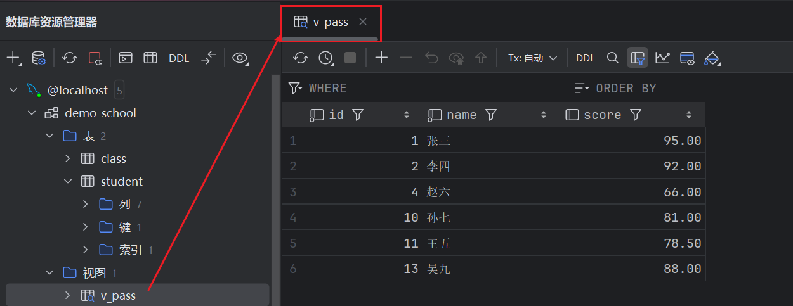

8 个学生只出来 6 个：`周八` 分数是 NULL（`NULL >= 60` 结果是 NULL，不算真），`郑十` 59 分不及格。


### 用视图

视图当普通表用就行：

在视图的查询控制台输入：

```sql
SELECT * FROM v_pass;
```


结果：

```
+----+------+-------+
| id | name | score |
+----+------+-------+
|  1 | 张三 | 95.00 |
|  2 | 李四 | 92.00 |
|  4 | 赵六 | 66.00 |
| 10 | 孙七 | 81.00 |
| 11 | 王五 | 78.50 |
| 13 | 吴九 | 88.00 |
+----+------+-------+
```


SQL 视图的核心价值就是，把复杂的多表 JOIN、聚合、过滤封装成一个"虚拟表"，也就是视图，后续还能继续在视图上叠条件、排序、join，和真表完全一样，不用反复从底表重新查询


