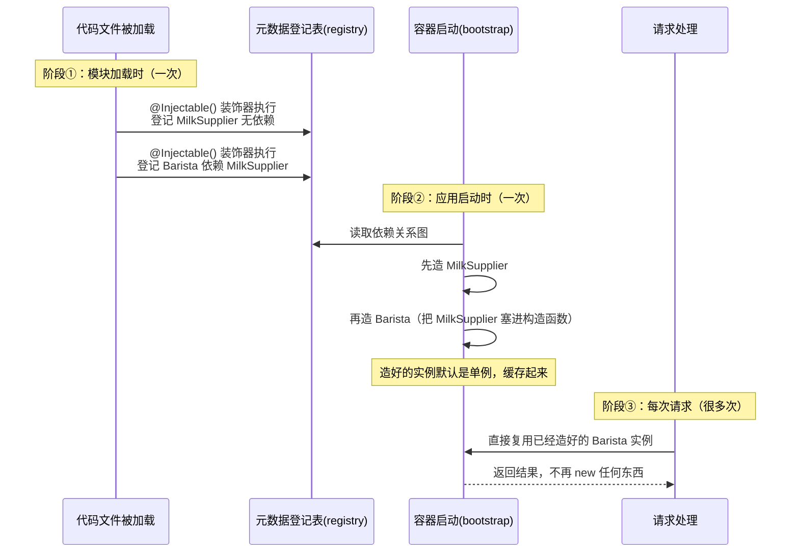
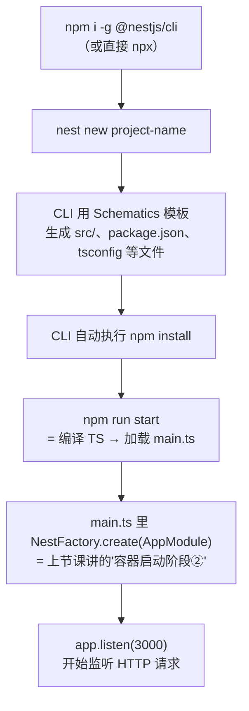
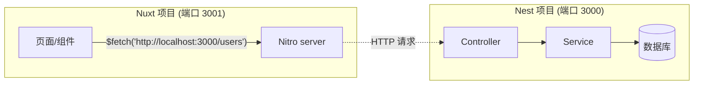
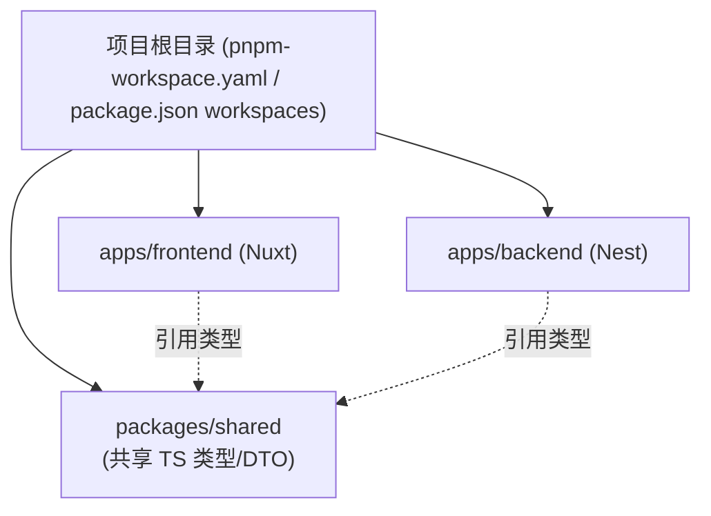

## 装饰器 与 依赖注入 的心智模型

Nest 几乎所有魔法都建立在这两个思想上。

- 装饰器（Decorator）的心智模型：在类/方法定义的那一刻，往它身上"贴一张元数据标签"（或包一层逻辑），本身不执行业务逻辑、不做实例化，只是给后面的人（比如容器）留下"这是什么、需要什么"的信息。
- 依赖注入（DI）的心智模型：谁需要依赖，谁只管声明"我需要什么"；由谁来创建、何时创建、传给谁，全部交给外部（容器）决定——对象自己永远不去 `new` 它依赖的东西。


伪代码：

```js
// ========== 装饰器：定义时"贴标签"，不执行业务逻辑，也不实例化 ==========
function Injectable(deps) {
  return (Cls) => registry.set(Cls.name, { Cls, deps }); // 只登记，不 new
}

@Injectable([])          // 贴标签："我没有依赖"
class MilkSupplier {}

@Injectable(['MilkSupplier'])  // 贴标签："我依赖 MilkSupplier"
class Barista {}

// ========== 依赖注入：启动时"照标签施工"，递归自底向上实例化 ==========
function resolve(name) {
  const { Cls, deps } = registry.get(name);
  const readyDeps = deps.map(resolve);   // 先递归造好我依赖的东西
  return new Cls(...readyDeps);          // 我自己不找依赖，依赖是"被塞进来的"
}

const barista = resolve('Barista');  // 启动时统一造好

// ========== 请求处理：只取用，不再创建 ==========
barista.makeCoffee();
```

时间顺序




整体思路可以简化为两步，就是下面这两步

第一步：理顺依赖关系 → 建有向依赖图

```mermaid
flowchart TD
    A["Barista<br/>(依赖 IMilk, ICup)"]
    B["MilkSupplier<br/>implements IMilk<br/>(无依赖)"]
    C["CupSupplier<br/>implements ICup<br/>(无依赖)"]
    D["CoffeeShop<br/>(依赖 Barista)"]

    D -->|依赖| A
    A -->|依赖| B
    A -->|依赖| C

    style B fill:#1B5E20
    style C fill:#1B5E20
    style A fill:#263238
    style D fill:#212121
```



第二步：拓扑排序，自底向上依次实例化并注入

```mermaid
sequenceDiagram
    participant Container as IoC容器
    participant Milk as MilkSupplier
    participant Cup as CupSupplier
    participant Barista as Barista
    participant Shop as CoffeeShop

    Note over Container: ① 扫描全部类，建好依赖图
    Note over Container: ② 拓扑排序：叶子节点排最前

    rect rgb(27, 94, 32)
    Note over Container: 顺序① 无依赖的先造
    Container->>Milk: new MilkSupplier()
    Container->>Cup: new CupSupplier()
    end

    rect rgb(38, 50, 56)
    Note over Container: 顺序② 依赖已就绪，才能造它
    Container->>Barista: new Barista(milk, cup) 注入
    end

    rect rgb(33, 33, 33)
    Note over Container: 顺序③ 以此类推，逐层向上
    Container->>Shop: new CoffeeShop(barista) 注入
    end

    Note over Container: 全部实例化完成，交给运行时使用
```




## 搭建 NestJS 后端的几种方式

方式一：独立裸 Nest 项目



1. CLI 安装：拿到 `nest` 这个命令行工具本身。
2. `nest new`：读取内置的项目模板（Schematics），把文件"抄"到你的目录里——这一步只是生成静态文件，还没有任何 Nest 代码在运行。
3. `npm install`：把 `@nestjs/core`、`@nestjs/common`、`rxjs`、`reflect-metadata` 这些运行时依赖装进 `node_modules`。
4. `npm run start`：先用 TS 编译器把 `.ts` 编译成 `.js`，再用 Node 执行编译产物。
5. `main.ts` 执行：这才是"应用真正跑起来"的时刻——`NestFactory.create()` 触发我们上节课讲的容器启动流程（读取所有装饰器留下的元数据 → 建依赖图 → 造实例）。
6. `app.listen()`：底层其实是创建了一个 Express（或 Fastify）实例并开始监听端口——Nest 只是在它上面包了一层。


方式二：Nest 作为独立后端服务，配合 Nuxt 前端（主流做法 ✅ 推荐）



1. 分别用各自的脚手架命令建两个互不相干的文件夹：`npx nuxi init frontend`、`nest new backend`。
2. 两边各自 `npm install`，各自维护自己的 `package.json`——没有共享依赖，完全解耦。
3. 开发时开两个终端，各自 `npm run dev`，Nest 监听 3000，Nuxt 监听 3001（或其他端口）。
4. Nuxt 页面里用 `$fetch`/`useFetch` 发起普通 HTTP 请求打到 Nest 的端口——对 Nest 来说，这就是"来了一个请求"，跟 Postman 打过来没有任何区别，Nest 完全不知道对方是 Nuxt。
5. 上线时两个是两个独立部署的服务（各自打包、各自的容器/服务器）。


方式三：Monorepo（一个仓库、两个 workspace，规模变大后常用）



1. 建根目录，写 `pnpm-workspace.yaml`（或 npm/yarn 的 workspaces 字段），声明 `apps/*`、`packages/*`。
2. 在 `apps/` 下分别用各自脚手架建 `frontend`（Nuxt）和 `backend`（Nest）——生成过程和方式二完全一样，只是位置挪到了子目录。
3. 额外建一个 `packages/shared`，放两边都要用的 TS 接口（比如 `interface User`），前后端都从这个包 import，保证类型一致，不用手写两遍。
4. 根目录写一个脚本（`concurrently "npm run dev -w backend" "npm run dev -w frontend"`）同时起两个 dev server。
5. 网络层面上，运行时依然是两个独立进程（跟方式二一样通过 HTTP 通信）——monorepo 解决的只是"代码仓库管理"和"类型共享"的问题，不改变部署架构。


## Controller / Provider / Module

三个装饰器，对应现实里的三种"标签"

| 装饰器                     | 贴在什么上                | 现实类比                                                     |
| -------------------------- | ------------------------- | ------------------------------------------------------------ |
| `@Injectable()`            | `app.service.ts` 这样的类 | 就 `Injectable()`——"这是一个可以被别人当依赖领取的东西"      |
| `@Controller()` + `@Get()` | `app.controller.ts`       | 前台接待员的工牌 + 一张"负责接待哪个门"的路牌                |
| `@Module()`                | `app.module.ts`           | 一个"部门花名册"：这个部门有哪些接待员（`controllers`）、雇了哪些员工（`providers`）、跟哪些别的部门借调人手（`imports`） |


