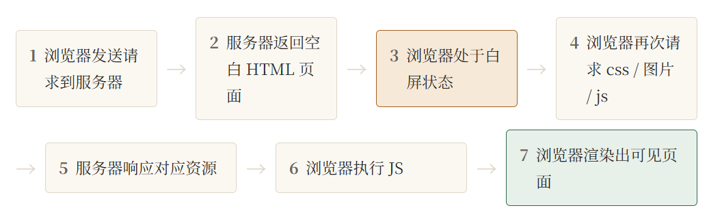
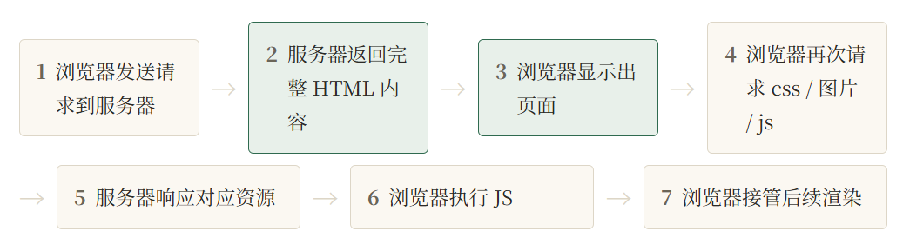
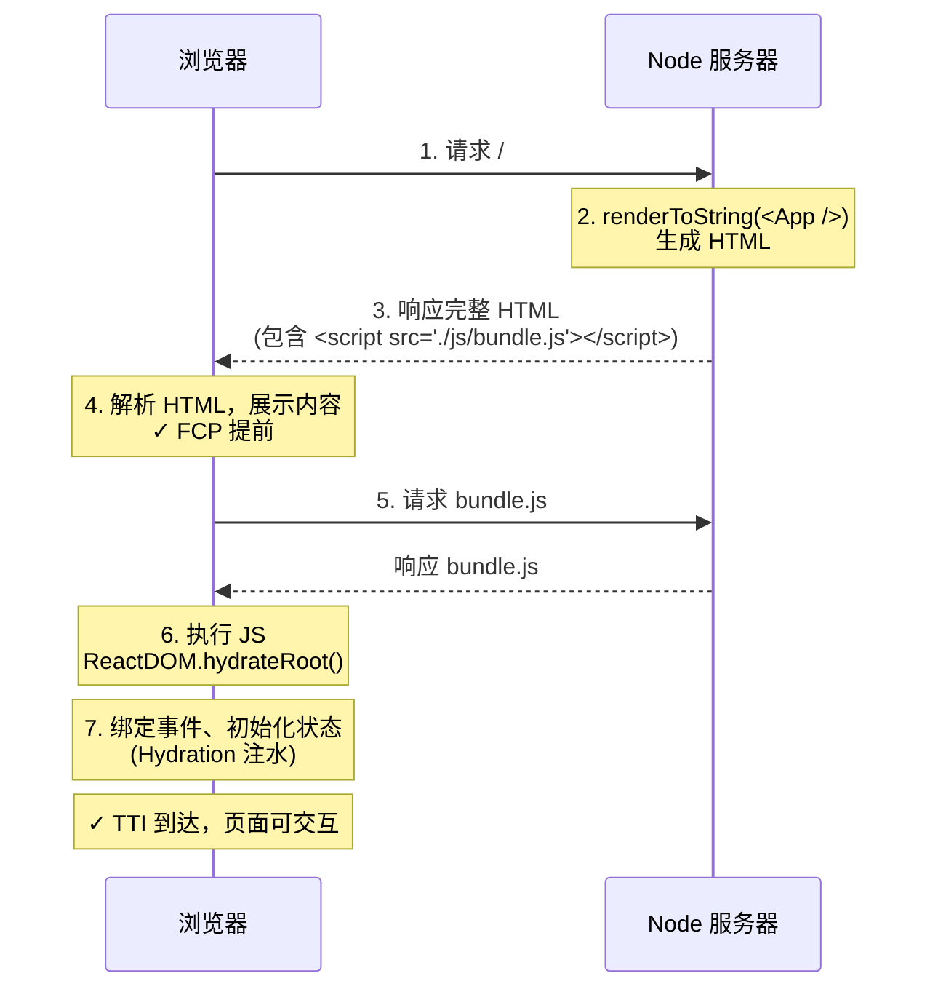
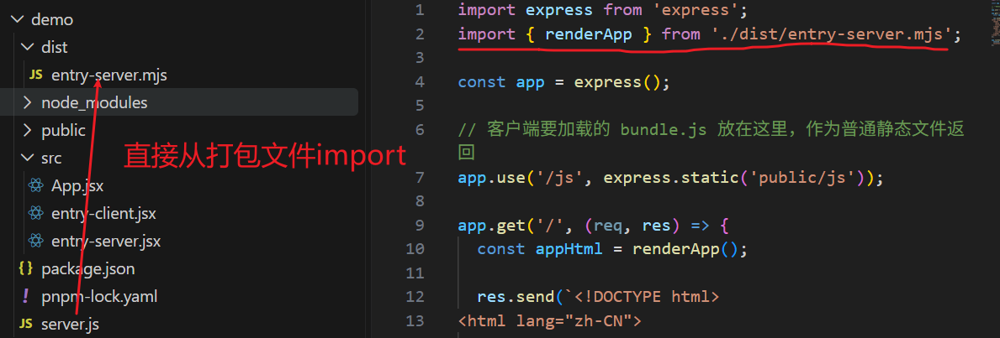
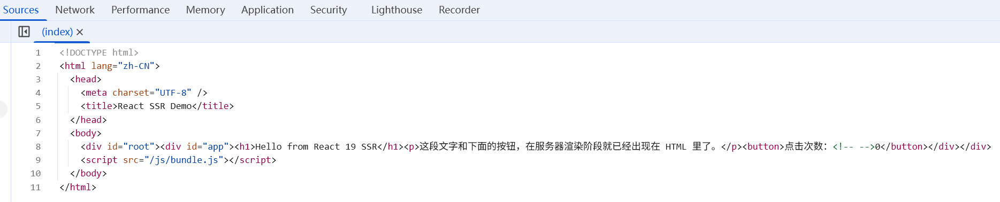
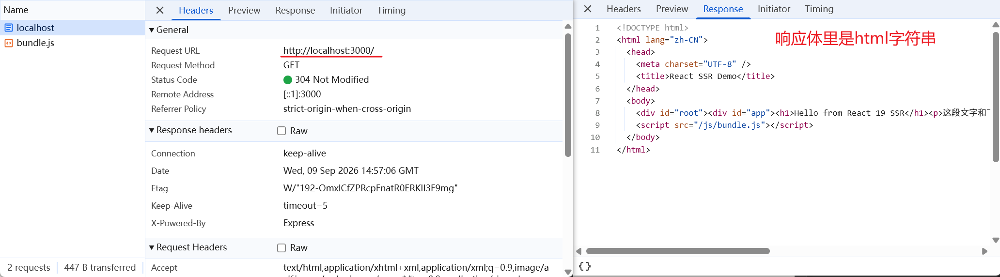
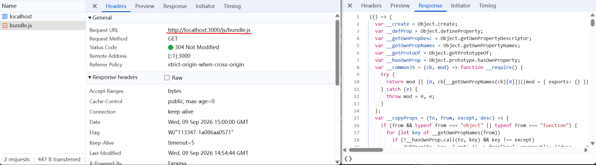
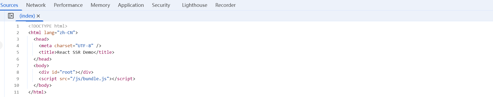
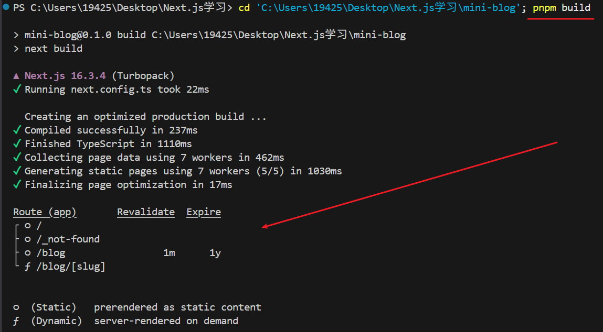

# ReactSSR


## CSR vs SSR

客户端渲染与服务端渲染


CSR：客户端渲染

CSR（Client-Side Rendering）：HTML、数据、路由这些活儿全部丢给浏览器里的 JS 去干。服务器几乎不参与"渲染"这件事，只负责把文件（HTML 壳子、JS、CSS）扔给浏览器。



关键是第 3 步 —— 白屏。这不是 bug，是 CSR 的正常阶段：HTML 壳子里什么都没有， 真正的内容要等 JS 跑起来、把数据塞进 DOM 之后才会出现。用更专业的说法：CSR 会推迟 首次内容绘制（First Contentful Paint, FCP）


优点

- 服务器只管发静态文件，压力小，容易扩展
- 页面切换不用整页刷新，交互体验流畅

缺点

- 首屏可能长期白屏，取决于 JS 包大小和设备性能
- 不利于 SEO 


SSR：服务端渲染

SSR（Server-Side Rendering）：服务器在响应请求之前，先把页面"跑"一遍，直接生成带内容的 HTML 再发给浏览器。



和 CSR 相比，第 2、3 步反过来了：浏览器一收到响应就能看到内容，首次内容绘制（FCP）更快。 但这不代表页面已经能交互 —— 第 4~6 步仍然要走一遍：浏览器还是要下载并执行 JS， 只是这一次 JS 的任务不是"从零生成页面"，而是"接管一个已经画好的页面"，让按钮、输入框这些东西真正能用。 这个"接管"的动作有个专门的名字，叫 hydration（水合）


## 完整的 SSR 流程

1. 浏览器请求 `/` → Node 服务器
2. 服务器执行 `renderToString(<App />)`，生成 HTML
3. 服务器返回完整 HTML（包含 `<script src="./js/bundle.js"></script>`）
4. 浏览器解析 HTML，立即展示内容（FCP 提前）
5. 浏览器发起请求，下载 `bundle.js`
6. 浏览器执行 JS，React 调用 `ReactDOM.hydrateRoot`
7. React 绑定事件、初始化状态 → 页面可交互（TTI 到达）



FCP（First Contentful Paint）

浏览器第一次画出「有内容」的东西的时间点。SSR 主要优化的就是这个——因为内容已经在 HTML 里了，不用等 JS。


TTI（Time To Interactive）

页面真正「可以点击、可以交互」的时间点。这个时间点由 hydration 完成的时刻决定——SSR 并不能让 TTI 提前，它优化的只是 FCP，让用户「更早看到东西」，但「能不能点」还是要等 JS 跑完。


后面会构建一个reactSRR项目


## 项目结构与工具选型

目录结构

```
demo/
├── package.json
├── server.js              ← Express 服务器，直接用 node 运行
├── src/
│   ├── App.jsx             ← 唯一的组件源码，服务端/客户端共用
│   ├── entry-server.jsx    ← 服务端渲染入口（用 renderToString）
│   └── entry-client.jsx    ← 客户端注水入口（用 hydrateRoot）
├── public/js/bundle.js     ← esbuild 打包出的浏览器端产物
└── dist/entry-server.mjs   ← esbuild 打包出的 Node 端产物
```

> 只有一份 `App.jsx`。SSR 不是「写两遍界面」，而是同一份组件代码，在两个不同的地方各跑一次：服务器跑一次生成 HTML 字符串，浏览器跑一次接管成可交互应用。


为什么需要两次打包

Node 本身不认识 JSX 语法，就算是服务端代码，只要写了 `<App />` 这种 JSX，也必须先转译成普通 JavaScript 才能运行。于是我们用 esbuild 分别打包两次：

| 打包目标 | 入口               | 产物                    | react / react-dom 怎么处理                                   |
| -------- | ------------------ | ----------------------- | ------------------------------------------------------------ |
| 浏览器端 | `entry-client.jsx` | `public/js/bundle.js`   | 打包进同一个文件——浏览器没有 `node_modules`，所有依赖都得塞进去 |
| Node 端  | `entry-server.jsx` | `dist/entry-server.mjs` | 标记为 external——服务器本地已经 `pnpm install` 过，直接 import 现成的包即可，不用重复打包 |


为什么 server.js 不需要打包

`server.js` 本身没有写任何 JSX，只是普通 JavaScript，用 `import` 引入打包好的 `dist/entry-server.mjs` 拿到渲染函数，所以可以直接 `node server.js` 运行，不需要额外编译这一步。




为什么是 Express

SSR 本质上只需要「收到请求 → 返回一段 HTML 字符串」，Express 的 `app.get('/', ...)` 刚好就是这个语义，几乎不需要额外学习成本。

Next.js 本质上就是把这里手写的「两套打包 + 手写 Express 路由 + 手写 HTML 模板」全部自动化封装好了。你现在手动搭一遍，是为了知道 Next.js 在底层替做了什么。


## 共享 App 组件

先写唯一一份组件代码——`src/App.jsx`：

```jsx
import { useState } from 'react';

// 服务端和客户端引用的是同一份组件代码，这是 SSR 能成立的前提
export default function App() {
  const [count, setCount] = useState(0);

  return (
    <div id="app">
      <h1>Hello from React 19 SSR</h1>
      <p>这段文字和下面的按钮，在服务器渲染阶段就已经出现在 HTML 里了。</p>
      <button onClick={() => setCount(count + 1)}>点击次数：{count}</button>
    </div>
  );
}
```

这就是一个普通的函数组件，没有任何「SSR 专用」写法。这正是重点：组件本身根本不知道自己会在哪里被渲染。


为什么同一份代码两边都能跑

App 组件只是一个「输入 state，输出 JSX 描述」的纯函数，没有调用任何只存在于某一端的 API（比如浏览器的 `window`、`document`）。只要遵守这一条，同一份组件代码：

- 在服务器上跑一次 → 交给 `renderToString` 变成 HTML 字符串
- 在浏览器上跑一次 → 交给 `hydrateRoot` 接管成可交互应用

> 如果组件在渲染过程中直接读取 `window.xxx` 或 `localStorage`，会在服务器上直接报错——服务器环境里根本没有 `window`。这类操作只能放进 `useEffect`（只在客户端执行），这也是后面学 Next.js 时会反复遇到的规则。


服务器渲染出的实际 HTML 长什么样

```html
<div id="root">
  <div id="app">
    <h1>Hello from React 19 SSR</h1>
    <p>这段文字和下面的按钮，在服务器渲染阶段就已经出现在 HTML 里了。</p>
    <button>点击次数：<!-- -->0</button>
  </div>
</div>
```

- `onClick` 完全没有出现在输出的 HTML 里——事件处理函数是 JS 层面的东西，HTML 字符串里根本放不下，所以服务器渲染阶段它「不生效」，只是数据还没绑定而已
- `<!-- -->0` 这个奇怪的 HTML 注释不是 bug：React 用它标记动态文本节点的边界，方便 hydration 阶段精确核对客户端渲染结果是否和服务端一致


## 服务端渲染

目标：把 App 组件真正「渲染」成 HTML 字符串，并用 Express 把它发送给浏览器。


渲染入口：src/entry-server.jsx

```jsx
import { renderToString } from 'react-dom/server';
import App from './App.jsx';

// 服务端只需要把组件转成 HTML 字符串，不需要事件绑定
export function renderApp() {
  return renderToString(<App />);
}
```

`renderToString` 来自 `react-dom/server`，它接收一段 JSX，同步返回一个纯字符串——就是上面看到的那段 `<div id="app">...</div>`。它不产生任何真实 DOM，只是字符串拼接。


服务器：server.js

```js
import express from 'express';
import { renderApp } from './dist/entry-server.mjs';

const app = express();

// 客户端要加载的 bundle.js 放在这里，作为普通静态文件返回
app.use('/js', express.static('public/js'));

app.get('/', (req, res) => {
  const appHtml = renderApp();

  res.send(`<!DOCTYPE html>
<html lang="zh-CN">
  <head>
    <meta charset="UTF-8" />
    <title>React SSR Demo</title>
  </head>
  <body>
    <div id="root">${appHtml}</div>
    <script src="/js/bundle.js"></script>
  </body>
</html>`);
});

app.listen(3000, () => {
  console.log('Server running at http://localhost:3000');
});
```

- `import { renderApp } from './dist/entry-server.mjs'`：引入在  [`搜索：为什么 server.js 不需要打包`]  处打包好的产物，不是引入 `entry-server.jsx` 源码——源码里的 JSX 是 Node 读不懂的

- `app.use('/js', express.static('public/js'))`：把本地 `public/js/` 目录整个映射到 `/js` 这个 URL 前缀下，所以 `public/js/bundle.js` 可以通过 `/js/bundle.js` 请求到
- `app.get('/', ...)`：每次有人访问首页，就重新调用一次 `renderApp()`，把结果塞进模板字符串里的 `<div id="root">`
- `<script src="/js/bundle.js">` 放在 `</body>` 前面：浏览器会先把前面的内容全部解析展示出来，再去加载执行这个脚本，不会因为等脚本而卡住内容展示


## 客户端 Hydration

服务端已经把 HTML 发过去了，现在轮到浏览器加载的 `bundle.js` 把这份「静态内容」接管成真正可交互的 React 应用。


注水入口：src/entry-client.jsx

```jsx
import { hydrateRoot } from 'react-dom/client';
import App from './App.jsx';

// hydrateRoot 复用服务端已生成的 DOM，只补上事件绑定和状态，不重新创建节点
hydrateRoot(document.getElementById('root'), <App />);
```

`document.getElementById('root')` 找到的正是 server.js 模板里那个 `<div id="root">`，里面已经塞满了 `renderToString` 生成的内容。`hydrateRoot` 不会清空重建它，而是拿同一份 `<App />` 在客户端「虚拟渲染」一遍，逐节点核对和已有 DOM 是否一致，一致就直接复用、只补上事件监听和内部状态。


hydrateRoot vs createRoot

| API                            | 假设                                 | 行为                                      |
| ------------------------------ | ------------------------------------ | ----------------------------------------- |
| `createRoot(container)`        | container 是空的                     | 创建全新 DOM 树（纯客户端渲染项目用这个） |
| `hydrateRoot(container, tree)` | container 里已有匹配的服务端渲染内容 | 复用已有 DOM，只补事件和状态              |

> hydration mismatch：一个要提前知道的坑
>
> 如果组件在服务端和客户端第一次渲染的结果对不上——比如渲染时直接用了 `Date.now()`、`Math.random()`，或者读取了只在浏览器才有的值——React 会在控制台报 *hydration mismatch* 警告，严重时会丢弃服务端内容重新在客户端渲染一遍，SSR 省下的首屏优势就白费了。这是 Next.js 项目里最常见的报错之一，先有印象，后面学 Next.js 遇到时就不会一头雾水。


到这里为止，三个文件各自的职责

- `App.jsx`：唯一的界面描述，双端共用
- `entry-server.jsx`：服务端调用一次，产出字符串
- `entry-client.jsx`：客户端调用一次，接管成可交互应用


## 跑起来、对照流程图验证

运行步骤

```
cd demo
pnpm install
pnpm run build   # 依次执行 build:client 和 build:server
pnpm run start   # node server.js，监听 http://localhost:3000
```

然后浏览器打开 `http://localhost:3000`。


验证：内容是不是「已经在 HTML 里」

查看网页源代码，这里显示的是浏览器还没跑任何 JS 之前收到的原始 HTML——如果标题、文字、按钮已经完整地出现在这份源码里，就说明第 1～3 步（请求 → renderToString → 响应完整 HTML）确实发生了，浏览器不用等 JS 就已经拿到了内容。




验证：bundle.js 是不是单独请求的

打开开发者工具的 Network 面板，刷新页面，应该能看到两个独立的请求：

1、`/` —— 文档请求，响应体就是刚才 `Ctrl+U` 看到的完整 HTML



2、`/js/bundle.js` —— 浏览器解析 HTML 时读到 `<script>` 标签后才发出的第二个请求




验证：hydration 是否真的接管了

点击页面上的按钮，数字应该正常递增。这一下点击能生效，恰恰证明了 `hydrateRoot` 已经完成：它把 `onClick` 事件绑定到了服务端渲染出的那个 `<button>` 节点上，而不是重新创建了一个新按钮。

> 如果想亲眼看到「没有 SSR 会怎样」
>
> 可以试着临时把 `server.js` 里 `const appHtml = renderApp();` 改成 `const appHtml = '';`（相当于砍掉服务端渲染这一步），重新 `pnpm run build && pnpm run start` 后再看一次源码——这时候 root 里就是空的，回到了第 1 课开头描述的纯 CSR 状态。

root节点里面是空的




# Next.js


## Next.js 是什么

Next.js 是一个基于 React 的全栈框架：React 只负责"组件怎么渲染"， 而 Next.js 在此之上加了三样 React 本身没有的东西

- 文件系统路由 （文件夹结构直接决定网址结构）
- 服务端渲染/静态生成（页面可以在服务器或构建时就生成好 HTML， 而不是全部在浏览器里跑）
- 后端能力（同一个项目里可以写 API 接口、连数据库）


## 脚手架与目录结构

Next.js 历史上有两套路由约定：老的 Pages Router（`pages/` 目录）和现在的 App Router（`app/` 目录，2023 年后官方默认推荐），以后看到 `pages/` 目录，认出它是老写法就够了。


mini-blog 项目是用这条命令创建的：

```
pnpm create next-app@latest mini-blog --ts --no-tailwind --eslint --app --no-src-dir --import-alias "@/*"
```

每个选项的含义：

- `--ts` — 用 TypeScript
- `--no-tailwind` — 不用 Tailwind，写普通 CSS
- `--eslint` — 带上代码规范检查工具
- `--app` — 使用 App Router（生成 `app/` 目录，而不是 `pages/`）
- `--no-src-dir` — 不额外套一层 `src/` 目录，`app/` 直接放项目根下
- `--import-alias "@/*"` — 允许用 `@/xxx` 代替很长的相对路径 `../../xxx` 来导入文件


目录结构

```
mini-blog/
├── app/                  ← 页面和路由都在这里（App Router 的核心）
│   ├── layout.tsx        ← 根布局，所有页面共用的外壳（<html><body>）
│   ├── page.tsx          ← 对应网址 "/" 的首页
│   ├── globals.css       ← 全局样式
│   ├── page.module.css   ← 只属于 page.tsx 的局部样式（CSS Modules）
│   └── favicon.ico
├── public/               ← 静态文件（图片等），可直接用 "/xxx.png" 访问
├── package.json          ← 项目依赖和脚本（dev/build/start/lint）
├── next.config.ts        ← Next.js 自身的配置文件（目前是空的）
├── tsconfig.json         ← TypeScript 配置，含 "@/*" 别名的实现
├── eslint.config.mjs     ← 代码规范配置
├── pnpm-lock.yaml        ← 依赖版本锁定文件（类似 package-lock.json）
└── node_modules/、.next/ ← 依赖包 和 构建产物缓存，都不用手动碰
```

> 在 `app/` 目录里，文件夹的路径 = 网址路径。 比如以后我们建一个 `app/blog/page.tsx`，它对应的网址就是 `/blog`，不需要任何额外配置。


文件名约定

App Router 里，文件夹本身不会自动变成一个页面——必须在文件夹里放一个约定名字的文件，Next.js 才知道要渲染什么：

- `page.tsx` — 这个路径真正的页面内容，必须默认导出（`export default`）一个 React 组件
- `layout.tsx` — 包在页面外面的共享外壳，比如导航栏、页脚；同级或父级目录的 `layout.tsx` 会自动包住下面所有页面

先看根布局 `app/layout.tsx`

```tsx
export const metadata: Metadata = {
  title: "Mini Blog",
  description: "一个用来学习 Next.js App Router 的迷你博客",
};

export default function RootLayout({ children }: LayoutProps<"/">) {
  return (
    <html lang="en">
      <body>{children}</body>
    </html>
  );
}
```

两个细节：`metadata` 是 Next.js 专门认识的一个导出变量，会自动变成页面的 `<title>`/`<meta>` 标签，不用开发者手写 `<head>`； `children` 就是"这个布局包住的页面内容"，这里对应的就是 `page.tsx` 渲染出的东西。

再看首页 `app/page.tsx`：

```tsx
import styles from "./page.module.css";

export default function Home() {
  return (
    <main className={styles.main}>
      <h1>Mini Blog</h1>
      <p>欢迎来到迷你博客，这是我们学习 Next.js App Router 的示例项目。</p>
    </main>
  );
}
```


## 嵌套路由、动态路由与 Link 导航

文件夹 = 网址

上一课说过`app/` 里文件夹路径就是网址路径。建一个新路由： `app/blog/` 文件夹 + 里面的 `page.tsx`，就得到了 `/blog` 这个网址， 不需要写任何路由配置。

```
app/
├── page.tsx           → "/"
└── blog/
    ├── page.tsx       → "/blog"           ← 新增：文章列表
    └── [slug]/
        └── page.tsx   → "/blog/任意值"     ← 新增：文章详情
```


动态路由：[slug] 是什么

文件夹名如果被方括号包住，比如 `[slug]`，就是一个动态段： 它能匹配这个位置上的任意值，而不是写死的一个网址。`/blog/why-app-router`、 `/blog/hello-world` 都会命中同一个 `app/blog/[slug]/page.tsx` 文件。

那具体访问到的是哪个值，怎么在代码里拿到？看 mini-blog 里实际的代码：

```tsx
export default async function BlogPostPage({params,}: {params: Promise<{ slug: string }>;}) {
  const { slug } = await params;   // 这里解构出来的slug就是/blog/hello-world 中的 hello-world
  const post = getPostBySlug(slug);
  // ...
}
// 前半 { params } 是 JS 的解构,从传入的对象里把 params 字段取出来，冒号后 { params: Promise<{ slug: string }> } 是 TS 的类型注解
```

> 为什么 params 是个 Promise，还要 await
>
> 把 `params`、`searchParams` 都变成异步的， 是为了让 Next.js 有更大空间去优化"提前渲染页面里不依赖这些参数的部分"。


列表页怎么拿到所有文章

`app/blog/page.tsx` 里没有 `[slug]` 这种动态段，因为它对应的是固定网址 `/blog`本身：

```tsx
import Link from "next/link";
import { getPosts } from "@/app/lib/posts";

export default function BlogIndexPage() {
  const posts = getPosts();

  return (
    <main className="container">
      <h1>博客文章</h1>
      <ul>
        {posts.map((post) => (
          <li key={post.slug}>
            <Link href={`/blog/${post.slug}`}>{post.title}</Link>
            <p>{post.excerpt}</p>
          </li>
        ))}
      </ul>
    </main>
  );
}
```

这里 `getPosts()` 目前读的是 `app/lib/posts.ts` 里写死的一个内存数组——先用假数据把路由跑通， 后面换成 Prisma + SQLite 查真实数据库时，`app/blog/page.tsx` 这部分代码基本不用变， 只是 `getPosts()` 内部实现从"读数组"变成"查数据库"。


`<Link>` 和普通 `<a>` 标签的区别

上面用的是 `next/link` 里的 `<Link>`，不是原生 `<a>`。 `<Link>` 是 Next.js 封装的导航组件：点击时不会整页刷新，而是只替换页面内容（客户端导航）， 并且 Next.js 会在用户可能点击之前提前"偷偷"把目标页面数据取好（prefetch），让跳转看起来几乎瞬间完成[[1\]](#ref-1)。 写法上就是把 `href` 换成动态拼出来的路径，比如 `href={\`/blog/${post.slug}\`}`。


## Server Component 与 Client Component

在ReactSSR里搭的传统 SSR 项目，服务端把整棵组件树渲染成 HTML 字符串发过去；但客户端拿到的 JS bundle 里包含的是同一整套组件的源码——`hydrateRoot` 会把这套代码在浏览器里重新跑一遍，生成一棵 virtual DOM，再去跟已有的真实 DOM 做 diff、挂事件监听（这就是 hydration）。关键是：即使某个组件从头到尾没有任何交互，它的代码也必须发到浏览器，因为整棵树要在客户端重新执行一遍才能完成 hydration。

但是这样，SSR 省下来的只是"首屏白屏时间"，客户端该下载、该执行的代码一点没少。

RSC（Server/Client Component 拆分）改变的正是这一步：Server Component 的渲染结果，不是以"组件源码"的形式发给客户端，而是序列化成一份叫 RSC Payload 的东西——本质是"渲染结果的描述"（相当于"这里是一段固定 HTML，那里挖了个坑，坑里要装某个 Client Component，它的 JS 在这个地址"）。客户端的 React 拿着这份 payload 去拼 DOM，从来不会把 Server Component 的函数再跑一遍——它的代码根本不在客户端 bundle 里。真正会被下载、被 hydrate（挂事件监听、变得有状态）的，只有 Client Component 那一小撮。


在 `app/` 目录里，任何组件默认都是 Server Component——只在服务器上运行， 渲染结果是 HTML，本身的代码不会被打包发送到浏览器。 在前面写的 `page.tsx` 全都是 Server Component。


Server Component 能做、不能做的事（原因在章节：ReactSSR---客户端 Hydration 提及）

能做：

- 直接写 `async function`，在组件里 `await` 查数据库或调用其他后端逻辑（第 4 课细讲）
- 安全地使用密钥、数据库连接字符串这类敏感信息——反正代码不会发到浏览器

不能做：

- `useState`、`useEffect` 这类只在浏览器里有意义的 hooks
- `onClick` 这类事件处理（点击这件事只能发生在浏览器里）
- 直接用 `window`、`localStorage` 等浏览器 API


需要交互时：'use client'

一旦某个组件需要状态或事件处理，就要在文件最顶部写一行 `"use client"`， 把它标记为 Client Component——这行代码之后，这个文件（以及它 import 的其他模块）才会被打包发送到浏览器， 变成一段真正能在浏览器里跑、能响应点击的 JS[[1\]](#ref-1)。

mini-blog 里新加的点赞按钮就是一个典型例子，`app/blog/[slug]/like-button.tsx`：

```tsx
"use client";

import { useState } from "react";

export default function LikeButton() {
  const [liked, setLiked] = useState(false);
  const [count, setCount] = useState(0);

  return (
    <button
      onClick={() => {
        setLiked(!liked);
        setCount((c) => (liked ? c - 1 : c + 1));
      }}
    >
      {liked ? "❤️" : "🤍"} {count}
    </button>
  );
}
```


Server Component 里嵌 Client Component

详情页 `app/blog/[slug]/page.tsx` 本身还是 Server Component（顶部没有 `"use client"`， 还在用 `async function` 查数据），但可以直接把 `<LikeButton />` 当普通组件一样导入渲染：

```tsx
import { getPostBySlug } from "@/app/lib/posts";
import LikeButton from "./like-button";

export default async function BlogPostPage({ params }: { ... }) {
  const { slug } = await params;
  const post = getPostBySlug(slug);
  // ...
  return (
    <main className="container">
      <h1>{post.title}</h1>
      <p>{post.content}</p>
      <LikeButton />
    </main>
  );
}
```

这是最常见的组合方式：页面整体是 Server Component（负责查数据、拼骨架）， 只把真正需要交互的那一小块拆成 Client Component——而不是把整个页面都标成 `"use client"`。 后者会导致整页的数据获取代码也被迫搬到浏览器上做，失去 Server Component 的好处。

> 反过来行不行：Client Component 里能不能直接 import 一个 Server Component？
>
> 不行——一个组件一旦是 Client Component，它 import 的组件也会被当成 Client Component 处理，被发送到浏览器。 如果确实想在 Client Component 内部展示某块 Server Component 渲染的内容， 正确做法是把那块内容作为 `children` 从外层 Server Component 传进来，而不是在 Client Component 内部 import。 这个模式课程里不深入，遇到再讲。


为什么要费劲区分这两种组件

好处是"默认更快、更安全"：大部分页面骨架和数据获取代码根本不需要发到浏览器执行， 用户下载的 JS 包更小，首屏也更快；同时数据库密钥这类敏感信息天然待在服务器端，不会被打包进客户端代码暴露出去。 读别人代码时，看到一个文件顶部有没有 `"use client"`，基本就能判断这段代码是"服务器专属"还是"要发到浏览器跑"。


## 数据获取与 loading.tsx

Server Component 里怎么拿数据：就是 await

上一章节说过 Server Component 能"直接查数据库"，这一课把它做实：不需要 `useEffect` + `useState` 那一套（那是给 Client Component 用的，纯浏览器端数据获取的写法），Server Component 本身可以是一个 `async function`，在里面直接 `await` 任何异步操作——`fetch`、数据库查询、读文件，都一样。

mini-blog 里 `app/lib/posts.ts` 现在长这样：

```js
function delay(ms: number) {
  return new Promise((resolve) => setTimeout(resolve, ms));
}

export async function getPosts(): Promise<Post[]> {
  await delay(600);
  return posts;
}

export async function getPostBySlug(slug: string): Promise<Post | undefined> {
  await delay(600);
  return posts.find((post) => post.slug === slug);
}
```

加的 `delay(600)` 是故意模拟"查数据库/调接口要花时间"，后面换成真正的 Prisma 查询后， 这个人工延迟就可以删掉了——真实数据库查询自己就会花时间。

调用方也跟着变成 `await`，比如 `app/blog/page.tsx`：

```tsx
export default async function BlogIndexPage() {
  const posts = await getPosts();
  // ...渲染列表
}
```


数据没回来之前，页面显示什么

现在 `/blog` 和 `/blog/[slug]` 都要等 600ms 才能拿到数据。如果什么都不做， 用户点击链接后会看到浏览器地址栏在转圈、页面一片空白，直到这 600ms 结束——这是"阻塞式"的体验。

App Router 给了一个专门的文件约定来解决这个问题：`loading.tsx`。只要在某个路由文件夹里放一个 `loading.tsx`，Next.js 会自动把同级的 `page.tsx` 包在一个 React `<Suspense>` 边界里——数据没准备好之前，先显示 `loading.tsx` 的内容；数据一到，自动换成真正的页面

mini-blog 里加了两个：

```
app/blog/loading.tsx
app/blog/[slug]/loading.tsx
```

loading.tsx中的内容目前都很简单：

```tsx
export default function Loading() {
  return (
    <main className="container">
      <p>加载中...</p>
    </main>
  );
}
```

> loading.tsx 是自动生效的，不用手动写 <Suspense>你不需要在 `page.tsx` 里 import 任何东西——文件名对了、位置对了，Next.js 在构建时自动把它接进去。 这是 App Router "文件即约定"思路的延续，跟 `page.tsx`/`layout.tsx` 是同一套规则。


## 渲染与缓存模型

执行`pnpm build`，输出里一直有这张表：

```
Route (app)       Revalidate  Expire
┌ ○ /
├ ○ /_not-found
├ ○ /blog                 1m      1y
└ ƒ /blog/[slug]

○  (Static)   prerendered as static content
ƒ  (Dynamic)  server-rendered on demand
```

`○` 和 `ƒ` 就是本课的主题：一个页面要么在构建时就生成好 HTML（Static）， 要么要等每次请求时才现算（Dynamic）。这直接决定了这个页面的性能特征——静态页面能直接从 CDN 边缘节点秒开，动态页面每次都要真正跑一遍服务器逻辑。




为什么 / 和 /blog 是静态的，/blog/[slug] 是动态的

Next.js 会自动判断，规则是：

- 页面里如果用到了只有请求到达时才知道的东西——`cookies()`、`headers()`、 直接读 `searchParams`——这个页面就必须是动态的，因为这些值因人、因请求而异。
- 动态路由段（比如 `[slug]`）如果没有用 `generateStaticParams` 提前告诉 Next.js "有哪些具体的 slug 值"，Next.js 就没法在构建时知道要生成哪些页面，只能延后到请求时再算—— 这正是 `/blog/[slug]` 现在的情况。后面加上 `generateStaticParams` 后，它也能变成静态的。

`/` 和 `/blog` 都没有用到这些"请求时才知道"的东西，所以能在构建时就跑完、生成好 HTML， 标成 `○ Static`。


fetch 默认不缓存

> 在当前的 Next.js（15+）里，`fetch()` 默认是不缓存的，每次都会真正发请求； 想要缓存，要显式加 `{ cache: 'force-cache' }`，或者 `{ next: { revalidate: 60 } }` 这种"多少秒内可以复用"的写法。老一点的 Next.js 教程/文章里说的"fetch 默认缓存"， 说的是 13/14 版本的旧行为，读到这类内容时要留意版本。

mini-blog 现在用的不是 `fetch()`，而是自己写的 `getPosts()`/`getPostBySlug()`—— 这类"手写的异步函数"不会被自动缓存或去重，Next.js 只对字面意义上的 `fetch()` 调用做这些优化。 


给 /blog 加一段 ISR：revalidate

为什么需要 ISR

`/blog` 现在是纯静态页面（`○ Static`），博客文章目录页面——意味着 `getPosts()` 只在 `pnpm build` 那一刻真正跑过一次，之后这个页面的 HTML 就定死了，直接从缓存里发。

问题来了：真实场景里，博客文章会不断新增（第 6 课换成数据库之后更明显）。如果没有任何机制， 这个"定死的 HTML"就会永远停留在你上次执行 `pnpm build` 那一刻的数据——哪怕数据库里已经多了 10 篇新文章， 线上页面也不会更新，除非你重新跑一次构建、重新部署整个项目。

反过来，如果让 `/blog` 变成完全动态（`ƒ Dynamic`），倒是能保证数据永远最新， 但代价是每一个访问者都要真的等 `getPosts()` 请求里那 600ms 延迟跑完——静态页面"秒开"的优势就没了。

**ISR（Incremental Static Regeneration，增量静态再生成）**就是这两难之间的折中方案，拆开看这个名字：

- 静态生成：还是像传统 SSG（Static Site Generation静态网站生成） 一样，提前把 HTML 生成好、缓存起来，大部分访问都直接吃缓存，秒开。
- 增量：跟"每次全站重新构建部署"相对——它允许单个页面自己悄悄换成新版本， 不需要你重新跑一次 `pnpm build` 重新部署整个项目，"一小块一小块"（incremental）地更新，而不是整站一起换。


revalidate = 60 具体触发的是什么：按请求触发，不是定时器

"每 60 秒允许重新生成一次"这句话最容易被误解成"有个定时器在后台每 60 秒自动刷新一次"—— 实际上没有定时器，是靠请求触发的。完整过程分几步：

1. `pnpm build` 时，Next.js 跑一次 `BlogIndexPage`，执行 `getPosts()`（花 600ms）， 把结果 HTML 缓存下来，并记下"生成时间"。
2. 接下来 60 秒内，不管多少人访问 `/blog`，都直接拿这份缓存 HTML，秒开， 不会再执行一次 `getPosts()`。
3. 60 秒之后，下一个访问 `/blog` 的人，依然立刻拿到那份缓存 HTML（这时候它已经算"过期/stale"了， 但访问者不用等）——与此同时，Next.js 在后台悄悄重新跑一次 `getPosts()` 生成新版本。
4. 新版本生成完，替换掉缓存；再之后的访问者拿到的就是更新后的内容了。
5. 如果这 60 秒窗口过去后，压根没人来访问，那就什么都不会发生——旧缓存会一直被使用，直到真的有人触发第 3 步。

写法是在页面文件顶部导出一个 `revalidate` 变量：

```tsx
import Link from "next/link";
import { getPosts } from "@/app/lib/posts";

// 缓存最多用 60 秒；60 秒后，下一个访问者会顺带触发一次后台重新生成
export const revalidate = 60;

export default async function BlogIndexPage() {
  const posts = await getPosts();
  // ...
}
```


现在回到pnpm build 输出的表格：Revalidate 和 Expire 两列什么意思

```
Route (app)       Revalidate  Expire
┌ ○ /
├ ○ /_not-found
├ ○ /blog                 1m      1y
└ ƒ /blog/[slug]
```

- Revalidate: 1m —— 就是前面写的 `revalidate = 60`：缓存最多新鲜 60 秒， 超过之后下一个请求会顺带触发上面第 3 步的后台重新生成。
- Expire: 1y —— 这个我们没有手动配置，是 Next.js 给的默认兜底值：大致意思是如果这个页面长时间没有任何人访问 （也就是一直没有请求来触发第 3 步的后台刷新），再有人访问时，Next.js 会强制等一次同步的重新生成，而不是无限期地发一份"放了很久的缓存"。对我们这个学习项目基本用不上， 认得这一列是干嘛的就行。


常见的路由级配置：dynamic

除了 `revalidate`，AI 生成的代码里还经常能看到这一行，你需要能认出它的意思：

```
export const dynamic = "force-dynamic"; // 强制这个页面每次请求都重新渲染，不许缓存
export const dynamic = "force-static";  // 强制当成静态页面处理
```

mini-blog 目前不需要手动加这些——都是靠上面说的自动规则来判断的，这里只是让你认得这两行代码是干嘛的。


再往前看一点：Cache Components（了解即可，不深入）

Next.js 16（我们用的这个大版本）其实还带了一套全新的缓存模型，叫 Cache Components， 核心是一个 `"use cache"` 指令，需要在 `next.config.ts` 里手动开启才生效。


## generateStaticParams

之前说`/blog/[slug]` 之所以是 `ƒ Dynamic`，是因为 Next.js 在构建时不知道 "有哪些具体的 slug 值"，只能推迟到请求时才现算。`generateStaticParams` 就是用来补上这个信息的—— 在页面文件里导出一个函数，告诉 Next.js "把这些具体值都提前生成好"


加上它，只需要几行

mini-blog 里 `app/blog/[slug]/page.tsx` 现在多了这一段：

```tsx
import { getPostBySlug, getPosts } from "@/app/lib/posts";
import LikeButton from "./like-button";

// 告诉 Next.js 构建时要提前生成哪些具体的 [slug] 页面
export async function generateStaticParams() {
  const posts = await getPosts();
  return posts.map((post) => ({ slug: post.slug }));
}

export default async function BlogPostPage({ params }: { ... }) {
  // 这部分完全没变
}
```

`generateStaticParams` 返回一个对象数组，每个对象的键要对应文件夹名里的动态段—— 这里文件夹是 `[slug]`，所以每个对象要有一个 `slug` 属性。 返回几个对象，构建时就会提前生成几个具体页面。[{slug: xxx}，{slug: xxx}，{slug: xxx}，...]


看构建输出：证据在这

加上这几行之后再跑 `pnpm build`，路由表变成了这样：

```
Route (app)                              Revalidate  Expire
┌ ○ /
├ ○ /_not-found
├ ○ /blog                                        1m      1y
└   /blog/[slug]
  ├ ● /blog/from-express-to-nextjs
  ├ ● /blog/server-vs-client-components
  └ ● /blog/why-app-router

○  (Static)  prerendered as static content
●  (SSG)     prerendered as static HTML (uses generateStaticParams)
```

`ƒ Dynamic` 变成了 `● SSG`，而且路由表里直接列出了三个具体页面—— 分别对应 `getPosts()` 查出来的 3 篇文章的 slug。这三个页面现在跟 `/`、`/blog` 一样， 是构建时就生成好的静态 HTML。

> 如果以后在旧项目/旧教程里看到 `getStaticPaths` 这个函数，它就是 App Router 里 `generateStaticParams` 的前身，做的是同一件事：告诉框架"动态路由要提前生成哪些具体页面"


## Prisma + SQLite

Prisma 是什么

Prisma 是一个 ORM（对象关系映射）

Prisma 里用一个专门的 `schema.prisma` 文件（自己的一套 DSL 语法），集中声明所有表结构。Prisma 会根据 schema.prisma 的变化自动生成 SQL 迁移文件，你通常不用手写。

Prisma 里需要显式跑一次 `prisma generate`，把 schema 编译成一份类型安全的 `PrismaClient` 代码，生成到磁盘上 （我们项目里是 `generated/prisma/` 这个文件夹）才能有可用的模型对象。


mini-blog 的 schema.prisma

```prisma
generator client {
  provider = "prisma-client"
  output   = "../generated/prisma"
}

datasource db {
  provider = "sqlite"
}

model Post {
  id      Int    @id @default(autoincrement())
  slug    String @unique
  title   String
  excerpt String
  content String
  date    String
}
```

`model Post { ... }` 基本可以逐行对照 Sequelize 的字段定义看：`@id @default(autoincrement())` 就是自增主键，`@unique` 就是唯一索引，类型直接写 `Int`/`String`


Prisma Client 怎么在代码里用

mini-blog 里的 `app/lib/posts.ts` 现在是这样的（对比第 5 课之前的版本，内存数组和人工 delay 都没了）：

```ts
import { prisma } from "@/app/lib/prisma";

export async function getPosts() {
  return prisma.post.findMany({ orderBy: { date: "desc" } });
}

export async function getPostBySlug(slug: string) {
  return prisma.post.findUnique({ where: { slug } });
}
```

`prisma.post.findMany()` / `findUnique()` 基本对应 Sequelize 的 `Post.findAll()` / `Post.findOne({ where: ... })`——用法上非常接近， 区别主要是 Prisma 的查询条件、返回值都是根据 schema 自动生成的 TypeScript 类型， 写错字段名编辑器会直接报错，不用等运行时才发现。


Prisma 7 的新要求：多了个 "driver adapter"

如果你以后看到的 Prisma 代码里没有 adapter，很正常——那是旧版本，Prisma 7要求显式传一个"驱动适配器"给 `PrismaClient`； 再之前的版本（5/6，网上绝大多数现存教程用的都是这些）不需要——直接 `new PrismaClient()` 就行，连接信息写在 schema 的 `datasource` 块里就够了。 Prisma 7 这个新版本才刚发布不久，读到的资料版本号一定要对上。

mini-blog 里 `app/lib/prisma.ts` 的写法：

```ts
import { PrismaClient } from "@/generated/prisma/client";
import { PrismaBetterSqlite3 } from "@prisma/adapter-better-sqlite3";

// dev 模式下热更新会反复重新执行这个模块，用 globalThis 缓存实例避免每次都新开一个数据库连接
const globalForPrisma = globalThis as unknown as { prisma?: PrismaClient };

const adapter = new PrismaBetterSqlite3({ url: process.env.DATABASE_URL! });

export const prisma = globalForPrisma.prisma ?? new PrismaClient({ adapter });  // 传一个驱动适配器

if (process.env.NODE_ENV !== "production") {
  globalForPrisma.prisma = prisma;
}
```

`PrismaBetterSqlite3` 来自 `@prisma/adapter-better-sqlite3` 包， 它才是真正"会说 SQLite 方言"的底层驱动；`PrismaClient` 只负责把类型安全的查询方法翻译成 SQL， 再交给这个驱动去实际执行。

`globalForPrisma` 那几行不是 Prisma 强制要求的，是社区总结出的 Next.js 专用写法。 原因跟模块热更新有关系：`pnpm dev` 下，每次你改代码触发热更新， Next.js 都会重新执行一遍模块代码——如果每次都 `new PrismaClient()`， 每次热更新就会新开一个数据库连接，越攒越多。把实例挂在 `globalThis` 上， 就能在热更新之间复用同一个连接，只有生产环境（`NODE_ENV === "production"`，每个进程只启动一次）不需要这个技巧。


怎么把数据"种"进数据库：seed 脚本

光有表结构还不够，得有数据。`prisma/seed.ts` 用 Prisma Client 把 3 篇文章写进数据库：

```ts
const posts = [ /* 跟以前内存数组一样的 3 篇文章 */ ];

async function main() {
  for (const post of posts) {
    await prisma.post.upsert({
      where: { slug: post.slug },
      update: post,
      create: post,
    });
  }
}
```

用 `upsert`（update or insert）而不是 `create`，是为了让这个脚本能重复运行—— 如果这条 slug 已经存在就更新，不存在就新建，不会因为重复跑而报"唯一索引冲突"的错。 运行方式是在 `prisma.config.ts` 里登记一条 `seed` 命令，然后执行：

```
pnpm exec prisma db seed
```


常用的 Prisma CLI 命令，对照 Sequelize CLI

| 做什么                         | Prisma               | 你熟悉的 Sequelize CLI                        |
| ------------------------------ | -------------------- | --------------------------------------------- |
| 根据 schema 改动生成并执行迁移 | `prisma migrate dev` | `sequelize migration:generate` + `db:migrate` |
| 重新生成类型安全的 Client 代码 | `prisma generate`    | （Sequelize 没有这一步，模型是运行时定义的）  |
| 灌入初始数据                   | `prisma db seed`     | `db:seed`                                     |

动手：查看真实数据

```
pnpm dev
```

访问 `/blog`，现在看到的 3 篇文章是从 `dev.db` 这个真实 SQLite 文件里查出来的， 不再是内存数组。如果好奇数据库长什么样，可以跑 `pnpm exec prisma studio` 打开一个可视化的数据浏览器 （图形界面，能直接看/改表里的数据，类似你可能用过的数据库 GUI 工具）。


## Server Actions 发文表单

Server Action 是什么：一个能被表单直接调用的服务器函数

Server Action（更严谨的说法是 Server Function）是一个标了 `"use server"` 的异步函数——跟 `"use client"` 是反过来的： `"use client"` 说"这段代码要发到浏览器跑"，`"use server"` 说 "这个函数只能在服务器上执行，就算从浏览器'调用'它，实际也是发一个请求到服务器"

最常见的用法是直接传给 `<form>` 的 `action` 属性——表单提交时， React 会把整个表单打包成一个 `FormData` 对象，传给这个函数，全程不需要你手写 `fetch`、不需要单独建一个 API 接口。


mini-blog 的发文表单

`app/lib/actions.ts`（整个文件顶部一行 `"use server"`，文件里所有导出的函数都是 Server Action）：

```ts
"use server";


import { prisma } from "@/app/lib/prisma";  // 项目里用 globalThis 缓存的 Prisma Client 单例
import { revalidatePath } from "next/cache"; // 用于按路径手动清除 Next.js 的数据缓存
import { redirect } from "next/navigation";  // 服务端专用的重定向函数，和 next/link 的客户端跳转不同

// 可以直接被 <form action={createPost}> 调用，formData 是浏览器提交表单时自动收集的字段
export async function createPost(formData: FormData) {
  // formData.get() 返回类型是 FormDataEntryValue | null，用 as string 断言成字符串
  const slug = formData.get("slug") as string;
  const title = formData.get("title") as string;
  const excerpt = formData.get("excerpt") as string;
  const content = formData.get("content") as string;

  // 相当于 Sequelize 的 Model.create()，插入一条新记录
  await prisma.post.create({
    data: {
      slug,
      title,
      excerpt,
      content,
      date: new Date().toISOString().slice(0, 10),
    },
  });

  // /blog 列表页缓存 60 秒才会自动刷新，手动让它立刻更新
  revalidatePath("/blog");
  // 服务端重定向到新文章详情页，redirect 内部通过抛异常中断函数执行
  redirect(`/blog/${slug}`);
}
```

`app/blog/new/page.tsx` 里的表单，注意 `action={createPost}`——直接把函数传过去，不是字符串 URL：

```ts
import { createPost } from "@/app/lib/actions";

export default function NewPostPage() {
  return (
    <main className="container">
      <h1>发布新文章</h1>
      <form action={createPost}>
        <input type="text" name="slug" required pattern="[a-z0-9-]+" />
        <input type="text" name="title" required />
        <input type="text" name="excerpt" required />
        <textarea name="content" required></textarea>
        <button type="submit">发布</button>
      </form>
    </main>
  );
}
```

`formData.get("slug")` 这些字段名，跟表单里 `<input name="slug">` 的 `name` 属性一一对应——这是浏览器原生 `FormData` API 的用法，不是 Next.js 专有的。


提交之后发生的两件事：revalidatePath 和 redirect

新文章写进数据库后，光有数据还不够——`/blog` 列表页第 5 课设了 `revalidate = 60`，意味着它最多要等 60 秒才会自动感知到新文章。 `revalidatePath("/blog")` 就是手动打破这个等待：告诉 Next.js "`/blog` 这个缓存现在就失效，下一个访问者立刻拿到最新版本"。

然后 `redirect(\`/blog/${"${slug}"}\`)` 把用户带到刚发布的文章详情页

> `redirect()` 的实现方式是抛出一个框架专门处理的"控制流异常"，调用它之后的代码根本不会执行。如果先 `redirect` 再 `revalidatePath`，后面这行永远跑不到。


动手：真发一篇文章试试

```
pnpm dev
```

访问 `/blog`，点"发布新文章 →"，填好表单提交。留意几件事：

- 提交后自动跳转到了新文章的详情页——这是 `redirect()` 的效果。
- 回到 `/blog` 列表页，新文章立刻出现了，不用等 60 秒——这是 `revalidatePath()` 的效果。
- 整个过程你没写一行 `fetch`，也没建一个 `/api/xxx` 接口——表单直接"connect"到了服务器函数。


## API Routes（Route Handlers）

上一课的 Server Action 是给你自己页面上的表单用的——本质上只能被你写的 UI 调用。 这一课的 Route Handler（官方文档里的正式叫法，日常也俗称 API Route）是给 任何外部调用方用的：别的前端、手机 App、别人写的脚本、`curl`， 只要知道 URL 就能拿到 JSON 数据。

这也是为什么 mini-blog 两个都要有——发文用 Server Action，对外提供数据用 Route Handler。


文件约定：route.ts，导出跟 HTTP 方法同名的函数

跟 `page.tsx`/`layout.tsx` 一样，`route.ts` 也是靠固定文件名 + 文件夹路径生效的约定。 区别是它导出的不是一个默认组件，而是一个个跟 HTTP 方法同名的函数：`GET`、`POST`、 `PUT`、`DELETE` 等。mini-blog 的 `app/api/posts/route.ts`：

```ts
import { getPosts } from "@/app/lib/posts";

export async function GET() {
  const posts = await getPosts();
  return Response.json(posts);
}
```

文件夹路径 `app/api/posts/route.ts` 对应网址 `/api/posts`——跟页面路由是同一套规则，只是文件名从 `page` 换成了 `route`。

> 类比 Express
>
> Express 里会写：
>
> ```js
> app.get('/api/posts', async (req, res) => {
>   const posts = await getPosts();
>   res.json(posts);
> });
> ```


动态路由段在 Route Handler 里怎么用

`app/api/posts/[slug]/route.ts`——跟页面里的 `[slug]` 是同一套动态段规则， 对应网址 `/api/posts/xxx`，`params` 一样是要 `await` 的 Promise：

```ts
import { getPostBySlug } from "@/app/lib/posts";

export async function GET(
  request: Request,
  { params }: { params: Promise<{ slug: string }> },
) {
  const { slug } = await params;
  const post = await getPostBySlug(slug);

  if (!post) {
    return Response.json({ error: "文章不存在" }, { status: 404 });
  }

  return Response.json(post);
}
```

对照 Express：`{ params }` 这第二个参数基本就是 `req.params`，只是包了一层 Promise。


动手：直接在浏览器里看 JSON

```
pnpm dev
```

浏览器直接访问 `http://localhost:3000/api/posts`，能看到所有文章的原始 JSON； 访问 `http://localhost:3000/api/posts/why-app-router` 能看到单篇文章； 访问一个不存在的 slug，比如 `http://localhost:3000/api/posts/not-real`， 会看到 `{"error":"文章不存在"}`，并且响应状态码是 404（可以在浏览器开发者工具的 Network 面板确认）。
