## Web应用变迁史


### 阶段 1｜静态页面

阶段 1｜静态页面 → 部署方案 ①

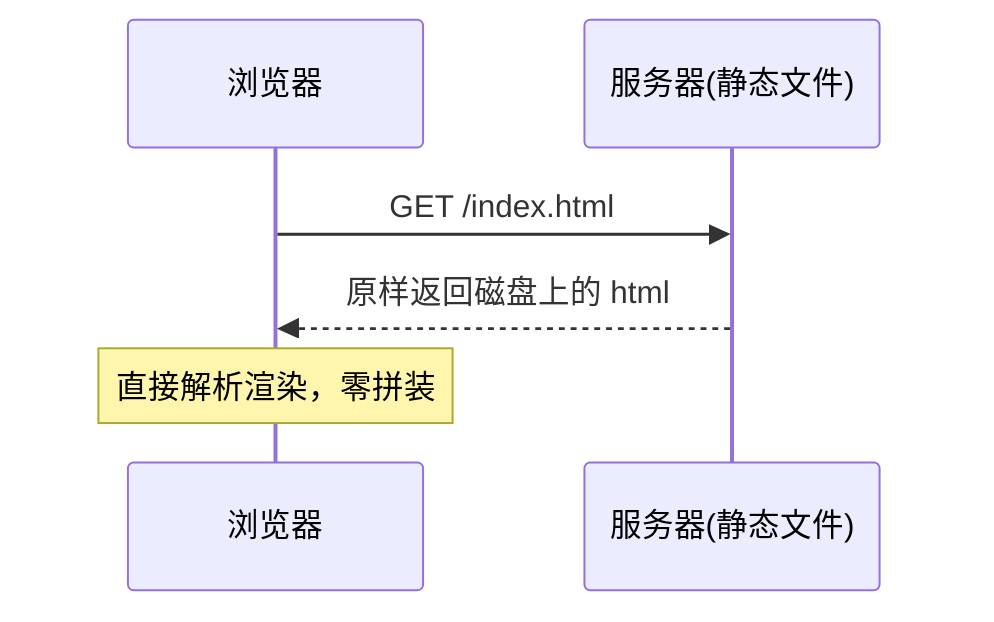

- 特征：一个 URL = 一个磁盘文件，改内容 = 改文件
- 痛点：结构样式一样、只有数据不同的页面要复制 N 份

部署方式：客户端文件（HTML、CSS、JS）和后端服务器端代码都托管在同一个服务器上（使用模板引擎的动态应用阶段）

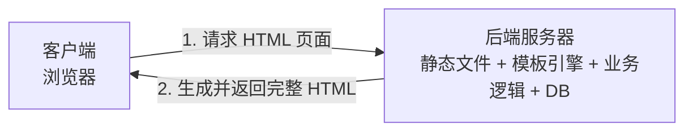

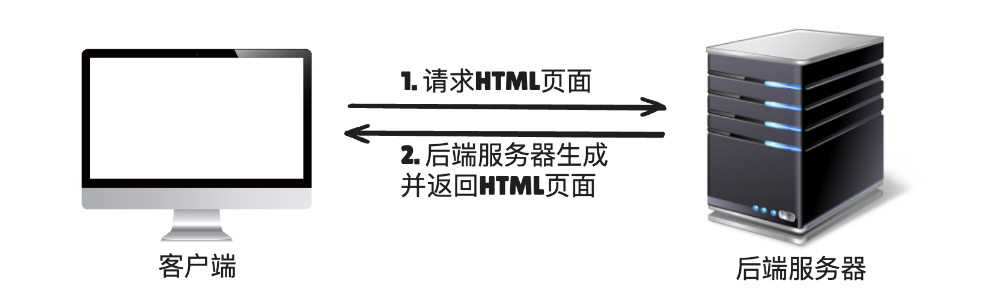


### 阶段 2｜动态页面

阶段 2｜动态页面 / 服务端模板渲染（MPA）→ 部署方案 ①

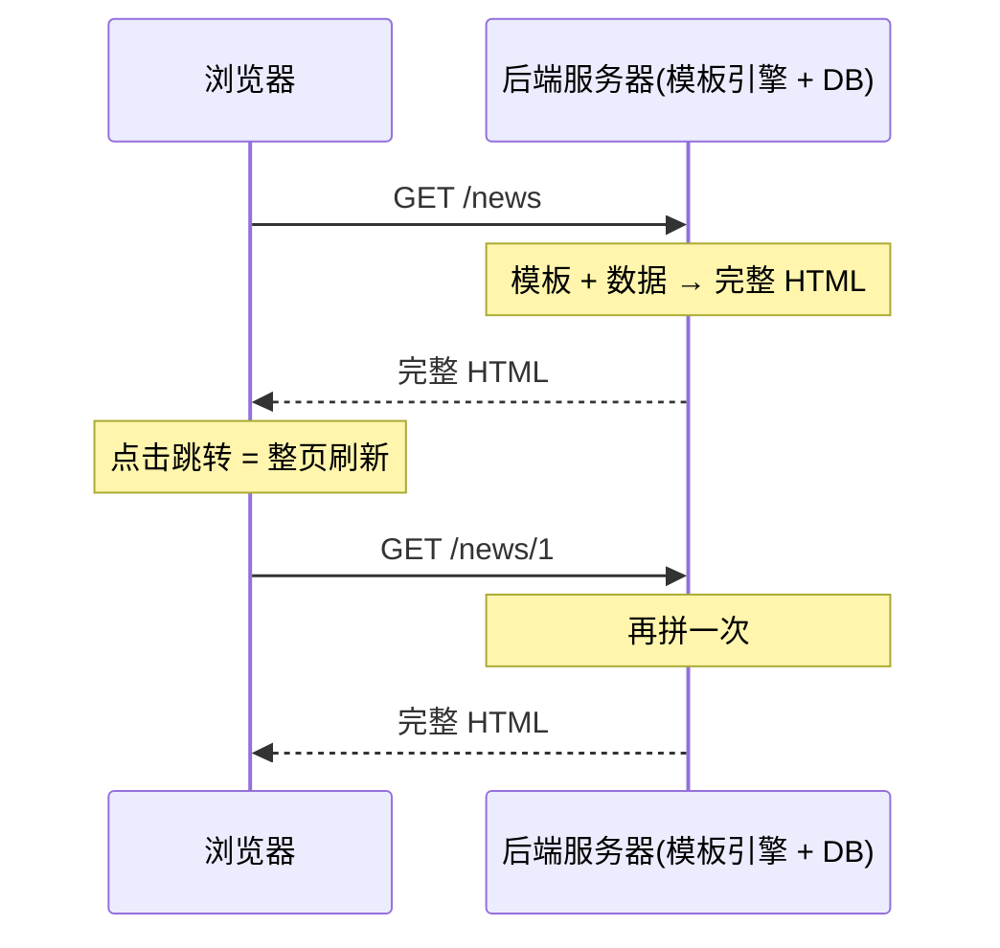

- 技术：JSP / Thymeleaf、PHP + Smarty、ASP、Jinja2、Razor
- 优点：首屏快、SEO 天然友好
- 痛点：整页刷新体验差 + 前后端代码耦合（前端要会 Java/PHP 语法）
- 这是你笔记"阶段一"的正确定位


### 阶段 3｜Ajax 局部刷新（前后端分离的开端）

阶段 3｜Ajax 局部刷新（前后端分离的开端）→ 部署方案 ① → ② 过渡

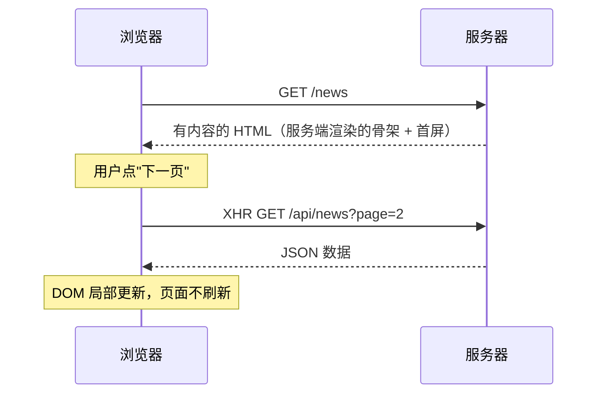

- 关键：仍是多页，但页面内部的数据更新不再刷页
- 解决的是"数据与页面解耦"，没有解决"跳转白屏"


### 阶段 4｜SPA / CSR（含 Vue、React、Angular）

阶段 4｜SPA / CSR（含 Vue、React、Angular）→ 部署方案 ②

SPA（Single Page Application，单页应用）：整个网站只有一个 HTML 页面，用户访问时拿到的是一个空壳 HTML + JS 文件。页面跳转不会刷新整个页面，而是由前端路由拦截，通过 JS 局部更新内容，全程"零刷新"。

CSR（Client-Side Rendering，客户端渲染）：页面内容不是服务器直接生成好的，而是浏览器下载 JS 后，在客户端执行 JS、请求数据、再渲染出真实内容。对应图中"执行 JS，框架挂载到 #app"→"GET /api/news"→"数据驱动视图 → 渲染真实内容"这个流程。

两者关系：SPA 通常采用 CSR 方式实现，

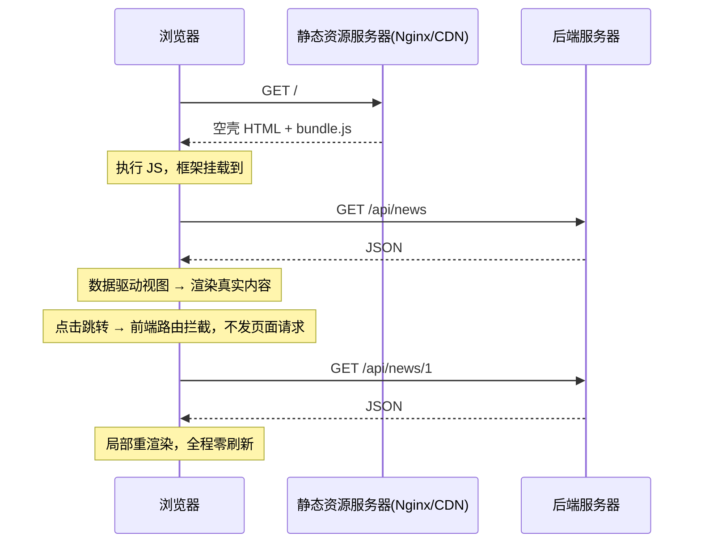

框架做的四件事：

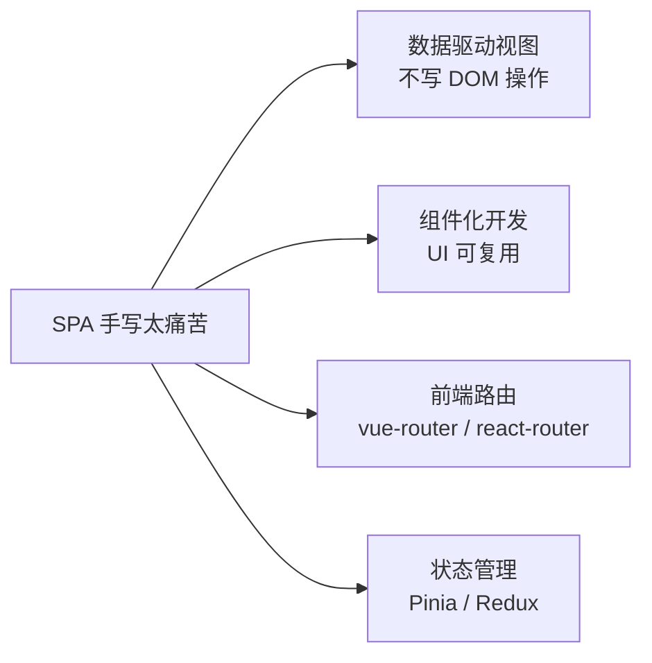

- 后端路由的含义变了：以前给页面，现在给数据
- 新痛点：首屏白屏久（要等 JS 下载→执行→请求→渲染）、SEO 差（爬虫拿到的是空 div）


### 阶段 5｜现代 SSR / 同构渲染 

阶段 5｜现代 SSR / 同构渲染 → 部署方案 ③

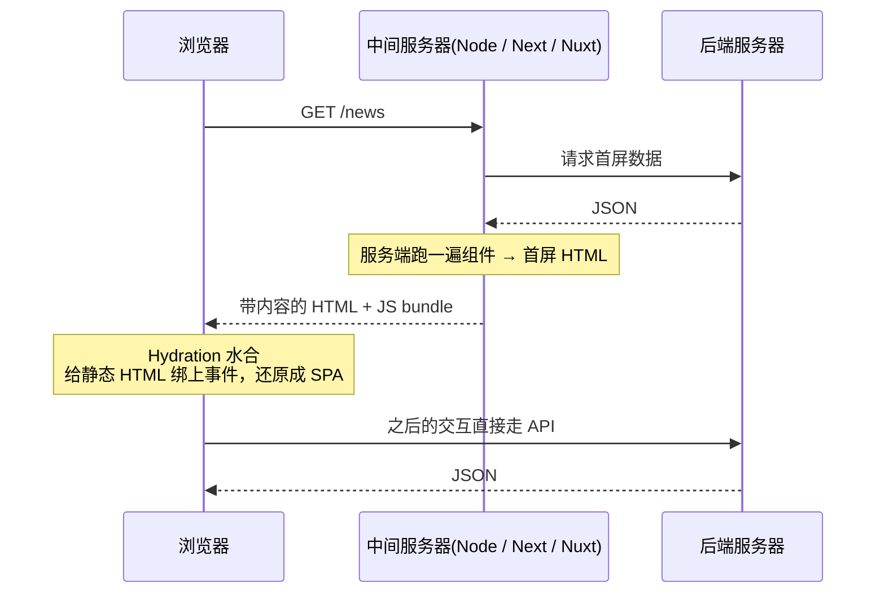

- 同构：同一份组件代码，既能在 Node 跑出字符串，也能在浏览器跑出 DOM（这就是中间服务器必须是 Node 的原因）
- Hydration（水合）：HTML 已经"看得见"但"点不动"，JS 加载后接管事件，页面从阶段 2 无缝变回阶段 4
- 同时拿回：首屏快 + SEO 好 + SPA 交互体验
- 代价：多一台服务器、多一层运维、Node 有计算压力 → SSR 不是银弹，按需选用
- 衍生：SSG（构建时直出）/ ISR / 流式 SSR / RSC


### 部署方案 1

部署方式：客户端文件（HTML、CSS、JS）和后端服务器端代码都托管在同一个服务器上（使用模板引擎的动态应用阶段）


### 部署方案 2

部署方式：静态服务器（如 Nginx 或 CDN）托管和提供静态文件的服务，而后端服务器（如 Node.js、Python、Java 等）处理 API 请求和业务逻辑（CSR客户端渲染阶段）

拓扑：

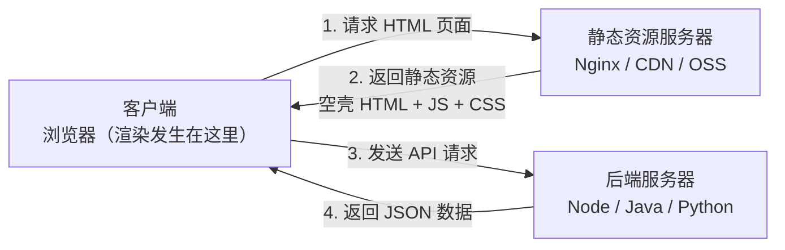

时序图：

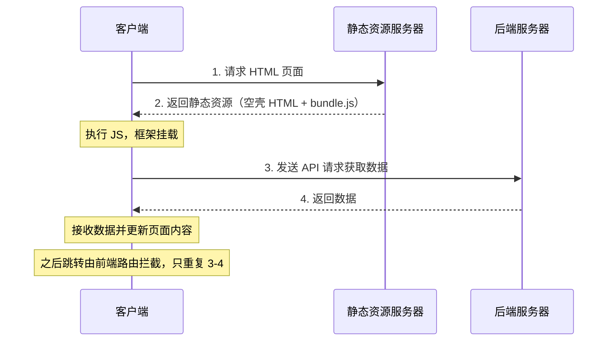

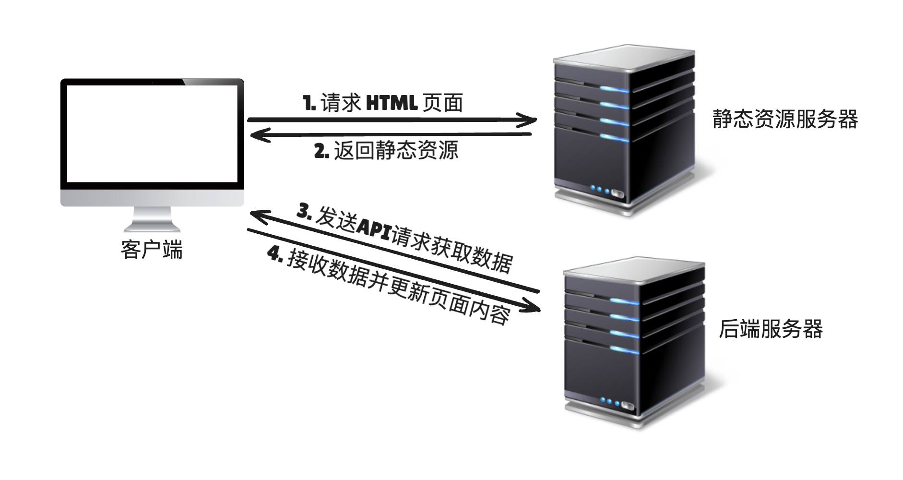


### 部署方案 3

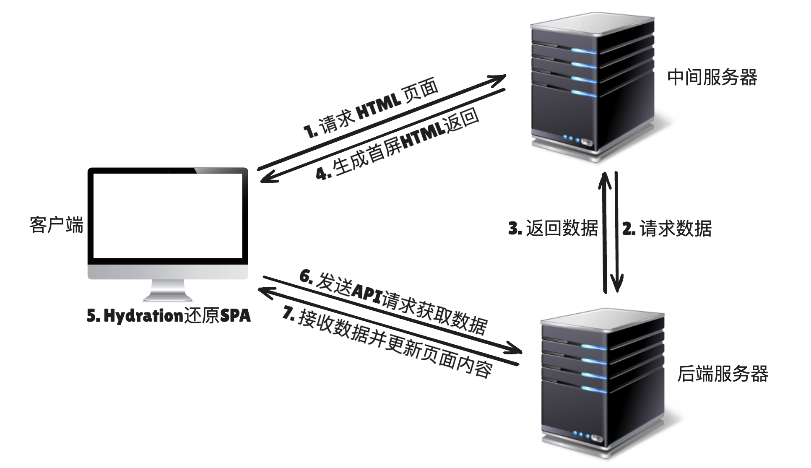

拓扑

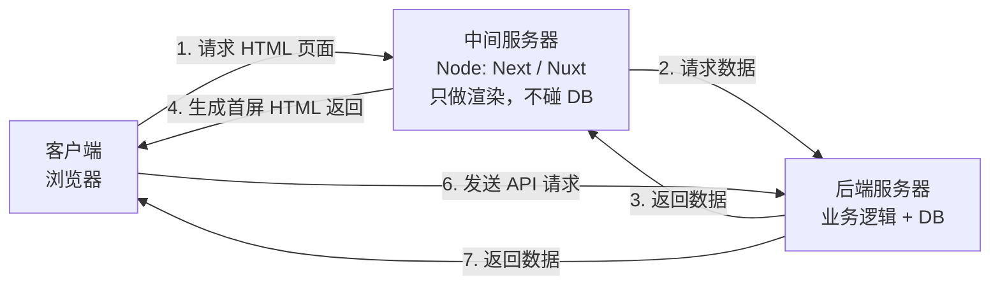

时序

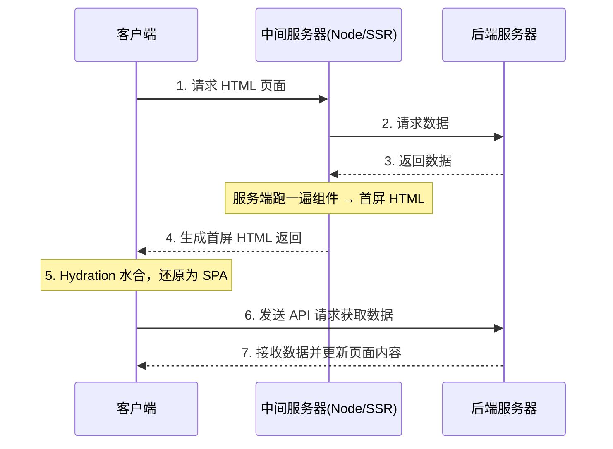


### 总结

| 阶段                   | HTML 从哪来            | 渲染在哪                       | 跳转方式                | 部署方案   |
| ---------------------- | ---------------------- | ------------------------------ | ----------------------- | ---------- |
| 1 静态页面             | 磁盘文件               | 无需渲染                       | 整页刷新                | ①          |
| 2 动态页面（模板引擎） | 后端服务器拼装         | 服务器                         | 整页刷新                | ①          |
| 3 Ajax 局部刷新        | 后端服务器拼装         | 服务器（骨架）+ 浏览器（局部） | 整页刷新                | ① → ② 过渡 |
| 4 SPA / CSR            | 静态资源服务器（空壳） | 浏览器                         | 前端路由，零刷新        | **②**      |
| 5 现代 SSR（同构）     | 中间服务器直出         | 首屏在中间服务器，之后在浏览器 | 首次直出 + 之后前端路由 | ③          |


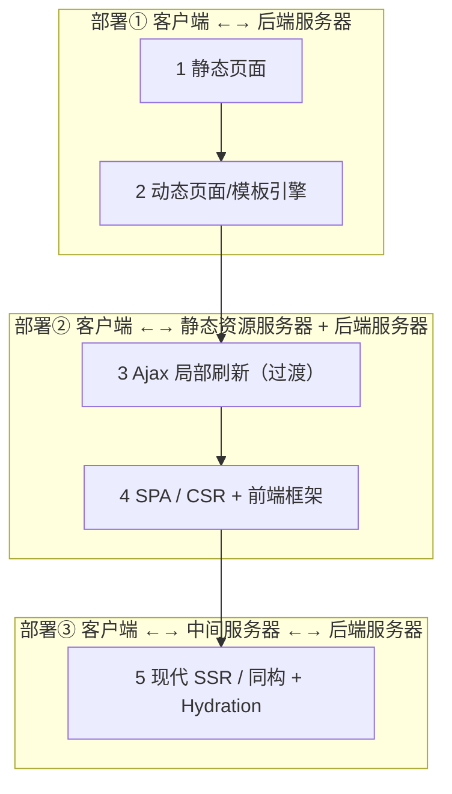


## SSR初体验


### 基本认识

|                       | CSR（传统 SPA）             | SSR               |
| --------------------- | --------------------------- | ----------------- |
| 浏览器首次拿到的 HTML | 空的 `<div id="app"></div>` | 已经带内容的 HTML |
| 内容何时出现          | JS 下载+执行完              | 立刻              |
| 爬虫能不能读到        | 难                          | 能                |


设计意图：让「渲染」这件事从浏览器搬到服务器，先把字符串产出来。

平时说的渲染（浏览器渲染）指的是把 HTML 字符串变成屏幕像素

SSR 语境下的"渲染"（框架渲染），指的是框架把组件变成 HTML 字符串的过程：

```vue
// Vue 组件（抽象描述）
{
  template: '<div>{{ msg }}</div>',
  data: { msg: 'Hello' }
}

// ↓ "渲染"后

// HTML 字符串（具体标记）
'<div>Hello</div>'
```


### 关键步骤解析

```
createSSRApp(组件)  →  renderToString(app)  →  res.send(html)
   造实例                 变成 HTML 字符串        发给浏览器
```


#### 第一步：`createSSRApp` —— 造实例

```js
import { createSSRApp } from "vue";

const app = createSSRApp({
  template: `<div><h1>Hello</h1><p>{{ message }}</p><button @click="count++">{{ count }}</button></div>`,
  data: () => ({ count: 1, message: "This is a server-side rendered page" }),
});
```

- 语法：和 `createApp` 一模一样，只是换个名字。
- 作用/为什么不用 `createApp`：`createSSRApp` 造出来的实例，将来在浏览器端挂载时走的是「接管已有 DOM」的路径；`createApp` 走的是「清空后重新生成 DOM」的路径。SSR 必须用前者。
- 现在这一步什么都没发生，只是把配置存下来了。


#### 第二步：`renderToString` —— 出字符串

```js
import { renderToString } from "vue/server-renderer";

const html = await renderToString(app);
console.log(html);
```

- 语法：从 `vue/server-renderer` 导入（不是从 `vue`）。异步，返回 Promise，所以要 `await`。

- 运行结果：

  ```html
  <div><h1>Hello</h1><p>This is a server-side rendered page</p><button>1</button></div>
  ```

`{{ message }}` 已经被算好了 → 数据是在服务器上求值的。

`@click` 不见了 → HTML 是纯文本，装不下函数。所以此刻这个按钮点了没反应。

没有 `<html>` `<head>` `<body>` → 这只是个片段，不是文档。


#### 第三步：Express 把字符串发出去

```js
import express from "express";
const server = express();

server.get("/", async (req, res) => {
  try {
    const html = await renderToString(app);
    res.send(html);
  } catch (err) {
    res.status(500).send("Server Error");
  }
});

server.listen(3000, () => console.log("监听3000端口..."));
```

- `express()`：造服务器实例。
- `server.get(路径, 处理函数)`：注册路由。`req` 是请求，`res` 是响应。
- `res.send(字符串)`：把内容作为响应体发回去。
- `res.status(500).send(...)`：渲染出错时返回 500，不要让服务器挂掉。
- `server.listen(端口, 回调)`：开始监听。

开发辅助：package.json

```jsON
"scripts": { "start": "nodemon --watch server.js server.js" }
```

改完文件自动重启，`pnpm start` 运行。


#### HTML 模板文件：三个占位符

`index.html`：

```html
<!DOCTYPE html>
<html lang="en">
  <head>
    <meta charset="UTF-8" />
    <meta name="viewport" content="width=device-width, initial-scale=1.0" />
    <title>{{ title }}</title>
    {{ meta }}
  </head>
  <body>
    <!-- 挂载点和外层div必须同一行 -->
    <div id="app"><!--vue-ssr-outlet--></div>
  </body>
</html>
```

| 占位符                  | 换成什么                |
| ----------------------- | ----------------------- |
| `{{ title }}`           | 页面标题                |
| `{{ meta }}`            | 一段 meta 标签字符串    |
| `<!--vue-ssr-outlet-->` | `renderToString` 的产物 |

服务端渲染时，这段注释：`<!--vue-ssr-outlet-->`会被替换成真正的 Vue 组件 HTML


为什么要强调「同一行」

```html
<div id="app"><!--vue-ssr-outlet--></div>   ✅

<div id="app">
  <!--vue-ssr-outlet-->
</div>                                       ❌
```

原因：换行和缩进在 HTML 里是空白文本节点。写成第二种，`#app` 的第一个子节点就变成了一个空白文本节点，而不是渲染出来的 `<div>`。

将来客户端接管 DOM 时，会拿真实 DOM 的子节点和虚拟 DOM 逐个比对，第一个就对不上 → 触发 hydration mismatch，Vue 会警告并把服务端渲染的内容全部丢弃、重新渲染一遍 —— SSR 白做了。


为什么必须上 HTML 模板

浏览器里右键 → View Page Source，看到的就是那段裸片段。问题：

- 没有 `<title>`、`<meta>` → SEO 全废（SSR 的主要卖点之一就是这个）
- 没有 `<meta charset>` → 中文乱码
- 没有 `<meta viewport>` → 移动端不适配
- 将来客户端 JS 的 `<script>` 标签也没地方放

结论：渲染结果只是「馅」，还需要一张「皮」。


#### 拼装：读文件 + 字符串替换

```js
import fs from "fs";

const desc = {
  title: "这是一个ssr页面",
  meta: '<meta name="description" content="服务器端渲染">',
};

server.get("/", async (req, res) => {
  try {
    const content = await renderToString(app);
    const template = fs.readFileSync("./index.html", "utf-8");
    const html = template
      .replace("{{ title }}", desc.title)
      .replace("{{ meta }}", desc.meta)
      .replace("<!--vue-ssr-outlet-->", content);
    res.send(html);
  } catch (err) {
    res.status(500).send("Server Error");
  }
});
```

- `fs.readFileSync(路径, "utf-8")`：同步读文件；第二个参数给了编码才返回字符串，不给返回 Buffer。
- `.replace(旧, 新)`：字符串方法，只替换第一个匹配，这里三个占位符各出现一次，正好够用；可以链式连写。
- 模板引擎的本质就是这个 —— 后面 Nuxt/Vite SSR 做的事情，内核仍然是「读模板 → 塞内容 → 发出去」。


### 完整最小可跑版

目录

```
demo/
  package.json
  index.html
  server.js
```


创建 package.json

```powershell
pnpm init 
```

```json
{
  "type": "module",
  "scripts": { "start": "nodemon --watch server.js server.js" }
}
```


安装

```powershell
pnpm install vue express
pnpm install -D nodemon
```


server.js

```js
import { createSSRApp } from "vue";
import { renderToString } from "vue/server-renderer";
import express from "express";
import fs from "fs";

const server = express();

const app = createSSRApp({
  template: `
    <div>
      <h1>Hello, Server-Side Rendering!</h1>
      <p>{{ message }}</p>
      <button @click="count++">{{ count }}</button>
    </div>
  `,
  data: () => ({ count: 1, message: "This is a server-side rendered page" }),
});

const desc = {
  title: "这是一个ssr页面",
  meta: '<meta name="description" content="服务器端渲染">',
};

server.get("/", async (req, res) => {
  try {
    const content = await renderToString(app);
    const template = fs.readFileSync("./index.html", "utf-8");
    const html = template
      .replace("{{ title }}", desc.title)
      .replace("{{ meta }}", desc.meta)
      .replace("<!--vue-ssr-outlet-->", content);
    res.send(html);
  } catch (err) {
    console.log(err, "err");
    res.status(500).send("Server Error");
  }
});

server.listen(3000, () => console.log("服务器启动成功，监听3000端口..."));
```


`index.html`：

```html
<!DOCTYPE html>
<html lang="en">
  <head>
    <meta charset="UTF-8" />
    <meta name="viewport" content="width=device-width, initial-scale=1.0" />
    <title>{{ title }}</title>
    {{ meta }}
  </head>
  <body>
    <!-- 挂载点和外层div必须同一行 -->
    <div id="app"><!--vue-ssr-outlet--></div>
  </body>
</html>
```


pnpm start启动

打开 `http://localhost:3000`，右键 View Page Source：

-  源码是完整 HTML 文档，有 `<!DOCTYPE>` `<head>` `<body>`
-  标签页标题是「这是一个ssr页面」
-  `<head>` 里有那条 description meta
-  `<div id="app">` 里面是渲染好的内容，`{{ message }}` 已求值
-  `<button>1</button>` 上没有任何事件属性
-  点按钮，数字不变 ← 记住这个现象，它是「水合」要解决的问题
-  页面里没有任何 `<script>` ← 目前完全没有客户端 JS


页面：

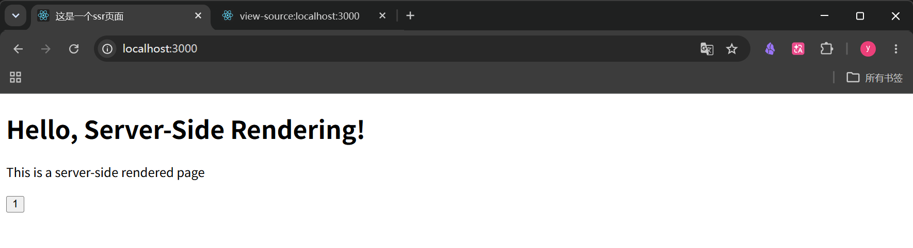

页面源代码：

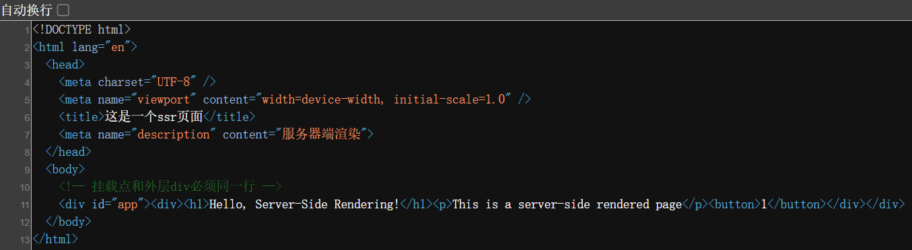


## 水合（Hydration）


### 是什么

水合 = 在浏览器端再跑一次 Vue，让它接管这堆已经存在的 DOM，把事件监听、响应式数据重新挂回去。

术语来源：化学里的"水合作用"，水分子与干燥物质结合使其活跃。静态 HTML 是"干燥"的，JS 是"水"。


上一节结束时的现象：

- 查看源码：`<button>1</button>` —— 内容有了
- 点按钮：数字不动 —— 交互没了

原因在第二步就埋下了：

```js
const html = await renderToString(app);
// '<div>...<button>1</button></div>'
```


此时页面虽然有真实 DOM，但 Vue 的功能还没有恢复，服务端渲染时：

```html
<button @click="count++">
  {{ count }}
</button>
```

`@click="count++"` 不可能直接存在于 HTML 字符串中，因为它是 JavaScript 行为，不是 HTML 属性。。所以服务器发过去的是一具"尸体"：结构对、样式对、事件全丢。

最终只会生成：

```html
<button>1</button>
```


不是重新生成 DOM，是复用已有 DOM。这也是 `createSSRApp` 和 `createApp` 的唯一区别。

|                          | 挂载时行为                           |
| ------------------------ | ------------------------------------ |
| `createApp().mount()`    | 清空容器 → 重新创建所有 DOM          |
| `createSSRApp().mount()` | 保留容器内 DOM → 逐个比对 → 只补事件 |


### 上一章节代码改造

从 1 个文件到 3 个

现在服务器和浏览器都要创建 Vue 实例，且必须是同一个组件。所以把组件抽出来共用。


从：

```
demo/
  index.html
  server.js
```

变成：

```
demo/
  index.html
  app.js       ← 组件定义 + 工厂函数（两端共用）
  server.js    ← 服务端：调 createApp → renderToString
  client.js    ← 客户端：调 createApp → mount
```


###  app.js 

关键在 `export function`

```js
import { createSSRApp } from "vue";

export function createApp() {
  return createSSRApp({
    template: `
        <div>
            <h1>Hello, Server-Side Rendering!</h1>
            <p>{{ message }}</p>
            <button @click="count++">{{ count }}</button>
        </div>
    `,
    data: () => ({
      count: 1,
      message: "This is a server-side rendered page",
    }),
  });
}
```

导出的是函数，不是单例：

```js
export const app = createSSRApp({...});   // ❌ 单例
export function createApp() { ... }       // ✅ 工厂
```

服务器是长期运行的进程，所有请求共用同一个模块。如果导出单例：用户 A 请求把 `count` 改成 5，用户 B 请求就会拿到 5。状态跨请求泄漏。

所以导出`createApp`这个函数，就能让每个请求一个全新的实例。

（`data: () => ({...})` 写成函数也是同一个道理，只不过那是组件层面的。）


### client.js

这两行就是水合

```js
import { createApp } from "./app.js";
createApp().mount("#app");
```

`mount("#app")` 在这里的语义已经变了：因为实例来自 `createSSRApp`，Vue 会走 hydration 路径 —— 找到 `#app`，发现里面已经有 DOM，就去接管而不是重建。


#### 语义解析

CSR 的 `mount`表示此时已经有真实dom了

CSR渲染流程：

```
空的 #app
  ↓
Vue 执行渲染
  ↓
创建虚拟 DOM
  ↓
创建真实 DOM
  ↓
插入 #app
```


SSR 客户端的 `mount` 更准确地说是：

> 让 Vue 客户端应用接管已有 DOM，对比客户端渲染出来的虚拟DOM，复用已经接管的DOM

可以把mount等同于水和看待

因为服务端的流程是：

```
Vue 组件
  ↓
执行 setup、计算数据、生成虚拟节点
  ↓
虚拟节点转成 HTML 字符串
  ↓
返回浏览器
```

浏览器接收到后，会自己解析HTML：

```
HTML 字符串
  ↓ 浏览器 HTML 解析器
真实 DOM 节点
```

但是此时浏览器还没有把 Vue 应用“接管”起来

之后

```js
#app 中已经有服务端生成的真实 DOM
  ↓
Vue 创建客户端组件实例和虚拟 DOM
  ↓
将虚拟 DOM 与已有 DOM 对比    // mount('#app')会在这里执行，也就是水合之前
  ↓
复用已有 DOM
  ↓
补充事件、响应式关系和组件逻辑
```


### index.html

新增两个 script

```html
<div id="app"><!--vue-ssr-outlet--></div>

<script type="importmap">
  {
    "imports": {
      "vue": "https://unpkg.com/vue@3/dist/vue.esm-browser.js"
    }
  }
</script>
<script type="module" src="/client.js"></script>
```

`type="importmap"` —— app.js 里写的是 `import { createSSRApp } from "vue"`。Node 会去 `node_modules` 找，但浏览器不认识裸模块名 `"vue"`，只认 URL。importmap 就是告诉浏览器："看到 `vue`，去这个地址拿"。

注意用的是 `vue.esm-browser.js`（完整版，含模板编译器），因为我们的 `template` 是运行时字符串，需要现场编译。

`type="module"` —— 让浏览器把 client.js 当 ES Module 执行，这样里面的 `import` 才合法。


### server.js 

 两处变化

```js
import { createApp } from "./app.js";        // ① 不再自己建实例

server.use(express.static(".", { index: false }));   // ② 提供静态文件服务，让浏览器能请求到 client.js / app.js；index:false 避免 "/" 被直接返回未替换的模板原文index.html

server.get("/", async (req, res) => {
  const app = createApp();                   // 每次请求新建
  const content = await renderToString(app);
  ...
});
```

`express.static(目录)` 是中间件：收到请求先看这个目录下有没有对应文件，有就直接发。浏览器请求 `/client.js` 靠的就是它。

`{ index: false }` 是个坑，必须写。默认情况下 `express.static` 遇到 `/` 会自动返回目录下的 `index.html` —— 那是没替换过占位符的模板原文，页面上会直接显示 `{{ title }}`。关掉它，`/` 才会落到下面的路由。


上面的`index.html`文件中有这么一行：

```js
<script type="module" src="/client.js"></script>
```

`server.js` 调用了 `server.listen(3000, ...)`，因此当页面从 `http://localhost:3000/` 加载时，浏览器会根据该源解析以根目录为基准的路径 `src="/client.js`"，即 `http://localhost:3000/client.js`


### 完整代码

`app.js` —— 新增，导出 `createApp` 工厂

```js
import { createSSRApp } from "vue";

// 导出工厂函数而非实例：服务端是长期运行的进程，每个请求必须拿到全新实例
export function createApp() {
  return createSSRApp({
    template: `
      <div>
        <h1>Hello, Server-Side Rendering!</h1>
        <p>{{ message }}</p>
        <button @click="count++">{{ count }}</button>
      </div>
    `,
    data: () => ({
      count: 1,
      message: "This is a server-side rendered page",
    }),
  });
}
```


`client.js` —— 新增，两行水合

```js
import { createApp } from "./app.js";

// 实例来自 createSSRApp，mount 会接管已有 DOM（水合），而不是重建
createApp().mount("#app");
```


`server.js` —— 拆分，保留静态服务 + 占位符替换功能

```js
import { renderToString } from "vue/server-renderer";
import express from "express";
import fs from "fs";
import { createApp } from "./app.js";

const server = express();

// 让浏览器能请求到 client.js / app.js；index:false 避免 "/" 被直接返回未替换的模板原文
server.use(express.static(".", { index: false }));

const desc = {
  title: "这是一个ssr页面",
  meta: '<meta name="description" content="服务器端渲染">',
};

server.get("/", async (req, res) => {
  try {
    const app = createApp();
    const content = await renderToString(app);
    const template = fs.readFileSync("./index.html", "utf-8");
    const html = template
      .replace("{{ title }}", desc.title)
      .replace("{{ meta }}", desc.meta)
      .replace("<!--vue-ssr-outlet-->", content);
    res.send(html);
  } catch (err) {
    console.log(err, "err");
    res.status(500).send("Server Error");
  }
});

server.listen(3000, () => console.log("服务器启动成功，监听3000端口..."));
```


`index.html` —— 加 importmap 和 module script

```html
<!DOCTYPE html>
<html lang="en">
  <head>
    <meta charset="UTF-8" />
    <meta name="viewport" content="width=device-width, initial-scale=1.0" />
    <title>{{ title }}</title>
    {{ meta }}
  </head>
  <body>
    <!-- 挂载点和外层div必须同一行 -->
    <div id="app"><!--vue-ssr-outlet--></div>

    <!-- 浏览器不认识裸模块名 "vue"，用 importmap 映射到 CDN 上的完整版（含模板编译器） -->
    <script type="importmap">
      {
        "imports": {
          "vue": "https://unpkg.com/vue@3/dist/vue.esm-browser.js"
        }
      }
    </script>
    <script type="module" src="/client.js"></script>
  </body>
</html>
```


#### 效果：

pnpm start启动

打开 `http://localhost:3000`

点击按钮有反应

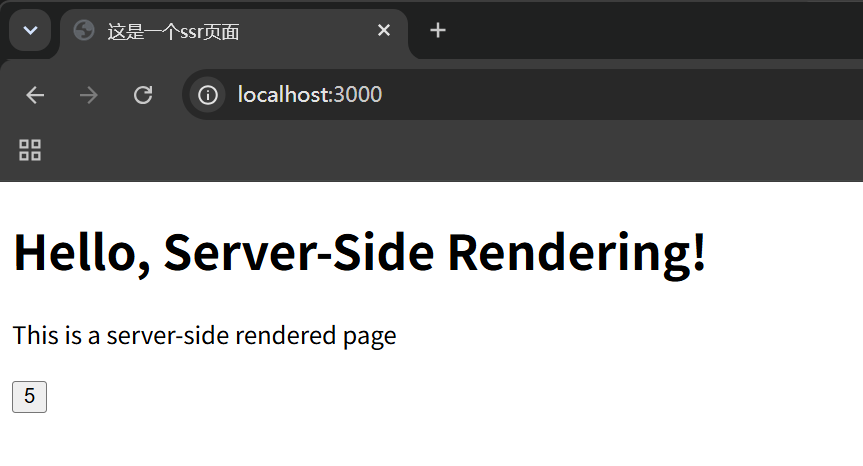

页面源代码：

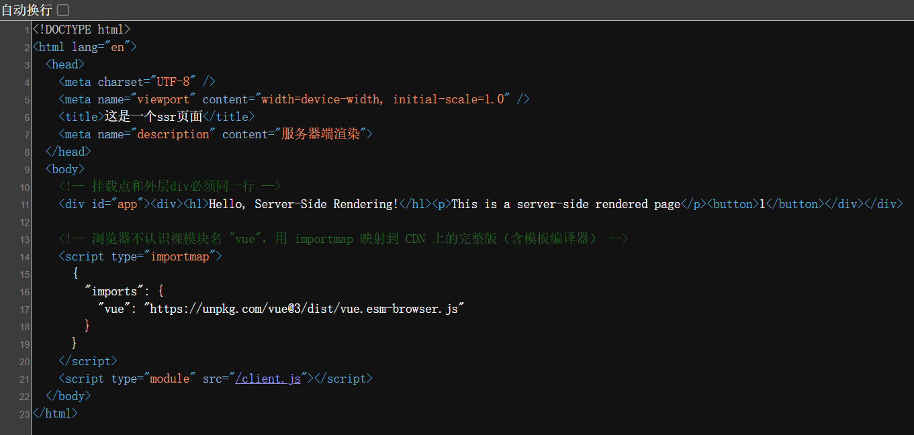


## 改造CSR项目


### 全景：改造前 vs 改造后

现在的 CSR 结构

```
client/
  index.html          → <div id="app"></div> 空壳
  src/main.js         → createApp(App).mount('#app')   一次性、单例
  src/router/index.js → export default router          单例
  vite.config.js      → vite dev 直接当服务器
```

浏览器拿到空壳 → 下载 JS → JS 造 DOM → 请求数据 → 表格才有内容。


改造后的 SSR 结构

```
client/
  server.js                   ← 新增：Express + Vite 中间件（真正的入口）
  index.html                  ← 改：加占位符
  src/main.js                 ← 改：export function createApp()
  src/router/index.js         ← 改：export function createRouter()
  src/entry/server-entry.js   ← 新增：render(url) → HTML 字符串
  src/entry/client-entry.js   ← 新增：水合
  src/hooks/useServerData.js  ← 新增：只在服务端跑的数据钩子
```

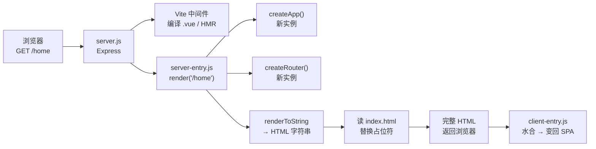

把「浏览器造 DOM」这一步搬到服务器，产出字符串；再让浏览器用同一份代码把字符串"激活"回 SPA。


### 1. 改造 router

将路由从单例导出改为工厂模式

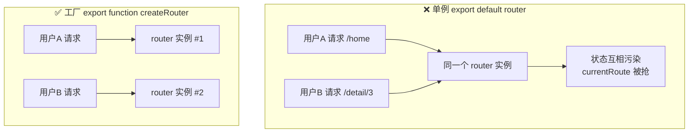

该法：client/src/router/index.js

```js
// 注意：重命名导入，腾出 createRouter 这个名字给自己的工厂函数
import {
  createRouter as _createRouter,
  createWebHistory,
  createMemoryHistory
} from 'vue-router'

const routes = [ /* 原样不动 */ ]

export function createRouter() {
  return _createRouter({
    history: import.meta.env.SSR ? createMemoryHistory() : createWebHistory(),
    routes
  })
}
```

两个新语法

| 语法                    | 作用                                    | 运行时表现                                                   |
| ----------------------- | --------------------------------------- | ------------------------------------------------------------ |
| `import.meta.env.SSR`   | Vite 注入的布尔量，标记"当前在服务端跑" | 服务端 `true`，浏览器 `false`；打包时会被直接替换成字面量并 tree-shake 掉另一分支 |
| `createMemoryHistory()` | 把"当前路径"存在一个 JS 变量里          | 服务端没有 `window.history`、没有地址栏，必须用内存版        |
| `createWebHistory()`    | 基于浏览器 History API                  | 只能在浏览器跑                                               |


原版：

```js
// router.js
import { createRouter, createWebHistory } from 'vue-router'

import Home from '../views/Home.vue'
import About from '../views/About.vue'
import AddOrEdit from '../views/AddOrEdit.vue'
import Detail from '../views/Detail.vue'
import Email from '../views/Email.vue'
import Tel from '../views/Tel.vue'

const routes = [ /* .... */ ]

const router = createRouter({
  history: createWebHistory(),
  routes
})

export default router
```


### 2. 改造入口文件 `main.js`

同样从"执行一次"变成"导出一个工厂"。

client/src/main.js

```js
import './assets/main.css'
import 'element-plus/dist/index.css'  // 引入组件库相关样式

import { createSSRApp } from 'vue'        // ① 不再是 createApp
import App from './App.vue'
import { createRouter } from './router'   // ② 不再是 default import
import { createPinia } from 'pinia'
import ElementPlus from 'element-plus'
import * as ElementPlusIconsVue from '@element-plus/icons-vue'

export function createApp() {
  const app = createSSRApp(App)
  const router = createRouter()
  const pinia = createPinia()

  for (const [key, component] of Object.entries(ElementPlusIconsVue)) {
    app.component(key, component)
  }
  app.use(router).use(pinia).use(ElementPlus)

  // ③ 一定要把实例交出去：外面还要用 router 跳转、用 pinia 取数据
  return { app, router, pinia }
}
```

三处关键变化

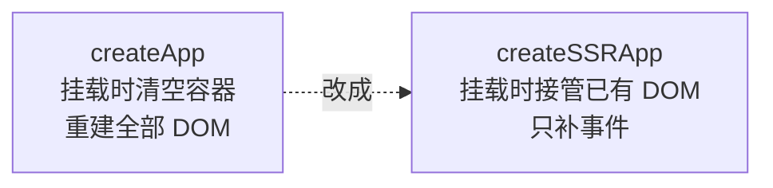

- 没有 `.mount('#app')`：挂载是浏览器端的事，服务端只要实例。
- `return { app, router, pinia }`：这是 SSR 版本和 CSR 版本最大的写法差别。服务端要 `router.push(url)`，还要读 `pinia.state.value`。


原版：

```js
import './assets/main.css'

import { createApp } from 'vue'
// 引入了根组件
import App from './App.vue'
import router from './router'
import { createPinia } from 'pinia'

// 引入组件库
import ElementPlus from 'element-plus'
// 引入组件库相关样式
import 'element-plus/dist/index.css'

import * as ElementPlusIconsVue from '@element-plus/icons-vue'

// 挂载根组件
const app = createApp(App)

// 引入图标
for (const [key, component] of Object.entries(ElementPlusIconsVue)) {
  app.component(key, component)
}

const pinia = createPinia()

app.use(router).use(pinia).use(ElementPlus).mount('#app')
```


### 3. 服务器端入口文件

新建 `client/src/entry/server-entry.js`：

```js
import { createApp } from '../main' // 引入服务端渲染的应用工厂函数
import { renderToString } from 'vue/server-renderer' // 用于将 Vue 组件渲染为 HTML 字符串

/**
 * 根据传入的 URL 渲染对应的页面组件，并返回渲染后的 HTML 字符串数组。
 * @param {string} url 
 * @returns {Promise<string[]>} 返回渲染后的 HTML 字符串数组
 */
export async function render(url) {
  const { app, router } = createApp()

  router.push(url)          // ① 告诉内存路由：去这个地址
  await router.isReady()    // ② 等异步组件/守卫跑完

  const html = await renderToString(app)   // ③ 组件树 → HTML 字符串
  return [html]
}
```

逐行说明：

| 行                          | 干了什么                                              | 不写会怎样                 |
| --------------------------- | ----------------------------------------------------- | -------------------------- |
| `router.push(url)`          | 把请求路径灌进内存路由                                | 永远渲染默认路由           |
| `await router.isReady()`    | 等首次导航彻底完成                                    | 渲染出空的 `<router-view>` |
| `await renderToString(app)` | 递归执行组件、求值插值、拼字符串                      | —                          |
| `return [html]`             | 用数组返回，方便后面扩展成 `[html, teleports, state]` | —                          |


### 4. 创建服务器

新建 `client/server.js`：

```js
import fs from 'node:fs'
import path from 'node:path'
import express from 'express' // 引入 Express 框架，用于创建一个 Node HTTP 服务
import { createServer as createViteServer } from 'vite' // createViteServer可以从Vite里拿到开发服务器编译器

async function createServer() {
  const app = express()

  // ① Vite 以「中间件模式」启动：不自己开端口，只提供编译能力
  const vite = await createViteServer({
    server: { middlewareMode: true },
    appType: 'custom'          // 关掉 Vite 自带的 HTML 处理，交给我们
  })
  app.use(vite.middlewares)    // ② 挂上去：.vue 编译、HMR、静态资源全归它管，让 Vite 不再是一个独立网页服务，而是变成了“中间件”，供 Express 去调用

  app.use(async (req, res) => {
    const url = req.originalUrl
    try {
      // ③ 读模板（每次都读，才能享受热更新）
      let template = fs.readFileSync(path.resolve('index.html'), 'utf-8')

      // ④ 注入 Vite 的 HMR 客户端脚本、@vite/client 等
      template = await vite.transformIndexHtml(url, template)

      // ⑤ 用 Vite 的 SSR 加载器读入口（它会现场编译 .vue、处理别名 @）
      const { render } = await vite.ssrLoadModule('/src/entry/server-entry.js')

      // ⑥ 渲染
      const [appHtml] = await render(url)

      // ⑦ 替换占位符
      const html = template.replace('<!--vue-ssr-outlet-->', appHtml)

      res.status(200).set({ 'Content-Type': 'text/html' }).end(html)
    } catch (e) {
      vite.ssrFixStacktrace(e)   // 把编译后的行号还原成源码行号
      res.status(500).end(e.message)
    }
  })

  app.listen(5173, () => console.log('http://localhost:5173'))
}

createServer()
```

`index.html` 加占位符

```html
<div id="app"><!--vue-ssr-outlet--></div>
```


请求生命周期

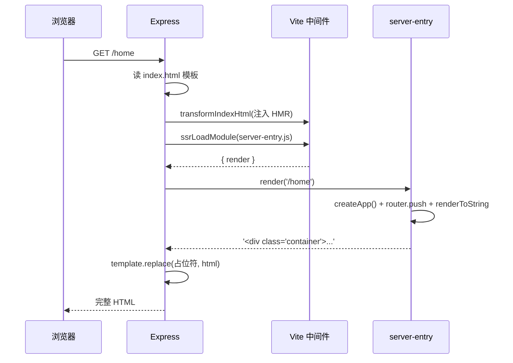


| API                        | 作用                                                         |
| -------------------------- | ------------------------------------------------------------ |
| `middlewareMode: true`     | Vite 不开自己的 dev server，变成一个 connect 中间件塞进 Express |
| `appType: 'custom'`        | 告诉 Vite「HTML 我自己发」，否则它会拦截并返回未替换的模板   |
| `vite.ssrLoadModule(路径)` | Node 原生不认 `.vue`、不认 `@` 别名；这个方法现场编译成 Node 能跑的模块 |


此刻的状态

| 现象             | 原因                       |
| ---------------- | -------------------------- |
| ✅ 查看源码有内容 | SSR 生效                   |
| ❌ 表格空的       | `onMounted` 在服务端不执行 |
| ❌ 按钮点了没反应 | 事件是函数，字符串装不下   |
| ❌ 点导航整页刷新 | 还没有客户端 JS 接管       |

> 端口用 5173 是因为 json-server 占了 3000，`request.js` 的 `baseURL` 指向那里。


### 5. 还原 SPA（水合）

新建 `client/src/entry/client-entry.js`：

```js
import { createApp } from '../main'

const { app, router } = createApp()

router.isReady().then(() => {
  app.mount('#app')
})
```

`index.html` 引入它（把原来的 `/src/main.js` 换掉，main.js 现在只导出函数，单独引入没有意义）

```html
<div id="app"><!--vue-ssr-outlet--></div>
<script type="module" src="/src/entry/client-entry.js"></script>
```


为什么要 `router.isReady()`

浏览器端路由要先解析出当前 URL 对应的组件，才能保证首次渲染的组件树和服务端一致；提前 mount 会渲染出空的 `<router-view>`，和服务端 HTML 对不上。

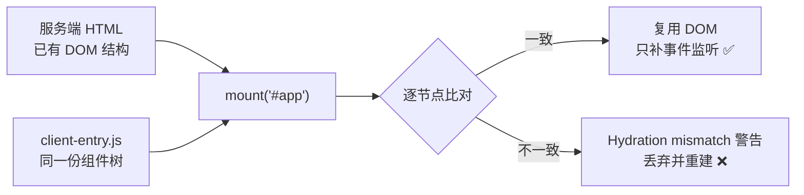

现在会看到控制台报 Hydration mismatch —— 下一步解决。

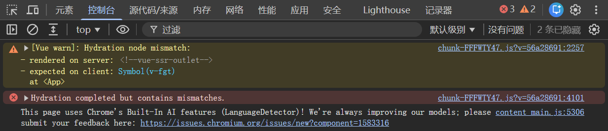


### 6. 解决 Element Plus 渲染不一致

Element Plus 有三个东西两端算出来不一样，逐个消掉。

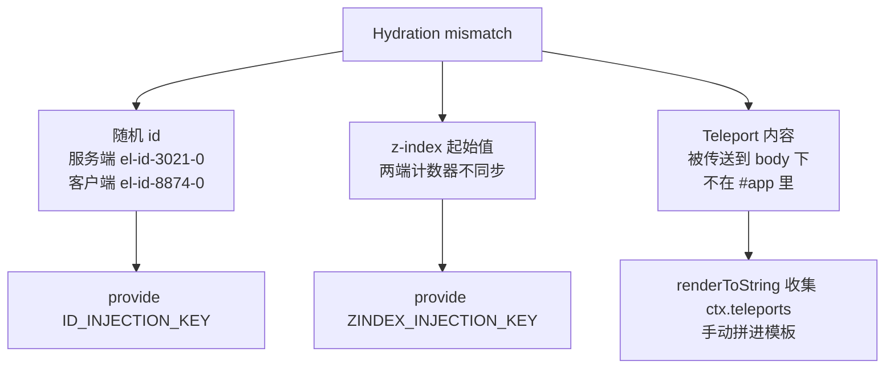


固定 id 和 z-index

在 `main.js` 的 `createApp` 里加：

```js
import { ID_INJECTION_KEY, ZINDEX_INJECTION_KEY } from 'element-plus'

export function createApp() {
  const app = createSSRApp(App)
  // ...
  app.provide(ID_INJECTION_KEY, { prefix: 1024, current: 0 })
  app.provide(ZINDEX_INJECTION_KEY, { current: 0 })
  // ...
}
```

原理：Element Plus 默认用 `Math.random()` 生成 id 前缀。手动注入一个固定 `prefix` 和从 0 开始的计数器，两端就会产出同样的 `el-id-1024-0`、`el-id-1024-1`……


处理 Teleports

`ElTooltip`、`ElSelect`、`ElDialog` 等会把浮层 `<Teleport>` 到 `body` 下。这块内容不在 `renderToString` 的返回值里，要单独取。

```js
export async function render(url) {
  const { app, router } = createApp()
  router.push(url)
  await router.isReady()

  const ctx = {}                                  // ① 传一个上下文对象进去
  const html = await renderToString(app, ctx)
  const teleportsStr = renderTeleports(ctx.teleports)   // ② 从里面捞 teleports

  return [html, teleportsStr]
}

/**
 * 渲染 teleport 内容为 HTML 字符串。
 * @param {{ [key: string]: string }} teleports 
 * @returns {string} 渲染后的 teleport HTML 字符串
 */
function renderTeleports(teleports) {
  if (!teleports) return ''
  return Object.entries(teleports).reduce((all, [key, value]) => {
    if (key.startsWith('#el-popper-container-')) {
      // key 是 '#el-popper-container-1024'，去掉 # 当作 id
      return `${all}<div id="${key.slice(1)}">${value}</div>`
    }
    return all
  }, '')
}
```

`index.html` 加一个新占位符（要在 `#app` **外面**）：

```html
<body>
  <!--app-teleports-->
  <div id="app"><!--vue-ssr-outlet--></div>
  <script type="module" src="/src/entry/client-entry.js"></script>
</body>
```

> 为什么这里用正则而不是普通字符串？因为要把占位符前面的换行和缩进一起吃掉。留下空白文本节点，客户端比对 `body` 子节点时第一个就对不上 —— 和前面 `<div id="app">` 必须同一行是完全同一个问题。


- `ElTooltip`：文字提示组件，对应标签写法通常是 `<el-tooltip>`
- `ElSelect`：选择器组件，对应 `<el-select>`
- `ElDialog`：对话框组件，对应 `<el-dialog>`

在 Vue 中一般这样导入：

```js
import { ElTooltip, ElSelect, ElDialog } from 'element-plus'
```


### 7. 数据预装载

`Home.vue` 里数据是 `onMounted` 拿的：

```js
onMounted(async () => {
  await store.fetchUser()
})
```

而 `onMounted` 是挂载后的钩子。服务端根本不"挂载"（没有 DOM），所以这个函数永远不执行 → 服务端渲染出来的表格是空的。

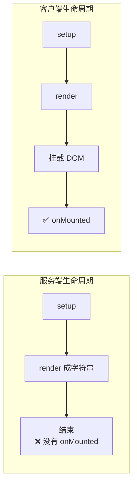

解法

新建 `client/src/hooks/useServerData.js`：

定义了一个用于 服务端渲染（SSR）时预加载数据 的函数

```js
export const useServerData = async (cb) => {
  if (import.meta.env.SSR && cb) {
    await cb()
  }
}
```

- `useServerData`：导出的异步函数，命名上属于 Vue composable/hook。
- `cb`：传入的回调函数，通常用来执行数据请求。
- `import.meta.env.SSR`：Vite 提供的环境标识。
  - 服务端渲染时为 `true`
  - 浏览器端运行时为 `false`
- `if (import.meta.env.SSR && cb)`：只有在 SSR 环境，并且确实传入回调时，才执行回调。
- `await cb()`：等待数据请求完成，确保数据准备好以后再生成 HTML。


`Home.vue` 里加一行：

```js
import { useServerData } from '@/hooks/useServerData'

const store = useUserStore()

// 顶层 await：服务端渲染会等它完成再产出字符串
await useServerData(() => store.fetchUser())

onMounted(async () => {
  await store.fetchUser()   // 客户端仍然保留
})
```

`<script setup>` 里用顶层 `await` 会让组件变成异步组件，`App.vue` 的 `<router-view />` 需要包一层 `<Suspense>`：

```vue
<Suspense><router-view /></Suspense>
```


### 8. 数据预取（脱水 / 注水）


#### 问题

服务端渲染时 pinia 里已经有数据了，但那份数据随请求结束就销毁了。客户端水合时 pinia 是空的，于是又发一次请求 —— 数据重复请求，中间还有一瞬间的闪烁。

```mermaid
graph TB
  S["服务端 pinia<br/>userList: [10条]"] -->|渲染成 HTML| H["HTML 有内容 ✅"]
  S -.->|请求结束销毁 ❌| X["数据丢失"]
  H --> C["客户端 pinia<br/>userList: [] 空的"]
  C --> Q["只能重新请求一次"]
```

#### 两个核心概念

| 概念             | 定义                                                     | 在哪一步                 |
| ---------------- | -------------------------------------------------------- | ------------------------ |
| 脱水 Dehydration | 服务端把渲染用到的状态序列化成字符串，嵌进 HTML 一起发走 | server-entry + server.js |
| 注水 Rehydration | 客户端在挂载前把这串数据反序列化回仓库                   | client-entry.js          |

```mermaid
sequenceDiagram
  participant S as 服务端
  participant H as HTML
  participant C as 客户端
  S->>S: pinia.state.value 有数据
  S->>H: 脱水 JSON.stringify → window.__INITIAL_STATE__
  H->>C: 传输
  C->>C: 注水 JSON.parse → pinia.state.value
  C->>C: app.mount('#app')
  Note over C: 仓库已有数据，无需重新请求
```


#### 脱水

`server-entry.js` 多返回一项：`JSON.stringify(pinia.state.value)`

从`createApp`的返回值中把pinia解构出来

```js
export async function render(url) {
  const { app, router, pinia } = createApp()
  router.push(url)
  await router.isReady()

  const ctx = {}
  const html = await renderToString(app, ctx)
  const teleportsStr = renderTeleports(ctx.teleports)

  return [html, teleportsStr, JSON.stringify(pinia.state.value)]
}
```

`pinia.state.value` 是所有 store 状态的总集合，形如：

```js
{ userStore: { userList: [ {...}, {...} ] } }
```

`index.html` 加占位符和承载脚本：

```html
<body>
  <!--app-teleports-->
  <div id="app"><!--vue-ssr-outlet--></div>
  <script type="module" src="/src/entry/client-entry.js"></script>
  <script>
    window.__INITIAL_STATE__ = '<!--pinia-state-->'
  </script>
</body>
```

`server.js` 再替换一次：


#### 注水

`client-entry.js`：

```js
import { createApp } from '../main'

const { app, router, pinia } = createApp()

router.isReady().then(() => {
  if (window.__INITIAL_STATE__) {
    pinia.state.value = JSON.parse(window.__INITIAL_STATE__)
  }
  app.mount('#app')       // 注水必须在 mount 之前
})
```

顺序不能反：先把仓库填好，`mount` 时渲染出来的内容才和服务端 HTML 一致；反过来会 mismatch。

>  用引号包 `'<!--pinia-state-->'` 有个隐患：数据里若含 `'` 或 `</script>` 会把 HTML 打断（XSS 风险）。生产环境应转义或改用 `<script type="application/json">` 承载。


#### 启动

```
# 终端 1：数据接口
cd user-system\server ; 
pnpm install    
pnpm json:server

# 终端 2：SSR 服务器
cd user-system\client; 
pnpm install  
pnpm add express; 
node server.js
```

可以在`package.json` 加个脚本：


#### 为什么服务端的 Pinia 数据会销毁？

```mermaid
sequenceDiagram
  participant B as 浏览器
  participant S as 服务端
  participant P as 本次请求的 Pinia
  B->>S: GET /home
  S->>P: createPinia()
  S->>P: fetchUser()
  P-->>S: userList = 5条数据
  S->>S: renderToString()
  S-->>B: 返回 HTML
  Note over S,P: 本次请求结束
  Note over P: 没有代码再持有它，成为可回收对象
```

服务端代码大致是：

```js
export async function render(url) {
  const { app, router, pinia } = createApp() // 这里的 pinia 是在 render() 内部创建的：

  router.push(url)          // ① 告诉内存路由：去这个地址
  await router.isReady()    // ② 等异步组件/守卫跑完
  const html = await renderToString(app, ctx)   // 组件树 → HTML 字符串
  // 。。。
  
  return [html, teleportsStr, JSON.stringify(pinia.state.value)]  
}
```

关键在函数的返回值，当 `render()` 执行完成后，如果服务端没有其他地方继续保存 `pinia`，那么这次请求对应的：

- `app`
- `router`
- `pinia`
- `userList`

都会失去引用。，它们就会变成可以被垃圾回收的对象。

更准确的说：

> 请求结束后，这些对象不再被使用，并且之后可能被 JavaScript 垃圾回收器回收。


#### 脱水和注水的作用是什么？


##### 解决什么问题

用到脱水和注水的原因是：

> 服务端和浏览器是两个不同的 JavaScript 运行环境，它们不会共享同一个 Pinia 实例。

服务端和客户端各自创建 Pinia

```js
const { app, pinia } = createApp()
```

浏览器执行：

```js
const { app, pinia } = createApp()
```

虽然它们调用的是同一个工厂函数，但创建的是两个完全不同的对象：

```mermaid
graph TB
  subgraph SERVER["服务端 Node.js"]
    SApp["服务端 app"]
    SPinia["服务端 Pinia<br/>userList: 5条"]
  end

  subgraph BROWSER["浏览器"]
    BApp["客户端 app"]
    BPinia["客户端 Pinia<br/>userList: []"]
  end

  SApp -.不是同一个对象.-> BApp
  SPinia -.不会自动同步.-> BPinia
```

服务端请求结束后，服务端 Pinia 也不能直接传给浏览器。

因此默认情况下会出现：

```mermaid
sequenceDiagram
  participant S as 服务端
  participant B as 浏览器
  participant SP as 服务端 Pinia
  participant BP as 浏览器 Pinia

  S->>SP: fetchUser()
  SP-->>S: userList = 5条
  S-->>B: HTML中已经有5条数据

  B->>BP: 创建新的客户端 Pinia
  Note over BP: userList = []
  B->>B: 开始水合
  B->>BP: onMounted()再次fetchUser()
  BP-->>B: 再次得到5条数据
```


##### 脱水：把服务端状态变成字符串

脱水 Dehydration 的意思是：

> 把服务端 Pinia 中用于渲染的数据提取出来，转换成可以放进 HTML 的字符串。

代码：

```js
const piniaState = JSON.stringify(pinia.state.value)
```

假设服务端 Pinia 是：

```js
pinia.state.value = {
  userStore: {
    userList: [
      {
        id: '9aa0',
        name: '张三',
        age: '14'
      }
    ]
  }
}
```

脱水后变成：

```json
'{"userStore":{"userList":[{"id":"9aa0","name":"张三","age":"14"}]}}'
```

这个字符串可以嵌入 HTML：

```html
<script>
  window.__INITIAL_STATE__ = '{"userStore":{"userList":[{"id":"9aa0","name":"张三","age":"14"}]}}'
</script>
```

此时，服务端数据就随着 HTML 一起传到了浏览器。

这样就解决了：

```
服务端 Pinia 有数据
        ↓
但是客户端 Pinia 不知道
        ↓
把服务端状态序列化到 HTML
```

也就是：

> 脱水负责把状态从“服务端内存对象”变成“可传输的字符串”。


##### 注水：把字符串恢复到客户端 Pinia

浏览器拿到 HTML 后，`window.__INITIAL_STATE__` 是一个字符串：

```js
window.__INITIAL_STATE__
// '{"userStore":{"userList":[...]}}'
```

客户端先用 `JSON.parse()` 把它恢复成 JavaScript 对象：

```js
const initialState = JSON.parse(window.__INITIAL_STATE__)
```

然后写回客户端 Pinia：

```js
pinia.state.value = initialState
```

完整代码：

```js
import { createApp } from '../main'

const { app, router, pinia } = createApp()

router.isReady().then(() => {
  if (window.__INITIAL_STATE__) {
    pinia.state.value = JSON.parse(window.__INITIAL_STATE__)
  }

  app.mount('#app')
})
```

这一步就叫注水 Rehydration。

解决了：

```
浏览器拿到服务端 HTML
        ↓
客户端创建 Pinia，但状态是空的
        ↓
把服务端传来的状态重新放进客户端 Pinia
        ↓
客户端应用继续工作
```

所以：

> 注水负责把传输过来的字符串恢复成客户端可以使用的响应式状态。


##### 注水必须在 mount 之前

```mermaid
graph LR
  A["创建客户端 app / pinia"] --> B["JSON.parse"]
  B --> C["pinia.state.value = 初始状态"]
  C --> D["app.mount('#app')"]
  D --> E["水合"]
```

也就是：

```js
pinia.state.value = JSON.parse(window.__INITIAL_STATE__)
app.mount('#app')
```

原因是水合时，客户端第一次渲染必须使用和服务端相同的数据

服务端 HTML：

```html
<tr>
  <td>张三</td>
  <td>14</td>
</tr>
```

如果客户端 Pinia 还是空的：

```js
userList = []
```

客户端虚拟 DOM 就会认为：

```
服务端：有5行数据
客户端：应该是0行数据
```

两边不一致，就可能出现：Hydration mismatch

正确情况是：

```
服务端 Pinia：5条数据
        ↓ 脱水
HTML：5条数据 + 初始状态字符串
        ↓ 注水
客户端 Pinia：5条数据
        ↓ mount / hydration
服务端 DOM 与客户端状态一致
```


## Nuxt4 基本介绍


### 项目结构

先看一个最小 Nuxt 4 项目

```
my-app/
  app/
    app.vue
    assets/
    components/
    pages/
  public/
  nuxt.config.ts
  package.json
  tsconfig.json
```

目录分别做什么

app/：核心应用目录，放真正的业务代码。它就像项目的主活动区，页面、组件、样式和多数代码都在这里。

pages/：页面目录。文件名会自动成为路由，比如 `pages/index.vue` 会对应 `/`。

components/：可复用组件目录。Nuxt 会自动导入组件，通常不需要手动写大量 import。

public/：静态资源目录。文件会直接对外暴露，比如 `/logo.png`。

assets/：构建资源目录。CSS、SCSS、图片等会被构建工具处理，适合在应用中引用。

nuxt.config.ts：全局配置入口。这里可以设置头部元信息、CSS、模块、代理、环境等。


### 静态资源 public 和 assets

为什么 `logo.png` 放在 `public/` 时可以用 `/logo.png` 访问，而不是从 `assets/` 直接访问。

`public/` 会被 Nuxt 当作网站的公开根目录。其中的文件会原样复制到最终输出目录，因此：`public/logo.png` 对应浏览器中的：`/logo.png`，所以可以直接写：

```html

```

这里的 `/` 表示网站根路径，不是项目根目录。

而 `app/assets/` 是应用的源代码资源目录。里面的文件会交给 Vite 等构建工具处理，构建工具可能会：

- 修改文件名
- 添加 hash
- 移动到其他输出目录
- 压缩或合并文件
- 只保留真正被代码引用的资源

例如：`app/assets/logo.png`,构建后可能变成：`/_nuxt/logo.a81f3c.png`,所以不能稳定地直接写：

```html

```

因为最终部署环境中通常并不存在这个固定 URL。

正确方式是导入：

```vue
<script setup lang="ts">
import logo from '~/assets/logo.png'
</script>

<template>
  
</template>
```

此时 `logo` 变量会接收构建工具生成的最终地址，例如：`/_nuxt/logo.a81f3c.png`

一句话记忆：

> `public/` 是“固定地址的公开文件”，所以直接用 `/文件名` 访问；`app/assets/` 是“需要参与构建的源文件”，所以要通过 `import` 让构建工具决定最终地址。


### 配置入口 `nuxt.config.ts`

`nuxt.config.ts` 负责“全局行为”，比如：页面标题、页面头部元信息、样式入口、模块和代理配置。

```js
export default defineNuxtConfig({
  app: {
    head: {
      title: 'My App',     // 页面标题
      meta: [
        { name: 'viewport', content: 'width=device-width, initial-scale=1' }    // 注入到 <head> 中的 meta 标签
      ]
    }
  },
  css: ['~/assets/css/main.css']
})
```

页面元数据用来控制页面的基础元信息，通常就是浏览器标签栏、SEO 和站点基础信息。


CSS 的引入方式

```js
export default defineNuxtConfig({
  css: [
    '~/assets/css/main.css',
    '~/assets/css/theme.scss'
  ]
})
```

这意味着：页面启动时，Nuxt 会自动把这些样式注入到应用中。很多项目的样式入口就是在这里写。


环境与代理：开发时更常用

```js
export default defineNuxtConfig({
  vite: {
    server: {
      proxy: {
        '/api': {
          target: 'http://localhost:3001',
          changeOrigin: true,
          rewrite: (path) => path.replace(/^\/api/, '')
        }
      }
    }
  }
})
```

开发代理是指在开发环境中，通过一个中间层来转发和修改前端发出的请求，使其指向后端服务器。

```js
proxy: {
  '/api': {
    target: 'http://localhost:3001',      // 真实的后端地址
    changeOrigin: true,                    // 改变请求源
    rewrite: (path) => path.replace(/^\/api/, '')  // 重写路径
  }
}
```

工作流程：

1. 前端发起请求 → `http://localhost:3000/api/user/list`
2. 代理拦截 → 识别到路径以 `/api` 开头
3. 代理转发 → 将请求转发到 `http://localhost:3001/user/list`
4. 后端响应 → 返回数据给前端


## 页面与路由

创建一个页面文件，框架就自动为你生成路由。不需要自己维护一份长长的 router 配置表。

```
app/pages/index.vue        -> /
app/pages/about.vue        -> /about
app/pages/blog.vue         -> /blog
app/pages/blog/[id].vue    -> /blog/123
```

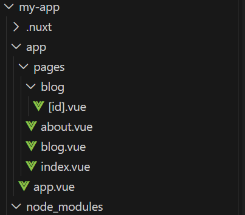

- `blog.vue` 匹配 `/blog`，同时因为同名目录 `blog/` 存在，它会自动变成 `blog/*` 所有子路由的父组件（相当于局部 layout）。
- `blog/[id].vue` 匹配 `/blog/:id`，是子路由，渲染时会被插入到 `blog.vue` 里的 `<NuxtPage />` 位置。

`blog.vue`

```vue
<template>
  <div>
    <!-- blog/[id].vue 是 blog.vue 的子路由，需要 NuxtPage 才能渲染 -->
    <NuxtPage />
  </div>
</template>
```


示例：

```
app/
  pages/
    index.vue
    about.vue
    products/[id].vue
```

其中：

- `index.vue` 对应首页 `/`
- `about.vue` 对应 `/about`
- `products/[id].vue` 对应类似 `/products/1`、`/products/abc` 的动态路由


目录层级也会自动生成嵌套路由

```
app/pages/
  user/
    profile.vue
    settings.vue
```

这样会自动变成：

- `/user/profile`
- `/user/settings`


配合 `useRoute()` 或路由参数读取数据

```vue
<script setup lang="ts">
// 通过 useRoute() 读取动态路由参数 [id]
const route = useRoute()
const id = route.params.id
</script>

<template>
  <div>
    <p>当前路由参数 id：{{ id }}</p>
  </div>
</template>
```

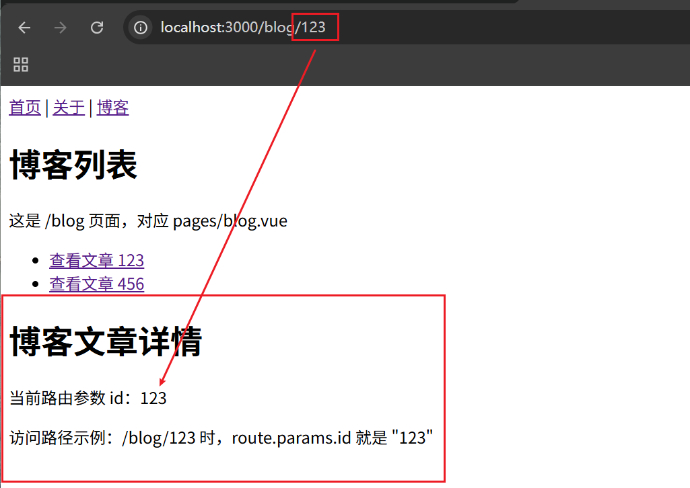


## 组件类型

### 三层关系

```
app.vue
  └─ NuxtLayout
       └─ NuxtPage
            └─ 当前页面内容
```

`app.vue` 是应用入口。`NuxtLayout` 负责套用布局，`NuxtPage` 负责显示当前 URL 对应的页面。它们不是普通的业务组件，而是 Nuxt 提供的内置组件。

NuxtPage：根据当前 URL 去 `pages/` 里找到匹配的页面组件并渲染

NuxtLayout：根据当前页面要用哪个布局，去 `layouts/` 里找到对应组件，并把默认插槽内容渲染进去


### `layouts/` 布局负责公共壳

```vue
<!-- app/layouts/default.vue -->
<template>
  <div>
    <Header />
    <slot />
    <Footer />
  </div>
</template>
```

访问任意页面时，布局中的 `Header` 和 `Footer` 都会出现；`<slot />` 的位置会被替换成当前页面。默认布局文件名是 `default.vue`，通常不需要额外指定。


示例：

新建`app/layouts/default.vue`

```vue
<template>
  <div>
    <header style="padding: 8px; background: #eee">这是 layouts/default.vue 提供的公共头部</header>
    <!-- slot 里插入的就是 NuxtPage 渲染出的当前页面内容 -->
    <slot />
    <footer style="padding: 8px; background: #eee">这是 layouts/default.vue 提供的公共底部</footer>
  </div>
</template>
```

`app.vue` 里用 `<NuxtLayout>` 包住 `<NuxtPage />`。

```vue
<template>
  <div>
    <!-- ... -->  
    <NuxtLayout>
      <NuxtPage />
    </NuxtLayout>
  </div>
</template>
```

`NuxtLayout` 是"渲染布局的容器/调度器"，`layouts/default.vue` 是"具体的布局内容"

1. `NuxtLayout` 会看当前页面组件有没有指定 `definePageMeta({ layout: 'xxx' })`。
2. 没指定的话，默认找 `layouts/default.vue`（也就是你项目里现在的这个）。
3. 找到后，把 `NuxtLayout` 标签内部的内容（也就是 `<NuxtPage />` 渲染出的页面）塞进 `default.vue` 的 `<slot />` 位置。


效果：红框标出的组件内有灰色的公共头部和底部

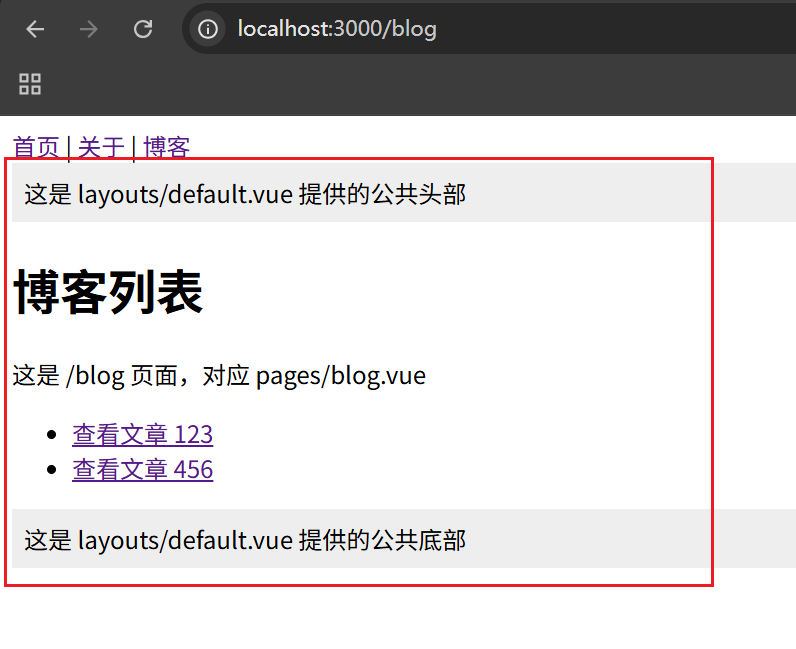

对应到目录树：

```
app/
├── app.vue                 # 应用入口，组合 NuxtLayout + NuxtPage
├── layouts/
│   └── default.vue         # 默认布局（头部/底部）
└── pages/
    ├── index.vue           # /
    ├── about.vue            # /about
    ├── blog.vue             # /blog（同时是 blog/* 的父级布局）
    └── blog/
        └── [id].vue         # /blog/:id，用 useRoute().params.id 读取参数
```


### `components`/可复用公共组件

目录结构

```
app/components/
  Test.vue
  user/
    Aaa.vue
```

```vue
<!-- app/pages/home.vue -->
<template>
  <Test />
  <UserAaa />
</template>
```

Nuxt 会自动扫描 `app/components/`，所以页面里可以直接使用组件名，不必手写 import。子目录会反映到组件名上：`user/Aaa.vue` 通常写成 `<UserAaa />`。


示例

app/components/Test.vue → 自动注册为 `<Test />`

```vue
<template>
  <p>我是 components/Test.vue，自动注册为 &lt;Test /&gt;</p>
</template>
```

app/components/user/Aaa.vue → 子目录路径拼进组件名，自动注册为 `<UserAaa />`

```vue
<template>
  <p>我是 components/user/Aaa.vue，子目录被拼进组件名，自动注册为 &lt;UserAaa /&gt;</p>
</template>
```

app/pages/home.vue → 直接使用 `<Test />` 和 `<UserAaa />`，都没有写 import

```vue
<template>
  <div>
    <h1>组件自动导入示例</h1>
    <Test />
    <UserAaa />
  </div>
</template>
```

效果：访问home页面，两个组件自动放上去，不用import

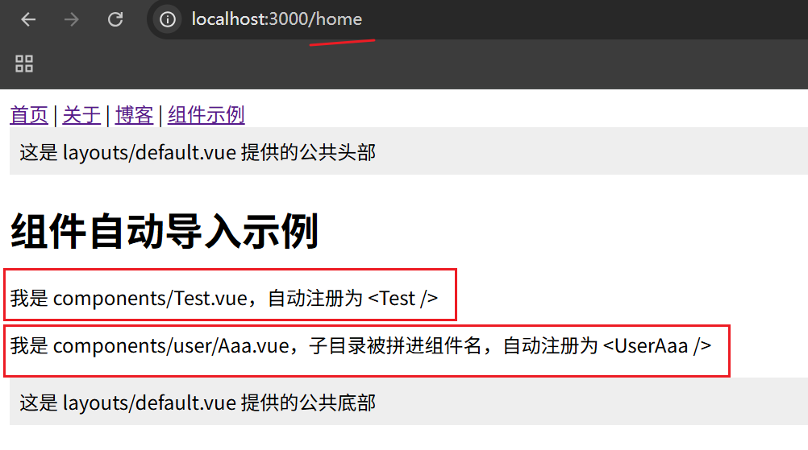

目录结构：

```
app/
├── app.vue
├── components/
│   ├── Test.vue            # <Test />
│   └── user/
│       └── Aaa.vue         # <UserAaa />
├── layouts/
│   └── default.vue
└── pages/
    ├── index.vue           # /
    ├── about.vue            # /about
    ├── home.vue             # /home，使用自动导入的组件
    ├── blog.vue             # /blog
    └── blog/
        └── [id].vue         # /blog/:id
```


## Nuxt 模块

直接安装一个 Vue 库，通常还要自己处理组件注册、样式、SSR 和按需加载。Nuxt 模块是 Nuxt 生态提供的集成层：它在 Nuxt 启动时执行配置，把这些重复工作集中起来。

> 判断标准： 模块不是“另一个组件库”，而是“让某个库更懂 Nuxt 的适配器”。Element Plus 仍然提供 UI 组件；`@element-plus/nuxt` 负责把它接进 Nuxt。


外部模块

来自 npm，例如 `@element-plus/nuxt`。安装依赖后，通常在 `nuxt.config.ts` 的 `modules` 中注册。

本地模块

放在项目的 `modules/*.ts` 或 `modules/*/index.ts`。Nuxt 4 会自动发现它们，不需要再写进配置。


以Element Plus为例

1、安装

```
pnpm add @element-plus/nuxt element-plus
```

- `element-plus` 是组件库本体（`ElButton`、`ElMessage` 等实际代码）。
- `@element-plus/nuxt` 是"适配层"模块，负责把组件库接入 Nuxt 的构建流程（自动引入组件/样式、按需加载）。两者都要装，模块不能替代本体。

2、在 `nuxt.config.ts` 里注册模块

```ts
export default defineNuxtConfig({
  compatibilityDate: '2025-07-15',
  devtools: { enabled: true },
  modules: ['@element-plus/nuxt']
})
```

- `modules` 数组是 Nuxt 的插件入口：Nuxt 启动时会遍历这个数组，加载每个模块并执行它的 `setup` 钩子。
- `@element-plus/nuxt` 的 `setup` 做了两件关键事：注册 `unplugin-vue-components`（让 `<el-button>` 这类组件在模板里直接用、无需手动 `import`）、自动引入对应的 CSS。这就是"零配置"的来源。

3、页面测试

app/pages/index.vue中加入按钮

```vue
<el-button type="primary" @click="ElMessage.success('Element Plus 生效了')">
  测试 Element Plus
</el-button>
```

现象：点击按钮，弹出弹框

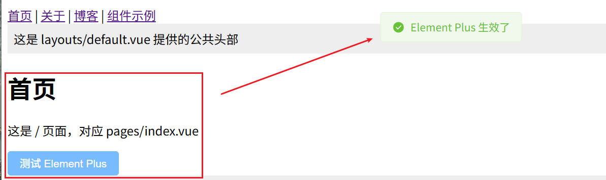


## 数据获取：选择正确的 API

原生 fetch 会导致每次页面访问时，服务器端请求一次数据，客户端又请求一次数据。 Nuxt 的三个数据获取 API 用不同的策略解决这个问题。


实战建议：

1. 页面首屏数据（需要 SEO 友好、需要缓存）→ useAsyncData
   - `useAsyncData` 能缓存：服务端请求得到的结果会被序列化塞进 HTML(即 `window.__NUXT_DATA__`),客户端 hydration 时发现 key 已经有缓存,就直接复用,不再重新发请求。
   - SEO 友好：如果数据是在 `onMounted` 里用 `$fetch` 拉取的,服务端渲染出的 HTML 里根本没有这段数据(因为 `onMounted` 只在客户端跑),爬虫看到的是空壳。如果用 `useAsyncData`(在 setup 顶层、SSR 期间执行),数据在服务端就已经请求完成并渲染进 HTML 里,爬虫直接就能看到完整内容。
2. 用户交互数据（搜索、筛选、分页）→ $fetch
3. 简单列表页（URL 足够独特）→ useFetch
4. 不确定时→ 先用 $fetch，如果有性能问题或 SSR 问题再改 useAsyncData


### useAsyncData：标准选择

SSR 应用中，需要在页面渲染前获取数据时，使用 useAsyncData

```js
const { data, pending, error, refresh } = await useAsyncData( 'uniqueKey', () => $fetch('/api/posts') 
```

参数：

- `'uniqueKey'`：唯一标识符。Nuxt 用它来缓存数据，避免重复请求。不能重复。 
  - useAsyncData 的 key 相同，数据就会被缓存。 第二次访问这个页面时，如果缓存还有效，直接用缓存数据，不会再请求一次。所以当客户端接管(hydration)时、发现 key 已经有缓存,就直接复用,不再重新发请求
- `() => $fetch(...)`：获取数据的函数。

返回值：

- `data`：响应式数据。在 template 中可以直接用 `{{ data }}`
- `pending`：布尔值。true 表示正在加载。
- `error`：如果请求失败，包含错误信息。
- `refresh()`：函数。主动重新加载数据。

例子：文章列表

```vue
<template> 
<div> 
    <button @click="refresh" :disabled="pending">刷新</button> 
    <div v-if="pending">加载中...</div> 
    <ul v-else> 
        <li v-for="post in posts" :key="post.id"> {{ post.title }} </li> 
    </ul> 
</div> 
</template> 
<script setup> 
    const { data: posts, pending, refresh } = await useAsyncData( 'posts', () => $fetch('/api/posts') ) 
</script>
```


### $fetch：最灵活的工具

`$fetch` 是对 ofetch 的封装，它不处理 SSR，不缓存数据。 适合**按需获取数据**的场景：点击按钮、提交表单、滚动加载。

```JS
const data = await $fetch('/api/posts')
```

$fetch 的特点：

- 返回普通数据（不响应式）。如果需要响应式，要自己用 ref 包装。
- 不缓存。每次都发起新请求。
- 更自由：可以在任何地方用——setup、事件处理器、生命周期钩子。
- 需要手动处理加载状态和错误。

例子：搜索功能

```vue
<template>
  <div>
    <input v-model="keyword" @keyup.enter="handleSearch" />
    <div v-if="loading">搜索中...</div>
    <ul v-else>
      <li v-for="result in results" :key="result.id">{{ result.name }}</li>
    </ul>
  </div>
</template>
<script setup>
const keyword = ref('')
const results = ref([])
const loading = ref(false)
const handleSearch = async () => {
  loading.value = true
  try {
    results.value = await $fetch('/api/search', { query: { q: keyword.value } })
  } finally {
    loading.value = false
  }
}
</script>
```


### useFetch：useAsyncData 语法糖

`useFetch` 本质上是 useAsyncData + $fetch 的组合。 它的唯一优点是：不需要手动提供 key，框架会根据 URL 自动生成。

```js
// useAsyncData（需要手动 key） 
const { data } = await useAsyncData('posts', () => $fetch('/api/posts')) 

// useFetch（自动生成 key） 
const { data } = await useFetch('/api/posts')
```

其他方面完全相同：都返回 `data、pending、error、refresh`，都缓存数据。

何时选 useFetch？ 当觉得手动 key 比较烦，并且 URL 已经是唯一的。 实际上，多数情况下 useAsyncData 更明确，因为 key 让你清楚地看到缓存策略。


## server 目录

Nuxt 里可以用 `server/` 目录快速创建 API，并把前端请求和后端接口连接起来

Nuxt 会自动扫描 `server/` 目录下的文件，并把它们注册成 API 路由。 不用手动写一份路由表，也不用自己启动一个 Express 服务器。 只要把文件放进约定的位置，Nuxt 就能识别它们。

> `server/` 就是“后端接口目录”。 `app/pages/` 负责页面，`server/api/` 负责接口。

server/ 目录会自动注册 API，支持 HMR，支持约定式路由


### 例子：一个hello接口

假设项目有下面这个结构：

```
server/
  api/
    hello.ts
```

内容大致是：

```ts
export default defineEventHandler(() => {
  return {
    name: '张三'
  }
})
```

这时 Nuxt 会把它挂到 `/api/hello` 这个地址上。 如果前端页面里这样请求：

```js
const { data } = await useFetch('/api/hello')
console.log(data.value)
```

浏览器看到的就是返回 JSON，没必要自己手工搭一个后端服务。


### RESTful API 的约定方式

Nuxt 里最常见的思路是“文件名决定接口语义”。

- `index.get.ts`：表示 GET 请求
- `index.post.ts`：表示 POST 请求
- `[id].get.ts`：表示带参数的 GET 接口
- `[id].delete.ts`：表示删除接口

也就是说，后端文件名和 HTTP 请求语义直接挂钩，开发时很容易看懂。

my-app\server\api\users\index.get.ts → GET /api/users

my-app\server\api\users\[id].get.ts → GET /api/users/1

真实项目实验：

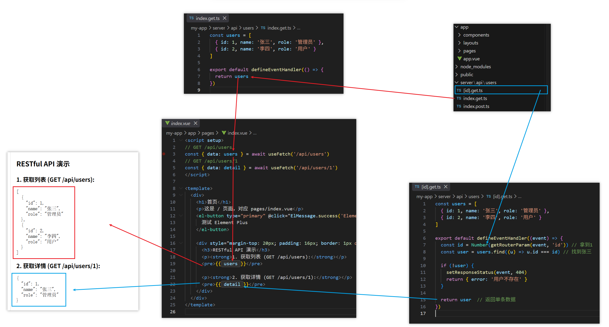


### 从请求中拿参数

真实接口最常做的事情不是“返回固定值”，而是读取参数、查询和请求体。

获取 params：路径参数

```js
// server/api/hello/[name].ts
export default defineEventHandler((event) => {
  const name = getRouterParam(event, 'name')
  return name
})
```

如果访问 `/api/hello/lihua`，返回值就是 `lihua`。


获取 query：查询字符串

```js
// server/api/query.get.ts
export default defineEventHandler((event) => {
  const query = getQuery(event)
  return query
})
```

访问 `/api/query?name=tom&age=18` 时，query 就会拿到对应对象。


获取 body：请求体

```
// server/api/submit.ts
export default defineEventHandler(async (event) => {
  const body = await readBody(event)
  return body
})
```

这是提交表单、新增数据时最常见的写法。


## 打包与 Node.js 部署

运行链


用户先请求 Nuxt 的 Node.js 服务。Nuxt 在服务端生成首屏 HTML；浏览器收到 HTML 后完成 hydration，之后页面再从后端 API 获取数据并更新界面。 部署时，我们要交付的是 Nuxt 编译后的服务，而不是开发源码。


### 打包

第一步：生成生产产物

```
pnpm run build
```

这个命令会把应用编译到项目根目录的 `.output/`。Node 服务器的启动入口是 `.output/server/index.mjs`。

记忆点：源码是给 Nuxt 编译的；`.output/` 才是部署时要运行的产物。

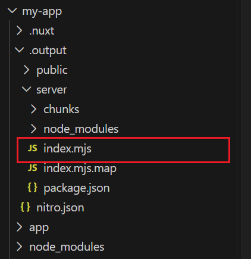


第二步：直接用 Node 启动

```
node .output/server/index.mjs
```

这会启动 Nuxt 自带的 Node 服务。默认端口通常是 `3000`，也可以通过环境变量调整：

```
PORT=8888 node .output/server/index.mjs
```

之后访问：`http://localhost:3000/`就能看到页面

这和开发模式的区别是：`npm dev`启动的是开发服务器，支持热更新，修改源码后会自动重新编译。而`node .output/server/index.mjs`启动的是生产构建后的服务器，运行的是 `.output` 中已经编译好的代码，修改源码不会自动反映到页面，必须重新执行：`pnpm run build`


### PM2

直接运行 Node 时，关闭终端或进程崩溃都可能让应用停止。PM2 是进程管理器，可以让服务后台运行、查看日志、崩溃重启，并统一管理启动和停止。

```
pnpm add -g pm2
```

- `pnpm add`：安装依赖
- `-g`：安装到全局
- `pm2`：Node.js 进程管理器

安装后，可以在任意目录使用 `pm2` 命令。

```
pm2 start .output/server/index.mjs --name user-system
```

让 PM2 启动 Nuxt 生产服务器。

- `pm2 start`：启动并托管一个程序
- `.output/server/index.mjs`：Nuxt 构建后的 Node.js 服务器入口
- `--name user-system`：给这个进程起名叫 `user-system`

相当于执行：

```
node .output/server/index.mjs
```

查看服务是否 online

```
pm2 list
```

查看服务运行日志

```
pm2 logs user-system
```

停止但保留进程（可再次 start/restart）：

```
pm2 stop user-system

pm2 start user-system   再次启动
pm2 restart user-system  重启
```

彻底删除该进程（从 PM2 列表中移除）：

```
pm2 delete user-system
```

停止/删除所有 PM2 进程：

```
pm2 stop all
pm2 delete all
```


#### 用 ecosystem 文件保存配置

在项目根目录创建 `ecosystem.config.cjs`：

```js
module.exports = {
  apps: [{
    name: 'user-system',
    script: './.output/server/index.mjs',
    cwd: __dirname,
    exec_mode: 'fork',
    instances: 1,
    env: {
      NODE_ENV: 'production',
      PORT: 8888
    }
  }]
}
```

- `ecosystem.config.cjs` 是 PM2 的配置文件，`apps` 数组里每一项描述一个要托管的进程。
- `name`: 进程名（就是 `pm2 list` 里显示的名字）。
- `script`: 要运行的入口文件，等价于你之前 `pm2 start .output/server/index.mjs` 里的那个路径。
- `cwd`: 进程运行时的工作目录，`__dirname` 表示配置文件所在目录（这里就是 `my-app`），避免 PM2 用错误的相对路径读取文件。
- `exec_mode` + `instances`: `fork` 模式启动 1 个实例（Node 单进程；如果是 `cluster` 模式可以配合 `instances` 开多进程负载均衡，但 Nuxt 的 `.output` 一般用 `fork` 就够）。
- `env`: 注入的环境变量，这里设置生产环境和端口 8888，等价于运行前 `export NODE_ENV=production PORT=8888`。


然后执行：

```
pm2 start ecosystem.config.cjs
pm2 list
pm2 restart user-system
pm2 stop user-system
pm2 delete user-system
```

- `pm2 start ecosystem.config.cjs`：读取这个配置文件里定义的所有 app 并启动，效果等同于之前的 `pm2 start .output/server/index.mjs --name user-system`，但参数都固定在文件里，不会输入错、也方便版本控制。


好处：以后换服务器部署、改端口、加环境变量，只改这个文件，不用记命令行参数；而且这个文件可以提交到 git，团队部署方式统一。
