# react-v19

仅添加相对于v18更新的内容


## 搭建项目

1、确认 Node.js 版本

Vite 要求 Node.js 20.19+ 或 22.12+。在终端里运行:

```
node -v
```

如果版本更低,先去 [nodejs.org](https://nodejs.org/) 更新。


2、用 Vite 创建项目

在你想存放项目的目录下运行:

```
npm create vite@latest my-app -- --template react
```

会依次问两个问题,直接按默认选就行:

- Which linter to use? —— 默认选中 `Oxlint`,直接回车

- Install with npm and start now? —— 选 `No`,我们自己手动走完接下来两步,这样每一步在干什么更清楚


3、安装依赖并启动

cd my-app pnpm install pnpm dev

顺利的话,终端会打印类似这样的内容:

```
VITE v8.2.2  ready in 721 ms     
➜  Local:   http://localhost:5173/    
➜  Network: use --host to expose
```


4、打开浏览器验证

访问 `http://localhost:5173`,你会看到一个带 React / Vite 图标的页面, 上面写着 _"Edit src/App.jsx and save to test HMR"_


## 项目结构

```
my-app/  
├── index.html           # 页面入口 HTML，挂载点 #root，引入 /src/main.tsx  
├── package.json         # 项目依赖与脚本配置  
├── vite.config.ts       # Vite 构建/开发服务器配置  
├── tsconfig*.json       # TypeScript 编译配置  
├── public/  
│   └── favicon.svg      # 网站图标（浏览器标签页图标）  
└── src/  
    ├── main.tsx         # 应用入口：把 App 挂载到 #root  
    ├── App.tsx          # 根组件：页面最简起点（示例计数器）  
    └── index.css        # 全局样式：最简重置
```


# react - v18


## 搭建开发环境

*React* 官网：*https://reactjs.org/*

*CDN* 引入 *React* 的方式：*https://zh-hans.reactjs.org/docs/cdn-links.html*

*React* 官方提供了脚手架工具 *Create React App*：*https://create-react-app.dev/*


```
npx create-react-app my-app
cd my-app
npm start
```


最简结构

```
my-app/
├── public/
│   ├── favicon.ico
│   └── index.html          ← 只保留 <div id="root">
├── src/
│   ├── App.js              ← 只有一个 div + 一行文字
│   └── index.js            ← 挂载 App 到 root
└── package.json
```


index.html

```html
<!DOCTYPE html>
<html lang="en">
  <head>
    <meta charset="utf-8" />
    <title>React App</title>
  </head>
  <body>
    <div id="root"></div>
  </body>
</html>
```


App.js

```jsx
function App() {
  return (
    <div>Hello React</div>
  );
}

export default App;
```


index.js

```js
import React from 'react'; // React 核心库
import ReactDOM from 'react-dom/client'; // ReactDOM 用于将 React 组件渲染到真实 DOM
import App from './App'; // 根组件

// 找到 public/index.html 里的 <div id="root"></div>，以它为容器创建一个 React 渲染根节点
const root = ReactDOM.createRoot(document.getElementById('root')); 

// 把 App 组件渲染进去。页面上看到的所有内容，都是从这里开始挂载的。
root.render(<App />);
```


## JSX是什么

JSX 就是函数调用， 用于创建一个“描述UI的JS对象”


JSX的渲染流程

```
写的 JSX  ──Babel编译──▶  jsx("div", {...})  ──执行──▶  {type:"div", props:{...}}  ──React渲染──▶  真实 DOM
  源码阶段                    还是源码(JS)              运行时的"React 元素"对象           浏览器
```

| 阶段   | 内容                               | 存在于                             |
| :----- | :--------------------------------- | :--------------------------------- |
| 源码   | `<div className="box">`            | 你写的 `.jsx` 文件                 |
| 编译后 | `jsx("div", { className: "box" })` | 还是 JS 源码，Babel 产物           |
| 运行时 | `{ type: "div", props: {...} }`    | **`jsx()` 被执行后**，内存中的对象 |
| 渲染后 | `<div class="box">`                | 浏览器真实 DOM                     |


Vue ：Vue 模板 → 编译成 render()函数 → 执行产生 VNode 对象 → patch 成 DOM。


```js
// Babel 把这段 JSX：
const el = <div className="box">Hello</div>
```

```js
// Babel 编译后（React 17+ 新转换）
import { jsx as _jsx } from "react/jsx-runtime"; // react/jsx-runtime 模块导出的 jsx 函数。
const el = _jsx("div", { className: "box", children: "Hello" });
```

 `jsx("div", {...})` 就是一个普通的 JavaScript 函数调用，核心就是创建并返回一个普通 JS 对象


例子：

```js
function App() {
  const el = <h1 className="greeting">Hello</h1>;
  console.log(el);
  return el;
}
```

打印结果，一个普通对象

```js
{ 
  $$typeof: Symbol(react.…element), 
  type: 'h1', 
  key: null, 
  props: { className: 'greeting', children: 'Hello' } 
 }

<div/> → _jsx("div") 字符串；<App/> → _jsx(App) 变量。小写会被当成未知 HTML 标签
```


因此可以推得：

| 规则                     | 为什么                                                       |
| ------------------------ | ------------------------------------------------------------ |
| 只能有一个根节点         | 一次函数调用只能 `return` 一个对象                           |
| `{}` 里只能写表达式      | 花括号里的东西是**函数实参**，`if`/`for` 是语句，不能当实参  |
| `class` 要写 `className` | 属性最终变成 JS 对象的 key，`class` 是 JS 保留字             |
| 组件必须首字母大写       | `<div/>` → `_jsx("div")` 字符串；`<App/>` → `_jsx(App)` 变量。小写会被当成未知 HTML 标签 |
| 标签必须闭合             | 编译器要靠闭合来确定 `children` 参数边界                     |


## JSX语法


### 单一根节点与 Fragment

JSX 不允许同时返回多个并列的元素，必须用一个"容器"包裹它们


方案一：用 `<div>` 包裹（会产生多余的 DOM 节点）

```jsx
function App() {
  return (
    <div>
      <h1>标题</h1>
      <p>段落</p>
    </div>
  );
}
```


方案二：用 Fragment `<>...</>`（推荐，不产生真实 DOM 节点）

```jsx
return (
  <>
    <h1>标题</h1>
    <p>段落</p>
  </>
);
```


### `{}`是什么

JSX 里的 `{}`（也叫 "JSX expression container"，表达式容器）

只有当 `{}` 出现在 JSX 标签内部（子内容或属性值的位置）时，它才是 JSX 语法的一部分：

```jsx
function App() { 
  return <h1 className={name}>Hello, {name}!</h1>;
}
```

章节：JSX是什么中提到，写的 JSX 会被 Babel编译成像 `jsx("div", {...})`这样的函数调用，所以JSX 标签语法本身不认识变量、函数调用这些东西——它只认识写死的标签和文本。`{}` 就是那个"逃生舱口"：告诉编译器"这里面不是 JSX 标签，是一段普通 JS 表达式，请把它的值算出来插进去"。


### `{}` 里只能是表达式

```js
function App() {
  const name = 'React';
  const user = { firstName: '张', lastName: '三' };
  function fullName(u) { return u.firstName + u.lastName; }

  return (
    <div>
      {name}                      {/* 变量 */}
      {1 + 2}                     {/* 运算 */}
      {fullName(user)}            {/* 函数调用 */}
      {user.firstName}            {/* 属性访问 */}
      {['a', 'b'].join('-')}      {/* 链式调用 */}
      {/* {if (a) {}} ❌ 语句不行 */}
      {/* {for (...) {}} ❌ 语句不行 */}
    </div>
  );
}
```

渲染结果：

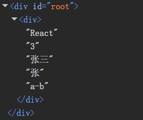


### 属性

JSX 属性(attributes)本质上是在描述"这个元素/组件该收到什么 props

```jsx
function App() {
  const myClass = "greeting";
  return(
    <>
      <h1 className="greeting">Hello</h1>  // 属性值是字符串字面量
      <h1 className={myClass}>Hello</h1>   // 属性值是JS表达式，用花括号
    </>
  );
}
```


命名规则：camelCase,而不是 HTML 的 kebab-case，因为 JSX 属性在编译期会变成一个 JS 对象的键值对

在JSX是什么的章节，可以查看jsx被Babel编译成什么东西


### style 属性

```jsx
return (
  <div style={{ color: 'red', backgroundColor: '#eee', width: 100, opacity: 0.5 }}>
    div元素
  </div>
);
```

```jsx
const styleObj = { color: 'red', backgroundColor: '#eee' };
<div style={styleObj} />          // 外层 {} = 插值
<div style={ {color:'red'} } />   // 内层 {} = 对象字面量
```

属性名小驼峰；

纯数字自动补 `px`（`width: 100` → `100px`）；`zIndex`、`opacity`、`lineHeight`、`flex`、`fontWeight` 这些无单位属性不补。


### 注释

```jsx
<div>
  {/* 这是 JSX 注释 */}
  {
    // 单行注释也行，但闭合花括号必须换行
  }
</div>
```


### 列表渲染

JSX 本身没有“列表语法”，本质是用 JS 表达式（`{}`）+ 数组的 `.map()` 生成一组元素。

```jsx
function App() {
  const users = [{ id: 1, name: 'A' }, { id: 2, name: 'B' }];
  return (
    <ul>
      {users.map(u => <li key={u.id}>{u.name}</li>)}
    </ul>
  );
}
```


### 条件渲染

1. `&&` —— 有就显示，没有就不显示

```jsx
function App() {
  const isLogin = true;

  return (
    <div>
      {isLogin && <p>欢迎回来！</p>}
    </div>
  );
}
```


2. 三元 —— 二选一

```jsx
function App() {
  const isLogin = false;

  return (
    <div>
      {isLogin ? <p>已登录</p> : <p>请登录</p>}
    </div>
  );
}
```


3. 抽变量 —— 分支多时最清晰

```jsx
function App() {
  const status = 'error'; // 'loading' | 'error' | 'ok'

  let content;
  if (status === 'loading') content = <p>加载中...</p>;
  else if (status === 'error') content = <p>出错了！</p>;
  else content = <p>加载成功！</p>;

  return <div>{content}</div>;
}
```

> 三个例子只需改 `isLogin` 或 `status` 的值，就能看到不同的渲染结果。


### React.createElement（老语法，不用看）

V17 之前

Babel 把 JSX 转译成 `React.createElement()`，所以文件顶部必须写：

```js
import React from 'react'; // 不写就报错
```

所以老代码中还有createElement

createElement用法：


JSX 写法：

```js
function App() {
  return <p className="tip">你好</p>;
}
```

等价的 createElement 写法：

```js
function App() {
  return React.createElement('p', { className: 'tip' }, '你好');
}
```

三个参数一一对应

```js
React.createElement(type, props, children)
                      ↓      ↓       ↓
                     'p'  {className} '你好'
```

| 参数       | 对应 JSX          | 说明                    |
| :--------- | :---------------- | :---------------------- |
| `type`     | 标签名 `p`        | 字符串或组件函数        |
| `props`    | `className="tip"` | 属性对象，没有写 `null` |
| `children` | `你好`            | 子内容，可以有多个      |


没有属性时传 `null`

```js
React.createElement('p', null, '你好');
// 等价于
<p>你好</p>
```


实际开发中直接写 JSX 就好


## 组件

组件就是一个返回JSX的普通函数

```jsx
function Greeting() {
  return <p>你好</p>;
}
```

调用时用尖括号当标签用：`<Greeting />`


Props：组件的输入

props 只读 —— 组件不能修改自己收到的 props

```jsx
function Greeting({ name }: { name: string }) {
  return <p>你好，{name}</p>;
}

// 使用：<Greeting name="小明" />
```


父子组件关系由调用关系决定

```jsx
function Greeting() {  // 父组件
  return <p>你好</p>;
}

function App() {       // 子组件
  return (
    <div>
      <Greeting name="小明" />
      <Greeting name="小红" />
    </div>
  );
}
```


## 事件

DOM 原生事件是全小写属性字符串（`onclick="..."`），React 里是 camelCase + 函数引用：

```jsx
<button onClick={handleClick}>点击</button>
```

需要传参数时用箭头函数包一层：

```jsx
<button onClick={() => handleClick(id)}>删除</button>
```


事件对象e

处理函数收到的 `e` 不是原生 `Event`，是 React 包了一层的 `SyntheticEvent`，这是抹平了浏览器差异（比如 `e.target`、`e.preventDefault()` 各浏览器写法不一样，React 统一了 API）。

```typescript
function handleChange(e: React.ChangeEvent<HTMLInputElement>) {
  console.log(e.target.value);
}
```

`React.MouseEvent` 这一泛型接口大概长这个样子：

```typescript
interface MouseEvent<T = Element> extends SyntheticEvent<T> {
  target: EventTarget;
  currentTarget: T; // currentTarget 的类型就是传入的 T
  // ...
}
```


常用 API

- `e.preventDefault()` —— 阻止默认行为（如表单提交刷新页面）
- `e.stopPropagation()` —— 阻止事件在 React 事件树中继续冒泡
- 常见事件类型：`onClick` `onChange` `onSubmit` `onKeyDown` `onFocus/onBlur` `onMouseEnter/Leave`


## 组件：useState

作用：让函数组件拥有"状态"——一个在多次渲染之间被记住的值

```jsx
const [state, setState] = useState(initialValue);
```

- `useState(initialValue)` 返回一个长度为 2 的数组：`[当前值, 更新函数]`。
- 初始值 `initialValue` 只在组件首次渲染时生效一次，之后调用不会重置它。


状态更新是异步批处理的——在同一个事件处理函数里多次 `setState`，React 19 会合并成一次重新渲染，且拿到的还是"旧值"（闭包陷阱），起码要等到 React 重新调用函数

`set` 之后立刻读，还是旧值

```jsx
const [count, setCount] = useState(0);

function handleClick() {
  setCount(count + 1);
  console.log(count); // 还是 0，不是 1
}
```

连续 set 三次，只加了 1

```jsx
setCount(count + 1);  // count 是 0 → 排队：把值设成 1
setCount(count + 1);  // count 还是 0 → 排队：把值设成 1
setCount(count + 1);  // count 还是 0 → 排队：把值设成 1
// 结果 1
```

解法：函数式更新

```jsx
setCount(prev => prev + 1);  // 拿队列里上一个结果，而不是本次渲染的快照
setCount(prev => prev + 1);
setCount(prev => prev + 1);
// 结果 3
```


渲染到底是什么

```jsx
function App() { // 👈 这个函数体每次执行一遍，就是"一次渲染"
  const [count, setCount] = useState(0)

  return (
    <>
      <p>count: {count}</p>
      <button onClick={() => setCount(prev => prev + 1)}>+1</button>
    </>
  );
}
```

- 首次挂载页面时，`App()` 被调用一次 → 第 1 次渲染。
- 你点击按钮 → `setCount` 被调用 → React 决定要更新界面 → 再次调用 `App()` → 第 2 次渲染。
- 再点一次 → 第 3 次渲染……

普通变量 vs `useState`

如果 `count` 是普通的 `let count = 0`，那么每次 `App()` 被重新调用时，这行代码都会重新执行一遍，`count` 又被重置回 `0`——普通局部变量"活不过"一次函数调用，函数一返回它就消失了。

而 `useState(0)` 的 `0` 只在第一次渲染时被使用；从第二次渲染开始，React 会"记得"上一次的值并把它还给你，而不是重新用初始值 `0`。这个"记忆"不是存在 `App()` 函数内部的，而是 React 在函数外部、针对这个组件实例单独保管的。


## 组件传参

组件本质上就是一个函数，props 就是它的参数对象

```jsx
// 组件接收 props（解构写法最常用）
function Greeting({ name, age = 18, children }) {
  return (
    <div>
      <p>你好, {name}, {age}岁</p>
      {children}
    </div>
  );
}

// 使用时像 HTML 属性一样传值
<Greeting name="小明" age={20}>
  <span>这是 children</span>
</Greeting>
```

- 单向流动：数据只能父→子，子组件不能直接改 props，只能通过父传的回调函数（`onXxx`）通知父组件改状态，可以看下个例子。
- props 是只读对象：`{name, age}` 这个对象每次父组件重渲染时都是新的引用。
- `children`：标签内部写的内容会被 React 自动收集成 `props.children`，类型是 `React.ReactNode`。


子传父

```jsx
// 子组件：接收父组件传来的函数 prop，调用它把数据传回父组件
function Child({ onSend }) {
  return (
    <button onClick={() => onSend('来自子组件的消息')}>
      点击，子传父
    </button>
  )
}

function App() {
  const [msg, setMsg] = useState('')

  return (
    <div>
      <p>收到：{msg}</p>
      <Child onSend={(text) => setMsg(text)} />
    </div>
  )
}
```

页面上显示：收到：来自子组件的消息

核心逻辑：父组件把函数 `(text) => setMsg(text)` 当 prop（`onSend`）传给子组件，子组件调用 `onSend(...)` 把数据传回去，父组件 state 更新后触发重新渲染。


## 组件：useEffect

用途：让组件与"外部系统"同步——订阅、定时器、DOM 操作、网络请求、第三方库集成等。凡是"渲染本身之外需要做的事"，都属于副作用（side effect）。

```jsx
import { useEffect } from 'react'

useEffect(() => {
  // 副作用逻辑
  return () => {
    // 可选：清理函数
  }
}, [dep1, dep2]) // 依赖数组
```

- 第一个参数：`setup` 函数，组件渲染后执行。
- 返回值（可选）：清理函数，在下次执行 effect 前、或组件卸载时调用。
- 第二个参数：依赖数组，决定 effect 何时重新执行。


useEffect这个钩子函数执行时发生了什么，以下面的代码为例：

```jsx
import { useState, useEffect } from 'react'

function App() {
  const [count, setCount] = useState(0)

  useEffect(() => {
    document.title = `点击了 ${count} 次`
  }, [count])

  return (
    <>
      <h1>Hello, React!</h1>
      <button onClick={() => setCount(count + 1)}>count: {count}</button>
    </>
  )
}

export default App
```

`count` 变化 → 组件重渲染 → React 比较依赖数组 → `count` 变了 → 重新执行 effect，更新标题。


官方文档更强调一个原则：能不用 Effect 就不用，避免多余的重渲染。


## 生命周期

| 阶段           | 发生时机                     |
| -------------- | :--------------------------- |
| 挂载 (Mount)   | 组件第一次渲染、插入 DOM     |
| 更新 (Update)  | props/state 变化引起重新渲染 |
| 卸载 (Unmount) | 组件从 DOM 移除              |


`useEffect` 把这三个生命周期揉进了同一个函数里,靠依赖数组隐式区分:

```tsx
useEffect(() => {
  console.log('挂载 或 count变化 后执行')   // 挂载 + 更新 都会走到这
  return () => {
    console.log('下次执行前 或 卸载时 清理')  // 更新前的清理 + 卸载 都会走到这
  }
}, [count])
```


开发模式下（`<StrictMode>`，Vite 模板默认开启）挂载阶段的 effect 会被故意执行两次（挂载→卸载→再挂载），用来帮你发现没写清理函数的 bug。

```tsx
// 应用入口：把 App 挂载到 index.html 中的 #root 节点
createRoot(document.getElementById('root')!).render(
  <StrictMode>
    <App />
  </StrictMode>,
)
```


## 表单


### 核心

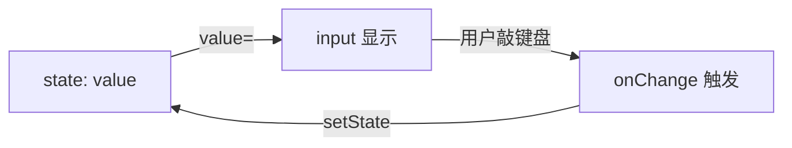

`input`标签里显示的字符来自`state`，不是来自键盘，用户只是通过敲键盘触发事件带动组件重新渲染变化的`state`

React的`onChange`其实就是原生的`input`事件

Vue对比：

```js
<!-- Vue：糖 -->
<input v-model="value" />

<!-- Vue：糖的本体，和 React 一模一样 -->
<input :value="value" @input="value = $event.target.value" />
```

```js
// React：没有糖，只有本体
<input value={value} onChange={e => setValue(e.target.value)} />
```


### 文本框

```jsx
import { useState } from 'react'; // 导入 React 的 useState 钩子函数

export default function App() {
  const [value, setValue] = useState('') // 初始值必须给'',不能给undefied，因为 value={undefined} 时 React 认为它是非受控的

  return (
    <div>
      <input value={value} onChange={e => setValue(e.target.value)}></input>
      <p>你输入了：{value}</p>
      <button onClick={() => setValue('')}>清空</button>
    </div>
  )
}
```

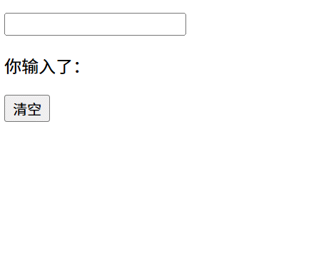


一个handler管多个字段

```jsx
import { useState } from 'react';

export default function App() {
  const [form, setForm] = useState({ username: '', email: '', age: '' });

  // [name] 是 ES6 计算属性名，动态决定改哪个 key
  const handleChange = (e)=> {
    const { name, value } = e.target;
    setForm(prev => ({ ...prev, [name]: value })); // prev 是上一次的 state, z展开后被后面的 [name]: value 覆盖，
  };

  return (
    <div>
      <input name="username" value={form.username} onChange={handleChange} placeholder="用户名" />
      <input name="email"    value={form.email}    onChange={handleChange} placeholder="邮箱" />
      <input name="age"      value={form.age}      onChange={handleChange} placeholder="年龄" />
      <pre>{JSON.stringify(form, null, 2)}</pre>
    </div>
  )
}
```

效果

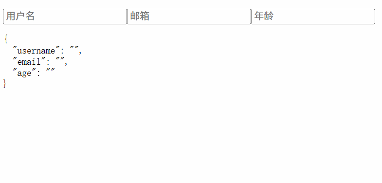

`setForm(prev => ({ ...prev, [name]: value }));` 覆盖过程示意图

```
prev（旧 state）                     展开 ...prev
┌─────────────────────┐             ┌─────────────────────┐
│ username: "Alice"   │  ...prev    │ username: "Alice"   │
│ email:    "old@x.com│ ─────────▶  │ email:    "old@x.com│
│ age:      "18"      │             │ age:      "18"      │
└─────────────────────┘             └─────────────────────┘
                                             │
                                             │ 再用 [name]: value 覆盖
                                             │ [name] = "email"
                                             │  value = "hello@qq.com"
                                             ▼
                                    ┌─────────────────────┐
                                    │ username: "Alice"   │  ← 保留
                                    │ email: "hello@qq.com│  ← ✅ 被覆盖
                                    │ age:      "18"      │  ← 保留
                                    └─────────────────────┘
                                          新 state ✨
```


### textarea

React 把`textarea`拉齐成立和`input`一样的用法，用`value`

```jsx
import { useState } from 'react';

export default function App() {
  const [text, setText] = useState('默认内容');
  return (
    <div>
      <textarea
        rows={6} col={40}
        value={text}
        onChange={e => setText(e.target.value)}
      />
    </div>
  )
}
```


### checkbox 选框

`checkbox`绑`checked`，不绑`value`。`value`是提交给服务器的固定标识


单选

```jsx
import { useState } from 'react';

export default function App() {
  const [agreed, setAgreed] = useState(false);

  return (
    <label>
      <input
        type="checkbox"
        checked={agreed}
        onChange={e => setAgreed(e.target.checked)}
      />同意条款
      <button disabled={!agreed}>下一步</button>
    </label>
  )
}
```


复选框

```jsx
import { useState } from 'react';

const SKILLS = ['html', 'css', 'js', 'vue', 'react'];

export default function App() {
  // 只存"选中的名字数组"
  const [checked, setChecked] = useState([]);

  const toggle = (skill) => {
    setChecked(prev =>  // skill在prev里就移除，不在就添加 → 点一下选中，再点一下取消
      prev.includes(skill)
        ? prev.filter(item => item !== skill) 
        : [...prev, skill]
    )
  };

  return (
    <div>
      {
        SKILLS.map(skill =>
          <label key={skill} style={{ display: 'block' }}>
            <input
              type="checkbox"
              checked={checked.includes(skill)}
              onChange={() => toggle(skill)}
            />
            {skill}
          </label>
        ) 
      }
    </div>
  )
}
```

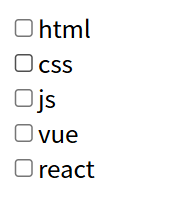


### radio 单选按钮

同一组 radio 用同一个 `name`，`checked` 用 `state === 该项的值` 判断：

```jsx
import { useState } from 'react';


export default function App() {
  const [gender, setGender] = useState('male');

  return (
    <div>
      {[
        { value: 'male',   label: '男' },
        { value: 'female', label: '女' },
        { value: 'secret', label: '保密' },
      ].map(item => (
        <label key={item.value}>
          <input
            type="radio"
            name="gender"
            value={item.value}
            checked={gender === item.value} // ← 受控靠这个表达式
            onChange={e => setGender(e.target.value)} 
          />
          {item.label}
        </label>
      ))}
    </div>
  )
}
```


### select 下拉列表

React 把`value`放在 `<select>` 上，不用原生的 `<option selected>`。

```jsx
import { useState } from 'react';

const OPTIONS = ['html', 'css', 'js', 'vue', 'react'];

export default function App() {
  const [single, setSingle] = useState('html');
  const [multi, setMulti] = useState(['css']);   // 多选时 value 必须是数组

  const handleMulti = (e) => {
    // e.target.selectedOptions 是类数组，要转真数组
    setMulti(Array.from(e.target.selectedOptions, opt => opt.value));
  }

  return (
    <div>
      <select value={single} onChange={e => setSingle(e.target.value)}>
        {OPTIONS.map(o => <option key={o} value={o}>{o}</option>)}
      </select>
      <p>单选：{single}</p>

      <select multiple value={multi} onChange={handleMulti} size={5}>
        {OPTIONS.map(o => <option key={o} value={o}>{o}</option>)}
      </select>
      <p>多选：{multi.join(', ')}</p>
    </div>
  )
}
```


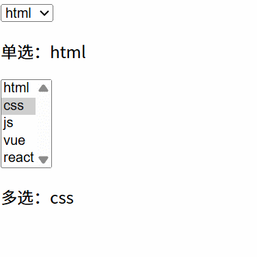


### 核心优势：输入过滤

经手数据可以随意加工

```jsx
import { useState } from 'react';

export default function App() {
  const [upper, setUpper] = useState('');
  const [num, setNum] = useState('');
  const [card, setCard] = useState('');

  return (
    <div>
      <input
        value={upper}
        onChange={e => setUpper(e.target.value.toUpperCase())}
        placeholder="自动转大写"
      />

      <input
        value={num}
        onChange={e => setNum(e.target.value.replace(/\D/g, ''))}  // \D = 非数字
        placeholder="只能输数字"
      />

      <input
        value={card}
        onChange={e => {
          const digits = e.target.value.replace(/\D/g, '').slice(0, 16);
          setCard(digits.replace(/(\d{4})(?=\d)/g, '$1 '));        // 每 4 位加空格
        }}
        placeholder="银行卡号自动分组"
      />
    </div>
  );
}
```


### 非受控组件：useRef

函数组件里对应的是 **`useRef`**：

```jsx
import { useRef } from 'react';

export default function App() {
  const inputRef = useRef(null);    // React 19 建议显式传 null

  const handleClick = () => {
    console.log(inputRef.current.value);   // 直接读 DOM，React 全程不知道你输了什么
    inputRef.current.focus();              // ref 的另一大用途：命令式操作 DOM
  };

  return (
    <div>
      {/* 用了 value 就是受控；非受控要给初始值请用 defaultValue */}
      <input ref={inputRef} defaultValue="初始内容" />
      <button onClick={handleClick}>读取内容并聚焦</button>
    </div>
  );
}
```


### 文件上传（必须非受控）

```jsx
import { useRef, useState } from 'react';

export default function App() {
  const fileRef = useRef(null);
  const [info, setInfo] = useState([]);

  const handleChange = (e) => {
    // e.target.files 是 FileList（类数组），要转成真数组才能 map
    setInfo(Array.from(e.target.files).map(f => ({
      name: f.name,
      size: (f.size / 1024).toFixed(1) + ' KB',
      type: f.type,
    })));
  };

  const reset = () => {
    fileRef.current.value = '';   // 清空 file input 的唯一办法
    setInfo([]);
  };

  return (
    <div>
      <input type="file" multiple accept="image/*" ref={fileRef} onChange={handleChange} />
      <button onClick={reset}>清空</button>
      <pre>{JSON.stringify(info, null, 2)}</pre>
    </div>
  );
}
```


## 生命周期（类组件，不推荐使用）

生命周期本身就是类组件的 API，学习的价值：读懂老代码 + 理解`useEffect`的时机从哪里来

进一步说，函数组件也没有可以挂方法的地方，下面这段代码就是无效的

```jsx
function App() {
  // ❌ 这只是一个定义了没人调用的局部函数，React 根本不知道它存在
  function componentDidMount() {
    console.log('永远不会打印');
  }
  return <div>hi</div>;
}
```

生命周期方法本质是【实例方法】

```js
// 类组件：React 内部大致这么干
const instance = new App(props);        // ① 有一个实例对象
const element = instance.render();      // ② 调它的 render
// ...把 DOM 挂上去...
instance.componentDidMount();           // ③ 去实例上"找"这个方法，找到就调

// 函数组件：React 内部只有这一句
const element = App(props);             // 就是调一个普通函数，没有 instance
```


### 核心

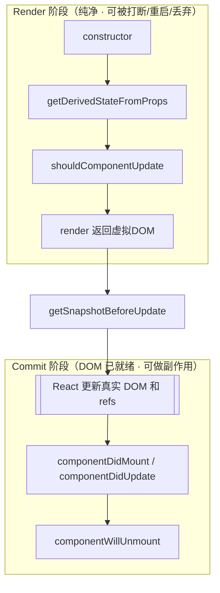

Render阶段 = 打草稿。React 在算【页面该长什么样】，这个草稿可能被重写好几遍【并发特性】，所以不能做任何有副作用的事情：不能发请求，不能操作DOM……

Commit阶段 = 誊写到答题卡。真实DOM已经修改完毕，ref已经拿到，做副作用是安全的

对比Vue，vue的更新是同步不可打断的。React从16开始为了【时间切片】，硬把渲染过程切成了【可反悔的阶段】+【不可反悔的阶段】


### constructor + render

构造函数 + 渲染


示例

```jsx
import React from 'react';

class Counter extends React.Component {
  constructor(props) { 
    super(props); // 调用父类的构造函数，把这个对象传给 React.Component，React内部将其挂载到 this.props 上
    console.log('1. constructor，this.props =', this.props);
    this.state = { count: 0 }; 
  };

  // 箭头函数使用外层作用域 this，不用在 constructor 里 bind
  handleClick = () => {
    this.setState({ count: this.state.count + 1 });
  };

  render() {
    // ❌ 这里写 this.setState(...) → 渲染引发更新，更新引发渲染 → 死循环
    return (
      <div>
        <h3>{this.state.count}</h3>
        <button onClick={this.handleClick}>+1</button>
      </div>
    );
  }
}

export default function App() {
  return <Counter title="计数器" />;
}
```


打印结果

```js
// constructor 只打印一次
1. constructor，this.props = {title: '计数器'}
2. render，count = 0

// 后每点一次按钮 render 就多打印一行
2. render，count = 1
……
2. render，count = n
```


constructor 禁止 `setState`：setState的本意是，改了状态，请重新渲染我，此时组件连第一次渲染都没有发生，

render 禁止 `setState`：render是【根据state算UI】的函数，在里面改state等于【算UI的过程中又改了输入】，React会重新调render，无限递归。

Vue 对照：`constructor` ≈ `data()` + `created`，render ≈ 模板编译出的 [render](vscode-file://vscode-app/c:/Application/Microsoft VS Code/e4c7e7b1d6/resources/app/out/vs/code/electron-browser/workbench/workbench.html) 函数。区别是 Vue 的 render 只在依赖变化时才重跑（细粒度依赖收集），React 的 render 是「父组件重渲染，我就跟着重渲染」。**这是两者最大的性能哲学差异。**


### componentDidMount

组件已更新


`componentDidMount` 每个实例只跑一次，且 DOM 已就绪。

Vue 对照：完全等于 `mounted`。

```js
import React from 'react';

class Clock extends React.Component {
  state = { time: new Date().toLocaleTimeString(), user: null }; // 类字段写法，不用在构造函数中初始化 state

  // 此刻真实 DOM 已经在页面上了
  componentDidMount() {
    console.log('3. componentDidMount，能拿到 DOM：', document.querySelector('h3'));

    // 启动计时器
    this.timer = setInterval(() => {
      this.setState({ time: new Date().toLocaleTimeString() });
    }, 1000);

    // ② 发网络请求
    fetch('https://jsonplaceholder.typicode.com/users/1')
      .then(res => res.json())
      .then(user => this.setState({ user }));
  };

  componentWillUnmount() {
    clearInterval(this.timer); // 不写这行 = 内存泄漏
  }

  render() {
    return (
      <div>
        <h3>{this.state.time}</h3>
        <p>{this.state.user ? this.state.user.name : '加载中...'}</p>
      </div>
    );
  }

}

export default function App() {
  return <Clock />;
}
```


### componentDidUpdate

表示组件已更新

`componentDidUpdate(prevProps, prevState, snapshot)`。注意参数是**旧的**，`this.props / this.state` 才是新的。

里面可以 `setState`，但**必须包在 if 里**。

触发源：父组件传新 props、自己setState、forceUpdate


切片

```js
/**
 * 组件更新完成后触发的生命周期函数
 * @param {*} prevProps - 组件更新前的props
 * @param {*} prevState - 组件更新前的state
 */
componentDidUpdate(prevProps, prevState) {
  console.log('更新完成：', prevProps.userId, '→', this.props.userId);

  // 关键的一行 if
  // 没有它：setState → 触发 didUpdate → 又 setState → 死循环
  if (prevProps.userId !== this.props.userId) {
    this.load(this.props.userId);
  }
}
```

完整示例

```jsx
import React from 'react'; // 引入React库

class UserDetail extends React.Component {
  state = { data: null };

  componentDidMount() {
    this.load(this.props.userId);
  }

  /**
   * 组件更新完成后触发的生命周期函数
   * @param {*} prevProps - 组件更新前的props
   * @param {*} prevState - 组件更新前的state
   */
  componentDidUpdate(prevProps, prevState) {
    console.log('更新完成：', prevProps.userId, '→', this.props.userId);

    // 关键的一行 if
    // 没有它：setState → 触发 didUpdate → 又 setState → 死循环
    if (prevProps.userId !== this.props.userId) {
      this.load(this.props.userId);
    }
  }

  load(id) {
    fetch(`https://jsonplaceholder.typicode.com/users/${id}`)
      .then(r => r.json())
      .then(data => this.setState({ data }));
  };

  render() {
    return <p>{this.state.data ? this.state.data.name : '加载中...'}</p>;
  };
}


export default function App() {
  const [id, setId] = React.useState(1);
  return (
    <div>
      <button onClick={() => setId(id + 1)}>换一个用户（当前 {id}）</button>
      <UserDetail userId={id} />
    </div>
  );
}
```


### componentWillUnmount

组件即将卸载


Vue 对照：≈ `beforeUnmount` / `unmounted`（Vue 3）


切片

```js
componentWillUnmount() {
  console.log('Child 即将卸载 —— 收拾残局');
  clearInterval(this.timer);
}
```

示例

```jsx
import React from 'react'; // 引入React库

class Child extends React.Component {
  componentDidMount() {
    console.log('Child 挂载');
    this.timer = setInterval(() => console.log('tick...'), 1000);
  }


  componentWillUnmount() {
    console.log('Child 即将卸载 —— 收拾残局');
    clearInterval(this.timer);
  }

  render() {
    return <h3>我是子组件</h3>;
  }
}


export default function App() {
  const [show, setShow] = React.useState(true);
  return (
    <div>
      <button onClick={() => setShow(!show)}>切换</button>
      {show && <Child />}
    </div>
  );
}
```


### shouldComponentUpdate / PureComponent

`shouldComponentUpdate` ：是否应该更新

切片：

```js
/**
 * 是否需要更新组件
 * @param {*} nextProps -- 新的 props
 * @param {*} nextState -- 新的 state
 * @returns boolean，返回 false 就跳过本次 render（连同 didUpdate 一起跳过）
 */
shouldComponentUpdate(nextProps, nextState) {
  return nextProps.value !== this.props.value;
}
```

完整例子：

```jsx
import React from 'react'; // 引入React库

class Heavy extends React.Component {
  /**
   * 是否需要更新组件
   * @param {*} nextProps -- 新的 props
   * @param {*} nextState -- 新的 state
   * @returns boolean，返回 false 就跳过本次 render（连同 didUpdate 一起跳过）
   */
  shouldComponentUpdate(nextProps, nextState) {
    return nextProps.value !== this.props.value;
  }

  render() {
    console.log('Heavy 渲染了');
    return <h3>{this.props.value}</h3>;
  }
}

export default function App() {
  const [v, setV] = React.useState(0);
  const [other, setOther] = React.useState(0);
  return (
    <div>
      <button onClick={() => setV(v + 1)}>改 value</button>
      <button onClick={() => setOther(other + 1)}>改无关状态 {other}</button>
      <Heavy value={v} />
    </div>
  )
}
```

现象：点【改无关状态】，Heavy组件不打印日志，删掉`shouldComponentUpdate`，点击两个按钮都会打印日志，这就是React组件【父更新子全部重新渲染】的默认行为

动态图位于章节底部


`PureComponent` 是 `React.Component` 的子类，用法几乎一样：

```js
class Counter extends React.PureComponent { ... }
// 对比
class Counter extends React.Component { ... }
```

和 Component 的区别

|                         | `Component`  | `PureComponent`    |
| :---------------------- | :----------- | ------------------ |
| `shouldComponentUpdate` | 需要手动实现 | 已内置，自动浅比较 |
| props/state 没变化时    | 仍然重新渲染 | 跳过渲染           |
| 用途                    | 通用         | 性能优化           |

用PrueComponent可以简写上面的子组件

```jsx
// 等价简写：PureComponent 自动对 props/state 做「浅比较」
class Heavy2 extends React.PureComponent {
  render() {
    console.log('Heavy2 渲染了');
    return <h3>{this.props.value}</h3>;
  }
}
```


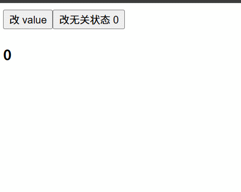


### 对应到函数组件里的useState

类组件生命周期和函数组件useState的对应关系

| Class 生命周期                                               | Hooks 等价物                           | 差异陷阱                                                     |
| ------------------------------------------------------------ | -------------------------------------- | ------------------------------------------------------------ |
| `constructor` 初始化 state                                   | useState(初始值)                       | 复杂初始值用 [useState(() => 计算())](vscode-file://vscode-app/c:/Application/Microsoft VS Code/e4c7e7b1d6/resources/app/out/vs/code/electron-browser/workbench/workbench.html) 惰性初始化 |
| [render](vscode-file://vscode-app/c:/Application/Microsoft VS Code/e4c7e7b1d6/resources/app/out/vs/code/electron-browser/workbench/workbench.html) | 函数体本身                             | 函数体就是 render，同样禁止副作用                            |
| `componentDidMount`                                          | `useEffect(fn, [])`                    | ❗useEffect 在浏览器绘制**之后**异步跑；`componentDidMount` 是绘制**之前**同步跑。要同步请用 `useLayoutEffect` |
| `componentDidUpdate`                                         | `useEffect(fn, [deps])`                | ❗**useEffect 在挂载时也会跑一次**，`componentDidUpdate` 不会 |
| `componentWillUnmount`                                       | `useEffect` 返回的清理函数             | ❗有依赖时，清理函数在**每次依赖变化前**也会跑，不只在卸载时  |
| `shouldComponentUpdate`                                      | React.memo + `useMemo` / `useCallback` | 只做浅比较                                                   |

示例：

```jsx
// ===== Class 写法 =====
class Timer extends React.Component {
  state = { count: 0 };

  componentDidMount() {              // 挂载
    this.timer = setInterval(() => {
      this.setState(s => ({ count: s.count + 1 }));
    }, 1000);
    document.title = `计数 ${this.state.count}`;
  }

  componentDidUpdate(prevProps, prevState) {   // 更新
    if (prevState.count !== this.state.count) {
      document.title = `计数 ${this.state.count}`;
    }
  }

  componentWillUnmount() {           // 卸载
    clearInterval(this.timer);
  }

  render() {
    return <h3>{this.state.count}</h3>;
  }
}
```

```jsx
// ===== Hooks 写法=====
function Timer() {
  const [count, setCount] = React.useState(0);

  // 只在挂载/卸载时跑 —— 对应 componentDidMount + componentWillUnmount
  React.useEffect(() => {
    const timer = setInterval(() => setCount(c => c + 1), 1000);
    return () => clearInterval(timer);   // 返回的函数 = componentWillUnmount
  }, []);                                 // 空数组 = 只跑一次

  // count 变化时跑 —— 对应 componentDidUpdate 里那个 if
  React.useEffect(() => {
    document.title = `计数 ${count}`;
  }, [count]);                            // 依赖数组 = 自动帮你做 if 比较

  return <h3>{count}</h3>;
}
```


## Hook


### 地基

```
UI = f(state)
```

React 组件就是**一个普通函数**，返回 JSX（对 UI 的描述）。**永远不直接操作 DOM**，你只改 state；React 会**重新调用这个函数**，拿到新 JSX，和旧的对比，再去改真实 DOM。

"重新调用组件函数"这件事叫 **一次渲染（render）**。

由此产生一个矛盾：函数每次调用，局部变量都会重置。那"跨渲染保留下来的数据"存在哪？

> 存在 React 内部（函数外面）。Hook 就是函数组件伸手去拿 React 内部能力的接口。

**Hook 铁律**：只能在组件函数体的**最顶层**调用，不能放进 `if` / `for` / 回调 / 嵌套函数里。具体原因查看章节：`组件：状态与传参`-`useState：状态`


### useState


#### 语法

```js
const [count, setCount] = useState(0);
```

| 部分          | 含义                                                         |
| ------------- | ------------------------------------------------------------ |
| `useState(0)` | `0` 是**初始值**，只在该组件**第一次渲染**时使用，之后每次渲染都被忽略 |
| 返回值        | 固定是长度为 2 的数组：`[本次渲染的值, 更新函数]`            |
| `count`       | **本次渲染的一个只读快照**，是个常量                         |
| `setCount`    | 干两件事：① 把新值存进 React ② 标记该组件"需要重新渲染"      |


#### 运行现象

现象 1：`set` 之后立刻读，还是旧值

```jsx
const [count, setCount] = useState(0);

function handleClick() {
  setCount(count + 1);
  console.log(count); // 还是 0，不是 1
}
```

不是因为异步，而是因为 `count` 是**这次渲染烙死的常量**。新值要等 React 重新调用函数、产生下一次渲染，才能看到。


现象 2：连续 set 三次，只加了 1

```jsx
setCount(count + 1);  // count 是 0 → 排队：把值设成 1
setCount(count + 1);  // count 还是 0 → 排队：把值设成 1
setCount(count + 1);  // count 还是 0 → 排队：把值设成 1
// 结果 1
```

解法：函数式更新（这个必须掌握，最通用）

```jsx
setCount(prev => prev + 1);  // 拿队列里上一个结果，而不是本次渲染的快照
setCount(prev => prev + 1);
setCount(prev => prev + 1);
// 结果 3
```


现象 3：如果状态变量是对象/数组，必须"换新的"，不能"改原来的"

```js
const [user, setUser] = useState({ name: '小明', age: 18 });

// ❌ 页面不动
user.age += 1;
setUser(user);

// ✅ 生成新对象
setUser({ ...user, age: user.age + 1 });

// ✅ 数组同理
setList([...list, newItem]);
setList(list.filter(x => x.id !== id));
```


#### 完整组件例子

```jsx
function Lesson1() {
  const [count, setCount] = useState(0);
  const [user, setUser] = useState({ name: '小明', age: 18 });

  return (
    <section style={box}>
      <h3>1. useState</h3>
      <p>count = {count}</p>

      <button onClick={() => setCount(count + 1)}>+1</button>

      <button onClick={() => { setCount(count + 1); setCount(count + 1); setCount(count + 1); }}>
        直接值连写 3 次 → 只 +1
      </button>

      <button onClick={() => { setCount(p => p + 1); setCount(p => p + 1); setCount(p => p + 1); }}>
        函数式连写 3 次 → +3
      </button>

      <button onClick={() => { setCount(count + 1); console.log('set 之后立刻读 count =', count); }}>
        证明 count 是快照（看控制台）
      </button>

      <p>user = {user.name} / {user.age}</p>
      <button onClick={() => setUser({ ...user, age: user.age + 1 })}>年龄+1（新对象，页面会动）</button>
      <button onClick={() => { user.age += 1; setUser(user); }}>年龄+1（改原对象，页面不动）</button>
    </section>
  );
}
```


### useEffect


#### 设计意图

React 要求渲染必须是纯的，组件函数只负责根据 state 算出 UI，不许干别的。

那和外部世界打交道的代码放在哪里 → useEffect。它在渲染结果已经提交到 DOM 之后才执行。

副作用（side effect）指的是：定时器、事件订阅、网络请求、手动操作 DOM、写 localStorage、打日志……凡是"影响 React 世界之外"的事。


#### 语法

```js
useEffect(() => {
  // 副作用代码
  return () => {
    // 清理函数（可选）
  };
}, [依赖1, 依赖2]);
```

第二个参数：依赖数组

| 写法           | 什么时候跑                                         |
| -------------- | -------------------------------------------------- |
| 不写第二个参数 | **每次渲染后**都跑                                 |
| `[]`           | **只在挂载后跑一次**                               |
| `[a, b]`       | 挂载时跑 + `a` 或 `b` 变化时跑（`Object.is` 比较） |


清理函数

返回的那个函数，在两个时机执行：

1. 下一次 effect 执行之前（先撤销上一次的）
2. 组件卸载时

```jsx
useEffect(() => {
  const id = setInterval(() => setSec(p => p + 1), 1000);
  return () => clearInterval(id);   // 不写就会内存泄漏 + 多个定时器叠加
}, []);
```


真实执行顺序

```
改 state → 重新渲染（调用组件函数）→ React 更新真实 DOM → 浏览器绘制 → 执行 effect
```


#### 完整例子

```jsx
function Clock() {
  const [sec, setSec] = useState(0);
  const [count, setCount] = useState(0);

  useEffect(() => { console.log('A：无依赖数组 → 每次渲染后都跑'); });
  useEffect(() => { console.log('B：空数组 → 只在挂载后跑'); }, []);
  useEffect(() => { console.log('C：[count] → count 变了才跑，count =', count); }, [count]);

  useEffect(() => {
    console.log('D：开启定时器');
    const id = setInterval(() => setSec(p => p + 1), 1000);
    return () => { clearInterval(id); console.log('D：清理定时器'); };
  }, []);

  return (
    <div>
      <p>已运行 {sec} 秒 ｜ count = {count}</p>
      <button onClick={() => setCount(p => p + 1)}>count +1</button>
    </div>
  );
}

function Lesson2() {
  const [show, setShow] = useState(true);
  return (
    <section style={box}>
      <h3>2. useEffect</h3>
      <button onClick={() => setShow(p => !p)}>{show ? '卸载 Clock' : '挂载 Clock'}</button>
      {show && <Clock />}
    </section>
  );
}
```


#### StrictMode 

```jsx
root.render(
  <React.StrictMode>
    <App />
  </React.StrictMode>
);
```

`index.js` 里包了 `<React.StrictMode>`，**开发环境**下 React 会故意把每个组件"挂载 → 卸载 → 再挂载"，所以你会看到 **effect 跑了两次、日志打了两遍**。
这是**故意的**，目的是暴露"没写清理函数"的 bug。**生产构建不会这样**。别去删 StrictMode。


### 自定义Hook


#### 语法

没有新语法

自定义 Hook 就是一个 `use` 开头的普通函数，内部可以调用其它 Hook。

```jsx
function useCounter(initial = 0) {
  const [count, setCount] = useState(initial);   // 内部可以用 useState
  const inc = () => setCount(p => p + 1);
  const reset = () => setCount(initial);
  return { count, inc, reset };                  // 返回什么完全由开发者决定
}
```

用起来和内置 Hook 一模一样：

```jsx
function CounterBox() {
  const { count, inc, reset } = useCounter(0); 
  return <button onClick={inc}>{count}</button>;
}
```

在组件顶层调用自定义 Hook `useCounter`，并传入初始值 `0`。

解构返回值，得到：

- `count`：当前计数。
- `inc`：增加计数的方法。
- `reset`：重置计数的方法。

因为 `useCounter` 以 `use` 开头且在组件顶层调用，所以它会被 React 当作 Hook 处理。

之后返回一个 JSX 按钮，通过`onClick={inc}`把按钮的点击事件绑定为 `inc` 函数。点击按钮时，React 会调用 `inc`。


#### 设计意图

组件复用 UI，自定义 Hook 复用「带状态的逻辑」

在 Hook 出现之前，React 没办法把"一段有 state、有生命周期的逻辑"单独抽出来复用，只能靠很别扭的高阶组件套娃。Hook 把这件事变成了**普通的函数抽取**。


#### 运行现象

```jsx
<CounterBox />   {/* 自己的 count */}
<CounterBox />   {/* 另一个独立的 count，互不影响 */}
```

自定义 Hook 复用的是「逻辑」，不是「状态」。 每次调用都会在调用它的那个组件里，开出一份全新的独立 state。


#### 必须 `use` 开头

纯约定，给人和 ESLint 看的。名字以 `use` 开头，`eslint-plugin-react-hooks` 才会按 Hook 规则检查它（比如禁止你写在 `if` 里面）。


完整例子

定义自定义hook

```jsx
function useWindowWidth() {
  const [width, setWidth] = useState(window.innerWidth);
  useEffect(() => {
    const onResize = () => setWidth(window.innerWidth);
    window.addEventListener('resize', onResize);
    return () => window.removeEventListener('resize', onResize);
  }, []);
  return width;
}
```

使用

```jsx
function Lesson3() {
  const width = useWindowWidth();
  return (
    <section style={box}>
      <h3>3. 自定义 Hook</h3>
      <p>窗口宽度：{width}px（拖动浏览器窗口看变化）</p>
    </section>
  );
}
```

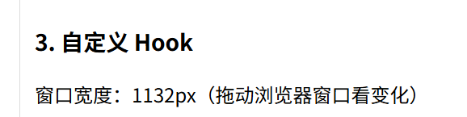


## React-router - 路由


### 核心

url变了 → 决定页面上某个”坑位“里换成哪个组件。整个过程不刷新页面

围绕这句话，任何React Router 项目都由4个角色组成，缺一不可：

| 角色      | 干什么                                     | 对应的东西                           | 写在哪               |
| --------- | ------------------------------------------ | ------------------------------------ | -------------------- |
| 1、总闸   | 监听 URL 变化，把当前 URL 广播给整棵组件树 | `<BrowserRouter>`                    | 最外层入口           |
| 2、地图   | 声明 “什么URL → 渲染什么组件”              | `useRoutes([...])`                   | `router/router.jsx`  |
| 3、坑位   | 匹配到的组件，具体渲染在页面的哪个位置     | `<RouterConfig />`                   | `App.jsx` 布局中间   |
| 4、遥控器 | 提供改变 URL 的手段                        | NavLink` / `Navigate` / `useNavigate | 导航栏、按钮、地图里 |


### 基本构建顺序


#### 第 1 步：装总闸

```jsx
const root = ReactDOM.createRoot(document.getElementById("root"));
root.render(
  <BrowserRouter>
    <App />
  </BrowserRouter>
);
```


#### 第 2 步：准备好要跳转的组件

准备`Home.jsx`、`About.jsx`、`AddOrEdit.jsx`、`NotFound.jsx` —— 等普通组件


#### 第 3 步：画地图

```jsx
// router/router.jsx
function RouterConfig() {
  return useRoutes([
    { path: "/home", element: <Home /> },
    { path: "/about", element: <About /> },
    { path: "/add",  element: <AddOrEdit /> },
    { path: "/",     element: <Navigate replace to="/home" /> },  // 默认页
    { path: "*",     element: <NotFound /> },                     // 兜底
  ]);
}
```

一条 `path` 配一个 `element`。最后两条是**每个项目都该有的固定收尾**：一条管"进首页，一条管"输错地址的兜底"。


#### 第 4 步：挖坑位

简写

```jsx
// App.jsx
<nav>...导航栏...</nav>     {/* 不变的部分 */}
<div className="content">
  <RouterConfig />          {/* ← 会变的部分：坑位 */}
</div>
```

`<RouterConfig />` 就是那个坑。**导航栏在坑外面，所以切页面时它不动**；坑里的内容随 URL 整个替换。


#### 第 5 步：装遥控器

```jsx
<NavLink to="/home">主页</NavLink>
```

用户能点的入口


完整：

```jsx
function App() {
  return (
    <div>
          
      <nav>
          <div className="navbar-header">
            <span className="navbar-brand">学生管理系统</span>
          </div>
          <ul className="nav navbar-nav">
            <li>
              <NavLink to="/home" className="navigation">
                主页
              </NavLink>
            </li>
            <li>
              <NavLink to="/about" className="navigation">
                关于我们
              </NavLink>
            </li>
          </ul>
      </nav>

      {/* 匹配到的路由组件渲染在这里 */}
      <div className="content">
        <RouterConfig />
      </div>
          
    </div>
  );
}
```


效果


### 点击导航栏发生了什么

简单来说，就是拦截a标签的请求行为，接着先改浏览器地址栏中的URL，再改对应区块显示内容

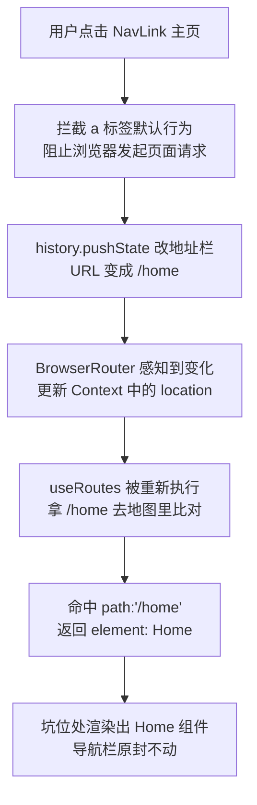

`NavLink` 渲染出来是个 `<a>` 标签，但它 `preventDefault()` 掉了默认跳转 —— 所以浏览器**从头到尾没有向服务器要过任何页面**，只是改了地址栏 + 换了个组件。

如果写的是原生 `<a href="/home">`，浏览器会真的去请求服务器，整页白屏重载，React 应用从零重启，所有 state 清空。


### 三种跳转方式

| 手段                   | 形态                         | 什么时候用                            | 例子                               |
| ---------------------- | ---------------------------- | ------------------------------------- | ---------------------------------- |
| `<NavLink>` / `<Link>` | 组件，用户**点**             | 导航栏、列表里的"详情"链接            | `<Link to="/detail/1">详情</Link>` |
| `<Navigate>`           | 组件，**渲染即跳**           | 写在路由表里做默认页/重定向、权限拦截 | `<Navigate replace to="/home" />`  |
| `useNavigate()`        | hook，返回函数，**代码里调** | 表单提交成功后跳走、删除后返回列表    | `navigate("/home")`                |

选择逻辑很简单：**用户点的用 Link，代码触发的用 useNavigate，在路由表里声明的用 Navigate。** 第三种阶段 4 会用到。

`useNavigate()`一般用法

```jsx
import { useParams, useNavigate } from "react-router-dom"; // 引入

// 在组件中调用useNavigate
function AddOrEdit() {
    const navigate = useNavigate(); // 返回一个函数
    // ...
    navigate("/home", { replace: true }) // 这里就会跳转
    // ...
}
```


### URL携带信息


#### 1. 动态参数：`:id`

```jsx
// router/router.jsx
function RouterConfig() {
  return useRoutes([
	// ...
    { path: "/detail/:id", element: <Detail /> },
    { path: "/edit/:id", element: <AddOrEdit /> },
    // ...
  ]);
}
```

`:id` 是**占位符**，意思是"这一段随便什么值都匹配，并且把它命名为 `id`"。`/detail/1`、`/detail/999` 都命中这一条。

组件里用 `useParams()` 取：

```jsx
import { useParams } from "react-router-dom";
// ...

function Detail() {
  const { id } = useParams();
  //...
 }
```

**`useParams` 取出来的永远是字符串。** `/detail/1` 拿到的是 `"1"` 不是 `1`。拿去和数字比较 `id === 1` 会是 `false`


#### 2. 一个组件挂两条路由

注意 `AddOrEdit` 同时挂在 `/add` 和 `/edit/:id` 上。组件内部就靠 `id` 有没有值来切换模式：

```jsx
// router/router.jsx
function RouterConfig() {
  return useRoutes([
    // ...
    { path: "/add", element: <AddOrEdit /> },
    { path: "/edit/:id", element: <AddOrEdit /> },
    // ...
  ]);
}
```


```jsx
// AddOrEdit.jsx
function AddOrEdit() {
  const { id } = useParams();
  const navigate = useNavigate();
  // ...
}

/

/add     → id 是 undefined  → 添加模式
/edit/5  → id 是 "5"        → 编辑模式，先拉数据填表单
```


添加学生页面

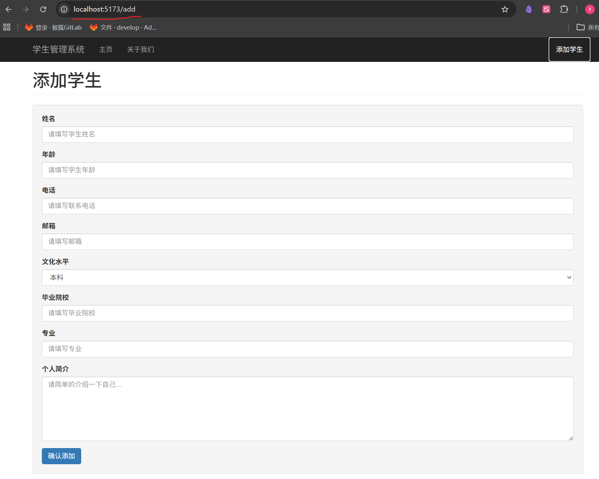

对比编辑学生页面，复用同一套UI，仅仅页面地址栏不同

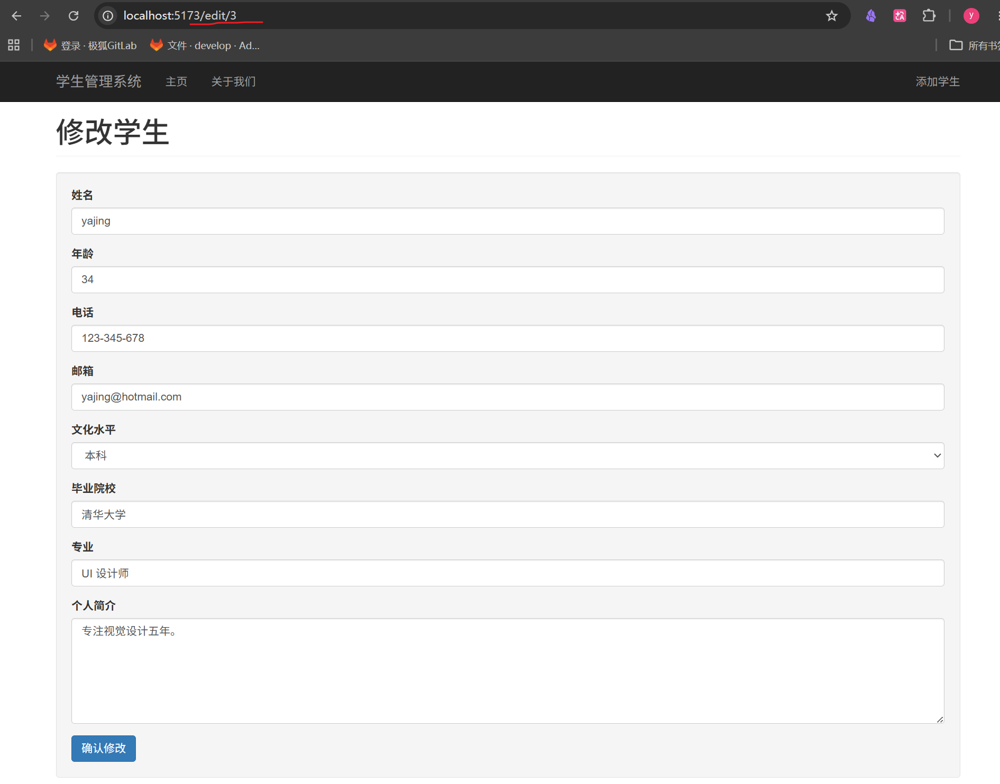


#### 3. `useNavigate`：代码里跳转

```jsx
const navigate = useNavigate(); // 返回函数navigate
```

| 法                                     | 含义                       |
| -------------------------------------- | -------------------------- |
| `navigate("/edit/1")`                  | 跳过去，历史栈**新增**一条 |
| `navigate("/home", { replace: true })` | 跳过去，**替换**当前记录   |
| `navigate(-1)`                         | 后退一步，等同浏览器返回键 |
| `navigate("/home", { state: {...} })`  | 跳转 + 捎带数据            |


#### 4. `state` 传参：不出现在 URL 里的数据

```jsx
// AddOrEdit：跳转时挂上数据
navigate("/home", {
  replace: true,
  state: { alert: "学生添加成功", type: "success" },
});
```

```jsx
// Home.jsx：用 useLocation 接
import { useLocation } from "react-router-dom";

const location = useLocation(); // 拿到数据

// 对拿到的数据进行处理
useEffect(() => {
  if (!location.state) return;
  setAlert(location.state);
  navigate(location.pathname, { replace: true, state: null }); // 用完清掉
}, [location, navigate]);
```

这里`useLocation`拿到的完整对象长这样：

```js
{
  pathname: "/home",      // 路径
  search: "",             // 查询参数字符串，阶段 6 会用
  hash: "",
  state: { alert: "学生添加成功", type: "success" },   // ← 我们塞的东西，原封不动
  key: "8x2k1p"           // 这条历史记录的唯一标识
}
```


### 嵌套路由

需求：`/about` 页面下面要能切换"邮箱 / 电话"，但**上面的标题和说明文字不能跟着一起换掉**。

效果看底部动态图


路由表：用 `children` 表达父子

```js
{
  path: "/about",
  element: <About />,
  children: [
    { index: true, element: <Navigate replace to="email" /> },
    { path: "email", element: <Email /> },
    { path: "tel",   element: <Tel /> },
  ],
},
```

**子路由的 `path` 不写前导斜杠。** `path: "email"` 会自动和父级拼成 `/about/email`。如果你写成 `path: "/email"`，它就变成了绝对路径 `/email`，跟 `/about` 一点关系都没有了，直接匹配失败。


`Outlet`：子路由的坑位

```jsx
function About() {
  return (
    <div>

      <p>联系方式：</p>      {/* 壳，不变 */}
      <NavLink to="email">邮箱</NavLink>
      <NavLink to="tel">电话</NavLink>

      {/* 子路由组件渲染在这里 */}
      <div className="well">
        <Outlet />            {/* ← 坑位，Email 或 Tel 渲染在这 */}
      </div>
      
    </div>
  );
}
```


切换邮箱/电话时，导航栏底部有些东西是不变的，相当于在页面上、更小的范围里进行内容切换


### 查询参数 + 路由守卫

#### 1. `useSearchParams`：把筛选条件放进 URL

url查询参数：

```js
https://example.com/products?keyword=手机
                              ^^^^^^^^^^^^^^^^
                              这就是查询参数
```

`?keyword=手机` 这部分就是 searchParams，可以通过 URL 直接访问、分享、刷新后保留。


```js
const [searchParams, setSearchParams] = useSearchParams();
// useSearchParams 类似 useState，返回两个东西：
searchParams	读取当前 URL 里的查询参数
setSearchParams	修改 URL 里的查询参数


const keyword = searchParams.get("keyword") ?? ""; //  URL 里取出 keyword 的值


function changeKeyword(value) {
  setSearchParams(value ? { keyword: value } : {}, { replace: true });
}
// 函数 changeKeyword 逻辑是：
  如果 value 有内容 → URL 变成 ?keyword=<传入的 value 值>
  如果 value 为空 → URL 变成 ?（清空参数，不留 keyword）
  { replace: true } 的意思是：替换当前历史记录，而不是新增一条。这样用户点浏览器"后退"时不会一直退到搜索历史里。
```


#### 2. 路由守卫

就是在进入某个页面之前，先检查用户是否有权限

v6 没有官方 API，靠包装组件


`RequireAuth` 组件

```jsx
function RequireAuth({ children }) {
  const location = useLocation();
  const token = localStorage.getItem("token");

  if (!token) {
    return <Navigate replace to="/login" state={{ from: location.pathname + location.search }} />;
  }
  return children;
}
```

代码分析：

1、seLocation拿到当前页面位置信息，内容类似下面

```js
{
  pathname: "/home",      // 路径
  search: "",             // 查询参数字符串，阶段 6 会用
  hash: "",
  state: { alert: "学生添加成功", type: "success" },   // ← 我们塞的东西，原封不动
  key: "8x2k1p"           // 这条历史记录的唯一标识
}
```

2、localStorage.getItem("token"), 从本地存储里取 token，判断是否已登录

3、`state={{ from: ... }}`，这是在跳转到登录页的同时，**悄悄带上"你从哪来的"**。


路由表中使用

```jsx
{ path: "/add", element: <RequireAuth><AddOrEdit /></RequireAuth> }
```

把 `<AddOrEdit />` **包在 `<RequireAuth>` 里**，逻辑就是：

```
访问 /add
  → 渲染 RequireAuth
    → 有 token？→ 渲染 AddOrEdit ✅
    → 没 token？→ 渲染 Navigate，跳转到 /login ✅
```


## React-redux


### 何时使用

只有一个组件用：useState

父子/爷孙两三层：props传

主题、登录态、语言：Context

多页面共享、有异步流程：Redux Toolkit

> Vue 对照：这就是"要不要上 Pinia"的同一个决策。


### 原理

```js
// 15 行的 mini-redux
/**
 * 仓库工厂
 * @param {Function} reducer - 函数，接收 state 和 action，返回新的 state
 * @param {any} initialState - 初始状态
 */
function createStore(reducer, initialState) {
  let state = initialState; // 私有变量，外部无法访问,整个应用的唯一状态源
  const linteners = new Set(); // 用Set存储所有订阅者回调，Set自动去重，避免同一个函数重复注册

  return {
    getState: () => state, // 直接返回当前State，外部只能读，不能改

    dispatch(action) { // dispatch-触发状态变更
      state = reducer(state, action); // 纯函数：（旧 state, action）=> 新 state
      linteners.forEach((fn) => fn()); // 通知所有订阅者去重新渲染
      return action; // 返回action，方便链式调用
    },

    subscribe(fn) { // 订阅状态变更
      linteners.add(fn); // 把fn加入订阅者集合
      return () => linteners.delete(fn); // 返回一个取消订阅的函数,这样调用它就能从Set中删除自己
    },
  };
}

// Reducer函数,一个纯函数，相同输入永远得到相同输出，无副作用
function counter(state = { n: 0 }, action) {
  switch (action.type) {
    case "add":
      return { ...state, n: state.n + 1 }; // 必须返回新对象
    default:
      return state;
  }
}

// 使用
const store = createStore(counter, { n: 0 }); // 创建仓库，传入reducer和初始状态
store.subscribe(() => console.log(store.getState())); // 订阅状态变更，打印最新状态
store.dispatch({ type: "add" }); // 触发状态变更，描述意图：增加状态变量n的值

```

dispatch中的action是一张操作说明单，只描述发生了什么事情，不关心怎么处理，也就是仅仅描述了意图

比如`store.dispatch({ type: "add" })`，意图：Redux 强制要求必须有 type 字段

比如：`store.dispatch({ type: "addN", payload: 5 })`，这里带上了 payload,告诉 reducer 加多少


### 数据流

View 触发 dispatch → Action 描述意图 → Middleware 处理副作用 → Reducer 更新 State → connect 通知 View 重新渲染


View（视图）

UI 组件，用户在这里触发操作


dispatch（派发）

触发数据流的"**起点**"，调用 `dispatch(action)` 将事件发出去。

```js
dispatch({ type: 'ADD_TODO', payload: 'Learn Redux' })
```


Action（动作）

一个**普通 JS 对象**，描述"发生了什么事"，必须有 `type` 字段。

```js
{ type: 'ADD_TODO', payload: 'Learn Redux' }
```


Middleware（中间件）

Action 到达 Reducer **之前**的拦截层，可以在这里：

- 处理**异步操作**（如 `redux-thunk`、`redux-saga`）
- 打印日志（`redux-logger`）
- 错误上报等

```js
store.dispatch → middleware1 → middleware2 → reducer
```


State（状态）

Middleware 处理完后，Action 进入 **Reducer**，由 Reducer 根据当前 state + action 计算出**新的 state**，存入 Store。

```js
// Reducer
(state, action) => newState
```


connect（连接）

将 Store 中的 state **映射到组件的 props**，state 变化时自动触发组件重新渲染。

```
// react-redux
const mapStateToProps = state => ({ todos: state.todos })
connect(mapStateToProps)(MyComponent)
```


### 使用流程

装依赖

```
npm install @reduxjs/toolkit react-redux
```

 

- `@reduxjs/toolkit` —— 管数据的（跟 React 无关，纯 JS）
- `react-redux` —— 把上面那个仓库接到 React 组件里的胶水


1 slice —— 一个业务模块（`src/store/counterSlice.js`）

定义数据怎么改

```js
// 从 RTK 库引入 createSlice 函数，它是创建数据模块的核心工具。
import { createSlice } from "@reduxjs/toolkit";

// 调用 createSlice，传入一个配置对象，返回值赋给 counterSlice
const counterSlice = createSlice({
  // 模块名称。RTK 用它给 action type 加前缀，比如这里生成的 action type 就是 "counter/add"、"counter/minus"。
  name: "counter",

  // 这个模块的初始数据
  initialState: {
    value: 0,
  },

  // 定义所有"改数据的方法"，每个方法对应一个 action。。参数固定是 (state, action)
  // state  = 当前模块的数据
  // action = 派发时带过来的信息，数据在 action.payload 里
  reducers: {
    // add：不需要额外参数，直接把 value 加 1。
    add(state) {
      state.value += 1; // 能直接改是因为 RTK 内置了 Immer
    },

    // minus：不需要额外参数，直接把 value 减 1。
    minus(state) {
      state.value -= 1;
    },

    // addBy：需要外部传入数字。action 是 dispatch 时携带的信息对象,例如 dispatch(addBy(5)) → payload 就是 5
    addBy(state, action) {
      state.value += action.payload; 
    },
  },
});

// createSlice 自动为每个 reducer 方法生成了对应的 action creator，都挂在 .actions 上。解构出来后，组件里就可以直接写 dispatch(add()) 或 dispatch(addBy(5))。
export const { add, minus, addBy } = counterSlice.actions;

// createSlice 同时自动生成了一个 reducer 函数，挂在 .reducer 上。导出它，供 store 的 configureStore 组装使用
export default counterSlice.reducer;

```


2 建 store —— 把 slice 组装成唯一仓库（`src/store/index.js`）

```js
// 从 RTK 引入 configureStore，它是创建 Redux store 的函数，是原始 Redux createStore 的增强版，自动集成了 devtools、中间件等
import { configureStore } from "@reduxjs/toolkit";

// 引入上一个文件里 export default 的那个 reducer 函数，负责处理 counter 模块的所有状态变化。
import counterReducer from "./counterSlice";

// 调用 configureStore，创建整个应用唯一的 Redux store，结果赋给 store。
const store = configureStore({
  reducer: {
    // key “counter” 决定了这块数据在全局 state 中的位置
    // 组件里取值时就要写 state.counter.value（state → counter 模块 → value 字段）
    // 如果以后新增模块，在这里再加一行 key 即可，RTK 内部会自动合并
    counter: counterReducer,
  },
});

// 把创建好的 store 导出，供根组件（通常是 index.js）用 <Provider store={store}> 注入到整个 React 应用，之后所有子组件就都能通过 useSelector / useDispatch 访问它了。
export default store;

```


3 Provider —— 把仓库交给组件树（`src/index.js`）

```jsx
// 。。。
import { Provider } from 'react-redux'; // 从 react-redux 引入 Provider 组件。它的作用是把 store "注入"到整棵组件树，让任意深度的子组件都能访问 Redux。
import store from './store'; // 引入刚才在 store/index.js 里创建并导出的唯一 store 实例。
// 。。。

const root = ReactDOM.createRoot(document.getElementById('root')); 

root.render(
  <React.StrictMode>
    {/* 把 store 传给 Provider，包裹在 App 外层。只要在这里包一次，内部所有组件就都能用 useSelector 读数据、用 useDispatch 派发 action。 */}
    <Provider store={store}> 
      <App />
    </Provider>
  </React.StrictMode>
);
```

> Vue 对照：等价于 `app.use(pinia)`。这一步全程只做一次。


4 组件读写

 写组件的数据 ——（`src\components\Counter.js`）

```jsx
// 引入两个核心 Hook：useSelector 用来读数据，useDispatch 用来写（派发 action）。
import { useSelector, useDispatch } from "react-redux";

// 引入之前 counterSlice 自动生成的三个 action creator，用于告诉 Redux "我要做什么操作"。
import { add, minus, addBy } from "../store/counterSlice";


export default function Counter() {
  // 传入一个选择器函数，Redux 把全局 state 交给它，你从中取出需要的那块数据。
  // state.counter 对应 store 里的 key，.value 是 initialState 里的字段。
  // 每次 value 变化，组件自动重新渲染。
  const count = useSelector((state) => state.counter.value); // 读

  // 获取 dispatch 函数，调用它才能真正触发 Redux 的状态变化。
  const dispatch = useDispatch(); // 写

  return (
    <div style={box}>
      <h3>Counter（读 + 写）</h3>
      <p style={{ fontSize: 32 }}>{count}</p>

      {/* 点击按钮 → 调用 action creator（如 add()）→ 得到 action 对象 { type: "counter/add" } → 传给 dispatch → Redux 找到对应 reducer 执行 → state 更新 → 组件重新渲染。 */}
      <button onClick={() => dispatch(minus())}>-1</button>
      <button onClick={() => dispatch(add())}>+1</button>

      {/* addBy(5) 生成的 action 是 { type: "counter/addBy", payload: 5 }，reducer 里用 action.payload 取到这个 5。 */}
      <button onClick={() => dispatch(addBy(5))}>+5</button>

      {/* 调试用按钮，直接打印两个 action creator 的返回值，可以在控制台看到 action 对象的结构（type 和 payload）。 */}
      <button onClick={() => console.log(add(), addBy(5))}>打印 action</button>
    </div>
  );
}

// 样式对象定义在组件外，避免每次渲染都重新创建。
const box = { border: "1px solid #ccc", borderRadius: 8, padding: 16, marginBottom: 16 };
```

打印结果

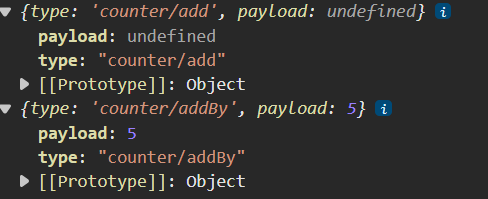


只读的兄弟组件 ——（`src\components\Display.js`）

```jsx
// 只需要读数据，所以只引入 useSelector，不需要 useDispatch。
import { useSelector } from "react-redux"; 

export default function Display() {
  // 和 Counter 里完全相同的写法，订阅同一个 state 字段。
  const count = useSelector((state) => state.counter.value);

  return (
    <div style={box}>
      <h3>Display（只读）</h3>
      <p>我和 Counter 是兄弟组件，没有任何 props 传递，但能看到它改的值：{count}</p>
    </div>
  );
}

const box = { border: "1px solid #ccc", borderRadius: 8, padding: 16 };
```


5 组装 ——（`src\App.js`）

```jsx
import Counter from './components/Counter';
import Display from './components/Display';

export default function App() {
  return (
    <div style={{ fontFamily: 'system-ui', padding: 20, maxWidth: 520 }}>
      <h2>Redux 最小示例</h2>
      <Counter />
      <Display />
    </div>
  );
}
```


数据流：点一次 +5 发生了什么

```
① 点击          dispatch(addBy(5))
                     ↓
② 造出 action    { type: "counter/addBy", payload: 5 }
                     ↓
③ 进 reducer     counterSlice.js 的 addBy(state, action) → state.value += 5
                     ↓
④ store 更新     { counter: { value: 5 } }
                     ↓
⑤ 订阅者重渲染   Counter 和 Display 的 useSelector 同时拿到 5
```


效果

同步变化

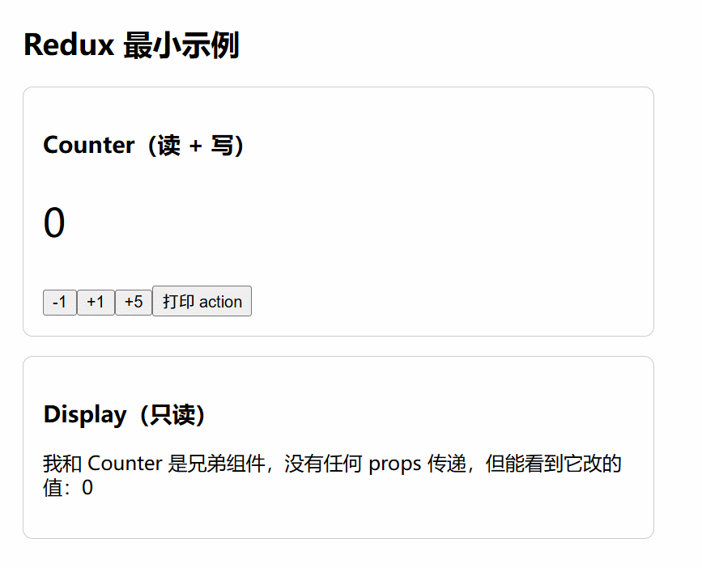


## Antd组件库


### 安装

```
pnpm i antd @ant-design/v5-patch-for-react-19
```

index.js

```jsx
import '@ant-design/v5-patch-for-react-19'; // 必须在最前面，React 19 兼容补丁，引入antd组件库

import React from 'react'; // React 核心库
import ReactDOM from 'react-dom/client'; // ReactDOM 用于将 React 组件渲染到真实 DOM
import App from './App'; // 根组件

import { ConfigProvider } from 'antd';// antd 组件库的配置提供者，用于全局配置主题、语言等
import zhCN from 'antd/locale/zh_CN'; // antd 中文语言包

// 找到 public/index.html 里的 <div id="root"></div>，以它为容器创建一个 React 渲染根节点
const root = ReactDOM.createRoot(document.getElementById('root')); 

// 把 App 组件渲染进去。页面上看到的所有内容，都是从这里开始挂载的。
root.render(
  <React.StrictMode>
    {/* ConfigProvider 用于全局配置 antd 组件库的主题、语言等 */}
    <ConfigProvider locale={zhCN}>
      <App />
    </ConfigProvider>
  </React.StrictMode>
);
```


### 核心

这是最需要先建立的直觉。`<Button type="primary">` 和你自己写的 `<MyButton type="primary">` **完全是同一回事**——它就是别人替你写好的普通 React 函数组件：

```jsx
// antd 内部大致长这样（简化到不能再简化）
function Button({ type, children, ...rest }) {
  return <button className={`ant-btn ant-btn-${type}`} {...rest}>{children}</button>;
}
```

推论：

1. 配置外观 → 传 props（`type` / `size` / `danger` / `loading`）
2. 填内容 → 传 children（标签中间的东西）
3. "学 antd" 不是学语法，是查文档看它开放了哪些 props


### input / Select

```jsx
import { useState } from 'react';
import { Input, Select } from 'antd'; // 引入 antd 组件库的 Input 和 Select 组件

function App() {
  const [name, setName] = useState('');
  const [city, setCity] = useState('bj');

  return (
    <>
      {/* antd 的 Input：e.target.value，和原生一致，这里配一个 onChange 把值写回 state */}
      <Input value={name} onChange={(e) => setName(e.target.value)} />

      {/* antd 的 Select：注意！回调直接给值，没有 e.target */}
      <Select 
        value={city} 
        onChange={(value) => setCity(value)}
        options={[
          { value: 'bj', label: '北京' },
          { value: 'sh', label: '上海' },
        ]}
      />

      <p>{name} - {city}</p>
    </>
  )
}
```

效果

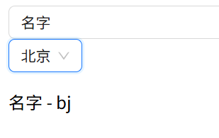


### Form

```jsx
import { useState } from 'react';
import { Form, Input, Button } from 'antd'; // 引入 antd 组件库的 Form、Input 和 Button 组件

function App() {
  const onFinish = (values) => {
    console.log(values); // { username: 'xx', password: 'yy' }
  };

  return (
    <Form onFinish={onFinish} initialValues={{ username: 'admin' }}>
      <Form.Item name="username" label="用户名" rules={[{ required: true, message: '请输入用户名' }]}>
        <Input />                        {/* 注意：没写 value，也没写 onChange */}
      </Form.Item>

      <Form.Item name="password" label="密码">
        <Input.Password />
      </Form.Item>

      <Form.Item>
        <Button type="primary" htmlType="submit">登录</Button>
      </Form.Item>
    </Form>
  );
}

export default App;
```

写 `<Input />` 却不用管 state，`Form.Item` 拿到 `name` 后，会用 React.cloneElement 把子组件克隆一份，**顺手注入 `value` 和 `onChange`**：

```js
// Form.Item 内部干的事，伪代码
return React.cloneElement(children, {
  value: store[name],
  onChange: (e) => setStore(name, e?.target?.value ?? e),
});
```

1. 带 `name` 的 `Form.Item`，**里面只能放一个子组件**（要克隆谁？多了就懵了）
2. 不要在 `<Input />` 上再写 `value`，会把注入的值覆盖掉
3. 初始值写在 `Form` 的 `initialValues` 上，别写在 `Input` 的 `defaultValue` 上


### Table

```jsx
import { useState } from 'react';
import { Table, Tag, Button, Space } from 'antd'; // 引入 antd 组件库的 Table、Tag、Button、Space 组件

// columns 描述列长什么样
// title 是表头
// dataIndex = 去每行数据里取哪个字段
const columns = [
  { title: '姓名', dataIndex: 'name', key: 'name' },
  { title: '年龄', dataIndex: 'age', key: 'age' },
  {
    title: '标签',
    dataIndex: 'tags',
    // render(单元格的值, 整行数据, 行下标) —— 想自定义渲染就写它
    render: (tags) => tags.map((t) => <Tag color="blue" key={t}>{t}</Tag>),
  },
  {
    title: '操作',
    render: (_, record) => (      // 没有 dataIndex，第一个参数没用，用 record
      <Space>
        <Button type="link">编辑 {record.name}</Button>
        <Button type="link" danger>删除</Button>
      </Space>
    ),
  },
];

// columns 描述列长什么样，dataSource 是行数据
const data = [
  { id: 1, name: '张三', age: 18, tags: ['前端'] },
  { id: 2, name: '李四', age: 20, tags: ['后端', '运维'] },
];

// rowKey 必须给，否则控制台刷 key 警告（本质就是列表渲染的 key）,
function App() {
  return (
    <Table columns={columns} dataSource={data} rowKey="id" />
  );
}

export default App;
```


### Grid布局

**Gutter 固定、Column 弹性** → 缝永远 16px，多出来的宽度全部平摊给 24 个 Column

1. **宽度**：`span/24` 直接换算成百分比，`span={8}` → `8/24 = 33.33%`
2. **缝**：gutter 一劈为二，每个 Col 左右各 **8px 的 padding**（因为 antd 全局 `box-sizing: border-box`，padding 是**算在宽度里面**的）

```jsx
<Row gutter={16}>
  <Col span={8}>左 1/3</Col>
  <Col span={16}>右 2/3</Col>
</Row>


Row (左右各 -8px 负 margin，抵消掉两端半缝)
┌─────────────────────┬──────────────────────────────┐
│ 8 │   内容 33%   │ 8 │ 8 │      内容 67%       │ 8 │
└─────────────────────┴──────────────────────────────┘
                    └─ 8+8 = 16px，正好一个 gutter ─┘
```


官网示意图

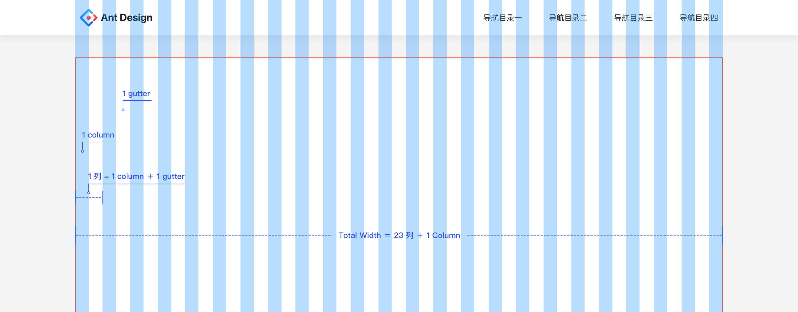


```jsx
function App() {
  return (
    <Row gutter={16}>
      <Col span={8} style={colStyleLeft}>左 1/3</Col>
      <Col span={16} style={colStyleRight}>右 2/3</Col>
    </Row>
  );
}
// 给左右两边的 Col 设置不同背景颜色样式
const colStyleLeft = {
  background: '#f0f2f5',
  padding: '16px',
  textAlign: 'center',
}; 

const colStyleRight = {
  background: '#921d1d',
  padding: '16px',
  textAlign: 'center',
};
```


## Umi.js / Antd pro / Dva


### 是什么

```
Umi (Umi Max)          框架层：路由 + 构建 + 插件
  ├── Dva / useModel   数据层：state 怎么存、怎么变
  └── Antd Pro         方案层：写好的中后台模板
        └── ProComponents  组件层：ProTable / ProForm ← 天天写的
```


| 技术栈                   | 一句话                             | 核心设计理念（只需理解这个）                                 |
| ------------------------ | ---------------------------------- | ------------------------------------------------------------ |
| ProComponents / Antd Pro | Antd 之上的业务组件 + 成品后台模板 | 一份 `columns` + `valueType`，同时驱动表格列、搜索框、表单项、详情项 |
| Dva                      | Redux + Saga + Router 的打包简化版 | 单向数据流：`reducers` 同步纯函数、`effects` 异步副作用；`yield call` 只是"描述一次调用"，让副作用变可测 |
| Umi                      | 约定式路由 + 插件化的 React 框架   | 约定优于配置；配置生成代码到 `src/.umi`，所以 `import from 'umi'` 是现造的 |


### ProComponents


#### 设计理念

想象你在做一个"用户管理"页面，有一个"状态"字段。用原生 Antd，你得写 4 次：

| 地方     | 你要手写什么                                                 |
| -------- | ------------------------------------------------------------ |
| 表格列   | `<Table columns>` 里写一个 `{ dataIndex: 'status', render: ... }` |
| 搜索区   | `<Form.Item>` + `<Select>` 手动写选项                        |
| 新建弹窗 | 又一个 `<Form.Item>` + `<Select>`                            |
| 详情页   | `<Descriptions.Item>` 里格式化显示                           |

同一个字段的定义，Antd 要写 4 遍。改一次（比如加个枚举值），要改 4 个地方，容易漏，容易出错。


Schema

解决方案：只写一个对象，称为 "Schema"，ProComponents 把字段的"描述信息"写在一个对象里，组件自己去渲染所有地方。

```js
{
  title: '状态',          // 这个字段叫什么
  dataIndex: 'status',   // 对应数据里的哪个 key
  valueType: 'select',   // ← 灵魂：用 select 控件渲染
  valueEnum: {           // ← 枚举：0 显示"关闭"，1 显示"运行中"
    0: { text: '关闭', status: 'Default' },
    1: { text: '运行中', status: 'Processing' },
  },
}
```

这一个对象，`ProTable` 会自动把它变成：

- 表格里：一列，枚举值渲染成带颜色的 Tag
- 搜索区：一个 Select 下拉框，选项自动从 `valueEnum` 生成
- 表单里：同样是 Select，`valueEnum` 就是选项
- 详情页：文字展示，同样走 `valueEnum` 映射


columns

Schema对象通常包裹在一个数组中，这个数组叫做columns

`columns` 是传给 `ProTable` 的一个**数组 prop**，数组里每一项就是Schema那种 `{ title, dataIndex, valueType, ... }` 对象：

```jsx
const columns = [           // ← 这整个数组叫 columns
  {                         // ← 这一项就是描述"姓名"字段的对象
    title: '姓名',
    dataIndex: 'name',
    valueType: 'text',
  },
  {                         // ← 这一项描述"状态"字段
    title: '状态',
    dataIndex: 'status',
    valueType: 'select',
    valueEnum: { ... },
  },
];

<ProTable columns={columns} ... />
```


`valueType` 的作用

`valueType` 是这套机制的关键 —— 它告诉组件"这个字段是什么类型的数据，应该用什么 UI 来展示和输入"。

```
valueType: 'date'      → 表格里显示格式化日期，搜索区自动变成 DatePicker
valueType: 'money'     → 表格里加货币符号，表单里是数字输入框
valueType: 'select'    → 配合 valueEnum，所有地方都用下拉选择
valueType: 'option'    → 专门用于"操作列"（编辑、删除按钮那一列）
```

valueType本质上"数据语义 → UI 控件"的映射表


总结：

 ProComponents 所有组件的学习，本质上都是在回答同一个问题：**这个组件认识哪些 `valueType`，支持哪些 `columns` 属性？** 剩下 20% 是各组件的特有 props，查文档就行。


#### ProTable —— 用得最多的组件

理念：表格 = 搜索表单 + 工具栏 + 表格 + 分页 + 请求逻辑，全部打包。

```jsx
import { ProTable } from '@ant-design/pro-components';

const columns = [
  { title: '姓名', dataIndex: 'name', copyable: true, ellipsis: true },
  { title: '状态', dataIndex: 'status', valueType: 'select', valueEnum: {...} },
  { title: '创建时间', dataIndex: 'createdAt', valueType: 'dateTime', hideInSearch: true },
  {
    title: '操作', valueType: 'option',
    render: (_, record, __, action) => [
      <a key="edit" onClick={() => {}}>编辑</a>,
      <a key="reload" onClick={() => action?.reload()}>刷新</a>,
    ],
  },
];

<ProTable
  rowKey="id"
  columns={columns}
  request={async (params, sort, filter) => {
    // params = { current, pageSize, ...搜索表单里填的值 }
    const res = await getUserList(params);
    return { data: res.list, total: res.total, success: true }; // 固定这三个字段
  }}
  search={{ labelWidth: 'auto' }}   // 传 false 可关掉搜索区
  toolBarRender={() => [<Button key="add" type="primary">新建</Button>]}
/>
```


解析

`columns` 列定义

```js
const columns = [
  { title: '姓名', dataIndex: 'name', copyable: true, ellipsis: true },
```

- `dataIndex`：对应后端返回数据的字段名
- `copyable`：显示一个复制图标，点击可复制内容
- `ellipsis`：文字过长时显示省略号

```jsx
 { title: '状态', dataIndex: 'status', valueType: 'select', valueEnum: {...} },
```

- `valueType: 'select'`：告诉 ProTable 这列数据是枚举类型，搜索区自动渲染下拉框
- `valueEnum`：枚举映射，把数字/字符串翻译成文案+颜色标签

```jsx
  { title: '创建时间', dataIndex: 'createdAt', valueType: 'dateTime', hideInSearch: true },
```

- `valueType: 'dateTime'`：表格里自动格式化成可读时间
- `hideInSearch: true`：这列**不在搜索区生成表单项**

```jsx
  { title: '操作', valueType: 'option',
    render: (_, record, __, action) => [...]
  }
```

- `valueType: 'option'`：操作列，**不参与搜索**，纯渲染用
- `render` 的第四个参数 `action` 是**表格遥控器**，`action?.reload()` 可以手动刷新表格

```jsx
<ProTable
  rowKey="id"          // 指定每行数据的唯一标识字段，相当于 key
  columns={columns}    // 传入上面定义的列
  request={async (params, sort, filter) => {
    const res = await getUserList(params);
    return { data: res.list, total: res.total, success: true };
  }}
```

- `request` 是 ProTable 的核心：它**自动把搜索值+分页信息打包进 `params`** 传给你，你只负责调接口
- 返回值**必须固定**为 `{ data, total, success }` 三个字段，否则表格不会正常渲染

```jsx
  search={{ labelWidth: 'auto' }}   // 控制搜索区 label 宽度，传 false 整个搜索区消失
  toolBarRender={() => [<Button key="add" type="primary">新建</Button>]}
  // 右上角工具栏，返回一个 JSX 数组
/>
```


#### ProForm —— 表单

理念：**表单的"布局形态"和"表单项"解耦**。同一批表单项，可以塞进普通页面、弹窗、抽屉、分步表单。

```jsx
import { ProForm, ProFormText, ProFormSelect, ProFormDatePicker, ModalForm } from '@ant-design/pro-components';

<ProForm
  onFinish={async (values) => {
    await save(values);
    message.success('提交成功');
    return true;          // 返回 true，弹窗/抽屉会自动关闭
  }}
  initialValues={{ name: '张三' }}
>
  <ProFormText name="name" label="姓名" rules={[{ required: true }]} />
  <ProFormSelect
    name="status" label="状态"
    request={async () => [{ label: '启用', value: 1 }]}   // 选项可以异步拉
  />
  <ProFormDatePicker name="birthday" label="生日" />
</ProForm>
```


解析

外壳：`<ProForm>` 组件

```jsx
<ProForm
  onFinish={async (values) => {
    await save(values);
    message.success('提交成功');
    return true;   // ← 关键：返回 true 才会触发弹窗/抽屉自动关闭
  }}
  initialValues={{ name: '张三' }}  // 表单默认填充值
>
```

- `onFinish`：点击提交按钮后触发，`values` 是所有表单项收集到的对象（`{ name, status, birthday }`）
- 对比原生 antd Form：不需要手动 `form.validateFields()`，ProForm 内部自动做了校验再调 `onFinish`
- `return true` 是 ProForm 的约定，告诉组件"提交成功了"，如果外壳是 `ModalForm` 会自动关弹窗

表单项：三种控件

```jsx
<ProFormText
  name="name"
  label="姓名"
  rules={[{ required: true }]}   // 校验规则，和原生 Form.Item 的 rules 一样
/>
```

- 等价于原生的 `<Form.Item name="name" label="姓名" rules={...}><Input /></Form.Item>`
- ProForm 把 `Form.Item` 的包裹层和控件合并成了一个组件

```jsx
<ProFormSelect
  name="status"
  label="状态"
  request={async () => [{ label: '启用', value: 1 }]}  // 选项可以是异步请求
/>
```

- `request` 支持异步拉取选项，内置 loading 状态，不需要自己管 `useState`
- 返回格式固定是 `[{ label, value }]` 数组

```jsx
<ProFormDatePicker name="birthday" label="生日" />
```

- 直接渲染一个日期选择器，提交时自动格式化成字符串


### Antd Pro —— 项目模板


#### 是什么

一个已经写好了的 React 中后台项目：登录页、权限、国际化、菜单布局、Mock 数据、请求封装、CRUD 示例页，全都有。你 clone 下来删掉示例页就能开工。

> Antd Pro ≈  "Umi 的配置 + ProComponents 的用法"，它本身没有新 API。


#### 新增一个页面的完整流程

页面文件 → routes 配置 → 菜单文案。就这三步

1、建页面文件

```
src/pages/Student/index.tsx
```

```tsx
import { PageContainer, ProTable } from '@ant-design/pro-components';

export default function StudentPage() {
  return (
    <PageContainer>   {/* 自动带面包屑 + 页头，Pro 页面的标准外壳 */}
      <ProTable ... />
    </PageContainer>
  );
}
```


2、路由配置（`config/routes.ts`）

```ts
export default [
  { path: '/welcome', name: 'welcome', icon: 'smile', component: './Welcome' },
  {
    path: '/student', name: 'student', icon: 'team', component: './Student',
    // access: 'canAdmin', 需要权限时加这个
  },
  { path: '/', redirect: '/welcome' },
  { path: '*', layout: false, component: './404' },
];
```

**菜单是自动从 `routes` 生成的** —— 这是 Pro 的关键约定：`name` 决定菜单文案（走国际化 key），`icon` 决定菜单图标，嵌套 `routes` 决定子菜单，不配 `name` 的路由不进菜单。


3、加菜单文案（`src/locales/zh-CN/menu.ts`）

```ts
export default {
  'menu.welcome': '欢迎',
  'menu.student': '学生管理',
};
```

> 顺序记忆：**页面文件 → routes 配置 → 菜单文案**。就这三步，没有第四步。


#### UI 配置（layout 配置对象）

整个后台长什么样，由一个配置对象决定 —— `config/defaultSettings.ts`：

```ts
export default {
  navTheme: 'light',        // 主题
  colorPrimary: '#1890ff',  // 主色
  layout: 'mix',            // ★ side(左侧菜单) / top(顶部菜单) / mix(混合)
  contentWidth: 'Fluid',    // Fluid 流式 / Fixed 定宽
  fixedHeader: false,       // 固定头部
  fixSiderbar: true,        // 固定侧边栏
  splitMenus: false,        // mix 模式下一级菜单在顶部、二级在侧边
  title: '后台管理系统',
};
```

再配合 `src/app.tsx` 里的**运行时** `layout` 配置（可以写函数、放 JSX）：

```tsx
export const layout = ({ initialState }) => ({
  logo: '...',
  avatarProps: { src: initialState?.currentUser?.avatar },
  footerRender: () => <Footer />,
  onPageChange: () => { /* 未登录就跳登录页 */ },
});
```

**理念**：静态的东西（主题色、布局模式）放构建时配置；需要拿到用户信息、需要写 JSX 的放运行时配置。这个"构建时 / 运行时"二分法是 Umi 的核心设计，批次 3 会展开。


第二段代码解析

```js
export const layout = ({ initialState }) => ({
```

- 这是一个**函数**，Umi 在运行时调用它，并把 `initialState`（全局初始数据，通常含当前登录用户）注入进来
- 返回一个对象，覆盖/补充第一段的静态配置

```js
  logo: '...',
  avatarProps: { src: initialState?.currentUser?.avatar },  // 右上角用户头像
  footerRender: () => <Footer />,    // 页脚渲染函数，可以放 JSX
  onPageChange: () => { /* 未登录就跳登录页 */ },  // 每次路由切换时触发
```

- `avatarProps.src` 依赖登录用户的数据，**只能在运行时拿到**，所以不能放构建时配置
- `footerRender` 需要写 JSX，**只能在运行时配置**里写


### Dva —— 数据流方案

Dva = Redux + Redux-Saga + React-Router 的打包简化版


#### 为什么会有 Dva

Redux 的痛点：

```
写一个功能要动 4 个文件：
  actionTypes.js  →  定义常量字符串
  actions.js      →  定义 action creator
  reducer.js      →  处理状态
  saga.js         →  处理异步
再加上 store 里手动 combineReducers 注册
```

Dva 的核心主张：**这 4 个文件本来就是同一件事，凭什么拆开？**


于是发明了 `model` —— 一个文件，一个对象，装下一个业务模块的全部数据逻辑：

```
model = namespace(名字) + state(数据) + reducers(同步改) + effects(异步做) + subscriptions(订阅)
```


#### 数据流

Redux 原版

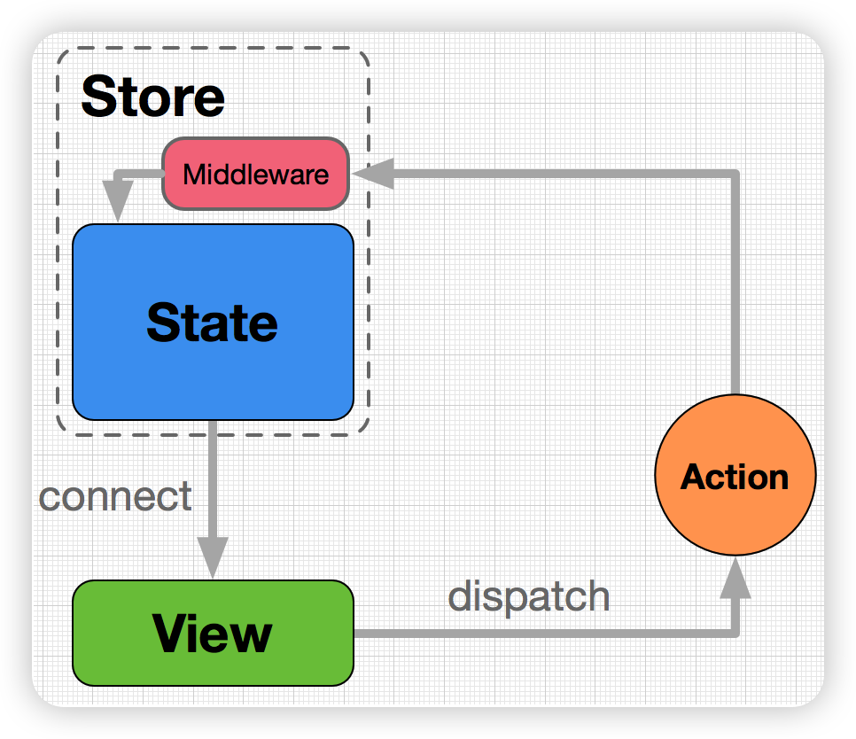


Dva 版

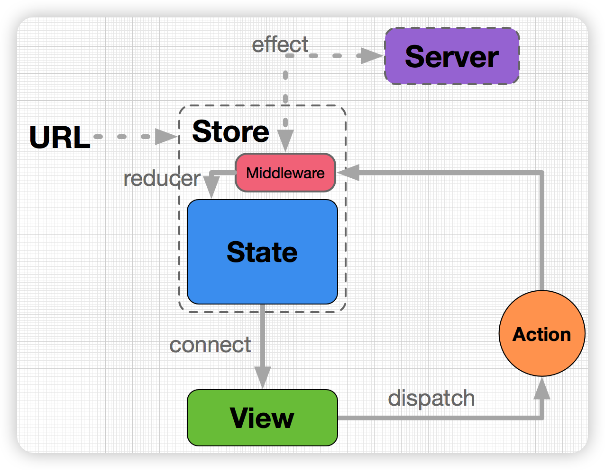


Dva在Redux基础上做了三处扩展

```
Middleware --> reducer --> State
```

把 Reducer 从 State 中**显式分离**出来，职责更清晰：

- **Middleware** 负责拦截、处理副作用
- **Reducer** 负责纯函数计算新 State


```
Store --effect(虚线)--> Server
```

Dva 内置了 **`redux-saga`** 作为副作用管理方案：

- `effect` 是 Dva 的核心概念，专门处理**异步请求**（调接口等）
- 用**虚线**表示它是"副作用"，区别于主数据流
- Server 响应后再 dispatch 新 Action 回到主流程


```
URL(虚线) --> Store
```

Dva 集成了 **`react-router`**：

- URL 变化可以直接影响 Store 的状态
- 路由也成为数据流的一个**输入源**


#### model 的写法（这是全部的新语法）

`src/models/students.js`

```js
import { queryStudents, addStudent } from '@/services/student';
// 从 service 层导入封装好的请求函数，保持 model 只负责数据逻辑，不写 fetch 细节

export default {
  // ① namespace：该 model 的唯一标识符
  // 全局 state 会以此为 key 挂载，如 state.students
  // 跨 model 触发 action 时也需要用它做前缀，如 'students/fetch'
  namespace: 'students',

  // ② state：该 model 的初始数据，只有这个 model 能直接操作它
  state: {
    list: [],
    total: 0,
  },

  // save：通用的合并更新
  // state 是当前状态，{ payload } 是 action 携带的新数据
  // 用展开运算符合并，返回一个全新对象（不改原对象，保证不可变性）
  reducers: {
    save(state, { payload }) {
      return { ...state, ...payload };
    },
      
     // remove：从列表中删除一条数据
    // 用解构直接把 payload 重命名为 id，语义更清晰
    // filter 返回新数组，同样不改原数组
    remove(state, { payload: id }) {
      return { ...state, list: state.list.filter(s => s.id !== id) };
    },
  },

  // ④ effects：异步操作，处理请求、延时等副作用
  // 使用 Generator 函数（function*），yield 相当于 await，遇到就暂停等结果
  // 好处：yield 出的是"描述对象"而非真正执行，effect 本身是纯函数，方便测试
  effects: {
    // fetch：拉取学生列表
    // { payload } 是调用方传来的参数（如分页、筛选条件）
    // { call, put, select } 是 dva/saga 注入的工具方法
    *fetch({ payload }, { call, put, select }) {
      // call：调用异步函数 queryStudents，并等待其返回结果
      // 等价于 const res = await queryStudents(payload)
      const res = yield call(queryStudents, payload);
        
      // put：发出一个 action，相当于 dispatch
      // 这里触发同 model 下的 save reducer，把请求结果写入 state
      yield put({ type: 'save', payload: { list: res.data, total: res.total } });
    },
      
    // add：新增一名学生
    *add({ payload }, { call, put }) {
      yield call(addStudent, payload);
      yield put({ type: 'fetch' });          // 新增完重新拉列表
    },
  },

  // ⑤ 订阅：监听外部数据源（路由变化、键盘、window resize…），可选
  subscriptions: {
    // setup 是约定的函数名，app 启动时自动执行
    // history 是路由对象，dispatch 用于发出 action
    setup({ dispatch, history }) {
      // history.listen 监听每次路由变化
      // 返回值是取消监听的函数，Dva 会在 model 卸载时自动调用它清理
      return history.listen(({ pathname }) => {
         // 每当用户导航到 /students 页面，自动触发 fetch 加载数据
        // 这样就不需要在页面组件的 componentDidMount 里手动 dispatch 了
        if (pathname === '/students') dispatch({ type: 'fetch' });
      });
    },
  },
};
```


**`yield` 就是 `await`。** 遇到 `yield` 就暂停，等异步做完拿到结果再往下走。


`yield call(fn, args)` **并不执行** `fn`，它只是**返回一个描述"我想调用 fn"的普通对象**，真正的执行交给 Dva 的中间件

好处：effect 函数本身变成了**纯函数** —— 测试时不用 mock 网络，只要断言它 yield 出的那个描述对象就行。这叫 **"声明式的副作用"**。


#### model.effect 的内置方法

`call(fn, ...args)`

调用异步函数并等待结果（最常用）


`put({ type, payload })`

发一个 action，触发本 model 的 reducer 或 effect

用上面的代码举例：

```js
*add({ payload }, { call, put }) {
  yield call(addStudent, payload);
  yield put({ type: 'fetch' });  // ← 这里
},
```

`yield put({ type: 'fetch' })` 做的事情就是：

>  发出一个 `{ type: 'students/fetch' }` 的 action（自动补上当前 namespace），Dva 收到后，发现 `students` model 里有个叫 `fetch` 的 **effect**，就去执行它

​																																																																				`select(state => state.xxx)`

从 store 里读数据


#### 组件如何使用model

dispatch —— 触发

```js
dispatch({ type: 'students/fetch', payload: { page: 1 } });
//            ↑namespace  ↑reducer 或 effect 的名字
```

语法点：`type` 的格式是 `'namespace/名字'`。省略 namespace 就是当前 model 内部调用（只能在 effect 里省略）。


connect —— 读取

```js
import { useDispatch, useSelector } from 'umi';

function StudentPage() {
  const dispatch = useDispatch(); // 获取能够执行写入操作的dispatch函数，
  const { list } = useSelector(state => state.students); // 读取state数据，当数据变化时，组件自动更新
  const loading = useSelector(state => state.loading.effects['students/fetch']);

  useEffect(() => { dispatch({ type: 'students/fetch' }); }, []);
  // ...
}
```


#### 独立使用 Dva 的搭建顺序

实际项目里会在 Umi 里用它，但知道原始形态有助于理解：


目录结构

```
dva-demo/
├── public/
│   └── index.html
├── src/
│   ├── index.js          ← 入口，初始化 Dva
│   ├── App.js            ← 根组件
│   ├── models/           ← 数据层
│   │   └── students.js
│   ├── services/         ← 请求封装
│   │   └── student.js
│   └── pages/            ← 页面组件
```


安装依赖

```bash
npm install dva react react-dom
```


入口文件 `src/index.js` —— 四行核心

```js
import dva from 'dva';
import studentsModel from './models/students';
import App from './App';

// 1. 创建 app 实例
const app = dva();

// 2. 注册 model（可注册多个）
app.model(studentsModel);

// 3. 配置路由
app.router(() => <App />);

// 4. 启动，挂载到 #root
app.start('#root');
```

> 这四步是 Dva 的固定启动公式，顺序不能乱。


写 model `src/models/students.js`

就是上面已经学过的那套写法：`namespace / state / reducers / effects / subscriptions`。model的写法章节


写 service `src/services/student.js`

```js
// 封装请求，与 model 解耦
export async function queryStudents(params) {
  return fetch(`/api/students?${new URLSearchParams(params)}`).then(r => r.json());
}
```


组件中使用 `connect`

```js
import { connect } from 'dva';

function StudentsPage({ list, dispatch }) {
  useEffect(() => {
    dispatch({ type: 'students/fetch' });
  }, []);

  return <ul>{list.map(s => <li key={s.id}>{s.name}</li>)}</ul>;
}

// 把 state.students 映射到组件 props
export default connect(({ students }) => ({
  list: students.list,
}))(StudentsPage);
```


#### ⚠️ 现状说明

Dva 在新项目里已经不推荐了。 你需要知道它，但不必练熟：

- Umi 4 / Umi Max 官方推荐用 **简易数据流（`model` 插件 + `useModel`）** 或 **valtio / react-query**；
- Dva 依赖 Generator、写法啰嗦、TS 类型支持差；
- 真正需要重型 Redux 时，社区现在用 **Redux Toolkit**（你已经会了）。


### Umi.js —— 把一切装起来的框架

Umi 是"约定式路由 + 插件体系"的 React 应用框架， React 生态里那堆要自己拼的东西，变成开箱可用的默认值


#### 设计理念

1. 约定优于配置（Convention over Configuration）

传统 React 项目开工前要做的事：装 webpack、配 babel、配 react-router、配 store、配 loading、配代码分割…… 每个项目重来一遍，每个人写法还不一样。

Umi 的回答：**这些都有标准答案，我直接定死。**

```
src/pages/        →  这里的文件就是路由，不用写路由表
src/models/       →  这里的文件就是数据 model，不用手动注册
src/layouts/      →  这里的 index.tsx 就是全局布局
src/app.tsx       →  这里就是运行时配置
.umirc.ts         →  这里就是构建时配置
mock/             →  这里就是接口 mock
```

**理念**：把"每个项目都要做一遍的决定"变成约定，你只做业务决定。


2. 插件化（一切皆插件）

Umi 自己的内核其实很小，路由、构建、数据流、请求、权限、国际化……**全是插件**。

```
Umi 内核（生命周期 + 临时文件生成）
  ├── 内置插件：路由、构建、HMR…
  └── 可选插件：antd、dva、model、request、access、locale、layout…
```

`Umi Max` 就是 **Umi + 一整套中后台常用插件的预设包**

所以：Umi = 内核；Umi Max = 内核 + 中后台全家桶；Antd Pro = Umi Max + 写好的业务页面。


3. 临时文件（.umi 目录）—— 理解这个就理解了 Umi 的魔法

写 `import { history, useModel } from 'umi'`，这个 `'umi'` 是什么？

启动项目时，Umi 会**扫描你的目录 + 读你的配置，动态生成一整套代码**放进 `src/.umi/`：

```
src/.umi/
  ├── core/          # 内置插件生成的代码（路由表、exports 汇总…）
  ├── plugin-dva/    # 你开了 dva，它就生成 dva 的 store 初始化代码
  ├── plugin-access/ # 你开了 access，它就生成权限代码
  └── umi.ts         # 真正的应用入口
```

**所以 `'umi'` 这个包不是 node_modules 里的固定东西，而是根据你的配置现生成的。** 你开了什么插件，就能从 `'umi'` 里 import 到什么。

这就是"构建时配置决定了 `.umi` 目录长什么样"这句话的含义。

> `.umi` 目录是自动生成的，**永远不要手动改，要加进 .gitignore**。但**出问题时进去看一眼生成的代码，是最快的排错方式**。


#### 约定式路由


##### 基本规则

不写 `routes` 配置时，Umi 扫描 `src/pages`，文件即路由：

```
src/pages/
  index.tsx            →  /
  users.tsx            →  /users
  users/index.tsx      →  /users
  users/list.tsx       →  /users/list
```


##### 动态路由

`$` 前缀（⚠️ Umi 4 用 `$`，不是 Next.js 的 `[]`）

```
src/pages/users/$id.tsx          →  /users/:id
src/pages/users/$id/settings.tsx →  /users/:id/settings
src/pages/$bar/$.tsx             →  /:bar/*     （单独的 $ 表示通配）
```

页面里取参数（Umi 4 底层是 react-router v6）：

```tsx
import { useParams, useSearchParams, useLocation, useNavigate } from 'umi';

const { id } = useParams();                      // 路径参数 /users/:id
const [searchParams] = useSearchParams();        // 查询参数 ?a=b
```


##### 全局布局与 404

```
src/layouts/index.tsx   →  全局布局，用 <Outlet /> 渲染子路由
src/pages/404.tsx       →  404 页面（只有约定式路由自动生效）
src/pages/loading.tsx   →  按页拆包时的加载态
```

```tsx
// src/layouts/index.tsx
import { Outlet, Link } from 'umi';
export default function Layout() {
  return (
    <div>
      <Link to="/users">用户</Link>
      <Outlet />        {/* 子路由渲染在这里 */}
    </div>
  );
}
```


##### 配置式路由

在中后台项目中更加常用

因为菜单要靠路由的 `name` / `icon` 生成，Antd Pro 系项目基本都用配置式：

```ts
// config/routes.ts
export default [
  { path: '/login', component: './Login', layout: false },   // layout:false 关掉全局布局
  { path: '/', redirect: '/welcome' },
  { path: '/welcome', name: 'welcome', icon: 'smile', component: './Welcome' },
  {
    path: '/student', name: 'student', icon: 'team',
    routes: [                                                 // 子路由 → 二级菜单
      { path: '/student/list', name: 'list', component: './Student/List' },
      { path: '/student/:id', name: 'detail', component: './Student/Detail', hideInMenu: true },
    ],
  },
  { path: '*', component: './404' },
];
```

常用字段：`path` `component` `routes`(子路由) `redirect` `name`(菜单名) `icon` `layout:false`(关布局) `access`(权限) `hideInMenu` `wrappers`(路由包装/守卫)。

> `wrappers` 就是路由守卫：`wrappers: ['@/wrappers/auth']`，wrapper 里判断登录，通过就 `<Outlet />`，否则 `<Navigate to="/login" />`。


#### 构建时配置 vs 运行时配置

假设要用`Umi`做一个后台管理系统，里面有"学生管理"这个页面，还要在右上角显示当前登录用户的头像。


构建时配置 —— "盖房子阶段"

跑 `pnpm dev` 的那一刻，**Node.js** 读取 `.umirc.ts`，决定"这个项目里有哪些东西"：

`.umirc.ts`

```ts
import { defineConfig } from '@umijs/max';

export default defineConfig({
  antd: {},          // 开 antd（自动按需引入 + 主题）
  access: {},        // 开权限
  model: {},         // 开简易数据流（useModel）
  dva: {},           // 开 dva（老项目）
  initialState: {},  // 开全局初始状态（存当前用户）
  request: {},       // 开请求（基于 axios + ahooks 的 useRequest）
  layout: { title: '后台管理系统' },   // 开 ProLayout 布局
  routes,            // 配置式路由
  proxy: { '/api': { target: 'http://localhost:3000', changeOrigin: true } },
  npmClient: 'pnpm',
});
```

这些配置的特点：**都是死的数据，不需要知道"谁在用这个系统"**。

Umi 读完这个文件，在 `src/.umi/` 目录里自动生成代码 —— 路由表生成了，Antd 按需引入生成了，布局骨架生成了。**这一切在用户打开浏览器之前就发生了。**


运行时配置 —— "用户进门以后"

用户打开浏览器，访问你的系统。**这时候浏览器运行 `src/app.tsx`**：

```tsx
// src/app.tsx

// 应用一启动，立刻去服务器查"你是谁"
export async function getInitialState() {
  const currentUser = await fetch('/api/me').then(r => r.json());
  return { currentUser };  // 比如返回 { name: '张三', avatar: '...' }
}

// 拿到用户信息后，才能决定右上角显示谁的头像
export const layout = ({ initialState }) => ({
  avatarProps: { src: initialState?.currentUser?.avatar },
  onPageChange: () => {
    if (!initialState?.currentUser) {
      history.push('/login');  // 没登录就踢回登录页
    }
  },
});
```


对比

| 什么时候跑    | 谁来跑                | 知道什么 |                                     |
| ------------- | --------------------- | -------- | ----------------------------------- |
| `.umirc.ts`   | `pnpm dev / build` 时 | Node.js  | 只知道项目结构                      |
| `src/app.tsx` | 用户打开浏览器时      | 浏览器   | 知道当前用户、能用 window、能写 JSX |


#### 从零搭建一个项目的完整顺序

```powershell
# 1. 创建项目（选 Ant Design Pro 或 Simple App）
pnpm dlx create-umi@latest

# 2. 安装依赖
pnpm install

# 3. 启动
pnpm dev
```


然后按这个顺序把项目搭起来（**这就是"框架的搭建顺序"**）

```
① .umirc.ts        开插件（antd / layout / model / request / access）
       ↓
② config/routes.ts 配路由 + 菜单（name、icon、component）
       ↓
③ src/layouts 或   布局（用 layout 插件就不用自己写）
   layout 配置
       ↓
④ src/services/    封装接口函数（一个模块一个文件，只管发请求）
       ↓
⑤ src/models/      数据层（useModel 或 dva model），调 services
       ↓
⑥ src/pages/       页面，用 ProTable / ProForm 渲染，调 model 或直接调 services
       ↓
⑦ src/app.tsx      运行时配置（getInitialState / layout / request 拦截器）
       ↓
⑧ src/access.ts    权限规则
```

配置 → 路由 → 布局 → 接口 → 数据 → 页面 → 运行时 → 权限。


#### 三个技术栈串起来看

一个"学生管理"页面的完整数据链路：

```
config/routes.ts       声明 /student 这个页面      ← Umi（路由）
     ↓
自动生成左侧菜单"学生管理"                          ← Umi layout 插件 + ProLayout
     ↓
src/pages/Student/index.tsx
   <PageContainer><ProTable request={...} /></PageContainer>   ← ProComponents
     ↓
request 里调 dispatch({type:'students/fetch'})     ← Dva（或直接调 services）
     ↓
effects.fetch  →  yield call(api)  →  yield put('save')        ← Dva
     ↓
reducers.save  →  新 state                                      ← Dva
     ↓
useSelector 拿到数据  →  ProTable 重新渲染                       ← Dva + ProComponents
```

- **Umi** 管"页面在哪、怎么进来、构建怎么打包"
- **Dva / model** 管"数据从哪来、存在哪、怎么变"
- **ProComponents** 管"数据怎么显示、用户怎么输入"


## 高阶组件 HOC（过时）

高阶组件是一个函数。参数是组件，返回值是新组件。

```js
const 新组件 = 高阶组件(旧组件);
```

目的是为了抽离组件间的公共逻辑

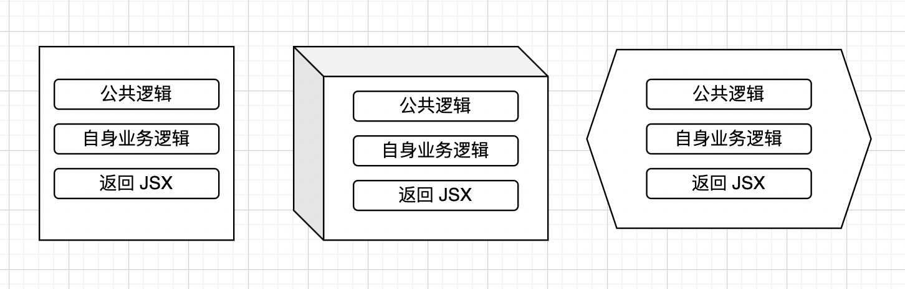


### 语法

```jsx
function withXxx(Com) {          // 1. 收一个组件（首字母必须大写，才能当 JSX 标签用）
  function NewCom(props) {       // 2. 内部定义一个全新的组件
    // 3. 这里写公共逻辑：useState / useEffect / 任何 Hook
    return <Com {...props} />;   // 4. 原组件当视图，props 原样透传
  }
  return NewCom;                 // 5. 把新组件还回去
}

命名	withLog / withMouse	纯约定，但全生态都这么写，一眼能认出这是 HOC
```

必须返回函数，不是JSX，返回JSX就变成普通函数调用，没法当组件用

命名，withLog / withMouse，纯约定，但全生态都这么写，一眼能认出这是 HOC


### 例子

`withLog.js` 抽出打印日志的逻辑

```jsx
import { useEffect } from 'react';

function withLog(Com) {
  function NewCom(props) {
    useEffect(() => {
      console.log(`[日志] ${Com.name} 挂载`);
      return () => console.log(`[日志] ${Com.name} 卸载`);
    }, []);            // [] = 只在挂载时跑一次，return 的函数在卸载时跑

    return <Com {...props} />;
  }
  NewCom.displayName = `withLog(${Com.name})`;   // 只影响 DevTools 里显示的名字
  return NewCom;
}
```

使用：`App.js`中，通过`withLog`组件，给组件`ChildCom1`和`ChildCom2`添加打印日志的功能

```jsx
// 引入两个组件
import ChildCom1 from './components/ChildCom1';
import ChildCom2 from './components/ChildCom2';

import withLog from './HOC/withLog'; // 引入公共逻辑的 HOC

// 获得了能打印日志的新组件
const WrapChild1 = withLog(ChildCom1);
const WrapChild2 = withLog(ChildCom2);

// JSX 里把 WrapChild1 当普通组件用，props 照常传
<button onClick={() => setToggle(!toggle)}>切换子组件（看控制台）</button>
{toggle ? <WrapChild1 name="小明" /> : <WrapChild2 age={18} />}
```

点击按钮切换组件时，控制台就会打印相关的日志


### 注入数据 HOC

上面 withLog 只是"做点事"，给组件增加些功能，更常见的是**HOC 自己持有 state，把数据当 props 塞给原组件**：

`withMouse.js`组件

```jsx
function withMouse(Com) {
  function NewCom(props) {
    const [mouse, setMouse] = useState({ x: 0, y: 0 });

    useEffect(() => {
      const handler = (e) => setMouse({ x: e.clientX, y: e.clientY });
      window.addEventListener('mousemove', handler);
      return () => window.removeEventListener('mousemove', handler);
    }, []);

    return <Com {...props} mouse={mouse} />;   // ← 在透传之外，多塞一个 mouse
  }
  return NewCom;
}
```

`MousePanel.js`组件

```jsx
// mouse 这个 props 不是父组件传的，是 withMouse 组件注入的
function MousePanel({ label, mouse }) {
  return (
    <p>
      {label} 鼠标位置：{mouse.x} , {mouse.y}
    </p>
  );
}
```

使用：`App.js`中，通过`withMouse`组件，给组件`MousePanel`添加实时现实鼠标位置的功能

```jsx
import MousePanel from './components/MousePanel';
import withMouse from './HOC/withMouse';

const MousePanelWithMouse = withMouse(MousePanel); // 获得增强组件

// 在JSX中进行使用
<h2>实验 2：withMouse —— HOC 向原组件注入新的 props</h2>
<MousePanelWithMouse label="[HOC 版]" />
```

运行现象：晃鼠标，坐标实时变。`MousePanel` 里没有任何监听代码，它只管展示。

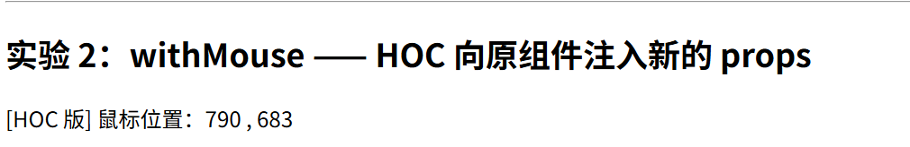

这里暴露出 HOC 的核心缺陷：**看 `MousePanel` 的代码，你不知道 `mouse` 从哪来**。得去翻是谁包了它。props 来源不透明，这是后面被 Hook 取代的直接原因。

顺带注意 `{...props}` 和 `mouse={mouse}` 的**顺序**：后写的覆盖先写的。


### 嵌套组合

多段公共逻辑就拆成多个 HOC，套着用：

```js
const WrapChild1 = withTimer(withLog(ChildCom1));
```

从内往外执行：`ChildCom1` 先被 `withLog` 包一层，结果再被 `withTimer` 包一层。渲染时组件树是 `withTimer的NewCom → withLog的NewCom → ChildCom1`


### HOC的替代：Hook

三个时代

```
mixins（已废弃） → HOC（组件时代的解法） → 自定义 Hook（现在）
```

**mixins 为什么死**：`mixins: [A, B]` 把方法直接混进组件，A 和 B 都定义了 `handleChange` 就冲突；组件读的 state 到底是自己的还是 mixin 的，看不出来。**隐式依赖 + 命名冲突 + 越滚越大**。

**HOC 好在哪**：包装是**显式**的，`withLog(ChildCom1)` 一眼看得出谁包了谁，且两个 HOC 各自独立作用域，不会互相踩。

**HOC 又输在哪**：props 从哪来看不出来、嵌套层数爆炸、props 命名撞车、必须多一层组件实例。


Hook写实时监控鼠标位置的逻辑

`useMouse.js`文件里写hook

```js
function useMouse() {
  const [mouse, setMouse] = useState({ x: 0, y: 0 });
  useEffect(() => {
    const handler = (e) => setMouse({ x: e.clientX, y: e.clientY });
    window.addEventListener('mousemove', handler);
    return () => window.removeEventListener('mousemove', handler);
  }, []);
  return mouse;      // 只返回数据，不返回组件
}
```

`HookPanel.js`写组件

```js
import useMouse from '../hooks/useMouse';

function HookPanel({ label }) {
  const mouse = useMouse();      // 数据来源写在脸上
  return <p>{label} 鼠标位置：{mouse.x} , {mouse.y}</p>;
}
```

使用：`App.js`中，引入组件`HookPanel`在JSX中直接使用

```jsx
import HookPanel from './components/HookPanel';

<h2>实验 3：自定义 Hook —— 同样的逻辑，现代写法</h2>
<HookPanel label="[Hook 版]" />
```

效果

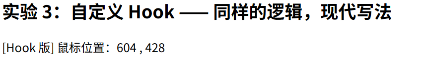


HOC 复用的是"包装"，Hook 复用的是"逻辑本身"。


### 现在还要不要写 HOC

**自己写新代码：不写，用自定义 Hook。**

**但必须认得出来**，因为老库和老项目里到处都是


## Ref

Ref就是一个`{current: xxx}`的盒子，用来存一个跨渲染不丢失、改变时不触发重渲染的可变值。

```js
function createRef() {
  return { current: null };   // 就这么简单，没有任何魔法
}
```


DOM 节点只是这类数据里最常见的一种。

```jsx
const ref = useRef(初始值);     // 造盒子
<div ref={ref} />              // 关联 DOM，挂载后 ref.current = DOM
ref.current                    // 读写，不触发渲染
useImperativeHandle(ref, () => ({ 方法名 }))  // 子组件自定义暴露内容
```


**设计理念**：React 是声明式的——你改数据，React 改 DOM。但有些事声明式做不到（聚焦、播放视频、测量宽高、接入第三方 DOM 库）。Ref 就是官方开的一个**"逃生舱"**：让你拿到真实 DOM，回到命令式操作。

**红线**：能用 state 声明式解决的，绝不用 Ref。Ref 只用于"React 管不着的副作用"。


老式写法

```jsx
<input type="text" ref="inputRef"/>
```

*input* 上面挂了一个 *ref* 属性，对应的值为 *inputRef*，之后查看组件实例，可以看到该组件实例中的 *refs* 里面就保存了该 *input* 的 *DOM* 元素。

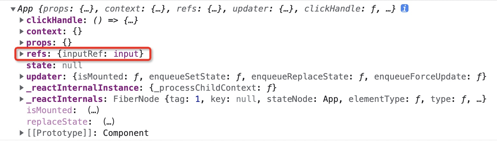


### API 演进

| 代   | 写法                                    | 状态                      |
| ---- | --------------------------------------- | ------------------------- |
| 1    | `ref="inputRef"` → `this.refs.inputRef` | **React 19 已移除**，报错 |
| 2    | `ref={el => this.dom = el}` 回调 ref    | 能用，特殊场景才用        |
| 3    | `useRef()` / `createRef()`              | ✅ **只用这个**            |

为什么废弃 String Ref，核心一条：**字符串 ref 需要 React 内部偷偷记录"当前正在渲染哪个组件"才能知道 `this` 是谁，既慢又不可组合。** 而 `{current}` 对象是个纯值，谁拿到谁用，天然可组合。


### useRef语法


#### useRef 关联 DOM

```jsx
import { useRef } from 'react';

export default function App() {
  const inputRef = useRef(null);   // 造一个盒子 { current: null }

  console.log('渲染时:', inputRef.current);  // null —— 此时 DOM 还没生成

  function focus() {
    console.log('事件里:', inputRef.current); // <input>  —— 真实 DOM 节点
    inputRef.current.focus();
    inputRef.current.value = '我是被直接改的';
  }

  return (
    <div>
      <input ref={inputRef} />       {/* 把盒子交给 React，它负责填 */}
      <button onClick={focus}>聚焦</button>
    </div>
  );
}
```

**语法做了什么**：`ref={inputRef}` 告诉 React——"这个 DOM 挂载好之后，把它放进这个盒子的 `current` 里"。

- **渲染函数执行期间 `ref.current` 还是 `null`**，因为 DOM 还没上屏。
- 只有在**事件处理函数**或 **useEffect** 里才拿得到值。
- 组件卸载时 React 会自动把 `current` 置回 `null`。


结果：输入框中直接显示了表达式`inputRef.current.value = '我是被直接改的'`赋的值

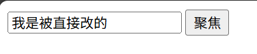


#### useRef 存"不参与渲染的可变值"

设计理念对比

|                | `useState`           | `useRef`                                   |
| -------------- | -------------------- | ------------------------------------------ |
| 改变时         | **触发重新渲染**     | **不触发**渲染                             |
| 跨渲染是否保留 | 保留                 | 保留                                       |
| 修改方式       | `setX(v)` 异步       | `ref.current = v` 同步立即生效             |
| 用途           | 要显示在页面上的数据 | 定时器 ID、上一次的值、DOM、任何"幕后"数据 |


```jsx
import { useState, useEffect, useRef } from 'react';

export default function App() {
  const timer = useRef(null);                 // 创建 { current: null } 这个盒子，跨渲染永远是同一个对象，不会因为组件重新渲染而重新创建

  useEffect(() => {     // 挂载后启动定时器
    timer.current = setInterval(() => console.log('tick'), 1000);
    return () => clearInterval(timer.current);  // 返回清理函数，组件卸载时自动执行 clearInterval

  }, []);

  return (
    <>
      <button onClick={() => clearInterval(timer.current)}>停止</button>
    </>
  );
}
```

现象：

```
挂载
  │
  ├─ 控制台每秒打印一次 "tick"
  │
  │
  ├─ 点击 "停止" 按钮
  │     └─ clearInterval(timer.current) 执行
  │        控制台停止打印 "tick"
  │
卸载
  └─ useEffect 清理函数自动执行 clearInterval，防止内存泄漏
```


#### ref 指向子组件

函数组件的 `ref` 现在就是一个普通 prop，直接解构就行：

子组件：接收并转发 ref

```jsx
// 子组件
function MyInput({ ref, ...rest }) {
  return <input ref={ref} {...rest} />;
}
```

`{ ref, ...rest }`，从 props 中解构出 ref，其余 props 收进 rest

`ref={ref}`，把父组件传来的 ref 绑定到真实的 `<input>` DOM 节点上

`{...rest}`，把其他 props（如 placeholder、className 等）透传给 `<input>`


父组件：创建 ref 并传给子组件

```jsx
// 父组件
import { useRef } from 'react';
export default function App() {
  const inputRef = useRef(null);  // 创建盒子 { current: null }
  return (
    <div>
      <MyInput ref={inputRef} />  // 
      <button onClick={() => inputRef.current.focus()}>聚焦子组件</button>
    </div>
  );
}
```

`<MyInput ref={inputRef} />`把盒子传给子组件，子组件内部再绑到 `<input>`

`inputRef.current.focus()`直接调用 DOM 节点的原生方法


结果

```
挂载
  │
  └─ React 将 <input> DOM 节点塞入 inputRef.current
     inputRef = { current: <input> }

点击"聚焦子组件"按钮
  │
  └─ inputRef.current.focus() 执行
     页面上的输入框获得焦点，出现光标  ✅

卸载
  └─ inputRef.current 被置为 null
```


ref指向链条

```
父组件 inputRef
    │
    │  ref={inputRef} 传入子组件
    ▼
MyInput（子组件）
    │
    │  ref={ref} 绑定到真实 DOM
    ▼
<input> DOM 节点   ← inputRef.current 最终指向这里
```


子组件老写法

```jsx
// React 18 及之前的写法
const MyInput = forwardRef((props, ref) => {
  return <input ref={ref} {...props} />;
});
```


#### useImperativeHandle —— 自定义暴露的能力

**设计理念**：直接把 DOM 交给父组件太危险了（父组件能改任何东西，破坏封装）。`useImperativeHandle` 让子组件说："我只给你这几个方法，别的别碰。"——相当于交出一个**遥控器**，而不是整台机器。


子组件：`useImperativeHandle` — 拦截并替换 `ref.current`

```jsx
import { useRef, useImperativeHandle } from 'react';

function MyInput({ ref }) {           // ref：父组件的盒子
  const inputRef = useRef(null);      // inputRef：子组件自己的盒子
  
  useImperativeHandle(ref, () => ({   // 改写父组件盒子的 current
    focus: () => inputRef.current.focus(),
    clear: () => { inputRef.current.value = ''; },
  }));

  return <input ref={inputRef} />;    // 真实 DOM 只绑内部的 inputRef
}
```

第一个参数 `ref`，父组件传来的 ref 盒子，要改写它的 `current`

第二个参数 `() => ({...})`，工厂函数，返回值就是父组件 `ref.current` 最终得到的对象

focus属性，封装了 `inputRef.current.focus()`，只暴露聚焦能力

clear属性， 封装了清空 input value 的操作


父组件

```jsx
export default function App() {
  const ctrl = useRef(null);
  return (
    <div>
      <MyInput ref={ctrl} />
      <button onClick={() => ctrl.current.focus()}>聚焦</button>
      <button onClick={() => ctrl.current.clear()}>清空</button>
    </div>
  );
}
```

父组件 `console.log(ctrl.current)` 打印出的**不是 `<input>` DOM**，而是 `{focus: f, clear: f}` 这个自定义的对象。


现象：

```
挂载
  │
  ├─ inputRef.current = <input> DOM 节点   （子组件内部）
  └─ ctrl.current = { focus: fn, clear: fn } （父组件拿到的）

点击"聚焦"按钮
  └─ ctrl.current.focus() 
       └─ 执行 inputRef.current.focus()
          输入框获得焦点，出现光标  ✅

点击"清空"按钮
  └─ ctrl.current.clear()
       └─ 执行 inputRef.current.value = ''
          输入框内容被清空  ✅

父组件尝试越权操作
  └─ ctrl.current.value        // undefined ❌
     ctrl.current.setAttribute(...)  // TypeError ❌
     父组件根本拿不到 DOM 节点，无法绕过封装
```


### createRef vs useRef

```js
const a = React.createRef();  // 每次渲染都新建一个盒子 → 组件更新后旧值丢失
const b = useRef();           // 整个组件生命周期内永远是同一个盒子
```

- `createRef` 给**类组件**用（在 `constructor` 里建，只执行一次，所以没问题）。
- `useRef` 给**函数组件**用。函数组件每次渲染整个函数体都重跑，用 `createRef` 就等于每次都换新盒子，前一次存的东西全丢——`useRef` 就是为解决这个而生的。


## Context

Context = 给一颗子树诸如一个”共享变量作用域“，后代组件跳过中间层直接取值

如图：让组件childCom2和组件childCom3共享变量count

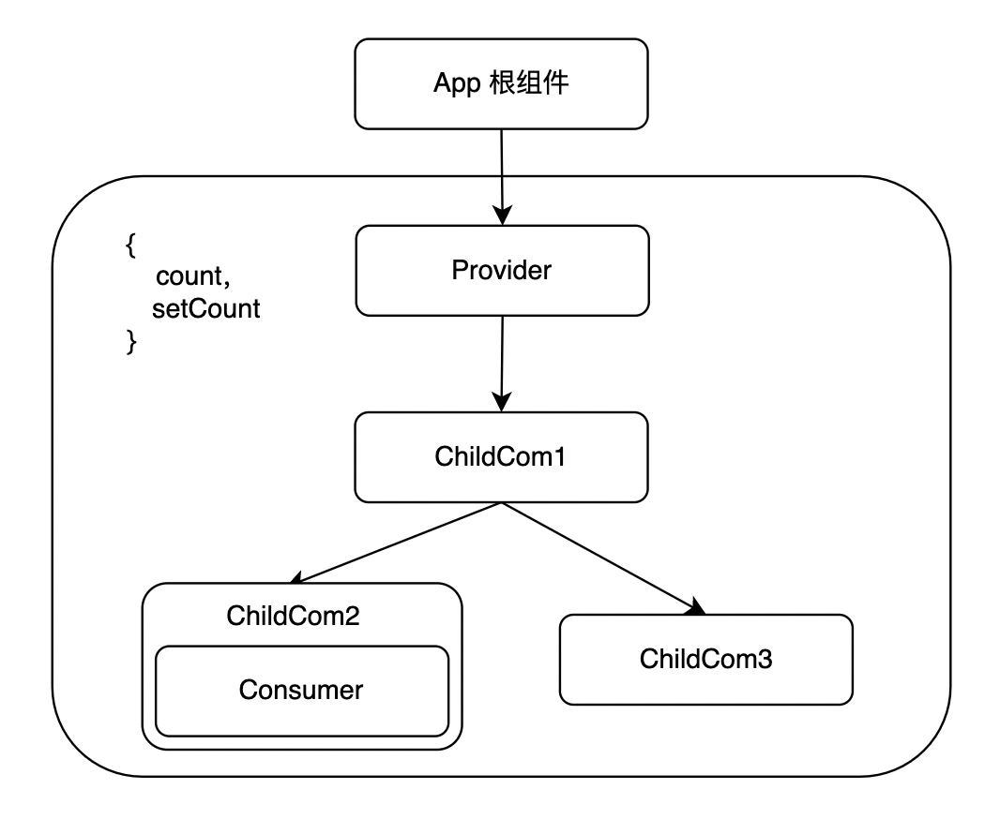


但它只解决**传递**问题，不解决**状态管理**问题（状态还是靠 `useState`）。


### 解决的问题：逐层传递（prop drilling）

组件树是这样的：

```
App
├── subComA ── subComA-1 / subComA-2
└── subComB ── subComB-1 / subComB-2
```

`subComA-1` 想拿到数据、`subComB-2` 也想拿到 → 按单向数据流，数据必须提升到公共父组件 `App`，然后一层层 `props` 往下传。

**痛点不是"传"，是中间层被污染**：`subComA` 自己根本不用这个数据，却被迫声明 props、接收、再转发。这叫"中间组件当搬运工"。

```jsx
// 反面教材：中间层纯搬运
function App() {
  const [count, setCount] = useState(0);
  return <Middle count={count} setCount={setCount} />;
}

function Middle({ count, setCount }) {          // ← 它自己一点都不需要这两个东西
  return <Deep count={count} setCount={setCount} />;
}

function Deep({ count, setCount }) {
  return <button onClick={() => setCount(count + 1)}>{count}</button>;
}
```


### 核心语法

```jsx
import { createContext, useContext, useState } from 'react';

// 【第1步】造一个"上下文对象"，模块级，导出给需要的文件共用
const CountContext = createContext();

function App() {
  const [count, setCount] = useState(0);  // 用useState持有count状态
  return (
    // 【第2步】Provider 包住子树，value 是要共享的数据，把count读写一并注入
    <CountContext.Provider value={{ count, setCount }}>
      <Middle />
    </CountContext.Provider>
  );
}

function Middle() {
  // 中间层彻底解放：不知道 count 存在，不接收任何 props
  return <Deep />;
}

function Deep() {
  // 【第3步】任意深度的后代，直接取
  const { count, setCount } = useContext(CountContext);
  return <button onClick={() => setCount(count + 1)}>count: {count}</button>;
}

export default App;
```

点按钮 → 数字增加。`Middle` 全程零参与。

三个API

| 语法                     | 做了什么                                              | 运行时现象                          |
| ------------------------ | ----------------------------------------------------- | ----------------------------------- |
| `createContext(默认值)`  | 造一个**唯一标识（key）**，本身不存数据               | 返回一个对象，带 `.Provider`        |
| `<X.Provider value={v}>` | 在这棵子树上**挂一个值**                              | 只影响被它包裹的后代                |
| `useContext(X)`          | 从当前位置**向上找最近的 X.Provider**，拿它的 `value` | `value` 变了 → 所有消费者组件重渲染 |


### 实际项目里的文件拆分

真实项目 Context 一般单独一个文件

```js
// src/context/index.js
import { createContext } from 'react';
export const CountContext = createContext();
```

然后 `App.js` 和子组件各自 `import { CountContext } from './context'`。

结构

```
src/
├── context/
│   └── index.js        # 创建并导出 CountContext
├── App.jsx             # Provider，import CountContext
├── components/
│   └── Deep.jsx        # 消费者，import CountContext
```


### 默认值

```js
const ThemeContext = createContext('light');   // 'light' 是默认值
```

默认值只在"往上找不到任何 Provider"时生效，value 显式传 undefined → 拿到 undefined

```jsx
<ThemeContext.Provider value={undefined}>
  <Deep />     {/* useContext 拿到的是 undefined，不是 'light' */}
</ThemeContext.Provider>
```

完全没有 Provider → 才拿到默认值 'light'

```jsx
// 没有任何 Provider 包裹
function App() {
  return <Deep />;  // useContext 拿到 'light'（默认值）
}
```


### 多个 Context：嵌套 Provider

一个 Context 装所有数据是可以的，但**不同变化频率的数据要拆开**

```jsx
import { createContext, useContext } from 'react';

const Ctx1 = createContext();
const Ctx2 = createContext();

function App() {
  return (
    <Ctx1.Provider value={{ a: 1, b: 2 }}>
      <Ctx2.Provider value={{ b: 10, c: 20 }}>
        <Deep />
      </Ctx2.Provider>
    </Ctx1.Provider>
  );
}

function Deep() {
  const c1 = useContext(Ctx1);   // { a:1, b:2 }
  const c2 = useContext(Ctx2);   // { b:10, c:20 }
  return <div>a:{c1.a} b:{c2.b} c:{c2.c}</div>;
}

export default App;
```

**不同 Context 之间互不干扰**，`useContext` 各查各的钥匙。


同一个 Context 嵌套多层 Provider 时，就近原则：

```jsx
<ThemeContext.Provider value="dark">
  <ThemeContext.Provider value="light">
    <Deep />      {/* 拿到 "light"，被内层"遮蔽"了 */}
  </ThemeContext.Provider>
</ThemeContext.Provider>
```

这个"就近覆盖"就是 JS 作用域链的思路


### 两种老写法：认识就行

```jsx
// 老写法A：Consumer + render props（函数组件时代之前）
<MyContext.Consumer>
  {(ctx) => <div>{ctx.count}</div>}
</MyContext.Consumer>

// 老写法B：contextType（只有 class 组件能用，且只能用一个 Context）
class Foo extends Component {
  static contextType = MyContext;
  render() { return <div>{this.context.count}</div>; }
}
```


### 设计理念

**为什么 Context 是"注入 + 就近查找"，而不是"全局变量"？**

1. **作用域可控**：全局变量是整个应用一份，Context 是"谁包在里面谁才有"。同一个 Context 可以在页面不同区域提供不同的值（比如左右分屏各一套主题）。
2. **能触发渲染**：普通全局变量改了 React 不知道。Context 的 `value` 变化会由 React 主动通知所有消费者重渲染，这是它和 `window.xxx` 的本质区别。
3. **组件仍然可复用**：组件声明"我需要什么"，而不是"我从哪个具体对象拿"。换个 Provider 就能换一套数据，测试时也容易 mock。

**和 Redux 的关系**：Redux 的 `<Provider store={store}>` 本质就是 Context 的一层封装 —— Context 负责"送达"，Redux 额外提供了状态组织规范和更新性能优化。

**Context 不是万能替代 props**：只有"很多层级、很多组件都要用"的数据（当前用户、主题、语言、路由信息）才值得放 Context。父传子一两层，老老实实用 props 更清晰。


```
<CountContext.Provider value={{ count, setCount }}>
```

这里的 `{{ count, setCount }}` 是一个**对象字面量**，每次 App 渲染都会在堆上新建一个对象：

```
第1次渲染 → 堆地址 0x001 { count: 0, setCount: fn }
第2次渲染 → 堆地址 0x002 { count: 0, setCount: fn }  ←
```

触发App重新渲染的情况：

1. 自身 state 变化；

   ```js
   const [count, setCount] = useState(0);
   // 点击按钮 → setCount → App 重新执行
   ```

2. 父组件重新渲染；

   ```jsx
   // 如果 App 不是根组件，它的父组件重渲染，App 也会跟着重渲染
   function Root() {
     const [other, setOther] = useState(0);
     return <App />;  // Root 重渲染 → App 重渲染
   }
   ```

3. 自身 props 变化

   ```jsx
   <App title="hello" />
   // title 变了 → App 重新执行
   ```

   

React 用 `Object.is` 比较前后两次的 value：


```js
Object.is(0x001, 0x002) // false → 认为"数据变了"
```

**结果：所有 `useContext(CountContext)` 的组件全部强制重渲染**，哪怕 count 实际上没有变化。


用useMemo 解决

userMemo是个react钩子

```jsx
const value = useMemo(() => ({ count, setCount }), [count]);
//            ───────  ─────────────────────────   ──────
//            React钩子  你提供的"计算函数"          依赖项
```

```
count 没变 → useMemo 返回缓存的旧对象 → 堆地址不变 → Object.is 为 true → 不重渲染 ✅
count 变了 → useMemo 新建对象         → 堆地址改变 → Object.is 为 false → 正常重渲染 ✅
```

完整例子

```jsx
import { createContext, useContext, useState, useMemo } from 'react';

function App() {
  const [count, setCount] = useState(0);
  // 只有 count 变化时才产出新对象
  const value = useMemo(() => ({ count, setCount }), [count]);
  return (
    <CountContext.Provider value={value}>
      <Middle />
    </CountContext.Provider>
  );
}
```


## Render Props（萎缩）

普通组件是「你把数据给我，我来渲染」。Render Props 是「我把数据给你，你来渲染」


### 语法

1、JSX 的属性值可以是任意 JS 值，包括函数

```jsx
<MouseTracker render={(数据) => <div>{数据.x}</div>} />
```

这一行做了什么：给 `MouseTracker` 传了一个名叫 `render` 的 prop，它的值是**一个函数**（不是调用结果，是函数本身）。此刻函数还没执行。


2、组件内部把它当普通函数调用，并把自己的 state 当参数传出去

```jsx
function MouseTracker(props) {
  const [pos, setPos] = useState({ x: 0, y: 0 });
  return props.render({ pos });   // ← 关键的一行
}
```

这一行做了什么：**执行**外面传进来的函数，把组件内部的私有状态 `pos` 作为参数「交出去」。


3、函数的返回值就是这个组件的渲染结果

外面那个箭头函数 `return` 了一段 JSX，这段 JSX 被 `MouseTracker` 原样 `return` 出去，最终渲染到页面上。


总结：组件负责算数据，调用方负责画界面


完整例子：

```jsx
import { useState } from 'react';

// 只管逻辑：追踪鼠标。它不知道自己会被画成什么样
function MouseTracker(props) {
  const [pos, setPos] = useState({ x: 0, y: 0 });

  function handleMove(e) {
    setPos({ x: e.nativeEvent.offsetX, y: e.nativeEvent.offsetY });
  }

  // 把内部状态和处理函数一起"回传"给调用方，拿到 JSX 后原样渲染
  return props.render({ pos, handleMove });
}

function App() {
  return (
    <div>
      {/* 显示坐标 */}
      <MouseTracker
        render={({ pos, handleMove }) => (
          <div onMouseMove={handleMove} style={{ height: 120, background: '#fdd' }}>
            坐标：{pos.x}, {pos.y}
          </div>
        )}
      />
    </div>
  );
}

export default App;
```

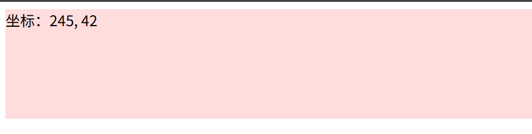


### 设计理念

控制反转

|              | 数据流向                    | 谁决定长什么样       |
| ------------ | --------------------------- | -------------------- |
| 普通 props   | 父 → 子                     | 子组件自己写死       |
| Render Props | 子 → 父（通过函数参数回传） | **父（调用方）决定** |

普通组件是「你把数据给我，我来渲染」。Render Props 是「我把数据给你，你来渲染」

这就是它能复用逻辑而不锁死视图的原因：子组件`MouseTracker` 里没有任何 `<div>`，它对 UI 一无所知，所以任何 UI 都能用它。


使用选择

Render Props：逻辑**完全相同**，只是视图不同 → 把视图开放出去。

**HOC**：逻辑有一部分公共、各组件还有自己独有的逻辑 → 对原组件做「增强包装」。


### 趋势

现代 React（16.8+）里，**纯逻辑复用几乎全部改用自定义 Hook**，Render Props 的使用场景已经大幅萎缩：

```jsx
// 同样的逻辑，Hook 版本 —— 更短、无嵌套
function useMouse() {
  const [pos, setPos] = useState({ x: 0, y: 0 });
  const handleMove = (e) => setPos({ x: e.nativeEvent.offsetX, y: e.nativeEvent.offsetY });
  return { pos, handleMove };
}

function Demo() {
  const { pos, handleMove } = useMouse();
  return <div onMouseMove={handleMove}>{pos.x}, {pos.y}</div>;
}
```


## Portals

`Portal` = 让组件的 DOM 输出位置，脱离它在组件树里的位置。

组件还是那个组件（父子关系不变），但渲染出来的真实 DOM 节点，被"传送"到指定的另一个容器里。


### 问题现场

```html
<div id="root">
  <div>            ← App 的根 div
    <h1>App组件</h1>
    <button>显示/隐藏</button>
    <div style="...">模态框</div>   ← Modal 被困在这里
  </div>
</div>
<div id="modal"></div>   ← 空的，本来该放模态框
```

**这会带来什么真实故障？** 模态框的定位是 `position: absolute`，它找的是"最近的已定位祖先"。一旦 App 的 div 加了：

```html
<div style={{ position: "relative" }}>
```

模态框的 `left/top` 参照物瞬间从"整个视口"变成"App 那个 div"，位置就跑偏了。

**结论**：全局性的浮层（模态框、下拉菜单、Tooltip、消息提示），不应该在 DOM 上寄生于业务组件内部。


### 语法

```jsx
import { createPortal } from 'react-dom';

createPortal(要渲染的 JSX, 目标 DOM 元素)
```

- 来自 **`react-dom`**，不是 `react`。因为它是"渲染到 DOM"这件事，属于渲染器的职责。
- 返回值就是一个普通的 React 元素，所以直接 `return` 它即可。

```jsx
function Modal() {
  return createPortal(
    <div className="modal">模态框</div>,
    document.getElementById("modal")
  );
}
```

第二个参数必须是**已经存在于 DOM 中的真实元素**。如果拿到 `null`，运行时会直接报错：
`Target container is not a DOM element.`

所以目标容器通常写死在 `public/index.html` 里。


### 设计理念

`createPortal` 只改变物理树的挂载点，完全不动逻辑树。

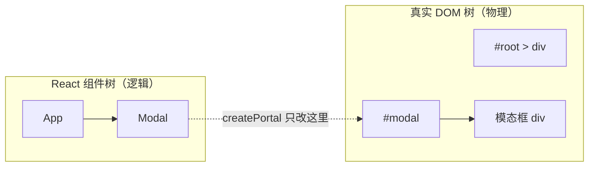

原本在真实 DOM 树上，#modal是挂载 `#root > div` 上的

由此可以推出（不用背，推就行）：

- props 正常传 —— 逻辑树没变
- Context 正常穿透 —— Context 沿逻辑树查找
- state / 生命周期正常 —— 就是个普通子组件
- 事件会冒泡到 React 树的祖先 ← 下面单独说


### 事件冒泡的"反直觉"点

模态框在 DOM 上已经躺在 `#modal` 里，和 `#root` 是兄弟关系。按原生 DOM 逻辑，点它绝不会触发 `#root` 里的事件。

但 React 会。

```jsx
<div onClick={() => console.log("App 组件被点击了")}>
  ...
  {isShow ? <Modal /> : null}
</div>
```

点击模态框 → 控制台照样打印 "App 组件被点击了"。

为什么：React 的合成事件系统统一在根容器上监听，然后按 React 树的路径模拟冒泡。所以传送门传送了 DOM，没传送事件路径。

实践影响：写"点击遮罩层关闭弹窗"时，记得在弹窗内容上 `e.stopPropagation()`，否则可能误触外层逻辑。


### 完整案例

第 1 步：`public/index.html` 加一个容器

```html
<body>
  <div id="root"></div>
  <div id="modal"></div>
</body>
```

第 2 步：`src/App.js`

```jsx
import { useState } from "react";
import { createPortal } from "react-dom";

const boxStyle = {
  width: "450px",
  height: "250px",
  border: "1px solid",
  position: "absolute",
  left: "calc(50% - 225px)",
  top: "calc(50% - 125px)",
  textAlign: "center",
  lineHeight: "250px",
  background: "#fff",
};

// 开关：改成 false，看看模态框会怎样跑偏
const USE_PORTAL = true;

function Modal() {
  const content = <div style={boxStyle}>模态框</div>;
  // USE_PORTAL 为 false 时，渲染在 <div id="root"></div>中
  // USE_PORTAL 为 true 时，渲染在<div id="modal"></div>中
  return USE_PORTAL
    ? createPortal(content, document.getElementById("modal"))
    : content;
}

export default function App() {
  const [isShow, setIsShow] = useState(false);
  return (
    <div
      style={{ position: "relative", marginLeft: "300px", marginTop: "100px" }}
    >
      <h1>App组件</h1>
      <Modal />
    </div>
  );
}
```

 

`USE_PORTAL = true`（使用 Portal），结构：

```
#root
  └─ div (App 的根 div)
      ├─ h1
      ├─ button
      └─ （无 Modal 的 DOM）
#modal
  └─ div (boxStyle 的 div)
```


`USE_PORTAL = false`（不使用 Portal），结构：

```
#root
  └─ div (App 的根 div, position: relative, margin)
      ├─ h1
      ├─ button
      └─ div (boxStyle 的 div)   ← 直接渲染在这里
```


## 错误边界


### 是什么


默认情况下，任何子组件在渲染过程中抛异常，整棵组件树都会被卸载（白屏，或者只剩下不相关的部分）。错误边界是一种特殊写法的 class 组件，包在"可能出错的组件"外面：出错时只把这一小块子树换成降级 UI，其他兄弟组件完全不受影响、照常渲染。

本质上就是 React 渲染层面的 `try/catch`。


比如：

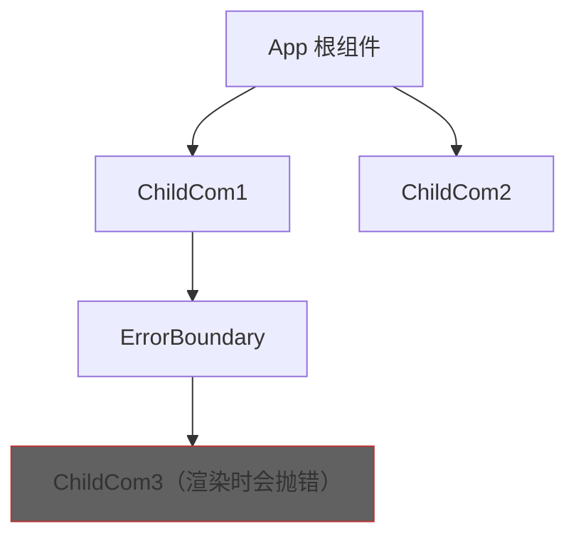

`ErrorBoundary` 只包住了 `ChildCom3`，所以出错影响范围仅限这一支，`ChildCom2` 不受牵连。


出错后发生了什么

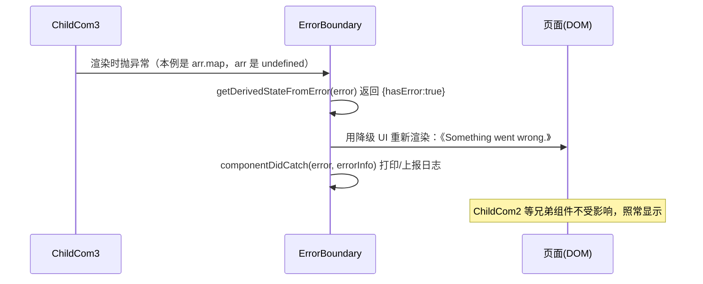


### 语法

| 语法                                     | 是什么               | 用途                                                   | 运行时机                                                     |
| ---------------------------------------- | -------------------- | ------------------------------------------------------ | ------------------------------------------------------------ |
| `static getDerivedStateFromError(error)` | 错误边界类的静态方法 | 决定"要不要显示降级 UI"，返回值会合并进 `state`        | render 阶段，**页面更新前**触发，保持纯函数，别在这做打日志之类的副作用 |
| `componentDidCatch(error, errorInfo)`    | 错误边界类的实例方法 | 记录/上报错误                                          | commit 阶段，**降级 UI 已经显示到页面之后**才触发，所以不适合在这改 state |
| `this.props.children`                    | 普通 prop            | 没出错时必须原样返回它，否则被包裹的子组件根本不会渲染 | render 时                                                    |

```jsx
class ErrorBoundary extends Component {
  state = { hasError: false };

  static getDerivedStateFromError(error) {
    // ① 渲染阶段：子组件出错了，把 state 改成"出错状态"（纯函数，只管返回新 state）
    return { hasError: true };
  }

  componentDidCatch(error, errorInfo) {
    // ② 提交阶段：页面已经用降级 UI 更新完了，这里只管打日志/上报服务器
    console.log(error, errorInfo);
  }

  render() {
    // ③ 出错就显示降级 UI，没出错就"透传"被包裹的子组件
    return this.state.hasError ? <h1>Something went wrong.</h1> : this.props.children;
  }
}
```


### 完整例子

- `ErrorBoundary.js` — 错误边界本体
- `ChildCom3.js` — 故意写了个 bug（`getData()` 没返回值，`arr.map` 报错）
- `ChildCom1.js` — 用 `<ErrorBoundary>` 包住 `<ChildCom3 />`
- `ChildCom2.js` — 正常兄弟组件，用来对比"没受影响"
- `App.js` — 渲染 `ChildCom1` + `ChildCom2`


App.js

```jsx
import ChildCom1 from './components/ChildCom1';
import ChildCom2 from './components/ChildCom2';

function App() {
  return (
    <div>
      <ChildCom1 />
      <ChildCom2 />
    </div>
  );
}

export default App;
```


ErrorBoundary.js

```jsx
import React, { Component } from 'react';

// 错误边界：只能用 class 组件写（没有 hooks 版本），用来包裹可能出错的子组件
export default class ErrorBoundary extends Component {
  constructor(props) {
    super(props);
    this.state = { hasError: false };
  }

  // 渲染阶段调用：子组件出错后、页面更新前触发，返回值会合并进 state（保持纯函数，别在这做副作用）
  static getDerivedStateFromError(error) {
    return { hasError: true };
  }

  // 提交阶段调用：页面已经用降级 UI 更新完之后触发，适合打印日志/上报服务器
  componentDidCatch(error, errorInfo) {
    console.log('error>>>', error);
    console.log('errorInfo>>>', errorInfo);
  }

  render() {
    if (this.state.hasError) {
      return <h1>Something went wrong.</h1>; // 降级 UI
    }
    return this.props.children; // 没出错就正常渲染被包裹的子组件
  }
}
```


ChildCom1.js

```jsx
import ChildCom3 from './ChildCom3';
import ErrorBoundary from './ErrorBoundary';

function ChildCom1() {
  return (
    <div style={{ width: '300px', height: '300px', border: '1px solid' }}>
      ChildCom1
      {/* 只包住可能出错的 ChildCom3，出错时只影响这一小块 UI */}
      <ErrorBoundary>
        <ChildCom3 />
      </ErrorBoundary>
    </div>
  );
}

export default ChildCom1;
```


ChildCom2.js

```jsx
function ChildCom2() {
  return (
    <div style={{ width: '300px', height: '300px', border: '1px solid' }}>
      ChildCom2
    </div>
  );
}

export default ChildCom2;
```


ChildCom3.js

```jsx
// 故意制造一个渲染期间的错误：getData 什么都没返回，arr 就是 undefined
function getData() {
  return;
}

function ChildCom3() {
  const arr = getData();
  const spanContent = arr.map(it => <span key={it}>{it}</span>); // undefined.map(...) 在这里抛错
  return (
    <div style={{ width: '100px', height: '100px', border: '1px solid' }}>
      ChildCom3
      <div>{spanContent}</div>
    </div>
  );
}

export default ChildCom3;
```


### 例子现象

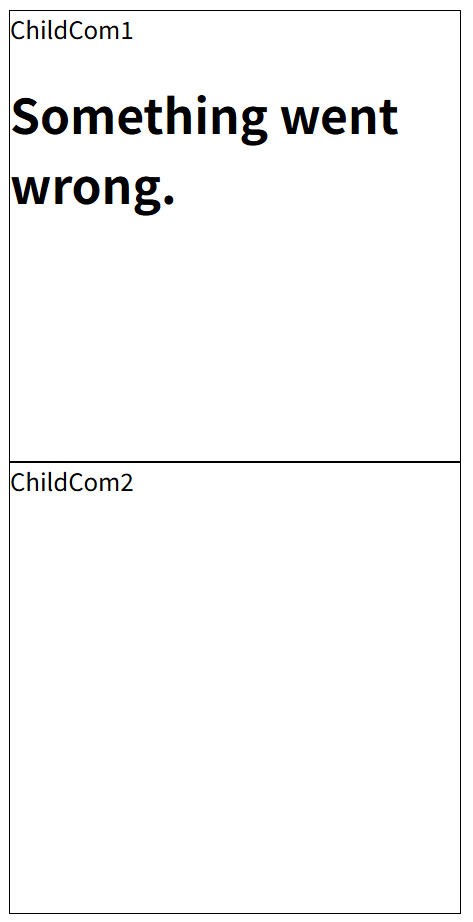

`ChildCom1` 框里显示 `Something went wrong.`（替代了 `ChildCom3`），`ChildCom2` 框正常显示；控制台打印 `error>>>` / `errorInfo>>>`。

如果把 `ChildCom1.js` 里的 `<ErrorBoundary><ChildCom3 /></ErrorBoundary>` 改成直接 `<ChildCom3 />`（去掉边界），刷新页面——你会看到整个页面都白屏消失，包括 `ChildCom2`，这样能直观对比出边界的作用。


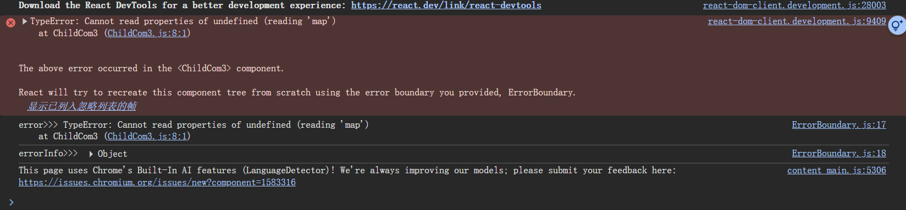


## 组件渲染性能优化


### 核心

React 的性能优化，99% 只在解决一件事：不必要的重渲染。

而"什么时候重渲染"只有一条规则：

> 某个组件的 state 变了 → 这个组件重新执行 → 它 return 出的所有子组件也重新执行 → 一路往下，整棵子树都重新执行。

注意"重新执行"≠"更新 DOM"。React 重新执行函数拿到新的虚拟结构，diff 之后可能一个 DOM 都不改。所以重渲染本身通常很便宜，只有当子树很大或者计算很贵时才需要优化。

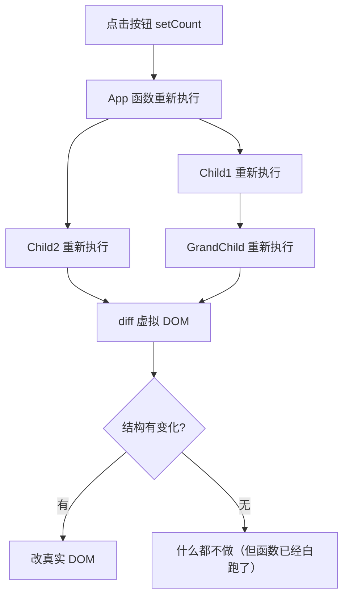


### 子树连锁重渲染

`src/App.js`

```jsx
import { useState } from 'react';

function Child() {
  console.log('Child 渲染');           // 观察点
  return <div>我是子组件，我没有任何 props</div>;
}

export default function App() {
  const [count, setCount] = useState(0);
  console.log('App 渲染');
  return (
    <div>
      <button onClick={() => setCount(count + 1)}>{count}</button>
      <Child />
    </div>
  );
}
```

运行现象：每点一次按钮，控制台同时打印 `App 渲染` 和 `Child 渲染`。`Child` 完全不依赖 `count`，却被牵连了。


### memo —— 给组件加一道"props 没变就别动"的闸

一个高阶组件，包住组件后，React 在准备重渲染它之前，先浅比较新旧 props；全都 `===` 相等就直接跳过，复用上一次的结果。


#### 使用

切断上一节例子中那条连连锁更新的锁链。

```jsx
import { memo, useState } from 'react';

const Child = memo(function Child({ name }) {   // ← 就加了个 memo
  console.log('Child 渲染');
  return <div>hello {name}</div>;
});

export default function App() {
  const [count, setCount] = useState(0);
  console.log('App 渲染');
  return (
    <div>
      <button onClick={() => setCount(count + 1)}>{count}</button>
      <Child name="张三" />   {/* name 是字面量字符串，每次都 === 相等 */}
    </div>
  );
}
```

现象：狂点按钮，`App 渲染` 一直打印，`Child 渲染` 只出现在首次


#### 缺陷

(1) 浅比较 = 只比引用（即判断是否指向同一个内存对象）。传对象/数组/函数字面量，`memo` 100% 失效：

```jsx
<Child style={{ color: 'red' }} />   // ❌ 每次都是新对象，memo 永远不命中
<Child onClick={() => {}} />         // ❌ 每次都是新函数，memo 永远不命中
<Child list={[1, 2]} />              // ❌ 同上
```


浅比较补充：

变量中保存的并不是对象本身，而是指向这个内存地址的引用（指针）。因此：

```js
const a = { info: { age: 18 } };
const b = { info: { age: 18 } };
console.log(a.info === b.info); // false
```

虽然 `a.info` 和 `b.info` 看起来一模一样，但它们各自指向了不同的内存地址（两个独立的 `{ age: 18 }` 对象），所以引用不同，比较结果为 `false`。

如果两个变量指向同一个对象，那么引用自然相同：

```js
const shared = { age: 18 };
const a = { info: shared };
const b = { info: shared };
console.log(a.info === b.info); // true，因为都指向同一个 shared 对象
```


(2) 改数组/对象必须换新引用，否则 UI 不更新：

```js
const [list, setList] = useState(['张三']);

// ❌ 原地 push，引用没变，memo 认为没变化 → 界面不动
list.push('李四'); setList(list);

// ✅ 造新数组
setList([...list, '李四']);
```

这条不只是为了 memo。React 官方要求 state 必须当成不可变数据对待，直接改原对象是 bug 温床。


(3) 第二个参数是自定义比较函数（很少用，知道即可）：

```js
memo(Child, (prev, next) => prev.user.id === next.user.id);
// 返回 true 表示"相等，跳过渲染" —— 注意跟 shouldComponentUpdate 的返回值语义相反
```


### `useCallback` —— 缓存函数引用

是什么：`useCallback(fn, deps)` 返回一个被缓存的函数引用。只要 `deps` 里的值没变，返回的**永远是同一个函数对象**。

用途：它自己不提升任何性能。它唯一的作用是让 `memo` 能命中。

```jsx
import { memo, useCallback, useState } from 'react';

const Child = memo(function Child({ onAdd }) {
  console.log('Child 渲染');
  return <button onClick={onAdd}>子组件按钮</button>;
});

export default function App() {
  const [count, setCount] = useState(0);
  const [n, setN] = useState(0);
  console.log('App 渲染');

  // ❌ 换成这行：每次 App 渲染都产生新函数 → Child 的 memo 失效 → Child 跟着渲染
  // const handleAdd = () => setN(v => v + 1);

  // ✅ deps 为 [] → 永远返回同一个函数引用 → Child 的 props 全等 → 跳过渲染
  const handleAdd = useCallback(() => setN(v => v + 1), []);

  return (
    <div>
      <button onClick={() => setCount(count + 1)}>App: {count}</button>
      <div>n = {n}</div>
      <Child onAdd={handleAdd} />
    </div>
  );
}
```

现象：用 ✅ 那行时，点 App 的按钮，`Child 渲染` 不再打印；把注释切到 ❌ 那行，`Child 渲染` 每次都跟着打印。

`useCallback` 必须和 `memo` 配对使用，单独用 `useCallback` 是纯浪费。

为什么 deps 能写 `[]`：因为用了 `setN(v => v + 1)` 这种函数式更新，函数体不需要读取外部的 `n`。如果写成 `setN(n + 1)`，就必须 `[n]`，那 `n` 一变引用又变了。能用函数式更新就用，这是让依赖数组保持空的最有效手段。


回调函数体里用到的每一个响应式值（props、state、以及由它们派生的变量），都必须出现在 deps 里。

```js
const fn = useCallback(() => {
  console.log(a, b);      // 用到 a、b
}, [a, b]);               // ← 就必须写 a、b
```

漏写 = 闭包捕获了旧值 = "我明明改了 state 怎么读到的还是老的" 这类幽灵 bug


### `useMemo` —— 缓存计算结果

是什么：`useMemo(() => 值, deps)`，deps 不变就直接返回上次算好的值，不重新执行回调。


#### 用途一：跳过昂贵计算

```jsx
import { useMemo, useState } from 'react';

export default function App() {
  const [count, setCount] = useState(1);
  const [text, setText] = useState('');

  const total = useMemo(() => {
    console.log('重新计算了！');
    let s = 0;
    for (let i = 0; i < 1e7; i++) s += i;   // 模拟昂贵计算
    return s + count;
  }, [count]);   // 只有 count 变才重算

  return (
    <div>
      <h4>总和：{total}</h4>
      <button onClick={() => setCount(count + 1)}>+1</button>
      <input value={text} onChange={e => setText(e.target.value)} />
    </div>
  );
}
```

现象：在输入框里打字，组件每次都重渲染，但 `重新计算了！` 不打印，输入丝滑；点 +1 才会打印一次，并明显卡顿一下。把 `useMemo` 去掉直接调用函数，打字会变得非常卡 —— 这就是它存在的意义。

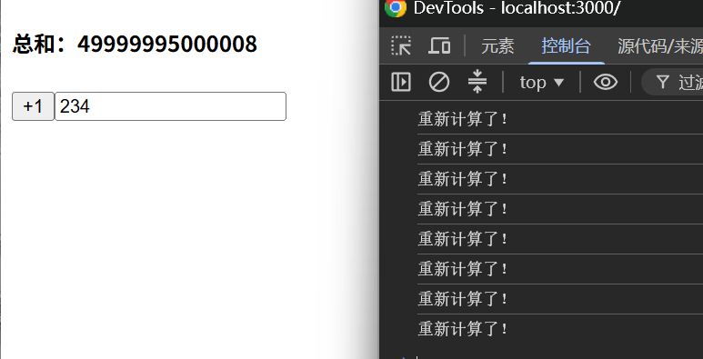

去掉useMemo实验

```jsx
import { useMemo, useState } from 'react';

export default function App() {
  const [count, setCount] = useState(1);
  const [text, setText] = useState('');

  // const total = useMemo(() => {
  //   console.log('重新计算了！');
  //   let s = 0;
  //   for (let i = 0; i < 1e7; i++) s += i;   // 模拟昂贵计算
  //   return s + count;
  // }, [count]);   // 只有 count 变才重算

  const total = (() => {
    console.log('重新计算了！');
    let s = 0;
    for (let i = 0; i < 1e7; i++) s += i;   // 模拟昂贵计算
    return s + count;
  })();   // 每次渲染都重算
  return (
    <div>
      <h4>总和：{total}</h4>
      <button onClick={() => setCount(count + 1)}>+1</button>
      <input value={text} onChange={e => setText(e.target.value)} />
    </div>
  );
}
```

每次打字都重新计算

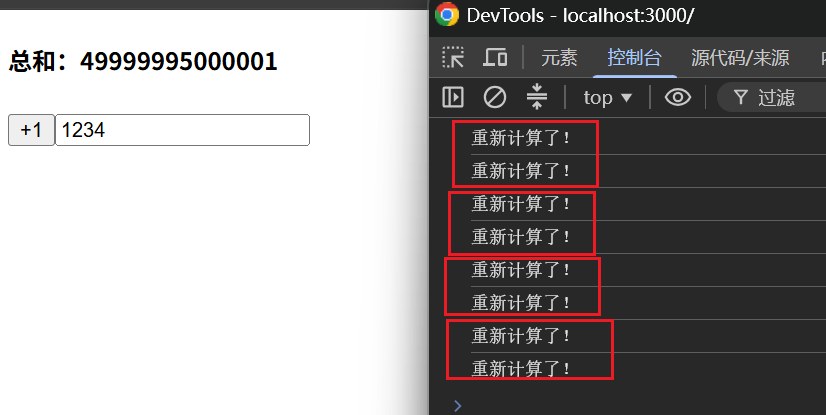


#### 用途二（更常用）：稳定住要传给 `memo` 子组件的对象/数组

```js
// ❌ 每次新数组，子组件 memo 失效
const options = list.filter(x => x.active);

// ✅ 引用稳定
const options = useMemo(() => list.filter(x => x.active), [list]);
```

`useMemo` vs `useCallback` ：

- `useMemo(fn, deps)` 缓存 fn 的返回值
- `useCallback(fn, deps)` 缓存 fn 本身，等价于 `useMemo(() => fn, deps)`


### 优化组件结构、砍掉重渲染

问题：一个巨大的 `<HeavyTree />` 被一个高频变化的 state 拖着一起渲染。


方案 A：把 state 下沉。谁用这个 state，就把它放到谁身上。

```jsx
// ❌ count 放在 App，整个子树陪跑
function App() {
  const [count, setCount] = useState(0);
  return <><button onClick={() => setCount(count+1)}>{count}</button><HeavyTree /></>;
}

// ✅ 抽成独立组件，state 只影响 Counter 自己
function Counter() {
  const [count, setCount] = useState(0);
  return <button onClick={() => setCount(count+1)}>{count}</button>;
}
function App() {
  return <><Counter /><HeavyTree /></>;   // HeavyTree 再也不会被牵连
}
```


方案 B：用 `children` 把内容"提升"上去

```jsx
import { useState } from 'react';

function Heavy() {
  console.log('Heavy 渲染');
  return <div>Heavy Component</div>;
}

function Wrapper({ children }) {
  const [count, setCount] = useState(0);
  console.log('Wrapper 渲染');
  return (
    <div onClick={() => setCount(count + 1)}>
      点击次数 {count}
      {children}      {/* 这里的 children 不会重新执行 */}
    </div>
  );
}

export default function App() {
  return (
    <Wrapper>
      <Heavy />       {/* 在 App 里创建，Wrapper 的 state 变化跟它无关 */}
    </Wrapper>
  );
}
```

运行现象：点击时只打印 `Wrapper 渲染`，`Heavy` 一次都不再打印。

原理：`<Heavy />` 这个 element 对象是在 `App` 里创建的。`Wrapper` 自己 setState 时 `App` 没重渲染，所以 `children` 这个 prop 的引用没变，React 直接复用。零 API、零依赖数组、零心智负担。


能靠组件结构解决的，别靠 memo 解决。


### useDeferredValue —— 让重的部分"慢一拍"


`memo/useMemo/useCallback` 解决的是"少跑几次函数"。但用户感知到的卡顿，往往是一次渲染太重、堵住了主线程。React 18/19 给了并发能力来解决这个，性价比比抠 memo 高得多。


`useDeferredValue`返回一个"滞后版"的值。紧急更新（输入框）立刻响应，重的部分用滞后值渲染，且这个渲染可被打断。

```jsx
import { useState, useDeferredValue, memo } from 'react';

const List = memo(function List({ text }) {
  const items = [];
  for (let i = 0; i < 3000; i++) items.push(<li key={i}>{text} - {i}</li>);
  return <ul>{items}</ul>;
});

export default function App() {
  const [text, setText] = useState('');
  const deferred = useDeferredValue(text);   // 滞后值
  return (
    <div>
      <input value={text} onChange={e => setText(e.target.value)} />
      <List text={deferred} />               {/* 用滞后值渲染重列表 */}
    </div>
  );
}
```

> `List` 必须包 `memo`，否则它每次都重渲染，滞后值就没意义了 —— 这是 `memo` 在 React 19 里最正当的用途之一。

现象：疯狂打字，输入框完全不卡（因为它用的是 `text`，立即更新），列表会延迟一点点才追上来。把 `deferred` 换成 `text` 试试，输入会明显掉帧。

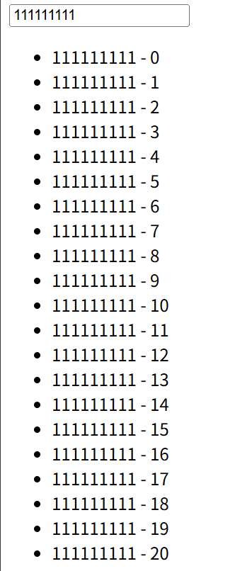


### `useTransition` —— 手动标记"这个更新不着急"

用途：切 Tab、切页面、提交表单这种"点了之后要渲染一大坨"的场景，避免点击后整个页面冻住。

```jsx
import { useState, useTransition } from 'react';

export default function App() {
  const [isPending, startTransition] = useTransition();
  const [tab, setTab] = useState('home');

  function select(next) {
    startTransition(() => {   // 标记为非紧急，渲染期间 UI 保持可交互
      setTab(next);
    });
  }

  return (
    <div>
      <button onClick={() => select('home')}>首页</button>
      <button onClick={() => select('heavy')}>重页面</button>
      {isPending && <span>加载中…</span>}   {/* 免费拿到 pending 状态 */}
      <div>{tab}</div>
    </div>
  );
}
```

- 普通的 `setTab(next)` 属于紧急更新。如果切换到 `heavy` 页面会触发一个很重的组件渲染，React 会同步完成这次渲染。渲染期间主线程被占用，用户点其他按钮、输入内容都会卡住。
- 用`startTransition`包住后，这次`setTab`变成非紧急过渡更新。React 可以：
  - 先保持当前页面可交互；
  - 在后台准备新页面；
  - 如果期间用户又点击了其他按钮，可以中断当前渲染，优先处理新的紧急更新；
  - 等浏览器有空闲时再继续渲染。
  - 

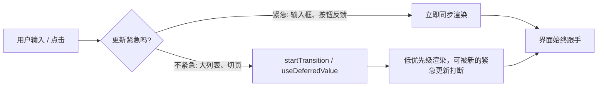


### `PureComponent` / `shouldComponentUpdate`

现在写新代码不会用 class 组件。只需要记住一个换算关系，将来读老代码时用：

| Class 时代                         | 函数组件时代      |
| ---------------------------------- | ----------------- |
| `shouldComponentUpdate` 手写浅比较 | `memo(Component)` |
| `extends PureComponent`            | `memo(Component)` |


### 什么时候该优化

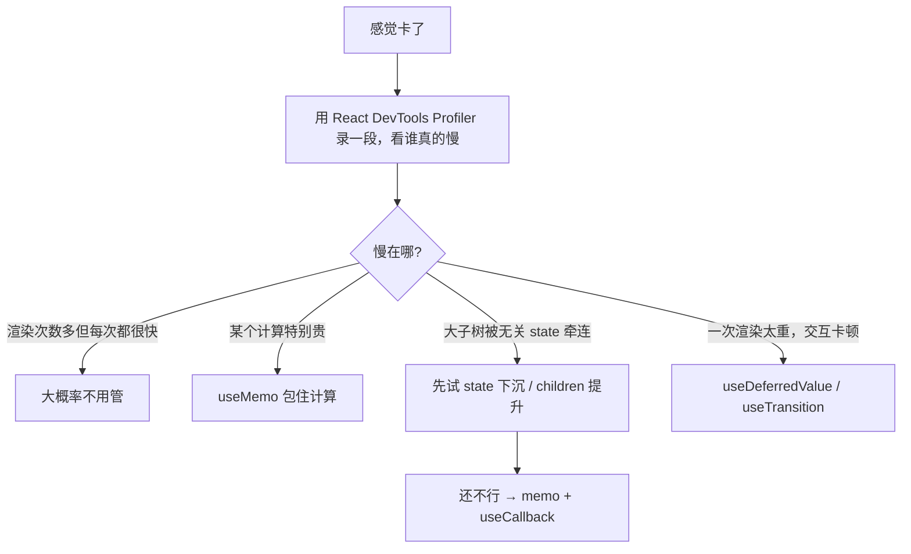

关于 React Compiler：React 19 配套推出了编译器，能自动帮你插入等价于 `memo/useMemo/useCallback` 的缓存，让这三个 API 基本退休。但它目前是可选的 Babel 插件，不是 React 19 默认开启的，CRA 项目里也没配。所以现阶段这三个还得手写，但你可以把它们当成"过渡期产物"来看，别过度投入。