# 数据驱动和ORM


## mysql驱动程序


### 什么是驱动程序

MySQL 是一个**独立的进程**，跟 Node 进程完全不在一个地址空间里。

它俩通信靠的是 **TCP + 一套二进制协议**（MySQL Client/Server Protocol）——什么字节表示"我要登录"，什么字节表示"这是一行数据"，全是官方规定死的。


驱动程序就是这套协议的 JS 实现。 干三件事

| 步骤 | 驱动做的事                                                  |
| ---- | ----------------------------------------------------------- |
| 连接 | 开 TCP socket 到 3306，完成认证握手（用户名/密码/加密方式） |
| 发送 | 把你的 SQL 字符串按协议格式打包成字节流发过去               |
| 接收 | 把返回的二进制字节流**反序列化**成 JS 的数组 / 对象         |


写 `SELECT ...` 拿到的是 `[{id:1, name:'张三'}]` 这种 JS 对象，中间的字节解析全是驱动干的


### 三种包

| 包             | 说明                                                         |
| -------------- | ------------------------------------------------------------ |
| `mysql`        | 最老牌的纯 JS 实现，API 是回调风格，**已基本停止维护**       |
| `mysql2`       | 重写版，性能更好，**支持服务端预编译（prepared statement）**，自带 Promise 接口，API 向下兼容 `mysql` |
| `mysql-native` | 另一个实现，生态小，基本不用                                 |

**无脑用 `mysql2`。** 后面全部用它

```powershell
pnpm add mysql2
```


### mysql2 的使用


#### 两套API

只学 Promise 那套，就像es6后js代码也不用回调函数写异步任务一样

```js
import mysql from 'mysql2';          // 回调版：conn.query(sql, (err, rows) => {})
import mysql from 'mysql2/promise';  // Promise 版：await conn.query(sql)   ← 只用这个
```


#### 建立连接

```js
import mysql from 'mysql2/promise';

const conn = await mysql.createConnection({
  host: '127.0.0.1',      // 数据库服务器地址
  port: 3306,             // 端口，默认 3306
  user: 'root',           // 用户名
  password: '',           // 密码（你本机 root 无密码）
  database: 'demo_school',// 默认库，之后 SQL 里就不用写 demo_school.student
  charset: 'utf8mb4',     // 字符集，中文必须给，否则乱码
});
```

`createConnection` **返回 Promise**，所以要 `await`。它在这一步就完成了 TCP 连接 + 认证握手，连不上会直接抛错。


#### 查询

`query` 返回的是一个**数组**

```js
const [rows, fields] = await conn.query('SELECT id, name, age FROM student LIMIT 3');
```

`await` 的结果是 `[rows, fields]` 这样一个**二元数组**，必须解构：

- `rows` —— 真正的数据
- `fields` —— 字段的元信息（字段名、类型、长度…），99% 场景用不上

所以标准写法就是 `const [rows] = await ...`，后面那个直接丢掉。

示例：

```js
const config = {
  host: '127.0.0.1',
  port: 3306,
  user: 'root',
  password: '',
  database: 'demo_school',
  charset: 'utf8mb4',
};

// ---------- 建立连接 + 查询 ----------
const conn = await mysql.createConnection(config);
const [rows] = await conn.query('SELECT id, name, age FROM student LIMIT 3');
console.log(rows);
```

运行结果:

```js
[
  { id: 1, name: '张三', age: 18 },
  { id: 2, name: '李四', age: 19 },
  { id: 4, name: '赵六', age: 21 }
]
```

一行 = 一个普通 JS 对象，对象中的 key 是列名


#### 增删改

返回的不是数组，是 `ResultSetHeader`

`SELECT` 有结果集，`INSERT/UPDATE/DELETE` 没有，所以第一个位置返回的是一个**状态对象**：

```js
// ---------- 增删改的返回值 ----------
const [ret] = await conn.execute(
  'INSERT INTO student (name, age, gender, score, class_id) VALUES (?, ?, ?, ?, ?)',
  ['测试员', 20, '男', 88, 1]
);
console.log(ret);
```

实测输出：

```js
ResultSetHeader {
  fieldCount: 0,
  affectedRows: 1,      // ← 影响了几行
  insertId: 15,         // ← 自增主键的值（只有 INSERT 有意义）
  info: '',
  serverStatus: 2,
  warningStatus: 0,
  changedRows: 0        // ← UPDATE 时：真正发生变化的行数
}
```

| 字段           | 用途                                                         |
| -------------- | ------------------------------------------------------------ |
| `affectedRows` | 判断操作是否生效（删除不存在的 id 就是 0）                   |
| `insertId`     | 插入后立刻拿到新记录的主键，用于后续关联插入                 |
| `changedRows`  | UPDATE 专用。`affectedRows` 是**匹配到**的行数，`changedRows` 是**值真的变了**的行数。把 score=88 改成 88，matched=1 但 changed=0 |


#### 关闭连接

```js
await conn.end();
```

不调用的话，**Node 进程不会退出**——因为 TCP socket 还开着，事件循环里一直有活跃句柄。脚本跑完卡住不退，八成就是忘了这句。


#### 连接池 `createPool`

每次 `createConnection` 都要走一遍 TCP 三次握手 + 认证，很贵。Web 服务器每秒几百个请求不可能这么干。

**设计思路**：预先建好 N 条连接放池子里，谁要用谁借，用完还回去，不真正关闭。

```js
const pool = mysql.createPool({
  host: '127.0.0.1', 
  port: 3306, 
  user: 'root', 
  password: '',
  database: 'demo_school', 
  charset: 'utf8mb4',
  connectionLimit: 5,          // 池子里最多 5 条连接
});

const [rows] = await pool.query('SELECT id, name FROM student LIMIT 1');
// 用法跟 conn 一模一样，pool 自动帮你「借-用-还」

await pool.end();              // 关闭整个池
```

注意 `createPool` **不需要 `await`**（它不立刻建连接，是懒加载），这跟 `createConnection` 不一样。

API 完全一致，所以实际项目里直接把 `createConnection` 换成 `createPool` 就行，业务代码一行不改。


### SQL 注入

用户把 SQL 语句片段"注入"到最终查询里，导致整条 SQL 的语义与预期不符。


#### 注入示例

假设做一个按姓名查学生的功能：

```js
const name = req.query.name;   // 来自用户输入
const [rows] = await conn.query(`SELECT id, name FROM student WHERE name = '${name}'`);
```

正常情况 `name = '张三'`，拼出来：

```sql
SELECT id, name FROM student WHERE name = '张三'
```

攻击者输入 `' OR 1=1 -- `（注意末尾有个空格），拼出来变成：

```sql
SELECT id, name FROM student WHERE name = '' OR 1=1 -- '
```

拆解发生了什么：

| 片段     | 作用                                                      |
| -------- | --------------------------------------------------------- |
| `'`      | 用户输入的第一个引号，**提前闭合**了你的字符串            |
| `OR 1=1` | 逃出字符串后，这就是货真价实的 SQL **关键字**，恒为真     |
| `-- `    | MySQL 的行注释，把你原本剩下的 `'` 全注释掉，保证语法合法 |

实测结果：查到 8 条 —— 整张表泄露。 换成 `'; DROP TABLE student; -- ` 就是删库。


#### 解决方法

正确姿势：占位符 `?`

```js
const [rows] = await conn.execute(
  'SELECT id, name FROM student WHERE name = ?',
  ["' OR 1=1 -- "]
);
// 实测：查到 0 条
```

**语法规则：**

- SQL 里用 `?` 占位，**`?` 外面不加引号**（写 `'?'` 就废了）
- 第二个参数传一个数组，**按顺序**一一对应
- 有几个 `?` 就传几个值，多了少了都报错

多个参数：

```sql
const [rows] = await conn.execute(
  'SELECT * FROM student WHERE age > ? AND class_id = ?',
  [18, 1]
);
```

INSERT 同理：

```js
await conn.execute(
  'INSERT INTO student (name, age, gender) VALUES (?, ?, ?)',
  ['测试员', 20, '男']
);
```


#### 为什么占位符安全（设计理念）

让变量的内容不作为任何 SQL 关键字

关键在于 **SQL 语句和参数是分两次发给服务器的**：

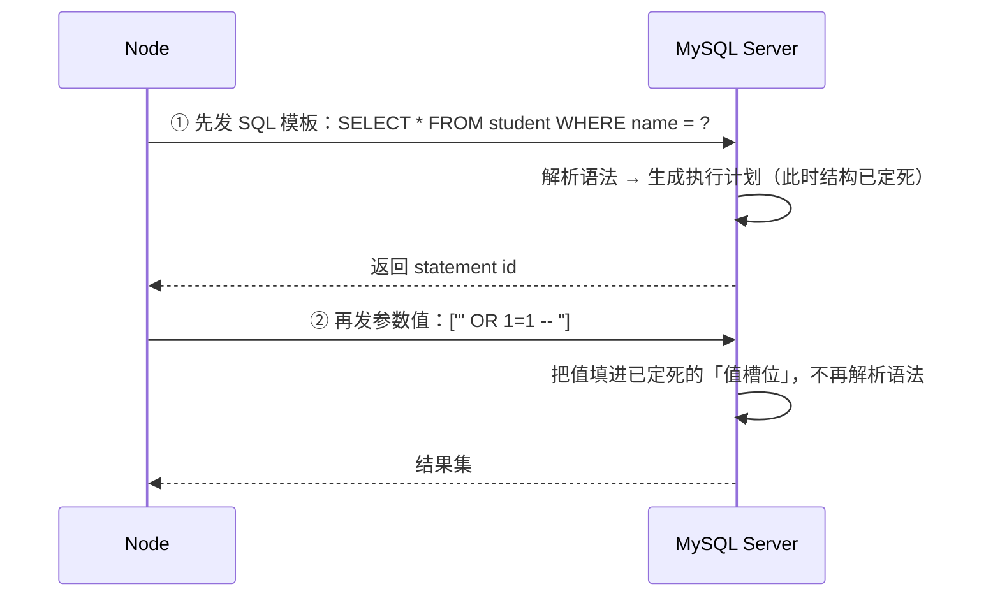


**核心：SQL 的语法结构在第①步就被编译固化了，第②步送来的参数只能填进"值"的槽位，永远没有机会被当成语法解析。** 所以哪怕参数里写满了 `OR`、`DROP`、`--`，服务器也只把它当一个普通字符串，去找一个名字真的叫 `' OR 1=1 -- ` 的学生 —— 当然找不到，返回 0 条。

这叫 **prepared statement（预编译语句）**，也是"代码与数据分离"这一安全原则在数据库层的落地。

**顺带一个副作用好处**：同一条模板反复执行，MySQL 只编译一次，后续复用执行计划，性能更好。


#### `query` vs `execute`

| 底层做法                    | 防注入                                                       |          |
| --------------------------- | ------------------------------------------------------------ | -------- |
| `conn.query(sql, params)`   | **客户端**转义：把参数里的 `'` `\` 等转义后拼进 SQL，一次性发送 | ✅ 有效   |
| `conn.execute(sql, params)` | **服务端**预编译，SQL 与参数分两次发送                       | ✅ 更彻底 |

两个都能防注入（前提是**用了参数数组**）。建议默认用 `execute`。


## Sequelize 简介


### ORM是什么

Object-Relational Mapping（对象关系映射）

核心思想：用 JS 对象操作数据库，不用手写 SQL。

```js
// ❌ 传统方式：手写 SQL
db.query('SELECT * FROM users WHERE id = 1');

// ✅ ORM 方式：写 JS
User.findOne({ where: { id: 1 } });
```


ORM原理图

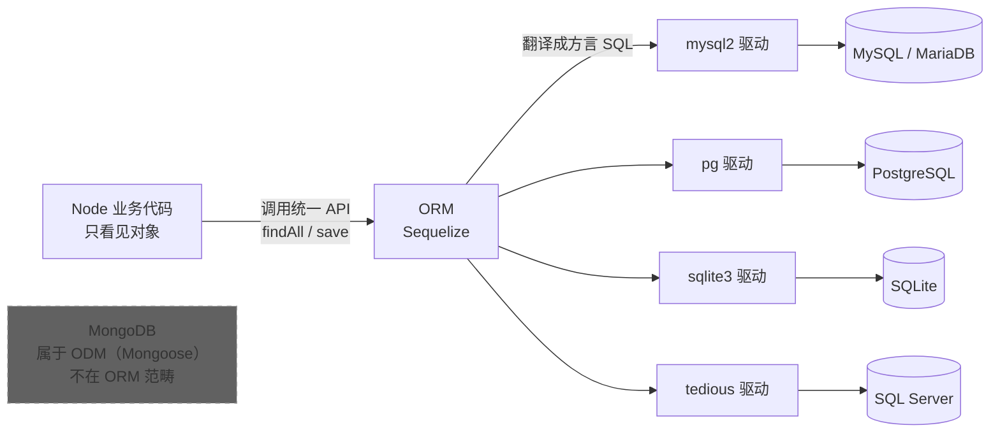


### ORM 到底"映射"了什么

把「表 / 行 / 列」这套数据库概念，翻译成「类 / 实例 / 属性」这套 JS 概念。

| 数据库           | JS 世界           | 本例                   |
| ---------------- | ----------------- | ---------------------- |
| 表 table         | 类 / 模型 Model   | `Student`              |
| 一行 row         | 一个实例 instance | `students[0]`          |
| 一列 column      | 一个属性 property | `.name`、`.age`        |
| 一条 UPDATE 语句 | 改属性 + 调方法   | `s.age = 19; s.save()` |
| 外键关联         | 对象上的引用      | `student.getClass()`   |

```
【mysql2】构造函数： Object       ← 驱动给你的是一坨纯数据
【sequelize】构造函数： Student   ← ORM 给你的是一个有行为的对象
```

`mysql2` 返回的 `{ id: 1, name: '张三' }` 是个普通对象，你想改数据库，还得自己再拼一条 UPDATE。

`Sequelize` 返回的是 `Student` 的实例


## 模型定义 & 增删改


### 建立连接

建立连接：`new Sequelize(...)`

```js
import { Sequelize, DataTypes } from 'sequelize';

// Sequelize参数：数据库名、用户名、密码、配置对象
const sequelize = new Sequelize('demo_school', 'root', '', {
  host: 'localhost',						   // 数据库地址
  dialect: 'mysql',                              // 决定生成哪种方言的 SQL，换成 'postgres' / 'sqlite' / 'mssql' 就换了数据库
  logging: (sql) => console.log('SQL:', sql),    // 把生成的 SQL 打出来，学习期必开
});
```


### 建表

定义模型：`sequelize.define(模型名, 字段定义, 表选项)`

```js
// 建模：用 JS 描述一张表的结构
const Note = sequelize.define(
  'Note',
  {
    title: { type: DataTypes.STRING, allowNull: false }, // VARCHAR(255) NOT NULL
    done: { type: DataTypes.BOOLEAN, defaultValue: false }, // TINYINT(1) DEFAULT 0
  },
  {
    tableName: 'note',
    timestamps: true, // 自动加 createdAt / updatedAt
    charset: 'utf8mb4', // 5.7 默认库字符集可能不是 utf8mb4，中文会乱码
  }
);
```

**建模** `sequelize.define(名字, 字段, 选项)`

- `DataTypes.STRING` → `VARCHAR(255)`；`DataTypes.BOOLEAN` → `TINYINT(1)`。这层就是 JS 类型 ↔ SQL 类型的映射表。
- `allowNull: false` → `NOT NULL`；`defaultValue` → `DEFAULT`。**都是写进建表语句的**，不是 JS 层校验。
- `tableName: 'note'`：不写的话 Sequelize 会自动复数化成 `Notes`，这是新手最常踩的坑。
- `timestamps: true`（默认开）：白送两列 `createdAt`/`updatedAt`，写入时自动维护。

**建表** `await Note.sync({ force: true })` → 日志里的 `DROP TABLE IF EXISTS` + `CREATE TABLE`。`force` 是**先删表再建**，只能练习用，生产用迁移（migration）。

结果，创建note表：

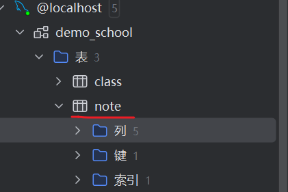


### 增

```js
const n1 = await Note.create({ title: '...' });   // 1 条 INSERT，返回"实例"
console.log(n1)

//  await Note.bulkCreate([{...}, {...}]);  1 条 INSERT 带多组 VALUES
await Note.bulkCreate([{ title: '写作业' }, { title: '打球' }]);
```

n1存一行，await语句存了两行，结果：

| id   | title          | done | createdAt           | updatedAt           |
| ---- | -------------- | ---- | ------------------- | ------------------- |
| 1    | 学习 Sequelize | 0    | 2026-08-19 01:50:44 | 2026-08-19 01:50:44 |
| 2    | 写作业         | 0    | 2026-08-19 01:50:44 | 2026-08-19 01:50:44 |
| 3    | 打球           | 0    | 2026-08-19 01:50:44 | 2026-08-19 01:50:44 |

打印对象n1字面量形式，是一个数组，因为此时只添加了一条数据

```js
[
    Note {
      dataValues: {
        done: false,
        id: 1,
        title: '学习 Sequelize',
        updatedAt: 2026-08-19T01:47:07.218Z,
        createdAt: 2026-08-19T01:47:07.218Z
      },
      _previousDataValues: {
        title: '学习 Sequelize',
        id: 1,
        done: false,
        createdAt: 2026-08-19T01:47:07.218Z,
        updatedAt: 2026-08-19T01:47:07.218Z
      },
      uniqno: 1,
      _changed: Set(0) {},
      _options: {
        isNewRecord: true,
        _schema: null,
        _schemaDelimiter: '',
        attributes: undefined,
        include: undefined,
        raw: undefined,
        silent: undefined
      },
      isNewRecord: false
    }
]
```


### 改

实例式更新

```js
n1.done = true;
await n1.save();
```

1. `n1` 是之前 `Note.create(...)` 返回的**模型实例**，Sequelize 内部记录了它的"原始值快照"
2. `n1.done = true` 只是修改了 JS 对象的属性，**数据库还没变**
3. `await n1.save()` 触发时，Sequelize **对比原始快照与当前值**，只把变动的字段写入 SQL

生成的SQL

```sql
UPDATE `note`
SET `done` = true, `updatedAt` = '2024-...'
WHERE `id` = 1;
```


静态式更新（`Model.update()`）

```js
const [affected] = await Note.update(
  { done: true },          // 第一个参数：要更新成什么值
  { where: { title: '写作业' } }  // 第二个参数：条件（WHERE 子句）
);
console.log('update 影响行数:', affected);
```

| 部分                             | 含义                                                 |
| :------------------------------- | :--------------------------------------------------- |
| `{ done: true }`                 | SET 的内容，可以同时改多个字段                       |
| `{ where: { title: '写作业' } }` | WHERE 条件，缺省会报错（防止误更新全表）             |
| `const [affected]`               | 返回值是数组，解构取第一个元素，表示**受影响的行数** |


结果：id为1和2的，done都变成了1

| id   | title          | done  | createdAt           | updatedAt           |
| ---- | -------------- | ----- | ------------------- | ------------------- |
| 1    | 学习 Sequelize | **1** | 2026-08-19 01:50:44 | 2026-08-19 01:50:44 |
| 2    | 写作业         | **1** | 2026-08-19 01:50:44 | 2026-08-19 01:50:44 |
| 3    | 打球           | 0     | 2026-08-19 01:50:44 | 2026-08-19 01:50:44 |

id=1 走实例式 `WHERE id = ?`，id=2 走静态式 `WHERE title = ?`，id=3 未被任何 `where` 命中。done这一列变成了1


### 删

```js
const removed = await Note.destroy({ where: { title: '打球' } });
console.log('destroy 影响行数:', removed);
```

| 部分                           | 含义                                     |
| :----------------------------- | :--------------------------------------- |
| `Note.destroy(...)`            | 静态方法，直接对表操作，无需先查出实例   |
| `{ where: { title: '打球' } }` | WHERE 条件，限定删哪些行                 |
| `const removed`                | 返回值是一个**数字**，表示实际删除的行数 |

生成的 SQL：

```sql
DELETE FROM `note`
WHERE `title` = '打球';
```


结果：

删之后（`destroy({ where: { title: '打球' } })`）

| id   | title          | done | createdAt           | updatedAt           |
| ---- | -------------- | ---- | ------------------- | ------------------- |
| 1    | 学习 Sequelize | 1    | 2026-08-19 01:50:44 | 2026-08-19 01:50:44 |
| 2    | 写作业         | 1    | 2026-08-19 01:50:44 | 2026-08-19 01:50:44 |


## Mock.js 生成模拟数据


Mock.js能够拦截 Ajax 请求，不依赖真实后端，按规则返回模拟数据。


### mockjs 语法

唯一的入口

```js
import Mock from "mockjs";

const result = Mock.mock(模板对象);
```

传入一个「模板」，返回一个「按模板生成的真实数据对象」。就一个 API。


语法结构

`'属性名|规则': 初始值`

性名后面用 `|` 跟一条规则，规则的含义由「初始值的类型」决定。

| 初始值类型 | 写法                       | 含义                      | 结果示例         |
| ---------- | -------------------------- | ------------------------- | ---------------- |
| **数组**   | `'list|3': [{a:1}]`        | 重复该模板 3 次           | 3 个元素的数组   |
| **数组**   | `'list|2-4': [{a:1}]`      | 重复 2~4 次（随机）       | 2/3/4 个元素     |
| **数组**   | `'level|1': ['A','B','C']` | 从数组中**随机挑 1 个**   | `'B'`            |
| **数字**   | `'id|+1': 100`             | 每生成一条就 +1（自增）   | 100, 101, 102... |
| **数字**   | `'age|18-30': 0`           | 18~30 之间的随机整数      | `24`             |
| **数字**   | `'score|1-100.1-2': 0`     | 1~100，小数位 1~2 位      | `48.7`           |
| **布尔**   | `'sex|1-2': true`          | 随机 true/false，概率 1:2 | `false`          |
| **字符串** | `'tag|2': 'ab'`            | 重复 2 次                 | `'abab'`         |


### 基本语法例子

数组重复

```js
import Mock from "mockjs";

console.log(Mock.mock({ "list|3": [{ a: 1 }] }));
// 结果：{ list: [ { a: 1 }, { a: 1 }, { a: 1 } ] }

console.log(Mock.mock({ "list|2-4": [{ a: 1 }] }));
// 结果：
{ list: [ { a: 1 }, { a: 1 } ] }
```


规则总览（初始值类型决定规则含义）

```js
console.log(
  Mock.mock({
    "id|+1": 100, // number + '+n'   → 每条自增 n
    "age|18-30": 0, // number + 'a-b'  → 区间随机整数
    "score|1-100.1-2": 0, // number 带小数位  → 1~100，小数 1~2 位
    "sex|1-2": true, // boolean + 'a-b' → 随机 true/false
    "tag|2": "ab", // string  + 'n'    → 重复 n 次
    "level|1": ["A", "B", "C"], // array + '1'     → 从数组里随机挑 1 个
  })
);
```

结果:

```js
{ id: 100, age: 20, score: 48.7, sex: false, tag: 'abab', level: 'C' }
```


### 占位符：`@xxx`

```js
{ name: '@cname', date: '@date' }
```

`@` 开头的会被替换成随机数据。常用的：

| 占位符                  | 生成                       |
| ----------------------- | -------------------------- |
| `@cname`                | 中文姓名（谢娜、程杰）     |
| `@name`                 | 英文姓名                   |
| `@date`                 | `2003-05-19`               |
| `@datetime`             | `1984-08-15 10:40:49`      |
| `@city` / `@city(true)` | `汕尾市` / `广东省 汕尾市` |
| `@email`                | 随机邮箱                   |
| `@ctitle(3, 6)`         | 3~6 个字的中文标题         |
| `@cparagraph`           | 中文段落                   |
| `@integer(1, 100)`      | 整数                       |
| `@image('200x100')`     | 图片占位 URL               |


例子：

```js
console.log(
  Mock.mock({
    "list|3": [
      {
        "id|+1": 1,
        cname: "@cname", // 中文姓名
        name: "@name", // 英文姓名
        date: "@date", // yyyy-MM-dd
        datetime: "@datetime",
        city: "@city(true)", // true = 带省份
        email: "@email",
        title: "@ctitle(3, 6)", // 3~6 个字的中文标题
        // 引用同级已生成的字段：@字段名
        text: "第 @id 期 - @cname",
      },
    ],
  })
);
```

结果：

```js
{
  list: [
    {
      id: 1,
      cname: '谢娜',
      name: 'Michael Anderson',
      date: '2003-05-19',
      datetime: '1984-08-15 10:40:49',
      city: '广东省 汕尾市',
      email: 'q.dggn@bojgyoi.fi',
      title: '队门将决',
      text: '第 1 期 - 谢娜'
    },
    {
      id: 2,
      cname: '程杰',
      name: 'Anthony Gonzalez',
      date: '1995-12-30',
      datetime: '1995-04-09 13:36:48',
      city: '吉林省 松原市',
      email: 'z.tweuo@ksldewmr.gt',
      title: '任展方',
      text: '第 2 期 - 程杰'
    },
    {
      id: 3,
      cname: '贾娟',
      name: 'Thomas Johnson',
      date: '2021-09-11',
      datetime: '1998-07-10 10:01:38',
      city: '四川省 眉山市',
      email: 'e.hpjgrepv@kymmyc.at',
      title: '周人程那现',
      text: '第 3 期 - 贾娟'
    }
  ]
}
```


### 正则：反向生成匹配的字符串

```js
{ mobile: /1[3-9]\d{9}/ }   // → '15207452734'
```

值直接写一个正则字面量，mockjs 会**反向生成**一个能匹配它的字符串。手机号、验证码、编号这类有固定格式的字段全靠它。


例子：按正则反向生成字符串

```js
console.log(Mock.mock({ "list|3": [{ mobile: /1[3-9]\d{9}/ }] }));
```

结果：

```js
{
  list: [
    { mobile: '15207452734' },
    { mobile: '17686718143' },
    { mobile: '15105063863' }
  ]
}
```


### 函数：完全自定义

```js
{
  'id|+1': 1,
  code() { return 'NO-' + this.id; }   // this 指向当前这条数据
}
```

模板搞不定的逻辑，写函数返回。`this` 是当前正在生成的那条对象。


例子

```js
console.log(
  Mock.mock({
    "list|3": [
      {
        "id|+1": 1,
        code() {
          return "NO-" + this.id; // this 指向当前这条数据
        },
      },
    ],
  })
);
```

结果：

```js
{
  list: [
    { id: 1, code: 'NO-1' },
    { id: 2, code: 'NO-2' },
    { id: 3, code: 'NO-3' }
  ]
}
```


### Mock.Random

不写模板，直接要一个值

```js
const R = Mock.Random;
R.cname()            // '蒋刚'
R.date()             // '2012-10-16'
R.integer(1, 10)     // 8
R.pick(['猫','狗'])   // '猫'
```

`@cname` 其实就是 `Random.cname()` 的字符串写法。在函数里、或者临时要一个随机值时用这个。


例子：Mock.Random 直接调用

```js
const R = Mock.Random;
console.log(R.cname(), R.date(), R.integer(1, 10), R.pick(["猫", "狗"]));
```

结果：

```
蒋刚 2012-10-16 8 猫
```


## 数据抓取

### 本质

数据抓取流水线

```
①  axios          ②  cheerio          ③  Promise.all       ④  sequelize
拿到 HTML 字符串 → 从字符串里挖出数据 → 并发处理一批链接 → bulkCreate 批量落库
   网络层             解析层                调度层              持久层
```

爬虫就是用代码假装成浏览器发一个 HTTP 请求，把服务器返回的那坨 HTML 字符串，用字符串查询工具挖出想要的字段


### axios —— 网络层


#### 做了什么

发一个 HTTP 请求，等服务器回话，把回话包成一个对象给你

进程向 `book.douban.com` 的 443 端口建立 TCP 连接 → 发送 `GET /latest HTTP/1.1` → 豆瓣服务器返回一坨 5 万字符的 HTML 文本 → axios 把它塞进 `resp.data`。**这中间要等网络往返（几十到几百毫秒），所以必须是异步的**，这就是为什么全篇都是 `async/await`。


#### 语法

```js
// 形式一：便捷方法（最常用）
const resp = await axios.get(url, config);
const resp = await axios.post(url, body, config);   // 注意 post 的 body 在第 2 个参数
const resp = await axios.delete(url, config);

// 形式二：通用形式（配置全写在一个对象里，AI 时代更推荐，因为不用记参数位置）
const resp = await axios({
  method: "get",
  url: "https://book.douban.com/latest",
  headers: { "User-Agent": "Mozilla/5.0" },
  params: { page: 2 },      // 会拼成 ?page=2
  timeout: 5000,
  data: { name: "x" },      // 请求体（POST/PUT 用）
});
```


高频写法：`axios.create()`

抓同一个网站时，UA、超时、baseURL 都一样，不想每次重复写：

```js
const http = axios.create({
  baseURL: "https://book.douban.com",
  headers: { "User-Agent": "Mozilla/5.0" },
  timeout: 8000,
});

const resp = await http.get("/latest");   // 自动拼成完整 URL，自动带上 UA
```


#### 响应对象：`resp`

| 属性           | 是什么               | 例子                                           |
| -------------- | -------------------- | ---------------------------------------------- |
| `resp.data`    | **响应体**，要的东西 | HTML 字符串 / JSON 对象                        |
| `resp.status`  | 状态码               | `200` `404` `403`                              |
| `resp.headers` | 响应头对象           | `{"content-type": "text/html; charset=utf-8"}` |
| `resp.config`  | 你这次请求用的配置   | 调试用                                         |

`resp.data` 的类型**由响应头 `content-type` 决定**：

- `text/html` → axios 给你 **字符串**
- `application/json` → axios **自动 `JSON.parse`**，给你 **对象**

这条"自动解析"是 axios 最大的便利，也是它和原生 `fetch`（必须手动 `await res.json()`）的核心区别。


#### 错误处理


HTTP 404 / 500 在 axios 里会 `reject`（抛异常），而不是正常返回。

原生 `fetch` 是反过来的：只要服务器回话了就算成功，404 也是 resolve。axios 认为"你要的东西没拿到就是失败"，更符合业务直觉

```js
try {
  await axios.get(url);
} catch (err) {
  if (err.response) {
    // 服务器回话了，但状态码不是 2xx（403 被反爬、404 页面没了）
    console.log(err.response.status);
  } else {
    // 压根没连上：DNS 挂了、超时、断网
    console.log(err.message);
  }
}
```

想让 4xx 也当成功返回（爬虫里很常用，方便统一处理）：

```js
await axios.get(url, { validateStatus: () => true });  // 任何状态码都不抛错
```


#### 爬虫必备 config：`User-Agent`

`User-Agent` 是请求头里的"我是谁"。axios 默认发 `axios/1.19.0`——等于举着牌子说"我是脚本"。很多网站看到就直接 403。

```js
headers: { "User-Agent": "Mozilla/5.0" }   // 假装成浏览器
```


#### 设计理念

1、 适配器（Adapter）模式 —— 这是 axios 存在的根本理由

浏览器发请求用 `XMLHttpRequest`，Node 发请求用 `http`/`https` 模块，两者 API 完全不同。axios 把它们藏在一个叫 adapter 的内部层后面，对外只暴露同一套 `axios.get(...)`。


2、 Promise 化 —— 把回调地狱拍平

Node 原生 `http.get` 是回调风格。axios 让请求变成一个 Promise，于是能用 `await`，于是能用 `Promise.all` 并发


#### 完整示例

```js
import axios from "axios";

// 1. 最基本：GET 一个 URL，await 拿到「响应对象」
const resp = await axios.get("https://book.douban.com/latest", {
  headers: { "User-Agent": "Mozilla/5.0" },
});

// 2. 响应对象上有什么
console.log("状态码 resp.status  :", resp.status);
console.log("响应头 content-type :", resp.headers["content-type"]);
console.log("响应体类型 typeof   :", typeof resp.data);
console.log("响应体长度         :", resp.data.length);
console.log("响应体前 100 字符   :", resp.data.slice(0, 100).trim());

// 3. 不带 User-Agent 时对方可能拒绝你（反爬）。validateStatus 让 4xx/5xx 也不抛错，方便观察
const bare = await axios.get("https://book.douban.com/latest", {
  validateStatus: () => true,
});
console.log("\n[裸请求] 状态码:", bare.status, " axios 默认发的 UA:", "axios/x.x.x");

// 4. axios 会自动帮你把 JSON 字符串解析成对象
const json = await axios.get("https://httpbin.org/json");
console.log("\nJSON 接口 typeof resp.data:", typeof json.data);

```

结果：

```
状态码 resp.status  : 200
响应头 content-type : text/html; charset=utf-8
响应体类型 typeof   : string
响应体长度         : 50263
响应体前 100 字符   : <!DOCTYPE html>
<html lang="zh-cmn-Hans" class=" book-new-nav">
<head>
  <meta http-equiv="Content

[裸请求] 状态码: 200  axios 默认发的 UA: axios/x.x.x

JSON 接口 typeof resp.data: object
```


### cheerio —— 解析层


#### 作用

从axios中，获取的是一坨 5 万字符的**字符串**。要从里面挖出书名，有两条路：

- 正则匹配 → HTML 是嵌套结构，正则处理嵌套天生无能，会疯

- **把字符串解析成一棵树，然后用 CSS 选择器查询** → cheerio 干的事

  ```
  "<ul><li>...</li></ul>"   ──cheerio.load()──>   树结构   ──$("li")──>   节点集合
        一坨字符串                                  可查询                  能取值
  ```


#### 语法

```js
// —— 入口 ——
import * as cheerio from "cheerio";     // ESM（cheerio 1.x）
const $ = cheerio.load(htmlString);     // 返回查询函数

// —— 查询 ——
$("#id")  $(".class")  $("div")  $("a.cover")  $("#info span.pl")   // 和 CSS 完全一样
$("ul > li")  $("ul li")  $("[href]")  $("span:first-child")

// —— 缩小集合 ——
.first()  .last()  .eq(2)                    // 按位置
.filter((i, ele) => boolean)                 // 按条件
.find("选择器")                               // 在后代里找
.children()  .parent()  .next()  .prev()     // 树上导航

// —— 取值 ——
.text()          // 后代所有文本（去标签）
.html()          // 内部 HTML 字符串
.attr("src")     // 属性值
.length          // 命中数量

// —— 集合 → 数组【最常用的一句】——
.map((i, ele) => 返回值).get()

// —— 只遍历 ——
.each((i, ele) => { ... })
```

`map` 的参数顺序是反的

```js
[1,2,3].map((值, 索引) => ...)             // 原生数组
$("a").map((索引, 元素) => ...)            // cheerio/jQuery ← 反的！
```

`.map()` 后面必须跟 `.get()`

`.map()` 返回的还是 cheerio 集合，`.get()` 才把它变成真正的 JS 数组（之后才能用 `Promise.all`、`slice`、`JSON.stringify`）。


#### cheerio 对象 vs 原生节点

- **Cheerio 对象**：通过 `cheerio.load(html)` 解析 HTML 字符串得到的类似 jQuery 的集合对象，提供 `.attr()`、`.find()`、`.text()` 等 API。

- **原生节点**：浏览器中真实的 `HTMLElement` 节点，由 `document.querySelector` 等 API 返回，拥有完整的 DOM 接口（如 `addEventListener`、`style`、`classList` 等）。

```js
const ele = $("a.cover")[0];   // 用下标取出来的是【原生节点】
```


|          | cheerio 集合 `$(...)`     | 原生节点 `ele`                        |
| -------- | ------------------------- | ------------------------------------- |
| 怎么得到 | `$("a")`                  | `$("a")[0]`、`each/map` 的第 2 个参数 |
| 取属性   | `.attr("href")`           | `ele.attribs["href"]`                 |
| 取标签名 | —                         | `ele.tagName`                         |
| 取兄弟   | `.next()`（**只找元素**） | `ele.nextSibling`（**文本节点也算**） |
| 取文本   | `.text()`                 | `ele.nodeValue`（文本节点专用）       |

**互相转换**：`$(ele)` 把原生节点包成集合；`集合[0]` 拆出原生节点。


#### 设计理念

1、分工：cheerio 只做「解析 + 查询」，坚决不做浏览器

```
浏览器 = HTML解析 + DOM树 + CSS布局渲染 + JS引擎执行 + 事件系统
cheerio =  HTML解析 + 对象树 + CSS选择器查询
```

它砍掉了后面三样。带来的结果：

- ✅ **极快、极省内存**（解析 5 万字符只要几毫秒，Puppeteer 要起一个 Chrome）
- ❌ **拿不到 JS 动态渲染的内容**。cheerio 看到的是"查看网页源代码"里的东西，不是 F12 里的 Elements 面板。**如果页面是 Vue/React 渲染的，cheerio 抓到的是一个空壳 `<div id="app"></div>`**

**选型的分水岭**：源码里有数据 → cheerio；源码里没有、要执行 JS 才有 → Puppeteer / Playwright（真起浏览器）。


2、复用 jQuery 的 API 设计，而不是发明新 API

jQuery 的"选择器 + 链式调用 + 集合语义"是被上亿开发者验证过的，前端人零成本上手。


3、链式调用（Fluent Interface）

每个方法都返回一个新的集合，于是能一路串下去：

```js
$("#info span.pl").filter(fn).next("a").first().text()
//    查询          筛选      导航     缩小   取值
```

设计意图：把"一步步缩小范围"这个查询过程，写成一条从左到右读的句子。


#### 完整案例

```js
import * as cheerio from "cheerio";

// 一段小 HTML，结构故意仿照豆瓣，方便迁移
const html = `
<div id="content">
  <ul class="book-list">
    <li class="item">
      <a class="cover" href="/book/1"></a>
      <h2><a href="/book/1">JavaScript高级程序设计</a></h2>
      <div class="info">
        <span class="pl">作者:</span> <a href="/author/1">Zakas</a>
        <span class="pl">出版年:</span> 2020-9
      </div>
    </li>
    <li class="item">
      <a class="cover" href="/book/2"></a>
      <h2><a href="/book/2">你不知道的JavaScript</a></h2>
      <div class="info">
        <span class="pl">作者:</span> <a href="/author/2">Simpson</a>
        <span class="pl">出版年:</span> 2015-4
      </div>
    </li>
  </ul>
</div>
`;

// ① load：把字符串解析成一棵树，返回一个查询函数，习惯命名为 $
const $ = cheerio.load(html);

// ② $(选择器) 返回一个「集合」，不是单个元素
const items = $("li.item");
console.log("1. 选中几个:", items.length);

// ③ .text() 取文本：把后代所有文本拼起来
console.log("2. 第一本书名:", $("li.item h2").first().text());
console.log("3. 所有 h2 的 text 会连在一起:", JSON.stringify($("li.item h2").text()));

// ④ .attr(name) 取属性：只取集合里的「第一个」元素
console.log("4. 第一个封面链接:", $("a.cover").attr("href"));

// ⑤ .map((i, ele) => ...).get()  集合 -> 真正的 JS 数组【最常用】
const links = $("a.cover").map((i, ele) => ele.attribs["href"]).get();
console.log("5. 所有链接数组:", links);

// ⑥ each 只遍历，不收集
$("li.item h2").each((i, ele) => {
  console.log(`6. 第${i}本:`, $(ele).text());
});

// ⑦ .filter((i, ele) => boolean) 在集合里再筛选
const spans = $("span.pl");
const authorSpan = spans.filter((i, ele) => $(ele).text().includes("作者"));
console.log("7. 筛出的 span:", authorSpan.text());

// ⑧ .next() 取下一个「元素」兄弟节点
console.log("8. 作者:", authorSpan.next("a").text());

// ⑨ 下一个是纯文本，没有标签包裹时，只能下到原生节点层
const pubSpan = spans.filter((i, ele) => $(ele).text().includes("出版年"));
console.log("9. 出版年:", pubSpan[0].nextSibling.nodeValue.trim());

// ⑩ 原生节点 vs cheerio 对象
const ele = $("a.cover")[0];
console.log("10. 原生节点 tagName:", ele.tagName, " attribs:", ele.attribs);
console.log("11. 包一层才有 jQuery 方法:", $(ele).attr("href"));
```

输出

```
1. 选中几个: 2
2. 第一本书名: JavaScript高级程序设计
3. 所有 h2 的 text 会连在一起: "JavaScript高级程序设计你不知道的JavaScript"
4. 第一个封面链接: /book/1
5. 所有链接数组: [ '/book/1', '/book/2' ]
6. 第0本: JavaScript高级程序设计
6. 第1本: 你不知道的JavaScript
7. 筛出的 span: 作者:作者:
8. 作者: ZakasSimpson
9. 出版年: 2020-9
10. 原生节点 tagName: a  attribs: [Object: null prototype] { class: 'cover', href:'/book/1' }
11. 包一层才有 jQuery 方法: /book/1
```


### `Promise.all` —— 并发层


任务在「调用那一刻」就启动了，`await` 只是「等」

```js
const proms = links.map(link => getBookDetail(link));  // ← 20 个请求已经全部发出去了
const books = await Promise.all(proms);                // ← 这里只是等它们都回来
```

`.map()` 那一行执行完，20 个 HTTP 请求已经同时在飞。`Promise.all` 的职责只有一个：**把 20 个 Promise 合并成 1 个 Promise，等它们全部完成后，按原顺序给你一个结果数组。**


串形vs并行实测差距

```js
// 对比：串行 vs 并发。观察总耗时
const sleep = (ms, tag) =>
  new Promise((res) => setTimeout(() => res(tag), ms));

// 串行：一个等完再下一个
console.time("串行");
for (const i of [1, 2, 3]) await sleep(500, i);
console.timeEnd("串行"); // ≈1500ms

// 并发：先全部启动，再一起等
console.time("并发");
const proms = [1, 2, 3].map((i) => sleep(500, i)); // 在微秒级别内，连续注册三个定时器，的这一行执行完，3 个任务已同时在跑
const results = await Promise.all(proms);
console.timeEnd("并发"); // ≈500ms
console.log(results);  // 结果按照原顺序
```

- **`console.time(label)`**：以 `label`（一个字符串）为标识，启动一个计时器。
- **`console.timeEnd(label)`**：停止对应 `label` 的计时器，并在控制台输出从 `time` 调用到 `timeEnd` 调用之间经过的时间，格式类似：

输出结果：

```
串行: 1.534s
并发: 512.521ms
[ 1, 2, 3 ]
```


#### 语法

```js
Promise.all(数组)         // 全成功→结果数组(按原顺序)；任一失败→立即 reject，其余结果全丢
Promise.allSettled(数组)  // 永不 reject，返回 [{status:'fulfilled',value} | {status:'rejected',reason}]
Promise.race(数组)        // 第一个有结果的胜出（做超时用）
```

**爬虫场景强烈建议用 `allSettled`**：20 本书里有 1 本详情页 404，`Promise.all` 会让你 19 本好数据全部丢失。

```js
const settled = await Promise.allSettled(links.map(getBookDetail));
const ok = settled.filter(r => r.status === "fulfilled").map(r => r.value);
```


#### 设计理念

1、 并发 ≠ 多线程。 Node 是单线程。这 20 个请求"同时进行"，是因为它们 99% 的时间都在**等网络**，而等待不占 CPU。事件循环把 20 段等待**重叠**起来了。所以：**IO 密集型任务并发收益巨大，CPU 密集型任务并发毫无收益**（甚至更慢）。


IO 密集型任务（I/O-bound）

**定义**：程序的大部分时间花在**等待输入/输出操作**上，而不是 CPU 计算上，瓶颈在外部设备（网络、磁盘）的响应速度上


CPU 密集型任务（CPU-bound / compute-bound）

**定义**：程序的大部分时间花在**CPU 计算**上，瓶颈是处理器的运算能力。


2、并发数要有上限。 上面是"一次性全部放出去"。20 个还好，2000 个链接这么写会：本机端口耗尽、对方服务器把你 IP 封了。生产做法是**并发池**（一次只跑 5 个，完一个补一个），库：`p-limit`。这是"抓取速度"和"不被封 / 不打垮对方"之间的权衡。


### `bulkCreate` —— 持久层

省「网络往返」，和数据库的数据交流也是网络往返

循环调用 `create` 会产生 N 次数据库通信（每次都有连接、解析、事务等开销），而 `bulkCreate` 将多条数据合并成**一条 INSERT 语句**，只产生 1 次往返。

```js
for (const b of books) await Book.create(b);   // 20 条 INSERT，20 次数据库往返

await Book.bulkCreate(books);                  // 1 条 INSERT，1 次往返
```


第二句生成的 SQL 是：

```
INSERT INTO Books (name, author, ...) VALUES ('a','x',...), ('b','y',...), ('c','z',...);
```

一次性插入了20行数据

数据库往返的开销（连接、解析、事务）远大于插入本身，所以批量插入通常快一个数量级。


#### 语法与常用选项

```js
await Book.bulkCreate(对象数组, {
  updateOnDuplicate: ["name", "author"],  // 唯一键冲突时改成 UPDATE 这几列（幂等的关键）
  ignoreDuplicates: true,                 // 或者：冲突就跳过
  validate: true,                         // 默认 false！批量插入默认跳过模型校验
  fields: ["name", "author"],             // 只插这几列
});
```

⚠️ **`validate` 默认是 `false`** —— 这是 `bulkCreate` 和 `create` 最大的行为差异，为了性能牺牲了安全。

⚠️ **`bulkCreate` 返回的实例，`id` 可能不准**（MySQL 批量插入只回传第一个自增 id）。要准确的 id 就别用批量。

- `paranoid: true` —— 软删除。多一个 `deletedAt` 列，`destroy()` 只是打时间戳，查询自动过滤。**数据是资产，物理删除不可逆。**


### 工程整合

| 文件            | 职责                          |
| --------------- | ----------------------------- |
| `db.js`         | 连接（唯一的 Sequelize 实例） |
| `Book.js`       | 模型 = 表结构定义             |
| `fetchBooks.js` | 抓取流水线                    |


db.js

```js
import { Sequelize } from "sequelize";

const sequelize = new Sequelize("spiderdb", "root", "", {
  host: "localhost",
  dialect: "mysql",
  logging: false,
  define: { charset: "utf8mb4" },
});

export default sequelize;
```

从 `sequelize` 包中导入 `Sequelize` 构造函数。

`new Sequelize("spiderdb", "root", "", { ... })` 创建一个 Sequelize 实例，建立和数据库的连接

配置对象中：`host: "localhost"` 指定数据库主机地址为本机；`dialect: "mysql"` 指定数据库方言为 MySQL，Sequelize 会根据方言生成对应的 SQL 语法并调用相应的驱动


Book.js

```js
import { DataTypes } from "sequelize";
import sequelize from "./db.js";

const Book = sequelize.define(
  "Book",
  {
    name: { type: DataTypes.STRING, allowNull: false },
    imgurl: { type: DataTypes.STRING },
    publishDate: { type: DataTypes.STRING, allowNull: false },
    author: { type: DataTypes.STRING, allowNull: false },
    // 详情页 URL 唯一，用来防止重复抓取时插入重复数据
    sourceUrl: { type: DataTypes.STRING, unique: true },
  },
  { paranoid: true }
);

export default Book;
```

`sequelize` 包中解构导入 `DataTypes`，用于声明各字段的数据类型。然后从本地 `db.js` 文件中导入已配置好的 `sequelize` 实例

`sequelize.define("Book", { ... }, { paranoid: true })` 定义了一个名为 `Book` 的模型，对应数据库中的 `Books` 表

字段定义中：

- `name` 为 `STRING` 类型
- `allowNull: false` 表示不允许为空；
- `imgurl` 为 `STRING` 类型，没有额外约束，默认允许为空；
- `publishDate` 和 `author` 同样为 `STRING` 且不允许为空；
- `sourceUrl` 为 `STRING` 类型，通过 `unique: true` 声明唯一约束，这会在数据库中为该列建立唯一索引。注释说明这个字段是详情页 URL，用来防止重复抓取时插入重复数据。


`fetchBooks.js`

```js
/** 
首先导入 `axios`（用于发起 HTTP 请求）、
`cheerio`（用于在 Node.js 中解析 HTML 并像 jQuery 一样操作 DOM）、
`sequelize`（同一数据库连接实例）
以及 `Book` 模型。
*/
import axios from "axios";
import * as cheerio from "cheerio";
import sequelize from "./db.js";
import Book from "./Book.js";

/** 

*/

/** 
调用 axios.create({ ... }) 创建一个自定义的 Axios 实例 http，并配置：baseURL 设为 https://book.douban.com，使后续使用该实例发起的相对路径请求自动拼接此域名；headers 设置 User-Agent 为 Mozilla/5.0，模拟浏览器身份，避免被网站拒绝；timeout 设为 10000 毫秒，超过 10 秒未收到响应将抛出超时错误。
*/
const http = axios.create({
  baseURL: "https://book.douban.com",
  headers: { "User-Agent": "Mozilla/5.0" },
  timeout: 10000,
});


// ① 列表页 -> 详情页链接数组
/** 
`getBookLinks` 是一个异步函数。它使用上面创建的 `http` 实例向 `/latest`（豆瓣读书新书速递页面）发起 GET 请求，并解构响应中的 `data` 为 `html`。接着用 `cheerio.load(html)` 将 HTML 字符串加载成一个可操作的 `$` 对象。

`$("#content ul li .media__img > a")` 是 CSS 选择器，选取页面上所有符合该结构的 `<a>` 标签。`.map((i, ele) => ele.attribs["href"])` 遍历这些元素，提取每个 `<a>` 的 `href` 属性，得到一个链接数组。最后 `.get()` 将 cheerio 的类数组对象转换为真正的 JavaScript 数组并返回。这个函数返回详情页链接数组。
*/
async function getBookLinks() {
  const { data: html } = await http.get("/latest");
  const $ = cheerio.load(html);
  return $("#content ul li .media__img > a")
    .map((i, ele) => ele.attribs["href"])
    .get();
}


// ② 详情页 -> 一本书的字段
/** 
getBookDetail(url) 是异步函数，参数是详情页完整 URL。它使用全局 axios（不是上面创建的 http 实例）发起 GET 请求，并复用 http.defaults.headers 中的请求头（因为自定义实例的默认头不会自动应用到全局 axios 上），获取 HTML 字符串。然后用 cheerio.load(html) 加载。

$("#info span.pl") 选取详情页中“信息”区域下的所有带有 pl 类的 span 标签（这些 span 通常包含“作者”、“出版年”等标签文本）。pick 是一个箭头函数，接受一个标签文本（如“作者”），用 .filter((i, e) => $(e).text().includes(label)) 筛选出包含该文本的 span 元素。

返回值对象包含：
    name：从 h1 标签提取书名，去除首尾空白。
    imgurl：从 #mainpic .nbg img 选择器获取图片标签的 src 属性。
    author：通过 pick("作者") 筛选出“作者”标签 span，然后 .next("a") 获取其后面的 <a> 标签（作者名通常在 <a> 中），提取文本并去除空白。
    publishDate：通过 pick("出版年") 筛选出“出版年”标签 span，[0] 取第一个匹配项，.nextSibling 获取下一个兄弟节点（文本节点，因为出版年通常是纯文本），.nodeValue.trim() 提取文本并去除空白；如果不存在则设为空字符串。
    sourceUrl：直接使用传入的详情页 URL 作为来源地址。
*/
async function getBookDetail(url) {
  const { data: html } = await axios.get(url, { headers: http.defaults.headers });
  const $ = cheerio.load(html);
  const spans = $("#info span.pl");
  const pick = (label) => spans.filter((i, e) => $(e).text().includes(label));
  return {
    name: $("h1").text().trim(),
    imgurl: $("#mainpic .nbg img").attr("src"),
    author: pick("作者").next("a").text().trim(),
    publishDate: pick("出版年")[0]?.nextSibling.nodeValue.trim() ?? "",
    sourceUrl: url,
  };
}


// ③ 并发抓取全部详情页，失败的单本不拖垮整批
/** 
fetchAll 异步函数首先调用 getBookLinks() 获取所有详情页链接，并打印链接数量。

links.map(getBookDetail) 会立即对每个链接调用 getBookDetail，每个调用都发起一个 HTTP 请求并返回 Promise；Promise.allSettled 等待所有 Promise 完成（无论成功或失败），返回一个结果数组

之后用 filter 取出状态为 fulfilled 的元素，再用 .map((r) => r.value) 提取成功返回的书籍对象。打印成功和失败的数量。

最后 return ok.filter((b) => b.name && b.author && b.publishDate)：过滤掉书名、作者、出版日期任一为空的记录（可能是页面结构变化导致提取失败），返回有效数据。
*/
async function fetchAll() {
  const links = await getBookLinks();
  console.log(`拿到 ${links.length} 个详情页链接`);
  const settled = await Promise.allSettled(links.map(getBookDetail));
  const ok = settled.filter((r) => r.status === "fulfilled").map((r) => r.value);
  console.log(`成功 ${ok.length} 本，失败 ${settled.length - ok.length} 本`);
  return ok.filter((b) => b.name && b.author && b.publishDate);
}


// ④ 建表 + 批量落库
/** 
saveToDB 异步函数首先执行 sequelize.sync({ alter: true })。这会根据模型定义与数据库现有表结构进行比对，自动执行 ALTER TABLE 来补齐缺失的列、索引等（但它可能产生破坏性变更，通常只在开发环境使用）。这一操作会创建 Books 表（如果不存在）并确保 sourceUrl 的唯一索引。

然后调用 fetchAll() 获取所有有效书籍数据，存入 books 变量。

Book.bulkCreate(books, { updateOnDuplicate: ["name", "imgurl", "publishDate", "author"] }) 执行批量插入。
选项 updateOnDuplicate 指定当唯一键（此处为 sourceUrl）发生冲突时，不插入新行而是更新 name、imgurl、publishDate、author 这几个字段。这样即使重复运行脚本，相同 sourceUrl 的记录只会被更新而不会产生重复，实现幂等性。
*/
async function saveToDB() {
  await sequelize.sync({ alter: true });
  const books = await fetchAll();
  await Book.bulkCreate(books, {
    updateOnDuplicate: ["name", "imgurl", "publishDate", "author"],
  });
  console.log(`已写入数据库，共 ${await Book.count()} 条`);
  await sequelize.close();
}

saveToDB();
```

获取列表页中的详情页链接


数据库结果：20本书

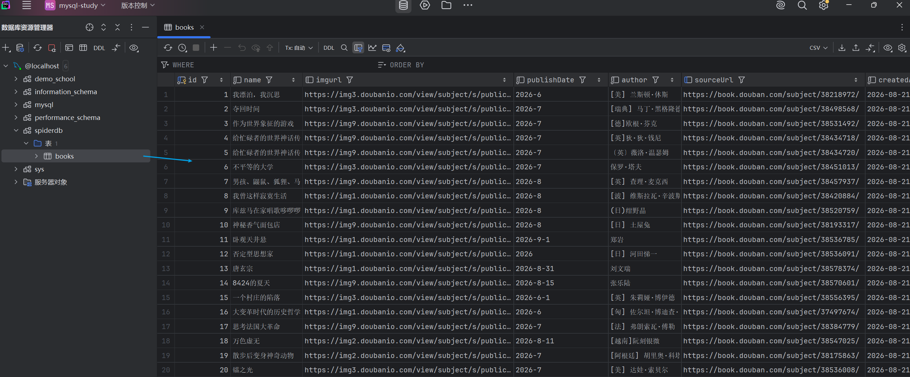


## 数据查询


### 准备工作（回顾）

Sequelize 是 ORM：模型 = 表，实例 = 一行数据，方法调用 = 生成并执行一句 SQL


连接 + 模型 + 关联

```js
import Sequelize from 'sequelize';
const { DataTypes, Op } = Sequelize;

// new Sequelize() 用于创建一个数据库连接实例。
const sequelize = new Sequelize('demo_school', 'root', '', {
  host: 'localhost',
  dialect: 'mysql',
  logging: (sql) => console.log('SQL >', sql),
});

// sequelize.define() 用于定义一个模型。
// 注意：这两张表是你手写建的，没有 createdAt/updatedAt，表名是单数
const Class = sequelize.define(
  'Class',
  { name: DataTypes.STRING },
  { tableName: 'class', timestamps: false }
);

const Student = sequelize.define(
  'Student',
  {
    name: DataTypes.STRING,
    age: DataTypes.INTEGER,
    gender: DataTypes.STRING,
    score: DataTypes.DECIMAL(5, 2),
    class_id: DataTypes.INTEGER,
  },
  { tableName: 'student', timestamps: false }
);
```

`define()` 只是把已有的表结构"告诉" Sequelize，不会自动建表

`sync()`才是建表，查询不需要 `sync()`。`sync` 是建表用的，表已经存在了，跑 `sync` 反而有删表风险。


### 核心

Sequelize 的查询 API 只有一个真正的核心：`findAll`。

```
findAll(options)   ← 全能查询，options 就是一份"SQL 的 JS 描述"
   ├── findOne     = findAll + LIMIT 1，返回单个而不是数组
   ├── findByPk    = findOne + where 固定为主键
   └── count       = 把 SELECT 列表换成 count(*)
```


SQL 是一个字符串语言，拼字符串既容易出错又容易被注入。Sequelize 的选择是——把 SQL 的每个子句变成 `options` 对象里的一个 key：

| SQL 子句   | options 的 key |
| ---------- | -------------- |
| `SELECT`   | `attributes`   |
| `FROM`     | 模型自己       |
| `WHERE`    | `where`        |
| `ORDER BY` | `order`        |
| `LIMIT`    | `limit`        |
| `OFFSET`   | `offset`       |
| `JOIN`     | `include`      |

所以学查询 = 学这几个 key 怎么写。只要把 `logging` 打开，每写一个 key 就能立刻看到它变成了哪段 SQL，这是最高效的学法。

四个方法全是静态方法（`Model.xxx`，不是实例方法），全部返回 **Promise**，必须 `await`。


后面用到的示例表：

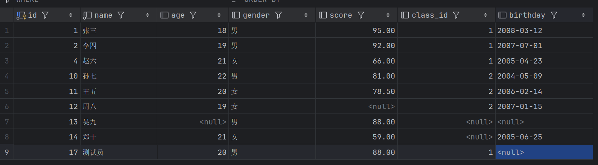


### findAll —— 查询多条

`findAll(options)`

 裸查（相当于 `SELECT * FROM student`）

```js
const all = await Student.findAll();
console.log(all.length);              // 9
console.log(all[0] instanceof Student); // true
console.log(all[0].name);             // 张三
```

生成的 SQL：

```sql
SELECT `id`, `name`, `age`, `gender`, `score`, `class_id` FROM `student` AS `Student`;
```

birthday并没有被查出来：不是 `SELECT *`，Sequelize 是把模型里声明过的字段一个个列出来。所以 `define` 时漏写的字段（比如 `birthday`）查不出来。这是刻意设计：模型是"表的契约"，模型说没有就当没有。


返回的变量`all`的字面量形式：

```js
[
  Student {
    dataValues: { id: 1, name: '张三', age: 18,gender: '男',score: '95.00',class_id: 1},
    _previousDataValues: { id: 1, name: '张三', age: 18, gender: '男', score: '95.00',class_id: 1 },
    uniqno: 1,
    _changed: Set(0) {},
    _options: { isNewRecord: false, _schema: null, _schemaDelimiter: '', raw: true,attributes: [Array] },
    isNewRecord: false
  },
  // ...
  Student { ... },
  Student { ... }
]
```

返回的是数组，元素是"模型实例"，不是普通对象。实例上带着 `save()` / `destroy()` 等方法，还有旧值快照

查不到时返回空数组 `[]`


如果只想拿到数据：

```js
const s = await Student.findOne({ where: { name: '张三' } });

console.log(s.toJSON());   // 实例 → 纯对象，事后转换
```

```js
const rows = await Student.findAll({ raw: true }); // 查询时就不要实例
console.log(rows[0]);      // { id: 1, name: '张三', ... } 普通对象
```

打印内容：

```json
{
  id: 1,
  name: '张三',
  age: 18,
  gender: '男',
  score: '95.00',
  class_id: 1
}
```

区分：要改数据 → 要实例；只是读出来发给前端 → `raw: true`，省掉构造实例的开销。


#### where —— 等值条件

```js
const boys = await Student.findAll({
  where: { gender: '男', class_id: 1 },
});
console.log(boys.map((s) => s.name)); // [ '张三', '李四', '测试员' ]
```

```sql
WHERE `Student`.`gender` = '男' AND `Student`.`class_id` = 1
```


和前面`findAll`对应的sql语句合并就是：

```sql
SELECT `id`, `name`, `age`, `gender`, `score`, `class_id` FROM `student` AS `Student` WHERE `Student`.`gender` = '男' AND `Student`.`class_id` = 1;
```

where` 对象里，**多个 key 默认用 `AND` 连接**，`key: 值` 默认是 `=

值是通过参数化传给驱动的（不是字符串拼接），所以天然防 SQL 注入 —— 这是用 ORM 最实在的一个收益。


#### Op —— 非等值条件

`=` 之外的比较，要用 `Op`（operator）。写法是把 key 的值从"字面量"换成"一个对象"：

```js
const good = await Student.findAll({
  where: { score: { [Op.gte]: 88 } },
});
console.log(good.map((s) => `${s.name}:${s.score}`));
// [ '张三:95.00', '李四:92.00', '吴九:88.00', '测试员:88.00' ]
```

```sql
WHERE `Student`.`score` >= 88
```

`[Op.gte]` 外面那层方括号是 JS 的计算属性名语法，因为 `Op.gte` 是一个 Symbol，不能直接当 key 写

最常用的一批：

| 写法                                  | SQL                       |
| ------------------------------------- | ------------------------- |
| `{ [Op.gt]: 60 }`                     | `> 60`                    |
| `{ [Op.gte]: 60 }`                    | `>= 60`                   |
| `{ [Op.lt]: 60 }` / `{ [Op.lte]: 60}` | `< 60` / `<= 60`          |
| `{ [Op.ne]: 60 }`                     | `!= 60`                   |
| `{ [Op.between]: [60, 90] }`          | `BETWEEN 60 AND 90`       |
| `{ [Op.in]: [1, 2] }`                 | `IN (1,2)`                |
| `{ [Op.like]: '%三%' }`               | `LIKE '%三%'`             |
| `{ [Op.is]: null }`                   | `IS NULL`（查 NULL 专用） |
| `{ [Op.not]: null }`                  | `IS NOT NULL`             |


OR 怎么写：`Op.or` 放在 `where` 顶层，值是一个数组：

```js
await Student.findAll({
  where: {
    [Op.or]: [{ class_id: 1 }, { score: { [Op.gte]: 90 } }],
  },
});
// WHERE (class_id = 1 OR score >= 90)
```


####  attributes / order / limit / offset

```js
const top2 = await Student.findAll({
  attributes: ['name', 'score'],   // 只取这两列
  order: [['score', 'DESC']],      // 数组套数组：[[字段, 方向], ...]
  limit: 2,
  offset: 0,
  raw: true,
});
console.log(top2);
// [ { name: '张三', score: '95.00' }, { name: '李四', score: '92.00' } ]
```

```sql
SELECT `name`, `score` FROM `student` AS `Student` ORDER BY `Student`.`score` DESC LIMIT 2;
```

- `attributes` 是白名单，写了就只查这些列。注意此时结果里**没有 `id`**，实例也就没法 `save()` 了。
- `order` 为什么是二维数组？因为要支持多字段排序：`[['score','DESC'], ['age','ASC']]`。单字段也得包一层，别省。
- `limit` + `offset` = 分页。第 n 页：`offset: (n-1) * pageSize`。
- 只写 `offset` 不写 `limit` 是无效的（SQL 不允许单独 OFFSET）。


### findOne —— 查询单条

```js
const one = await Student.findOne({ where: { name: '张三' } });
console.log(one.toJSON());
// { id: 1, name: '张三', age: 18, gender: '男', score: '95.00', class_id: 1 }

const none = await Student.findOne({ where: { name: '不存在' } });
console.log(none); // null
```

```sql
... WHERE `Student`.`name` = '张三' LIMIT 1;
```

- options 和 `findAll` 完全一样（`where`/`attributes`/`order`/`include` 都能用），只是 Sequelize 自动加了 `LIMIT 1`，并把数组拆成单个元素。
- 查不到返回 `null`（对比 `findAll` 返回 `[]`）。所以 `findOne` 之后必须判空，否则 `one.name` 直接 `TypeError`。习惯写 `one?.name`。
- 匹配到多条时它不报错，静悄悄给你第一条。想要"最新的一条"务必配 `order`：

```js
await Student.findOne({ where: { class_id: 1 }, order: [['score', 'DESC']] });
```


### findByPk —— 按主键查询

```js
const s = await Student.findByPk(2);
console.log(s?.name); // 李四
```

```sql
... WHERE `Student`.`id` = 2;
```

- Pk = Primary Key。第一个参数直接传主键值，不用写 where。
- 第二个参数仍是 options（但 where 会被忽略）：await Student.findByPk(2, { attributes: ['name'], include: [Class] })。
- 查不到同样返回 null。
- 注意 SQL 里没有 LIMIT 1 —— 主键本来就唯一，加了也是多余。

为什么单独给它一个方法？ 因为「按 id 查一条」是 Web 后端最高频的操作（GET /students/:id），专门开一个 API 省掉每次写 { where: { id } } 的样板代码。语义上也更清晰：一看就知道走的是主键索引。


### count —— 查询数量

```js
const n = await Student.count({ where: { class_id: 1 } });
console.log(n, typeof n); // 4 'number'
```

```sql
SELECT count(*) AS `count` FROM `student` AS `Student` WHERE `Student`.`class_id` = 1;
```

- 返回的是纯数字，不是实例、不是数组。
- 不传参数就是全表：await Student.count() → 9。
- where 用法和 findAll 一模一样。
- 不要用 (await Student.findAll()).length 代替它 —— 那会把整表数据搬到 Node 内存里再数个数。count 让数据库去数，只回传一个数字。这就是设计上把它单列出来的意义：能在数据库做的计算，就不要搬到应用层做。


###  include —— 包含关系（关联查询）

这是 ORM 相对于裸 SQL 最大的价值点


class_id，学生对应的班级id

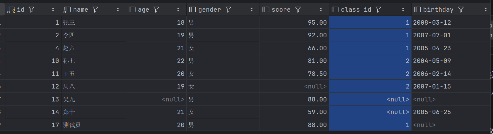


班级表

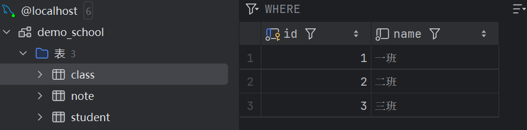


 前提：先声明关联

`include` 用不了，99% 是因为没定义关联。要在 `define` 之后写：

```js
Student.belongsTo(Class, { foreignKey: 'class_id' }); // 学生 属于 一个班级（外键在 student 表上）
Class.hasMany(Student, { foreignKey: 'class_id' });   // 班级 拥有 多个学生
```

怎么判断用哪个：外键列在谁身上，谁就 `belongsTo`。`class_id` 长在 `student` 表上 → `Student.belongsTo(Class)`。反向就是 `hasMany`（一对多）或 `hasOne`（一对一）。


#### 多 → 一

查学生，带上班级（多 → 一）

```js
const rows = await Student.findAll({
  include: [{ model: Class, attributes: ['name'] }],
  limit: 3,
});
console.log(rows.map((s) => [s.name, s.Class?.name]));
// [ [ '张三', '一班' ], [ '李四', '一班' ], [ '赵六', '一班' ] ]
```

```sql
SELECT `Student`.`id`, ..., `Class`.`id` AS `Class.id`, `Class`.`name` AS `Class.name`
FROM `student` AS `Student`
LEFT OUTER JOIN `class` AS `Class` ON `Student`.`class_id` = `Class`.`id`
LIMIT 3;
```

- include 的值是数组（可以同时关联多张表）。
- 生成 `LEFT OUTER JOIN`：即使学生没班级（吴九、郑十 的 `class_id` 是 `NULL`），这个学生仍会出现在结果里，只是 `s.Class` 为 `null`。所以 `s.Class?.name` 的 `?.` 是必须的。


SQL 里的列别名是 `Class.name` 这种带点的形式。Sequelize 拿到扁平结果后，按别名里的点把它重新组装成嵌套对象 —— 这就是 ORM 说的"对象关系映射"，SQL 只会返回二维表格，嵌套结构是 Sequelize 拼出来的。


挂载的属性名叫什么？ 默认取模型名：`belongsTo` → 单数 `s.Class`。想改就在关联时加 `as`：`Student.belongsTo(Class, { foreignKey: 'class_id', as: 'clazz' })`，之后 `include` 里也必须写 `{ model: Class, as: 'clazz' }`，两边要对上。


#### 一 → 多

查班级，带上所有学生（一 → 多）

```js
const classes = await Class.findAll({
  include: [{ model: Student, attributes: ['name'] }],
});
console.log(classes.map((c) => [c.name, c.Students.map((s) => s.name)]));
// [ [ '一班', [ '张三', '李四', '赵六', '测试员' ] ],
//   [ '二班', [ '孙七', '王五', '周八' ] ],
//   [ '三班', [] ] ]
```


#### 内连接

include 里加 where —— 用关联表过滤主表

```js
const inClass1 = await Student.findAll({
  include: [{ model: Class, where: { name: '一班' } }],
});
console.log(inClass1.map((s) => s.name)); // [ '张三', '李四', '赵六', '测试员' ]
```

```sql
FROM `student` AS `Student`
INNER JOIN `class` AS `Class` ON `Student`.`class_id` = `Class`.`id` AND `Class`.`name` = '一班';
```

只保留 `s.class_id = c.id`（班级id） 的那些行

JOIN 类型从 `LEFT OUTER` 自动变成了 `INNER`


### 完整案例

```js
import Sequelize from 'sequelize';
const { DataTypes, Op } = Sequelize;

const sequelize = new Sequelize('demo_school', 'root', '', {
  host: 'localhost',
  dialect: 'mysql',
  logging: (sql) => console.log('SQL >', sql),
});

const Class = sequelize.define(
  'Class',
  { name: DataTypes.STRING },
  { tableName: 'class', timestamps: false }
);

const Student = sequelize.define(
  'Student',
  {
    name: DataTypes.STRING,
    age: DataTypes.INTEGER,
    gender: DataTypes.STRING,
    score: DataTypes.DECIMAL(5, 2),
    class_id: DataTypes.INTEGER,
  },
  { tableName: 'student', timestamps: false }
);

Student.belongsTo(Class, { foreignKey: 'class_id' });
Class.hasMany(Student, { foreignKey: 'class_id' });

console.log('=== findAll 基础 ===');
const all = await Student.findAll();
console.log(all.length, all[0] instanceof Student);
console.log(all[0].name, all[0].score, typeof all[0].score);


console.log('=== findAll where ===');
const boys = await Student.findAll({ where: { gender: '男', class_id: 1 } });
console.log(boys.map((s) => s.name));

console.log('=== Op ===');
const good = await Student.findAll({ where: { score: { [Op.gte]: 88 } } });
console.log(good.map((s) => `${s.name}:${s.score}`));

console.log('=== attributes / order / limit ===');
const top2 = await Student.findAll({
  attributes: ['name', 'score'],
  order: [['score', 'DESC']],
  limit: 2,
  raw: true,
});
console.log(top2);

console.log('=== findOne ===');
const one = await Student.findOne({ where: { name: '张三' } });
console.log(one?.toJSON());
const none = await Student.findOne({ where: { name: '不存在' } });
console.log('没查到:', none);

console.log('=== findByPk ===');
const byPk = await Student.findByPk(2);
console.log(byPk?.name);

console.log('=== count ===');
const n = await Student.count({ where: { class_id: 1 } });
console.log('一班人数:', n, typeof n);

console.log('=== include: 学生带班级 ===');
const withClass = await Student.findAll({
  include: [{ model: Class, attributes: ['name'] }],
  limit: 3,
});
console.log(withClass.map((s) => [s.name, s.Class?.name]));

console.log('=== include: 班级带学生 ===');
const classes = await Class.findAll({
  include: [{ model: Student, attributes: ['name'] }],
});
console.log(classes.map((c) => [c.name, c.Students.map((s) => s.name)]));

console.log('=== include + where 过滤主表 ===');
const inClass1 = await Student.findAll({
  include: [{ model: Class, where: { name: '一班' } }],
});
console.log(inClass1.map((s) => s.name));

await sequelize.close();
```


## MD5加密


### 是什么

MD5（Message-Digest Algorithm 5）是一种哈希加密算法，它的本质是：

```
任意长度的字符串 → MD5算法 → 固定32位的十六进制字符串
```

核心特点：

1. 固定长度输出：无论输入多长，输出都是32位十六进制字符（128位二进制）
2. 单向加密：只能加密，不能解密（这是哈希算法的特性）
3. 确定性：相同输入永远得到相同输出
4. 雪崩效应：输入微小变化，输出完全不同


解决的核心问题：密码安全存储

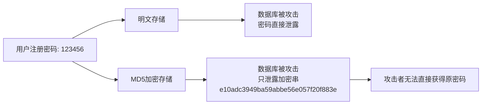

- 即使数据库管理员也不应该知道用户的真实密码
- 数据库泄露时，加密后的密码无法直接还原
- 登录验证时，将用户输入的密码加密后与数据库对比


### Node.js中使用MD5

安装md5包：

```
npm install md5
```

使用示例：

```js
const md5 = require('md5');
// 1. 基本加密
console.log('原始密码:', '123456');
console.log('加密结果:', md5('123456'));
// 输出: e10adc3949ba59abbe56e057f20f883e

// 2. 固定长度输出
console.log('\n短字符串:', md5('a'));
console.log('长字符串:', md5('这是一段很长很长很长的文本内容'));
// 两者长度完全相同，都是32位
// 短字符串: 0cc175b9c0f1b6a831c399e269772661
// 长字符串: c7ec135723cdc188ae236d654f7873d2

// 3. 确定性（相同输入相同输出）
console.log('\n第一次加密:', md5('hello'));
console.log('第二次加密:', md5('hello'));
// 结果完全一致
// 第一次加密: 5d41402abc4b2a76b9719d911017c592
// 第二次加密: 5d41402abc4b2a76b9719d911017c592

// 4. 雪崩效应（微小变化导致巨大差异）
console.log('\nhello:', md5('hello'));
console.log('Hello:', md5('Hello'));  // 只改了大小写
// 结果完全不同
// hello: 5d41402abc4b2a76b9719d911017c592
// Hello: 8b1a9953c4611296a827abf8c47804d7
```


### 实际应用场景

1. 用户注册（加密存储）

```js
const md5 = require('md5');

// 用户注册时
async function register(loginId, password) {
  const encryptedPassword = md5(password);  // 加密密码
  
  // 存储到数据库的是加密后的密码
  await Admin.create({
    loginId: loginId,
    loginPwd: encryptedPassword  // 数据库中存的是加密串
  });
}
```


2. 用户登录（加密对比）

```js
async function login(loginId, password) {
  const encryptedPassword = md5(password);  // 将用户输入的密码加密
  
  // 用加密后的密码去数据库查询
  const user = await Admin.findOne({
    where: {
      loginId: loginId,
      loginPwd: encryptedPassword  // 用加密串匹配
    }
  });
  
  return user ? user.toJSON() : null;
}
```


3. 修改密码

```js
async function updatePassword(userId, newPassword) {
  const encryptedPassword = md5(newPassword);  // 新密码也要加密
  
  await Admin.update(
    { loginPwd: encryptedPassword },
    { where: { id: userId } }
  );
}
```


### 局限与改进

MD5不是绝对安全的：

1. 彩虹表攻击：常见密码的MD5值已被收集成表，可以反查
   - `123456` → `e10adc3949ba59abbe56e057f20f883e`（已被收录）
2. 碰撞攻击：理论上可以找到不同输入产生相同MD5

实际应用的改进方案（加盐）：

```js
const md5 = require('md5');

// 加盐：在密码后面加一段固定字符串
const SALT = 'my_secret_salt_2024';

function encryptPassword(password) {
  return md5(password + SALT);  // 密码+盐值一起加密
}

// 这样即使是123456，加密结果也不是常见的那个了
console.log('不加盐:', md5('123456'));
console.log('加盐后:', encryptPassword('123456'));
```


## moment.js


### UTC 和本地时间

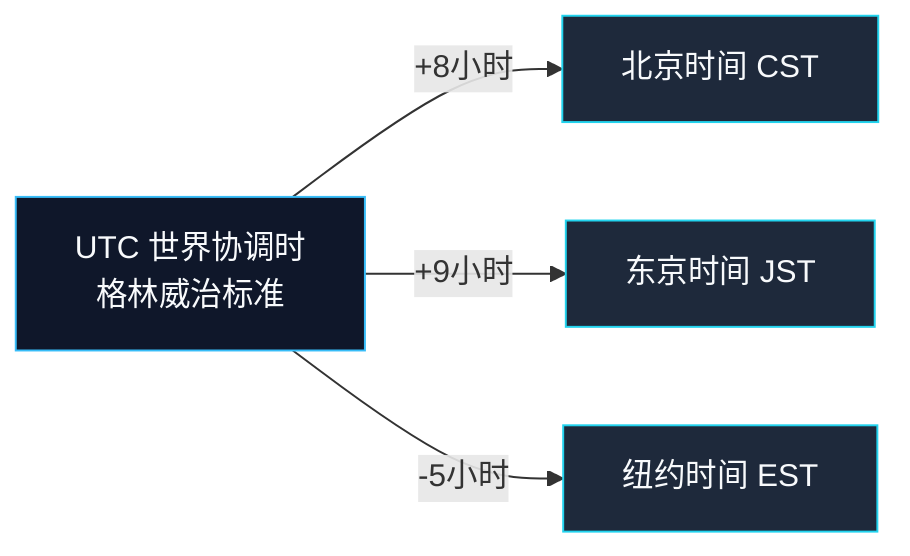

UTC 的 00:00 = 北京时间 08:00


时间戳（Timestamp）：从 UTC 1970-1-1 00:00:00 到某个时刻经过的毫秒数

- 例如：`1725253860000` 表示从 1970 年到现在经过了这么多毫秒


原生 JavaScript 的 Date 对象：时区转换麻烦、格式化输出复杂、日期计算不直观。moment.js处理起来非常方便


### 语法

1. 创建时间对象

```js
const moment = require('moment');

// 方式1：获取当前时间
const now = moment();

// 方式2：从时间戳创建（毫秒）
const fromTimestamp = moment(1725253860000);

// 方式3：从日期字符串创建
const fromString = moment('2026-09-02');

// 方式4：从UTC时间创建
const utcTime = moment.utc();
```

运行现象：这些方法都会创建一个 moment 对象，包含了完整的日期时间信息，可以进行各种操作

```powershell
Moment<2026-09-02T12:29:31+08:00>
Moment<2024-09-02T13:11:00+08:00>
Moment<2026-09-02T00:00:00+08:00>
Moment<2026-09-02T04:29:31Z>
```


2. 格式化输出（最常用）

```js
const moment = require('moment');
const now = moment();

// 常用格式
now.format('YYYY-MM-DD');           // "2026-09-02"
now.format('YYYY-MM-DD HH:mm:ss');  // "2026-09-02 12:30:45"
now.format('YYYY年MM月DD日');        // "2026年09月02日"
```

格式化符号：

- `YYYY`：四位年份
- `MM`：两位月份（01-12）
- `DD`：两位日期（01-31）
- `HH`：24小时制小时（00-23）
- `mm`：分钟（00-59）
- `ss`：秒（00-59）


3. UTC 和本地时间转换（核心功能）


```js
const moment = require('moment');
// 从数据库读取UTC时间戳，转为本地时间显示
const timestamp = 1725253860000;
const localTime = moment.utc(timestamp).local();
console.log(localTime.format('YYYY-MM-DD HH:mm:ss'));  // 显示北京时间
// 用户输入本地时间，转为UTC保存到数据库
const userInput = moment('2026-09-02 20:30:00');
const utcTime = userInput.utc();
console.log(utcTime.valueOf());  // 获取时间戳用于保存
```


4. 时间计算

```js
const moment = require('moment');
const now = moment();

// 加时间
now.add(7, 'days');      // 加7天
now.add(1, 'months');    // 加1个月
now.add(2, 'hours');     // 加2小时

// 减时间
now.subtract(3, 'days'); // 减3天

// 时间差
const start = moment('2026-09-01');
const end = moment('2026-09-10');
const diff = end.diff(start, 'days');  // 返回：9（相差9天）
```


### 实际应用场景

场景1：文章"多久前发布"

```js
const publishedAt = moment('2026-09-01 10:00:00');
const daysAgo = moment().diff(publishedAt, 'days');

if (daysAgo === 0) return '今天';
if (daysAgo === 1) return '昨天';
if (daysAgo < 7) return `${daysAgo}天前`;
return publishedAt.format('YYYY-MM-DD');
```


场景2：查询最近7天数据

```js
const end = moment().endOf('day').valueOf();           // 今天23:59:59
const start = moment().subtract(7, 'days').startOf('day').valueOf();  // 7天前00:00:00

// SQL: SELECT * FROM articles WHERE created_at BETWEEN start AND end
```


场景3：VIP过期提醒

```js
const vipExpire = moment('2026-09-10 23:59:59');
const daysLeft = vipExpire.diff(moment(), 'days');

if (daysLeft <= 3 && daysLeft > 0) {
  console.log(`您的VIP还剩${daysLeft}天到期`);
}
```


## 数据验证


### 数据验证分层

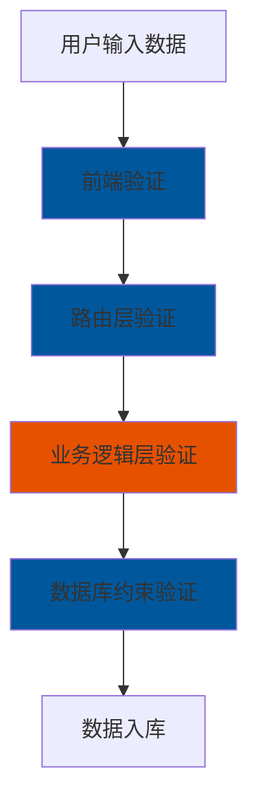

1. 前端验证：即时反馈，提升用户体验（用户输错了立刻提示）
2. 路由层验证：检查接口格式，防止恶意请求
3. 业务逻辑层验证（重点）：保证业务规则完整性
4. 数据库约束：最后一道防线，保证数据完整性

前端验证可以被绕过（用户可以禁用 JS 或直接发请求），所以后端必须再验证一遍。


### 核心库

1. validator（字符串级别验证）

专门验证单个字符串是否符合规则，比如：

- 是不是邮箱？
- 是不是手机号？
- 长度是否合法？


2. validate.js（对象级别验证）★★★

验证整个对象的多个属性是否符合规则，这是重点。


### validate.js 核心用法


#### validate.js 做什么

- 给你一个对象（比如 `{name: "张三", age: 15}`）
- 你定义一套规则（比如 name 必填、age 必须大于 18）
- validate.js 告诉你：这个对象是否符合规则

为什么需要它？ 手写验证代码太繁琐：

```js
// 不用库的写法，又臭又长
if (!stuObj.name) return "姓名必填";
if (stuObj.name.length > 10) return "姓名太长";
if (!stuObj.mobile) return "手机号必填";
if (!/1\d{10}/.test(stuObj.mobile)) return "手机号格式错误";
// ...一堆 if
```


用 validate.js 后，声明式地定义规则即可:

```js
const 数据 = {...};
const 规则 = {...};
const errors = validate(数据, 规则);
if (errors) {
  console.log("验证失败：", errors);
} else {
  console.log("验证通过！", studentData);
}
```


#### 日期解析

validate.js内置的 `datetime` 验证器

validate.js 默认不知道怎么解析日期,必须配置的日期解析器

```js
validate.extend(validate.validators.datetime, {
  parse: function(value, options) {
    return +moment.utc(value);  // 把日期字符串转成时间戳
  },
  format: function(value, options) {
    var format = options.dateOnly ? "YYYY-MM-DD" : "YYYY-MM-DD hh:mm:ss";
    return moment.utc(value).format(format);
  }
});
```

`validate.extend(validator, options)`：扩展已有验证器的行为

- 第一个参数 `validate.validators.datetime`：指向内置的 `datetime` 验证器
- 第二个参数：配置对象，包含两个必需方法：
  - `parse`：输入字符串 → 时间戳
  - `format`：时间戳 → 格式化字符串

使用：

```js
birthday: {
  datetime: {
    dateOnly: true,
    earliest: +moment.utc().subtract(100, "y"),
    latest: +moment.utc().subtract(5, "y")
  }
}
```


#### 常用验证规则

① presence（必填验证）

```js
name: {
  presence: { allowEmpty: false }  // 必填且不能为空字符串
}
```

- `presence: true`：字段必须存在（但可以是空字符串 `""`）
- `presence: { allowEmpty: false }`：不仅要存在，还不能是空字符串


② type（类型验证）

```js
name: { type: "string" }    // 必须是字符串
sex: { type: "boolean" }    // 必须是布尔值
```

支持的类型：`string`, `boolean`, `number`, `integer`, `date`, `array`, `object`


③ length（长度验证）

```js
name: {
  length: {
    minimum: 1,    // 最少 1 个字符
    maximum: 10    // 最多 10 个字符
  }
}
```


④ format（正则验证）

```js
mobile: {
  format: /1\d{10}/  // 1 开头，后面 10 个数字
}
```

适用场景：手机号、邮箱、身份证等格式验证。


⑤ datetime（日期验证）

```js
birthday: {
  datetime: {
    dateOnly: true,                              // 只验证日期部分
    earliest: +moment.utc().subtract(100, "y"),  // 最早 100 年前
    latest: +moment.utc().subtract(5, "y")       // 最晚 5 年前
  }
}
```

为什么是 `+moment.utc()`？

- moment 返回的是对象，需要 `+` 转成时间戳（毫秒数）
- validate.js 内部会调用前面配置的 `parse` 函数


⑥ numericality（数值验证）

```js
ClassId: {
  numericality: {
    onlyInteger: true,   // 只能是整数
    strict: false        // 不严格模式：字符串 "1" 也能通过
  }
}
```

- `strict: true`：严格模式，`"1"` 会报错
- `strict: false`：宽松模式，`"1"` 会被转换成数字 `1`


#### 自定义验证器

1）问题场景

假设要验证 `ClassId` 是否真实存在于数据库中，怎么办？

内置的验证器只能验证格式，不能查数据库。


2）解决方案：自定义验证器

```js
validate.validators.classExits = async function (value) {
  const c = await Class.findByPk(value);  // 查询数据库
  if (c) {
    return;  // 存在就返回 undefined，表示验证通过
  }
  return "is not exist";  // 不存在返回错误消息
};
```

关键点：

1. 在 `validate.validators` 上挂一个新的验证器 `classExits`
2. 验证器是 `async` 函数（因为要查数据库）
3. 验证通过返回 `undefined`，失败返回错误字符串


3）使用自定义验证器

```js
const rule = {
  ClassId: {
    presence: true,
    numericality: { onlyInteger: true },
    classExits: true  // 使用自定义验证器
  }
};

// 注意：使用异步验证器必须用 validate.async()
await validate.async(stuObj, rule);
```

为什么要 `validate.async()`？

- 同步的 `validate()` 不支持异步验证器
- `validate.async()` 返回 Promise，需要 `await`


#### 完整验证流程

```js
exports.addStudent = async function (stuObj) {
  // ===== 第一步：数据清洗 =====
  stuObj = pick(stuObj, "name", "birthday", "sex", "mobile", "ClassId"); // 只要后面列出的字段，过滤恶意字段
  
  // ===== 第二步：自定义验证器 =====
  validate.validators.classExits = async function (value) {
    const c = await Class.findByPk(value);
    if (c) return;
    return "is not exist";
  };

  // ===== 第三步：定义验证规则 =====
  const rule = {
    name: {
      presence: { allowEmpty: false },
      type: "string",
      length: { minimum: 1, maximum: 10 }
    },
    birthday: {
      presence: { allowEmpty: false },
      datetime: {
        dateOnly: true,
        earliest: +moment.utc().subtract(100, "y"),
        latest: +moment.utc().subtract(5, "y")
      }
    },
    sex: {
      presence: true,
      type: "boolean"
    },
    mobile: {
      presence: { allowEmpty: false },
      format: /1\d{10}/
    },
    ClassId: {
      presence: true,
      numericality: { onlyInteger: true, strict: false },
      classExits: true  // 使用自定义验证器
    }
  };
  
  // ===== 第四步：执行验证 =====
  await validate.async(stuObj, rule);
  
  // ===== 第五步：插入数据库 =====
  const ins = await Student.create(stuObj);
  return ins.toJSON();
};
```


### 实际应用场景

实战案例：学生信息验证

```js
import validate from "validate.js";
import moment from "moment";

// 配置 validate.js 的日期解析器（必须配置才能使用 datetime 验证器）
validate.extend(validate.validators.datetime, {
  parse: function(value, options) {
    return +moment.utc(value);
  },
  format: function(value, options) {
    var format = options.dateOnly ? "YYYY-MM-DD" : "YYYY-MM-DD hh:mm:ss";
    return moment.utc(value).format(format);
  }
});
```

```js
// 模拟要验证的学生数据
const studentData = {
  name: "李四",
  birthday: "2015-06-15",
  sex: true,
  mobile: "13812345678",
  ClassId: 1
};
```

```js
// 定义验证规则
const rule = {
  name: {
    presence: { allowEmpty: false }, // 必填，不能为空
    type: "string",                  // 必须是字符串
    length: {                        // 长度限制
      minimum: 1,
      maximum: 10
    }
  },
  birthday: {
    presence: { allowEmpty: false },
    datetime: {
      dateOnly: true,                // 只验证日期，不管时间
      earliest: +moment.utc().subtract(100, "y"), // 最早100年前
      latest: +moment.utc().subtract(5, "y")      // 最晚5年前（学生至少5岁）
    }
  },
  sex: {
    presence: true,                  // 必填
    type: "boolean"                  // 必须是布尔值
  },
  mobile: {
    presence: { allowEmpty: false },
    format: /1\d{10}/                // 正则：1开头，后面10个数字
  },
  ClassId: {
    presence: true,
    numericality: {                  // 数值验证
      onlyInteger: true,             // 只能是整数
      strict: false                  // 不严格（字符串"1"会转成数字1）
    }
  }
};
```

验证

```js
const errors = validate(studentData, rule);

if (errors) {
  console.log("验证失败：", errors);
} else {
  console.log("验证通过！", studentData);
}
```

测试失败的情况:

```js
// 测试失败的情况
const badData = {
  name: "",              // 姓名为空
  birthday: "2023-01-01", // 年龄太小（不到5岁）
  sex: "男",             // 类型错误（应该是 boolean）
  mobile: "12345",       // 手机号格式错误
  ClassId: "abc"         // 不是数字
};
const badErrors = validate(badData, rule);
console.log("错误信息：", badErrors);
```

```
错误信息： {
  name: [
    "Name can't be blank",
    'Name is too short (minimum is 1 characters)'
  ],
  birthday: [ 'Birthday must be no later than 2021-09-02' ],
  sex: [ 'Sex must be of type boolean' ],
  mobile: [ 'Mobile is invalid' ],
  ClassId: [ 'Class id is not a number' ]
}
```


## 访问器和虚拟字段


### 虚拟字段 (Virtual Fields)

虚拟字段是不存在于数据库表中的字段,它们只在 Sequelize 模型层面存在,通常用于组合或转换其他字段的值。

定义方式

```js
const User = sequelize.define('User', {
  firstName: DataTypes.STRING,
  lastName: DataTypes.STRING,
    
  // 虚拟字段:不会在数据库中创建该列
  fullName: {
    type: DataTypes.VIRTUAL,
    get() {
      return `${this.firstName} ${this.lastName}`;
    },
    set(value) {
      const names = value.split(' ');
      this.setDataValue('firstName', names[0]);
      this.setDataValue('lastName', names[1]);
    }
  }
});
```


应用场景示例

场景1: 用户全名组合

```js
// 模型定义
const User = sequelize.define('User', {
  firstName: DataTypes.STRING,
  lastName: DataTypes.STRING,
  fullName: {
    type: DataTypes.VIRTUAL,
    get() {
      // 组合姓和名
      return `${this.firstName} ${this.lastName}`;
    }
  }
});

// 使用
const user = await User.findOne();
console.log(user.fullName); // 输出: "Zhang San" (虚拟字段,数据库中不存在)
```


### 访问器 (Getters & Setters)

访问器用于在读取或设置字段值时进行自定义处理,可以应用于真实的数据库字段。

定义方式

```js
const User = sequelize.define('User', {
  email: {
    type: DataTypes.STRING,
    get() {
      // 读取时的处理
      const rawValue = this.getDataValue('email');
      return rawValue ? rawValue.toUpperCase() : null;
    },
    set(value) {
      // 写入时的处理
      this.setDataValue('email', value.toLowerCase());
    }
  }
});
```


应用场景示例

场景4: 密码加密存储

```js
const User = sequelize.define('User', {
  phone: {
    type: DataTypes.STRING,
    get() {
      const rawValue = this.getDataValue('phone');
      // 读取时自动脱敏: 13812345678 -> 138****5678
      if (!rawValue) return null;
      return rawValue.replace(/(\d{3})\d{4}(\d{4})/, '$1****$2');
    }
  }
});

// 使用
const user = await User.findOne();
console.log(user.phone); // 输出: "138****5678" (数据库存完整号码)
```


## 日志记录


### log4js是什么

直接用`log4js`

Node 端的日志框架。它不是 `console.log` 的美化版，而是把「谁在打日志、这条日志重不重要、写到哪里去、长什么样」四件事拆开配置的工具


解决的问题（`console.log` 的痛点）：

| 痛点                             | log4js 的解法               |
| -------------------------------- | --------------------------- |
| 上线后想关掉调试输出，只能删代码 | Level — 改一行配置就过滤    |
| SQL 日志和业务日志混在一起       | Category — 分类隔离         |
| 日志只在终端，重启就没了         | Appender — 写文件、按天切割 |
| 没时间戳、没级别、没来源         | Layout — 统一格式化         |


### 四个核心概念

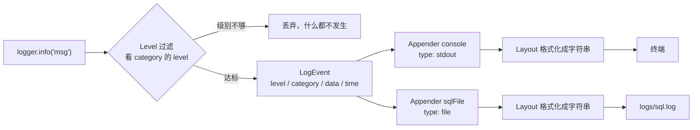


| 概念     | 是什么                           | 一句话                                             |
| -------- | -------------------------------- | -------------------------------------------------- |
| Logger   | 你手里调用 `.info()` 的对象      | 日志的入口                                         |
| Category | logger 的名字（如 `"sql"`）      | **路由键**：决定这条日志走哪些出口、用什么级别阈值 |
| Appender | 出口（stdout / file / dateFile） | 日志写到哪                                         |
| Layout   | 格式模板                         | 日志长什么样                                       |


设计原理：Category 是 Logger 和 Appender 之间的间接层。业务代码只写 `getLogger("sql")`，完全不知道也不关心它最终写到哪里；运维改配置文件就能把 sql 日志从终端改成写文件、加一份发邮件——业务代码一行不用动。这就是「关注点分离」。


Category 到 Appender 是多对多：

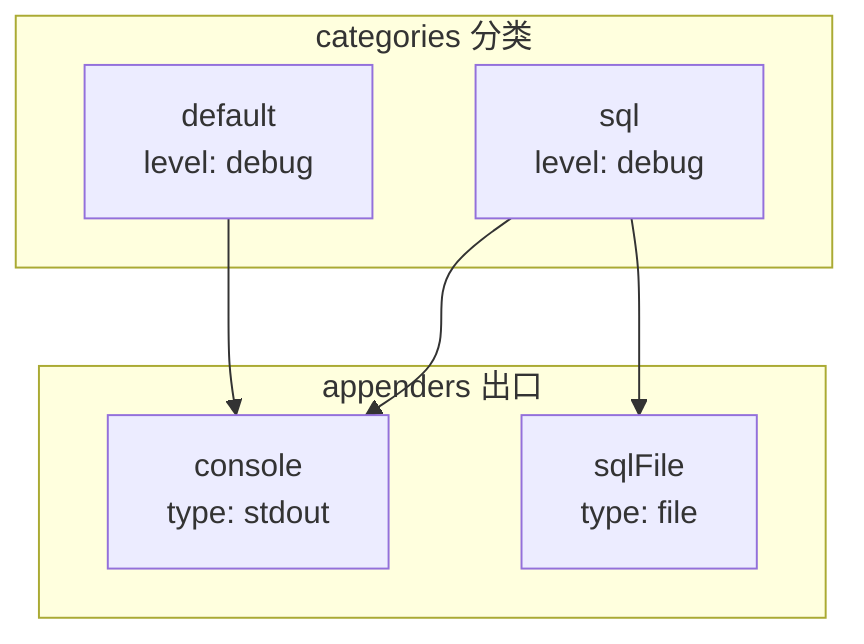


### Level：唯一的开关

```
trace < debug < info < warn < error < fatal
```

规则：`category.level` 是最低门槛，低于它的调用直接被丢弃（连字符串拼接都不会执行，所以性能开销≈0）

```js
// 配置 level: "debug"
logger.trace("...") // ❌ 丢弃
logger.debug("...") // ✅ 输出
logger.error("...") // ✅ 输出

logger.level = "error"; // 运行时改，立即生效
logger.info("...")  // ❌ 丢弃了
```

实际语义约定：`debug` 调试细节 / `info` 关键流程节点 / `warn` 可恢复异常 / `error` 需要人看的错误 / `fatal` 服务挂了。


### 语法


#### configure - 全局配置

`log4js.configure(config)` — 全局配置，进程内调一次

```js
log4js.configure({
  appenders: { /* 出口定义，key 是自定义名字 */ },
  categories: { /* 分类定义，必须有 default */ },
});
```

> `categories.default` 是强制的，缺了会抛错。`getLogger()` 不传名字就用它；`getLogger("不存在的名字")` 也回退到它。


#### appender - 出口

常用 appender 类型（3 个够用）

```js
appenders: {
  // ① 打终端
  console: { type: "stdout" },

  // ② 写单文件，按体积切割
  app: {
    type: "file",
    filename: path.join(__dirname, "logs", "app.log"),
    maxLogSize: 1024 * 1024, // 超过 1MB 切一个新文件
    backups: 3,              // 最多保留 3 个历史文件
  },

  // ③ 写文件，按天切割（最常用于生产）
  sql: {
    type: "dateFile",
    filename: path.join(__dirname, "logs", "sql.log"),
    pattern: "yyyy-MM-dd",  // 切割粒度
    keepFileExt: true,      // 切出 sql.2026-09-02.log 而不是 sql.log.2026-09-02
    numBackups: 7,          // 保留 7 天
  },
}
```


#### Layout — `pattern` 模板

```js
layout: { type: "pattern", pattern: "%[[%d{yyyy-MM-dd hh:mm:ss}] [%p] %c%] - %m" }
```

| 占位符      | 含义                                 |
| ----------- | ------------------------------------ |
| `%d{格式}`  | 时间                                 |
| `%p`        | 级别（INFO / ERROR）                 |
| `%c`        | category 名                          |
| `%m`        | 日志内容                             |
| `%n`        | 换行                                 |
| `%[ ... %]` | 中间部分按级别着色（只对终端有意义） |


#### getLogger(category) + 输出方法

```js
const logger = log4js.getLogger();       // default 分类
const sqlLogger = log4js.getLogger("sql");

logger.info("普通文本");
logger.info("查到 %d 条，条件 %j", 3, { age: 18 }); // 支持 util.format 占位符
logger.error("出错了", err);                        // 传 Error 自动打印堆栈
```


#### shutdown() — 关闭

file/dateFile 是异步缓冲写入，进程直接退出会丢日志。

```js
await new Promise((resolve) => log4js.shutdown(resolve));
```


### 接到 Sequelize 上

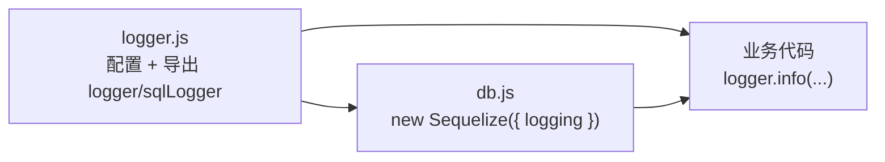

```js
const sequelize = new Sequelize("demo_school", "root", null, {
  dialect: "mysql",
  logging: (sql) => sqlLogger.debug(sql), // ← 就是这里
});
```

补充：`logging: false` 完全关闭；回调第二个参数是耗时（需配 `benchmark: true`）。


### 完整案例

日志配置代码

```js
const path = require("path");
const log4js = require("log4js");

// 配置 log4js 日志系统
log4js.configure({
  // 1. appenders：日志“出口”，决定写到哪里、长什么样
  appenders: {
    console: {
      type: "stdout",
      layout: {
        type: "pattern",
        pattern: "%[[%d{hh:mm:ss}] [%p] %c%] - %m",
      },
    },
    sqlFile: {
      type: "file",
      filename: path.join(__dirname, "logs", "sql.log"),
      maxLogSize: 1024 * 1024,
      backups: 3,
      layout: {
        type: "pattern",
        pattern: "[%d{yyyy-MM-dd hh:mm:ss}] [%p] %c - %m",
      },
    },
  },
  // 2. categories：日志“分类”，把 logger 名字映射到一组出口 + 一个最低级别
  categories: {
    default: { appenders: ["console"], level: "debug" },
    sql: { appenders: ["console", "sqlFile"], level: "debug" },
  },
});

// 导出 logger 实例和 shutdown 方法
module.exports = {
  logger: log4js.getLogger(),      // 走 default 分类
  sqlLogger: log4js.getLogger("sql"), // 走 sql 分类
  shutdown: () => new Promise((resolve) => log4js.shutdown(resolve)),
};
```


ORM驱动控制数据库代码

```js
const { Sequelize, DataTypes } = require("sequelize");
const { logger, sqlLogger, shutdown } = require("./logger");

// 连接数据库，集成log4js
const sequelize = new Sequelize("demo_school", "root", null, {
  host: "localhost",
  dialect: "mysql",
  // 关键：Sequelize 把每条 SQL 交给这个回调，我们转交给 log4js
  logging: (sql) => sqlLogger.debug(sql),
});

// 定义 Student 模型，对应 student 表
const Student = sequelize.define(
  "Student",
  {
    id: { type: DataTypes.INTEGER, primaryKey: true },
    name: DataTypes.STRING,
    age: DataTypes.INTEGER,
  },
  { tableName: "student", timestamps: false }
);

// 查询数据并记录日志
(async () => {
  try {
    const rows = await Student.findAll({ limit: 3 });
    logger.info("查到 %d 条：%j", rows.length, rows.map((r) => r.name));
  } catch (err) {
    logger.error("查询失败", err);
  } finally {
    await sequelize.close();
    await shutdown(); // 等日志写完再退出
  }
})();
```


执行后输出日志：

```powershell
[16:08:15] [DEBUG] sql - Executing (default): SELECT `id`, `name`, `age` FROM `student` AS `Student` LIMIT 3;
[16:08:15] [INFO] default - 查到 3 条：["张三","李四","赵六"]
```


