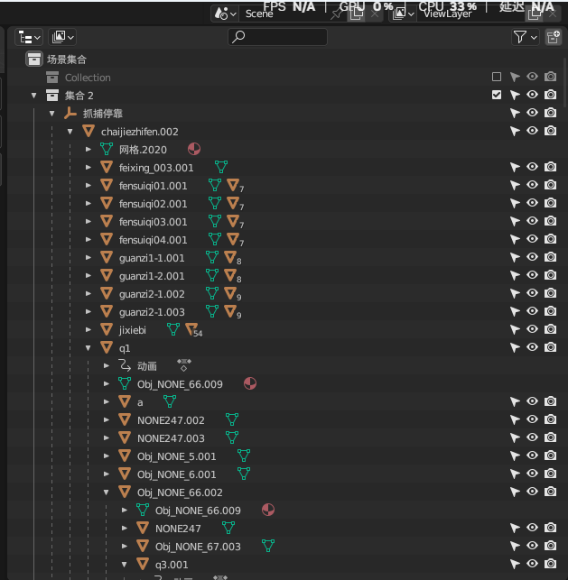
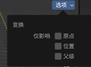
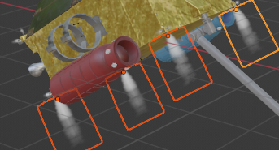
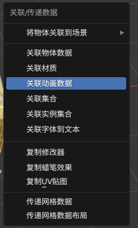
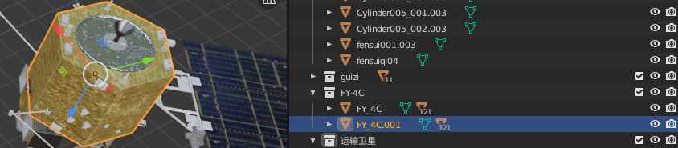
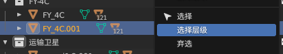
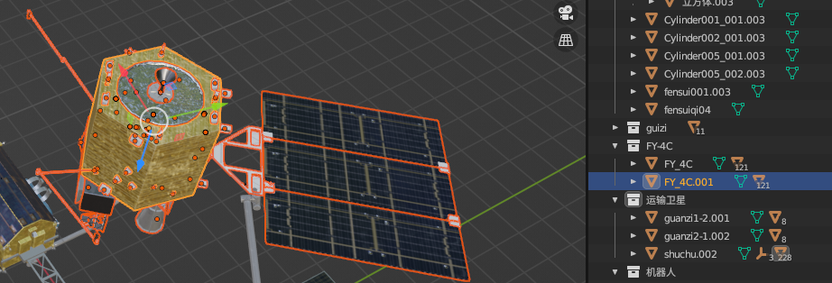

blender快捷键


shift + A 创建标准网格图形，比如规整的多少米，

进入编辑模式，选你要改哪些东西


这上面是修改点、线、面，选面，点击要改的面，按一下g键，就能随鼠标自由动，如果按鼠标中键，就能让其沿着坐标轴移动


选中物体

ctrl+a弹出弹窗：


点击全部变换能让所以变化参数重置为0和1，但是物体本身不变，对应下面的就是，位置，旋转，缩放会变，但是尺寸不会变


#### blender常用概念

快捷键

```
旋转视角：鼠标中键拖动

平移视角：Shift + 鼠标中键拖动

缩放视角：滚轮 / Ctrl + 鼠标中键

聚焦到所选物体：小键盘 .，如果鼠标hover在模型树处，会自动缩放到对应节点处

配合轴约束：
G + X / Y / Z：沿全局轴移动
R + X / Y / Z：绕全局轴旋转
S + X / Y / Z：沿某轴缩放

设置父子级：Shift+选中两个物体，Ctrl+P,面板中选择：物体（保持变换），

解除父子级：拖出网格物体，然后按下Ctrl + Shift + Alt
```

可以把它理解成：

- 场景里的对象树
- 集合（Collection）和对象（Object）的层级列表
- 场景组织结构面板



```
橙色三角形图标：表示 Mesh Object（网格物体），也就是一个“物体”，它的类型是网格，Blender 里一个物体是“对象容器”，它里面引用真正的网格数据。

绿色的“三个小点/小方块连起来”的图标：表示 Mesh Data（网格数据）：这个表示 Mesh Data（网格数据），也就是这个物体实际使用的几何体数据。

参考系三轴图标：叫做空物体，可以把它理解成文件管理器树状目录里的“L”那种意思,空物体下面的网格物体的就以空物体作为参考系   shift+a 选择创建空物体
```


这里选父级的话，变换只作用到父级的参考系，不会将子集连带着动




动画关联

先给一个模型设置动画，shift选中其它模型，最后选中带动画的模型，待关联的呈现红色，



ctrl选中多个物体

ctrl + L，关联动画数据能让选中的模型做一样的动作变换




shift + d ，左键点一下，原地复制一个模型

如果只是点击选择，只会复制橙色边框框中的物体



只有在场景树中右键，选择层级，才能选中所有的子层级，进行完整复制





