#  html

^cb67bc

html，一种能存放文本音频的超文本，是网页骨架

#### 快捷键

vscode快捷键:在该处查看

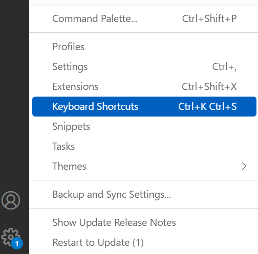

比如向下复制:shift+alt+⬇

整体向右:选中整体按住tab

整体向右:shift+tab

格式化文档:在vscode中右键

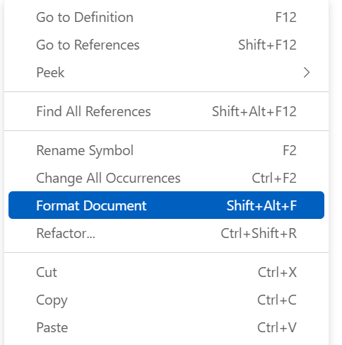

注释快捷键:ctrl+/

块注释:shfit + alt +a

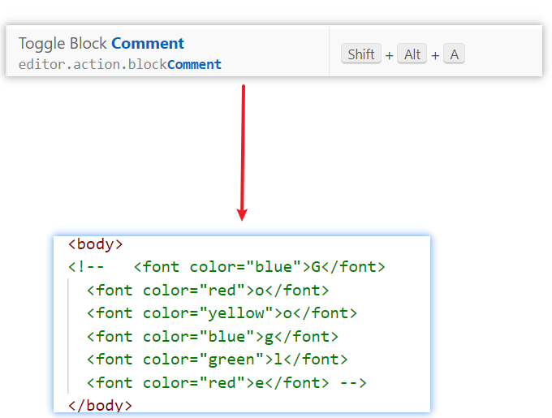

同时更改所有相同的变量名:按住alt选中要改的元素进行更改,或者ctrl+f进行批量替换


#### 特殊符号

特殊字符和特殊符号,有对应的表去查询，也叫html实体

```
&lt; 表示小于号 <

&gt; 表示大于号 >

&amp; 表示和号 &

&quot; 表示引号 "

&nbsp; 表示不断行的空格
```


#### 文档标签

```
html
	head
		meta
		title
	body
```


### `<ul>`列表

```html
    //无序列表(Unordered List)
	type属性:
	disc：实心圆（默认值）。
    circle：空心圆。
    square：实心方块。
    none：无项目符号。
    <body>
         <ul type = ''>
             <li>列表条目1</li>
             <li>列表条目2</li>
             <li>列表条目3</li>
         </ul>
     </body>
     
     //有序 带有序号(Ordered List)
	type属性,能改变列表前面的标识符号
        a for lowercase letters
        A for uppercase letters
        i for lowercase Roman numerals
        I for uppercase Roman numerals
        1 for numbers (default)
    <body>
         <ol type = ''>
             <li>步骤1</li>
             <li>步骤2</li>
             <li>步骤3</li>
         </ol>
     </body>
```


### ``图片

```html


<imge src="" alt="" width="200px" height="400px">
```

  `./`表示当前路径,然后依次写下一级目录  `名称1/名称2/` ;  `../` 表示返还上一级目录,接着同样一次写下一级目录名  `名称1/名称2/`


懒加载

```html

```

- `auto`（默认值）：浏览器自行决定是否懒加载，通常会立即加载
- `lazy`：启用懒加载，图片会在接近视口时才开始加载，节省带宽和加快首屏速度
- `eager`：强制浏览器立即加载，不使用懒加载


### `<video>`视频

```html
<!-- autoplay: 自动播放（浏览器要求必须同时设置 muted） -->
<!-- muted: 静音 -->
<!-- loop: 循环播放 -->
<!-- controls: 显示原生控件，去掉此属性即可隐藏 -->
<video
  id="v"
  src="data\乐土火符.mp4"
  autoplay
  muted
  loop
  controls
></video>
```

`controls`这个属性决定是否显示原生控件，在标签里写上，鼠标hover时就显示控件，不写就不显示，在js中对应`元素节点.control = true / false`


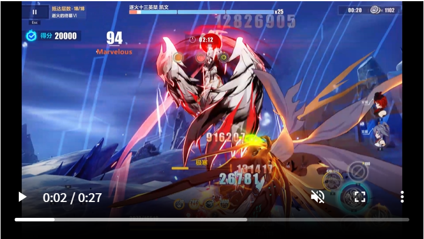


`autoplay`：页面加载后自动播放，但是未经用户同意，直接播放有声视频是会被阻止的，所以要搭配`muted`属性才能够生效

`muted`：静音

`loop`：播放到末尾时，回到开头重播

元素宽高：

- `<video>`是行内替换元素，直接用 CSS 的 `width` / `height` 控制，单位 px、%、vw 均可。
- 若只设置宽度不设高度，默认按视频原始比例自动计算高度。
- 宽高都 `auto`：视频按原始分辨率展示，例如 1920×1080 就占 1920px。


### `<a>`

```html
<a href="https://www.mi.com/index.html" target = "">
  
</a>
```

target可以定义链接打开的方式,`_black`表示在新标签页中打卡,`_self`表示在当前窗口中打开


锚链接, 能跳转到当前页面其它部分

```html
<!-- 模拟文章章节跳转,href中的链接对应相应的id -->
<ul>
    <li><a href="#chapter1">第一章：引言</a></li>
    <li><a href="#chapter2">第二章：发展</a></li>
    <li><a href="#chapter3">第三章：结论</a></li>
</ul>

<h2 id="chapter1">第一章：引言</h2>
<p>这是第一章的内容。这里介绍了文章的背景和目的。</p>

<h2 id="chapter2">第二章：发展</h2>
<p>这是第二章的内容。这里详细讨论了主题的发展过程。</p>

<h2 id="chapter3">第三章：结论</h2>
<p>这是第三章的内容。这里总结了主要观点并提出了未来的方向。</p>
```


### 结构性语义标签

语义化标签

先用div确定整体大纲,然后用语义标签替换显得更加高级

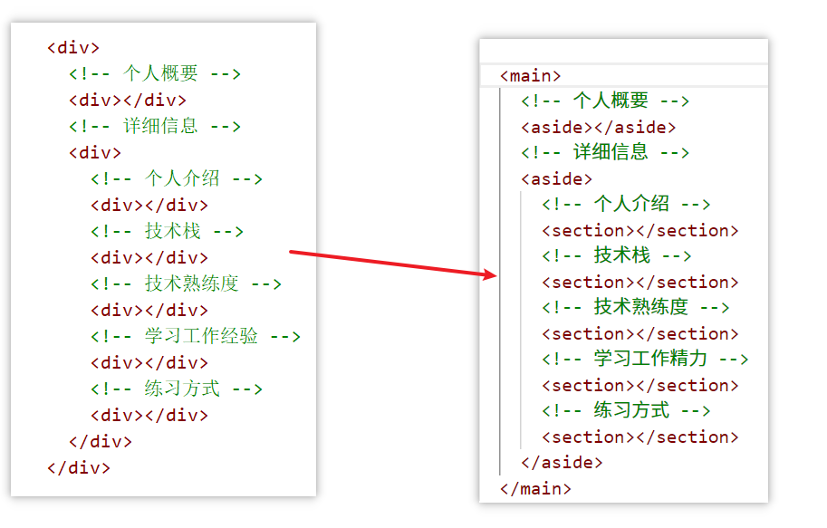


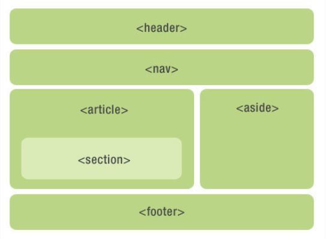

```
<header>：定义文档的头部区域，通常包含标题、导航链接等。
<nav>：定义导航链接的部分。
<main>：定义文档的主要内容部分，通常是页面最重要的内容。
<section>：定义文档中的一个章节或部分，通常包含标题和一些内容。
<article>：定义独立的内容块，通常是可以独立于其他内容进行分发的文章或帖子。
<aside>：定义与主要内容相关但不是主要内容的部分，例如侧边栏、广告等。
<footer>：定义文档的底部区域，通常包含版权信息、联系信息等。
```


### 表单html

```html
遇到表单区域，尽量使用from标签，而不是div标签，因为form表单有一些内置功能，比如和input元素相互配合，能让用户在输入框按下回车键时提交表单

`action` 属性定义了表单数据提交的目标 URL,未填写就是提交到当前页面

当在写页面的时候，遇到一个内容区域，可嵌套可不嵌套div标签时，一般选择嵌套一个div标签，比如在表单的input元素外面嵌套一个div标签，这样可以让界面样式更加好写，方便去设置css

<form>标签里所有的<button>元素默认都是type="submit"的，点击就会提交整个表单，所以在写<button>标签时，如果不想让它提交表单，就要设置type="button"，如：
<button type="button">获取验证码</button>
如果要重置表单，则需要设置type="reset"，如：
<button type="reset">重置表单</button>

下拉列表选择框的<select>标签有一个multiple属性，通过<select multiple="multiple">来设置这个属性，可以让用户在下拉列表中选择多个选项

通过<label>标签可以让用户点击input元素旁的文本时也能选中input元素，只需将<input>元素和文本放在<label>标签内即可，比如：
<label>
  <input type="checkbox" />
  选项1
</label>

textarea标签是一个多行文本输入框
```


```html
<body>
  <form action="" class="container">
    <h1>用户注册</h1>

    <div class="form-item">
      <input type="text" placeholder="请输入11位手机号" maxlength="11">
    </div>

    <div class="form-item">
      <input type="text" placeholder="请填写验证码">
      <button type="button">获取验证码</button>
    </div>

    <div class="form-item">
      <input type="password" placeholder="请输入密码">
    </div>

    <div class="form-item">
      <input type="password" placeholder="请再次确认密码">
    </div>

    <div class="form-item">
      <select multiple="multiple">
        <option >爱好1</option>
        <option >爱好2</option>
        <option >爱好3</option>
        <option >爱好4</option>
        <option >爱好5</option>
        <option >爱好6</option>
        <option >爱好7</option>
        <option >爱好8</option>
        <option >爱好9</option>
        <option >爱好10</option>
      </select>
    </div>

    <div class="form-item">
      <div class="title">性别</div>

      <label>
        <input type="radio" name="sex" />
        <span>男</span>
      </label>
      
      <label>
        <input type="radio" name="sex" />
        <span>女</span>
      </label>
    </div>

    <div class="form-item">
      <textarea placeholder="请输入内容"></textarea>
    </div>

    <div class="form-item">
      <label>
        <input type="checkbox">
        <span>我已同意相关协议</span>
      </label>
    </div>

    <div class="form-item">
      <button>立即注册</button>
      <button type="reset">重置表单</button>
    </div>
  </form>
</body>
```

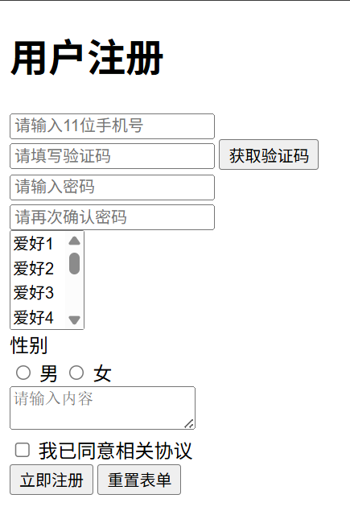


#### input常用type类型

1. **text**:

   - 默认类型，允许用户输入一行文本。

   ```
   <input type="text" placeholder="输入文本">
   ```

2. **password**:

   - 用于输入密码，输入的文本会以星号（或其他符号）隐藏。

   ```html
   <label for="password">密码:</label>
   <input type="password" name="password" id="password" placeholder="***">
   ```

   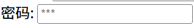

3. **email**:

   - 用于输入电子邮件地址，浏览器会对格式进行基本验证。

   ```
   <input type="email" placeholder="输入电子邮件">
   ```

4. **url**:

   - 用于输入网址，浏览器会进行格式验证。

   ```
   <input type="url" placeholder="输入网址">
   ```

5. **number**:

   - 用于输入数字，可以指定最小值、最大值和步长。

   ```
   <input type="number" min="1" max="10" step="1">
   ```

6. **range**:

   - 用于输入一个在指定范围内的数值，通常以滑块的形式呈现。

   ```
   <input type="range" min="1" max="100" value="50">
   ```

7. **date**:

   - 用于输入日期，通常以日期选择器的形式呈现。

   ```
   <input type="date">
   ```

8. **month**:

   - 用于输入年月，通常以选择器的形式呈现。

   ```
   <input type="month">
   ```

9. **week**:

   - 用于输入某一周，通常以选择器的形式呈现。

   ```
   <input type="week">
   ```

10. **time**:

    - 用于输入时间，通常以时间选择器的形式呈现。

    ```
    <input type="time">
    ```

11. **datetime-local**:

    - 用于输入本地日期和时间，通常以选择器的形式呈现。

    ```
    <input type="datetime-local">
    ```

12. **search**:

    - 用于输入搜索查询，通常具有特殊的样式和行为。

    ```
    <input type="search" placeholder="搜索">
    ```

13. **tel**:

    - 用于输入电话号码，浏览器会进行基本格式验证。

    ```
    <input type="tel" placeholder="输入电话号码">
    ```

14. **color**:

    - 用于选择颜色，通常以颜色选择器的形式呈现。

    ```
    <input type="color">
    ```

15. **file**:

    - 用于上传文件，用户可以通过文件选择对话框选择文件。

    ```html
    <label for="profile">照 片:</label>
    <input type="file">
    ```

    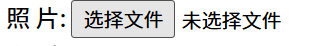

16. **checkbox**:复选框

    - 用于表示布尔值，用户可以选中或不选中,多选框
    - **`name`**:指定多选框的名称。当表单提交时，使用这个名称作为键,如果多个多选框的name属性相同,选中的选项会以数组形式发送

    ```html
    <label>喜欢的类型</label>
    <input type="checkbox" name="favor" id="favor1" value="可爱" checked>
    <label for="favor1">可爱</label>
    
    <input type="checkbox" name="favor" id="favor2" value="性感" checked>
    <label for="favor2">性感</label>
    
    <input type="checkbox" name="favor" id="favor3" value="御姐">
    <label for="favor3">御姐</label>
    
    <input type="checkbox" name="favor" id="favor4" value="萝莉">
    <label for="favor4">萝莉</label>
    
    <input type="checkbox" name="favor" id="favor5" value="小鲜肉">
    <label for="favor5">小鲜肉</label>
    
    <input type="checkbox" name="favor" id="favor6" value="大叔">
    <label for="favor6">大叔</label>
    ```

    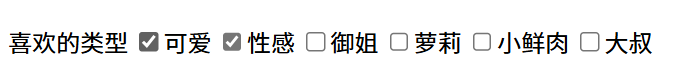

    <hr>

17. **radio**:

    - 单选
    - 其中`name` 属性非常重要。它的作用是将一组单选框联系在一起，使得在同一组中只能选择一个选项。
    - `value`属性一定要带上,因为表单上传后,单选框和多选框的数据会以name=value&name1=value1$....的形式传输到后端,有value属性才能区分用户选择了哪些选项

    ```html
    <label>性 别:</label>
    <input type="radio" name="gender" id="gender1" value="male">
    <label for="gender1">男</label>
    
    <input type="radio" name="gender" id="gender2" value="female">
    <label for="gender2">女</label>
    ```

    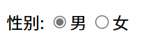

    <hr>

18. **button**:

    - 用于定义一个可点击的按钮。

    ```html
    <input type="submit" value="提交">
    ```

19. **submit**:

    - 用于提交表单,是一个按钮

    ```html
    <input type="submit" value="提交">
    ```

20. **reset**:

    - 用于重置表单字段,是一个按钮。

    ```html
    <input type="reset" value="重置">
    ```

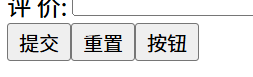

表单中直接用`<button></button>`按钮也能提交

使用图片也能提交

```html
<button></button>
```


### `<table>`表格

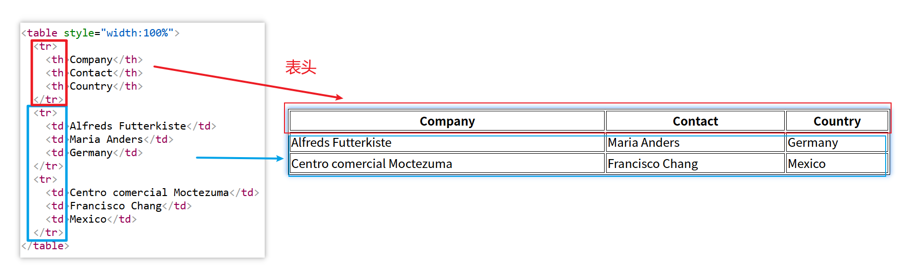

- **tr**：tr 是 table row 的缩写，表示表格的一行。
- **td**：td 是 table data 的缩写，表示表格的数据单元格。
- **th**：th 是 table header的缩写，表示表格的表头单元格。

表格的语义化标签

thead 页眉

tbody 主体

tfoot 页脚


#### tr,th和td常用attribute

colspan 跨列

rowspan 跨行

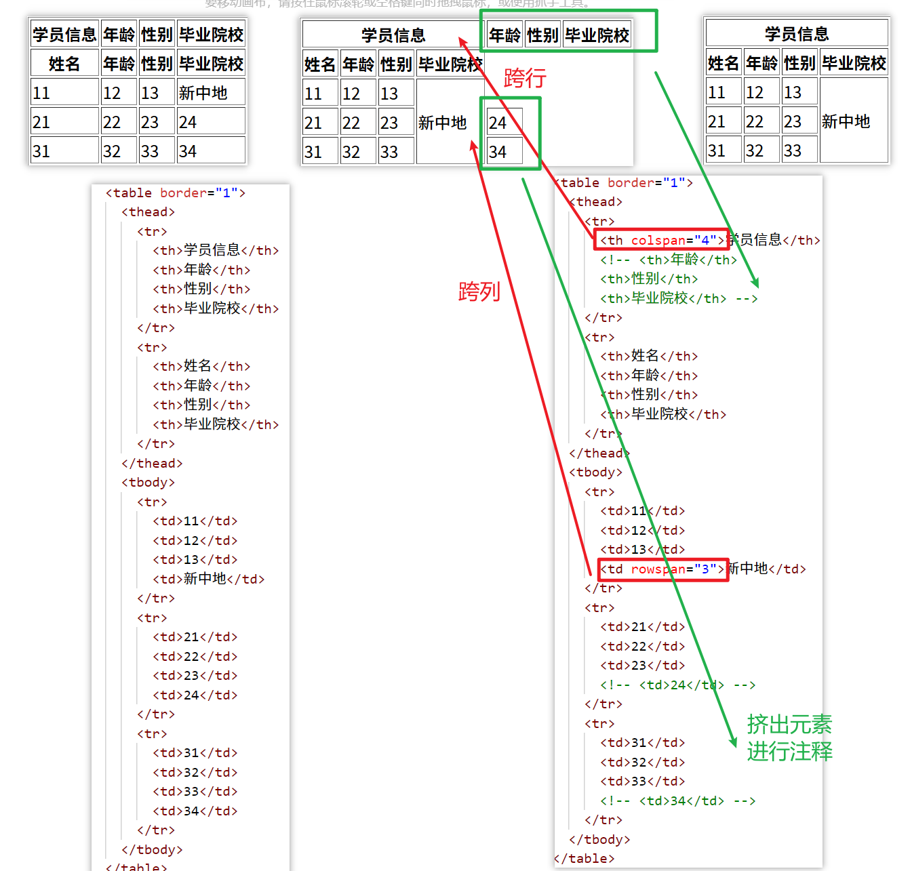


align=left,right,center,规定单元格内容的对齐方式


## 行级块级标签

### 行级标签

指标签内的元素能都在同一行显示,**多个元素在一起不会另起一行**,只能占用内容的宽度,不能设置宽高,和行内元素是同一含义

```
<span>

<a>
```

这里能看出并没有另起一行

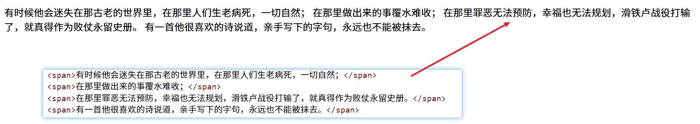

### 块级标签

其中的元素会在页面中占据整一行,可以设置宽高

```
<div>
<p>（段落）
<h1> 到 <h6>（标题）
<ul> 和 <ol>（无序和有序列表）
<table>（表格）
```

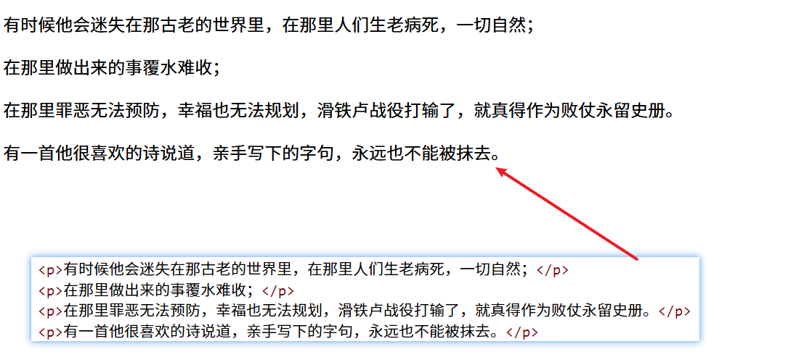

### 行块级元素样式

关于居中:

text-align的居中,指的是容器里面的内容居中

如果让行级元素中内容居中,仅仅需要在对应行标签上添加`text-align: center;`样式,

如果是块级元素,则是在父元素上添加`text-align: center;`样式,

<hr>

关于宽高

行级元素的宽高只能靠内容(content)支撑,无法设置宽高,

块级元素可以设置宽高


## 标签属性

```
title标签的作用：鼠标悬浮时显示提示文本（Tooltip）
```


# CSS

主流布局方式 div+css

## 创建样式方式

inline styles

```
<p style="color: red; font-size: 20px;">这是一个红色文本。</p>
```

internal styles

```
    <style>
        body {
            background-color: lightblue;
        }
        h1 {
            color: white;
            text-align: center;
        }
    </style>
</head>
<body>
    <h1>欢迎来到我的网站</h1>
    <p>这是一个使用内部样式的示例。</p>
</body>
```

extenal styles 外部样式

```html
<head>
    <meta charset="UTF-8">
    <meta name="viewport" content="width=device-width, initial-scale=1.0">
    <title>外部样式示例</title>
    <link rel="stylesheet" type="text/css" href="styles.css">
</head>
<body>
    <h1>欢迎来到我的网站</h1>
    <p>这是一个使用外部样式的示例。</p>
</body>
</html>

styles.css
body {
    background-color: lightblue;
}
h1 {
    color: white;
    text-align: center;
}
```

解析优先级,行内样式最高,内部样式和和外部样式谁先解析就应用谁


document.createElement('style');


### style标签可以有id

```html
<style id="my-style">
  body { background: #eee; }
</style>
```

```js
if (document.getElementById('record-screen-manager-styles')) return; // 避免重复注入
const style = 
style.id = 'record-screen-manager-styles';
```

这样可确保只注入一次该样式，后续也可直接用 `getElementById` 快速定位


## 选择器

id选择器,通过元素唯一标识符id选择html元素,一般选择页面中唯一的一个元素,以#+id名称为变量

class选择器,`.类名`进行选择,

元素选择器,使用标签名进行选择

优先级:类>id>元素,通用性越低,优先级越高

```css
标签选择器
p {
 color: red;
 }

类选择器
.red {
 color: red;
 }

 id选择器
#red {
 color: red;
 }

通配符选择器
* {
 color: red;
 }

并集选择器
div,p{
 color: red;
}

交集选择器
p#c1{
 color: red;
}

后代选择器 选择所有父级是 <div> 元素的 <p> 元素
div p{
 color: red;
}

.container .info{
  ......
}

子代选择器  选择<div>元素内的所有<p>元素
div>p{
 color: red;
}

相邻兄弟选择器
h2 + p {
  color: blue; /* 将紧接在 h2 后面的 p 元素的文本颜色设为蓝色 */
}

属性选择器
[attribute] {
  /* 样式 */
}

选择具有指定属性并且属性值完全匹配的元素。
input[type="text"] {
    border: 1px solid black; /* 选择所有类型为 'text' 的输入框 */
}

伪类选择器
伪类指元素处于交互的某种状态中,比如鼠标悬停,点击后等
a:link {color:#FF0000;} /* 未访问的链接 */
a:visited {color:#00FF00;} /* 已访问的链接 */
a:hover {color:#FF00FF;} /* 鼠标划过链接 */
a:active {color:#0000FF;} /* 已选中的链接 */


加法语法
/* 当鼠标悬停select时，让container展开 */
.select:hover + .container {
  transform: scaleY(1);
  pointer-events: auto; /* 开启鼠标事件 */
}
```


伪类结构选择器

```html
<div class="icon-panel">
  <button class="icon-btn"></button>  <!-- button -->
  <button class="icon-btn"></button>  <!-- button -->
  <button class="icon-btn"></button>  <!-- button -->
  <div class="pointer"></div>          <!-- div -->
</div>
```

- `.icon-btn:last-child` 尝试匹配 `.icon-btn` 元素中作为 `.icon-panel` 最后一个子元素的那个，但最后一个子元素是 `<div class="pointer">`，不是按钮，因此没有匹配。
- `.icon-btn:last-of-type` 匹配 `.icon-panel` 中**最后一个 `<button>` 元素**，即最后一个 `.icon-btn`。

对于列表

```
li:first-child{   /* 交集写法,要满足li又要满足是ul的第一个子元素 */
  color: red;
}
li:nth-child(2){    /* 第二个 */
  color: green;
}
li:last-child{     /* 最后一个 */
  color: blue;
}


p 表示选择所有的 <p> 元素
:nth-child(2) 是伪类，表示选择父元素下第二个子元素
组合起来，p:nth-child(2) 选择的是父元素的第二个子元素，且该子元素是 <p> 标签的元素


p:nth-of-type(2)	选择所有p元素第二个为p的子元素
```


选择器可以嵌套写,比如在触摸一个元素的时候,同时要多个元素达成某个效果

```css
.box:hover{
  .left{
    transform: translateX(-100%);
  }
  .right{
    transform: translateX(100%);
  }
}
```

选择器使用

类+后代,选择器层级不超过5个

id选择器,一般用在`<label></label>`和锚链接上


伪类选择器判断

```html
<style>
.nav-open-btn:is(:hover, :focus-visible) .line {
    background-color: white;
}
</style>
<button class="nav-open-btn btn" aria-label="open menu" data-nav-toggler>
    <span class="line line-1"></span>
    <span class="line line-2"></span>
</button>
```


`:is(:hover, :focus-visible)` 是一个伪类函数，表示选择满足 `:hover` 或 `:focus-visible` 伪类的 `.nav-open-btn` 元素


`:not(:last-child)`
 这是一个否定伪类选择器，意思是“不是最后一个子元素”的元素。

```css
/* 所有带有 service-item 类，且不是其父元素的最后一个子元素的元素 */
.service-item:not(:last-child) {
  border-left: 1px solid var(--border-eerie-black);
}
```


### `标签+选择器`的语法

类和 ID选择器: 使用 `.` 来表示类，`#` 来表示 ID

输入 `.container` 会生成 

```html
<div class="container"></div>
```

输入`#header`会生成

```html
<div id="header"></div>
```


输入 `div.container#header` 

```html
<div class="container" id="header"></div>
```


利用子代选择器嵌套标签,输入 `ul>li*3` 会生成：

```html
<ul>
    <li></li>
    <li></li>
    <li></li>
</ul>
```


重复, `ul>li.item*5`

```html
<ul>
    <li class="item"></li>
    <li class="item"></li>
    <li class="item"></li>
    <li class="item"></li>
    <li class="item"></li>
</ul>
```

关于居中:

如果让行级元素中内容居中,仅仅需要在对应行标签上添加`text-align: center;`样式,

如果是块级元素,则是在父元素上添加


## 常见样式属性

### 容器宽高

```css
p.ex {
height:100px;
width:100px;
}
```

| auto     | 默认值。浏览器可计算出实际的宽度。         |
| -------- | ------------------------------------------ |
| *length* | 使用 px、cm 等单位定义宽度。               |
| *%*      | 定义基于包含块（父元素）宽度的百分比宽度。 |


css**包含块**

给元素设置长宽百分比的时候，是基于父元素宽高，更专业的说法指的是包含块

如果定位是 **`static`**、**`relative`** **或 `sticky`**,包含块就是最近的祖先元素（比如说 inline-block, block 或 list-item 元素）

如果定位是**`absolute`** ，包含块就是由它的最近的 position 的值不是 `static` （也就是值为`fixed`, `absolute`, `relative` 或 `sticky`）的祖先块元素的内容区组成，（absolute脱标瞬间，元素并不会突破祖先块元素，除非施加定位）

如果没有定位祖先元素，**就是相对于视口宽高**。


**脱离文档流后元素宽度变化**

默认情况下

（未设置 position 或 position: static/relative）

块级元素默认宽度是**其包含块的宽度**（通常是父元素的内容区宽度）

当元素脱离文档流，不再占据空间, 默认情况下，如果没有设置显式的 `width`，浏览器会让元素的宽度**收缩到包裹其内容的最小宽度**，也就是“内容宽度”


块级元素仅包裹内容

元素宽高根据内容自动调整  自适应宽高

```css
width: fit-content;
height: fit-content;

/* block元素content部分的最大宽度始终等于内容的最大宽度,会让元素尽量宽，避免内容换行或被裁剪 */
max-width: max-content;

max-width: 1200px; 通常用于居中自适应大容器，宽度随屏幕变化最大不超过1200px；
min-width: 1200px; 用于强制最小宽度，适合不想页面过窄时屏幕内容变形
```


保持宽高比

```css
aspect-ratio: var(--width) / var(--height);
```


### 字体样式

```css
.font1 {
  color: blue;					/* 字体大小 */
  font-size: 100px;				/* 字体颜色 */
}

h1 {
    font-family: 隶书;		   /* Specifies the font family for text  字体风格 黑体 楷体*/
    font-size: 24px;            /* Specifies the font of text 1em=16px 使用百分比则是指,相对于父标签样式规定的文字大小百分比*/
    font-style: italic;         /* 字体样式 */
    font-weight: bold;          /* 字体粗细 */ 
}

连写
font: font-style;font-weight;font-size/font-height;font-family
```

### 文本

text-align

```css
div {
    text-align: center; left right justify        /* 文本居中,连边对齐 */
 /* text-align sets the horizontal alignment of the inline-level content inside a block element or table-cell */
    
      /* 首字母大写 */
  text-transform: capitalize;
}

字符间距
letter-spacing: 1px;  给文本的每个字符之间增加1像素的水平空隙
```

text-decoration

有下划线,删除线

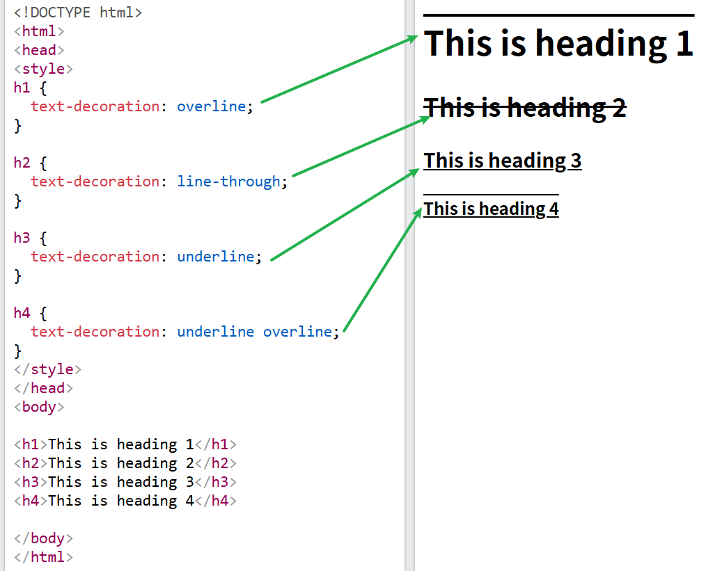

```
`text-decoration: none`清除下划线,清除样式

text-decoration: line-through  删除线
```

line-height 行高  

如果文字行高等于容器高度,则文字就会垂直居中, 或者加相同的上下内边距也行

```css
div {
    line-height: 1.5;          /* 行高为字体尺寸的1.5倍*/
    line-height: 200%;          /* 行高相对于字体尺寸的2倍*/
    line-height: 30px;          /* 固定行高*/
}    

```

text-indent  缩进 Specifies the indentation of the first line in a text-block


文字方向设置为横向

文字方向为竖向

```
.horizontal-text {
            writing-mode: horizontal-tb; /* 设置为横向，从上到下 */
        }
```

- horizontal-tb：水平方向自上而下的书写方式。即 left-right-top-bottom
- vertical-rl：垂直方向自右而左的书写方式。即 top-bottom-right-left
- vertical-lr：垂直方向内内容从上到下，水平方向从左到右
- sideways-rl：内容垂直方向从上到下排列
- sideways-lr：内容垂直方向从下到上排列


vertical-align 文字基线

该属性定义行内元素（inline）的基线相对于该元素所在行的基线的垂直对齐。**允许指定负长度值和百分比值**。这会使元素降低而不是升高。

有时候发现文字底部并没有完全对齐

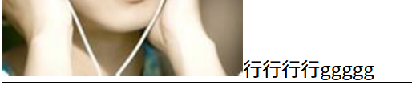

这是英文特有的文字基线导致的

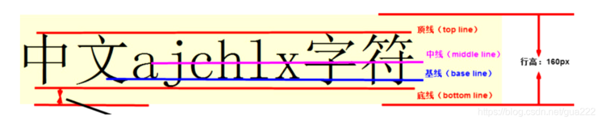

解决办法：

top	把元素的顶端与行中最高元素的顶端对齐

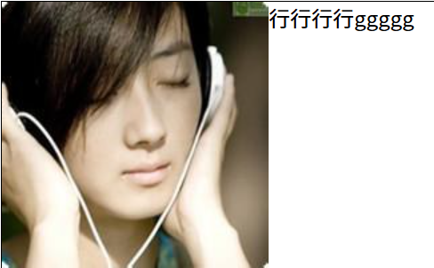

middle	把此元素放置在父元素的中部。

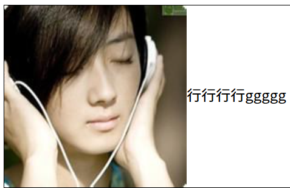

bottom	使元素及其后代元素的底部与整行的底部对齐。

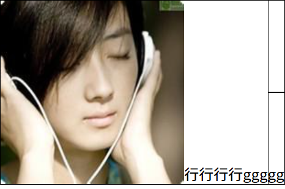

```
img{
			vertical-align: bottom; /* 底线对齐 */
			vertical-align: top; /* 顶部对齐 */
			vertical-align: middle; /* 居中对齐 */
		}
```

或者给img设置 display:block; 转为块级元素就不会存在这种问题了。


placeholder样式设置

```css
input::placeholder {
  color: #999999;
  font-size: 14px;
  font-style: italic;
}

```


抗锯齿

```
/* 字体的抗锯齿 */
-webkit-font-smoothing: antialiased;
```


换行

```
white-space: nowrap; /* 禁止中文拆字换行 */  （中文默认允许在字符间换行）
```


### 边框

```css
div{
  /* border-width | border-style dotted solid double dashed | 边框颜色 */
border: medium dashed green;
}
```


表格边框合并,网格合并

```
table
{
    border-collapse:collapse;
}
```

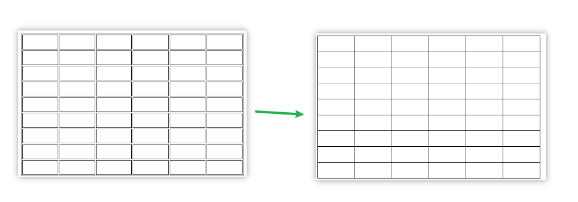

### 背景

渐变背景:  `background-image: radial-gradient(transparent,grey);`

```css
div {
  width: 400px;
  height: 400px;
  background-color: darkgoldenrod;   /* 背景颜色 */
  background-image: url(../static/lb.jpg);		/* 背景图片 */
  background-repeat: no-repeat;		/* 取消背景图片重复 */
  
    
  background-position: 0px 0px;    /* 图片位置,左上顶点 */
    
    
  background-size: cover;    /* 背景显示模式 contain */
  /* 表示占据父级尺寸的百分比 */
  /* There are four different syntaxes you can use with this property: the keyword syntax ("auto", "cover" and "contain"), the one-value syntax (sets the width of the image (height becomes "auto"), the two-value syntax (first value: width of the image, second value: height), and the multiple background syntax (separated with comma). */

  /* 连写 */
  background: background-color background-image background-position background-repeat;
}
```

**cover**: 	Resize the background image to cover the entire container, even if it has to stretch the image or cut a little bit off one of the edges

**contain**: 	Resize the background image to make sure the image is fully visible


背景颜色反转

比如给鼠标跟随元素设置这个属性,当鼠标挪动到那里,那里背景颜色就会反转

```css
.cursor-dot.hovered {
  transform: translate(-50%, -50%) scale(10);
  mix-blend-mode: exclusion; //指定一个元素的内容如何与其父元素的内容和背景进行混合
}
```


### 图片背景


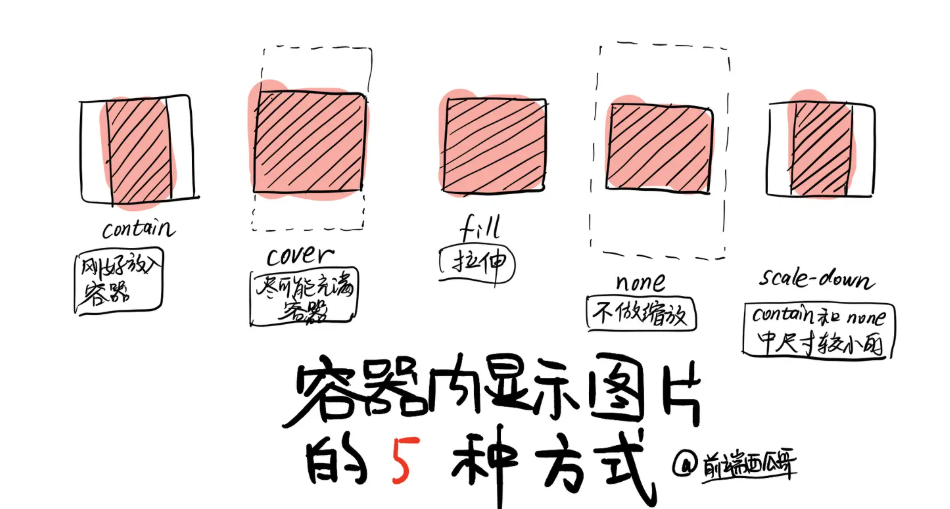

```css
img.a {
  width: 200px;
  height: 400px;
  object-fit: cover;
}
```

```
1. contain
含义：保持图片原有宽高比例，把图片完整缩放到“完全装进”容器，可能会留白（容器没被填满，通常出现上下或左右空白）。

2. cover
含义：保持图片原有宽高比例，把图片缩放到刚好填满整个容器，多余部分会被裁剪掉。

3. fill
含义：拉伸（或压缩）图片，直接铺满整个容器，可能会变形，不保证比例。

4. none
含义：保持图片原始大小，不进行缩放。如果图片比容器大，会溢出；比容器小，则只显示原始尺寸。

5. scale-down
含义：取 none 和 contain 的较小渲染结果。即：图片如果比容器大则缩到 contain，否则保持原大小。
```

| 选项       | 保持比例 | 会裁剪 | 是否变形 | 会留白 | 特点                           |
| ---------- | -------- | ------ | -------- | ------ | ------------------------------ |
| contain    | 是       | 否     | 否       | 可能   | 保证全部内容出现，可能有空隙   |
| cover      | 是       | 可能   | 否       | 否     | 容器铺满，图片可能部分裁剪     |
| fill       | 否       | 否     | 可能     | 否     | 填满容器，图片可能宽高拉伸变形 |
| none       | 是       | 否     | 否       | 可能   | 原图大小，不缩放               |
| scale-down | 是       | 否     | 否       | 可能   | 尺寸取最小的显示方式           |


```
CSS 只显示图片的一部分（比如图片左上角100x100像素）

css
.logo {
  width: 100px;     /* 设置显示区域的宽度 */
  height: 100px;    /* 设置显示区域的高度 */
  background-image: url('../../public/image/image.png');
  background-position: 0 0;    /* 显示图片的左上角 */
  background-size: auto;       /* 保持原图尺寸 */
  background-repeat: no-repeat;
}
```


背景颜色滤镜

能将模糊或者色彩偏移用于后面的元素

```js
backdrop-filter: blur(10px);  高斯模糊，模糊半径为 10 像素。
backdrop-filter: invert(80%);  颜色反转
backdrop-filter: sepia(90%);   棕褐色（复古）滤镜，程度为 90%

例子：https://developer.mozilla.org/en-US/docs/Web/CSS/backdrop-filter
```


### 滚动条

下面是设置div元素的滚动条样式

```css
/* 设置滚动条整体部分样式 */
div::-webkit-scrollbar {
  width: 10px;
}

/* 设置滚动条的轨道样式 */
div::-webkit-scrollbar-track {
  background: blue;
}

/* 设置滚动条里面的上下移动小方块的样式 */
div::-webkit-scrollbar-thumb {
  background: red;
  border-radius: 50px;
}
```

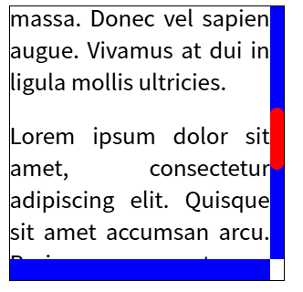


### cursor样式

`cursor: auto;`

| 类型            | CSS 值                                                       | 例子                                                         | 描述                                                         |
| :-------------- | :----------------------------------------------------------- | :----------------------------------------------------------- | :----------------------------------------------------------- |
| 常规            | `auto`                                                       |                                                              | 浏览器根据当前内容决定指针样式 ，例如当内容是文字时使用 text 样式 |
| `default`       |  | 默认指针，通常是箭头。                                       |                                                              |
| `none`          |                                                              | 无指针被渲染                                                 |                                                              |
| 链接及状态      | `context-menu`                                               |  | 指针下有可用内容目录。                                       |
| `help`          |  | 指示帮助                                                     |                                                              |
| `pointer`       |  | 悬浮于连接上时，通常为手                                     |                                                              |
| `progress`      |  | 程序后台繁忙，用户仍可交互 (与).`wait 相反`                  |                                                              |
| `wait`          |  | 程序繁忙，用户不可交互 (与).图标一般为沙漏或者表。`progress 相反` |                                                              |
| 选择            | `cell`                                                       |  | 指示单元格可被选中                                           |
| `crosshair`     |  | 交叉指针，通常指示位图中的框选                               |                                                              |
| `text`          |  | 指示文字可被选中                                             |                                                              |
| `vertical-text` |  | 指示垂直文字可被选中                                         |                                                              |
| 拖拽            | `alias`                                                      |  | 复制或快捷方式将要被创建                                     |
| `copy`          |  | 指示可复制                                                   |                                                              |
| `move`          |  | 被悬浮的物体可被移动                                         |                                                              |
| `no-drop`       |  | 当前位置不能扔下 [Firefox bug 275173](https://bugzil.la/275173)Windows 或 Mac OS X 中 “no-drop 与 not-allowed 相同”。 |                                                              |
| `not-allowed`   |  | 不能执行                                                     |                                                              |


### table样式

```html
设置表格列宽
    <colgroup> 标签用于对表格中的列进行分组，通常放在 <table> 标签内、<thead> 之前。
    <col> 标签用于指定某一列的属性（如宽度、样式等）。
    <colgroup> 内可以有多个 <col>，每个 <col> 对应表格的一列，顺序要和表格列一致。
    
<table>
  <colgroup>
    <col style="width: 40%;">
    <col style="width: 20%;">
    <col style="width: 20%;">
    <col style="width: 20%;">
  </colgroup>
  <thead>
    <tr>
      <th>列A</th>
      <th>列B</th>
      <th>列C</th>
      <th>列D</th>
    </tr>
  </thead>
  <tbody>
    <!-- 表格内容 -->
  </tbody>
</table>
```


### 移除默认样式

下拉框移除默认样式

```css
select {
    appearance: none; /* 移除默认样式 */
}

//清除被选中时的样式
select:focus {
	outline: none; /* 去掉蓝色外边框 */
	box-shadow: none; /* 去掉阴影 */
}
```

input

```css
/* 去掉input聚焦时样式 */
input:focus {
  outline: none; /* 去掉聚焦时的轮廓线 */
  box-shadow: none; /* 去掉聚焦时的阴影 */
}
input {
    caret-color: transparent; /* 隐藏光标 */
}
<input type="text" readonly /> 阻止输入框获得焦点
```


```css
user-select: none; 的作用是禁止用户选中该元素的内容。

pointer-events: none; 禁止所有鼠标事件
dom.style.pointerEvents = "auto"; 恢复鼠标事件
style.cursor = "auto" 鼠标样式设置


重置样式
all: unset;  /*将元素的所有属性恢复到“未设置”的状态*/

/* 让元素不受鼠标和指针事件影响 */
pointer-events: none;
会让该元素对鼠标事件变得透明，事件会“穿过”它，作用于下方的元素。
场景：有时页面有个全屏动画、装饰层在上方，但又不希望它挡住下面按钮的点击
```

'<button>'

```css
/* 让 <button> 看起来像 <div> */
button {
  all: unset; /* 清除绝大部分浏览器默认样式 */
  display: block; /* 或者 inline-block，根据需求 */
  width: 100%;    /* 如果你想让它撑满父容器 */
}
```

`<a>`

```css
/* <a> 标签里的内容在页面上看起来跟普通文字一样 */
a {
  color: inherit;         /* 继承父元素的文字颜色 */
  text-decoration: none;  /* 取消下划线 */
  cursor: default;        /* 鼠标悬停时显示普通光标（可选） */
}
```

ul

```css
/* 用下面这种方式去掉margin和li的样式即可即可 清除样式 */ 
ul {
  margin: 0;
  padding: 0;
  list-style: none;
}
```


### 字符最合适字体

分别为不同字符指定字体

```
• 汉字： 'PingFang SC' （macOS）/ 'Microsoft YaHei'（Windows）
• 英文： 'Segoe UI' （Windows）/ -apple-system （macOS）
• 数字： 'Segoe UI' （和英文一样）
• 符号： 'Segoe UI' （和英文一样）
```


通用

```css
font-family: -apple-system, BlinkMacSystemFont, 'Segoe UI', 'Microsoft YaHei', 'PingFang SC', sans-serif;
```

**font-family** 是 CSS 属性，用于指定文本使用哪种字体显示。 它包含多个字体名称，用逗号分隔，浏览器会按顺序尝试使用这些字体。

**第1步**：检查系统是否安装了 `-apple-system`
✓ 有 → 使用它
✗ 无 → 尝试下一个

**第2步**：检查系统是否安装了 `BlinkMacSystemFont`
✓ 有 → 使用它
✗ 无 → 尝试下一个

**第3步**：检查系统是否安装了 `'Segoe UI'`
✓ 有 → 使用它
✗ 无 → 尝试下一个

**继续... 以此类推**，直到找到一个可用的字体
如果所有字体都不可用，使用 `sans-serif`（系统默认无衬线字体）

| 序号   | 字体名                 | 系统支持      | 作用                                      |
| :----- | :--------------------- | :------------ | :---------------------------------------- |
| **1**  | `-apple-system`        | macOS / iOS   | 自动选择苹果系统最优字体（San Francisco） |
| **2**  | `BlinkMacSystemFont`   | macOS / iOS   | 备用方案（如果 -apple-system 不可用）     |
| **3**  | `'Segoe UI'`           | Windows / Web | Windows 系统最清晰的英文字体              |
| **4**  | `'Roboto'`             | Android / Web | 谷歌开发，Android 系统默认字体            |
| **5**  | `'Helvetica Neue'`     | macOS / iOS   | 经典字体，Mac 系统备用                    |
| **6**  | `'PingFang SC'`        | macOS / iOS   | 苹果开发的中文字体，质量最高              |
| **7**  | `'Hiragino Sans GB'`   | macOS / iOS   | 日本字体厂商的中文字体，质量优秀          |
| **8**  | `'Source Han Sans SC'` | 部分 Linux    | 开源字体，某些系统的中文备用              |
| **9**  | `'Microsoft YaHei'`    | Windows       | 微软中文字体，Windows 自带                |
| **10** | `sans-serif`           | 所有系统      | 最后的备用方案（系统默认无衬线字体）      |


## 样式属性书写顺序

1.布局属性 display, float, position

2.宽高等尺寸属性 width  height

3.辅助背景颜色  background

4.盒子模型相关属性  border margin padding

5.其它样式(文本,字体,对齐,行高) color text-align font vertical-align line-height

6.点缀属性(圆角,阴影,光标小手) border-radius text-shadow box-shadow cursor

## CSS变量

css函数

在根选择器中自定义属性,这样整个文档都能使用

var()函数,可以在多出插入自定义属性

结合起来就是,在跟选择器中定义一个自定义属性,然后使用var()在各处插入

```html
  <style>
    /* 1.定义一个自定义属性 */
    :root{
      --green:green;
    }

    /* 2.在页面中选择不同的元素 使用var()插入自定义属性的值*/
    p{
      color: var(--green);
    }

    div{
      color: var(--green);
    }
  </style>
</head>
<body>
  <p>1111</p>
  <p>2222</p>
</body>
```

```css
:root {
  --blue: #2980b9;
  --black: #333;
  --white: #fff;
  --light-color: #777;
  --light-bg: #eee;
  /* 盒子阴影 */
  --box-shadow: 0 5px 10px rgba(0, 0, 0, 0.3);
}
```


变量可用于计算

```css
:root {
  --spacing-unit: 8px;
}

.container {
  padding: calc(var(--spacing-unit) * 2);
  margin-bottom: var(--spacing-unit);
}
```


## css单位

绝对长度：绝对长度，顾名思义，是绝对的；它们是固定的，不与任何东西相对。这意味着无论发生什么，它们都是相同的尺寸。绝对长度包括 `cm`、`mm`、`in`、`px`、`pts` 和 `pc`。

相对长度

| 单位 | 描述                                                         |
| :--- | :----------------------------------------------------------- |
| em   | 它是描述相对于应用在当前元素的字体尺寸，所以它也是相对长度单位。一般浏览器字体大小默认为16px，则2em == 32px； |
| ex   | 依赖于英文字母小 x 的高度                                    |
| ch   | 数字 0 的宽度                                                |
| rem  | rem 是根 em（root em）的缩写，rem作用于非根元素时，相对于根元素字体大小；rem作用于根元素字体大小时，相对于其出初始字体大小。 |
| vw   | Viewport Width，视窗宽度，1vw=视窗宽度的1%                   |
| vh   | Viewport Height，视窗高度，1vh=视窗高度的1%                  |
| vmin | vw和vh中较小的那个。                                         |
| vmax | vw和vh中较大的那个。                                         |
| %    |                                                              |


em和rem

1 个 `em` 等于**父元素**中设置的**字体大小**,只继承上一个父元素。

`rem` 是 CSS 中另一个测量长度的单位，它代表 `root em`。`rem`从根元素`html`那里继承它的大小,如果改变根元素字体大小,所有用`rem`单位的为大小的元素都会更新

`rem`示例代码

```html
  <style>
    html{
      font-size: 30px;
    }
    p{
      font-size: 2rem;
    }
  </style>
</head>
<body>
  <p>em</p>
  <p>rem</p>
</body>
```


## css特性

层叠性

后面的颜色会把前面的颜色覆盖掉

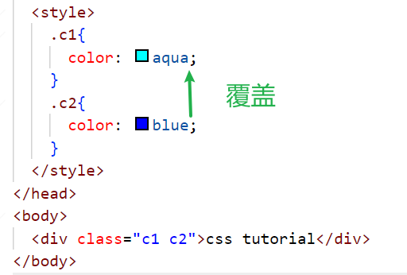

继承性

部分css属性会自动的从父元素传递给子元素,可以把通用样式写到body中  列表通用样式写到ul的标签上门

优先级

优先级高的会覆盖优先级低的

优先级的高低通过权重公式判定

权值等级划分， 一般来说是划分4个等级：

| 类型                            | 权重                        |
| :------------------------------ | :-------------------------- |
| 内联样式                        | 如: style=" "，权值为1000。 |
| ID选择器                        | 如：#name，权值为0100。     |
| class类选择器，伪类和属性选择器 | 如.name，权值为0010。       |
| 标签选择器和伪元素选择器        | 如div p，权值为0001。       |

通配符、子选择器、相邻选择器等的。如: *、>、+,权值为:0000。

底层:影响范围越小,优先级越高

```html
  <style>
    a{
      color: red;   /* 0001 */
    }

    li a{
      color: purple;    /* 0001 + 0001 = 0002 */
    }

    .myLink{
      color: gray;    /* 0010 */
    }

    #myLi .myLink{
      color: blue;    /* 0100 + 0010 = 0110 */
    }

    #myLi a{
      color: pink;    /* 0100 + 0001 = 0101 */
    }
  </style>
</head>
<body>
  <div>
    <ul>
      <li id="myLi">
        <a href="" class="myLink">
          class
        </a>
      </li>
    </ul>
  </div>
</body>
```

上述例子中,明显蓝色优先级最高

## 盒子模型

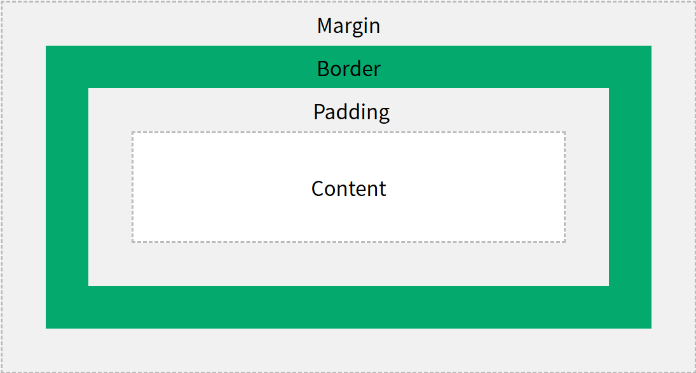

```css
div {
  width: 320px;
  height: 50px;
  padding: 10px;
  border: 5px solid gray;
  margin: 0;
}

div{
    background-color: green;     /* 背景颜色 */
    background-img        /* 背景图片 */
    width: 100px;		/* 宽 */
    height: 400px;		/* 高 */
}
```


### 行内块

行盒子不能设置宽高,宽高由内容决定

块盒子设置宽高是有效果的,不设置就默认由内容撑开

通过审查元素,块级元素有个属性,是display,可以实现行级和块级的转换

```
p.ex1 {display: none;}   此元素不可见
p.ex2 {display: inline;}	设置此元素为行级元素
p.ex3 {display: block;}		设置此元素为块级元素,使元素有换行符
p.ex4 {display: inline-block;}		设置为行内块,不会换行,但是可以设置宽高了
```

行内块布局间隙,把低下两个块级元素标签放在一排就行

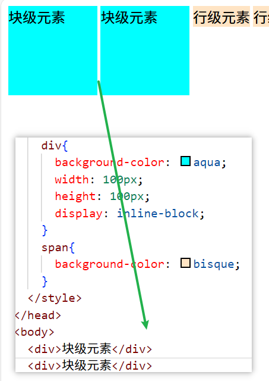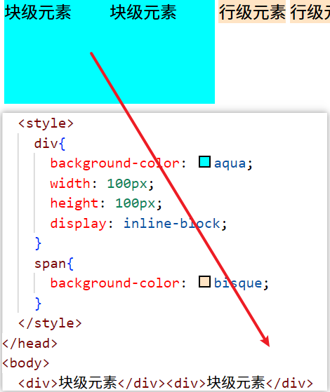

### 边框

```css
  /* 边框宽度  样式  颜色 */
  border: 1px solid green;  

  /* 分开写 */
  border-width: ;
  border-style: ;
  border-color: ;
```

单一方向边框复写

```css
p {
   border-bottom: 1px dotted gery
}
```


#### 边框宽度

这里可以看到更多属性

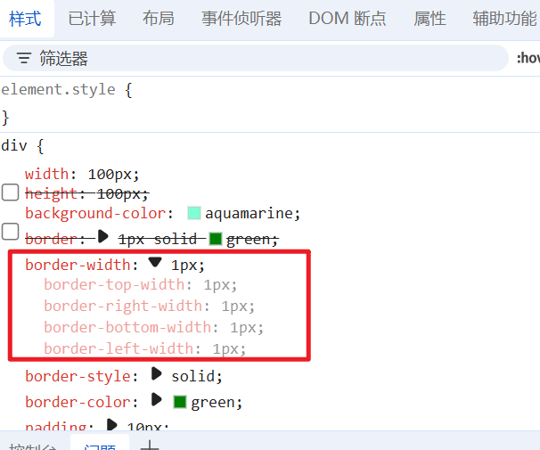

`border-width`给多值

一个值,设置的就是上右下左顺时针边框的宽度

2个值,第一个值代表上下,第二个值代表左右给

3个值,第一个值代表上,第二个值代表右,第三个值代表下,第四个值没有

4个值,按照上右下左顺时针赋值

```
border-widht: 1px 5px 10px 15px
```

更多属性

不同方向上边框宽度

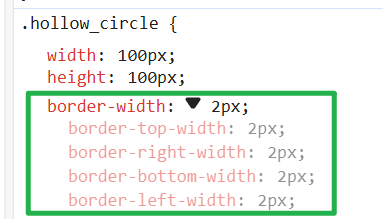

#### 样式

```css
p
{
    border-style:solid;
}
```

| 值     | 描述                                       |
| :----- | :----------------------------------------- |
| none   | 定义无边框。                               |
| dotted | 定义点状边框。在大多数浏览器中呈现为实线。 |
| dashed | 定义虚线。在大多数浏览器中呈现为实线。     |

不同方向边框样式,单一方向边框样式

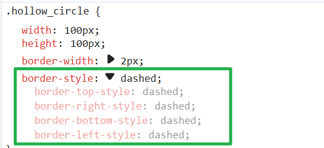

圆角

`border-radius` 属性是一个最多可指定四个 **border-\*-radius** 属性的复合属性

四个值的时候,表示的是每个角的圆角半斤值,顺时针从左上开始

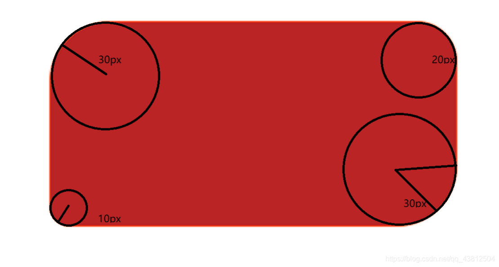

该属性最多可以设置8个参数,分别表示四个角的水平半径和垂直半径,相当于椭圆角

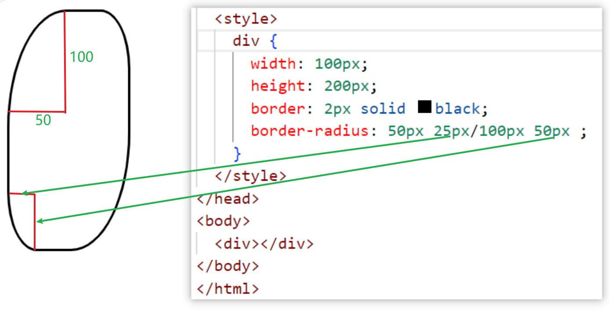


### 内边距

```css
p {
    padding:2cm 4cm 3cm 4cm;
}
```

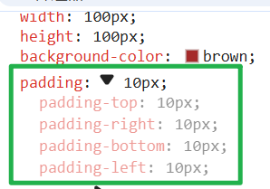

- padding:10px 5px 15px 20px;
  - 上填充是 10px
  - 右填充是 5px
  - 下填充是 15px
  - 左填充是 20px
- padding:10px 5px 15px;
  - 上填充是 10px
  - 右填充和左填充是 5px
  - 下填充是 15px
- padding:10px 5px;
  - 上填充和下填充是 10px
  - 右填充和左填充是 5px
- padding:10px;
  - 所有四个填充都是 10px

防止文字方向影响padding,可以设置以下属性

| 属性             | 作用                       | 方向                     | 传统等效属性                     |
| ---------------- | -------------------------- | ------------------------ | -------------------------------- |
| `padding-block`  | 设置块方向（上下）内边距   | 上下或竖排方向对应的两侧 | `padding-top` + `padding-bottom` |
| `padding-inline` | 设置内联方向（左右）内边距 | 左右或竖排方向对应的两侧 | `padding-left` + `padding-right` |


### 盒子尺寸

把宽高直接设置为盒子的总宽高,计算内边距和边框的大小,自动缩小content内容的宽高(内容自减)

防止盒子被撑大,防止超出盒子,自动内减

但是不会压缩到内容,如果内容已经被文字撑满,增加外边距依然会撑大盒子

```css
#example1 {
  box-sizing: border-box;   /* 元素的总高度和宽度包含内边距和边框(padding 与 border) */
}
```

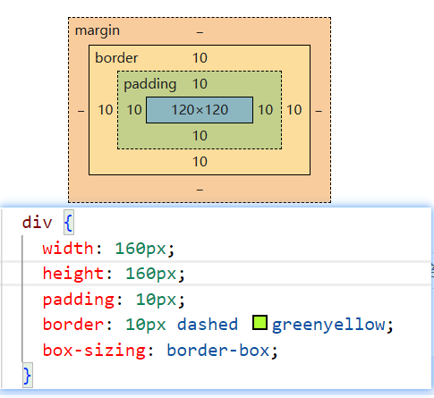

子元素大小不能超过父元素大小,所以不能公国给子元素添加内边距和边框来撑大父元素

实际宽高不算外边距

```
width(宽度) + padding(内边距) + border(边框) = 元素实际宽度
height(高度) + padding(内边距) + border(边框) = 元素实际高度
```

### margin

块级元素的水平居中需要依靠调整外边距,Margin

body元素自带外边距`margin:8px`,如果需要精准布局的时候需要删除这一部分

margin简写属性在一个声明中设置所有外边距属性。该属性可以有1到4个值。

- margin:10px 5px 15px 20px;
  - 上边距是 10px
  - 右边距是 5px
  - 下边距是 15px
  - 左边距是 20px
- margin:10px 5px 15px;
  - 上边距是 10px
  - 右边距和左边距是 5px
  - 下边距是 15px
- margin:10px 5px;
  - 上边距和下边距是 10px
  - 右边距和左边距是 5px
- margin:10px;
  - 所有四个边距都是 10px

单一方向外边距

```
margin-top: 50px;
```

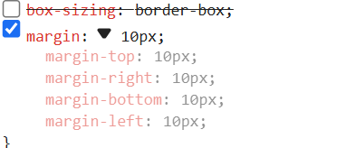

#### 上下外边距合并

左右外边距不会合并

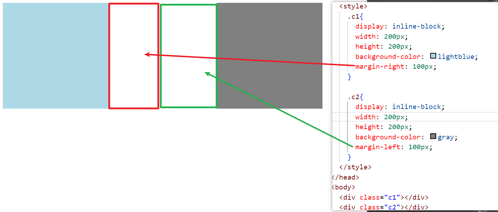

上下外边距会合并,取较大的一个

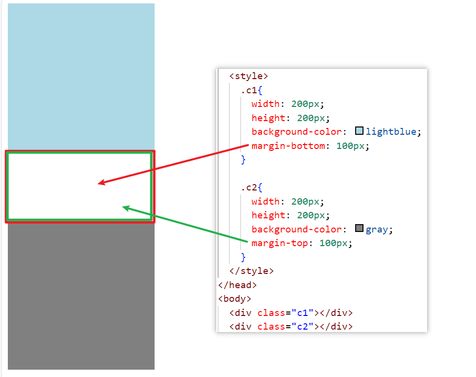

#### 外边距塌陷

父子元素的margin-top紧贴在一起,子元素设置margin-top样式会作用在父元素上

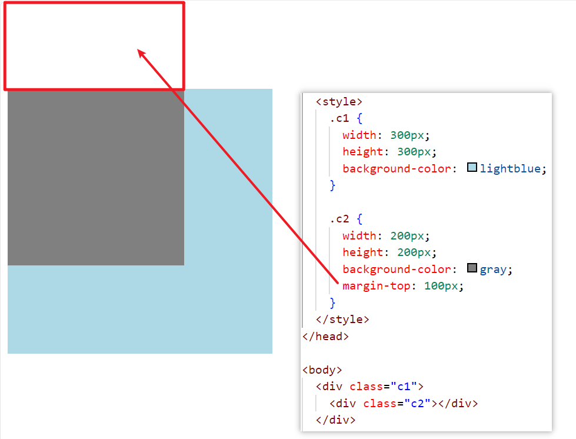

可以给父元素设置内边距解决这个问题

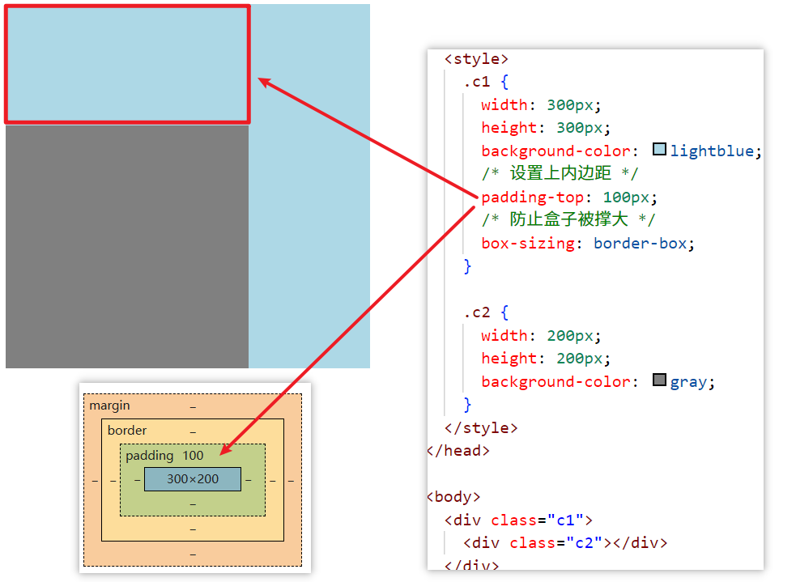


#### 逻辑属性

| 逻辑属性              | 作用描述                 | 传统物理属性对应 (LTR & 从上到下书写) |
| --------------------- | ------------------------ | ------------------------------------- |
| `margin-block-start`  | 元素块方向起始边的外边距 | `margin-top`                          |
| `margin-block-end`    | 元素块方向结束边的外边距 | `margin-bottom`                       |
| `margin-inline-start` | 元素行方向起始边的外边距 | `margin-left`                         |
| `margin-inline-end`   | 元素行方向结束边的外边距 | `margin-right`                        |

## 元素默认样式

方便布局

p标签就是默认自带外边距使之达到换行效果

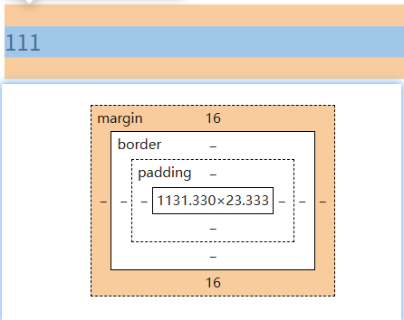

所以精确布局一定要取消标签自带的外边距

```css
比如下面就是p标签自带的默认样式
p {
    display: block;		//block表示垂直方向 margin-block-start相当于margin-top
    margin-block-start: 1em;	//block表示垂直方向 margin-block-end相当于margin-bottom
    margin-block-end: 1em;
    margin-inline-start: 0px;	//inline表示水平方向 margin-inline-start相当于margin-left
    margin-inline-end: 0px;		//inline表示水平方向 margin-inline-end相当于margin-right
}


/* 取消样式,等同于div*/
p {
  margin: 0;
}
```


ul也自带margin和padding-left

```css
ul {
    display: block;
    list-style-type: disc;
    margin-block-start: 1em;
    margin-block-end: 1em;
    padding-inline-start: 40px;
    unicode-bidi: isolate;
}

/* 用下面这种方式去掉margin和li的样式即可即可 清除样式 */ 
ul {
  margin: 0;
  padding: 0;
  list-style: none;
}
```


## 伪元素

普通元素是html写出来的,伪元素是用css模拟出来的

":before" 伪元素可以在元素的内容前面插入新内容。

":after" 伪元素可以在元素的内容之后插入新内容。

伪元素默认是块元素,可以通过设置`display:block`将其变成块元素

```html
  <style>
    div{
      width: 300px;
      height: 300px;
      background-color: lightblue;
    }

    div::before{
      width: 100px;
      height: 100px;
      content: '新中地';
      background-color: green;
    }

    div::after{
      content: '中地数码';
    }
  </style>
</head>
<body>
  <div>中地科技园</div>
</body>
```

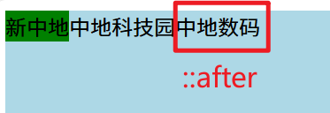


伪元素的内容里可以同时插入图片和文字

```css
.c1::after {
    content: url(./static/输入中.png) '输入中';
    height: 10px;
    width: 10px;
}
```


## 布局方式

### 标准流文档布局

行级元素从左往右水平排布,没有水平空间就会另起一行显示

块级元素从上往下排布


### 定位

是一种布局方式,可以把元素自由摆放,把元素盒子放到其它元素上面

1.设置定位模式

2.水平和垂直方向各取一个偏移值

默认情况下position: static

static	默认值。没有定位，元素出现在正常的流中（忽略 top, bottom, left, right 或者 z-index 声明）

#### 定位偏移属性

##### top、left

```
top、right、bottom、left 这些属性只有在元素的 position 为以下之一时才生效：
absolute（绝对定位）
fixed（固定定位）
relative（相对定位）
sticky（粘滞定位）
```

- `top: 10px`
   元素上边缘距离包含块（或参考区域）上边缘 10 像素。
- `right: 20px`
   元素右边缘距离包含块右边缘 20 像素。
- `bottom: 30px`
   元素下边缘距离包含块下边缘 30 像素。
- `left: 40px`
   元素左边缘距离包含块左边缘 40 像素。

```
包含块（定位父元素）
+--------------------------------------------------+
|                                                  |
|   top:10px                                       |
|   +------------------------------------------+   |
|   |                                          |   |
|   |                                          |   |
|   |                                          |   |
|   |    元素区域                              |   |right:20px
|   |                                          |   |
|   |                                          |   |
|   |                                          |   |
|   +------------------------------------------+   |
|       left:40px                          bottom:30px
+--------------------------------------------------+
```


##### inset

- `inset` 是 CSS 的一个简写属性，用于同时设置元素的 `top`、`right`、`bottom` 和 `left` 四个定位偏移值。

```css
inset: 10px;           等同于 top:10px; right:10px; bottom:10px; left:10px;
inset: 10px 20px;      等同于 top:10px; right:20px; bottom:10px; left:20px;
inset: 10px 20px 30px; 等同于 top:10px; right:20px; bottom:30px; left:20px;
```

```
position: fixed;
inset: 0;
这表示：

元素被固定定位（不会随滚动移动），
并且上下左右都紧贴视口边界（距离为 0），
通常会让这个元素覆盖整个浏览器可视区域。
```


#### 相对定位


#### 绝对定位

相对于已经定位的父元素进行定位,原点是已定位父元素的左上角,但是会脱离文档流,就像浮动一样,会影响其它元素的位置

加上了`position: relative`  `position: absolute` `position: fixed`样式就表明元素已经定位

一般使用是给父元素添加相对定位,在使其不脱离文档流的情况下,用来给子元素进行定位

动态水平居中

添加如下样式

```css
.son{
  position: absolute;
  top: 50%;
  left: 50%;
  transform: translate(-50%,-50%);
}

```

transform: translate(X轴移动距离, Y轴移动距离);

取值  百分比（参照盒子自身尺寸计算结果） 正负均可


伪类元素覆盖父元素

```css
.hero-banner::after{
  position: absolute;
  /* 拓展定位到整个父元素 */
  top: 0;
  left: 0;
  bottom: 0;
  right: 0;
}
```


#### 固定定位

`position: fixed`

固定再窗口上的一个位置,脱离文档流,原点是body的左上角

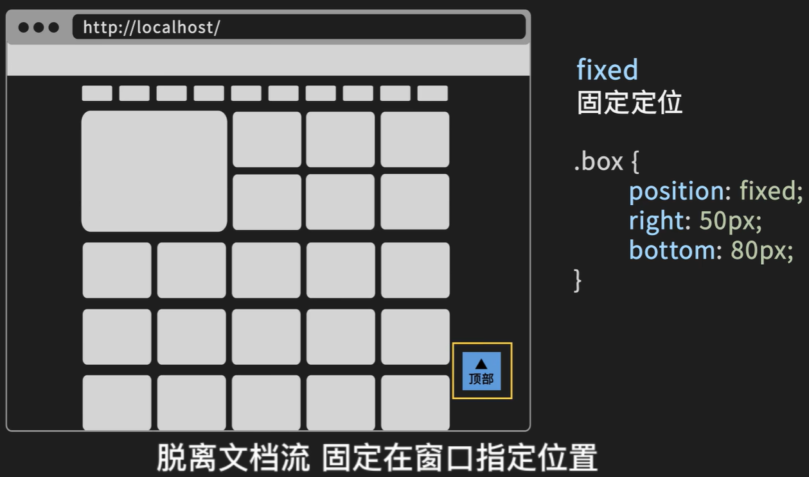

#### 粘性定位

窗口滑动时,元素距离浏览器窗口到一定距离定位效果就会变得和fix一样

固定阈值指定 top, right, bottom 或 left 四个其中之一，

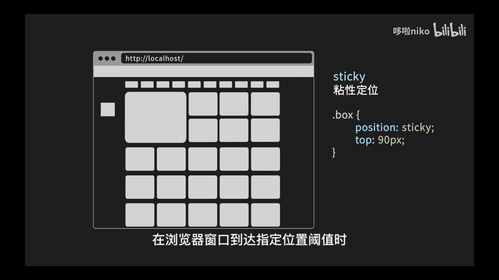

#### 层级顺序

标准流<浮动<定位(定位之间顺序相同)

可以直接用`z-index`属性更改层级顺序


### Flex box

弹性盒子

基本使用方式,在父元素中添加如下样式

1.`display: flex`;  2.`justify-content: xxxx;`

使用目的:

给容器指定`display: flex`; 规则后,自动恰当的拜访容器内元素位置,且随着视口大小改变响应式变化

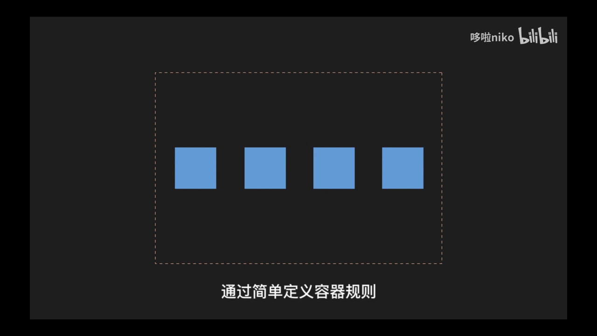

示例代码

```html
  <style>
    .father{
      background: lightblue;
      display: flex;
      justify-content: space-between;
    }

    .son{
      width: 100px;
      height: 100px;
      background: purple;
    }
  </style>
</head>
<body>
  <div class="father">   /* 弹性容器*/
    <div class="son">1</div>    /* 弹性元素*/
    <div class="son">2</div>
    <div class="son">3</div>
  </div>
</body>
```

#### 轴

flex布局有两个轴,元素排列默认沿着主轴方向排布

主轴默认水平

侧轴默认垂直

原点在左上角

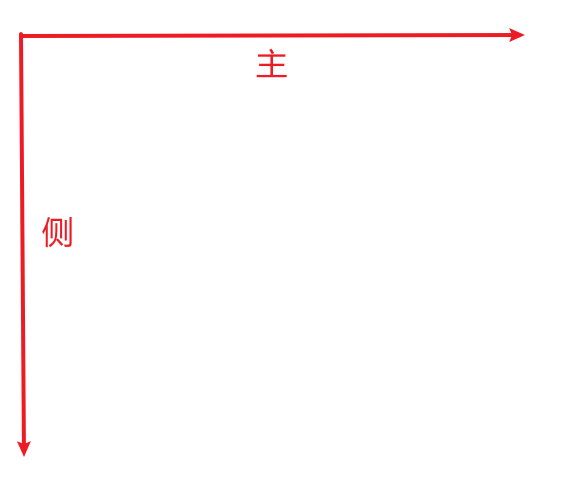

`flex-direction`定义主轴方向,默认`flex-direction: column`


#### jusitify-content(主轴对齐方式)

 `justify-content: flex-start;`

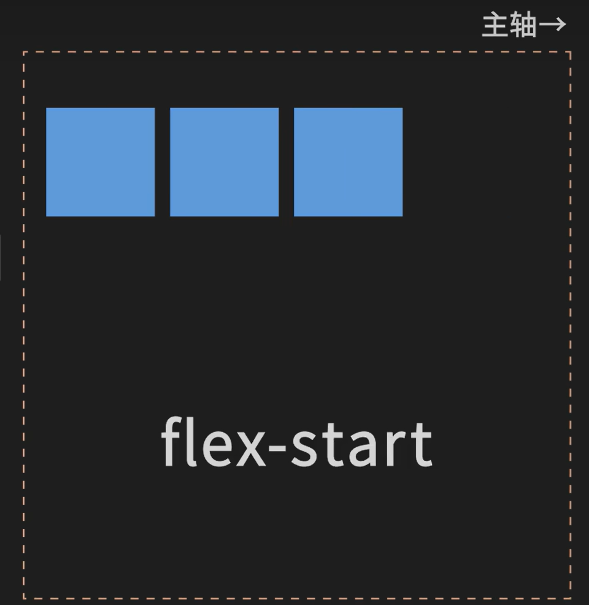

 `justify-content: flex-end;`

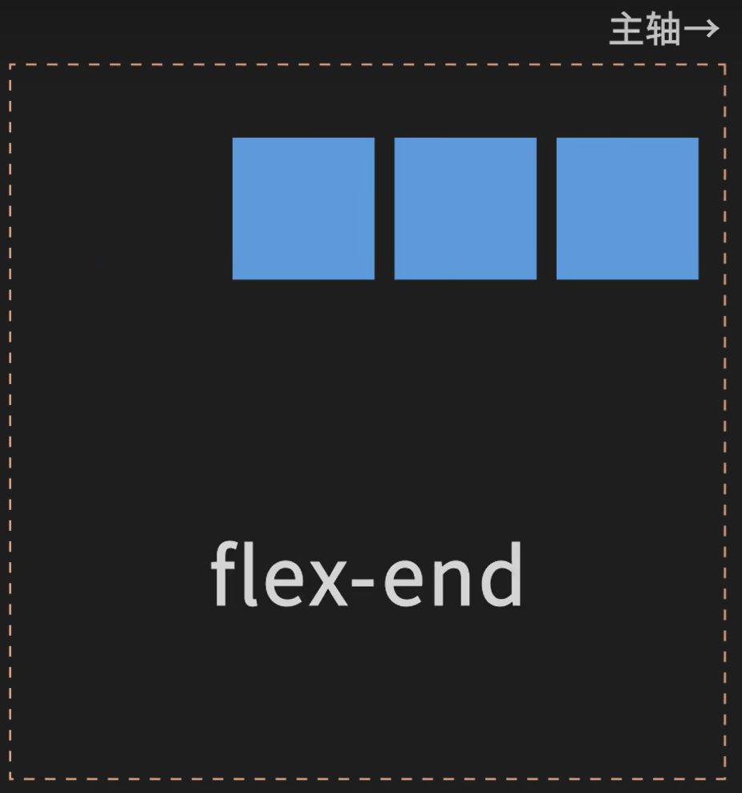

 `justify-content: center;`

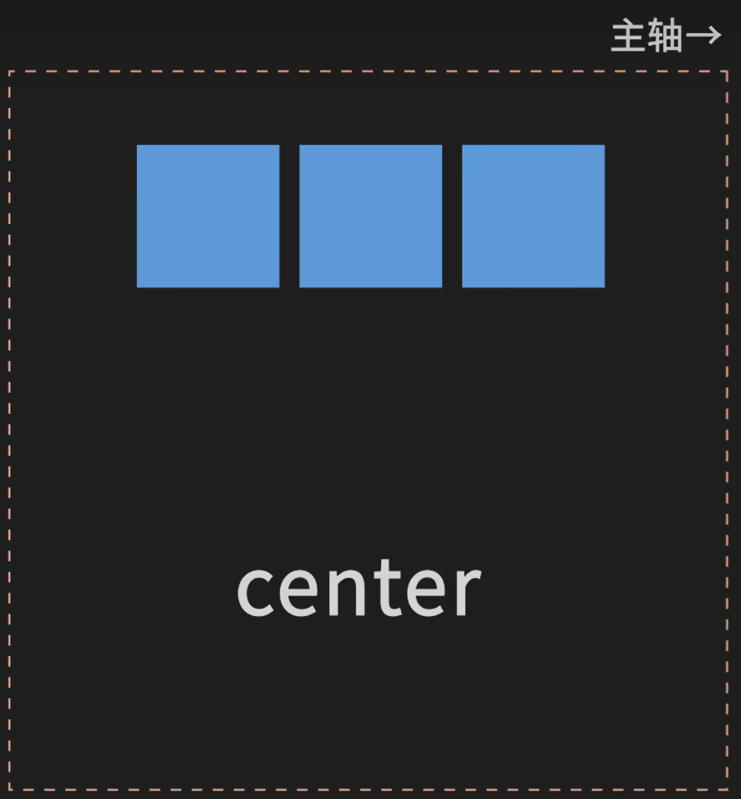

 `justify-content: space-between;`

首位紧贴容器边缘,项目间 间隔相等


 `justify-content: space-around;`

前后两侧间隔相等


 `justify-content: space-evenly;`

容器间和边缘 间隔等距离


#### align-items(侧轴对齐方式)

也可以称为交叉轴对应方式

`align-items: flex-start;`


`align-items: flex-end;`


`align-items: center;`


`align-items: baseline;`

文字基线,项目首行文字对齐


`align-items: stretch;`(默认效果)  

拉伸,前提是没有设置子元素在交叉轴的高度,这种情况下子元素会拉伸的跟父类一样高


#### align-content(多行侧轴对齐)

定义多行项目在侧轴的对齐方式**,只有在多行项目生效**

把前面主轴对齐方式的方向换了一下罢了

```css
align-content: flex-start;
align-content: flex-end;
align-content: center;
align-content: stretch;
align-content: space-between;
align-content: space-around;
```


我设置了5px间隙

`align-content: flex-start;`


`align-content: flex-end;`


`align-content: center;`


`align-content: stretch;`(默认)


`align-content: space-between;`


`align-content: space-around;`


#### align-self(继承父元素align-items)

这个样式要单独设置在子元素上

单独给一个子元素设置align-items的样式

如果不设置就继承弹性容器  或者说是父元素的align-items


#### flex子项尺寸总结

默认有`align-items: stretch;`属性,如果元素没有设置高度,就会拉伸到跟父类一样高

如果没有设置上述默认项

- 子元素没有宽度:则宽度＝内容宽度
- 子元素没有高度:则高度＝内容高度


#### 动态分配空间

`flex: xx;`

复合写法：flex: 200px  =  flex: 1 1 200px

该样式写在子元素上

设置弹性元素占据剩余主轴空间比例

flex 属性用于设置或检索弹性盒模型对象的子元素如何分配空间。

```css
flex 属性是 flex-grow、flex-shrink 和 flex-basis 属性的简写属性。

flex-grow：剩余空间分配比例  默认0
flex-shrink：空间不足时收缩比例  默认1
flex-basis：主轴初始尺寸 默认auto
		   如果同时设置了 width 和 flex-basis，flex容器主轴为row时，优先使用flex-basis。如果flex-basis为auto，则使用width。
		   如果没设置 width，flex-basis: auto 时，元素以内容决定的宽度为初始尺寸,只有 flex-basis: 0 时，初始宽度才会是 0, 

举例说明
.card-content {
  display: flex;
}
.card-content .left-chart {
  flex: 0 0 70%;
  height: 434px;
  border: 1px solid black;
}
.card-content .right-list {
  flex: 1;
}

情况一：flex: 0 0 70%;
flex-grow: 0 → 不会拉伸
flex-shrink: 0 → 不会收缩
flex-basis: 70% → 初始宽度为 70%，即使剩余空间或空间不足都不会变化
所以：
.left-chart 一直是父容器宽度的 70%（比如700px），不变。
.right-list 得到剩余的 30%（比如300px），如果空间不够，它会被压缩。

情况二：flex: 1 0 70%;
flex-grow: 1 → 会根据剩余空间扩展
flex-shrink: 0 → 不会收缩（空间不足时不压缩）
flex-basis: 70% → 初始宽度 70%
所以：
如果 .card-content 宽度比 70%大，.left-chart 会占到 70%，且会参与剩余空间的分配（grow生效）。
由于 .right-list 是 flex: 1，也会参与分配剩余空间。
这时，.left-chart 和 .right-list 会按 grow 比例（1:1）平分剩余空间！
举例：
.card-content 1000px
.left-chart flex-basis 700px
.right-list 没设 flex-basis，初值0px
剩余空间：1000-700=300px
grow:1:1 → .left-chart 得150px, .right-list 得150px
最终 .left-chart = 700+150=850px，.right-list = 0+150=150px


父元素未设置宽度时，flex-basis百分比会生效吗？
情况三：设置flex: 0 0 78%和flex: 0 0 20%的子项，
宽度始终保持比例（分别为父容器的78%和20%）。视口变宽时，两者宽度会同时等比变大，没有哪个元素单独伸缩。
```


##### flex-grow

按照比例分配容器空间,放大元素,如果值为0则不放大元素

`flex-grow` 的默认值是 `0`。


##### flex-shrink 

当于主轴方向被填满,视口宽度继续被压缩的时候,减少的主轴长度按照flex-shrink的比例分配,和上面正相反,默认值是1

**子容器没有超出父容器，设置 flex-shrink 无效**


##### flex-basic

如果元素宽高没有给定, 在分配多余空间之前,   flex-basic  就指定了 flex 元素在主轴方向上的初始大小

元素宽度属性优先级:


但其会随着视口方向长度的变变化,等比例平滑跟着放大缩小,不会一直固定,下面就是自动挤压效果,其实只要父元素设置了`display: flex`,都可以挤压,但是设置了`flex-basic`会更平滑


自动扩展是因布局效果


| 值       | 描述                                                         |
| :------- | :----------------------------------------------------------- |
| *number* | 一个长度单位或者一个百分比，规定灵活项目的初始长度。         |
| auto     | 默认值。长度等于灵活项目的长度。如果该项目未指定长度，则长度将根据内容决定。 |


`flex-wrap: xxx;`

设置换行,超出容器轴线长度自动换行,不设置就会压缩容器宽度

默认是不换行


#### 属性表一览

| 属性                                                      | 说明                                                         |
| :-------------------------------------------------------- | :----------------------------------------------------------- |
| [flex]                                                    | 复合属性。设置或检索弹性盒模型对象的子元素如何分配空间。     |
| [flex-grow]                                               | 设置或检索弹性盒的扩展比率。                                 |
| flex-shrink                                               | 设置或检索弹性盒的收缩比率。                                 |
| flex-basis                                                | 设置或检索弹性盒伸缩基准值。                                 |
| flex-flow                                                 | 复合属性。设置或检索弹性盒模型对象的子元素排列方式。         |
| flex-direction                                            | 该属性通过定义 flex 容器的主轴方向来决定 flex 子项在 flex 容器中的位置。 |
| flex-wrap                                                 | 该属性控制flex容器是单行或者多行，同时横轴的方向决定了新行堆叠的方向。 |
| align-content                                             | 在弹性容器内的各项没有占用交叉轴上所有可用的空间时对齐容器内的各项（垂直）。 |
| align-items                                               | 定义flex子项在flex容器的当前行的侧轴（纵轴）方向上的对齐方式。 |
| align-self                                                | 定义flex子项单独在侧轴（纵轴）方向上的对齐方式。             |
| justify-content                                           | 设置或检索弹性盒子元素在主轴（横轴）方向上的对齐方式。       |
| [order](https://www.runoob.com/cssref/css3-pr-order.html) | 设置或检索弹性盒模型对象的子元素出现的順序。                 |


justify-content主轴对齐方式

| 值            | 描述                                                       |
| :------------ | :--------------------------------------------------------- |
| flex-start    | 默认值。从行首起始位置开始排列。                           |
| flex-end      | 从行尾位置开始排列。                                       |
| center        | 居中排列。                                                 |
| space-between | 均匀排列每个元素，首个元素放置于起点，末尾元素放置于终点。 |
| space-evenly  | 均匀排列每个元素，每个元素之间的间隔相等。                 |
| space-around  | 均匀排列每个元素，每个元素周围分配相同的空间。             |
| initial       | 设置该属性为它的默认值。                                   |


align-items侧轴对齐方式

| 值         | 描述                                                         |
| :--------- | :----------------------------------------------------------- |
| stretch    | 默认值。元素被拉伸以适应容器。如果指定侧轴大小的属性值为'auto'，则其值会使项目的边距盒的尺寸尽可能接近所在行的尺寸，但同时会遵照'min/max-width/height'属性的限制。 |
| center     | 元素位于容器的中心。弹性盒子元素在该行的侧轴（纵轴）上居中放置。（如果该行的尺寸小于弹性盒子元素的尺寸，则会向两个方向溢出相同的长度）。 |
| flex-start | 元素位于容器的开头。弹性盒子元素的侧轴（纵轴）起始位置的边界紧靠住该行的侧轴起始边界。 |
| flex-end   | 元素位于容器的结尾。弹性盒子元素的侧轴（纵轴）起始位置的边界紧靠住该行的侧轴结束边界。 |
| baseline   | 元素位于容器的基线上。如弹性盒子元素的行内轴与侧轴为同一条，则该值与'flex-start'等效。其它情况下，该值将参与基线对齐。 |
| initial    | 设置该属性为它的默认值。                                     |


align-self  给单独子元素设置侧轴对齐方式

| 值         | 描述                                                         |
| :--------- | :----------------------------------------------------------- |
| auto       | 默认值。元素继承了它的父容器的 align-items 属性。如果没有父容器则为 "stretch"。 |
| stretch    | 元素被拉伸以适应容器。如果指定侧轴大小的属性值为'auto'，则其值会使项目的边距盒的尺寸尽可能接近所在行的尺寸，但同时会遵照'min/max-width/height'属性的限制。 |
| center     | 元素位于容器的中心。弹性盒子元素在该行的侧轴（纵轴）上居中放置。（如果该行的尺寸小于弹性盒子元素的尺寸，则会向两个方向溢出相同的长度）。 |
| flex-start | 元素位于容器的开头。弹性盒子元素的侧轴（纵轴）起始位置的边界紧靠住该行的侧轴起始边界。 |
| flex-end   | 元素位于容器的结尾。弹性盒子元素的侧轴（纵轴）起始位置的边界紧靠住该行的侧轴结束边界。 |
| baseline   | 元素位于容器的基线上。如弹性盒子元素的行内轴与侧轴为同一条，则该值与'flex-start'等效。其它情况下，该值将参与基线对齐。 |
| initial    | 设置该属性为它的默认值。                                     |


`gap: 5px;` 设置子元素之间的间隙,一个值就是同时设置行间距和列间距


flex(设置在子元素上)

| 值            | 描述                                                         |
| :------------ | :----------------------------------------------------------- |
| *flex-grow*   | 一个数字，规定项目将相对于其他灵活的项目进行扩展的量。       |
| *flex-shrink* | 一个数字，规定项目将相对于其他灵活的项目进行收缩的量。       |
| *flex-basis*  | 项目的长度。合法值："auto"、"inherit" 或一个后跟 "%"、"px"、"em" 或任何其他长度单位的数字。 |
| auto          | 与 1 1 auto 相同。                                           |
| none          | 与 0 0 auto 相同。                                           |


flex-wrap

| 值           | 描述                                                     |
| :----------- | :------------------------------------------------------- |
| nowrap       | 默认值。规定灵活的项目不拆行或不拆列。                   |
| wrap         | 规定灵活的项目在必要的时候拆行或拆列。                   |
| wrap-reverse | 规定灵活的项目在必要的时候拆行或拆列，但是以相反的顺序。 |


align-content

| 值            | 描述                                                         |
| :------------ | :----------------------------------------------------------- |
| stretch       | 默认值。元素被拉伸以适应容器。各行将会伸展以占用剩余的空间。如果剩余的空间是负数，该值等效于'flex-start'。在其它情况下，剩余空间被所有行平分，以扩大它们的侧轴尺寸。 |
| center        | 元素位于容器的中心。各行向弹性盒容器的中间位置堆叠。各行两两紧靠住同时在弹性盒容器中居中对齐，保持弹性盒容器的侧轴起始内容边界和第一行之间的距离与该容器的侧轴结束内容边界与第最后一行之间的距离相等。（如果剩下的空间是负数，则各行会向两个方向溢出的相等距离。） |
| flex-start    | 元素位于容器的开头。各行向弹性盒容器的起始位置堆叠。弹性盒容器中第一行的侧轴起始边界紧靠住该弹性盒容器的侧轴起始边界，之后的每一行都紧靠住前面一行。 |
| flex-end      | 元素位于容器的结尾。各行向弹性盒容器的结束位置堆叠。弹性盒容器中最后一行的侧轴起结束界紧靠住该弹性盒容器的侧轴结束边界，之后的每一行都紧靠住前面一行。 |
| space-between | 元素位于各行之间留有空白的容器内。各行在弹性盒容器中平均分布。如果剩余的空间是负数或弹性盒容器中只有一行，该值等效于'flex-start'。在其它情况下，第一行的侧轴起始边界紧靠住弹性盒容器的侧轴起始内容边界，最后一行的侧轴结束边界紧靠住弹性盒容器的侧轴结束内容边界，剩余的行则按一定方式在弹性盒窗口中排列，以保持两两之间的空间相等。 |
| space-around  | 元素位于各行之前、之间、之后都留有空白的容器内。各行在弹性盒容器中平均分布，两端保留子元素与子元素之间间距大小的一半。如果剩余的空间是负数或弹性盒容器中只有一行，该值等效于'center'。在其它情况下，各行会按一定方式在弹性盒容器中排列，以保持两两之间的空间相等，同时第一行前面及最后一行后面的空间是其他空间的一半。 |

### grid网格布局

一个 fr 单位代表网格容器中可用空间的一等份

这里表示把长分4份，宽分2两份,去掉  行间距5px  和  列间距5px  之后剩余的空间，剩下的空间被均分成上4下4的八等份


跨行：`grid-row: 1/4`


跨列：`grid-column: 2/5`


#### 行列的灵活变化

```css
  ul {
    box-sizing: border-box;
    list-style: none;
    display: grid;
    /* grid-template-rows: 40px 40px 40px 40px ...; */
    /* repeat简化上面的代码 25个li 可以写25 如果用auto-fit,必须要设置max-height*/
    grid-template-rows: repeat(auto-fit, 40px); 

    /* 实现多列方式一 */
    /* grid-template-columns: 1fr 1fr 1fr 1fr; */

    /* 方式二 */
    /* 通过限制每一列的最大高度, 来实现列的灵活变化*/
    max-height: 200px;
    /* 通过填充每一列来设置网格元素 在必要时添加新列 宽度自动填满元素*/
    grid-auto-flow: column;
      
  	/* 文本不换行显示,针对单行文本较多的情况 会强行突破宽度限制*/
    white-space: nowrap;
  }
  li {
    border: 1px solid black;
  }
```

white-space: nowrap;


#### 居中

关于网格内容居中,仅仅grid布局都能用

- `place-content` 控制的是**整体网格内容区域的位置**。
- `place-items` 控制的是**单个网格单元格内的项目对齐**。

例子

1. 只使用 `place-content: center;`,网格布局元素的网格单元整体居中,每个元素占满了整个'**网格单元**'的区域


2. 只使用 `place-items: center;`,元素在**网格单元的网格区域**里居中,但是单元格整体不居中


3. 同时使用 `place-content: center;` 和 `place-items: center;`,**网格单元**整体居中,网格单元中**内容**也在**网格区域**里居中


#### 排序

```css
.banner-outline {
  order: 1;
}
```

如果它是父元素的子元素，且父元素是 flex 或 grid 布局，则 `.banner-outline` 会根据 `order` 值参与排序

因为默认所有元素的 `order` 都是 0，设置成 `1` 后，它通常会排在默认顺序的后面。


## web布局方式

概略，类似字典，随时可供查询

```js
1. 响应式 Container 居中流式布局（你当前用的）
核心思想：用 container 限制最大宽度、内容居中，内部模块自适应排列，宽度随屏幕变化，极少写死宽高。常用在内容型、后台型网站。

2. 圣杯布局（Holy Grail Layout）
核心思想：常见三栏结构，左右侧边栏固定宽度，中间内容自适应，通常 header、footer 独立于主内容。可用 float、flex、grid 等多种方式实现。

3. 双飞翼布局（Double Wing Layout）
核心思想：三栏布局的变体，左右栏通过 margin 等措施实现固定宽，内容区域自适应，且内容 HTML 结构优先加载中间（利于 SEO）。

4. 瀑布流布局（Masonry Layout）
核心思想：多列内容高度不一，自动“补齐”空白区，常见于图片墙、Pinterest 风格。一般用 JS 计算或 CSS columns 实现。

5. 全屏布局/块块布局（Full Page/Block Layout）
核心思想：每个模块/section 占据整个视口高度（100vh），用户滚动一页一页浏览，常见于展示型企业官网、作品集。

6. 固定宽度居中布局（Fixed-Width Centered Layout）
核心思想：container 定死宽度（如 1200px），始终居中，屏幕再大也不变宽，适合内容稳定型网站。

7. 流式布局（Fluid Layout）
核心思想：内容宽度始终为百分比，无最大最小宽度限制，完全自适应浏览器窗口，早期响应式布局常用。

8. 多栏自适应布局（Responsive Multi-Column Layout）
核心思想：通过 CSS Grid/Flexbox，实现不同屏幕下列数自动切换（如移动端一列、PC 三列），常见于电商、新闻类首页。

9. 弹性盒子布局（Flexbox Layout）
核心思想：所有内容用 flex 弹性分布，横向/纵向/对齐/伸缩都灵活，适合各种复杂小型模块、导航、横向内容。

10. 网格布局（CSS Grid Layout）
核心思想：用网格（行和列）精确控制布局，适合复杂非线性排布，如图片集、仪表板、后台等。

11. 侧边栏固定布局（Sidebar Layout）
核心思想：左或右侧边栏固定宽度不随滚动或窗口变化，主内容自适应，适合后台、管理系统。
```

参考对照表

| 布局名称         | 核心思想简述                              | 应用场景         |
| ---------------- | ----------------------------------------- | ---------------- |
| 响应式 container | 居中限制宽度，内部弹性流式排列            | 内容型、后台型   |
| 圣杯布局         | 三栏，两侧固定，中间自适应                | 资讯、门户       |
| 双飞翼布局       | 三栏，中间优先 HTML，左右固定，内容自适应 | 资讯、SEO 优先   |
| 瀑布流           | 多列高度不一自动补齐                      | 图片墙、作品集   |
| 全屏布局         | 每页占满整个视窗                          | 展示网站、H5     |
| 固定宽度居中     | container 宽度固定不变，始终居中          | 企业官网、论坛   |
| 流式布局         | 全部百分比宽度，窗口变宽内容也变宽        | 早期响应式       |
| 多栏自适应       | 多列随屏幕自动增减                        | 电商、新闻       |
| Flexbox 弹性盒子 | 弹性排列，灵活对齐伸缩                    | 工具型、模块组件 |
| CSS Grid 网格    | 明确网格格点，精确控制                    | 仪表板、图片集   |
| 侧边栏固定       | 侧边栏（左/右）固定宽度，内容区自适应     | 后台、工具类     |

# CSS3高级特效


## transform

`transform: none|transform-functions;`

### 平移

```css
transform: translate(X轴移动距离, Y轴移动距离)
translateX(x)
translateY(y)
```

方向


取值

​	像素单位数值 

​	百分比（参照盒子自身尺寸计算结果） 

​	正负均可


注意,在用dom修改元素定位时, transform会继续作用

- 给元素设置了 `position: absolute; top: 40%; left: 50%;`，浏览器会先根据这两个属性，计算出元素左上角相对于包含块的位置。
- 然后，`transform: translate(-50%, -50%)` 会使元素相对于自身宽高，向左和向上各移动 50%。


### 旋转 rotate

```css
transform: rotate(旋转角度);

img:hover {
 /* 正数：顺时针旋转；负数：逆时针旋转 */
 transform: rotate(360deg);
 transform: rotate(-360deg);
 }
```

取值：

​	角度单位是 deg  

​	取值正负均可 

​	取值为正，顺时针旋转 

​	取值为负，逆时针旋转


### transform-origin 基准点

它可以是,旋转原点,缩放起点,缩放等

```css
transform-origin: 水平原点位置 垂直原点位置;
```

一般取值为百分比,水平百分比为元素自身水平长度的百分比,垂直则亦然


元素自转原点是(50%,50%)


旋转是会带着坐标轴一起旋转,比如我这里旋转后再横向缩放


### 倾斜 skew

`transform: skewX(30deg);`


`transform: skewY(30deg);`


#### 倾斜(仅X,Y)

沿着X轴和Y轴扭曲坐标的角度

skewX(),


`transform: skewX(30deg)`

从y轴往x轴压30度


`transform: skewY(30deg)`

从y轴往x轴压30度


### 缩放 scale

取值大于1表示放大，取值小于1表示缩小

```css
transform: scale(缩放倍数);
transform: scale(X轴缩放倍数, Y轴缩放倍数)
```

技通常，只为 scale() 设置一个值，表示 X 轴刻度和 Y 轴刻度等比例缩放,如果缩放后使用 translate(),移动的距离也会跟着相应缩放

这里横向缩放了,但是盒模型依旧没有变化


scale可以叠加操作

缩放后在原来的基础上继续缩放

```css
transform: scale(2, 1) scale(1, 2);
```


伸缩变化之后,再原来伸缩方向上的影像将会一直保留下去,

即使在伸缩后旋转,`transform:  scale(2, 1) rotate(-45deg)`,**伸缩的方向不随轴的转向而变化**

如下图,水平伸缩情况一直存在


### 多重转换

多重转换技巧：先平移再旋转

```css
.box:hover img {
 /* 先平移再旋转 */
 transform: translate(600px) rotate(360deg);
 }
```

多重转换原理：以第一种转换方式坐标轴为准转换形态

旋转会改变网页元素的坐标轴向 

先写旋转，则后面的转换效果的轴向以旋转后的轴向为准，会影响转换结果


### 3D转换

空间：是从坐标轴角度定义的 X 、Y 和 Z 三条坐标轴构成了一个立体空间，Z 轴位置与视线方向相同。 

空间转换也叫 3D转换

#### 坐标轴


#### 视距(perspective)  & preserve-3d

1. transform-style: preserve-3d 作用：决定“此元素的子元素在 3D 变换时是否被‘压扁（flatten）’到一个平面”。
   - 默认 transform-style: flat：子元素的 3D（translateZ / rotateX / rotateY）结果在父元素坐标系里被投影成 2D 平面，再一起参与父层的后续变换。子元素之间的 Z 深度差异不会再彼此遮挡/前后。
   - preserve-3d：保留子元素自己的 3D 关系（Z 深度、前后遮挡）。只有这样，你在父元素上做旋转时才能“看到”子元素按各自的 Z 值前后远近。
   - 它本身不产生透视感（近大远小），只决定“是否保留 3D 层次”。
2. perspective 的作用：设置一个“观察者到屏幕的距离（视距）”，由它产生真实的透视投影：近大远小、远处收缩。没有 perspective 时，3D 旋转像“正交投影”——物体旋转只像被剪裁/压扁，不会出现明显的远近缩放。
   - perspective 越小 → 观察点越近 → 透视越夸张。
   - 设置方式：父元素上写 perspective: 800px;（最常用），或在 transform 里用 perspective(800px) 函数（较少用）。
   - 只有当元素或其后代做 3D 变换时（rotateX/Y、translateZ 等）才能体现。

perspective：800px  意思就是，我在离屏幕800px 的地方观看这个元素

立方体效果

```html
    <style>
    .box {
      perspective: 800px;
    }
    .cube {
      position: relative;
      width: 200px;
      margin: 100px auto;  /* 居中作用 */
      transform-style: preserve-3d;
    }
    .face {
      position: absolute;
      width: 200px;
      height: 200px;
      border: 1px solid black;
    }
    .front { transform: rotateY(0deg) translateZ(100px); }
    .back {transform: rotateY(180deg) translateZ(100px);}
    .right {transform: rotateY(90deg) translateZ(100px);}
    .left {transform: rotateY(-90deg) translateZ(100px);}
    .top {transform: rotateX(90deg) translateZ(100px);}
    .bottom { transform: rotateX(-90deg) translateZ(100px);}
  </style>
<body>
    <div class="box">
    <div class="cube">
      <div class="face front"></div>
      <div class="face back"></div>
      <div class="face right"></div>
      <div class="face left"></div>
      <div class="face top"></div>
      <div class="face bottom"></div>
    </div>
  </div>
```


#### z轴平移

```css
.c1:hover{
	/* Z给的越大,距离眼睛越进,挪上去后图片会放大 */
    transform: perspective(1000px) translateZ(900px);
    或者 transform: perspective(1000px) translate3d(0,0,900px);
}
translate3d()
```

#### z轴缩放

```
 scaleZ(-1) //需要搭配其它参数使用
 scale3d(1,1,-1)
```

先让元素沿着y轴旋转到一定角度 `transform:  rotateY(80deg)`,将z轴尽可能展示在我们侧面


然后利用其缩放影响不随其轴变动的特性,

一倍z轴缩放 `transform:  rotateY(80deg)  scaleZ(1) rotateX(40deg);`


两倍z轴缩放  `transform:  rotateY(80deg)  scaleZ(2) rotateX(40deg)`


这里就能看到明显的变化了

#### 旋转

```
/* 相当于前后倾斜 */
transform: rotateX(60deg);
```


`transform: rotateY(60deg);`


`transform: rotateZ(90deg);`


/* 旋转向轴 + 角度 */

`transform: rotate3d(1,1,1, 30deg);`

绕y轴旋转

`transform: rotate3d(0,1,0, 30deg);`


### 功能函数表一览

| 值                                                           | 描述                                    |
| :----------------------------------------------------------- | :-------------------------------------- |
| none                                                         | 定义不进行转换。                        |
| matrix(*n*,*n*,*n*,*n*,*n*,*n*)                              | 定义 2D 转换，使用六个值的矩阵。        |
| matrix3d(*n*,*n*,*n*,*n*,*n*,*n*,*n*,*n*,*n*,*n*,*n*,*n*,*n*,*n*,*n*,*n*) | 定义 3D 转换，使用 16 个值的 4x4 矩阵。 |
| translate(*x*,*y*)                                           | 定义 2D 转换。                          |
| translate3d(*x*,*y*,*z*)                                     | 定义 3D 转换。                          |
| translateX(*x*)                                              | 定义转换，只是用 X 轴的值。             |
| translateY(*y*)                                              | 定义转换，只是用 Y 轴的值。             |
| translateZ(*z*)                                              | 定义 3D 转换，只是用 Z 轴的值。         |
| scale(*x*[,*y*]?)                                            | 定义 2D 缩放转换。                      |
| scale3d(*x*,*y*,*z*)                                         | 定义 3D 缩放转换。                      |
| scaleX(*x*)                                                  | 通过设置 X 轴的值来定义缩放转换。       |
| scaleY(*y*)                                                  | 通过设置 Y 轴的值来定义缩放转换。       |
| scaleZ(*z*)                                                  | 通过设置 Z 轴的值来定义 3D 缩放转换。   |
| rotate(*angle*)                                              | 定义 2D 旋转，在参数中规定角度。        |
| rotate3d(*x*,*y*,*z*,*angle*)                                | 定义 3D 旋转。                          |
| rotateX(*angle*)                                             | 定义沿着 X 轴的 3D 旋转。               |
| rotateY(*angle*)                                             | 定义沿着 Y 轴的 3D 旋转。               |
| rotateZ(*angle*)                                             | 定义沿着 Z 轴的 3D 旋转。               |
| skew(*x-angle*,*y-angle*)                                    | 定义沿着 X 和 Y 轴的 2D 倾斜转换。      |
| skewX(*angle*)                                               | 定义沿着 X 轴的 2D 倾斜转换。           |
| skewY(*angle*)                                               | 定义沿着 Y 轴的 2D 倾斜转换。           |
| perspective(*n*)                                             | 为 3D 转换元素定义透视视图。            |


## matrix

### 矩阵乘法理解

线性代数的本质是改变基向量来改变图形
$$
\left[\begin{array}{ll} a & b \\ c & d \end{array}\right]\left[\begin{array}{l} x \\ y \end{array}\right]=x\left[\begin{array}{l} a \\ c \end{array}\right]+y\left[\begin{array}{l} b \\ d \end{array}\right]=\left[\begin{array}{l} ax+by \\ cx+dy \end{array}\right]
$$


比如要让一个物体顺时针旋转90度

x轴基向量从(1, 0)变成(0, 1), y轴基向量从(0, 1)变成(-1, 0)


transform底层就是矩阵


平面变换的matrix(), 只有a, b, c, d, e, f 6个选填值, 第三层是为了方便矩阵计算硬加上去的, (x, y)是元素上每个点的原始坐标, 毕竟transform操作的就是图像上的每一个点

### 语法

`matrix()`语法

```
matrix(a, b, c, d, tx, ty)

a c tx
b d ty
0 0 1

a：水平缩放因子（X 轴的缩放）。
b：水平倾斜因子（X 轴的倾斜）。根据上面动图:arctan(b/a)
c：垂直倾斜因子（Y 轴的倾斜）。
d：垂直缩放因子（Y 轴的缩放）。根据上面动图:arctan(c/d)
tx：水平方向的平移（X 轴的偏移量）。
ty：垂直方向的平移（Y 轴的偏移量）。


```


### 例子

平移变换
$$
   T = \begin{bmatrix}
   1 & 0 & e \\
   0 & 1 & f \\
   0 & 0 & 1
   \end{bmatrix}
$$


`matrix(1, 0, 0, 1, e, f) === translate(e, f)`


缩放
$$
   S = \begin{bmatrix}
   a & 0 & 0 \\
   0 & d & 0 \\
   0 & 0 & 1
   \end{bmatrix}
$$


`matrix(a, 0, 0 ,d, 0, 0) === scale(a, d)`


旋转

根据线代的图像变换本质,完全可以通过改变参数a, b, c, d来改变基向量的位置,达到想要的效果, 但是为了精确控制缩放程度, 参数使用三角函数变量会更好
$$
R = \begin{bmatrix}
   \cos(\theta) & -\sin(\theta) & 0 \\
   \sin(\theta) & \cos(\theta) & 0 \\
   0 & 0 & 1
   \end{bmatrix}
$$
`matrix(cos(θ), sin(θ), -sin(θ), cos(θ), 0, 0) === rotate(θ)`


旋转缩放平移的合成

先计算S * R
$$
S \cdot R = \begin{bmatrix}
   a \cdot \cos(\theta) & -a \cdot \sin(\theta) & 0 \\
   d \cdot \sin(\theta) & d \cdot \cos(\theta) & 0 \\
   0 & 0 & 1
   \end{bmatrix}
$$
然后计算T * S * R
$$
   M = \begin{bmatrix}
   1 & 0 & e \\
   0 & 1 & f \\
   0 & 0 & 1
   \end{bmatrix} \cdot \begin{bmatrix}
   a \cdot \cos(\theta) & -a \cdot \sin(\theta) & 0 \\
   d \cdot \sin(\theta) & d \cdot \cos(\theta) & 0 \\
   0 & 0 & 1
   \end{bmatrix}
$$
得到矩阵
$$
M = \begin{bmatrix}
a \cdot \cos(\theta) & -a \cdot \sin(\theta) & e \\
d \cdot \sin(\theta) & d \cdot \cos(\theta) & f \\
0 & 0 & 1
\end{bmatrix}
$$
matrix(*a*⋅cos(*θ*),−*a*⋅sin(*θ*),*d*⋅sin(*θ*),*d*⋅cos(*θ*),*e*,*f*)


### 使用

```js
  div.addEventListener("click", function () {
    const angleInDegrees = 30 // 旋转角度
    const angleInRadians = angleInDegrees * (Math.PI / 180) // 转换为弧度

    const cosA = Math.cos(angleInRadians)
    const sinA = Math.sin(angleInRadians)

    // 更新transform属性
    div.style.transform = `matrix(${cosA}, ${sinA}, ${-sinA}, ${cosA}, 0, 0)`
  })
```


## 渐变

线性渐变

`background-image: linear-gradient(#f69d3c, #3f87a6);`


径向渐变

`background: radial-gradient(#f69d3c, #3f87a6);`


到达指定点后,重复渐变

`background: repeating-linear-gradient(angle | to side-or-corner, color-stop1, color-stop2, ...);`

| Value                          | 描述                                                         |
| :----------------------------- | :----------------------------------------------------------- |
| *angle*                        | 定义渐变的角度方向。从 0deg 到 360deg，默认为 180deg。       |
| *side-or-corner*               | 指定线性渐变的起始位置。由两个关键字组成：第一个为指定水平位置(left 或 right)，第二个为指定垂直位置（top 或bottom）。 顺序是随意的，每个关键字都是可选的。 |
| *color-stop1, color-stop2,...* | 指定渐变中的颜色停止点，可以指定颜色和位置，如color 50%，表示颜色在渐变的 50% 位置。 |

`background: repeating-linear-gradient(#f69d3c, #3f87a6 50px);`


`background: repeating-radial-gradient(#f69d3c, #3f87a6 50px);`


一半渐变一半透明


```css
background: linear-gradient(to top, rgba(174, 133, 255, 0.5), rgba(174, 133, 255, 0) 50%);
    /* 
        渐变从底部开始：
        - rgba(174, 133, 255, 0.5) 是底部的颜色，透明度为 0.5
        - rgba(174, 133, 255, 0) 是中间部分完全透明
    */
```


## 阴影


### 盒子阴影

`box-shadow`

```
box-shadow: h-shadow v-shadow blur spread color inset;
```

| 值         | 说明                                                         |
| :--------- | :----------------------------------------------------------- |
| *h-shadow* | 必需的。水平阴影的位置。允许负值                             |
| *v-shadow* | 必需的。垂直阴影的位置。允许负值                             |
| *blur*     | 可选。模糊距离                                               |
| *spread*   | 可选。阴影的大小                                             |
| *color*    | 可选。阴影的颜色。在[CSS颜色值](https://www.runoob.com/cssref/css_colors_legal.aspx)寻找颜色值的完整列表 |
| inset      | 可选。从外层的阴影（开始时）改变阴影内侧阴影                 |

外部阴影


内部阴影


左上添加白色阴影,就像光源从外部打过来,

右下同时添加阴影,看起来像凸起


如果修改为内阴影

则看起来像凹陷


```css
box-shadow:inset 8px 8px 8px rgba(0, 0, 0, 0.3),
                  inset -8px -8px 8px rgba(255, 255, 255, 0.7);
```


一个元素空间抬升效果的小tip

```css
.box {
  width: 100px;
  height: 100px;
  margin: 200px;
  border-radius: 20px;

  box-shadow: 0px 5px 12px rgba(0, 0, 0, 0.5);
  transition: all 0.3;
}

/* 更改阴影,形成抬升按钮*/
.box:hover {
  transform: translateY(-8px) scale(1.01, 1.01);
  box-shadow: 0px 10px 20px rgba(0, 0, 0, 0.3);
}
```


### 文字阴影

`text-shadow` 

跟盒子阴影一样得,但是少一个扩散参数

```css
text-shadow: 4px 4px 10px #222222;
参数顺序为：水平偏移 垂直偏移 模糊半径 颜色
```


文字模糊

将阴影的偏移变量改成0,然后将字体颜色改为透明,即可做出模糊效果

这是利用阴影自身的,第三个模糊变量


文字发光

给同一段文字叠加多层阴影，阴影颜色用较亮的颜色，模糊半径逐层增大，就会像在“向外发光”

```css
.neon {
  color: #fff;
  text-shadow:
    0 0 2px  #fff, 
    0 0 6px  #fff,
    0 0 12px #ff3df2,
    0 0 24px #ff3df2,
    0 0 48px #ff3df2;
}
```


## 模糊

```css
/* 对元素自身内容模糊 */
filter: blur(5px);

/* 对元素背后的内容模糊 */
backdrop-filter: blur(5px);
```


## 关键帧动画

本质;把元素的css样式从一种逐渐变成另一种

在动画过程中，可以更改CSS样式的设定多次

语法

```
1.定义动画
@keyframe 动画名称{
  0%{动画开始状态}
  40%{动画40%时候的状态}
  100%{动画结束状态}
}

2.使用动画
  animation:动画名称 动画持续时长
```

示例代码

```css
.box{
  /* transform: rotate(-45deg);  这里的transform会被后面动画里的transform抵消*/

  /* 添加动画 */
  animation: myJump 1s infinite;
}

/* 定义动画 */
@keyframes myJump {
  0%{
    transform: scale(1) rotate(-45deg);
  }
  10%{
    transform: scale(1.2) rotate(-45deg);
  }
  100%{
    transform: scale(1) rotate(-45deg);
  }
}
```

具体语法

`animation: name duration timing-function delay iteration-count direction fill-mode play-state;`

| 值                        | 说明                                                         |
| :------------------------ | :----------------------------------------------------------- |
| animation-name            | 指定要绑定到选择器的关键帧的名称                             |
| animation-duration        | 动画指定需要多少秒或毫秒完成                                 |
| animation-timing-function | 设置动画将如何完成一个周期                                   |
| animation-delay           | 设置动画在启动前的延迟间隔。                                 |
| animation-iteration-count | 定义动画的播放次数。                                         |
| animation-direction       | 指定是否应该轮流反向播放动画。                               |
| animation-fill-mode       | 规定当动画不播放时（当动画完成时，或当动画有一个延迟未开始播放时），要应用到元素的样式。 |
| animation-play-state      | 指定动画是否正在运行或已暂停。                               |
| initial                   | 设置属性为其默认值。                                         |

### animation-timing-function

也可以称为动画速度曲线

linear:  匀速进行,没有加速或减速


ease: 默认值,动画开始缓慢加速,接近结束时减速


ease-in: 动画开始时缓慢加速

ease-out: 动画接近结束时减速


ease-in-out: 动画在开始和结束时缓慢加速和减速


steps(n): 动画分成等长的n步进行,每步的持续时间相等，n为整数


cubic-bezier(n,n,n,n): 自定义贝塞尔曲线,n为0~1表示曲线上的控制点

下面分别表示的是两点, 三点,四点曲线, 上面的函数时四点定义的贝赛尔曲线,两个点已经被固定,四个参数是剩下两个点的坐标


1. **曲线的阶次等于控制点的数量减一**。 对于两个点我们能得到一条线性曲线（直线），三个点 — 一条二阶曲线，四个点 — 一条三阶曲线。
2. **曲线总是在控制点的凸包内部：**


### animation-fill-mode 保持状态

1. **`none`**: 默认值，动画结束后，元素会恢复到动画开始之前的状态。
2. **`forwards`**: 动画结束后，元素会保持在最后一帧的样式。
3. **`backwards`**: 动画开始前，元素会应用动画的第一帧样式。
4. **`both`**: 结合了 `forwards` 和 `backwards` 的效果，动画结束后保持最后一帧的样式，并在动画开始前应用第一帧的样式。


## 过渡

让元素从一个样式变成另一个样式的过程中,更加平滑

使用:

`transition: property duration timing-function delay;`

| 值                           | 描述                                                         |
| :--------------------------- | :----------------------------------------------------------- |
| *transition-property*        | 列举要设置动画的所有属性，如：`left、margin-left、height 和 color` |
| *transition-duration*        | transition效果需要指定多少秒或毫秒才能完成                   |
| *transition-timing-function* | 指定transition效果的转速曲线                                 |
| *transition-delay*           | 定义transition效果开始的时候                                 |

示例代码

```html
  <style>
    div{
      width: 200px;
      height: 200px;
      background: lightblue;
      /* 宽度平滑的从200px 变化到 400px */
      transition: width 1s;
    }

    div:hover{
      width: 400px;
    }
  </style>
</head>
<body>
  <div></div>
</body>
```

## 隐藏元素

   /* 使用后元素不占位置,但是无法使用过渡效果 */

   display: none;


   /* 设置透明度 有过渡效果 占据位置 */

   opacity: 0;  


   /* 元素不可见 同样没有过渡效果 占据位置 隐藏交互*/

   visibility: hidden;


透明背景

（0 完全透明，1 完全不透明）

```css
.transparent-bg {
  background-color: rgba(255, 255, 255, 0.5); /* 白色，50% 透明度 */
}
```


## 媒体查询

### 根据设备的类型和参数设置样式

媒体查询能够检测视口的宽度，然后编写差异化的 CSS 样式 当某个条件成立, 执行对应的CSS样式 

在屏幕可视窗口尺寸小于 480 像素的设备上修改背景颜色

```css
@media screen and (max-width: 480px) {
    body {
        background-color: lightgreen;
    }
}
```

| 值     | 描述                             |
| :----- | :------------------------------- |
| all    | 用于所有多媒体类型设备           |
| print  | 用于打印机                       |
| screen | 用于电脑屏幕，平板，智能手机等。 |
| speech | 用于屏幕阅读器                   |


```
@media (min-width: 992px) {
  /* 这里的样式只有当屏幕宽度 ≥ 992px 时才生效 */
}
@media (max-width: 991.98px) {
  /* 屏幕宽度 ≤ 991.98px 时生效 */
}
```


### 检测是否启用深色模式

```css
@media (prefers-color-scheme: dark) {
      .control-panel-lighting {
        background: linear-gradient(135deg, rgba(0, 0, 0, 0.2) 0%, rgba(0, 0, 0, 0.4) 100%);
      }
    }
```

**`prefers-color-scheme: dark`** - 检测用户是否启用了深色模式

例子

```css
/* 亮色模式（默认） */
body {
  background:  #ffffff;  /* 白色背景 */
  color: #000000;       /* 黑色文字 */
}

/* 深色模式 */
@media (prefers-color-scheme: dark) {
  body {
    background: #1a1a1a;  /* 深灰背景 */
    color: #ffffff;       /* 白色文字 */
  }
}
```


# css优化&技巧

```css
/* 让开发者告诉浏览器，指定的 CSS 属性即将发生变化, 浏览器可以基于这一信息，提前为该元素做优化*/
will-change: transform;
```


占满屏幕无滚动条

````
html 元素是文档的根元素，它的父元素是浏览器的视口（viewport）。
因此，html 的 height: 100% 是指html元素的高度等于浏览器视口的高度。
1. html, body, #app 全高 + overflow:hidden

```
html, body, #app {
  height: 100%;
  margin: 0;
  overflow: hidden; /* 禁止出现滚动条 */
}
````


# Tailwindcss

```
官网https://www.tailwindcss.cn/
英文官网 https://tailwindcss.com/

vite框架中使用
https://tailwindcss.com/docs/installation/using-vite
```


# cSS新笔记体系

### box-sizing

```css
默认值：box-sizing: content-box; 

元素的宽高设置的是元素的内容区域，padding和border会增加元素的实际占用空间。

box-sizing: border-box;

元素宽高设置的是元素border+padding+内容区域的总和，极大方便元素布局

所以一般在页面中会统一设置：

\* {

 box-sizing: border-box;

}
```


### rgba()

```css
颜色的alpha通道，能单独设置颜色的透明度，

比如：

div {
 background-color: rgba(255, 0, 0, 0.5); /* 红色，50%透明，仅仅影响背景颜色 */
 opacity: 0.5; /* 整个元素，包括内容和背景，50%透明 */
}
```


### 尺寸百分比

百分比是个相对单位，普通元素的参考系为父元素的内容区域，绝对定位`position: absolute`元素的参考系为父元素中第一个定位元素的`padding`边界

固定定位`position: fixed`则是相对于视口

```js
css属性  百分比相对于
width   参考系的宽度
height   参考系的高度
padding  参考系的宽度
border   参考系的宽度
margin   参考系的宽度
```


css百分比大多依赖的是宽度这一尺寸，因为在传统盒模型里，宽度更容易确认，除非该尺寸和高度强相关

这是因为早期css布局偏向横向排版，宽度很早就能知道，而高度需要等子元素排完才知道，因为通常父元素的高度是由子元素撑开的


```html
<style>
  /*
   * 父元素：
   *   内容区：200 x 200px
   *   padding：20px（四个方向）
   *   padding 边界宽度 = 200 + 20 + 20 = 240px
   */
  .parent {
    position: relative;        /* 作为绝对定位子元素的参考 */
    width: 200px;
    height: 200px;
    padding: 20px;
    background-color: lightblue;
  }

  /*
   * 普通子元素 —— 参考系：父元素内容区 200 x 200px
   *   width:   200px * 50% = 100px
   *   height:  200px * 50% = 100px
   *   padding: 200px * 10% = 20px
   *   margin:  200px * 5%  = 10px
   */
  .normal-child {
    width: 50%;
    height: 50%;
    padding: 10%;
    margin: 5%;
    background-color: salmon;
  }
  /*
   * 绝对定位子元素 —— 参考系：父元素 padding 边界 240 x 240px
   *   width:   240px * 50% = 120px
   *   height:  240px * 50% = 120px
   *   padding: 240px * 10% = 24px
   *   margin:  240px * 5%  = 12px
   */
  .abs-child {
    position: absolute;
    top: 0;
    left: 0;
    width: 50%;
    height: 50%;
    padding: 10%;
    margin: 5%;
    background-color: lightgreen;
    opacity: 0.8;
  }
</style>
<body>
  <h3>普通子元素（参考父内容区 200px）</h3>
  <div class="parent">
    <div class="normal-child"></div>
  </div>

  <br>

  <h3>绝对定位子元素（参考父 padding 边界 240px）</h3>
  <div class="parent">
    <div class="abs-child"></div>
  </div>
</body>
```


### 最大最小宽高

当一个元素的尺寸会自动变化时，设置最大最小宽高，不至于让其过大或过小

比如在实际开发中，通常会为pc端页面设置一个最小宽度，此宽度通常为设计稿的宽度：

```css
html {
  min-width: 1200px;
}
```


下面是``加和不加上 `max-width: 100%;` 的区别

```html
<style>
  .container {
    width: 300px;
    height: 300px;
    padding: 20px;
    background: red;
  }
  img {
    /* max-width: 100%; */
  }
</style>
<body>
  <div class="container">
    
  </div>
</body>
```

不加，就会自适应图片尺寸，会自动根据图片分辨率来适应，例如 1920×1080 就占 1920px的宽


加上能让图片在父元素宽度不足的情况下自动缩小


### 精灵图

精灵图：把多张小图合成一张大图，如果每个小图标是一张图片，会导致图片文件巨量增加，降低浏览器的加载效率


使用原理，把整张背景图放进去，通过background-position属性平移背景图片，再通过宽高设置容器的区域，让背景图片中我们需要的那一部分显示出来


```html
<style>
  .sprite {
    width: 85px;
    height: 60px;
    border: 1px solid #000;
      /** 设置背景图片为精灵图，禁止重复 */
    background: url(./assest/img/sprite.jpg) no-repeat;
    /** 图片位置右移-280px，向下移动-240px */
    background-position: -280px -240px; 
  }
</style>

<body>
  <div class="sprite"></div>
</body>
```


### 层叠

css中的声明冲突：一个元素的css属性，被多个css代码同时设置

层叠：浏览器判定哪个css代码的声明 被最终应用的过程


核心就是看谁写的更具体，谁的选择器范围更小


具体规则

```
重要性先后：
1、作者样式表中的 !important
2、作者样式表中的样式
3、浏览器默认样式


重要性相同，比较特殊性，特殊性可记为 `(a, b, c, d)`：从左到右逐位比较，(0,1,0,0) 比 (0,0,99,99) 大
a: 内联样式数量
b: id 选择器数量
c: 类选择器、属性选择器、伪类选择器数量
d: 元素选择器数量、伪类选择器数量


后写的覆盖先写的
```


伪类压元素选择器

```html
  <style>
    p {
      color: red;
    }

    p:hover {
      color: blue;
    }
  </style>
</head>
<body>
  <p>鼠标移上来会变蓝</p>
</body>
```

鼠标移动上去变蓝

- `p` → `(0,0,0,1)`
- `p:hover` → `(0,0,1,1)`


id选择器压制属性和类选择器

```html
  <title>ID 压过 类选择器 和 属性选择器</title>
  <style>
    

    #title {
      color: green;
    }

    .text {
      color: red;
    }

    [data-x] {
      color: blue;
    }
  </style>
</head>
<body>
  <p id="title" class="text" data-x="1">这段文字最终应该是绿色</p>
</body>
```

字体显示为绿色，即使类选择器和属性选择器写在后面

- `.text` → 类选择器，特殊性：`(0,0,1,0)`
- `[data-x]` → 属性选择器，特殊性：`(0,0,1,0)`
- `#title` → id 选择器，特殊性：`(0,1,0,0)`


### 继承

与文字，字体相关的属性会被继承，与盒模型/布局相关的属性通常不会被继承

如果父元素的字号为20px，子元素突然变回默认的16px，阅读体验就会有强烈的断裂感，设计为继承是为了保证阅读的连贯性


### css属性值的计算过程

css属性值的计算过程

浏览器渲染元素的时候，会按照页面文档的树形目录结构一个元素一个元素的依次渲染

渲染每个元素的条件：让该元素的所有css属性必须有值

一个元素，从所有css属性没有值，到所有css属性都有值的过程，叫做css属性值的计算过程


css属性值的计算过程案例：

```css
现在假设有一个元素：<h1 class="red">Lorem</h1>

其css属性值：
{
  color:
  background-color:
  text-align:
  font-size:
  font-weight:
  display:
  其他CSS属性：...    
}

现有作者样式表：
.red{
  color:red;
  font-size:40px;
}
h1{ 
  font-size:26px; 
}
div h1.red{
  font-size:3em;
  font-size:30px;
}

浏览器默认样式表：
h1{
  display: block; 
  font-size: 2em; 
  font-weight: bold;
}

一步步推导：
1.确定声明值：样式表中没有冲突的属性值，直接使用该值
其中color: red;font-size: 40px;display: block;都是没有冲突的属性值，直接作为css属性值
目前元素css属性值：
{
  color:red
  background-color:
  text-align:
  font-size:
  font-weight:bold
  display:block
  其他CSS属性：...
}


2.层叠冲突：对于样式表中有冲突的声明使用层叠规则
font-size: 40px;（作者样式表）、font-size: 2em;（浏览器默认样式表）、font-size:3em;font-size:30px;（div h1.red）三个声明冲突，作者样式表优先级更高，从比较特殊性上看，div h1.red比.red优先级更高，又因为font-size:30px;在font-size:3em;后面，所以font-size:30px;优先级最高，最终font-size:30px;作为css属性值
目前元素css属性值：
{
  color:red
  background-color:
  text-align:
  font-size:30px
  font-weight:bold
  display:block
  其他CSS属性：...
}


3.继承：对于没有属性的值，可以选择继承父元素的属性值
假设h1父元素的css属性值：
{
  color:green
  background-color:gray
  text-align:center
  font-size:20px
  font-weight:normal
  display:block
  其他CSS属性：...
}
h1元素的text-align属性值可以从父元素继承，text-align:center;，background-color属性值不能继承，仍然没有值
目前元素css属性值：
color:red
background-color:
text-align:center
font-size:30px
font-weight:bold
display:block
其他CSS属性：...

4.使用默认值：对仍然没有值的属性，使用默认值
background-color属性值没有值，使用默认值transparent;
目前元素css属性值：
{
  color:red
  background-color:transparent
  text-align:center
  font-size:30px
  font-weight:bold
  display:block
  其他CSS属性：...
}

```

流程图：


### 盒模型

盒子模型

盒子模型由四个部分组成

1、内容 content，width、height，设置的是盒子的内容宽高

2、填充（内边距）padding，盒子边框到盒子内容的区域

3、边框 border

4、外边距，边框到其它盒子的距离


#### 盒子类型

1、行盒、`display: inline-block`

2、块盒、`display: block`

行盒再页面中不换行、块盒独占一行

display默认值为inline，行盒

常见`display: inline`的元素,span、a、img、video、audio

浏览器默认设置的块盒：容器元素div、h1~h6、p


#### 改变宽高范围

默认情况下，width 和 height 设置的是内容的宽高

但是在衡量设计稿尺寸的时候，往往使用的是边框盒，所以通常会设置 box-sizing: border-box ,让宽高包括padding + content 区域


#### 改变背景覆盖范围

默认情况下，覆盖边框盒，可以通过background-clip改变背景覆盖范围

```css
background-clip: border-box;   /* 背景延伸到边框（默认值） */
background-clip: padding-box;  /* 背景延伸到内边距 */
background-clip: content-box;  /* 背景仅在内容区域 */
background-clip: text;      /* 背景被裁剪成文字形状 */
```


甚至可以自定义一个背景覆盖范围，通过clip-path定义形状

```css
div {
  width: 300px;
  height: 200px;
  background: black;
  clip-path: polygon(0 0, 100% 0, 100% 100%, 50% 80%, 0 100%);
}
```


#### 溢出处理

```css
overflow: visible; 让元素的内容超出元素范围的时候显示出来,默认值
overflow: hidden; 让元素的内容超出元素范围的时候隐藏起来
overflow: scroll; 让元素的内容超出元素范围的时候显示滚动条
overflow-y 专门控制元素的垂直方向上的溢出行为
overflow-x 控制水平方向上的溢出行为
text-overflow: ellipsis：当文本溢出容器时，使用省略号（...）表示被截断的部分。需要配合 white-space: nowrap 和 overflow: hidden 使用
```


text-overflow: ellipsis


#### 断词规则

word-break，会影响文字在什么位置被截断换行


word-break，会影响文字在什么位置被截断换行

`word-break: normal`：默认值，使用浏览器默认的换行规则，CJK（Chinese, Japanese, Korean）文本会在单个文字处截断，非CJK文本会在单词边界处截断。所以中文会在单个字之间换行，英文会在单词边界换行


`word-break: break-all`：所有字符都在文字处截断


`word-break: keep-all`: 所有文字都在单词处截断，对于CJK文本，会选择在标点符号处或者空格处换行，对于非CJK文本，行为与normal相同，即在单词边界处换行。


#### 换行规则

`white-space: pre`：文本会保留所有空格和换行符，按照原样显示


`white-space: normal`：默认值，文本会根据容器宽度自动换行，连续的空格会被合并成一个空格。


`white-space: nowrap`：完全不换行


### 行盒盒模型

设计目的：对文字流中的一段内容施加样式，而不破坏文字的自然流动

常见的行盒

span、strong、em、i、img、video、audio


#### 行盒特点

1、盒子沿着内容延伸，下一个行盒的头部接着上一个行盒的尾巴

2、不能设置宽高

如果想调整行盒的宽高，只能通过字体大小，文字行高，字体类型类间接调整


3、内边距(padding)

水平方向有效，垂直方向上不影响行盒所在行的行高计算，其他元素不会被撑开，但视觉上背景会溢出覆盖到相邻行，不挤压其它元素和自己内容的位置，不占据实际空间

4、边框（border）

水平方向有效，垂直方向只会扩大边框的显示范围，不挤压其它元素和自己内容的位置，垂直方向不会实际占据空间。

5、外边距（margin）

水平方向有效，垂直方向不会实际占据空间。

6、空白折叠

空白折叠指的是行内元素之间的空白在页面上会被折叠成一个空格


#### 行块盒

`display: inline-block`的盒子

1、不独占一行

2、盒模型中所有尺寸都生效

3、有行盒的空白折叠


#### 可替换/非可替换元素

大部分元素，在页面上显示的内容，取决于元素内容，比如<p>标签，显示的是<p></p>之间的文本内容

 少部分元素在页面上显示的内容，取决于元素属性，比如标签，显示的是标签的src属性值所指向的图片，还有video、audio、input等


### 常规流

盒模型：规定单个元素的规则

视觉格式化模型（布局规则）：规定页面中多个元素的排布规则

视觉格式化模型分为三种：

1. 常规流
2. 浮动
3. 定位


#### 常规流布局

所有元素，默认情况下都是常规流布局

块盒独占一行，行盒沿着内容延伸不换行，水平依次排列

包含块：每个盒子都有包含块，包含块决定了盒子的排布范围

绝大部分情况下，包含块指的是父元素的内容区域（content area）


**块盒**

1、每个块盒的总宽度，必须等于刚好等于包含块的宽度(margin + border + padding + width)

宽度的默认值是auto

margin的取值也可以是auto，margin的默认值是0

auto：表示一个属性将包含块剩余的宽度吸收掉，width的吸收能力强于margin

若宽度、边框、内边距、外边距计算后，包含块仍有剩余空间，剩余空间将被margin-right吸收掉（可能是因为内容从左向右排列的原因）

在常规流中，想让一个块盒剧中，可以设置width为一个固定值，设置margin-left和margin-right为auto，相当于左边右边同时吸收宽度，使得块盒在包含快中水平居中

如果width没有定，让margin-left和margin-right都为负值，可以扩大块盒子的宽度，因为块盒的总宽度必须等于刚好等于包含块的宽度


2、块盒垂直方向上的auto值

height的默认值是auto，表示适应内容的高度

margin:auto， 表示0


3、百分比取值

padding、宽、margin可以取值为百分比

以上的所有百分比相对于包含块的宽度。

高度的百分比：

1）. 包含块的高度是否取决于子元素的高度，设置百分比无效
2）. 包含块的高度不取决于子元素的高度，百分比相对于父元素高度


4、上下外边距的合并

两个常规流块盒，上下外边距相邻，会进行合并。

两个外边距取最大值。

margin相邻就会合并，比如父子元素同时设置上外边距就会合并，解决方式就是将两个外边距隔离开，因为子元素的包含块是父元素的content区域，所以只需要给父元素加上border就能隔开两者的margin，让两者不再合并。但是通常让父元素使用padding替代


### 浮动

应用场景

1. 文字环绕
2. 横向排列


基本性质

`float: left`：左浮动，元素靠上靠左

`float: right`：右浮动，元素靠上靠右

float默认值为none

1. 当一个元素浮动后，元素必定为块盒(更改display属性为block)
2. 浮动元素的包含块，和常规流一样，为父元素的内容盒


**盒子尺寸**

1. 宽度为auto时，适应内容宽度
2. 高度为auto时，与常规流一致，适应内容的高度
3. margin为auto，为0.
4. 边框、内边距、百分比设置与常规流一样


**盒子排列**

1. 左浮动的盒子靠上靠左排列
2. 右浮动的盒子考上靠右排列
3. 浮动盒子在包含块中排列时，会避开常规流块盒（浮动盒子发现前面有常规流块盒，就避开它排列）
4. 常规流块盒在排列时，无视浮动盒子（就好像浮动盒子在天上，块盒子在地上走，看不到浮动盒子一样）
5. 行盒在排列时，会避开浮动盒子（文字环绕）
6. 外边距合并不会发生

> 如果文字没有在行盒中，浏览器会自动生成一个行盒包裹文字，该行盒叫做匿名行盒。


**高度坍塌**

高度坍塌的根源：常规流盒子的自动高度，在计算时，不会考虑浮动盒子

清除浮动，涉及css属性：clear

- 默认值：none
- left：清除左浮动，该元素必须出现在前面所有左浮动盒子的下方
- right：清除右浮动，该元素必须出现在前面所有右浮动盒子的下方
- both：清除左右浮动，该元素必须出现在前面所有浮动盒子的下方

解决方案：给父元素加一个`::after`伪类，这相当于在父元素里最后一个子元素中再添加一个子元素

```css
父元素类::after {
  content: '';
  display: block;
  clear: both;
}
```


#### 多个浮动元素排布

块盒子一个一个飘到最上面,如果第一排剩余空间没法容纳盒子,就会向下移动,高度足够后就会向左向右移动


如果宽度够,还要参考一个规则,下一个盒子的顶边不能高过上一个盒子的顶边


同理5号盒子也不能超过上一个元素的顶边


6号元素遵从规则一向下移动寻找能容纳的位置


7号元素就不能超过6号元素的顶边


### 定位

手动控制元素在包含块中的精准位置

#### position属性

- 默认值：static，静态定位（不定位）
- relative：相对定位
- absolute：绝对定位
- fixed：固定定位

只要position的取值不是static，认为该元素是一个定位元素

定位元素会脱离文档流（相对定位除外）

一个脱离了文档流的元素：

1. 文档流中的元素摆放时，会忽略脱离了文档流的元素
2. 文档流中元素计算自动高度时，会忽略脱离了文档流的元素


#### 相对定位

`position: relative`

不会导致元素脱离文档流，只是让元素在原来位置上进行偏移。

可以通过四个CSS属性对设置其位置：

- left
- right
- top
- bottom

盒子的偏移不会对其他盒子造成任何影响。


#### 绝对定位

1. 宽高为auto，适应内容
2. 包含块变化：找祖先中第一个定位元素，该元素的填充盒为其包含块（content + padding）。若找不到，则它的包含块为整个网页（初始化包含块）


#### 固定定位

其他情况和绝对定位完全一样。

包含块不同：固定为视口（浏览器的可视窗口）


#### 粘性定位

窗口滑动时,元素距离浏览器窗口到一定距离定位效果就会变得和fix一样

固定阈值指定 top, right, bottom 或 left 四个其中之一，


#### 多个定位元素重叠时

堆叠上下文

设置z-index，通常情况下，该值越大，越靠近用户

只有定位元素设置z-index有效

z-index可以是负数，如果是负数，则遇到常规流、浮动元素，则会被其覆盖


绝对定位、固定定位元素一定是块盒

绝对定位、固定定位元素一定不是浮动

没有外边距合并


### 背景图


#### 和img元素的区别

img元素是属于HTML的概念

背景图属于css的概念

1. 当图片属于网页内容时，必须使用img元素
2. 当图片仅用于美化页面时，必须使用背景图


#### 涉及的css属性

```
默认显示是按照图片的分辨率尺寸显示，不会对图片进行缩放，2000px * 1000px的图片 就必须要宽2000高1000的容器才能显示
background-image: url("imgs/main_bg.jpg");


background-repeat: no-repeat; 
默认情况下，背景图会在横坐标和纵坐标中进行重复
这是个复合属性
background-repeat: repeat-x;相当于：
background-repeat-x: repeat;
background-repeat-y:no-repeat;
只在x方向重复
```


background-size：设置背景图的尺寸

`background-size: contain;`让图片完整的在容器中显示，但是不改变比例


`background-size: cover;` 让图片顶满容器的宽高，同时保持图片比例不变


`background-size: 100% 100%;` 第一个值表示横向撑满，第二个值表示纵向撑满，图片的宽高比会被破坏


`background-size: 100px 100px;`  第一个值表示图片的宽度，第二个值表示图片的高度


background-position：设置背景图的位置。

`background-position: center;`  图片横向和纵向都居中


`background-position: center top;` 图片横向居中，纵向顶部对齐


`background-position: left center;` 图片横向左对齐，纵向居中


`background-position: 0px 0px;` 第一个值表示背景图左边距元素左边的距离，第二个值表示背景图顶部距元素顶部的距离


`background-attachment: fixed;` 背景图固定在视口上，不随元素内容滚动而滚动


### @规则

@import "路径";

导入另外一个css文件

```css
@import "reset.css";

h1{
    text-align: center;
    font-size: 3em;
}
```


### web字体和图标

web字体

用户电脑上没有安装相应字体，强制让用户下载该字体

使用@font-face指令制作一个新字体

```css
/* 制作一个新的字体，名称叫做good night，url指向字体文件 */
@font-face {
    font-family: "good night";
    src: url("./font/晚安体.ttf");
}

p {
    font-family: "good night";
}
```


字体图标

iconfont.cn

可以把字体理解成每个文字都做了一张图片，使用字体的时候，就是把每个字用图片去替换

字体图标就是这样出现的


### 块级格式化上下文

全称Block Formatting Context，简称BFC

它是一块独立的渲染区域，它规定了在该区域中，常规流块盒的布局


#### 定义拆解

它是一块独立的渲染区域，**它规定了在该区域中，常规流块盒的布局**

- 常规流块盒在水平方向上，必须撑满包含块（盒子的context + padding + border + margin必须占满包含快的context区域）
- 常规流块盒在包含块的垂直方向上依次摆放
- 常规流块盒若外边距无缝相邻，则进行外边距合并
- 常规流块盒的自动高度和摆放位置，无视浮动元素


它是一块**独立的渲染区域**，它规定了在该区域中，常规流块盒的布局

**BFC渲染区域**：

这个区域由某个HTML元素创建，以下元素会在其内部创建BFC区域：

- 根元素,意味着，`<html>`元素创建的BFC区域，覆盖了网页中所有的元素
- 浮动和绝对定位元素
- overflow不等于visible的块盒


它是一块**独立的**渲染区域，它规定了在该区域中，常规流块盒的布局

独立指的是：

- 不同的BFC区域，它们进行渲染时互不干扰
- 创建BFC的元素，隔绝了它内部和外部的联系，内部的渲染不会影响到外部


具体规则：

- 创建BFC的元素，它的自动高度需要计算浮动元素（不会高度坍塌）
- 创建BFC的元素，它的边框盒不会与浮动元素重叠
- 创建BFC的元素，不会和它的子元素进行外边距合并


### 深入理解字体

font-size、line-height、vertical-align、font-family


#### font-family（文字）

文字是通过一些文字制作软件制作的，比如fontforge

制作文字时，会有几根参考线，不同的文字类型，参考线不一样。同一种文字类型，参考线一致。


#### font-size（字体大小）

字体大小，设置的是文字的相对大小

文字的相对大小：1000、2048、1024

文字顶线（text top，ascent）到底线（text bottom，descent）的距离，是文字的实际大小（content-area，内容区）

行盒的背景，覆盖content-area

> 参考图看下面


#### line-height（行高）

顶线向上延申的空间，和底线向下延申的空间，两个空间相等，该空间叫做gap（空隙）

gap默认情况下，是字体设计者决定

top到botoom（看ppt图），叫做virtual-area（虚拟区）

行高，就是virtual-area

line-height:normal，默认值，使用文字默认的gap

> 文字一定出现一行的最中间——错误
> content-area一定出现在virtual-area的中间


假如这里设置的字体的相对大小为2048（顶线到底线），但是由于字体设计者创造的gap存在，在网页上实际显示的内容区高度为2398


#### vertical-align（父子基线对齐方式）

决定参考线：font-size、font-family、line-height

一个元素如果子元素出现行盒，该元素内部也会产生参考线

```html
<p>
    H
    <span>
        M
    </span>
</p>


p元素的基线就是H的基线

子元素span的基线就是M的基线
```


baseline：该元素的基线与父元素的基线对齐

super: 该元素的基线与父元素的上基线对齐

sub：该元素的基线与父元素的下基线对齐

text-top: 该元素的virtual-area的顶边，对齐父元素的text-top

text-bottom: 该元素的virtual-area的底边，对齐父元素的text-bottom

top：该元素的virtual-area的定边，对齐line-box的顶边

bottom：该元素的virtual-area的底边，对齐line-box的底边

middle: 该元素的中线（content-area的一半），与父元素的X字母高度一半的位置对齐


行盒组合起来，可以形成多行，每一行的区域叫做line-box，line-box的顶边是该行内所有行盒最高顶边，底边是该行行盒的最低底边。

实际，一个元素的实际占用高度（高度自动），高度的计算通过line-box计算。

行盒：inline-box
行框：line-box

数值：相对于基线的偏移量，向上为正数，向下为负数。

百分比：相对于基线的偏移量，百分比是相对于自身virtual-area的高度

line-box是承载文字内容的必要条件，以下情况不生成行框：

1. 某元素内部没有任何行盒
2. 某元素字体大小为0


### 堆叠上下文

堆叠上下文（stack context），它是一块区域，这块区域由某个元素创建，它规定了该区域中的内容在Z轴上排列的先后顺序。


创建堆叠上下文的元素

1. html元素（根元素）
2. 设置了z-index（非auto）数值的定位元素


同一个堆叠上下文中元素在Z轴上的排列

从后到前的排列顺序：

1. 创建堆叠上下文的元素的背景和边框
2. 堆叠级别(z-index, stack level)为负值的堆叠上下文
3. 常规流非定位的块盒
4. 非定位的浮动盒子
5. 常规流非定位行盒
6. 任何 z-index 是 auto 的定位子元素，以及 z-index 是 0 的堆叠上下文
7. 堆叠级别为正值的堆叠上下文

每个堆叠上下文，独立于其他堆叠上下文，它们之间不能相互穿插。
