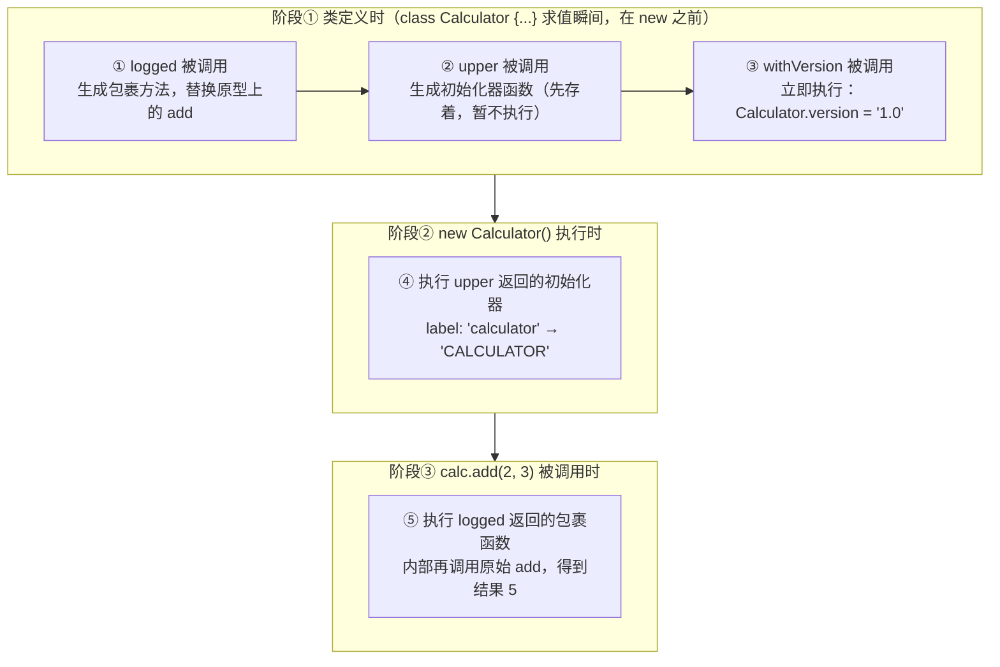

## TypeScript 是什么？

一句话：TypeScript = JavaScript + 静态类型检查（编译期检查，而非运行时）。

示例：

```ts
let foo = 1;
foo.split(' ');
// TS 编译错误：Property 'split' does not exist on type 'number'.
// JS 运行时报错：foo.split is not a function
```

TS 把这类错误提前，写代码时就能发现。


强类型 vs 弱类型

- JS / TS：弱类型，允许大量隐式转换：

  ```ts
  console.log(1 + '1'); // '11'
  ```

- Python：强类型，`1 + '1'` 直接报错。


## 基本类型

原始数据类型

```ts
let isDone: boolean = false;

let decLiteral: number = 6;
let hexLiteral: number = 0xf00d;
let binaryLiteral: number = 0b1010;
let octalLiteral: number = 0o744;

let myName: string = 'Tom';

let sentence: string = `Hello, my name is ${myName}.`;

function alertName(): void {
  alert('My name is Tom');
}

let u: undefined = undefined;
let n: null = null;
```


## any

any：放弃类型检查

```ts
let myFavoriteNumber: any = 'seven';
myFavoriteNumber = 7; // ✅ 不报错
```

- 用途：迁移旧 JS 代码时“临时跳过”类型检查。


## 类型推断

 TypeScript 不要求处处写类型注解——只要给了初始值，TS 就会自动推断出类型，之后按这个类型做检查。

```ts
let count = 10;        // 推断为 number
const arr = [1, 2, 3]; // 推断为 number[]

function add(a: number, b: number) {
  return a + b; // 返回类型被推断为 number
}
```


## 联合类型

用 `|` 表示一个变量可以是几种类型之一：

```ts
let value: string | number;
```

```ts
value = 'hello'; // ✅
value = 123;     // ✅
value = true;    // ❌ 只能是 string 或 number，boolean 不在联合类型里
```


"收窄"(narrowing)

拿到联合类型的值后，不能直接调用某个具体类型独有的方法，必须先"收窄"(narrowing)——最常见是用 `typeof` 判断：

```ts
if (typeof id === "string") {
  id.toUpperCase(); // TS 确认这里是 string，才允许调用
} else {
  id.toFixed(2);    // 这个分支里 TS 知道是 number
}
```

这是 TS 联合类型的核心设计意图：**逼你显式处理每一种可能性**，而不是运行时才炸。


字符串字面量联合类型，相当于轻量级枚举：

```ts
type Status = "loading" | "success" | "error";
```


## 对象类型

对象类型描述对象的“形状”（shape）：属性名 + 类型，多余或缺失属性会在编译期报错。

```ts
// 1. 内联对象类型：直接写 { 属性: 类型 }
let user: { name: string; age: number };
user = { name: "Tom", age: 20 };
```

```ts
// 2. type 别名：给对象类型起个名字，复用更方便
type User = { name: string; age: number };
const u2: User = { name: "Amy", age: 22 };
```

```ts
// 3. 可选属性 ?：允许省略
type Config = { host: string; port?: number };
const c1: Config = { host: "localhost" }; // 不传 port 也合法
console.log(c1.port); // undefined
```

```ts
// 4. readonly：赋值后不能再修改（只在编译期检查，运行时无效）
type Point = { readonly x: number; readonly y: number };
const p: Point = { x: 1, y: 2 };
p.x = 5; // 编译报错：Cannot assign to 'x' because it is a read-only property
```

```ts
// 5. 嵌套对象类型
type Post = { title: string; author: { name: string; id: number } };
const post: Post = { title: "Hello", author: { name: "Bob", id: 1 } };
```

6. 接口（interface），在其它章节


## 索引签名

语法：

```ts
interface Scores {
  [subject: string]: number;
}
```

`[key: 类型]: 值类型` 这种写法叫索引签名。`subject`这个名字随便起（只是给自己看的），关键是 `string`（键的类型）和 `number`（值的类型）。

你无法在写代码时就把所有属性名列出来（比如学科、用户 ID、配置项名），但知道只要是这个对象的属性，值就一定是某个类型，就用索引签名。它把一个"开放"的对象变成"部分类型安全"的字典。

```ts
const scores: Scores = {};
scores.math = 90;
scores["english"] = 85;
scores.chemistry = 78;

console.log(scores); // { math: 90, english: 85, chemistry: 78 }

// 类型检查会拦截值类型不对的赋值（下面这行故意写错类型，用来演示报错）
scores.chemistry = "78";
```


## 接口（interface）

```ts
// interface：描述对象的形状（有哪些属性、每个属性什么类型）
interface Person {
  name: string;
  age?: number; // ? 表示可选属性
  readonly id: string; // readonly 只能在创建时赋值，之后不能改
}

const p: Person = { name: "Tom", id: "u1" }; // age 可以不给
console.log(p); // { name: 'Tom', id: 'u1' }
// p.id = "u2"; // 报错：readonly 属性不能重新赋值
```

```ts
// 接口可以继承（extends），组合出更大的形状
interface Employee extends Person {
  salary: number;
}
const e: Employee = { name: "Jerry", id: "u2", salary: 8000 };
console.log(e); // { name: 'Jerry', id: 'u2', salary: 8000 }
```


## 数组

```ts
// 1. 基本写法：类型 + []
let nums: number[] = [1, 2, 3];
let names: string[] = ["a", "b"];
```

```ts
// 2. 泛型写法：Array<类型>，与上面等价，团队代码里两种都常见
let nums2: Array<number> = [1, 2, 3];
```

```ts
// 3. 联合类型数组：数组里每一项可以是多种类型之一
let mixed: (number | string)[] = [1, "two", 3];
```

```ts
// 4. 只读数组：编译期禁止 push/修改，但运行时其实还是普通数组
const frozen: readonly number[] = [1, 2, 3];
frozen.push(4); // 会报错：Property 'push' does not exist on type 'readonly number[]'
```

```ts
// 5. 元组 tuple：固定长度、每个位置类型固定，比普通数组更严格
let point: [number, number] = [10, 20];
let entry: [string, number] = ["age", 30];
```

```ts
// 6. 二维数组：数组的数组
let grid: number[][] = [
  [1, 2],
  [3, 4],
];
```


## 函数类型

```ts
// 1. 基本注解：参数类型 + 返回值类型
function add(a: number, b: number): number {
  return a + b;
}
```

```ts
// 2. 函数类型表达式：描述"一个函数长什么样"，可以拿来做变量/参数的类型
let mathOp: (a: number, b: number) => number;
mathOp = add;
mathOp = (a, b) => a - b; // 赋值时 a、b 的类型可省略，由 mathOp 的类型反推出来
```

```ts
// 3. void 返回类型：表示"不关心返回值"，函数体可以没有 return
function logResult(value: number): void {
  console.log("结果:", value);
}
```

```ts
// 4. 可选参数 ?：调用时可以不传
function greet(name: string, title?: string): string {
  return title ? `${title}${name}` : name;
}
```

```ts
// 5. 默认参数：不传时用默认值，类型从默认值推断出来
function power(base: number, exponent: number = 2): number {
  return base ** exponent;
}
```

```ts
// 6. 剩余参数：把不定数量的同类型实参收集成一个数组
function sum(...nums: number[]): number {
  return nums.reduce((total, n) => total + n, 0);
}
```

```ts
// 7. type 别名：给函数类型起名字，方便复用（常用于回调参数）
type Comparator = (a: number, b: number) => boolean;

function findFirst(nums: number[], test: Comparator): number | undefined {
  return nums.find((n) => test(n, 0));
}
findFirst([-1, 2, -3], (a, b) => a > b)
```


## 类 class

```ts
// 1. 基础类：字段 + 构造函数 + 方法
class Animal {
  name: string; // 字段声明（必须先声明类型）
  private age: number; // private：只能在类内部访问
  readonly species: string; // readonly：构造后不能再赋值

  constructor(name: string, age: number, species: string) {
    this.name = name;
    this.age = age;
    this.species = species;
  }

  speak(): string {
    return `${this.name} 发出了声音`;
  }
}

const dog = new Animal("旺财", 3, "犬");
console.log(dog.speak());
console.log(dog.name); // public 字段可以外部访问
// console.log(dog.age); // 编译报错：age 是 private
```

```ts
// 2. getter/setter：像访问属性一样调用方法
class Temperature {
  private _celsius = 0;
  get celsius(): number {
    return this._celsius;
  }
  set celsius(value: number) {
    this._celsius = value;
  }
  get fahrenheit(): number {
    return this._celsius * 1.8 + 32;
  }
}
const t = new Temperature();
t.celsius = 25; // 调用 setter
console.log(`${t.celsius}°C = ${t.fahrenheit}°F`); // 调用 getter
```

`interface` 描述"形状"（有哪些方法/字段），`implements` 要求类必须满足这个形状。

```ts
// 3. implements：类遵守某个接口的形状约定
interface Flyable {
  fly(): string;
}
class Bird implements Flyable {
  fly(): string {
    return "鸟儿飞起来了";
  }
}
console.log(new Bird().fly());
```


## 泛型 `<T>`

泛型：泛型让"类型"本身像函数参数一样，可以被传入和推导，而不是写死。


### 泛型函数

这里让函数输入类型和输出类型保持一致

```ts
// 1. <T> 是类型占位符，调用时才确定具体类型
function identity<T>(value: T): T {
  return value;
}

identity<number>(1);   // 显式指定 T = number
identity("hello");     // 自动推断为 T = string
```

```typescript
// 2. 多个类型参数
function pair<A, B>(a: A, b: B): [A, B] {
  return [a, b];
}
console.log(pair("age", 18));
```

ts自动推导，相当于被具体化为 `pair(a: string, b: number): [string, number]`


### 泛型接口

```typescript
// 3. 泛型接口/类型：描述一个"装着 T"的结构
interface Box<T> {
  content: T;
}
const numberBox: Box<number> = { content: 100 };  // 显示指定为number
```

```typescript
// 4. 默认类型参数：不传时使用默认值
interface ApiResponse<T = string> {
  data: T;
}
const res: ApiResponse = { data: "ok" };
```

不传类型参数时退化为默认值，类似函数默认参数。


### 泛型约束

`T extends { length: number }` 表示：必须是拥有 `length` 属性才能通过编译。

```typescript
// 4. 泛型约束：extends 限制 T 必须满足某个形状，才能访问对应属性
function getLength<T extends { length: number }>(item: T): number {
  return item.length;
}
console.log(getLength("abc"));     // string 有 length
console.log(getLength([1, 2, 3])); // 数组也有 length
```


### 泛型类

让类也带有类型参数

```typescript
// 6. 泛型类
class Stack<T> {
  private items: T[] = [];
  push(item: T) { this.items.push(item); }
  pop(): T | undefined { return this.items.pop(); }
}

const numberStack = new Stack<number>();
```


## 断言 `as Type`

断言是"我知道你不知道,但相信我"——用来说服编译器,而不是真正转换或校验数据。

`as Type`(最常用)

```ts
const input: unknown = "123";
const strLen = (input as string).length; // 输出 3
```

诉编译器"相信我,这就是这个类型",绕过类型检查。适合开发者比 TS 更了解实际类型的场景


非空断言 `!`

```ts
function getLength(s?: string) {
  return s!.length;
}
```

去掉 `null | undefined`,告诉编译器"这里一定有值"。如果你判断错了,运行时会直接抛 `Cannot read properties of undefined`。


## Promise`<T>`

返回值类型 `Promise<T>` 告诉 TypeScript："这个函数是异步的，最终会给你一个 `T` 类型的值"。

```ts
function delay<T>(value: T, ms: number): Promise<T> {
  return new Promise((resolve) => {
    setTimeout(() => resolve(value), ms);
  });
}
```


`delay<T>` 中的 `T` 是调用时根据传入参数自动推断的，不用手写。

```ts
const num = await delay(42, 500);      // T 被推断为 number → num: number
const str = await delay("hello", 500); // T 被推断为 string → str: string
```


泛型让同一份异步逻辑能安全地适配任意类型，`await` 之后拿到的变量类型也是准确的，否则只能写 `Promise<any>` 或者对每种类型写一个重复的函数（`delayNumber`、`delayString`...）


其它常用：

- `Promise<void>`：不关心 resolve 的值（比如只是等待某个操作完成）。
- `Promise<User>`：resolve 出一个自定义类型的对象，常见于 `fetch` 封装。
- `async function foo(): Promise<T>`：写 `async` 函数时，TypeScript 会自动把返回值包一层 `Promise<...>`，通常可以省略不写，靠推断。


## TypeScript 装饰器（decorator）

本质上是在类定义阶段执行一次的函数，用 `@decoratorName` 语法附加在类、方法、属性、访问器上，可以在类构建时替换/包裹/标记这些成员。


语法：

1. 签名统一为 `(value, context) => 替换值 | void`。`value` 是被装饰的东西本身（类构造函数 / 方法 / 字段初始值 undefined），`context` 是描述信息对象（`kind`、`name`、`static`、`private`、`addInitializer` 等）。

2. 不同位置的装饰器，`value` 含义不同：

   - 类装饰器：`value` = 类构造函数，返回一个新类可整体替换它。
   - 方法装饰器：`value` = 原函数
   - 字段装饰器：`value` = `undefined`

3. `context` 是 TC39 装饰器规范专门设计出来的"元信息 + 工具箱"对象，目的是让装饰器函数不用去反射/猜测自己在装饰什么，而是直接从这个参数里拿到标准化的信息和能力

4. 装饰器函数可以什么都不 `return`（等价于 `return undefined`），此时该元素保持原样不变：

   - 方法/访问器装饰器不 return → 原方法/访问器不变
   - 字段装饰器不 return → 字段用原始初始值，不做任何转换（`upper` 里如果不 return，`label` 就还是 `"calculator"`）
   - 类装饰器不 return → 类本身不变（当然像 `withVersion` 这种直接 mutate `target` 的写法，即使不 return 效果也已经生效了，因为它没有替换类，只是改了它）

5. 如果要 return，类型是有严格限制的，不是任意类型，按种类分别要求：

   - | 装饰器类型                | 允许的返回值                                               |
     | ------------------------- | ---------------------------------------------------------- |
     | 类装饰器                  | 一个可调用的东西（新的类/函数/Proxy），用来整体替换原类    |
     | 方法/getter/setter 装饰器 | 一个新的 `Function`，替换原方法                            |
     | 字段装饰器                | 一个 `(initialValue) => newValue` 形式的函数，作为初始化器 |


装饰器执行时间顺序：

1. 在类被定义瞬间：方法/访问器装饰器先被调用，字段装饰器接着被调用，类装饰器最后被调用
2. 同一类里如果有多个同类型装饰器（比如两个字段都用了装饰器），它们之间是按源码书写顺序调用的；但跨类型时（方法 vs 字段），顺序是固定的"方法/访问器 → 字段 → 类"




```ts
// 方法装饰器：包裹原方法，在调用前后打印日志
/**
 * @param target 原方法
 * @param context 装饰器上下文
 * @returns 包裹后的新方法
 */

function logged(target: Function, context: ClassMethodDecoratorContext) {
  console.log("【logged装饰器开始执行】");
  const methodName = String(context.name); // 把context.name转换为字符串
  return function (this: unknown, ...args: unknown[]) { // 返回一个匿名函数
    const result = target.apply(this, args); // 调用原方法，以当前实例作为this调用target
    console.log("【logged装饰器返回的匿名函数被调用】");
    return result; // 返回原方法的结果
  };
}


// 类装饰器：接收类本身，可以直接修改它（这里挂一个静态属性）
/**
 * 给类添加一个静态版本号属性
 * @param target 类本身
 */

function withVersion(target: Function) {
  console.log("【withVersion装饰器开始执行】");
  (target as any).version = "1.0"; // 给target添加一个静态属性version
  console.log("【withVersion装饰器函数执行完毕】");
}


// 字段装饰器：返回一个函数来改写初始值
/**
 * 字段装饰器：将初始值转换为大写
 * @param _value 初始值（未定义）
 * @param context 装饰器上下文
 * @returns 包裹后的新方法
 */
function upper(_value: undefined, context: ClassFieldDecoratorContext) {
  console.log("【upper装饰器开始执行】");
  return function (this: unknown, initialValue: string) { // 返回一个匿名函数，参数this指向当前实例，initialValue是字段的初始值
    console.log("【upper装饰器返回的匿名函数被调用】");
    return initialValue.toUpperCase(); // 返回大写后的初始值
  };
}


@withVersion // 类装饰器：类定义完成的瞬间就立即调用withVersion，给类添加静态版本号属性
class Calculator {
  @upper // 字段装饰器：类定义时调用upper生成初始化器，该字段初始化时，调用装饰器返回的匿名函数，将初始值转换为大写
  label = "calculator";

  @logged // 方法装饰器：当调用类的该方法时，改调用装饰器返回的匿名函数
  add(a: number, b: number) {
    return a + b;
  }
}

const calc = new Calculator();
console.log('调用类里的add方法');
calc.add(2, 3);
console.log("label =", calc.label);
```

- `upper`（字段装饰器）返回的初始化器函数：每次实例化时执行一次，即 `new Calculator()` 运行到 `label` 字段被初始化的那一刻调用，接收字段原始值 `initialValue`，返回值作为该字段的最终初始值。有几个实例就调用几次。
- `logged`（方法装饰器）返回的包裹函数：它在类定义时就已经替换了原型上的 `add`，之后每次外部代码调用 `calc.add(...)` 时，实际调用的就是这个包裹函数——调用几次就执行几次。

```
【logged装饰器开始执行】
【upper装饰器开始执行】
【withVersion装饰器开始执行】
【withVersion装饰器函数执行完毕】
【upper装饰器返回的匿名函数被调用】
调用类里的add方法
【logged装饰器返回的匿名函数被调用】
label = CALCULATOR
```


```
1. logged —— 方法装饰器(第 1–9 行)
参数 target 是被装饰的原方法(这里是 add),context 描述该方法的信息(名字、种类等)。
装饰器被应用时(类定义阶段,只执行一次)先打印"logged装饰器开始执行"。
methodName 取出方法名,但后面没有用到。
返回一个新函数,用它替换原来的 add。这个新函数被调用时:先用 target.apply(this, args) 执行原方法,再打印"返回的匿名函数被调用",最后把结果返回。也就是给方法加了一层包装。

2. withVersion —— 类装饰器(第 11–15 行)
target 是被装饰的类(Calculator)。
先打印"开始执行",然后给类添加静态属性 version = "1.0"(用 as any 绕过类型检查),再打印"执行完毕"。
没有返回值,所以类本身不被替换,只是被加了个属性。

3. upper —— 字段装饰器(第 17–23 行)
字段装饰器的第一个参数固定是 undefined,所以写作 _value;context 描述字段信息。
应用时打印"upper装饰器开始执行"。
返回一个函数,它会成为字段的初始化器转换函数:每次创建实例、给字段赋初始值时被调用,接收初始值 initialValue,返回其大写形式,作为字段最终的值。

4. Calculator 类(第 25–34 行)
@withVersion 修饰整个类。
@upper 修饰字段 label,初始值 "calculator",会被转成 "CALCULATOR"。
@logged 修饰方法 add,它返回 a + b,但被包装了一层。

5. 运行流程(第 36–40 行)
实际输出顺序是:

类定义时,装饰器按"先成员、后类"的顺序执行(成员按书写顺序):
【upper装饰器开始执行】
【logged装饰器开始执行】
【withVersion装饰器开始执行】
【withVersion装饰器函数执行完毕】
new Calculator() 创建实例,初始化字段 label 时,调用 upper 返回的函数:
【upper装饰器返回的匿名函数被调用】,label 变成 "CALCULATOR"。
打印 调用类里的add方法。
calc.add(2, 3):实际执行的是 logged 返回的包装函数,先算出 5,再打印 【logged装饰器返回的匿名函数被调用】。返回值 5 没有被使用。
最后打印 label = CALCULATOR。
```

