# three.js

## 基础骨架（Scene + Camera + Renderer）

这一章的目标：
**看到这一章，你就能在全新项目里从空白文件搭出：一个带坐标轴/网格、可鼠标旋转、随窗口缩放、能挂上 GUI 的基础 three.js 场景。**

### 概述

- **Scene**：3D 世界容器，装所有物体、灯光、背景、雾。
- **Camera**：视角（相机位置 + 视锥体参数）。
- **Renderer**：帮你把 Scene 通过 Camera 渲染到 `<canvas>` 上。
- **OrbitControls**：用鼠标拖拽/缩放控制相机。
- **animate / renderLoop**：渲染循环。

------

### 项目骨架（Vite + three）

目录（你已经用过）：


```Text
├─src
│  ├─func
│  │  ├─初始化.js
│  │  ├─添加辅助工具.js
│  │  └─3.基本变换.js
│  └─main.js
├─index.html
├─package.json
├─vite.config.js
└─node_modules
```

创建项目：

```bash
pnpm init
pnpm add three
pnpm add -D typescript vite @types/three
pnpm install vite -D
```

`package.json` 脚本：

```json
"scripts": {
  "dev": "vite"
}
```

启动：

```bash
pnpm run dev
```

------

### 最小可运行示例（Scene + Camera + Renderer + 立方体）

#### src/main.ts

```ts
import * as THREE from 'three';
import { OrbitControls } from 'three/addons/controls/OrbitControls.js';
import * as dat from 'dat.gui';

// 1. 场景
const scene: THREE.Scene = new THREE.Scene();

// 2. 相机（透视相机）
const camera: THREE.PerspectiveCamera = new THREE.PerspectiveCamera(
  75, // fov 视角
  window.innerWidth / window.innerHeight, // 宽高比
  0.1, // 近裁面
  1000 // 远裁面
);
camera.position.set(3, 3, 5);

// 3. 渲染器
// 创建时不传 canvas，让 WebGLRenderer 自己 new 一个 <canvas>
const renderer: THREE.WebGLRenderer = new THREE.WebGLRenderer({
  antialias: true, // 抗锯齿
});
renderer.setPixelRatio(window.devicePixelRatio);
renderer.setSize(window.innerWidth, window.innerHeight);
// 把这个内部的 canvas 插到 DOM 里
document.body.appendChild(renderer.domElement);


// 4. 一个立方体
const boxGeometry: THREE.BoxGeometry = new THREE.BoxGeometry(1, 1, 1);
const boxMaterials: THREE.Material[] = [
  new THREE.MeshBasicMaterial({ color: 0xff0000 }), // 右
  new THREE.MeshBasicMaterial({ color: 0x00ff00 }), // 左
  new THREE.MeshBasicMaterial({ color: 0x0000ff }), // 上
  new THREE.MeshBasicMaterial({ color: 0xffff00 }), // 下
  new THREE.MeshBasicMaterial({ color: 0x00ffff }), // 前
  new THREE.MeshBasicMaterial({ color: 0xff00ff }), // 后
];

const cube: THREE.Mesh = new THREE.Mesh(boxGeometry, boxMaterials);
scene.add(cube);

// 5. 轨道控制器（鼠标旋转/缩放）
const controls: OrbitControls = new OrbitControls(
  camera,
  renderer.domElement
);
controls.enableDamping = true; // 惯性缓动，手感更好

// 6. 坐标轴 + 网格辅助
const axesHelper: THREE.AxesHelper = new THREE.AxesHelper(5); // 坐标轴辅助，参数表示轴的长度
scene.add(axesHelper);
const gridHelper: THREE.GridHelper = new THREE.GridHelper(20, 20); // 网格辅助，参数表示网格大小和分割数
scene.add(gridHelper);


// 8. 自适应窗口大小
window.addEventListener('resize', () => {
  const width: number = window.innerWidth;
  const height: number = window.innerHeight;

  camera.aspect = width / height;
  camera.updateProjectionMatrix();

  renderer.setSize(width, height);
});

// 9. 渲染循环（带控制器阻尼）
function animate(): void {
  requestAnimationFrame(animate);

  controls.update(); // OrbitControls 启用阻尼时需要每帧更新

  renderer.render(scene, camera); // 使用渲染器，通过相机将场景渲染出来
}

animate();
```

#### index.html

```html
<!DOCTYPE html>
<html lang="zh-CN">
  <head>
    <meta charset="UTF-8" />
    <title>three.js 基础场景</title>
    <style>
      body {
        margin: 0;
        overflow: hidden;
      }
      canvas {
        display: block; /* 防止出现滚动条 */
      }
    </style>
  </head>
  <body>
    <script type="module" src="/src/main.js"></script>
  </body>
</html>
```

> 这一段就是 three.js 的“Hello World 模板”，新功能一律往这个基础上加。

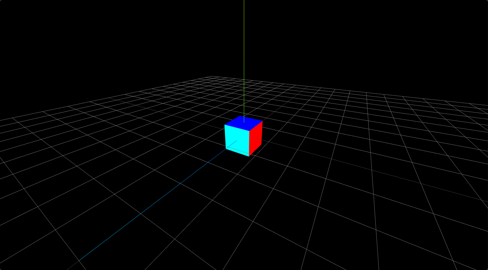


### WebGLRenderer（渲染器）


#### WebGLRenderer

```js
将3D场景(Scene)通过摄像机(Camera)的视角绘制出来

职责：
管理webgl上下文及 Canvas DOM 元素 

// 典型创建方式
const renderer = new THREE.WebGLRenderer({ antialias: true });
document.body.appendChild(renderer.domElement);

// 渲染到默认 canvas
renderer.render(scene, camera);
```

构造函数

```js
new WebGLRenderer( parameters : WebGLRenderer~Options )

构造一个新的WebGL渲染器。
Options — 可选的参数对象，具有以下属性：
  canvas — 渲染器用于绘制输出的 canvas 元素。如果未在此处传递参数，渲染器将创建一个新的 canvas 元素。
  alpha  — 在创建 WebGL 上下文时，是否为颜色缓冲区分配 alpha 通道，如果不传 alpha: true，WebGL 上下文默认是不透明的
  antialias — 是否使用默认的 MSAA（多级抗锯齿）。

方法：
  .setSize(width: number, height: number, updateStyle: boolean)
  将输出画布调整为 (width, height) 大小，并考虑设备像素比例，同时将视口设置为该大小，初始值为 (0, 0)。将 updateStyle 设置为 false 可阻止对输出画布进行任何样式更改。
  参数：
    width — 以逻辑像素为单位的宽度。
    height — 以逻辑像素为单位的高度。
    updateStyle — 是否更新画布的样式属性。默认为 true。
  
  .setPixelRatio( value : number )
  设置指定的像素比例，并在必要时调整画布大小。

  .setClearColor( color : Color, alpha : number )
  这设定了每帧渲染前清屏时用到的颜色和 alpha 值。Three.js 默认在每次 renderer.render() 调用前会自动清除颜色缓冲区（autoClear = true），把所有像素重置为( Color, alpha )。
  比如： 
    renderer.setClearColor(0x0000ff, 0.5);设置清除颜色为蓝色，半透明（能透出 HTML 背景）
    
    
    
下面两行代码能做到让canvas
const renderer = new THREE.WebGLRenderer({ alpha: true, antialias: true });
renderer.setClearColor(0x000000, 0);  // alpha = 0，完全透明
```


#### WebGLRenderTarget — 离屏渲染缓冲区

WebGLRenderTarget 是一个**离屏渲染目标**，本质上是 GPU 显存中的一块帧缓冲区（Framebuffer）。渲染结果不会直接输出到屏幕，而是写入其持有的纹理对象中，供后续使用。

- 默认创建两个纹理：**颜色纹理**（`target.texture`）和**深度/模板纹理**
- 渲染结果以纹理形式保存，可被贴到 3D 物体表面，或用于后处理

```js
// 创建一个 512x512 的离屏渲染目标
const renderTarget = new THREE.WebGLRenderTarget(512, 512);

// 可访问其中的颜色纹理
const texture = renderTarget.texture;
```

与WebGLRenderer的关系

可以让渲染器(`const renderer = new THREE.WebGLRenderer()`)里输出的内容写入到一个指定的renderTarget(`const` 

depthBuffer`renderTarget = new THREE.WebGLRenderTarget(width, height)`)里,而不是默认的画布上(`Canvas`)，这样就能在后续的渲染过程中把这个renderTarget当成一个纹理来使用了。


#### sRGB

```
sRGB是最适合计算机屏幕（如平板电脑和智能手机）的色彩空间（约30%CIE XYZ）

CIE (国际照明委员会) 在 1931 年制定了标准色度图，它定义了人眼可以区分的颜色数量与光的波长，通常以 2D 形式表示为 XY 轴上的马蹄形颜色扩散（俗称马蹄图）。

因为微软的主要倡议，使得 sRGB 成为默认颜色空间（任何具有类似计算机功能的设备都使用 sRGB），但是，它仅覆盖CIE XYZ色彩空间的约30%。
```

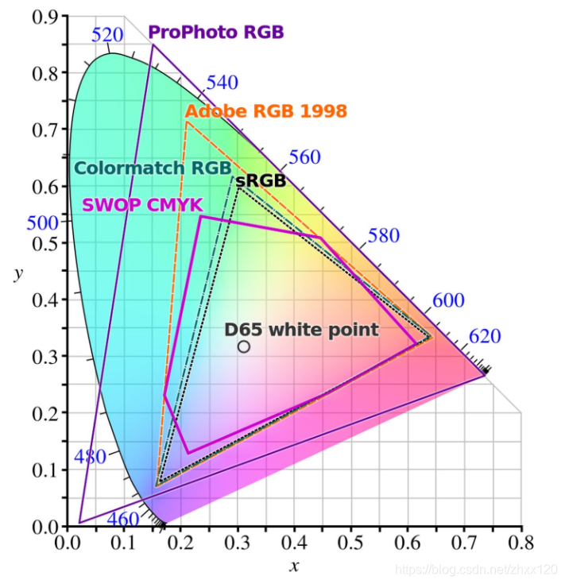


#### HDR 、LDR

```

Dynamic Range（动态范围）=最高亮度/最低亮度
HDR= High Dynamic Range
LDR = Low Dynamic Range

经常用到的显示器，它们实际上的物理亮度是不同意的，由于亮度不一样，所以LDR(0-1)对应到不用的屏幕上我们需要对应屏幕进行一个匹配。

蜡烛的物理亮度=15，太阳光的强度=100000，从15-100000这个高动态范围转换到屏幕上0-1的亮度范围叫Tonemapping。

日常使用的屏幕，其最高亮度是经过一系列经验积累的，所以使用、用起来不会对眼睛有伤害；但自然界中的，比如直视太阳时，实际上是会对眼睛产生伤害的


为什么需要HDR
    LDR只能将现实中的颜色压缩再呈现出来
    HDR可以由更好的色彩，更高的动态范围和更丰富的细节。
    可以有效防止画面过曝，超过1的亮度值的色彩也能很好地表现，像素光亮度变得很正常，视觉传达更真实

	HDR才有超过1的数值，才会有光晕（bloom）效果，也叫泛光，高质量的bloom效果能体现出画面的渲染品质

```

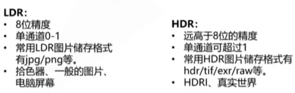

泛光效果

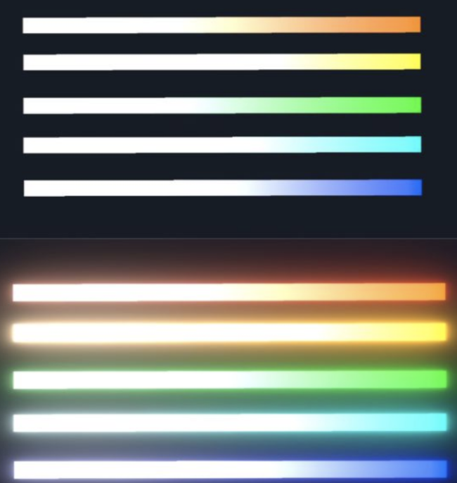


#### 像素比/宽高尺寸

```js
const renderer = new THREE.WebGLRenderer({ 
  antialias: true, // 启用抗锯齿
  alpha: true // 启用透明背景
});

renderer.setSize(window.innerWidth, window.innerHeight); 
renderer.setPixelRatio(window.devicePixelRatio); // 设置像素比

Window 接口的 devicePixelRatio 属性返回当前显示设备中物理像素分辨率与 CSS 像素分辨率的比率。
该值也可理解为像素尺寸的比率：即一个 CSS 像素对应一个物理像素的大小
```


```js
setSize(width, height, updateStyle)
用途: 设置渲染器输出画布的逻辑尺寸和视口大小
  width (number): 画布逻辑宽度(像素)
  height (number): 画布逻辑高度(像素)
  updateStyle (boolean, 默认true): 是否更新canvas的CSS样式
  
// 基础用法
renderer.setSize(1920, 1080);
// 内部逻辑大致为:
// 1. 设置 canvas.width = 1920
// 2. 设置 canvas.height = 1080
// 3. 设置 WebGL viewport = (0, 0, 1920, 1080)
// 4. 如果 updateStyle === true，也设置 canvas.style.width = '1920px', canvas.style.height = '1080px'

// 不更新CSS样式(保持容器size不变)
renderer.setSize(1920, 1080, false);
// canvas渲染分辨率改变，但CSS显示尺寸不变
```

下面是输出画布尺寸不等同于浏览器窗口大小的情况

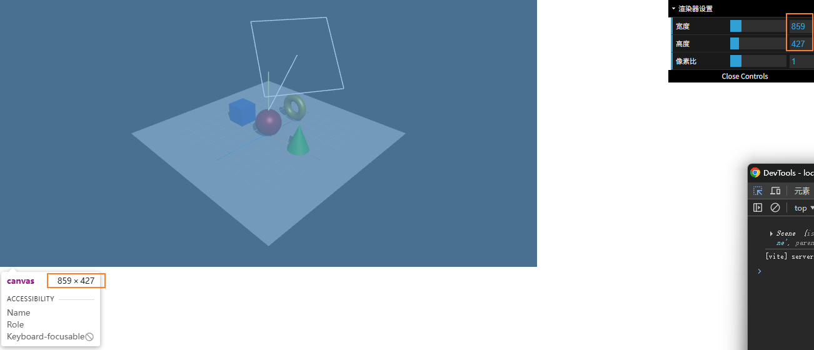


setPixelRatio(value)

设置指定的像素比例

```js
// 适配高分屏
renderer.setPixelRatio(window.devicePixelRatio);
// 内部逻辑大致为:
// 实际canvas分辨率 = 逻辑尺寸 × pixelRatio
// 例: 逻辑 1920×1080，pixelRatio=2
//     实际渲染分辨率 = 3840×2160 (更清晰，性能消耗更大)

// 降低像素比提升性能
renderer.setPixelRatio(1);
// 实际分辨率 = 逻辑分辨率 (1:1)

renderer.setPixelRatio(0.5);
// 实际分辨率 = 逻辑分辨率 × 0.5 (图像模糊，性能更好)
```

0.5的像素比

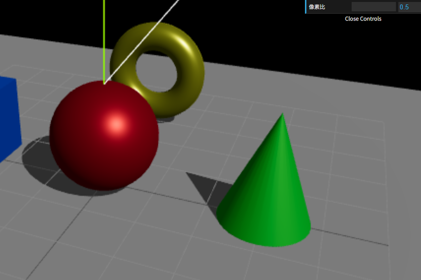

像素比为3

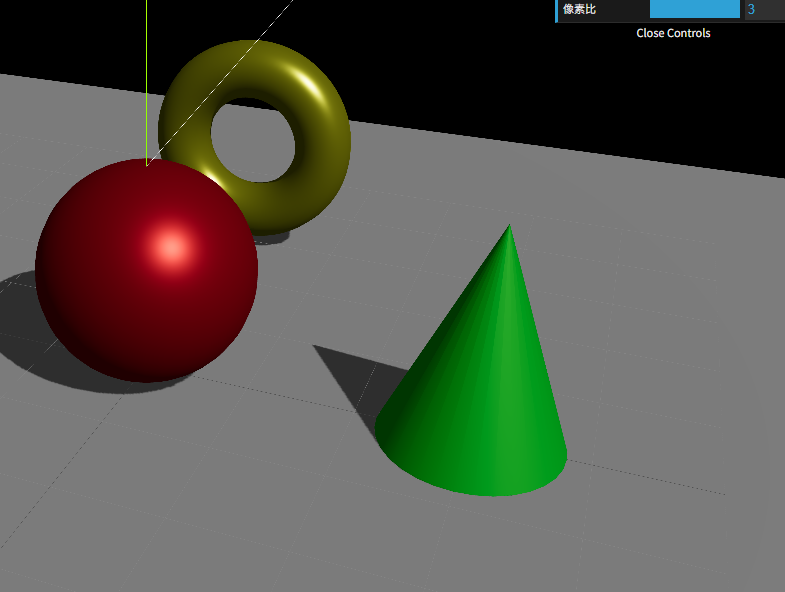


#### toneMapping（色调映射）

```js
作用：将高动态范围(HDR)的光照数据映射到显示器可显示的低动态范围(LDR)

通俗理解：就像拍照时的"HDR模式"，让亮部不过曝、暗部不死黑

renderer.toneMapping = THREE.ACESFilmicToneMapping; 

{
  NoToneMapping: 0,           // 不处理（会导致亮部截断）
  LinearToneMapping: 1,       // 线性映射（简单粗暴）
  ReinhardToneMapping: 2,     // Reinhard算法（柔和过渡）
  CineonToneMapping: 3,       // 电影感色调
  ACESFilmicToneMapping: 4    // 电影胶片模拟（推荐，最真实）
}

`THREE.LinearToneMapping`：线性色调映射，
    不对HDR颜色值进行特殊处理，直接映射到LDR范围，这可能会导致过曝或欠曝的问题。

`THREE.ReinhardToneMapping`：Reinhard色调映射，
    通过 `Reinhard函数` 对HDR颜色值进行压缩，以更自然地映射到LDR范围，
    有助于减少过曝，
    但是，可能不如其他方法自然。

`THREE.CineonToneMapping`：Cineon色调映射，
    使用`Cineon对数曲线`进行压缩，
    这种方法在某些电影风格的效果中很有用，但可能不适合所有场景。

`THREE.ACESFilmicToneMapping`：ACES Filmic色调映射，
    基于电影工业中广泛使用的ACES（Academy Color Encoding System）标准，
    提供了非常自然且接近电影效果的色调映射，能够很好地处理高光和阴影，同时保持颜色的丰富性和细节。
    
    
-使用 HDR 环境贴图时必须配置
-场景中有强光源（点光源、平行光）时推荐使用
```

色调映射类型：

NoToneMapping

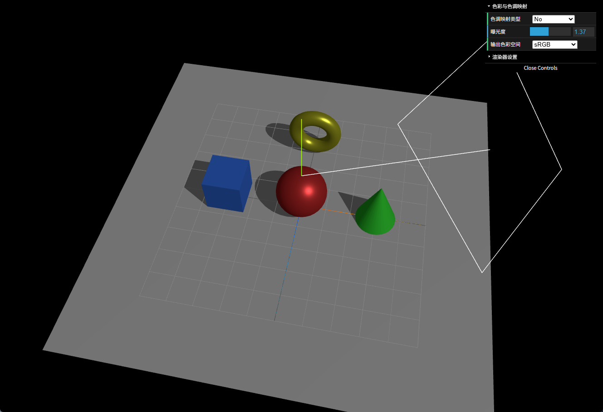

ACESFilmicToneMapping

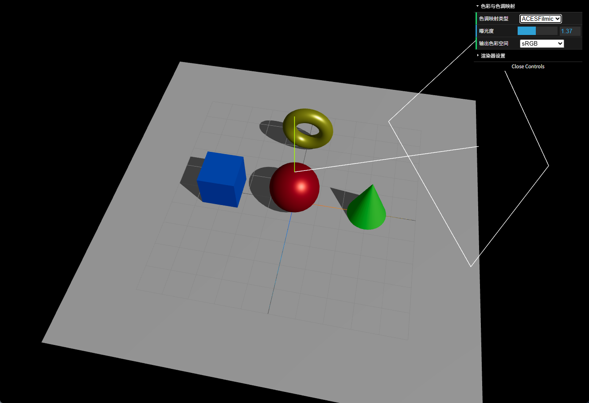


#### toneMappingExposure（曝光度）

```js
原指摄影过程中通过光圈、快门速度和感光度组合控制进入感光元件的光量
作用：控制整体画面亮度，类似相机的曝光补偿
范围：通常 0.1 ~ 3.0

配合 ACESFilmic 使用效果最佳
如果场景过暗，调高此值
如果高光溢出，调低此值

renderer.toneMappingExposure = 1.0;
```


#### outputColorSpace（输出色彩空间）

```js
作用：定义渲染结果的色彩编码方式

renderer.outputColorSpace = THREE.SRGBColorSpace; 

{
  SRGBColorSpace: {
    // 标准显示器色彩空间（默认）
    特点: "符合人眼感知，颜色更鲜艳",
    适用: "最终输出到屏幕的场景",
    gamma: "已应用 2.2 gamma 校正"
  },
  
  LinearSRGBColorSpace: {
    // 线性色彩空间
    特点: "物理正确但看起来偏灰",
    适用: "中间渲染步骤（如后期处理）",
    gamma: "无 gamma 校正"
  }
}
```

LinearSRGBColorSpace

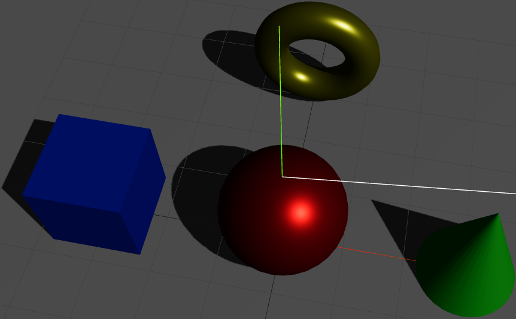

SRGBColorSpace,明显更加鲜艳

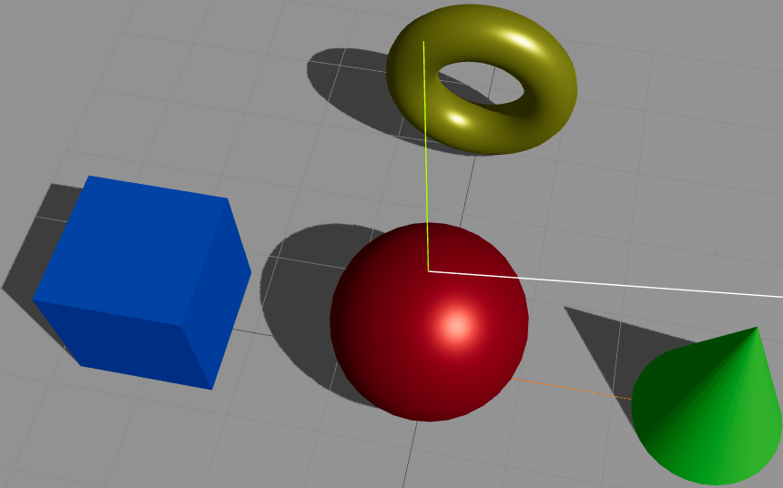


#### 阴影映射类型

```js
阴影映射：
  用于，计算物体投射到其他物体上阴影的技术，
  阴影映射，通过，在场景中，从光源的视角渲染一次场景（深度测试）来工作，从而确定哪些部分被其他物体遮挡，进而生成阴影。

默认值
renderer.shadowMap.type = THREE.PCFShadowMap


.BasicShadowMap : number (常量)
提供未过滤的阴影贴图——速度最快，但质量最低。

.PCFShadowMap : number (常量)
使用百分比更近过滤（PCF）算法过滤阴影贴图。适用于大多数应用场景

.PCFSoftShadowMap : number (常量)
使用百分比更近过滤（PCF）算法过滤阴影贴图，尤其在使用低分辨率阴影贴图时能获得更佳的柔和阴影效果。

.VSMShadowMap : number (常量)
使用方差阴影贴图（VSM）算法过滤阴影贴图。启用VSMShadowMap时，所有阴影接收器也将投射阴影。通过计算每个阴影映射像素的方差来工作，能够产生更平滑、更自然的阴影边缘，尤其是在阴影的软边部分，不过，它对性能要求更高，并且需要更精细的调整以达到最佳效果。
```

BasicShadowMap

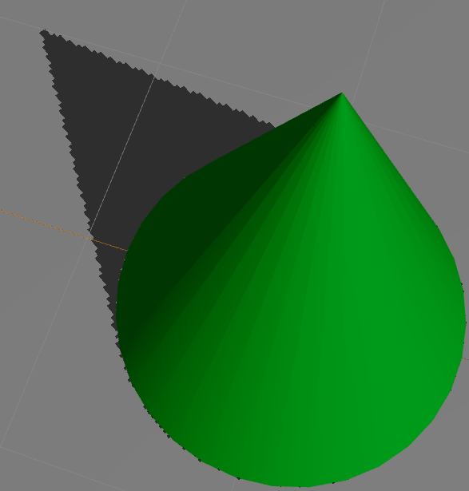

PCFShadowMap

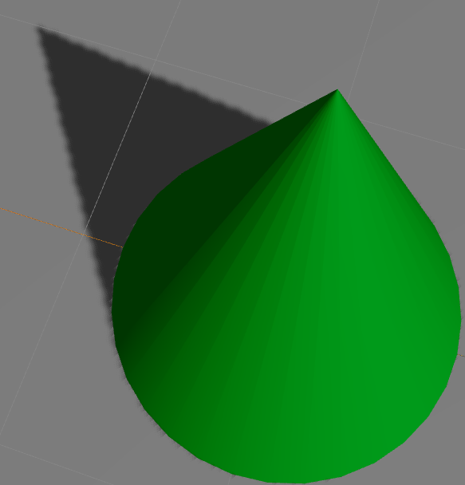

VSMShadowMap

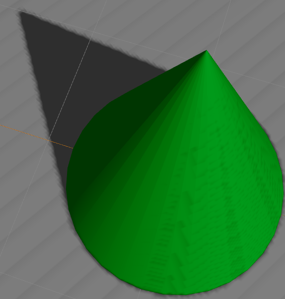


#### 渲染器对画布的清除

autoClear 与 scene.background

```
默认行为
	renderer.autoClear = true（默认）：每次 renderer.render() 前 Three.js 自动清除 color/depth/stencil 缓冲。
	清除后再绘制 scene.background（纯色 / 纹理 / cubemap / HDR），然后再绘制场景物体。

关闭 autoClear 的影响
	renderer.autoClear = false 时不再自动清除；若你不手动 clear，Three.js 仍会照常绘制物体，但背景不会被重新填充（因为之前的颜色缓冲内容未被擦除或已不可靠）。
	结果可能：背景看似“消失”或残留上一帧杂质。
	
为什么上一帧背景不能依赖
	three.js 只有在每次 render 开始时执行背景绘制（背景 quad / skybox），这通常是和清除颜色缓冲一起做的；把 autoClear 关掉后（或不手动 clear），three.js 就不会每帧重绘 scene.background。
	WebGL 默认 preserveDrawingBuffer = false，浏览器不保证前一帧像素还在；缓冲交换后内容可能不可用，所以不能指望“不清除就保留背景”。
	
解决方法：
每次重新使用渲染器渲染之前，手动清除一次画布：renderer.clear()
```


#### 画布分割

```
setViewport(x, y, width, height)
设置视口区域——定义渲染输出映射到画布的哪个矩形区域。

控制 3D 场景最终"投影"到画布上的位置和大小
坐标原点在左下角（WebGL 坐标系）
不设置 scissor 的话，清除操作（clearColor 等）仍会影响整个画布


setScissor(x, y, width, height)
设置裁剪区域——定义一个矩形，限定哪些像素可以被写入。

与 viewport 参数格式相同，通常两者设置一致的区域
只设置这个不开启 scissor test 是没有效果的


setScissorTest(boolean)
开启/关闭裁剪测试——是 scissor 生效的开关。

true：只有 scissor 区域内的像素才会被渲染操作影响（包括 clear()）
false：关闭限制，所有像素均可被影响


WebGL 坐标系，原点在左下角，y 轴朝上，与 CSS/DOM 坐标系（原点在左上角）相反
(0, h) ┌──────────┐ (w, h)
       │          │
       │  Canvas  │
       │          │
(0, 0) └──────────┘ (w, 0)
       ↑ 原点在这里


setScissorTest(true)          ← 打开开关
setScissor(x, y, w, h)        ← 定义"保护区域"（只有这里能被写入）
setViewport(x, y, w, h)       ← 定义场景渲染映射到哪里
renderer.render(scene, camera) ← 实际渲染
```

左右分屏示例，具体示例可以查看相机调参效果

```js
const views = [
  {
    // 左半屏
    left: 0, bottom: 0,
    width: 0.5, height: 1.0,
    camera: cameraLeft,
  },
  {
    // 右半屏
    left: 0.5, bottom: 0,
    width: 0.5, height: 1.0,
    camera: cameraRight,
  },
];

function render() {
  const canvasWidth  = renderer.domElement.clientWidth;
  const canvasHeight = renderer.domElement.clientHeight;

  // 关键：禁用自动清除，手动控制每个视口的清除
  renderer.autoClear = false;
  renderer.clear(); // 先整体清除一次

  for (const view of views) {
    const left   = Math.floor(canvasWidth  * view.left);
    const bottom = Math.floor(canvasHeight * view.bottom);
    const width  = Math.floor(canvasWidth  * view.width);
    const height = Math.floor(canvasHeight * view.height);

    // 1. 开启裁剪测试，限制后续操作只影响当前区域
    renderer.setScissorTest(true);
    renderer.setScissor(left, bottom, width, height);

    // 2. 设置视口，场景渲染映射到该区域
    renderer.setViewport(left, bottom, width, height);

    // 3. 渲染当前相机的视角
    renderer.render(scene, view.camera);
  }
}
```


### 相机

透视相机构造函数

```js
PerspectiveCamera
new PerspectiveCamera( fov : number, aspect : number, near : number, far : number )
创建一个新的透视相机。
参数
  fov — 摄像机视锥体垂直视野角度，单位为度。
  aspect — 摄像机视锥体宽高比。
  near — 摄像机视锥体近端面。
  far — 摄像机视锥体远端面。

方法
  .updateProjectionMatrix()
  更新相机投影矩阵，修改相机后必须调用此方法
```

相机自身局部参考系“以相机自身为原点，x指向右，y指向上，z指向屏幕外


#### 相机参数调试

调试位置

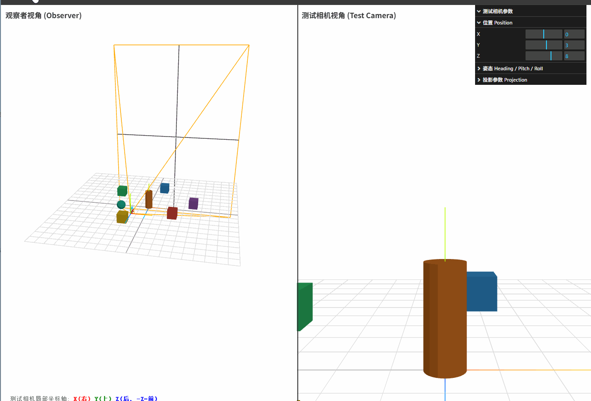


调试旋转角度

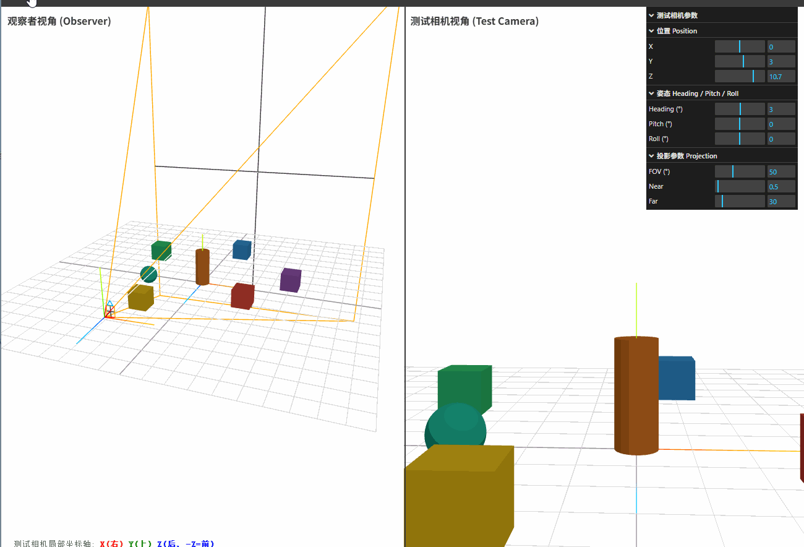


调试投影参数

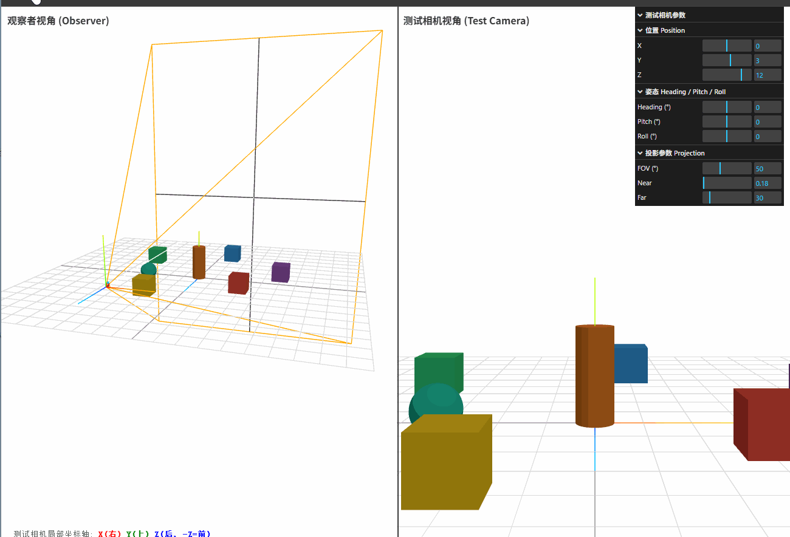


代码：

```html
<!doctype html>
<html lang="en">
  <head>
    <meta charset="UTF-8" />
    <link rel="icon" type="image/svg+xml" href="/vite.svg" />
    <meta name="viewport" content="width=device-width, initial-scale=1.0" />
    <title>vite-project</title>
    <style>
      body {
        margin: 0;
      }
      #cesiumContainer {
        width: 100vw;
        height: 100vh;
      }
      #divider {
        position: fixed;
        left: 50%;
        top: 0;
        width: 2px;
        height: 100%;
        background: #333;
        z-index: 10;
        pointer-events: none;
      }
      .view-label {
        position: fixed;
        top: 10px;
        color: #333;
        font: bold 16px sans-serif;
        z-index: 10;
        pointer-events: none;
      }
      #leftLabel {
        left: 10px;
      }
      #rightLabel {
        left: calc(50% + 10px);
      }
      #infoLabel {
        position: fixed;
        left: 10px;
        bottom: 10px;
        color: #555;
        font: 13px monospace;
        z-index: 10;
        pointer-events: none;
        background: rgba(255, 255, 255, 0.85);
        padding: 6px 10px;
        border-radius: 4px;
      }
      #leftOverlay {
        position: fixed;
        left: 0;
        top: 0;
        width: 50%;
        height: 100%;
        z-index: 5;
      }
    </style>
  </head>
  <body>
    <div id="cesiumContainer"></div>
    <div id="divider"></div>
    <div id="leftLabel" class="view-label">观察者视角 (Observer)</div>
    <div id="rightLabel" class="view-label">测试相机视角 (Test Camera)</div>
    <div id="infoLabel">
      测试相机局部坐标轴:
      <span style="color:red;font-weight:bold">X(右)</span>
      <span style="color:green;font-weight:bold">Y(上)</span>
      <span style="color:blue;font-weight:bold">Z(后, -Z=前)</span>
    </div>
    <div id="leftOverlay"></div>
    <script type="module" src="/src/main.js"></script>
  </body>
</html>

```

```js
import * as Cesium from "cesium";
import "cesium/Build/Cesium/Widgets/widgets.css";
import CesiumNavigation from 'cesium-navigation-es6'
import GUI from 'lil-gui';

//注册token
Cesium.Ion.defaultAccessToken = import.meta.env.VITE_CESIUM_TOKEN;

// const terrainProvider = await Cesium.createWorldTerrainAsync({
//   requestVertexNormals: true, // 让地形有更真实的光照阴影（可选）
// });

// 选择 id为cesiumContainer 的html元素作为cesium容器
// 第二个参数中可以设置控件
const viewer = new Cesium.Viewer("cesiumContainer", {
  // imageryProvider: false, // 设置为 false，不加载任何底图
  // timeline: false, // 隐藏时间轴
  animation: true, // 动画控件
  baseLayerPicker: false, // 底图切换控件
  geocoder: false, // 搜索控件
  homeButton: false, // 复位功能
  sceneModePicker: false, // 二三维切换功能
  navigationHelpButton: false, // 隐藏帮助按钮
  scene3DOnly: true, // 只使用3D场景
  shouldAnimate: true, // 开启动画效果,比如太阳位置变化
  infoBox: false, // 隐藏信息框
  // terrainProvider: terrainProvider, // 使用加载的地形数据
});

// createCameraHud(viewer, { updateHz: 10, precision: 6, showVectors: true })

// 启用光照
viewer.scene.globe.enableLighting = true;


// 加载罗盘，方便我知道东南西北方向
new CesiumNavigation(viewer,{
    // defaultResetView: Cesium.Rectangle.fromDegrees(116.0, 39.5, 116.8, 40.3), // 使用矩形区域定义重置视图
    enableCompass: true, // 是否显示指南针
    enableZoomControls: true, // 是否显示缩放控件
    enableDistanceLegend: true, // 是否显示距离图例
})


//配置并创建天地图Web瓦片服务影像提供者
const tianditu = new Cesium.WebMapTileServiceImageryProvider({
  url:
    "http://{s}.tianditu.gov.cn/img_w/wmts?service=wmts&request=GetTile&version=1.0.0&LAYER=img&tileMatrixSet=w&TileMatrix={TileMatrix}&TileRow={TileRow}&TileCol={TileCol}&style=default&format=tiles&tk=" +
    "4a050b56e21976c2bb53fec757797dc1",
  layer: "img_w",
  style: "default",
  format: "tiles",
  tileMatrixSetID: "w",
  subdomains: ["t0", "t1", "t2", "t3", "t4", "t5", "t6", "t7"],
  maximumLevel: 18,
  credit: new Cesium.Credit("天地图"),
});


// 将天地图层添加到观众实例的影像图层集合中
viewer.imageryLayers.addImageryProvider(tianditu);


// 主相机飞到合适位置观察原点位置
viewer.camera.flyTo({
  destination: Cesium.Cartesian3.fromDegrees(116.3975, 39.9085, 15000),
  orientation: {
    heading: Cesium.Math.toRadians(0),
    pitch: Cesium.Math.toRadians(-45),  // 俯视角度
    roll: 0.0
  },
  duration: 0.2
});


// 可视化相机位置处的ENU坐标系（随相机移动实时更新）

const enuAxesLen = 8000; // ENU 轴线长度（米），可按需调整
let enuEntities = [];

function updateCameraENUAxes() {
  // 移除上一帧的ENU轴实体
  enuEntities.forEach(e => viewer.entities.remove(e));
  enuEntities = [];

  const camPos = Cesium.Cartesian3.fromDegrees(116.3975, 39.9085, 5000)

  // 获取相机位置处的ENU变换矩阵（列依次为 East / North / Up / Position）
  const enuMatrix = Cesium.Transforms.eastNorthUpToFixedFrame(camPos);
  const rot = Cesium.Matrix4.getMatrix3(enuMatrix, new Cesium.Matrix3());
  const eastDir  = Cesium.Matrix3.getColumn(rot, 0, new Cesium.Cartesian3()); // East,enu 4*4矩阵的第一列
  const northDir = Cesium.Matrix3.getColumn(rot, 1, new Cesium.Cartesian3()); // North,enu 4*4矩阵的第二列
  const upDir    = Cesium.Matrix3.getColumn(rot, 2, new Cesium.Cartesian3()); // Up,enu 4*4矩阵的第三列

  const eEnd = Cesium.Cartesian3.add(
    camPos,
    Cesium.Cartesian3.multiplyByScalar(eastDir,  enuAxesLen, new Cesium.Cartesian3()),
    new Cesium.Cartesian3()
  );
  const nEnd = Cesium.Cartesian3.add(
    camPos,
    Cesium.Cartesian3.multiplyByScalar(northDir, enuAxesLen, new Cesium.Cartesian3()),
    new Cesium.Cartesian3()
  );
  const uEnd = Cesium.Cartesian3.add(
    camPos,
    Cesium.Cartesian3.multiplyByScalar(upDir,    enuAxesLen, new Cesium.Cartesian3()),
    new Cesium.Cartesian3()
  );

  // East - 红色
  enuEntities.push(viewer.entities.add({
    position: eEnd,
    polyline: { positions: [camPos, eEnd], width: 3, material: Cesium.Color.RED },
    label: {
      text: 'E (East)', font: '14px Microsoft YaHei',
      fillColor: Cesium.Color.RED,
      style: Cesium.LabelStyle.FILL_AND_OUTLINE, outlineWidth: 2,
      pixelOffset: new Cesium.Cartesian2(0, -12)
    }
  }));

  // North - 绿色
  enuEntities.push(viewer.entities.add({
    position: nEnd,
    polyline: { positions: [camPos, nEnd], width: 3, material: Cesium.Color.LIME },
    label: {
      text: 'N (North)', font: '14px Microsoft YaHei',
      fillColor: Cesium.Color.LIME,
      style: Cesium.LabelStyle.FILL_AND_OUTLINE, outlineWidth: 2,
      pixelOffset: new Cesium.Cartesian2(0, -12)
    }
  }));

  // Up - 蓝色
  enuEntities.push(viewer.entities.add({
    position: uEnd,
    polyline: { positions: [camPos, uEnd], width: 3, material: Cesium.Color.BLUE },
    label: {
      text: 'U (Up)', font: '14px Microsoft YaHei',
      fillColor: Cesium.Color.BLUE,
      style: Cesium.LabelStyle.FILL_AND_OUTLINE, outlineWidth: 2,
      pixelOffset: new Cesium.Cartesian2(0, -12)
    }
  }));

  // 相机原点标记 - 黄色点
  enuEntities.push(viewer.entities.add({
    position: camPos,
    point: {
      pixelSize: 10,
      color: Cesium.Color.YELLOW,
      outlineColor: Cesium.Color.BLACK,
      outlineWidth: 2
    },
  }));
}

// 降低 changed 触发阈值使更新更及时
viewer.camera.percentageChanged = 0.01;  // 位置或方向改变超过1%时触发 changed 事件
viewer.camera.changed.addEventListener(updateCameraENUAxes);
updateCameraENUAxes(); // 初始化


// 创建虚拟相机，位置固定在指定经纬度，不影响主相机
const virtualCamera = new Cesium.Camera(viewer.scene);
virtualCamera.frustum.fov = Cesium.Math.toRadians(40);  // 视场角40度，也可以理解为张角
virtualCamera.frustum.near = 100;   // 近平面100米
virtualCamera.frustum.far = 5000;  // 远平面5000米
// virtualCamera.frustum.aspectRatio = 2.0; 宽是高的 2 倍，这里的宽高比和fov还有far能一起改变视锥体远平面长宽的大小和形状

virtualCamera.setView({
  destination: Cesium.Cartesian3.fromDegrees(116.3975, 39.9085, 5000),
  orientation: {
    heading: Cesium.Math.toRadians(0),
    pitch: Cesium.Math.toRadians(-45),
    roll: 0.0
  }
});

// DebugCameraPrimitive 可视化虚拟相机的视场锥体
let debugCameraPrimitive = viewer.scene.primitives.add(new Cesium.DebugCameraPrimitive({
  camera: virtualCamera,
  color: Cesium.Color.CYAN,
  updateOnChange: false,
}));

// === lil-gui 虚拟相机参数调试 ===
const guiParams = {
  fov:     40,   // 度
  far:   5000,   // 米
  heading: 0,    // 度
  pitch:  -45,   // 度
  roll:    0,    // 度
};

function applyVirtualCameraParams() {
  virtualCamera.frustum.fov = Cesium.Math.toRadians(guiParams.fov);
  virtualCamera.frustum.far = guiParams.far;
  virtualCamera.setView({
    destination: Cesium.Cartesian3.fromDegrees(116.3975, 39.9085, 5000),
    orientation: {
      heading: Cesium.Math.toRadians(guiParams.heading),
      pitch:   Cesium.Math.toRadians(guiParams.pitch),
      roll:    Cesium.Math.toRadians(guiParams.roll),
    }
  });
  // 重新添加 primitive 以强制刷新视锥体
  viewer.scene.primitives.remove(debugCameraPrimitive);
  debugCameraPrimitive = viewer.scene.primitives.add(new Cesium.DebugCameraPrimitive({
    camera: virtualCamera,
    color: Cesium.Color.CYAN,
    updateOnChange: false,
  }));

  // 打印directionWC，upWC，rightWC这三个变量
  const dir = virtualCamera.directionWC;
  const up = virtualCamera.upWC;
  const right = virtualCamera.rightWC;
  console.log('Camera Direction (World):', dir);
  console.log('Camera Up (World):', up);
  console.log('Camera Right (World):', right);
}

const gui = new GUI({ title: '虚拟相机参数' });
gui.add(guiParams, 'fov', 1, 120, 1).name('FOV (°)').onChange(applyVirtualCameraParams);
gui.add(guiParams, 'far', 100, 10000, 100).name('Far Plane (m)').onChange(applyVirtualCameraParams);
gui.add(guiParams, 'heading', -180, 180, 1).name('Heading (°)').onChange(applyVirtualCameraParams);
gui.add(guiParams, 'pitch', -90, 90, 1).name('Pitch (°)').onChange(applyVirtualCameraParams);
gui.add(guiParams, 'roll', -180, 180, 1).name('Roll (°)').onChange(applyVirtualCameraParams);
```


#### 视锥体示意图

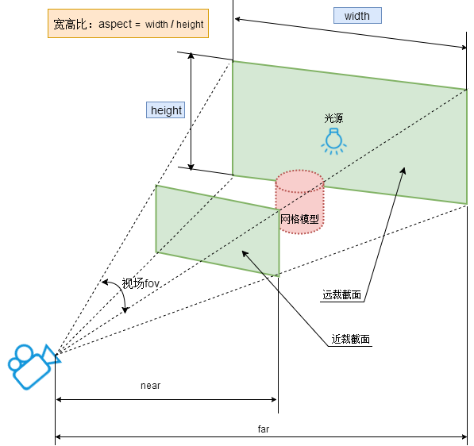


#### 相机可视范围

将渲染的画布分成两个部分

左边画布为我们从透视相机camera中看到的画面，能看见pCamera的视锥体

右边画布为透视相机pCamera看到的画面

```js
// 左右相机分屏显示
// 创建相机 看到的内容将被放到左半边屏幕
const camera = new THREE.PerspectiveCamera(
  45, // fov 视野角度
  window.innerWidth / 2 / window.innerHeight, // aspect 宽高比
  0.1, // near 近截面
  100, // far 远截面
)
camera.position.set(0, 3, 3); // 设置相机位置


// 创建一个虚拟相机 看到的内容将被放到右半边屏幕
const pCamera = new THREE.PerspectiveCamera(
  45,
  window.innerWidth / 2 / window.innerHeight,
  10,
  20,
)
pCamera.position.set(0, 3, 3); // 设置相机位置


// 创建一个相机的辅助工具，方便查看相机的视锥体
const cameraHelper = new THREE.CameraHelper(pCamera)
// 将相机辅助工具添加到场景中
scene.add(cameraHelper) 


// 执行渲染器的渲染循环
renderer.autoClear = false; // 关闭renderer.render()方法的自动清除画布功能
renderer.renderLoop(() => {
  // 左边画布大小
  renderer.setViewport(0, 0, window.innerWidth / 2, window.innerHeight);
  renderer.render(scene, camera); // 使用渲染器，通过相机将场景渲染出来
  // 右边画布大小
  renderer.setViewport(window.innerWidth / 2, 0, window.innerWidth / 2, window.innerHeight);
  renderer.render(scene, pCamera); // 使用渲染器，通过相机将场景渲染出来
})
```


利用gui调整透视相机pCamera的视锥参数

```js
// 使用gui调试相机的投影属性
const gui = new dat.GUI();
gui.add(pCamera, 'fov', 1, 179).onChange(() => { // 视野
  pCamera.updateProjectionMatrix() // 更新投影矩阵
  cameraHelper.update() // 更新相机辅助工具
});
gui.add(pCamera, 'near', 0.1, 50).onChange(() => { // 近截面
  pCamera.updateProjectionMatrix() // 更新投影矩阵
  cameraHelper.update() // 更新相机辅助工具
});
gui.add(pCamera, 'far', 0.1, 100).onChange(() => { // 远截面
  pCamera.updateProjectionMatrix() // 更新投影矩阵
  cameraHelper.update() // 更新相机辅助工具
});
gui.add(pCamera, 'aspect', 0.1, 4).onChange(() => { // 宽高比
  pCamera.updateProjectionMatrix() // 更新投影矩阵
  cameraHelper.update() // 更新相机辅助工具
});

// 使用gui调试相机位置
gui.add(pCamera.position, 'x', -20, 20, 0.1).name('相机X轴位置').onChange(() => {
  cameraHelper.update() // 更新相机辅助工具
  pCamera.updateMatrixWorld(); // 更新相机的世界矩阵
});
gui.add(pCamera.position, 'y', -20, 20, 0.1).name('相机Y轴位置').onChange(() => {
  cameraHelper.update() // 更新相机辅助工具
  pCamera.updateMatrixWorld(); // 更新相机的世界矩阵
});
gui.add(pCamera.position, 'z', -20, 20, 0.1).name('相机Z轴位置').onChange(() => {
  cameraHelper.update() // 更新相机辅助工具
  pCamera.updateMatrixWorld(); // 更新相机的世界矩阵
});
```

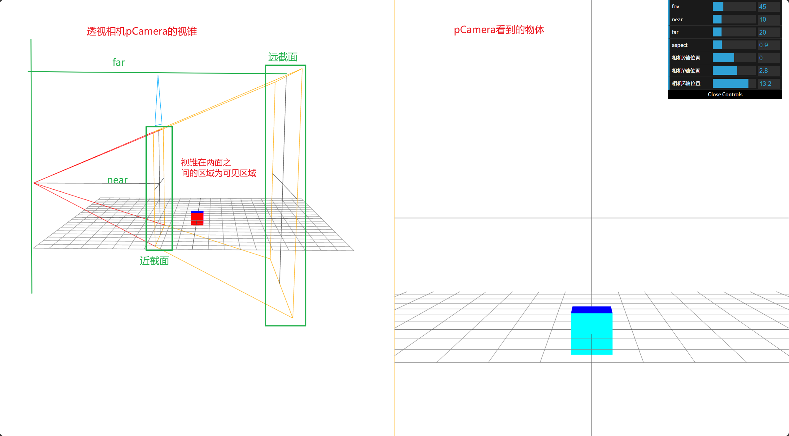


#### 正交相机

正交相机是一种投影方式，在三维场景中不会产生透视缩放效果，即物体无论距离相机远近，显示出来的大小都一样

在初始化创建相机时, 可以设置6个参数

- left: 左面
- right: 右面
- top: 上面
- bottom: 下面
- near: 近面
- far: 远面


关键代码

```js
// 左右相机分屏显示
// 创建相机 看到的内容将被放到左半边屏幕
const camera = new THREE.PerspectiveCamera(
  45, // fov 视野角度
  window.innerWidth / 2 / window.innerHeight, // aspect 宽高比
  0.1, // near 近截面
  100, // far 远截面
)
camera.position.set(0, 10, 10); // 设置相机位置


// 创建一个正交相机 看到的内容将被放到右半边屏幕
const oCamera = new THREE.OrthographicCamera(
  -1, // left 左面
  1, // right 右面
  1, // top 上面
  -1, // bottom 下面
  3, // near 近截面
  10, // far 远截面
)
oCamera.position.set(0, 0, 7); // 设置相机位置


// 创建一个相机的辅助工具，方便查看相机的视锥体
const cameraHelper = new THREE.CameraHelper(oCamera)
scene.add(cameraHelper) // 将相机辅助工具添加到场景中


// 执行渲染器的渲染循环
renderer.autoClear = false; // 关闭renderer.render()方法的自动清除画布功能
renderer.renderLoop(() => {
  renderer.clear() // 手动清除画布
  // 立方体旋转动画
  cube.rotation.x += 0.01;
  // 左边画布大小
  renderer.setViewport(0, 0, window.innerWidth / 2, window.innerHeight);
  renderer.render(scene, camera); // 使用渲染器，通过相机将场景渲染出来
  // 右边画布大小
  renderer.setViewport(window.innerWidth / 2, 0, window.innerWidth / 2, window.innerHeight);
  renderer.render(scene, oCamera); // 使用渲染器，通过相机将场景渲染出来
})
```


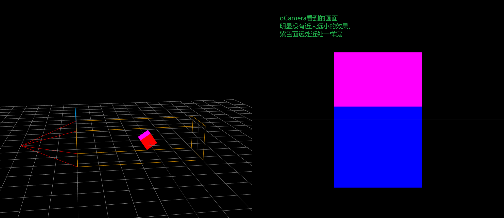


#### Object3D.lookAt() 运镜方法

两种调用方式

```js
// 签名1：传入一个 Vector3
camera.lookAt(new THREE.Vector3(x, y, z));

// 签名2：传入三个数字
camera.lookAt(x, y, z);
```

`lookAt()` 方法做的事情，重新计算对象的旋转四元数，使对象的局部 -Z 轴指向目标点

对于相机来说，-Z 轴就是相机的**视线方向**，所以调用 `lookAt` 就等于"把镜头对准那个点"。


具体步骤：

1. 以对象当前的 `position`（世界坐标）为起点，目标点为终点，构造一个"注视方向"向量。
2. 用该方向 + 对象的 `up` 向量（默认 `(0,1,0)`）构建一个旋转矩阵（`Matrix4.lookAt`）。
3. 将旋转矩阵分解为四元数，赋给 `object.quaternion`，从而改变对象朝向。


继承链：

PerspectiveCamera→Camera→Object3DPerspectiveCamera→Camera→Object3D


### Scene —— 数据容器

```js
const scene = new THREE.Scene();
scene.add(mesh);   // 只是把物体"登记"进去
scene.add(light);  // 纯粹的数据结构，不涉及任何绘制
```

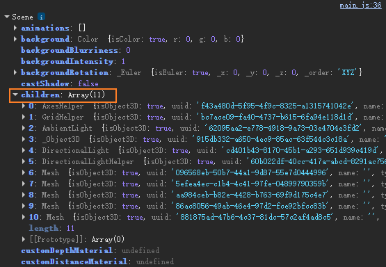


Scene 本质是一棵**对象树**，只负责组织和存储 3D 数据（几何体、材质、灯光、位置等），**自己完全不知道如何绘制**。


Camera 定义了"从哪里、以什么角度、看多远"，本质是一组**数学矩阵**（视图矩阵 + 投影矩阵），**同样不负责绘制**。


Renderer 才是真正**调用 GPU、执行绘制**


```js
renderer.render(scene, camera)
         │
         ├─ 1. 遍历 scene 对象树，收集所有可见 Mesh
         │
         ├─ 2. 用 camera 的矩阵，计算每个物体在屏幕上的位置
         │       (Model Matrix × View Matrix × Projection Matrix)
         │
         ├─ 3. 排序（透明物体后绘制）
         │
         ├─ 4. 对每个 Mesh：
         │       ├─ 上传顶点数据到 GPU（如果还没上传）
         │       ├─ 编译/绑定 Shader
         │       ├─ 传入 uniform 变量（颜色、光照、矩阵...）
         │       └─ 调用 gl.drawArrays / gl.drawElements（真正画点）
         │
         └─ 5. 输出到 Canvas
```


#### 在场景中查找单个对象

```js
scene是继承于Object3D的对象，.getObjectByProperty() 这个方法在Object3D类中定义，去Object3D处的文档查找
scene.getObjectByProperty()
作用： 递归搜索对象及其所有后代，返回第一个匹配属性值的对象
参数：
  name (string): 要查找的属性名
  value (any): 该属性的目标值

  
  
// 在场景中查找 type 为 'DirectionalLightHelper' 的对象
const helper = scene.getObjectByProperty('type', 'DirectionalLightHelper');
// 等价于遍历：
// if (scene.type === 'DirectionalLightHelper') return scene;
// if (scene.children[0].type === 'DirectionalLightHelper') return scene.children[0];
// if (scene.children[0].children[0].type === 'DirectionalLightHelper') return ...
// ...

// 查找 name 属性
const mesh = scene.getObjectByProperty('name', 'ground');

// 查找自定义属性
const obj = scene.getObjectByProperty('customId', 42);
```


### OrbitControls

```js
OrbitControls
构造函数：
new OrbitControls( object : Object3D, domElement : HTMLElement )
参数：
  object — 要控制的对象，通常是一个相机。
  domElement — 用于监听鼠标和触摸事件的 HTML 元素，通常是渲染器的 DOM 元素。如果向限制控制的范围，可以传入一个覆盖在渲染器上的 div 元素。
属性：
  target — 控制器的焦点，默认为 (0, 0, 0)。当用户旋转时，相机将围绕这个点旋转。
  enableDamping — 是否启用惯性（阻尼），默认为 false。
  dampingFactor — 阻尼系数，控制惯性的衰减速度，默认为 0.05。
方法：
  update() — 更新控制器状态，必须在动画循环中调用以实现惯性效果。
```


getObjectsByProperty

查找多个对象

```js
scene.getObjectsByProperty()
作用： 递归搜索对象及其所有后代，返回所有匹配属性值的对象
参数：
  name (string): 要查找的属性名
  value (any): 该属性的目标值
  result (Array): 用于存储查找结果的数组（会被填充）

// 查找所有 type 为 'Mesh' 的对象
const meshes = [];
scene.getObjectsByProperty('type', 'Mesh', meshes);
// meshes 现在包含场景中所有的网格对象

// 等价于遍历：
// 检查 scene.type === 'Mesh' → 添加到 result
// 检查 scene.children[0].type === 'Mesh' → 添加到 result
// 检查 scene.children[0].children[0].type === 'Mesh' → 添加到 result
// ...

// 查找所有 name 为 'cube' 的对象
const cubes = [];
scene.getObjectsByProperty('name', 'cube', cubes);

// 可以复用数组
const results = [];
scene.getObjectsByProperty('visible', true, results);
console.log(results); // [可见的对象1, 可见的对象2, ...]
```


## 几何体

### 概述

- **Geometry 决定“形状”**，材质决定“长什么样”，Mesh = Geometry + Material。
- 常用现成 Geometry：
  - `BoxGeometry`：方块 / 房子 / UI 面板；
  - `SphereGeometry`：球 / 地球 / 灯泡 / 玻璃球；
  - `PlaneGeometry`：地面 / 屏幕 / 流动纹理 / 置换；
  - `ExtrudeGeometry(Shape)`：任意 2D 轮廓拉伸（Logo、立体文字、挖洞形状）；
- 高级：
  - `BufferGeometry`：自己写顶点（自定义形状、大量粒子、路径线）。

------

### 几何体“决策表”

| 需求/场景                          | 几何体 / 方式                         |
| ---------------------------------- | ------------------------------------- |
| 立方体、长方体、盒子               | `BoxGeometry`                         |
| 球、地球、球灯、玻璃球             | `SphereGeometry`                      |
| 地面、平面屏幕、流动箭头纹理       | `PlaneGeometry`（可加细分）           |
| 任意 2D 轮廓拉伸（Logo、头像牌匾） | `Shape` + `ExtrudeGeometry`           |
| 自定义多边形面、非规则形           | `BufferGeometry` + position attribute |
| 2D 曲线 + 线框路径                 | `Curve`（如 EllipseCurve）+ Line      |
| 大量点/粒子（雪、星空、点云）      | `BufferGeometry` + `Points`           |


### 设计思想  Geometry + Material → Mesh

Three.js 的 Geometry + Material → Mesh 这套设计，绝非 three.js 独创，而是整个 **3D 图形学领域的通用范式**

渲染一个三维物体，天然可以被分成两个独立的问题：

- **"它长什么形状？"** → Geometry（顶点、面、法线、UV 坐标）
- **"它的表面长什么样？"** → Material（颜色、纹理、反光、透明度）

这两个问题**在数学上和物理上是正交的（orthogonal）**：同一个球形（SphereGeometry）可以是金属的、玻璃的、木头的；同一种材质（比如砖墙纹理）可以贴在立方体、球体、任意形状上。分离它们是自然而然的决定。


Mesh（网格）

- **词源**：英语原词，意为「网」或「网眼」，引申自「由许多小块交织而成的结构」。
- **在图形学中的含义**：3D 模型在计算机中的标准表示方式是**多边形网格（Polygon Mesh）**，即用大量三角形（或四边形）拼接出一个曲面。

------

### 封装一个 Box：`createBox`

用途：快速创建一个彩色六面体，常用来当“测试用网格”或小道具。

```ts
// src/utils/createBox.ts
import * as THREE from 'three';

export type BoxOptions = {
  width?: number;
  height?: number;
  depth?: number;
  position?: { x?: number; y?: number; z?: number };
};

export function createBox(
  scene: THREE.Scene,
  options: BoxOptions = {}
): THREE.Mesh {
  const {
    width = 1,
    height = 1,
    depth = 1,
    position = {},
  } = options;

  const { x = 0, y = 0, z = 0 } = position;

  const geometry = new THREE.BoxGeometry(width, height, depth); // width平行于x轴的边程度，height平行于y轴，depth平行于z轴

  const materials: THREE.Material[] = [
    new THREE.MeshBasicMaterial({ color: 0xff0000 }), // 右
    new THREE.MeshBasicMaterial({ color: 0x00ff00 }), // 左
    new THREE.MeshBasicMaterial({ color: 0x0000ff }), // 上
    new THREE.MeshBasicMaterial({ color: 0xffff00 }), // 下
    new THREE.MeshBasicMaterial({ color: 0x00ffff }), // 前
    new THREE.MeshBasicMaterial({ color: 0xff00ff }), // 后
  ];

  const cube = new THREE.Mesh(geometry, materials);
  cube.position.set(x, y, z);

  scene.add(cube);

  return cube;
}
```

使用：

```ts
import { createBox } from './utils/createBox';

const cube = createBox(scene, {
  width: 2,
  height: 1,
  depth: 1,
  position: { x: 0, y: 0.5, z: 0 },
});
```


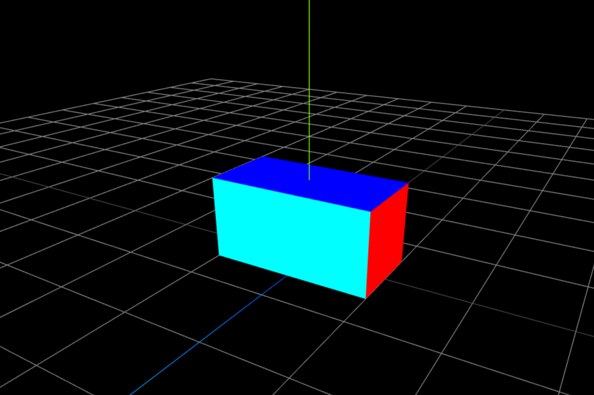

------

### Sphere：完整球 / 部分球 / 替换几何体

#### 基本球体（工厂函数）


```ts
// src/utils/createSphere.ts
import * as THREE from 'three';

export type SphereOptions = {
  radius?: number;
  widthSegments?: number;
  heightSegments?: number;
  position?: { x?: number; y?: number; z?: number };
  material?: THREE.Material;
};

export function createSphere(
  scene: THREE.Scene,
  options: SphereOptions = {}
): THREE.Mesh {
  const {
    radius = 1,
    widthSegments = 32,
    heightSegments = 32,
    position = {},
    material = new THREE.MeshBasicMaterial({ color: 0x00aaff }),
  } = options;

  const { x = 0, y = 0, z = 0 } = position;

  const geometry = new THREE.SphereGeometry(
    radius,
    widthSegments,
    heightSegments
  );

  const sphere = new THREE.Mesh(geometry, material);
  sphere.position.set(x, y, z);
  scene.add(sphere);

  return sphere;
}
```

使用：

```ts
import { createSphere } from './utils/createSphere';

const sphere = createSphere(scene, {
  radius: 0.5,
  position: { x: 2, y: 0, z: 0 },
});
```

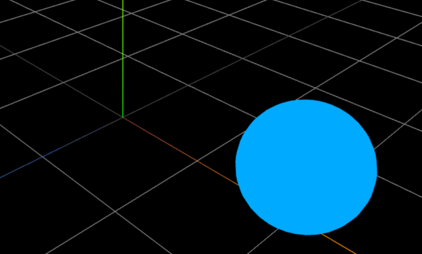


####  部分球体（裁切 / 球冠）

`SphereGeometry` 后面的参数改为：

```ts
const geometry = new THREE.SphereGeometry(
  radius,
  widthSegments,
  heightSegments,
  phiStart,    // 水平起始角
  phiLength,   // 水平扫过角度（小于 2π 时是扇形）
  thetaStart,  // 垂直起始
  thetaLength  // 垂直扫过角度（小于 π 时是球冠）
);
```

例如做一个“南半球”：

```ts
const halfSphereGeo = new THREE.SphereGeometry(
  1,
  32,
  32,
  0,
  Math.PI * 2,
  0,
  Math.PI / 2
);
```

常见用法：

- 做地球 + 鼓包 / 截断效果；
- 做一个只展示某一块的球面可视区域。


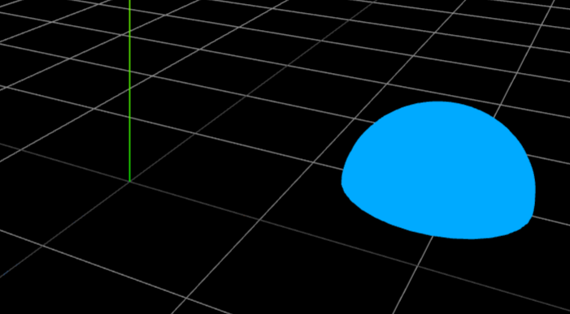


####  动态替换几何体（GUI 控参数时）

当用 GUI 调整分段/角度时，推荐写法是**保持同一个 Mesh，只替换 `mesh.geometry`**：

```ts
function updateSphereGeometry(
  mesh: THREE.Mesh,
  params: { radius: number; widthSegments: number; heightSegments: number }
) {
  mesh.geometry.dispose(); // 释放旧几何体
  mesh.geometry = new THREE.SphereGeometry(
    params.radius,
    params.widthSegments,
    params.heightSegments
  );
}
```


------

### Plane：地面、贴图、流动纹理的基础

#### 基本地面（工厂函数）

```js
new THREE.PlaneGeometry
参数：
  width — 平面的宽度。
  height — 平面的高度。
  widthSegments — 沿宽度的分段数。
  heightSegments — 沿高度的分段数。
```


```ts
// src/utils/createPlane.ts
import * as THREE from 'three';

export type PlaneOptions = {
  width?: number;
  height?: number;
  widthSegments?: number;
  heightSegments?: number;
  position?: { x?: number; y?: number; z?: number };
  rotation?: { x?: number; y?: number; z?: number };
  material?: THREE.Material;
};

export function createPlane(
  scene: THREE.Scene,
  options: PlaneOptions = {}
): THREE.Mesh {
  const {
    width = 10,
    height = 10,
    widthSegments = 1,
    heightSegments = 1,
    position = {},
    rotation = {},
    material = new THREE.MeshBasicMaterial({
      color: 0x00ff00,
      side: THREE.DoubleSide,
    }),
  } = options;

  const { x = 0, y = 0, z = 0 } = position;
  const { x: rx = -Math.PI / 2, y: ry = 0, z: rz = 0 } = rotation;

  const geometry = new THREE.PlaneGeometry(
    width,
    height,
    widthSegments,
    heightSegments
  );

  const plane = new THREE.Mesh(geometry, material);
  plane.position.set(x, y, z);
  plane.rotation.set(rx, ry, rz);

  scene.add(plane);
  return plane;
}
```

使用：


```ts
import { createPlane } from './utils/createPlane';

const ground = createPlane(scene, {
  width: 10,
  height: 10,
  position: { y: 0 },
});
```

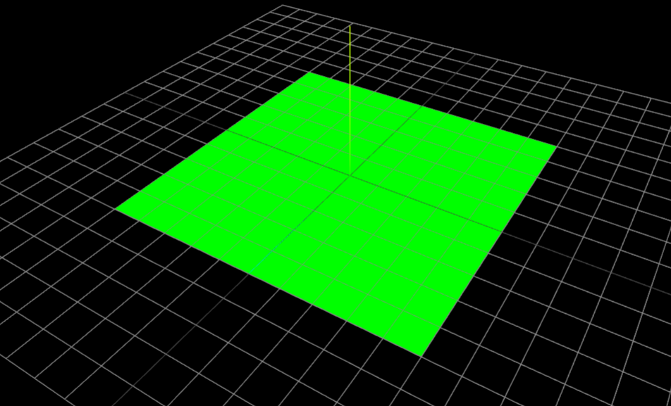


#### 位移贴图（需要高分段）

“置换贴图地面”，核心要点：

- `PlaneGeometry(width, height, widthSegments, heightSegments)` 要有足够细分；
- 材质使用 `displacementMap` + `displacementScale`。

典型写法（简化示例）：

```ts
const planeGeo = new THREE.PlaneGeometry(5, 5, 64, 64);
const dispTex = new THREE.TextureLoader().load('../src/assets/texture/位移贴图.png');
const colorTex = new THREE.TextureLoader().load('../src/assets/texture/颜色贴图.png');

const mat = new THREE.MeshStandardMaterial({
  map: colorTex, // 颜色贴图
  displacementMap: dispTex, // 位移贴图
  displacementScale: 1, // 位移缩放
  side: THREE.DoubleSide, // 双面渲染
})
const plane = new THREE.Mesh(planeGeo, mat);

plane.rotation.x = -Math.PI / 2;
scene.add(plane);

// 环境光
const ambientLight = new THREE.AmbientLight(0xffffff, 0.5); // 白色，强度0.5
scene.add(ambientLight);
```

> 决策：**要做“凹凸真形变” → 用 Plane + 高分段 + displacementMap。**
>
> 位移贴图：`displacementMap` 用纹理的亮度（luminance）去位移顶点，亮（白）部分会沿法线向外推，暗（黑）部分则不推移。

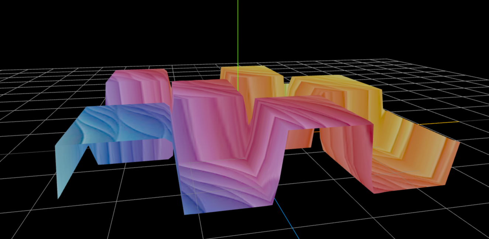

------

### Shape + ExtrudeGeometry：任意 2D 轮廓拉伸

shape：使用带有可选孔洞的路径定义一个任意的二维形状平面。

适合做：

- Logo / 文字挖洞板；
- 任意 2D 路径拉伸成 3D。

基础示例


```ts
// src/utils/createExtrudedShape.ts
import * as THREE from 'three';

export type ExtrudeOptions = {
  depth?: number;
  material?: THREE.Material;
  position?: { x?: number; y?: number; z?: number };
};

export function createExtrudedShape(
  scene: THREE.Scene,
  shape: THREE.Shape,
  options: ExtrudeOptions = {}
): THREE.Mesh {
  const {
    depth = 1,
    material = new THREE.MeshBasicMaterial({ color: 0x00ff00 }),
    position = {},
  } = options;

  const { x = 0, y = 0, z = 0 } = position;

  const extrudeGeo = new THREE.ExtrudeGeometry(shape, {
    depth, // 挤出深度
    curveSegments: 64, // 曲线分段数，越大越平滑
    bevelEnabled: true, // 是否斜角
    bevelSegments: 6, // 斜角分段数，越大越平滑
    bevelSize: 0.1, // 斜角大小
    bevelThickness: 0.1, // 斜角厚度
  });
    
  const mesh = new THREE.Mesh(extrudeGeo, material);
  mesh.position.set(x, y, z);
  scene.add(mesh);
  return mesh;
}
```

**构建一个简单圆形 + 洞的 shape：**

 

```ts
// 使用 createExtrudedShape 工具函数创建一个挤出形状
import { createExtrudedShape } from './utils/createExtrudedShape';

const shape = new THREE.Shape();
shape.absarc(0, 0, 1, 0, Math.PI * 2, false);

// 中间挖个圆洞
const hole = new THREE.Path();
hole.absarc(0.5, 0, 0.4, 0, Math.PI * 2, true); // 参数： x, y, radius, startAngle, endAngle, clockwise
shape.holes.push(hole);

const mesh = createExtrudedShape(scene, shape, {
  depth: 0.2,
  position: { z: 0 },
});
```

> 决策：**想要复杂 2D 边界 + 可选洞 + 拉伸成 3D → 用 Shape + ExtrudeGeometry。**

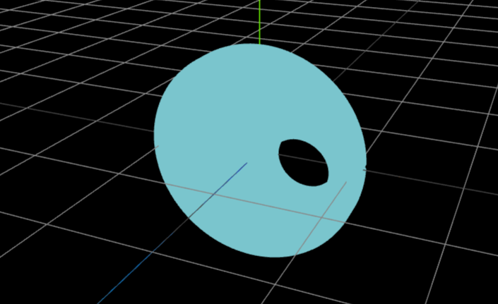

------

### BufferGeometry：手写顶点

什么时候该用 BufferGeometry？

- 现成几何体满足不了的自定义形状；
- 高性能场景：大量点/线/粒子不能用成千上万个 Mesh；
- 需要完全控制 attributes：position/normal/uv/color 等。

你笔记里有自定义四边形（两个三角形）的例子，我们用 TS 把它压成一个模板。

#### 自定义二维四边形（两个三角面）


```ts
// src/utils/createCustomQuad.ts
import * as THREE from 'three';

export type QuadOptions = {
  positions: number[]; // 长度 12：4 个顶点 * 3
  material?: THREE.Material;
};

export function createCustomQuad(
  scene: THREE.Scene,
  options: QuadOptions
): THREE.Mesh {
  const {
    positions,
    material = new THREE.MeshBasicMaterial({
      color: 0xffffff,
      wireframe: true,
    }),
  } = options;

  if (positions.length !== 12) {
    throw new Error('positions length must be 12 (4 vertices * 3 components).');
  }

  // 构造两个三角形：
  // 0,1,2 和 2,3,0
  const vertices = new Float32Array([
    positions[0], positions[1], positions[2], // x1, y1, z1
    positions[3], positions[4], positions[5],
    positions[6], positions[7], positions[8],
    positions[6], positions[7], positions[8],
    positions[9], positions[10], positions[11],
    positions[0], positions[1], positions[2],
  ]);

  const geometry = new THREE.BufferGeometry();
  geometry.setAttribute('position', new THREE.BufferAttribute(vertices, 3));
  geometry.computeVertexNormals(); // 自动计算法线，灯光才正常

  const mesh = new THREE.Mesh(geometry, material);
  scene.add(mesh);
  return mesh;
}
```

BufferAttribute 缓冲属性，该类存储与 `BufferGeometry` 关联的属性数据（如顶点位置、面索引、法线、颜色、UV 以及任何自定义属性），从而更高效地向 GPU 传递数据。


使用：


```ts
import { createCustomQuad } from './utils/createCustomQuad';

const quad = createCustomQuad(scene, {
  positions: [
    -1, 0, 0, // v0
    1, 0, 0,  // v1
    1, 1, 0,  // v2
    -1, 1, 0, // v3
  ],
});
```

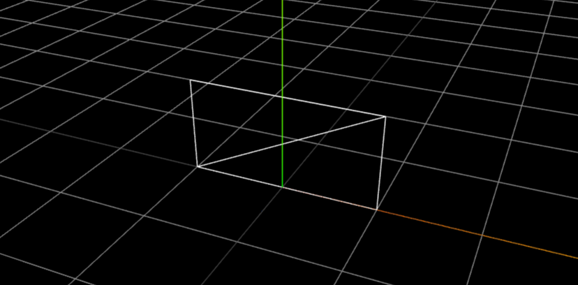


#### 曲线 + Line：EllipseCurve → Line

已有的 EllipseCurve 示例也很标准，可以抽象为：

```ts
export function createEllipseLine(
  scene: THREE.Scene,
  options: {
    xRadius?: number;
    yRadius?: number;
    segments?: number;
    color?: number;
  } = {}
): THREE.Line {
  const {
    xRadius = 2,
    yRadius = 1,
    segments = 50,
    color = 0xff0000,
  } = options;

  const curve = new THREE.EllipseCurve(
    0,
    0,
    xRadius,
    yRadius
  );

  const points = curve.getPoints(segments);
  const geometry = new THREE.BufferGeometry().setFromPoints(points);
  const material = new THREE.LineBasicMaterial({ color });

  const ellipse = new THREE.Line(geometry, material);
  scene.add(ellipse);
  return ellipse;
}
```

使用

```ts
// 使用 createEllipseLine 工具函数创建一个椭圆线
import { createEllipseLine } from './utils/createEllipseLine';
const ellipse = createEllipseLine(scene);
```

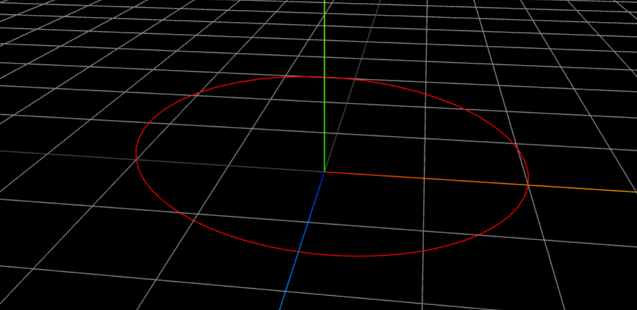


> 决策：
>
> - 想要**线条**（路径/轨迹）：Curve + `.getPoints` + `BufferGeometry.setFromPoints` + `Line`；
> - 想要**填充面**：要自己构造三角网（一般用 Shape / Extrude 更简单）。

------

### 小结

1. 常用几何体的“任务 → 选择”：
   - Box：方块、砖块、测试用；
   - Sphere：球、灯泡、玻璃球；
   - Plane：地面、屏幕、流动纹理、置换；
   - Shape + Extrude：任意 2D 轮廓拉伸；
   - BufferGeometry：高级自定义形状、粒子、线。
2. 工厂函数快速起物体：
   - `createBox(scene, options)`；
   - `createSphere(scene, options)`；
   - `createPlane(scene, options)`；
   - `createExtrudedShape(scene, shape, options)`；
   - `createCustomQuad(scene, { positions })`。
3. 什么时候要用 BufferGeometry：
   - “因为要自定义面/粒子/点云，所以要用 BufferGeometry。”


## 材质 & 纹理 & 贴图

### 概述

- **材质（Material）**：定义“表皮”的光照响应和外观。
- **纹理（Texture）**：一张 2D 图（或立方体图），提供颜色 / 高度 / 法线 / 金属度 / 粗糙度等信息。
- **贴图（Map）**：将纹理应用到材质的具体方式
- 常用材质选择顺序（决策树）：
  1. 不需要光照，仅调试/简单 UI → `MeshBasicMaterial`
  2. 简单漫反射（木头、石头，无明显高光）→ `MeshLambertMaterial`
  3. 需要高光（塑料、金属感）→ `MeshPhongMaterial`
  4. 想要**物理正确**的 PBR（金属、塑料、粗糙度）→ `MeshStandardMaterial`
  5. 想要更高级的 PBR（玻璃、车漆、丝绒、虹彩）→ `MeshPhysicalMaterial`

------

### 材质对比 & 选材质决策表

3.2.1 材质速查表

| 材质类型               | 是否受光照 | 特点/用途                                |
| ---------------------- | ---------- | ---------------------------------------- |
| `MeshBasicMaterial`    | 否         | 纯颜色/贴图，不受光照；调试/发光 UI      |
| `MeshNormalMaterial`   | 否         | 用法线着色，调试模型几何/法线            |
| `MeshLambertMaterial`  | 是         | 漫反射，无镜面高光；木/石/布等非金属     |
| `MeshPhongMaterial`    | 是         | 有镜面高光（`shininess`）；塑料、陶瓷    |
| `MeshStandardMaterial` | 是         | 标准 PBR（金属度/粗糙度），主力材质      |
| `MeshPhysicalMaterial` | 是         | 高级 PBR（玻璃、车漆、布料、虹彩等效果） |
| `ShadowMaterial`       | 是         | 可见的平面来显示其他3D对象投射的阴影     |
| `ShaderMaterial`       | 可选       | 自定义着色器渲染的材质                   |

 

llambert 和 phong的区别，phong有高光

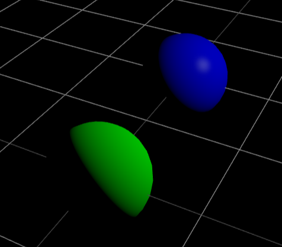


典型使用示例（TS）

```ts
import * as THREE from 'three';

// 不受光照：UI / 调试
const basicMat = new THREE.MeshBasicMaterial({ color: 0x00bfff });

// 漫反射：木头/石材
const lambertMat = new THREE.MeshLambertMaterial({ color: 0x00ff00 });

// 高光：塑料/光滑表面
const phongMat = new THREE.MeshPhongMaterial({
  color: 0x0000ff,
  shininess: 100, // 高光系数
});

// 标准 PBR：大多数真实材质
const standardMat = new THREE.MeshStandardMaterial({
  color: 0xdddddd,
  metalness: 0.5,
  roughness: 0.4,
});

// 高级 PBR：玻璃/车漆/布料
const physicalMat = new THREE.MeshPhysicalMaterial({
  color: 'white',
  metalness: 0,
  roughness: 0,
  transmission: 1, // 玻璃透明
  ior: 1.5,
});
```

> 建议：**只要跟真实物体相关，默认先用 `MeshStandardMaterial`**，除非你需要玻璃/车漆那种高级效果，再用 Physical。

------


### 纹理

一张 2D 图（或立方体图），提供颜色 / 高度 / 法线 / 金属度 / 粗糙度等信息，贴在 3D 物体表面的"皮肤"，通过 UV 坐标映射到 3D 表面


three.js里纹理的工作流程：

```
1. 加载/创建纹理数据（CPU端）
2. 上传到 GPU
  -Three.js 在首次渲染时自动将纹理上传到显卡
  -触发条件：texture.needsUpdate = true 或首次使用
3.通过UV坐标映射到3D表面
  -片元着色器根据UV坐标从纹理中采样颜色
```


#### new Texture()

```js
Texture 主要作为基类使用
Three.js 中很少直接 new THREE.Texture()
通常使用它的子类或通过加载器（Loader）间接创建

构造函数：
Texture(image, mapping, wrapS, wrapT, magFilter, minFilter, format, type, anisotropy, colorSpace)

构造函数主要的参数说明在下面的CanvasTexture描述
```


使用例子：

```js
// 几乎不这样写（虽然可以）
const img = new Image();
img.src = 'texture.jpg';
const texture = new THREE.Texture(img);
img.onload = () => { texture.needsUpdate = true; }

// 推荐方式1：使用 TextureLoader（内部帮你创建 Texture 实例）
const texture = new THREE.TextureLoader().load('texture.jpg');

// 推荐方式2：使用 CanvasTexture 子类
const canvas = document.createElement('canvas');
const texture = new THREE.CanvasTexture(canvas);

// 推荐方式3：使用其他子类
const cubeTexture = new THREE.CubeTexture([...]); // 立方体纹理
const videoTexture = new THREE.VideoTexture(video); // 视频纹理
const dataTexture = new THREE.DataTexture(data, width, height); // 原始数据纹理
```


#### new THREE.CanvasTexture(canvas)

```js
把 Canvas 的 2D 画布内容转换为 Three.js 可用的纹理对象，可以贴到 3D 物体上，或设为场景背景，或用于其他渲染用途
构造时自动设置 needsUpdate = true，可以立即使用

.needsUpdate : boolean 是基类Texture上的一个属性，将此属性设为true时，引擎将在下次渲染时更新纹理。此操作将触发纹理上传至GPU，并确保纹理参数配置正确。

构造函数：
CanvasTexture(canvas, mapping, wrapS, wrapT, magFilter, minFilter, format, type, anisotropy)
               ↑ 限定为 HTMLCanvasElement


//  参数1: image / canvas 
Texture: 任意图像对象（Image、HTMLVideoElement、HTMLCanvasElement、ImageBitmap 等）
CanvasTexture: 仅限 HTMLCanvasElement
const canvas = document.createElement('canvas');
const img = new Image();


//  参数2: mapping 
纹理如何映射到几何体表面
默认值: Texture.DEFAULT_MAPPING → UVMapping
const mapping = THREE.UVMapping;                // 普通 UV 映射（最常用）
// 或 THREE.CubeReflectionMapping              // 立方体反射映射（环境贴图）
// 或 THREE.EquirectangularReflectionMapping   // 等距矩形反射映射


//  参数3: wrapS（水平方向包裹，对应 UV 中的 U
// 默认值: ClampToEdgeWrapping
const wrapS = THREE.ClampToEdgeWrapping;   // 边缘拉伸（超出部分取边缘像素颜色）
// 或 THREE.RepeatWrapping                 // 重复平铺
// 或 THREE.MirroredRepeatWrapping         // 镜像重复

直观理解:
 UV 坐标 0.0 ~ 1.0 是正常范围，超出时:
   ClampToEdge:    [|||边缘色|||] 纹理 [|||边缘色|||]
   Repeat:         ...纹理 纹理 纹理 纹理...
   MirroredRepeat: ...纹理 理纹 纹理 理纹...

   
//  参数4: wrapT（垂直方向包裹，对应 UV 中的 V
同 wrapS，只是方向不同
const wrapT = THREE.RepeatWrapping;


//  参数5: magFilter（放大滤波器
一个纹素(texel)覆盖多个屏幕像素时（即纹理被放大/拉近观看）的采样方式
默认值: LinearFilter
const magFilter = THREE.LinearFilter;    // 线性插值，过渡平滑（常用）
// 或 THREE.NearestFilter                // 最近邻，像素风/锐利边缘


//  参数6: minFilter（缩小滤波器
一个纹素覆盖不足一个像素时（即纹理被缩小/远处观看）的采样方式
默认值: LinearMipmapLinearFilter（三线性过滤，质量最高）
const minFilter = THREE.LinearMipmapLinearFilter;

// 可选值从低质量到高质量:
// THREE.NearestFilter                → 最近邻，不用 mipmap
// THREE.LinearFilter                 → 线性，不用 mipmap
// THREE.NearestMipmapNearestFilter   → mipmap 级别取最近 + 纹素取最近
// THREE.NearestMipmapLinearFilter    → mipmap 级别取最近 + 纹素线性插值
// THREE.LinearMipmapNearestFilter    → mipmap 级别线性插值 + 纹素取最近
// THREE.LinearMipmapLinearFilter     → mipmap 级别线性插值 + 纹素线性插值（三线性）

// Mipmap 直观理解:
// 原图 512x512 → 自动生成一系列缩小版本:
//   Level 0: 512x512  (原图)
//   Level 1: 256x256
//   Level 2: 128x128
//   Level 3:  64x64
//   ...
// 物体远离时选用小尺寸 mipmap，避免闪烁/摩尔纹
```


#### 参数效果

```js
texture.repeat 变换须知
几何体的 UV 坐标保持不变（仍为默认的 [0,1] 范围）,但是采样纹理会发生变化

// 这个会被 texture.repeat 影响
实际采样 UV = 几何体 UV × texture.repeat

// 步骤1: 几何体的 UV 坐标（不变）
顶点 UV = 0.5 // 保持在 [0,1] 范围

// 步骤2: 应用 texture.repeat 变换
texture.repeat.x = 2;
纹理采样 UV = 0.5 × 2 = 1.0

// 步骤3: 应用 wrapS 处理
if (纹理采样 UV > 1.0) {
  根据 wrapS 模式处理...
}

相当于原本采样点采样的是纹理的中间位置（0.5)，现在采样点采样的是纹理的边缘位置（1.0)，那么原本是采样（0.6）位置的点现在采样的是（1.2）位置，超出部分根据wrapS 和 wrapT 的设置决定是否重复、边缘拉伸或者镜像重复。


const wrapS = THREE.ClampToEdgeWrapping;   // 边缘拉伸（超出部分取边缘像素颜色）
// 或 THREE.RepeatWrapping                 // 重复平铺
// 或 THREE.MirroredRepeatWrapping         // 镜像重复
```


##### wrapS/wrapT

ClampToEdgeWrapping：边缘拉伸（超出部分取边缘像素颜色）

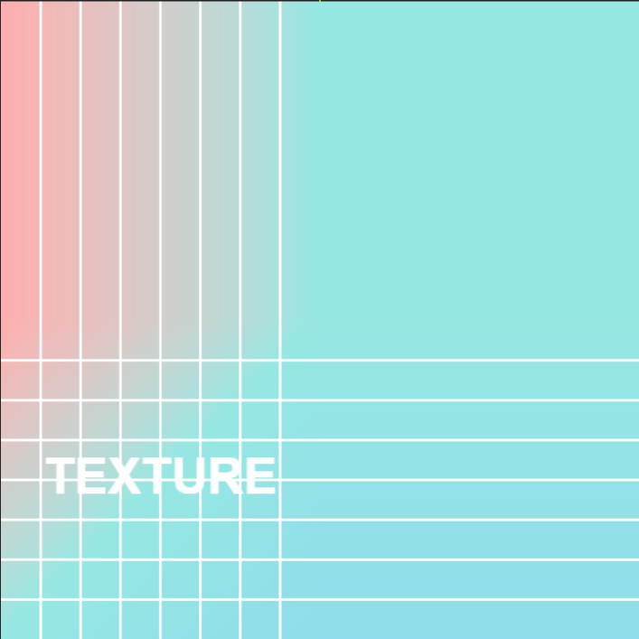

wrapS：RepeatWrapping：重复平铺

wrapT：ClampToEdgeWrapping：边缘拉伸（超出部分取边缘像素颜色）

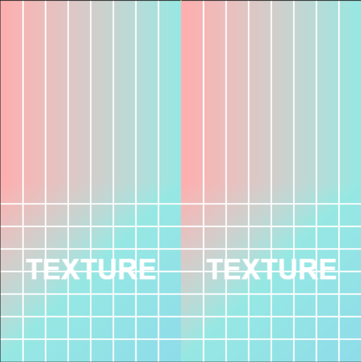


wrapS：RepeatWrapping：重复平铺

wrapT：MirroredRepeatWrapping：镜像重复

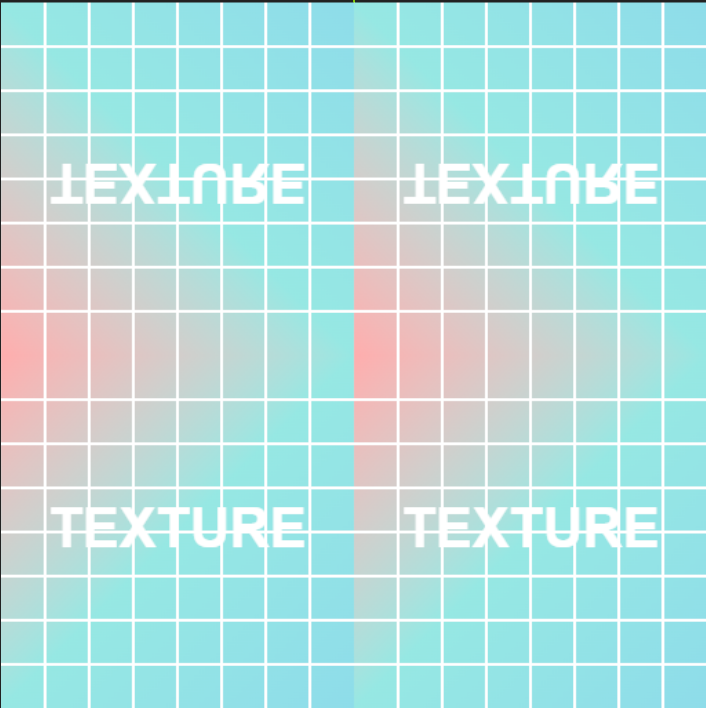


##### MagFilter

```
1. NearestFilter（最近邻过滤）：
   - 采样器会选择距离采样点最近的纹理像素进行显示。这会产生一种像素化的效果，纹理看起来会比较锐利，但可能会出现锯齿状边缘。

2. LinearFilter（线性过滤）：
   - 采样器会对采样点周围的多个纹理像素进行加权平均，生成一个平滑的结果。这会使纹理看起来更柔和，但在某些情况下可能会显得模糊。
```

NearestFilter

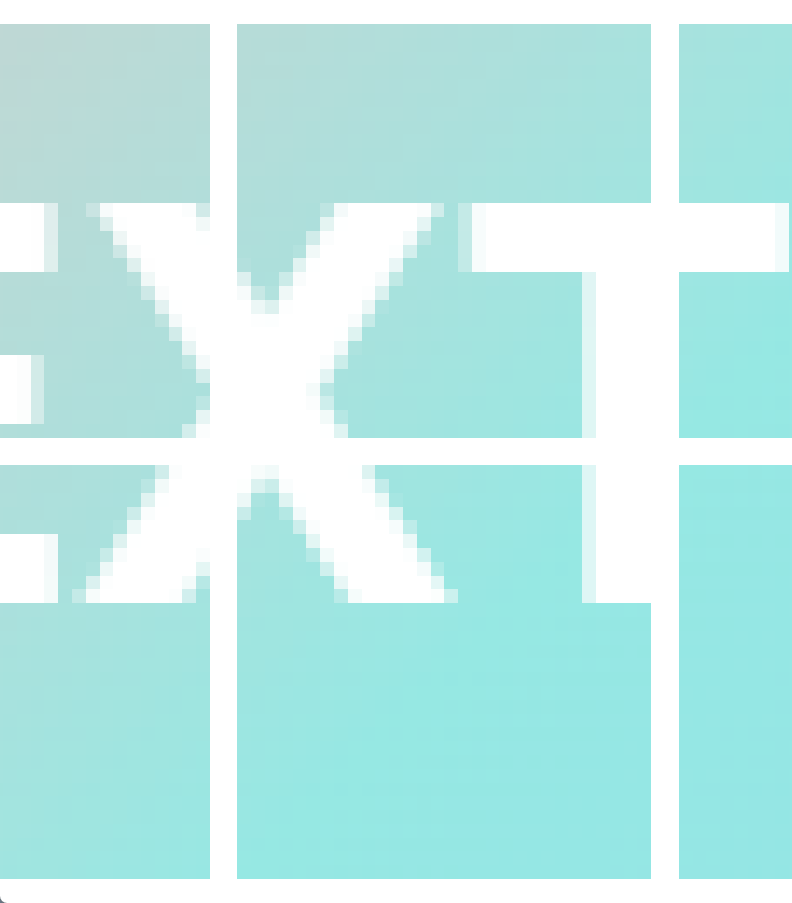

LinearFilter


##### minFilter

```js
minFilter参数的原理，当将相机移动至距离平面较远的位置时，纹理会被缩小显示，此时纹理采样器会根据设置的 MinFilter 参数来决定如何采样纹理像素：

1. NearestFilter（最近邻过滤）：
   - 采样器会选择距离采样点最近的纹理像素进行显示。这可能会导致纹理出现摩尔纹（当纹理细节过多时会产生干扰图案），并且纹理看起来会比较锐利。

2. LinearFilter（线性过滤）：
   - 采样器会对采样点周围的多个纹理像素进行加权平均，生成一个平滑的结果。这可以减少摩尔纹的出现，使纹理看起来更柔和，但在某些情况下可能会显得模糊。

3. Mipmap过滤（如 NearestMipmapNearestFilter、LinearMipmapNearestFilter、NearestMipmapLinearFilter、LinearMipmapLinearFilter）：
   - 当使用 Mipmap 过滤时，Three.js 会根据纹理在屏幕上的大小自动选择合适的 Mipmap级别（预生成的缩小版本）。这可以显著提高性能并减少摩尔纹的出现，尤其是在纹理被大幅缩小时。不同的 Mipmap 过滤选项决定了在选择 Mipmap 级别时是否使用最近邻或线性过滤，以及在两个 Mipmap 级别之间是否进行插值。

  3.1 NearestMipmapNearestFilter：使用最近的 Mipmap 级别，并使用最近邻过滤进行采样。

  3.2 LinearMipmapNearestFilter：使用最近的 Mipmap 级别，并使用线性过滤进行采样。

  3.3 NearestMipmapLinearFilter：在两个 Mipmap 级别之间进行插值，但使用最近邻过滤进行采样。

  3.4 LinearMipmapLinearFilter：在两个 Mipmap 级别之间进行插值，并使用线性过滤进行采样（通常提供最高质量的结果）。
```


NearestFilter（最近邻过滤）

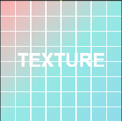

LinearFilter（线性过滤）

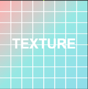

NearestMipmapNearestFilter

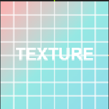

LinearMipmapNearestFilter

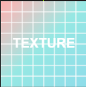

NearestMipmapLinearFilter

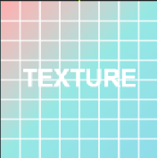

LinearMipmapLinearFilter

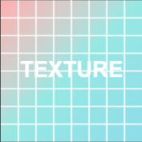


代码：

```js
// 使用 Canvas 绘制自定义图案
const canvas = document.createElement('canvas');
canvas.width = 256;
canvas.height = 256;
const ctx = canvas.getContext('2d');

// 绘制渐变背景
const gradient = ctx.createLinearGradient(0, 0, 256, 256);
gradient.addColorStop(0, '#ff6b6b');
gradient.addColorStop(0.5, '#4ecdc4');
gradient.addColorStop(1, '#45b7d1');
ctx.fillStyle = gradient;
ctx.fillRect(0, 0, 256, 256);

// 绘制网格线
ctx.strokeStyle = '#ffffff';
ctx.lineWidth = 2;
for (let i = 32; i < 256; i += 32) {
  ctx.beginPath();
  ctx.moveTo(i, 0);
  ctx.lineTo(i, 256);
  ctx.stroke();
  
  ctx.beginPath();
  ctx.moveTo(0, i);
  ctx.lineTo(256, i);
  ctx.stroke();
}

// 绘制文字标识
ctx.fillStyle = '#ffffff';
ctx.font = 'bold 40px Arial';
ctx.textAlign = 'center';
ctx.textBaseline = 'middle';
ctx.fillText('TEXTURE', 128, 128); // 

// 6. 将 Canvas 转换为 THREE.js 纹理
const texture = new THREE.CanvasTexture(canvas);
texture.mapping = THREE.UVMapping; // 使用标准 UV 映射

// 设置纹理的初始包裹模式
texture.wrapS = THREE.RepeatWrapping; // 水平方向包裹模式
texture.wrapT = THREE.RepeatWrapping; // 垂直方向包裹模式

// 设置纹理重复次数
texture.repeat.set(1, 1); // 设置纹理在U、V方向上重复多少次，参数为 (repeatX, repeatY)
// 设置纹理偏移
texture.offset.set(0, 0); // 设置纹理在U、V方向上的偏移，参数为 (offsetX, offsetY)

// 7. 创建平面几何体
const geometry = new THREE.PlaneGeometry(6, 6); // 创建一个 6x6 的平面

// 8. 创建材质并应用纹理
const material = new THREE.MeshBasicMaterial({
  map: texture,
  side: THREE.DoubleSide // 双面显示
});

// 9. 创建网格并添加到场景
const plane = new THREE.Mesh(geometry, material);
scene.add(plane);

// 10. 设置 GUI 控制面板
const gui = new dat.GUI();


// 纹理包裹模式选项
const wrapModes = {
  'RepeatWrapping': THREE.RepeatWrapping,      // 重复模式
  'ClampToEdgeWrapping': THREE.ClampToEdgeWrapping, // 边缘拉伸模式
  'MirroredRepeatWrapping': THREE.MirroredRepeatWrapping // 镜像重复模式
};

// 纹理放大过滤器选项（当纹理被放大时使用）
const magFilters = {
  'NearestFilter': THREE.NearestFilter,        // 最近邻过滤（像素化效果）
  'LinearFilter': THREE.LinearFilter           // 线性过滤（平滑效果）
};

// 纹理缩小过滤器选项（当纹理被缩小时使用）
const minFilters = {
  'NearestFilter': THREE.NearestFilter,                    // 最近邻过滤
  'LinearFilter': THREE.LinearFilter,                      // 线性过滤
  'NearestMipmapNearestFilter': THREE.NearestMipmapNearestFilter,  // 使用最近的Mipmap级别，最近邻过滤
  'LinearMipmapNearestFilter': THREE.LinearMipmapNearestFilter,    // 使用最近的Mipmap级别，线性过滤
  'NearestMipmapLinearFilter': THREE.NearestMipmapLinearFilter,    // 在两个Mipmap级别间插值，最近邻过滤
  'LinearMipmapLinearFilter': THREE.LinearMipmapLinearFilter       // 在两个Mipmap级别间插值，线性过滤（最高质量）
};

// GUI 参数对象
const params = {
  wrapS: 'RepeatWrapping',        // 水平方向包裹模式
  wrapT: 'RepeatWrapping',        // 垂直方向包裹模式
  repeatX: 1,                     // 水平重复次数
  repeatY: 1,                     // 垂直重复次数
  offsetX: 0,                     // 水平偏移
  offsetY: 0,                     // 垂直偏移
  magFilter: 'LinearFilter',      // 放大过滤器（默认线性过滤）
  minFilter: 'LinearMipmapLinearFilter',  // 缩小过滤器（默认三线性过滤）
  cameraZ: 5                      // 相机Z轴位置，用于观察过滤效果
};

// 添加 wrapS 控制（水平方向包裹模式）
gui.add(params, 'wrapS', Object.keys(wrapModes)).name('WrapS (水平)').onChange((value) => {
  texture.wrapS = wrapModes[value];
  texture.needsUpdate = true; // 标记纹理需要更新
});

// 添加 wrapT 控制（垂直方向包裹模式）
gui.add(params, 'wrapT', Object.keys(wrapModes)).name('WrapT (垂直)').onChange((value) => {
  texture.wrapT = wrapModes[value];
  texture.needsUpdate = true; // 标记纹理需要更新
});

// 添加纹理重复次数控制
gui.add(params, 'repeatX', 0.1, 5, 0.1).name('水平重复次数').onChange((value) => {
  texture.repeat.x = value;
});

gui.add(params, 'repeatY', 0.1, 5, 0.1).name('垂直重复次数').onChange((value) => {
  texture.repeat.y = value;
});

// 添加纹理偏移控制
gui.add(params, 'offsetX', -1, 1, 0.01).name('水平偏移').onChange((value) => {
  texture.offset.x = value;
});

gui.add(params, 'offsetY', -1, 1, 0.01).name('垂直偏移').onChange((value) => {
  texture.offset.y = value;
});

// 添加放大过滤器控制（当纹理放大显示时的采样方式）
gui.add(params, 'magFilter', Object.keys(magFilters)).name('MagFilter (放大)').onChange((value) => {
  texture.magFilter = magFilters[value];
  texture.needsUpdate = true; // 标记纹理需要更新
});

// 添加缩小过滤器控制（当纹理缩小显示时的采样方式）
gui.add(params, 'minFilter', Object.keys(minFilters)).name('MinFilter (缩小)').onChange((value) => {
  texture.minFilter = minFilters[value];
  texture.needsUpdate = true; // 标记纹理需要更新
});

// 添加相机距离控制，方便观察放大和缩小效果
gui.add(params, 'cameraZ', 1, 20, 0.1).name('相机距离').onChange((value) => {
  camera.position.z = value;
});
```


#### 纹理用途

```js
// 用途1：物体表面贴图（最常见）
const brickTexture = new THREE.TextureLoader().load('brick.jpg');
const wall = new THREE.MeshStandardMaterial({ map: brickTexture });

// 用途2：凹凸贴图（法线贴图，模拟表面细节）
const normalMap = new THREE.TextureLoader().load('brick_normal.jpg');
material.normalMap = normalMap;

// 用途3：环境贴图（反射/折射）
const envMap = new THREE.CubeTextureLoader().load([...]);
material.envMap = envMap;

// 用途4：场景背景
scene.background = new THREE.CanvasTexture(canvas);

// 用途5：光照贴图（预计算的光照信息）
material.lightMap = lightMapTexture;

// 用途6：数据可视化（通过像素颜色存储数据）
const dataTexture = new THREE.DataTexture(
  new Uint8Array([255, 0, 0, 128, ...]), // 原始像素数据
  width, height
);
```


<hr>


### 贴图

####  贴图通道

贴图 = 材质上的某个属性：

```ts
const tex = new THREE.TextureLoader().load('xxx.jpg');
const mat = new THREE.MeshStandardMaterial({ map: tex });
```

同时，"贴图"也指纹理如何被应用到3D物体表面的过程


常用属性表：

| 属性名                                  | 含义                           |
| --------------------------------------- | ------------------------------ |
| `map`                                   | 基础颜色贴图（Albedo/Diffuse） |
| `normalMap`                             | 法线贴图，增强凹凸细节         |
| `bumpMap` + `bumpScale`                 | 凹凸高度近似模拟（较旧）       |
| `displacementMap` + `displacementScale` | 真正位移顶点                   |
| `aoMap` + `aoMapIntensity`              | 环境光遮蔽，暗化缝隙/凹处      |
| `metalnessMap`                          | 金属度贴图                     |
| `roughnessMap`                          | 粗糙度贴图                     |
| `envMap`                                | 环境贴图（反射/折射）          |
| `alphaMap`                              | 透明度贴图                     |
| `emissive` / `emissiveMap`              | 自发光颜色/贴图                |

> - `map` = 颜色；
> - `normalMap` = 细节凹凸；
> - `aoMap` = 阴影加深；
> - `displacementMap` = 真位移；
> - `envMap` = 环境反射。


#### 从canvas创建贴图

```
CanvasTexture 继承自 Texture
唯一区别是：
CanvasTexture 的第一个参数限定为 HTMLCanvasElement
构造时自动设置 needsUpdate = true（因为 canvas 内容已就绪，可以立即上传 GPU）

构造函数
CanvasTexture(canvas, mapping, wrapS, wrapT, magFilter, minFilter, format, type, anisotropy)
```


------


###  颜色写法：`0xRRGGBB` / `'#RRGGBB'`

```ts
const mat1 = new THREE.MeshStandardMaterial({ color: 0x00bfff }); // 十六进制数
const mat2 = new THREE.MeshStandardMaterial({ color: '#00bfff' }); // 字符串
const mat3 = new THREE.MeshStandardMaterial({ color: new THREE.Color(0, 0.75, 1) }); // 0..1 浮点
```

- `0x00BFFF` → R=0, G=191, B=255 → RGB(0,191,255)。


### 流动纹理（跑道/箭头流水效果）

- 在 `PlaneGeometry` 上贴一张箭头纹理；
- 设置 `wrapS = RepeatWrapping`，开启重复；
- 在动画循环中不断改变 `texture.offset.x`。


```ts
import * as THREE from 'three';

export function createFlowingPlane(scene: THREE.Scene): THREE.Mesh {
  const geometry = new THREE.PlaneGeometry(10, 2);

  const flowTexture = new THREE.TextureLoader().load(
    '/src/assets/texture/arrow-left.jpg'
  );

  flowTexture.wrapS = THREE.RepeatWrapping;
  flowTexture.wrapT = THREE.ClampToEdgeWrapping; // 最后一个网格纹理拉伸到网格边缘
  flowTexture.repeat.set(5, 1); // x 方向重复 5 次

  const material = new THREE.MeshBasicMaterial({
    map: flowTexture,
    side: THREE.DoubleSide,
    transparent: true,
    opacity: 0.8,
  });

  const plane = new THREE.Mesh(geometry, material);
  plane.rotation.x = -Math.PI / 2;
  scene.add(plane);

  return plane;
}

// 在主循环中更新偏移
export function updateFlowingPlane(plane: THREE.Mesh, speed = 0.01): void {
  const mat = plane.material as THREE.MeshBasicMaterial;
  if (mat.map) {
    mat.map.offset.x -= speed;
  }
}
```

使用：

```ts
const plane = createFlowingPlane(scene);

function animate() {
  requestAnimationFrame(animate);
  updateFlowingPlane(plane, 0.01);
  renderer.render(scene, camera);
}
animate();
```

> 决策：想做“流动效果”（道路、流水、进度条） → **Plane + Texture.repeat + Texture.offset 动画**。


### AO（环境光遮蔽贴图）

- AO = 暗化缝隙/凹陷的阴影，提升立体感；
- 只在光照敏感材质（Standard / Physical 等）上有意义；
- 必须使用第二套 UV：`uv2` attribute；
- 强度由 `aoMapIntensity` 控制。


```ts
import * as THREE from 'three';

export function createAoPlane(scene: THREE.Scene): THREE.Mesh {
  const colorTex = new THREE.TextureLoader().load(
    '/src/assets/texture/diffuse.jpg'
  );

  const aoTex = new THREE.TextureLoader().load(
    '/src/assets/texture/ao.png',
    (t) => {
      t.wrapS = t.wrapT = THREE.RepeatWrapping;
      t.needsUpdate = true; // 通知 three.js 贴图需要更新
    }
  );

  const geometry = new THREE.PlaneGeometry(2, 2);
  // 复制 uv -> uv2
  if (!geometry.attributes.uv2) {
    geometry.setAttribute(
      'uv2',
      new THREE.BufferAttribute(
        (geometry.attributes.uv as THREE.BufferAttribute).array.slice() as Float32Array, // 取出原始的底层数组，通过 .array 属性的 slice 方法复制一份
        2
      )
    );
  }

  const material = new THREE.MeshStandardMaterial({
    map: colorTex,
    aoMap: aoTex,
    aoMapIntensity: 1.0, // 环境光遮蔽强度
    side: THREE.DoubleSide,
  });

  const mesh = new THREE.Mesh(geometry, material);
  scene.add(mesh);
  return mesh;
}
```

> 使用 `aoMap` 时，一定要把 `uv` 复制给 `uv2`。

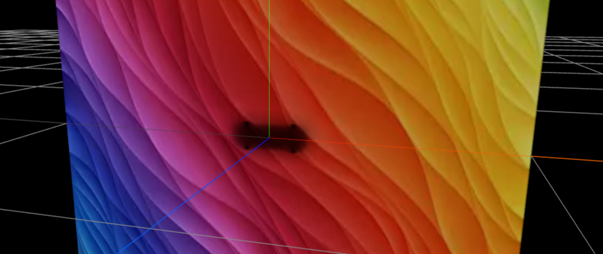


### 凹凸细节：normalMap / bumpMap / displacementMap

#### normalMap / bumpMap（表面细节，不改几何）

根据材质的贴图纹理属性设置凹凸贴图

```js
// 引入纹理贴图 实现物体表面起伏效果
// 凹凸贴图 通过灰度值来表现凹凸程度，白色部分最高，黑色部分最低
// 法相贴图 通过RGB三个通道来表示法线的xyz方向
const bumpMap = new THREE.TextureLoader().load('./src/assets/texture/world_normal.jpg')
// 颜色纹理
const colorTexture = new THREE.TextureLoader().load('./src/assets/texture/world.jpeg')

// 给球体添加纹理贴图
sphere.material = new THREE.MeshStandardMaterial({
  // bumpMap: bumpMap, // 设置凹凸贴图
  normalMap: bumpMap, // 设置法相贴图
  map: colorTexture, // 设置颜色贴图
})
```


只有在可以产生阴影的光线环境下, 才可以观察到凹凸效果

凹凸纹理

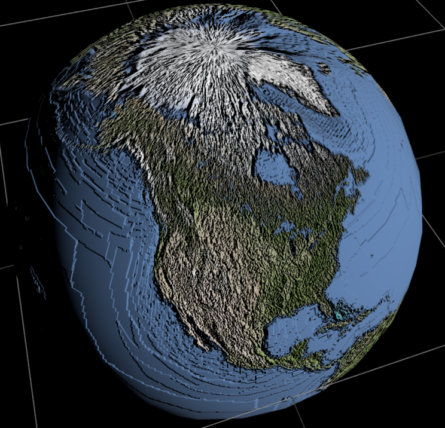

法向纹理

阴影处能看到效果，效果没有凹凸纹理那么夸张

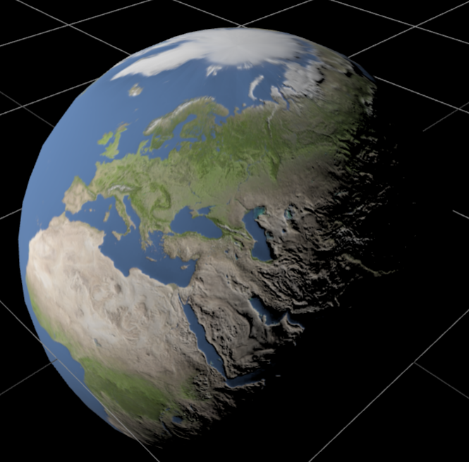

> 注意：要看到凹凸效果，**必须有光源**（点光/方向光）。


#### displacementMap（真位移顶点）

```ts
import * as THREE from 'three';

export function createDisplacedPlane(scene: THREE.Scene): THREE.Mesh {
  const geometry = new THREE.PlaneGeometry(5, 5, 64, 64);

  const dispTex = new THREE.TextureLoader().load(
    '/src/assets/texture/rocks/gray_rocks_disp_1k.png'
  );
  const colorTex = new THREE.TextureLoader().load(
    '/src/assets/texture/rocks/gray_rocks_diff_1k.jpg'
  );
  colorTex.encoding = THREE.sRGBEncoding;

  const material = new THREE.MeshStandardMaterial({
    map: colorTex,
    displacementMap: dispTex,
    displacementScale: 1,
    side: THREE.DoubleSide,
  });

  const plane = new THREE.Mesh(geometry, material);
  plane.rotation.x = -Math.PI / 2;
  scene.add(plane);

  return plane;
}
```

> - 只要“看起来凹凸就行”且不需要轮廓变化：`normalMap` 或 `bumpMap`；
> - 需要物体轮廓/轮廓线真变形：`displacementMap + 高分段几何体`。
> - “顶点不够，几何细分不够，导致位移只能按大块折线近似”，所以看起来失真/块状/锯齿，而不是细腻起伏。

使用

```ts
// 点光源
const pointLight: THREE.PointLight = new THREE.PointLight(0xffffff, 1);
pointLight.position.set(1.4, 0.7, -1.4);
scene.add(pointLight);

// 使用gui调节点光源位置
import * as dat from 'dat.gui';
const gui = new dat.GUI();
gui.add(pointLight.position, 'x', -10, 10, 0.1);
gui.add(pointLight.position, 'y', -10, 10, 0.1);
gui.add(pointLight.position, 'z', -10, 10, 0.1);

// 创建设置了位移贴图的平面
import { createDisplacedPlane } from './utils/createDisplacedPlane.js';
createDisplacedPlane(scene);
```


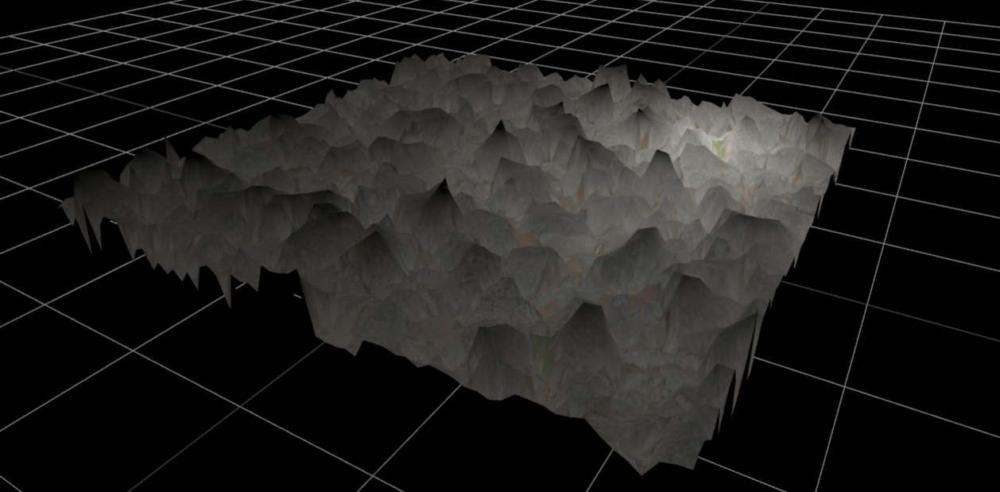


### 环境贴图 & HDR（PBR 的灵魂）

- `envMap` / `scene.environment` = 环境反射/折射源；
- HDR（`*.hdr`）/CubeTexture 六面图 → 作为环境；
- `scene.environment` 给所有 PBR 材质统一提供反射/间接光照；
- `scene.background` 只负责“你看到的背景图”。


对于表面光滑的物体, 是可以反射出周围环境的效果, 环境贴图主要就是用于实现这个效果

three.js中的环境贴图的本质就是把周围环境映射到物体表面，让其看起来能反射光线

注意：这种表面光滑物体只反射静态的环境贴图，不能反射场景中其他物体


RGBELoader已经弃用，改用HDRLoader，用法一致


HDR 作为背景 + 反射源

```ts
import * as THREE from 'three';
import { RGBELoader } from 'three/examples/jsm/loaders/RGBELoader.js';

export function setupHdrEnvironment(
  scene: THREE.Scene,
  url = '/src/assets/hdr/leibstadt_4k.hdr'
): Promise<THREE.Texture> {
  return new Promise((resolve, reject) => {
    new RGBELoader().load( // load 参数位置：loader.load(url, onLoad, onProgress, onError)，四个参数分别是 URL、成功回调、进度回调、失败回调。
      url,
      (hdrTexture: THREE.DataTexture) => {
        hdrTexture.mapping = THREE.EquirectangularReflectionMapping;
        scene.background = hdrTexture; // 可选：把 HDR 当背景
        scene.environment = hdrTexture;  // 关键：环境反射/IBL
        resolve(hdrTexture);
      },
      undefined,
      (err: unknown) => reject(err)
    );
  });
}

// 创建一个高反射球
export function createMetalSphere(scene: THREE.Scene): THREE.Mesh {
  const geo = new THREE.SphereGeometry(1, 32, 32);
  const mat = new THREE.MeshStandardMaterial({
    roughness: 0.0, // 粗糙度
    metalness: 1.0, // 金属度
  });
  const sphere = new THREE.Mesh(geo, mat);
  scene.add(sphere);
  return sphere;
}
```

使用：

```ts
import { setupHdrEnvironment, createMetalSphere } from './utils/setupHdrEnvironment.js';

// 设置 HDR 环境贴图
setupHdrEnvironment(scene)
  .then(() =>{
    // 创建一个高反射球体以测试环境贴图效果
    createMetalSphere(scene);
  })
```

> - 想让所有 Standard/Physical 材质都有真实反射 → 用 `scene.environment`；
> - 只想给单个材质反射别的贴图 → 设置 `material.envMap`。

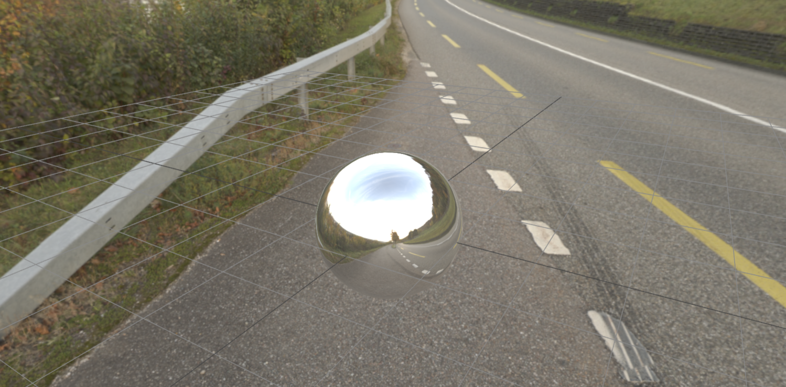


#### 辐射环境贴图 （PMREM）

##### 区别

普通的环境贴图(envMap)只适合完全镜面光滑的材质，无法随着材质粗糙度变化而变化，但是PMREM（Pre-filtered Mipmapped Radiance Environment Map）能正确相应粗糙度的变化


##### 原理

普通环境贴图就是对环境进行一次采样，也就是在每个反射方向存储一个颜色值，渲染时，根据视线方向和发现计算反射向量，相当于知道了反射方向，然后从贴图中查一个像素。

这等价于假设材质的 BRDF 是一个**完美的 Dirac δ 函数**（只有镜面反射方向有值）。所以它只对「完全镜面光滑」的材质正确。

当粗糙度 α>0 时，反射不再是一条线，而是一个「瓣」（lobe），也就是漫反射。正确计算需要对半球上的入射光做积分，实时做积分代价很高，PMREM就是把积分预计算好存在贴图里


预滤波：把不同粗糙度下的积分结果提前计算好


多级Mipmap存储：把预滤波的结果根据粗糙度等级存储在贴图的 Mipmap各级 中

| Mip Level | 粗糙度       | 视觉效果       |
| --------- | ------------ | -------------- |
| Level 0   | α≈0*α*≈0     | 清晰的镜面反射 |
| Level 1   | α≈0.2*α*≈0.2 | 轻微模糊       |
| Level 2   | α≈0.4*α*≈0.4 | 中度模糊       |
| ...       | ...          | ...            |
| Level N   | α≈1.0*α*≈1.0 | 完全漫射模糊   |


 辐射（Radiance）的物理正确性：保持能量守恒，不同粗糙度下反射的能量总量是一致的，配合 **Split-Sum 近似**（Epic Games 提出），将渲染方程拆成两部分独立预计算，极大减少实时开销


##### 编码使用区别

```js
// ===== 普通环境贴图（直接赋值，不经过PMREM处理）=====
import { RGBELoader } from 'three/examples/jsm/loaders/RGBELoader.js'

const loader = new RGBELoader()
loader.load('env.hdr', (texture) => {
  texture.mapping = THREE.EquirectangularReflectionMapping
  // 直接赋给材质 envMap —— 只有 roughness≈0 时反射正确
  material.envMap = texture
})

// ===== PMREM 环境贴图（经过预滤波处理）=====
import { RGBELoader } from 'three/examples/jsm/loaders/RGBELoader.js'

const pmremGenerator = new THREE.PMREMGenerator(renderer)
const loader = new RGBELoader()
loader.load('env.hdr', (texture) => {
  // 关键：用 PMREMGenerator 生成预滤波 CubeMap
  const envMap = pmremGenerator.fromEquirectangular(texture).texture
  // 赋给 scene.environment —— 所有 PBR 材质自动获得正确的粗糙度响应
  scene.environment = envMap
  texture.dispose()
  pmremGenerator.dispose()
})
```


api说明

```js
PMREMGenerator
此类从立方体贴图环境纹理生成预过滤的 Mipmap 光晕环境贴图 (PMREM)。这样可以根据材质粗糙度快速访问不同级别的模糊效果。

构造函数：
new PMREMGenerator( renderer : WebGLRenderer )
构造一个新的 PMREM 生成器。
参数：
  renderer — 用于生成 PMREM 的 WebGLRenderer 实例。
方法：
  .fromEquirectangular( equirectangular : Texture, renderTarget : WebGLRenderTarget ) : WebGLRenderTarget
  从等距柱状投影纹理生成 PMREM，该纹理可以是 LDR 或 HDR。理想的输入图像尺寸为 1k (1024 x 512)，因为这与 256 x 256 的立方体贴图输出最为匹配。
  参数：
    equirectangular — 输入的等距柱状投影纹理。
    renderTarget — 要使用的渲染目标。默认值为 null，表示创建一个新的 WebGLRenderTarget。
  返回：
    WebGLRenderTarget，期间会生成 PMREM 纹理作为 WebGLRenderTarget 的纹理属性。通过 renderTarget.texture 访问生成的 PMREM 纹理。
```


##### 效果对比

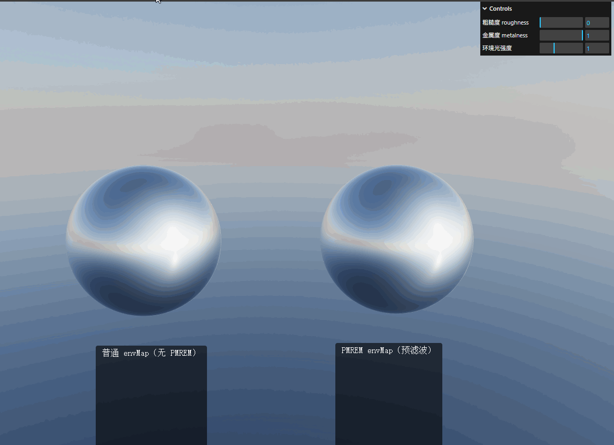


#### 全局设置环境贴图

```js
import { RGBELoader } from 'three/examples/jsm/loaders/RGBELoader.js';

// 1. 加载 HDR 环境贴图
const pmremGenerator = new THREE.PMREMGenerator(renderer);
pmremGenerator.compileEquirectangularShader();

new RGBELoader().load('environment.hdr', (hdrTexture) => {
  const envMap = pmremGenerator.fromEquirectangular(hdrTexture).texture;
  hdrTexture.dispose();
  pmremGenerator.dispose();

  // 2. 全局设置（推荐）
  scene.environment = envMap;

  // 3. 遍历模型节点，逐一设置
  model.traverse((node) => {
    if (node.isMesh && node.material) {
      node.material.envMap = envMap;              // 指定环境贴图
      node.material.envMapIntensity = 3.0;        // 增强反射强度
      node.material.needsUpdate = true;           // 强制材质更新，若不设置，材质改动可能不会立即生效

      if (node.material.isMeshStandardMaterial || node.material.isMeshPhysicalMaterial) {
        node.material.aoMapIntensity = 1;         // 设置 AO 强度
      }
    }
  });
});
```

`node.material.aoMapIntensity = 1`,控制**环境光遮蔽贴图（AO Map）**的强度。AO Map 用于模拟物体间的接触阴影，增强立体感,前提是材质需要有 `aoMap` 纹理，且模型需要第二套 UV（`uv2`）


### MeshPhysicalMaterial 的高级效果（玻璃 / 清漆 / 毛绒 / 虹彩）

- 玻璃：`transmission + ior + envMap`
- 清漆：`clearcoat + clearcoatRoughness`
- 毛绒：`sheen + sheenRoughness + sheenColor`
- 虹彩：`iridescence + iridescenceIOR`


环境贴图

```ts
// 创建一个立方体贴图作为环境贴图
const cubeTexture = new THREE.CubeTextureLoader().setPath('/src/assets/texture/park/').load([
    'posx.jpg',
    'negx.jpg',
    'posy.jpg',
    'negy.jpg',
    'posz.jpg',
    'negz.jpg',
]);
scene.background = cubeTexture; // 可选：设置为场景背景
```


#### 玻璃板

```ts
import * as THREE from 'three';

export function createGlassPanel(
  scene: THREE.Scene,
  cubeTexture: THREE.CubeTexture
): THREE.Mesh {
  const geometry = new THREE.BoxGeometry(1, 1, 0.1);

  const material = new THREE.MeshPhysicalMaterial({
    color: 'gray',
    metalness: 0,
    roughness: 0,
    envMap: cubeTexture, // 环境贴图
    transmission: 0.9, // 透明度
    ior: 1.8, // 折射率
  });

  const mesh = new THREE.Mesh(geometry, material);
  scene.add(mesh);
  return mesh;
}
```

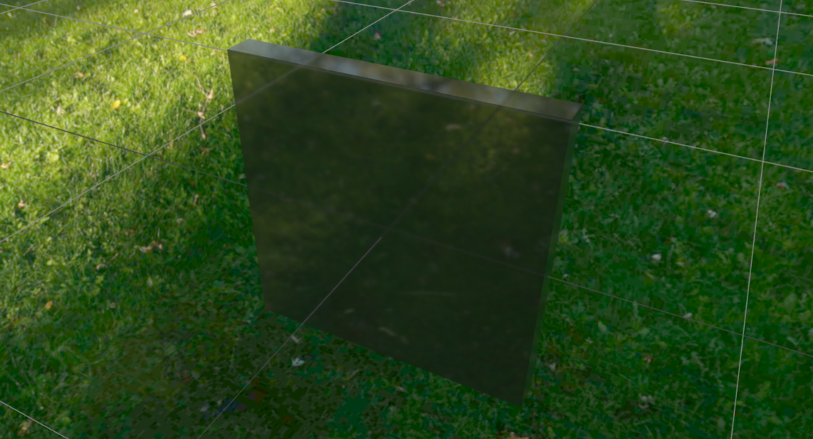


#### 毛绒效果

```js
const matteMesh = mesh.clone() // 克隆一个网格模型

// 砖块纹理
const brickTexture = new THREE.TextureLoader().load('./src/assets/texture/zhuan.jpg')

// 毛绒效果材质参数
const sheenMaterial = new THREE.MeshPhysicalMaterial({
    color: 'red',
    sheen: 1, // 毛绒效果 0-1之间
    sheenColorMap: brickTexture, // 毛绒效果的颜色贴图
    sheenRoughness: 1, // 毛绒效果的粗糙度 0-1之间
    sheenColor: 'white' // 毛绒效果的颜色
});
matteMesh.material = sheenMaterial; // 将材质赋值给网格模型
matteMesh.position.x = -2; // 将克隆的网格模型向左移动
scene.add(matteMesh); // 将克隆的网格模型添加到场景中


// 添加点光源
const pointLight = new THREE.PointLight(0xffffff, 1); // 创建点光源 参数：颜色，强度
pointLight.position.set(5, 5, 5); // 设置点光源位置
scene.add(pointLight); // 将点光源添加到场景中
```

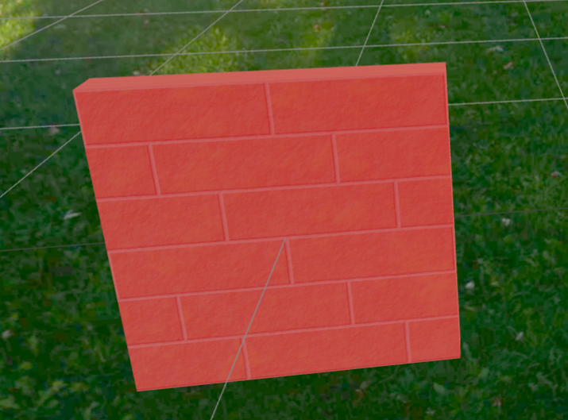


#### 虹彩效果

```js
// 创建一个球形几何体
const sphereGeometry = new THREE.SphereGeometry(1, 32, 32);
// 创建网格模型对象
const iridescenceMesh = new THREE.Mesh(sphereGeometry); 

// 虹彩效果材质参数
const iridescenceMaterial = new THREE.MeshPhysicalMaterial({
    color: '#ffffff',
    metalness: 0,
    roughness: 0,
    transmission: 1,
    iridescence: 1, // 虹彩强度 0-1之间
    iridescenceIOR: 1.8, // 虹彩折射率 1-3之间
    reflectivity: 1, // 反射率
    envMap:cubeTexture, // 设置环境贴图
});
iridescenceMesh.material = iridescenceMaterial; // 将材质赋值给网格模型

iridescenceMesh.position.y = 2; // 将克隆的网格模型向上移动
scene.add(iridescenceMesh); // 将克隆的网格模型添加到场景中
```

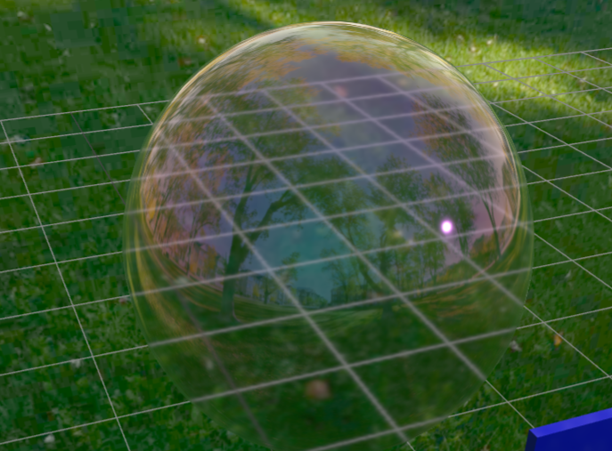


#### 清漆车漆

```ts
function createClearCoatMesh(
  scene: THREE.Scene,
  cubeTexture: THREE.CubeTexture,
  baseMesh: THREE.Mesh
): THREE.Mesh {
  const mesh = baseMesh.clone();

  mesh.material = new THREE.MeshPhysicalMaterial({
    color: 'blue',
    metalness: 0.8, 
    roughness: 0.4, // 基础粗糙度
    clearcoat: 1.0, // 清漆涂层强度
    clearcoatRoughness: 0.05, // 清漆涂层粗糙度
    envMap: cubeTexture,
  });

  mesh.position.x = 2;
  scene.add(mesh);
  return mesh;
}

// 创建一个有清漆涂层的立方体
const boxGeometry = new THREE.BoxGeometry(1, 1, 1);
const boxMesh = new THREE.Mesh(boxGeometry);
createClearCoatMesh(scene, cubeTexture, boxMesh);
```

> 当需要真实玻璃、车漆、丝绒、虹彩这种效果时，会选择 MeshPhysicalMaterial，并结合 envMap/HDR 环境贴图。

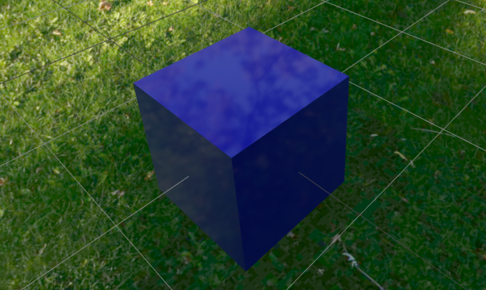

------

### ShadowMaterial

```js
new THREE.ShadowMaterial()
阴影材质，仅用于接收阴影效果，除此之外完全透明
参数：
  color：阴影的颜色，默认值为黑色（0x000000）。
  opacity：阴影的透明度，取值范围为0到1，数值越小阴影越淡，默认值为1（不透明）。
  fog：布尔值，表示材质是否受场景中的雾效影响，默认值为false。
  transparent：布尔值，表示材质是否透明，默认值为true。
使用示例：


const groundGeometry = new THREE.PlaneGeometry(50, 50);
const groundMaterial = new THREE.ShadowMaterial({
  color: 0x000000,    // 阴影颜色（黑色）
  opacity: 0.3        // 阴影透明度，0-1 越小越淡
});

const ground = new THREE.Mesh(groundGeometry, groundMaterial);
ground.rotation.x = -Math.PI / 2;
ground.position.y = 0;
ground.receiveShadow = true;  // 关键！必须启用接收阴影
scene.add(ground);

优点：只在阴影区域输出半透明黑色，其余像素完全透明，无论视角怎么转都看不出有第二个平面存在。
```


### ShaderMaterial

```js
new THREE.ShaderMaterial(parameters)
ShaderMaterial 是一个使用自定义着色器渲染的材质。允许编写自定义的 GLSL 代码来实现 Three.js 内置材质无法实现的特殊效果。

参数：
uniforms: {
  time: { value: 1.0 },
  resolution: { value: new THREE.Vector2() }
}
uniforms传递给着色器的变量，格式：{变量名：{ value: 初始值 }}，每帧更新时可以修改 value 来改变变量值。可以用来传递事件、分辨率、纹理、颜色等数据。

vertexShader: `
  void main() {
    gl_Position = projectionMatrix * modelViewMatrix * vec4(position, 1.0);
  }
`
顶点着色器代码，字符串格式的 GLSL 编写。负责处理顶点位置、法线等数据。

fragmentShader: `
  void main() {
    gl_FragColor = vec4(1.0, 0.0, 0.0, 1.0);
  }
`
片元着色器代码,字符串格式的 GLSL 编写。用来计算每个像素的颜色。


lights: boolean
  默认值: false
  作用: 是否接收光照影响
  设为 true 时会传递光照相关的 uniform 数据

fog: boolean
  默认值: false
  作用: 是否受场景雾效影响
  需要配合 UniformsUtils.merge() 合并雾效 uniforms

wireframe: boolean
  默认值: false
  作用: 是否以线框模式渲染几何体

glslVersion
  可选值: GLSL1 | GLSL3
  默认值: null
  作用: 指定 GLSL 版本

clipping: boolean
  默认值: false
  作用: 是否支持裁剪平面

uniformsNeedUpdate: boolean
  默认值: false
  作用: 强制更新 uniforms（在 onBeforeRender 中使用）
```

注意：`ShaderMaterial` 不支持 `receiveShadow`，Three.js 阴影系统要求材质内嵌特定 shader chunks 才能工作


### 反射平面

#### 传统 Reflector

```js
Reflector
可用于创建类似镜子的平面反射表面。
import { Reflector } from 'three/addons/objects/Reflector.js';
new Reflector( geometry : BufferGeometry, options : Reflector~Options )
参数
geometry — 用于定义反射表面形状的几何体。
options — 可选的参数对象，具有以下属性：
  clipBias — 反射剪裁偏移。默认为 0。
  textureWidth — 反射纹理的宽度。默认为 512。
  textureHeight — 反射纹理的高度。默认为 512。
  color — 反射表面的颜色。默认为 0x7F7F7F,即灰色。


可以把Reflector看成是一个独立的Mesh对象，创建时就会自动生成一个翻转的虚拟相机和一个离屏RenderTarget，并在每帧渲染时自动将场景渲染到RenderTarget上，然后把这个RenderTarget当成纹理投影到它自己的材质上
// 一行搞定——Reflector 本身就是 Mesh，自带材质，只需要提供几何体这一载体即可
const reflector = new Reflector(planeGeometry, {
    clipBias: 0.003,
    textureWidth: 1024,
    textureHeight: 1024,
    color: 0x889999,
});
scene.add(reflector); // 直接加到场景
```


#### 新方法：ReflectorNode

```js
ReflectorNode 是节点材质系统中的一个节点，只负责提供反射纹理数据，不直接参与渲染。你需要自己创建一个 Mesh 和一个 NodeMaterial, 然后把 ReflectorNode 生成的反射纹理数据组合到 NodeMaterial 的 colorNode 中，这样就能在任何材质上实现反射效果了，使用上更灵活，但写法也更复杂一些。

// 1. 创建普通 Mesh
const floorMesh = new THREE.Mesh(planeGeometry);

// 2. 创建反射节点（只提供数据，不管材质）
const reflectorNode = reflector({ target: floorMesh, resolution: 1 });

// 3. 自由组合到节点材质中（这是核心优势）
const material = new MeshPhysicalNodeMaterial();
material.colorNode = mix(baseColor, reflectorNode, float(0.85));
floorMesh.material = material;
```


#### 代码效果

效果


传统

```js
/**
 * 传统 Reflector 方案（WebGLRenderer）
 * 
 * Reflector 是一个特殊的 Mesh，内部自动完成：
 *   1. 创建一个翻转的虚拟相机
 *   2. 将场景渲染到离屏 RenderTarget
 *   3. 将纹理投影到反射面上
 * 
 * 优点：用法简单，一行搞定
 * 缺点：和其他材质效果难以组合（它自带材质，不能用你自己的 PBR 材质）
 */

import * as THREE from 'three';
import { OrbitControls } from 'three/addons/controls/OrbitControls.js';
import { Reflector } from 'three/addons/objects/Reflector.js';

// ---- 渲染器 ----
const renderer = new THREE.WebGLRenderer({ antialias: true });
renderer.setSize(window.innerWidth, window.innerHeight);
renderer.setPixelRatio(window.devicePixelRatio);
renderer.toneMapping = THREE.ACESFilmicToneMapping;
renderer.toneMappingExposure = 1.0;
document.getElementById('cesiumContainer').appendChild(renderer.domElement);

// ---- 场景 & 相机 ----
const scene = new THREE.Scene();
scene.background = new THREE.Color(0x222222);

const camera = new THREE.PerspectiveCamera(50, window.innerWidth / window.innerHeight, 0.1, 100);
camera.position.set(3, 3, 5);

const controls = new OrbitControls(camera, renderer.domElement);
controls.target.set(0, 0.5, 0);
controls.update();

// ---- 灯光 ----
scene.add(new THREE.AmbientLight(0xffffff, 0.4));
const dirLight = new THREE.DirectionalLight(0xffffff, 1.5);
dirLight.position.set(5, 8, 5);
scene.add(dirLight);

// ============================================================
//  核心：创建 Reflector（传统方式）
//  它本身就是一个 Mesh，自带反射材质，直接加入场景即可
// ============================================================
const floorGeometry = new THREE.PlaneGeometry(10, 10);
const reflector = new Reflector(floorGeometry, {
    clipBias: 0.003,           // 反射面裁剪偏移，防止 z-fighting
    textureWidth: 1024,        // 反射纹理宽度
    textureHeight: 1024,       // 反射纹理高度
    color: 0x889999,           // 反射色调（灰色 = 较真实，深色 = 暗反射）
});
reflector.rotation.x = -Math.PI / 2; // 平面默认朝 Z，旋转为朝 Y（地板）
scene.add(reflector);

// ---- 场景物体（将被反射） ----
// 彩色立方体
const boxGeo = new THREE.BoxGeometry(0.8, 0.8, 0.8);
const boxMat = new THREE.MeshStandardMaterial({ color: 0xff4444, roughness: 0.2, metalness: 0.8 });
const box = new THREE.Mesh(boxGeo, boxMat);
box.position.set(-1.2, 0.6, 0);
scene.add(box);

// 球体
const sphereGeo = new THREE.SphereGeometry(0.5, 32, 32);
const sphereMat = new THREE.MeshStandardMaterial({ color: 0x44aaff, roughness: 0.1, metalness: 0.5 });
const sphere = new THREE.Mesh(sphereGeo, sphereMat);
sphere.position.set(0, 0.7, 0);
scene.add(sphere);

// 圆环
const torusGeo = new THREE.TorusGeometry(0.4, 0.15, 16, 32);
const torusMat = new THREE.MeshStandardMaterial({ color: 0x44ff88, roughness: 0.3, metalness: 0.6 });
const torus = new THREE.Mesh(torusGeo, torusMat);
torus.position.set(1.2, 0.6, 0);
torus.rotation.x = Math.PI / 4;
scene.add(torus);

// ---- 动画 & 渲染 ----
const clock = new THREE.Clock();
function animate() {
    requestAnimationFrame(animate);
    const t = clock.getElapsedTime();

    box.rotation.y = t * 0.5;
    torus.rotation.y = t * 0.8;
    sphere.position.y = 0.7 + Math.sin(t * 2) * 0.2;

    renderer.render(scene, camera);
}
animate();

// ---- 自适应 ----
window.addEventListener('resize', () => {
    camera.aspect = window.innerWidth / window.innerHeight;
    camera.updateProjectionMatrix();
    renderer.setSize(window.innerWidth, window.innerHeight);
});

```

新方法

```js
/**
 * ReflectorNode 方案（WebGPURenderer + 节点材质）
 * 
 * ReflectorNode 是节点材质系统中的一个"节点"，只负责提供反射纹理数据。
 * 你需要自己创建一个 NodeMaterial（如 MeshPhysicalNodeMaterial），
 * 然后把 reflectorNode 的输出接入材质的某个通道（如 colorNode）。
 * 
 * 优点：可与其他节点自由组合（比如混合反射 + PBR 粗糙度 + 自定义色调）
 * 缺点：写法比传统方式复杂，需要理解节点材质系统
 * 
 * 对比 Reflector：
 *   Reflector    = 独立的 Mesh（自带材质，无法定制）
 *   ReflectorNode = 材质节点（只提供数据，自由组合到任何 NodeMaterial 中）
 */

import * as THREE from 'three/webgpu';
import { MeshPhysicalNodeMaterial } from 'three/webgpu';
import { reflector, color, float, mix } from 'three/tsl';
import { OrbitControls } from 'three/addons/controls/OrbitControls.js';

// ---- 渲染器（WebGPURenderer） ----
const renderer = new THREE.WebGPURenderer({ antialias: true });
renderer.setSize(window.innerWidth, window.innerHeight);
renderer.setPixelRatio(window.devicePixelRatio);
renderer.toneMapping = THREE.ACESFilmicToneMapping;
renderer.toneMappingExposure = 1.0;
document.getElementById('cesiumContainer').appendChild(renderer.domElement);

// 等待 WebGPU 初始化
await renderer.init();

// ---- 场景 & 相机 ----
const scene = new THREE.Scene();
scene.background = new THREE.Color(0x222222);

const camera = new THREE.PerspectiveCamera(50, window.innerWidth / window.innerHeight, 0.1, 100);
camera.position.set(3, 3, 5);

const controls = new OrbitControls(camera, renderer.domElement);
controls.target.set(0, 0.5, 0);
controls.update();

// ---- 灯光 ----
scene.add(new THREE.AmbientLight(0xffffff, 0.4));
const dirLight = new THREE.DirectionalLight(0xffffff, 1.5);
dirLight.position.set(5, 8, 5);
scene.add(dirLight);

// ============================================================
//  核心：使用 ReflectorNode（节点材质方式）
//  步骤：
//    1. 创建一个普通 Mesh 作为地板
//    2. 用 reflector() TSL 函数创建反射节点，关联到该 Mesh
//    3. 创建 NodeMaterial，将反射节点组合到 colorNode 中
// ============================================================

// 1. 先创建地板 Mesh（用普通几何体 + 占位材质）
const floorGeometry = new THREE.PlaneGeometry(10, 10);
const floorMesh = new THREE.Mesh(floorGeometry);
floorMesh.rotation.x = -Math.PI / 2;

// 2. 创建 reflector 节点，关联到地板 Mesh
const reflectorNode = reflector({
    target: floorMesh,          // 反射器关联的 3D 对象
    resolution: 1,              // 分辨率缩放（1 = 全分辨率）
    generateMipmaps: false,     // 是否生成 mipmap
    bounces: true,              // 是否允许反射其他反射器（镜中镜）
});

// 3. 创建节点材质，将反射数据组合进去
//    这正是 ReflectorNode 的优势：你可以用 TSL 自由混合各种效果
const floorMaterial = new MeshPhysicalNodeMaterial();
floorMaterial.roughness = 0.05;
floorMaterial.metalness = 0.0;

// 将反射纹理与一个底色混合（这里用 mix 节点做加权混合）
// 底色为深灰，反射权重 0.85（越大反射越强）
const baseColor = color(0x333333);
const reflectionStrength = float(0.85);
floorMaterial.colorNode = mix(baseColor, reflectorNode, reflectionStrength);

// 把材质赋给地板
floorMesh.material = floorMaterial;
scene.add(floorMesh);

// ---- 场景物体（将被反射） ----
// 彩色立方体
const boxGeo = new THREE.BoxGeometry(0.8, 0.8, 0.8);
const boxMat = new THREE.MeshStandardMaterial({ color: 0xff4444, roughness: 0.2, metalness: 0.8 });
const box = new THREE.Mesh(boxGeo, boxMat);
box.position.set(-1.2, 0.6, 0);
scene.add(box);

// 球体
const sphereGeo = new THREE.SphereGeometry(0.5, 32, 32);
const sphereMat = new THREE.MeshStandardMaterial({ color: 0x44aaff, roughness: 0.1, metalness: 0.5 });
const sphere = new THREE.Mesh(sphereGeo, sphereMat);
sphere.position.set(0, 0.7, 0);
scene.add(sphere);

// 圆环
const torusGeo = new THREE.TorusGeometry(0.4, 0.15, 16, 32);
const torusMat = new THREE.MeshStandardMaterial({ color: 0x44ff88, roughness: 0.3, metalness: 0.6 });
const torus = new THREE.Mesh(torusGeo, torusMat);
torus.position.set(1.2, 0.6, 0);
torus.rotation.x = Math.PI / 4;
scene.add(torus);

// ---- 动画 & 渲染 ----
const clock = new THREE.Clock();
function animate() {
    requestAnimationFrame(animate);
    const t = clock.getElapsedTime();

    box.rotation.y = t * 0.5;
    torus.rotation.y = t * 0.8;
    sphere.position.y = 0.7 + Math.sin(t * 2) * 0.2;

    renderer.render(scene, camera);
}
animate();

// ---- 自适应 ----
window.addEventListener('resize', () => {
    camera.aspect = window.innerWidth / window.innerHeight;
    camera.updateProjectionMatrix();
    renderer.setSize(window.innerWidth, window.innerHeight);
});

```


### UV坐标

```js
// 创建一个平面几何体 PlaneGeometry
const plane = new THREE.PlaneGeometry( 5, 5 ); // 创建一个平面几何体对象 参数：x宽，y高
console.log(plane); // 打印平面几何体对象 查看uv坐标
```


### 小结

1. **先选材质类型：**
   - 不受光、只是 debug/简易 UI → `MeshBasicMaterial`
   - 简单的、无明显高光的物体 → `MeshLambertMaterial`
   - 有明显高光、但不追求物理真实性 → `MeshPhongMaterial`
   - 真实 PBR，主力材质 → `MeshStandardMaterial`
   - 高级 PBR 效果（玻璃/车漆/布料/虹彩） → `MeshPhysicalMaterial`
2. **再决定是否使用贴图：**
   - 想还原真实表面 → `map + normalMap + roughnessMap + metalnessMap + aoMap`；
   - 想做特殊效果：
     - 流动 → `Texture.offset + repeat`；
     - 凹凸 → `normalMap` / `bumpMap`；
     - 真形变 → `displacementMap + 高分段`；
     - 高级反射/环境 → HDR + `scene.environment` / `envMap`。
3. **记住几个关键坑：**
   - AO：要用 `uv2`；
   - HDR：`EquirectangularReflectionMapping`；
   - 置换：必须高分段，否则看不出效果。


## 光照 & 阴影

### 概述

- 光源决定“亮哪里、从哪儿亮、什么颜色”。
- 材质决定“怎么响应光照”（Basic 不响应，Lambert/Phong/Standard/Physical 响应）。
- 阴影 = “灯光当相机”拍一张深度图（shadow map），渲染时对比当前像素深度是否被挡住。
- 要看到阴影，必须四件事全部满足：
  1. 场景中启用阴影贴图`renderer.shadowMap.enabled = true`
  2. 光源：`light.castShadow = true`
  3. 投影物体：`mesh.castShadow = true`
  4. 接收物体：`mesh.receiveShadow = true`

------

### 光照

#### 常见光源选型表

| 光源类型           | 方向性        | 距离衰减 | 能投射阴影 | 场景用途              |
| ------------------ | ------------- | -------- | ---------- | --------------------- |
| `AmbientLight`     | 无方向        | 否       | 否         | 环境底色，弱化阴影    |
| `DirectionalLight` | 平行          | 否/可设  | 是         | 太阳光/大面积均匀照明 |
| `PointLight`       | 全向          | 是       | 是         | 灯泡/路灯/小点光源    |
| `SpotLight`        | 锥形          | 是       | 是         | 手电筒/舞台灯         |
| `HemisphereLight`  | 上下天光/地光 | 否       | 否         | 户外天空+地面反光     |

> 初学项目里，最常组合：`AmbientLight + DirectionalLight` 或 `AmbientLight + SpotLight`。


#### 通用测试场景：立方体 + 球 + 地面

先准备一套通用“物体 + 材质 + 地面”，所有光源/阴影示例都可以直接套用。


```ts
import * as THREE from 'three';

export type TestSceneObjects = {
  cube: THREE.Mesh;
  sphere: THREE.Mesh;
  ground: THREE.Mesh;
};

export function createTestSceneObjects(scene: THREE.Scene): TestSceneObjects {
  // 立方体
  const boxGeo = new THREE.BoxGeometry(1, 1, 1);
  const sphereGeo = new THREE.SphereGeometry(0.7, 32, 32);
  const planeGeo = new THREE.PlaneGeometry(10, 10);

  // 标准材质（受光照）
  const commonMat = new THREE.MeshStandardMaterial({
    color: 0x00bfff,
    side: THREE.DoubleSide, // 双面渲染
  });

  const cube = new THREE.Mesh(boxGeo, commonMat);
  cube.position.set(-2, 1, 0);
  scene.add(cube);

  const sphere = new THREE.Mesh(sphereGeo, commonMat);
  sphere.position.set(2, 1, 0);
  scene.add(sphere);

  // 地面材质颜色为灰色
  const planeMat = new THREE.MeshStandardMaterial({
    color: 0xF5F5F5,
    side: THREE.DoubleSide,
  });

  const ground = new THREE.Mesh(planeGeo, planeMat);
  ground.rotation.x = -Math.PI / 2;
  scene.add(ground);

  return { cube, sphere, ground };
}
```


使用

```ts
import { createTestSceneObjects } from './utils/createTestSceneObjects.js';
const testObjects = createTestSceneObjects(scene);
```


####  环境光（AmbientLight）：打“底色”

- 无方向，场景中所有物体统一加亮；
- 不会产生阴影；
- 用来“提亮暗部，弱化对比度”。


```ts
import * as THREE from 'three';

export function addAmbientLight(
  scene: THREE.Scene,
  color: number | string = 0xffffff,
  intensity = 0.5
): THREE.AmbientLight {
  const ambient = new THREE.AmbientLight(color, intensity);
  scene.add(ambient);
  return ambient;
}
```

------

#### 聚光灯（SpotLight）：锥形光束 + GUI 调参


- 有位置、有方向；
- 光束是一个锥体（`angle` 决定开合角）；
- `penumbra` 控制边缘软化；
- 可投射阴影。


```ts
// src/lights/createSpotLight.ts
import * as THREE from 'three';
import * as dat from 'dat.gui';

export type SpotParams = {
  color: number | string;
  intensity: number;
  distance: number;
  angle: number;
  penumbra: number;
  decay: number;
  power: number;
};

export function createSpotLightWithGui(
  scene: THREE.Scene,
  gui: dat.GUI,
  targetObjects: { cube: THREE.Mesh; sphere: THREE.Mesh; ground: THREE.Mesh }
): THREE.SpotLight {
  const params: SpotParams = {
    color: 0xffffff,
    intensity: 1,
    distance: 0,
    angle: Math.PI / 3,
    penumbra: 0,
    decay: 1,
    power: 4 * Math.PI,
  };

  const spotLight = new THREE.SpotLight(
    params.color,
    params.intensity,
    params.distance,
    params.angle,
    params.penumbra,
    params.decay
  );
  spotLight.power = params.power;
  spotLight.position.set(1, 7, 0);
  scene.add(spotLight);

  // 辅助工具
  const helper = new THREE.SpotLightHelper(spotLight);
  scene.add(helper);

  // 阴影设置
  spotLight.castShadow = true;
  targetObjects.cube.castShadow = true;
  targetObjects.sphere.castShadow = true;
  targetObjects.ground.receiveShadow = true;

  // GUI
  const folder = gui.addFolder('聚光灯参数');

  folder
    .addColor(params, 'color')
    .name('颜色')
    .onChange((val: number | string) => {
      spotLight.color = new THREE.Color(val as any);
      helper.update();
    });

  folder
    .add(params, 'intensity', 0, 2, 0.01)
    .name('强度')
    .onChange((val: number) => {
      spotLight.intensity = val;
      helper.update();
    });

  folder
    .add(params, 'distance', 0, 20, 0.1)
    .name('距离')
    .onChange((val: number) => {
      spotLight.distance = val;
      helper.update();
    });

  folder
    .add(params, 'angle', 0, Math.PI / 2, 0.01)
    .name('角度')
    .onChange((val: number) => {
      spotLight.angle = val;
      helper.update();
    });

  folder
    .add(params, 'penumbra', 0, 1, 0.01)
    .name('边缘衰减')
    .onChange((val: number) => {
      spotLight.penumbra = val;
      helper.update();
    });

  folder
    .add(params, 'decay', 1, 2, 0.01)
    .name('衰减')
    .onChange((val: number) => {
      spotLight.decay = val;
      helper.update();
    });

  folder
    .add(params, 'power', 0, 50, 0.1)
    .name('功率')
    .onChange((val: number) => {
      spotLight.power = val;
      helper.update();
    });

  return spotLight;
}
```

使用

```ts
import * as dat from 'dat.gui';
import { createSpotLightWithGui } from './utils/createSpotLight.js';

const gui = new dat.GUI();
createSpotLightWithGui(scene, gui, testObjects);

renderer.shadowMap.enabled = true; // 开启阴影计算
renderer.shadowMap.type = THREE.PCFSoftShadowMap; // 生成带有柔和边缘的阴影
```


#### 点光源（PointLight）：灯泡/路灯


- 从一点向四面八方发光；
- 有 `distance` 衰减范围、`decay` 衰减速度；
- 可产生阴影（shadow map 是立方体贴图）。


```ts
// src/lights/createPointLight.ts
import * as THREE from 'three';
import * as dat from 'dat.gui';

export type PointParams = {
  color: number | string;
  intensity: number;
  distance: number;
  decay: number;
  power: number;
};

export function createPointLightWithGui(
  scene: THREE.Scene,
  gui: dat.GUI,
  targetObjects: { cube: THREE.Mesh; sphere: THREE.Mesh; ground: THREE.Mesh }
): THREE.PointLight {
  const params: PointParams = {
    color: 0xffffff,
    intensity: 1,
    distance: 0,
    decay: 1,
    power: 4 * Math.PI,
  };

  const pointLight = new THREE.PointLight(
    params.color,
    params.intensity,
    params.distance,
    params.decay
  );
  pointLight.power = params.power;
  pointLight.position.set(0, 2, 4);
  scene.add(pointLight);

  const helper = new THREE.PointLightHelper(pointLight, 0.5);
  scene.add(helper);

  // 阴影
  pointLight.castShadow = true;
  targetObjects.cube.castShadow = true;
  targetObjects.sphere.castShadow = true;
  targetObjects.ground.receiveShadow = true;

  // 可选：阴影质量
  pointLight.shadow.mapSize.width = 1024;
  pointLight.shadow.mapSize.height = 1024;
  pointLight.shadow.radius = 4; // 阴影软化

  const folder = gui.addFolder('点光源参数');

  folder
    .addColor(params, 'color')
    .name('颜色')
    .onChange((val: number | string) => {
      pointLight.color = new THREE.Color(val as any);
      helper.update();
    });

  folder
    .add(params, 'intensity', 0, 2, 0.01)
    .name('强度')
    .onChange((val: number) => {
      pointLight.intensity = val;
      helper.update();
    });

  folder
    .add(params, 'distance', 0, 20, 0.1)
    .name('距离')
    .onChange((val: number) => {
      pointLight.distance = val;
      helper.update();
    });

  folder
    .add(params, 'decay', 1, 2, 0.01)
    .name('衰减')
    .onChange((val: number) => {
      pointLight.decay = val;
      helper.update();
    });

  folder
    .add(params, 'power', 0, 50, 0.1)
    .name('功率')
    .onChange((val: number) => {
      pointLight.power = val;
      helper.update();
    });

  return pointLight;
}
```


使用

```ts
import * as dat from 'dat.gui';
import { createPointLightWithGui } from './utils/createPointLight.js';

const gui = new dat.GUI();
createPointLightWithGui(scene, gui, testObjects);

renderer.shadowMap.enabled = true; // 开启阴影计算
```


------

#### 平行光（DirectionalLight）：太阳光 + 阴影相机

```js
平行光：
平行光是一种模拟来自无限远处的平行光线的光源,类似于太阳光。它的光线方向是统一的,不会随着距离变化而衰减,适合用于模拟阳光等场景。
构造函数：
const directionalLight = new THREE.DirectionalLight( color : Integer, intensity : Float )
  color: 光的颜色，整数形式（如 0xffffff）或 CSS 颜色字符串（如 'white'）
  intensity: 光的强度，默认为 1.0

其它属性：
  position 属性用来设置光源位置
  directionalLight.position.set(x, y, z)
  
  target 属性用来设置光源的目标点
  directionalLight.target.position.set(x, y, z)
  默认目标点在场景中心(0, 0, 0)，改变目标点会改变光线的方向。
  
  castShadow 属性用来启用阴影投射
  directionalLight.castShadow = true


光源辅助器：
光源可视化辅助工具
new DirectionalLightHelper( light : DirectionalLight, size : number, color : number | Color | string )
参数：
  light: 需要可视化的 DirectionalLight 对象
  size: 表示光源的平面大小（默认为 1）
  color: 辅助器的颜色（可选），如不设置则自动使用光源的颜色
  lightPlane: 一条 Line 对象，显示平行光的位置和方向（立方体/平面）
  targetLine: 一条 Line 对象，表示光线指向的目标点方向
方法：
  update(): 更新辅助器的位置和方向，通常在光源位置或目标点改变后调用
  dispose(): 释放 GPU 资源，在不再使用辅助器时调用
```


```js
dir = new THREE.DirectionalLight(0xffffff, 1.0);
dir.position.set(5, 8, 3); // 光源位置
dir.target.position.set(0, 2, 0);

上方的橙色框表示光源位置（5，8，3），平面表示光源方向，下面的橙色框表示光源照向哪里，这里是（0，2，0）
```


基础平行光 + 阴影，完整场景，可以debug光源

```ts
// src/lights/createDirectionalLight.ts
import * as THREE from 'three';
import * as dat from 'dat.gui';

export type DirParams = {
  color: number | string;
  intensity: number;
};

export function createDirectionalLightWithGui(
  scene: THREE.Scene,
  gui: dat.GUI,
  targetObjects: { cube: THREE.Mesh; sphere: THREE.Mesh; ground: THREE.Mesh }
): THREE.DirectionalLight {
  const params: DirParams = {
    color: 0xffffff,
    intensity: 1,
  };

  const dirLight = new THREE.DirectionalLight(
    params.color,
    params.intensity
  );
  dirLight.position.set(5, 5, 5);
  scene.add(dirLight);

  const helper = new THREE.DirectionalLightHelper(dirLight, 1);
  scene.add(helper);

  // 阴影开关
  dirLight.castShadow = true;
  targetObjects.cube.castShadow = true;
  targetObjects.sphere.castShadow = true;
  targetObjects.ground.receiveShadow = true;

  // 阴影 map 分辨率
  dirLight.shadow.mapSize.width = 1024;
  dirLight.shadow.mapSize.height = 1024;

  // 阴影相机范围（正交相机）
  const cam = dirLight.shadow.camera as THREE.OrthographicCamera;
  cam.near = 1;
  cam.far = 20;
  cam.left = -10;
  cam.right = 10;
  cam.top = 10;
  cam.bottom = -10;
  cam.updateProjectionMatrix();

  // 阴影相机辅助工具
  const shadowCamHelper = new THREE.CameraHelper(cam);
  scene.add(shadowCamHelper);

  const folder = gui.addFolder('平行光参数');

  folder
    .addColor(params, 'color')
    .name('颜色')
    .onChange((val: number | string) => {
      dirLight.color = new THREE.Color(val as any);
      helper.update();
    });

  folder
    .add(params, 'intensity', 0, 2, 0.01)
    .name('强度')
    .onChange((val: number) => {
      dirLight.intensity = val;
      helper.update();
    });

  // 阴影相机调优
  folder
    .add(cam, 'near', 0.1, 50, 0.1)
    .name('shadow near')
    .onChange(() => {
      cam.updateProjectionMatrix();
      shadowCamHelper.update();
    });

  folder
    .add(cam, 'far', 0.1, 100, 0.1)
    .name('shadow far')
    .onChange(() => {
      cam.updateProjectionMatrix();
      shadowCamHelper.update();
    });

  folder
    .add(cam, 'left', -50, 0, 0.5)
    .name('shadow left')
    .onChange(() => {
      cam.updateProjectionMatrix();
      shadowCamHelper.update();
    });

  folder
    .add(cam, 'right', 0, 50, 0.5)
    .name('shadow right')
    .onChange(() => {
      cam.updateProjectionMatrix();
      shadowCamHelper.update();
    });

  folder
    .add(cam, 'top', 0, 50, 0.5)
    .name('shadow top')
    .onChange(() => {
      cam.updateProjectionMatrix();
      shadowCamHelper.update();
    });

  folder
    .add(cam, 'bottom', -50, 0, 0.5)
    .name('shadow bottom')
    .onChange(() => {
      cam.updateProjectionMatrix();
      shadowCamHelper.update();
    });

  return dirLight;
}
```


> 在阴影相机远端面里面的就有阴影
> 简单讲，阴影只会被渲到 `shadow.camera` 定义的盒子体积内；范围过大 → 阴影模糊；范围过小 → 物体被裁掉没阴影。


### 阴影工作原理 & 调优要点


#### 阴影工作流

1. 灯光当相机，从光源视角渲一遍场景，得到一张深度图（shadow map）；

2. 正式渲染时

   ，每个像素都把自己变换到“灯光空间”，和深度图对比：

   - 如果当前深度 > shadow map 记录的深度 → 在某物体后面 → 在阴影里。
   - 否则 → 在光照下。


#### 想要“看见阴影”，要满足：

- `renderer.shadowMap.enabled = true`;
- 光源：`light.castShadow = true`;
- 投射者：`mesh.castShadow = true`;
- 接收者：`mesh.receiveShadow = true`;
- 材质：必须响应光照（`MeshStandardMaterial` / `MeshPhongMaterial` 等）。


#### 阴影质量调优

- 清晰度：`shadow.mapSize`调整阴影贴图的分辨率（越大越清晰，但更耗性能）；
- 范围：`light.shadow.camera.near/far/left/right/top/bottom` 盒子要**紧贴场景**，不能太大；
- 软阴影：
  - `renderer.shadowMap.type = THREE.PCFSoftShadowMap;`
  - 点光源可用 `light.shadow.radius` 控制模糊程度。


这里以平行光为例

```js
new LightShadow( camera : Camera ) (abstract)
LightShadow 是一个抽象基类,用于配置不同类型光源的阴影。通常不直接使用,而是通过光源对象(如 dir)的 .shadow 属性访问


shadow 属性：
是一个 LightShadow 对象,用于配置阴影相关参数,如阴影贴图分辨率、偏移等。这里以一个平行光为例子：
const dir = new THREE.dir( color : Integer, intensity : Float )

shadow.camera 属性是一个 OrthographicCamera 对象,用于定义平行光的阴影相机视锥体,通过调整 left、right、top、bottom、near、far 属性来控制阴影范围和精度.
dir.shadow.camera.left = -10;...
  
shadow.mapSize 属性控制阴影贴图的分辨率,值越大阴影越清晰,但性能消耗越大.
dir.shadow.mapSize.width = 2048; ...

shadow.bias 阴影贴图偏移量,解决"阴影痤疮"(shadow acne)问题,通常设置为一个小的负值.
dir.shadow.bias = -0.0001; ...
  
shadow.normalBias 阴影贴图位置沿物体法线方向的偏移量.
dir.shadow.normalBias = 0.01; ...

shadow.radius 阴影边缘模糊半径.
dir.shadow.radius = 1; ...
```


##### 阴影分辨率

阴影分辨率：512，1024，4096


##### 阴影贴图偏移

bias：0，-0.01，0.01


##### 阴影痤疮

###### 先理解阴影贴图

深度图：

把摄像机放到光源的位置，从光源的视角去渲染整个三维场景(相当于在光源位置给场景拍一张照片)，得到一张图，记录图中每个像素、对应的三维坐标点到光源的距离，把这个距离作为像素值存储起来，这张图就是 深度图

上述记录的是`z_s`的值，

正式渲染时，把场景中的点P放到光源坐标系下得到其坐标值，计算到光源的距离，`z_r`

- 如果 `z_r ≈ z_s` → P 就是光源最先碰到的那个点 → **P 在阳光下**
- 如果 `z_r > z_s` → 光源那个方向更近处有别的东西挡着 → **P 在阴影里**

阴影贴图(Shadow Map)的工作原理：

假设摄像机与光源位于相同的位置，则摄像机无法看到的场景区域与光源的光线无法到达的场景区域相同；因此，这些区域处于阴影中


###### 阴影痤疮现象

将光源高度调低，从而使得光线入射方向和地面之间夹角比较小，并且不做任何bias处理，从而得到比较明显的shadow acne现象


把acne放大看是间隔的条纹


###### 产生原因

```
先不看整个整个 2D 地面，而是只看一个截面shadow map 本质上是一张贴图，说明它不是无限精细的连续记录，而是一格一格的 texel，每个 texel 只存一个深度值

由于阴影贴图储存的值是离散的，总会将一片区域到光源的距离(深度)储存为一个值，但是这片区域的深度是连续变化的，就会导致有些深度大于这个值，造成自遮挡

1、真实地面的深度值(距离光源的距离)是连续变化的
2、shadow map存储的深度是却类似阶梯函数
```

于是会得到这种关系（概念示意）

- 在某个 texel 覆盖的区间内，总会有一部分点满足 

- $$
  (z_r(x) \le z_s)（判定不在阴影）
  $$

- 也会有一部分点满足 

- $$
  (z_r(x) > z_s)（误判在阴影，自遮挡）
  $$

- 当跨过texel边界，(z_s) 突然跳到下一个 texel 的值，于是“误判区/不误判区”也跟着周期性出现——看起来就是**一条一条的条纹**（acne）。

- 图里粉色锯齿线（shadow func）表达的正是：**存储深度 (z_s) 是分段的、会跳变**；而计算的深度是连续的。两者一比较就会在某些区间产生系统性误差。被粉色锯齿线覆盖的区域黑线区域会被判定为阴影区域


解决方法：使用bias

```
把比较门槛整体向前挪动，Bias可以对比较做一个偏移，让“判阴影”的条件更难成立，从而减少自遮挡，对应粉色锯齿整体“前移/下移”
让原本会落入“z_r > z_s”的那一小段红色错误区间，变回“不过门槛”，从而消掉条纹。
bias 的副作用：
	真实应该接触的阴影边缘被推开
	物体脚底阴影与物体之间出现缝隙（像漂浮），这就是常说的 peter panning。
```


##### 模糊半径

radius：0，10

对阴影类型为PCFShadowMap的阴影无效，仅仅对VSMShadowMap生效


------

### 阴影调试 Checklist

发现“阴影不对劲”时，可以按这个顺序查：

1. 渲染器是否启用阴影？
   `renderer.shadowMap.enabled = true;`
2. 材质是否受光？
   - 如果是 `MeshBasicMaterial` 就不会有阴影效果；
3. 光源是否能投影 & 真的开了？
   - `light.castShadow = true;`
4. 物体是否标记？
   - 投射：`mesh.castShadow = true;`
   - 接收：`ground.receiveShadow = true;`
5. 阴影相机是否包含你的物体？
   - 打开 `CameraHelper(light.shadow.camera)` 看盒子有没有框住模型；
6. `shadow.mapSize`是否太小？
   - 默认 512，有锯齿就升到 1024 或 2048 试试。


### 小结

1. 选光源类型：
   - 想要“到处都有一点亮度” → `AmbientLight`；
   - 户外大范围太阳光 → `DirectionalLight`；
   - 灯泡/点状光源 → `PointLight`；
   - 手电筒/舞台聚光 → `SpotLight`。
2. 确定是否需要阴影：
   - 要阴影 →
     - 打开 `renderer.shadowMap.enabled`；
     - 光源 `castShadow = true`；
     - 物体 `castShadow` / 地面 `receiveShadow`；
     - 调整 `shadow.camera` 范围 + `shadow.mapSize`。
3. 调试顺序：
   - 先有环境光 + 主光牢靠照亮场景；
   - 再加阴影；
   - 最后用 CameraHelper 调整阴影相机盒子的大小和位置。


## 场景

### 概述

- Scene除了装物体，还有决定“整体气氛”的几个关键属性：
  - `scene.background`：你眼睛看到的背景（颜色 / 2D 纹理 / 天空盒 / HDR）。
  - `scene.environment`：所有 PBR 材质（Standard/Physical）的环境反射/间接光源。
  - `scene.fog`：距离相机越远越“雾化”。
- AO（环境光遮蔽）：暗化模型凹处/缝隙，增强立体感（材质上的 `aoMap`）。

------

### 背景模式（`scene.background`）

`scene.background` 支持几种类型：

1. 纯色背景：`new THREE.Color(...)`
2. 2D 纹理图：`Texture`（普通贴图）
3. 天空盒（6 张立方体纹理）：`CubeTexture`
4. HDR 全景图：`Texture`（通常搭配 `EquirectangularReflectionMapping`）


### 纯色背景

```ts
import * as THREE from 'three';

export function setSolidBackground(
  scene: THREE.Scene,
  color: number | string = 0x87ceeb // 天空蓝
): void {
  scene.background = new THREE.Color(color as any);
}
```

使用：

```ts
setSolidBackground(scene, 0x222233); // 深色背景
```

> 适合：debug、简单 UI、太空/深色场景。


------

### canvas创建背景


创建径向渐变背景

```js
// 创建径向渐变背景
function createGradientBackground() {
  const canvas = document.createElement('canvas');
  canvas.width = 512;
  canvas.height = 512;
  
  const ctx = canvas.getContext('2d');
  
  // 创建径向渐变（中心浅色到边缘深色）
  const gradient = ctx.createRadialGradient(256, 256, 0, 256, 256, 400);
  gradient.addColorStop(0, '#f5f5f5');    // 中心：浅灰
  gradient.addColorStop(0.7, '#e8e8e8');  // 过渡
  gradient.addColorStop(1, '#d0d0d0');    // 边缘：深灰
  
  ctx.fillStyle = gradient;
  ctx.fillRect(0, 0, 512, 512);
  
  const texture = new THREE.CanvasTexture(canvas);
  return texture;
}

const gradientTexture = createGradientBackground();
scene.background = gradientTexture;
```


<hr>


###  2D 纹理当背景图


```ts
import * as THREE from 'three';

export function setTextureBackground(
  scene: THREE.Scene,
  url: string
): THREE.Texture {
  const texture = new THREE.TextureLoader().load(url);
  scene.background = texture;
  return texture;
}
```

使用：

```ts
setTextureBackground(scene, '/src/assets/texture/bg.jpeg');
```

> 适合：固定背景图、海报式效果、简单天空。


### 天空盒（六张方位图）

- px: x轴正方向
- nx: x轴负方向
- py: y轴正方向
- ny: y轴负方向
- pz: z轴正方向
- nz: z轴负方向

```ts
import * as THREE from 'three';

export function setCubeTextureBackground(
  scene: THREE.Scene,
  basePath: string, // 例如 '/src/assets/texture/park/'
  files: [string, string, string, string, string, string] = [
    'posx.jpg',
    'negx.jpg',
    'posy.jpg',
    'negy.jpg',
    'posz.jpg',
    'negz.jpg',
  ]
): THREE.CubeTexture {
  const cubeTexture = new THREE.CubeTextureLoader()
    .setPath(basePath)
    .load(files);

  scene.background = cubeTexture;
  return cubeTexture;
}
```

使用：

```ts
const cubeTex = setCubeTextureBackground(
  scene,
  '/src/assets/texture/park/'
);
```

> 适合：360° 环境、室外、公园、城市等“包围式天空”。


------

### HDR 全景图（同时做背景和环境）

three 会用它做 **PBR 环境光照和反射**，天空盒仅仅作为视觉背景

```ts
import * as THREE from 'three';
import { RGBELoader } from 'three/examples/jsm/loaders/RGBELoader.js';

export function setupHdrBackgroundAndEnvironment(
  scene: THREE.Scene,
  url: string = '/src/assets/hdr/leibstadt_4k.hdr'
): Promise<THREE.Texture> {
  return new Promise((resolve, reject) => {
    // @ts-expect-error RGBELoader 在 d.ts 中被标为 deprecated，但官方示例仍在使用
    new RGBELoader().load(
      url,
      (hdrTexture: THREE.DataTexture) => {
        hdrTexture.mapping = THREE.EquirectangularReflectionMapping;

        // 视觉背景
        scene.background = hdrTexture;
        // PBR 材质环境反射 / 间接光照
        scene.environment = hdrTexture;

        resolve(hdrTexture);
      },
      undefined,
      (err: unknown) => reject(err)
    );
  });
}
```

使用：

```ts
await setupHdrBackgroundAndEnvironment(scene); // 背景 + environment 一步搞定
```

> 适合：高质量环境照明（金属球、玻璃、车模），让场景看起来“真实置于某个环境中”。


###  `scene.environment`：统一环境反射 / 间接光源

`scene.environment` 是set `envMap` 的“全局版”：

- 当某个 PBR 材质（Standard/Physical）**没有单独设置 `envMap`** 时，会默认使用 `scene.environment`；
- 常配合 HDR/CubeTexture 使用；
- 比一个个 material 设置 `envMap` 更方便。


```ts
import * as THREE from 'three';

// 生成100个小球，同时设置环境反射
export function setupEnvironmentAndManyMetalSpheres(
  scene: THREE.Scene,
  cubeTexture: THREE.CubeTexture
): void {
  scene.background = cubeTexture;
  scene.environment = cubeTexture;

  const sphereGeo = new THREE.SphereGeometry(0.2, 20, 20); // 半径，宽度分段，高度分段
  const mat = new THREE.MeshStandardMaterial({
    metalness: 1,
    roughness: 0.01,
  });

  for (let i = 0; i < 100; i++) {
    const mesh = new THREE.Mesh(sphereGeo, mat);
    const x = Math.random() * 20 - 10;
    const y = Math.random() * 20 - 10;
    const z = Math.random() * 20 - 10;
    mesh.position.set(x, y, z);
    scene.add(mesh);
  }
}
```

> 想给所有 PBR 材质统一加环境反射 → set `scene.environment`。


###  雾化效果（Fog）：远处渐隐、制造空间感

- Fog = 距离越远，颜色越接近雾色；
- 常用类型：`THREE.Fog`（线性），`THREE.FogExp2`（指数雾）；
- 好处：制造空间深度感、远处淡出、统一氛围颜色。


#### 线性雾（Fog）

结合上篇代码形成的小球

```ts
import * as THREE from 'three';

export function setupLinearFog(
  scene: THREE.Scene,
  color: number | string = 0xffffff,
  near = 3,
  far = 15
): void {
  scene.fog = new THREE.Fog(color as any, near, far);
}
```


```ts
setupLinearFog(scene, 0xffffff, 3, 15);
```

> 越靠近 `near` → 清晰；越靠近 `far` → 完全雾色。


#### 指数雾（FogExp2）


```ts
export function setupExpFog(
  scene: THREE.Scene,
  color: number | string = 0xcccccc,
  density = 0.02
): void {
  scene.fog = new THREE.FogExp2(color as any, density);
}
```

> 适合“仙气”“沙尘”“烟雾”感更强的场景。


### AO（环境光遮蔽）：暗化凹处，增强立体感

你已经看过 AO 示例，这里再用“氛围感”的角度总结一下，给一个完整 TS 封装。

- 使用 `MeshStandardMaterial` / `MeshPhysicalMaterial` 等 PBR 系列；
- `aoMap` = 灰度贴图，黑暗/灰暗区域表示被遮蔽；
- **必须有 `uv2`**：把原 geometry 的 `uv` 复制一份为 `uv2`；
- 使用 `aoMapIntensity` 控制强度。


```ts
import * as THREE from 'three';

export function createAoDemoPlane(
  scene: THREE.Scene,
  colorMapUrl: string,
  aoMapUrl: string
): THREE.Mesh {
  const colorTex = new THREE.TextureLoader().load(colorMapUrl);
  colorTex.encoding = THREE.sRGBEncoding;

  const aoTex = new THREE.TextureLoader().load(aoMapUrl, (t) => {
    t.encoding = THREE.LinearEncoding;
    t.wrapS = t.wrapT = THREE.RepeatWrapping;
    t.needsUpdate = true;
  });

  const geometry = new THREE.PlaneGeometry(2, 2);

  // 复制 uv -> uv2
  const uvAttr = geometry.attributes.uv as THREE.BufferAttribute;
  geometry.setAttribute(
    'uv2',
    new THREE.BufferAttribute(
      (uvAttr.array as Float32Array).slice() as Float32Array,
      2
    )
  );

  const material = new THREE.MeshStandardMaterial({
    map: colorTex,
    aoMap: aoTex,
    aoMapIntensity: 1.0,
    side: THREE.DoubleSide,
  });

  const mesh = new THREE.Mesh(geometry, material);
  scene.add(mesh);
  return mesh;
}
```

搭配 dat.GUI：

```ts
import * as dat from 'dat.gui';

const plane = createAoDemoPlane(
  scene,
  '/src/assets/texture/颜色贴图.png',
  '/src/assets/texture/ao.png'
);
const mat = plane.material as THREE.MeshStandardMaterial;

const gui = new dat.GUI();
gui.add(mat, 'aoMapIntensity', 0, 5, 0.1).name('AO 强度');

// 添加环境光 ...
```

>“AO 贴图不是光源，而是一张乘性贴图，用于暗化缝隙和凹处，提高立体感；在 three.js 里需要 `uv2`，我会在加载几何后复制 `uv` 到 `uv2`。”


“乘性贴图”理解

乘性 = **乘法参与**最终颜色计算，而不是加法或替换。

最典型：**基础色贴图（BaseColor / Albedo） + AO 贴图**：

- `baseColorMap`：物体表面的固有颜色（红、绿、金属漆等）；

- `aoMap`

  ：环境遮蔽（Ambient Occlusion），值通常在 0~1： 

  - 1：完全不遮蔽（不变暗）；
  - 0：完全遮蔽（变黑）；
  - 中间值：不同程度的变暗。

在 shader 里大致是这样算的（伪代码）：

```glsl
vec3 baseColor = texture2D(map, vUv).rgb;
float ao = texture2D(aoMap, vUv2).r; // 多半用 vUv2
vec3 finalColor = baseColor * ao;
```


### 小结

1. 先想背景要什么感觉：
   - 简单 / 调试 → `scene.background = new Color(...)`
   - 一张静态图 → TextureLoader + `scene.background`
   - 360° 场景 → `CubeTextureLoader`（天空盒）
   - 真实环境 + PBR → HDR + `background + environment`
2. 是否需要空间深度感：
   - 是 → `scene.fog = new Fog` 或 `FogExp2`；
   - 不想太明显 → 远近距离/密度设小一点。
3. 是否需要模型细节的“暗缝隙”效果：
   - 是 → 用 AO 贴图（`aoMap + uv2 + aoMapIntensity`）；
   - 建议搭配 Standard/Physical 材质和合适光照。
4. 是否要统一环境反射：
   - 是 → 设置 `scene.environment` 为 CubeTexture / HDR 贴图；
   - 不需要全局，只单个材质有反射 → 用该材质的 `envMap`。


## 动画

### 概述

three.js 里常见的动画有三种层次：

1. 渲染循环 + 手写更新
   - 在 `animate()` 里改位置/旋转/材质等；
   - 优点：简单、直接；
   - 用途：自转、运动轨迹、粒子下落等。
2. Tween.js 插值动画（属性渐变）
   - 用第三方库（`@tweenjs/tween.js`）帮你做平滑插值；
   - 优点：写起来像“从 A 变到 B，用多久，缓动函数是什么”；
   - 用途：界面过渡、物体平滑移动/变色、镜头切换。
3. 关键帧动画 + AnimationMixer（基于 Clip）
   - 使用 three.js 的 `AnimationClip` / `AnimationMixer`；
   - 可以自己定义关键帧，也可以播放 GLTF 模型自带动画；
   - 用途：角色行走/跑步/攻击、机器人动作、机械臂运动等。

------

### 渲染循环：最基础的动画骨架

```ts
// 假设已经有 scene / camera / renderer
function animate(): void {
  requestAnimationFrame(animate);

  // 在这里更新你的动画状态
  // cube.rotation.x += 0.01;
  // cube.position.y = Math.sin(Date.now() * 0.001);

  renderer.render(scene, camera);
}

animate();
```

- 用 `requestAnimationFrame` 做递归调用；
- 所有“每帧更新”的逻辑都放在 `animate` 里面。

> 几乎所有 three 项目都会有这样一个 `animate` 或 `renderLoop` 函数，是整个动画体系的基础。

------

### Tween.js

属性插值动画（位移/颜色等）

Tween.js 控制 cube 移动 / 变色

安装 & 引入

[@tweenjs/tween.js - npm](https://www.npmjs.com/package/@tweenjs/tween.js/v/18.6.4)

```bash
pnpm add @tweenjs/tween.js@18.6.4
```


```ts
import * as TWEEN from '@tweenjs/tween.js';
```


位置 + 颜色 tween 示例

```ts
import * as THREE from 'three';
import * as TWEEN from '@tweenjs/tween.js';

// 假设 cube 已经创建并添加到场景中
const cubeGeometry = new THREE.BoxGeometry(1, 1, 1);
const cubeMaterial = new THREE.MeshBasicMaterial({ color: 0xdddddd });
const cube = new THREE.Mesh(cubeGeometry, cubeMaterial);
scene.add(cube);

// 位置 tween：把 cube.position 从当前位置移动到 (3,3,0)，用 2 秒
const positionTween = new TWEEN.Tween(cube.position)
  .to({ x: 3, y: 3, z: 0 }, 2000) // 目标属性 + 持续时间（毫秒）
  .easing(TWEEN.Easing.Quadratic.InOut) // 缓动函数
  .repeat(Infinity) // 无限次重复
  .yoyo(true) // 往返运动
  .start();

// 颜色 tween：把颜色从灰变为青（r=0,g=1,b=1）
const colorTween = new TWEEN.Tween(cube.material.color)
  .to({ r: 0, g: 1, b: 1 }, 2000)
  .easing(TWEEN.Easing.Quadratic.InOut)
  .repeat(Infinity)
  .yoyo(true)
  .start();
```


和渲染循环结合：记得调用 `TWEEN.update`

```ts
// 渲染循环
function animate(): void {
  requestAnimationFrame(animate);
    
  TWEEN.update();

  renderer.render(scene, camera); // 使用渲染器，通过相机将场景渲染出来
}
animate();

```

> 记忆：Tween.js 不会自动跑，它只负责“算插值”，每帧你要手动调用 `TWEEN.update(time)`。


### three.js 内建关键帧动画

AnimationClip + AnimationMixer

当你想让物体按时间沿着轨迹移动、缩放、改变颜色等，可以用 three.js 内建的关键帧系统。这在你写“自己定义的关键帧动画”或“控制 glTF 模型上的 clip”时很有用。


- KeyframeTrack：描述某个属性随时间变化的关键帧序列；
  - `VectorKeyframeTrack`：位置、缩放等 vector 属性；
  - `QuaternionKeyframeTrack`：旋转；
  - `NumberKeyframeTrack`：标量属性；
  - `ColorKeyframeTrack`：颜色。
- `AnimationClip`：一组 Track（一个“动画片段”）。
- `AnimationMixer`：负责控制某个对象上的动画播放/混合。
- `AnimationAction`：Mixer 中对某个 Clip 的一个播放实例。


球体沿路径往返移动

```ts
import * as THREE from 'three';

// 创建一个球体
const geometry = new THREE.SphereGeometry(1, 64, 64);
const material = new THREE.MeshBasicMaterial({ color: 0x00aaff });
const sphere = new THREE.Mesh(geometry, material);
scene.add(sphere);

// 关键帧时间点（单位：秒）
const times = [0, 2, 4]; // t=0,2,4
// 对应位置（x,y,z 序列）
const values = [
  0, 0, 0, // t=0 时 (0,0,0)
  5, 5, 0, // t=2 时 (5,5,0)
  0, 0, 0, // t=4 时 (0,0,0)
];

// 创建位置轨道：绑定属性名 '.position'
const positionTrack = new THREE.VectorKeyframeTrack(
  '.position',
  times,
  values
);

// 创建动画片段（持续时间 4 秒）
const clip = new THREE.AnimationClip('move', 4, [positionTrack]);

// 创建混合器，绑定到 sphere
const mixer = new THREE.AnimationMixer(sphere);

// 根据 clip 创建一个播放动作
const action = mixer.clipAction(clip);
action.play(); // 默认循环播放

// 动画时钟
const clock = new THREE.Clock();

// 在渲染循环中更新 mixer
function animate(): void {
  requestAnimationFrame(animate);

  const delta = clock.getDelta(); // 上一帧到这一帧的时间差（秒）
  mixer.update(delta); // 更新动画状态机

  renderer.render(scene, camera);
}

animate();
```

> 对比 Tween.js：
>
> - Tween.js 是“从 A 渐变到 B”，更偏 UI/过渡，也就是从当前变为目标状态，无法充分干预中间过程；
> - AnimationMixer 是“有时间轴 + clip + 多 track 的动画系统”，更适合复杂动作组织和 glTF 动画。


### GLTF 模型动画

从 gltf 对象中取出**场景树** `gltf.scene` 和**动画片段数据** `gltf.animations`；

以场景树为根节点创建 `AnimationMixer`，它负责**管理和驱动**该场景树上的所有动画；从动画片段数组中找到目标 `AnimationClip`，通过 `mixer.clipAction(clip)` 得到 `AnimationAction`，在每一帧调用 `mixer.update(Δt)`，推进时钟，插值计算动作效果


```javascript
three.js的gltf模型对象字面量如下
{
  animations: [AnimationClip],
  asset: { generator: 'FBx2glTF', version: '2.0' },
  cameras: [],
  parser: GLTFParser {json: {...}, extensions: {...}, plugins: {...}, ...},
  scene: Group {isObject3D: true, uuid: 'c44a6990-2213-49e9-95...', ...},
  scenes: [Group],
  ...
}
  
  
// 第一步：从 gltf 对象取出两个关键东西
const root = gltf.scene;  // 场景树（骨骼/网格都在里面）
const clips = gltf.animations;  // 所有 AnimationClip （动画片段）数组

// 第二步：创建 Mixer，绑定到场景根节点, Mixer 负责"知道要驱动哪个场景"
const mixer = new THREE.AnimationMixer(root);
                
// 第三步：找到场景中想要播的那条 Clip
// Clip 只是纯数据：{ name, duration, tracks:[关键帧轨道] }
// 此时这条clip并不知道自己应该被哪个Mixer进行驱动，进而播放
const clip = THREE.AnimationClip.findByName(clips, '动画名称')；

// 第四步：Mixer + Clip 生成 action
// 此时播放器和播放数据才真正由播放控制器 Action 关联起来
const action = mixer.clipAction(clip);
action.setLoop(THREE.LoopOnce, 1);  // 播放模式
action.clampWhenFinished = true;     // 结束停在最后一帧
action.play();                       // 开始播放
                
// 第五步：每一帧调用 mixer.update
// Δt = 距上一帧过了多少秒（比如 0.016 = 约60fps）
// Mixer 拿着 Δt，推进 action.time，
// 然后去 Clip 的每条 KeyframeTrack 里插值，
// 把结果直接写进 root 里对应骨骼/节点的 position/rotation/scale
function animate() {
  const Δt = clock.getDelta();
  mixer.update(Δt);   // ← 这一行让动画"活"起来
  renderer.render(scene, camera);
  requestAnimationFrame(animate);
}
```


#### API文档

```javascript
new AnimationMixer( root : Object3D )
创建一个新的动画混合器。
AnimationMixer 是用于播放场景中特定对象动画的播放器。当场景中的多个对象独立进行动画播放时，每个对象可以使用一个 AnimationMixer。
参数：
  root，该混合器将播放其动画的对象。
属性：
  time: Number - 以秒为单位；在混音器创建时从 0 开始计时。这个时间会随着动画的播放而增加。
  timeScale : Number - 以秒为单位；默认值为 1。这个值会乘以 time 的增量来加速或减慢动画的播放速度。负值会导致动画倒放。
方法:
  clipAction( clip : AnimationClip | string, optionalRoot : Object3D, blendMode : NormalAnimationBlendMode | AdditiveAnimationBlendMode ) : AnimationAction
  该方法返回一个 AnimationAction 对象，代表一个特定动画剪辑的播放状态。可以使用这个对象来控制动画的播放、暂停、停止、时间等。
  参数：
    clip - 一个动画片段，或该动画片段的名称。
    optionalRoot - 可选的 Object3D 对象，指定动画应该应用于哪个对象。如果未提供，则使用混合器创建时指定的 root 对象。
    blendMode - 可选的混合模式，指定动画如何与其他动画混合。默认值为 NormalAnimationBlendMode。
  返回值：
    AnimationAction 对象，代表一个特定动画剪辑的播放状态。

  update( deltaTime : number ) : AnimationMixer
  将全局混合器时间向前推进并更新动画
  参数：
    deltaTime - 以秒为单位的时间增量，通常是上一帧和当前帧之间的时间差。
  返回值：
    对调用对象的引用，允许链式调用。


new AnimationAction( mixer : AnimationMixer, clip : AnimationClip, localRoot : Object3D, blendMode : NormalAnimationBlendMode | AdditiveAnimationBlendMode )
创建一个新的动画动作。
AnimationAction 的实例负责调度存储在 AnimationClip 中的动画的播放。一般使用mixer.clipAction(clip)的方式返回AnimationAction对象，而不是直接创建。
参数：
  mixer - AnimationMixer 对象，管理这个动画动作的混合器。
  clip - AnimationClip 对象，包含实际关键帧的动画片段。
  localRoot - Object3D 对象，指定动画应该应用于哪个对象。
  blendMode - 可选的混合模式。
属性：
  clampWhenFinished - Boolean - 当动画完成时是否在最后一个帧时自动暂停。默认值为 false。
  paused - Boolean - 是否暂停动作的播放。默认值为 false。
  time - Number - 此动作的本地时间（以秒为单位，从 0 开始计数）。该值会被限制或循环调整为 [0,clip.duration] 范围（取决于循环状态）。默认值为Infinity。
方法：
  .setLoop( mode : LoopRepeat | LoopOnce | LoopPingPong, repetitions : number ) : AnimationAction
  配置此动作的循环设置。
  参数：
    mode - 循环模式，LoopRepeat（默认值）会重复播放动画，LoopOnce 会播放一次后停止，LoopPingPong 会来回播放动画。
    repetitions - 循环次数，默认为 Infinity。
  返回值：
    对调用对象的引用，允许链式调用。
  
  play() : AnimationAction
  开始播放这个动画动作。
  返回值：
    对调用对象的引用，允许链式调用。

  getClip() : AnimationClip
  返回此动画动作的动画clip
  返回值：
    对调用对象的引用，允许链式调用。


new AnimationClip( name : string, duration : number, tracks : Array.<KeyframeTrack>, blendMode : NormalAnimationBlendMode | AdditiveAnimationBlendMode )
创建一个新的动画clip
一组可重用的关键帧轨道，用于表示动画。
参数：
  name - 动画的名称。
  duration - 动画的持续时间，以秒为单位。
  tracks - 包含一个或多个 KeyframeTrack 对象的数组，定义了动画的关键帧数据。
  blendMode - 定义当两个或多个动画同时播放时，动画的混合/组合方式。
属性：
  duration - number - clip的时长，以秒为单位。
  name - string - clip的名称。
  tracks - Array.<KeyframeTrack> - 关键帧轨道数据。
方法：
  findByName( objectOrClipArray : Array.<AnimationClip> | Object3D, name : string ) : AnimationClip
  根据名称搜索动画片段，其第一个参数可以是片段数组，也可以是包含名为“animations”属性的数组的网格或几何体。
  参数：
    objectOrClipArray - 包含动画片段的数组，或者包含名为“animations”属性的对象。
    name - 要搜索的动画片段的名称。
  返回值：
    找到的 AnimationClip 对象，如果未找到则返回 null。
```


#### 手动控制动画进度

Three.js 中**手动控制动画进度**的标准惯用法：先 `play()` 激活 → 再 `paused = true` 阻止自走 → 每帧通过 Cesium 时钟驱动 `action.time`

```js
// 1. 创建 action 并激活（注册进 mixer 调度队列）
const action = mixer.clipAction(clip);
action.setLoop(THREE.LoopOnce, 1);
action.clampWhenFinished = true;
action.play();        // 激活：mixer.update() 才会采样此 action
action.paused = true; // 暂停：阻止 mixer 自动推进 action.time

// 2. 每帧手动执行（由外部时钟/进度驱动）
function onTick(progress) {            // progress ∈ [0, 1]
  action.time = progress * clip.duration; // 手动定位到目标时间点
  mixer.update(0);                        // dt=0：仅采样，不推进时间
}
```


 

> 总结：GLTF 动画 = gltf.animations（Clip 数组）+ AnimationMixer + AnimationAction，和你自己定义关键帧的模式是完全一致的，只是 Clip 来自模型文件。


### 总结

三种动画方式的选型“决策树”

1. 只是需要简单的、每帧更新的效果（比如自转、沿某个轨迹移动、粒子掉落）
   → 用 渲染循环 + 手写更新：

   ```ts
   function animate() {
     requestAnimationFrame(animate);
     mesh.rotation.y += 0.01;
     renderer.render(scene, camera);
   }
   ```

2. 需要“从状态 A 过渡到状态 B”，带时间、缓动、可能反复往返
   → 用 Tween.js：

   ```ts
   new TWEEN.Tween(object)
     .to({ x: 10 }, 1000)
     .easing(TWEEN.Easing.Quadratic.Out)
     .start();
   ```

3. 需要“基于时间轴的复杂动作”，或者使用模型自带的骨骼动画 / 动作库
   → 用 `AnimationClip + AnimationMixer`：

   - 自己拼关键帧 → 做自定义动作；
   - 使用 glTF 提供的动画 → 角色行走/跑步/攻击等。

可以在项目中**同时使用**这三种方式，例如：

- 渲染循环：控制摄像机、粒子、灯光位置；
- Tween.js：控制 UI 面板、相机飞行切换、某些属性渐变；
- AnimationMixer：负责角色/模型的正式动作。

> - three.js 的动画底座是 **渲染循环**，所有变化都在 `animate()` 里做；
> - **Tween.js** 负责属性从 A 到 B 的平滑插值，适合做过渡动画；
> - **AnimationMixer + AnimationClip** 负责复杂的关键帧时间轴动画，是播放 glTF 模型自带动作的标准方式。


## 模型

### 概述

- OBJ + MTL
  - 老牌格式：OBJ 负责几何，MTL 负责材质；
  - 多文件（.obj + .mtl + 多张贴图）；
  - 不包含骨骼动画、PBR 材质定义较弱；
  - 适合简单静态模型或老资源。
- glTF (.gltf) / GLB (.glb)
  - Khronos 推的现代“3D 界的 JPEG”；
  - 支持：PBR 材质、动画、骨骼、灯光、相机等；
  - `.gltf`：JSON + 外部二进制和贴图；`.glb`：全部打包为一个二进制文件；
  - Three 官方强烈推荐，优先选择。
- DRACO 压缩
  - Google 的几何压缩格式；
  - 常嵌入在 glTF/GLB 中，用 GLTFLoader + DRACOLoader 解压；
  - 优点：网络体积大幅缩小。

------

###  加载 OBJ + MTL：老格式但依然常见

- OBJ：只描述几何（顶点、法线、UV、面）；
- MTL：为 OBJ 中使用的材质名定义属性（漫反射颜色、贴图等）；
- 加载顺序通常是：
  1. 用 `MTLLoader` 先加载 `.mtl`，得到材质；
  2. 把材质传给 `OBJLoader.setMaterials`；
  3. 再用 `OBJLoader` 加载 `.obj`。

加载救护车模型并开启阴影

```ts
// src/loaders/loadObjWithMtl.ts
import * as THREE from 'three';
import { MTLLoader } from 'three/examples/jsm/loaders/MTLLoader.js';
import { OBJLoader } from 'three/examples/jsm/loaders/OBJLoader.js';

/**
 * 
 * @param scene  场景
 * @param mtlUrl 材质路径
 * @param objUrl 模型路径
 * @returns 加载完成的模型组
 */
export async function loadObjWithMtl(
  scene: THREE.Scene,
  mtlUrl: string,
  objUrl: string
): Promise<THREE.Group> {
  const mtlLoader = new MTLLoader(); // 创建 MTLLoader 实例

  // 加载材质文件
  const materials = await new Promise<THREE.MaterialCreator>((resolve, reject) => {
    mtlLoader.load(
      mtlUrl,
      (mtl) => {
        mtl.preload(); // 预加载材质
        resolve(mtl);
      },
      undefined,
      (err) => reject(err)
    );
  });

  const objLoader = new OBJLoader(); // 创建 OBJLoader 实例
  objLoader.setMaterials(materials); // 设置材质

  // 加载 OBJ 模型文件
  const model = await new Promise<THREE.Group>((resolve, reject) => {
    objLoader.load(
      objUrl,
      (obj) => resolve(obj),
      undefined,
      (err) => reject(err)
    );
  });

  // 给所有网格统一设置 castShadow
  model.traverse((child) => {
    if ((child as THREE.Mesh).isMesh) {
      const mesh = child as THREE.Mesh;
      mesh.castShadow = true;
      // 若需要也可以接收阴影：
      // mesh.receiveShadow = true;
    }
  });

  scene.add(model);
  return model;
}
```

使用：

```ts
const ambulance = await loadObjWithMtl(
  scene,
  '/src/assets/models/obj/ambulance.mtl',
  '/src/assets/models/obj/ambulance.obj'
);
```

要点：

- `obj` 返回的是一个 `THREE.Group`，一般不要只看 `children`，用 `traverse` 更可靠；
- 用 `isMesh` 判断，只给网格设置阴影或材质。


### glTF / GLB：现代主力格式

- .gltf：
  - JSON 文本 + 外部 `.bin`（几何）+ 贴图文件；
  - 可读性好，便于手改；
- .glb：
  - 所有内容（JSON + 二进制 + 贴图）打包成一个二进制文件；
  - 体积一般更小，对网络/部署更方便。

**实际使用：**
前端项目基本都偏向 `.glb`（一文件好处理），生产工具通常都提供 `gltf -> glb` 的导出或转换。

gltf模型对象字面量


------

#### GLTFLoader

```js
GLTFLoader 是用于加载 glTF 2.0 格式模型文件的加载器。glTF（GL Transmission Format）是 Khronos 组织制定的开放标准 3D 模型格式，支持 .gltf 和 .glb 文件。

import { GLTFLoader } from 'three/examples/jsm/loaders/GLTFLoader.js';
const loader = new GLTFLoader();

1. load() - 异步加载模型
loader.load(
  url,           // 模型文件路径
  onLoad,        // 加载成功回调
  onProgress,    // 加载进度回调
  onError        // 加载错误回调
);

2. loadAsync() - Promise 方式加载（推荐）
const gltf = await loader.loadAsync('models/model.glb');
scene.add(gltf.scene);

3. parse() / parseAsync() - 解析原始数据
const gltf = await loader.parseAsync(arrayBuffer, basePath);


加载结果对象 (LoadObject)
属性		  类型		说明
scene	    Group		默认场景（主要使用这个）
scenes	    Array		模型中可能包含的多个场景
animations	Array		模型动画数组
cameras		Array		模型中的相机数组
asset		Object		元数据信息
parser		GLTFParser	内部解析器引用
userData	Object		自定义数据


async/await 方式（现代推荐）
try {
  const gltf = await loader.loadAsync('models/model.glb');
  model = gltf.scene;
  scene.add(model);
} catch (error) {
  console.error('加载失败:', error);
}


支持的压缩扩展
扩展						说明
KHR_draco_mesh_compression	Draco 网格压缩（需配置 DRACOLoader）
KHR_materials_*				材质扩展（透明度、清漆、IOR 等）
KHR_lights_punctual			灯光支持
EXT_texture_webp			WebP 纹理支持
```


<hr>


#### 不含 DRACO 的 glTF/GLB 加载

最基础的加载方式：

```ts
// src/loaders/loadGltf.ts
import * as THREE from 'three';
import { GLTFLoader } from 'three/examples/jsm/loaders/GLTFLoader.js';

export type LoadedGltf = {
  scene: THREE.Group;
  animations: THREE.AnimationClip[];
};

export async function loadGltf(
  scene: THREE.Scene,
  url: string
): Promise<LoadedGltf> {
  const loader = new GLTFLoader();

  const gltf = await new Promise<import('three/examples/jsm/loaders/GLTFLoader.js').GLTF>(
    (resolve, reject) => {
      loader.load(
        url,
        (gltf) => resolve(gltf),
        undefined,
        (err) => reject(err)
      );
    }
  );

  const model = gltf.scene;

  // 遍历所有子对象，设置阴影
  model.traverse((child) => {
    if ((child as THREE.Mesh).isMesh) {
      const mesh = child as THREE.Mesh;
      mesh.castShadow = true;
      mesh.receiveShadow = true;
    }
  });

  scene.add(model);

  return {
    scene: model,
    animations: gltf.animations ?? [],
  };
}
```

使用：

```ts
const { scene: ferrari, animations } = await loadGltf(
  scene,
  '/src/assets/models/gltf/ferrari.glb'
);
// 如有 animations，可以接入 AnimationMixer 播放
```


#### DRACO 压缩 glTF：GLTFLoader + DRACOLoader


- 是一种专门的几何压缩格式，压缩顶点数据；
- 常见用法：在 glTF/GLB 里把 mesh 数据用 DRACO 压缩，前端加载时用 DRACOLoader 解码；
- 优点：减少下载体积；
- 代价：客户端多了一步 CPU 解码。


Ferrari + DRACO

```ts
import * as THREE from 'three';
import { GLTFLoader } from 'three/examples/jsm/loaders/GLTFLoader.js';
import { DRACOLoader } from 'three/addons/loaders/DRACOLoader.js';

// 导出类型LoadedGltf:animations数组和scene对象
export type LoadedGltf = {
  scene: THREE.Group;
  animations: THREE.AnimationClip[];
}

export async function loadGltf(
  scene: THREE.Scene,
  url: string,
  dracoDecoderPath: string = '/node_modules/three/examples/jsm/libs/draco/'
): Promise<LoadedGltf> {
  const gltfLoader = new GLTFLoader();
  const dracoLoader = new DRACOLoader(); // 创建DRACOLoader实例
  dracoLoader.setDecoderPath(dracoDecoderPath); // 设置解码器路径
  gltfLoader.setDRACOLoader(dracoLoader); // 将DRACOLoader传递给GLTFLoader

  const gltf = await new Promise<import('three/examples/jsm/loaders/GLTFLoader.js').GLTF>(
    (resolve, reject) => {
      gltfLoader.load(
        url,
        (gltf) => resolve(gltf),
        undefined,
        (err) => reject(err)
      )
    }
  );

  const model = gltf.scene;

  // 遍历所有子对象，设置阴影
  model.traverse((child) => {
    if ((child as THREE.Mesh).isMesh) {
      const mesh = child as THREE.Mesh;
      mesh.castShadow = true;
      mesh.receiveShadow = true;
    }
  });

  scene.add(model);

  return {
    scene: model,
    animations: gltf.animations ?? [],
  }
}
```

使用：

```ts
const { scene: car, animations: carAnimations } = await loadGltfWithDraco(
  scene,
  '/src/assets/models/gltf/ferrari.glb'
);
```

> 关键点：
>
> 1. 一定要先 `dracoLoader.setDecoderPath()` 指向 `draco_decoder.js` 的目录；
> 2. 然后 `gltfLoader.setDRACOLoader(dracoLoader)`；
> 3. 其他用法和普通 GLTFLoader 是一样的。


### 遍历traverse

在 OBJ 和 glTF 两处都用到了一个非常重要的套路：**`Object3D.traverse`**。

traverse 是 three.js 的 Object3D（Scene、Group、Mesh 等都继承自它）提供的遍历方法。普通的 JavaScript 对象没有 traverse。

`traverse` 使用

```ts
model.traverse((child) => {
  if ((child as THREE.Mesh).isMesh) {
    const mesh = child as THREE.Mesh;
    mesh.castShadow = true;
    mesh.receiveShadow = true;

    // 可选：统一替换材质
    // mesh.material = new THREE.MeshStandardMaterial({ color: 0xffffff });

    // 可选：按名字做特殊处理
    // if (mesh.name === 'Body') { ... }
  }
});
```

对比：

- 直接用 `model.children` 只会拿到**第一层**子节点；
- 复杂模型往往是树结构（Group 里面套 Group，再套 Mesh），所以应该用 `traverse` 深度优先遍历全部子节点；
- 用 `isMesh` 判断是否是网格对象，然后对网格做统一操作（阴影、材质、透明度、layer 等）。


group对象

- 本身没有几何或渲染输出，只用于组织场景层次、统一变换或批量操作子对象。
- 常用场景：把若干 Mesh 组合成一个整体移动、把模型的各部分归为一组、作为 glTF/GLB 中 gltf.scene 的容器。


------

### Box3 包围盒

```js
Box3 代表三维空间中的轴对齐包围盒（AABB - Axis-Aligned Bounding Box），用于计算物体的边界范围。常用于模型居中、碰撞检测、视图适配等。


构造函数：
const box = new THREE.Box3(min, max);
参数：
  min：一个 THREE.Vector3 对象，表示包围盒的最小点（即左下角）。 默认值为 (Infinity, Infinity, Infinity)，表示初始时包围盒无限大。
  max：一个 THREE.Vector3 对象，表示包围盒的最大点（即右上角）。默认值为 (-Infinity, -Infinity, -Infinity)，表示初始时包围盒无限小。

  
方法：
.setFromObject( object : Object3D, precise : boolean ) : Box3
该方法用于计算一个3D对象（包括其子对象）的世界轴对齐包围盒（AABB）。它会考虑对象及其子对象的世界变换。该方法可能会生成一个比实际需要更大的包围盒。
参数：
  object：要计算包围盒的3D对象（THREE.Object3D实例）。
  precise：布尔值，表示是否进行精确计算。如果设置为true，方法会计算出最小的世界轴对齐包围盒，但会增加计算量。默认值为false。
返回值：返回 Box3 自身（支持链式调用）

.getCenter( target : Vector3 ) : Vector3
该方法用于获取包围盒的中心点坐标。
参数：
  target：一个 THREE.Vector3 对象，用于存储计算得到的中心点坐标。

.getSize( target : Vector3 ) : Vector3
该方法用于获取包围盒的尺寸（宽度、高度、深度）。
参数：
  target：一个 THREE.Vector3 对象，用于存储计算得到的尺寸值。
```

模型包围盒
$$
\begin{aligned}
& \text { box.min } = \left( x_{\min }, y_{\min }, z_{\min } \right) \\
& \text { box.max } = \left( x_{\max }, y_{\max }, z_{\max } \right) \\
& \text { center } = \left( \frac{x_{\min } + x_{\max }}{2}, \frac{y_{\min } + y_{\max }}{2}, \frac{z_{\min } + z_{\max }}{2} \right)
\end{aligned}
$$

```js
model.position.x = -center.x;
model.position.y = -box.min.y; 
model.position.z = -center.z;


将模型沿 X 轴平移 −centerx，使得模型的 X 轴几何中心 对齐到世界原点 x=0。

将模型沿 Y 轴平移 −ymin，使得模型的 最低点（底部）对齐到 y=0（地面）。

将模型沿 Z 轴平移 −centerz，使得模型的 Z 轴几何中心 对齐到世界原点 z=0。
```


### 总结

可以直接记成表：

| 场景/需求                   | 推荐格式 / 方式                                 |
| --------------------------- | ----------------------------------------------- |
| 老项目只提供了 OBJ + MTL    | `MTLLoader + OBJLoader`                         |
| 新项目、控制导出格式        | 优先 **glTF/GLB**                               |
| 有动画 / 骨骼 / PBR         | 必须用 **glTF/GLB**                             |
| 体积大、网络敏感            | `glTF/GLB + DRACO` → `GLTFLoader + DRACOLoader` |
| 加载完成后统一开阴影/调材质 | 使用 `model.traverse`，对所有 Mesh 设置属性     |


## 粒子 & 特效

### 概述

- Sprite（THREE.Sprite）
  - 场景中单个小图标/精灵，始终“面向相机”的平面；
  - 每个 Sprite 是一个 Object3D，有自己的材质/缩放；
  - 适合：数量相对少、需要单独控制/点击交互的粒子。
- Points（THREE.Points + BufferGeometry）
  - 一次性绘制**很多**粒子：所有点共享一个材质，位置用 BufferGeometry 的 attribute 表示；
  - 粒子移动 = 修改几何体的 position attribute（TypedArray）；
  - 适合：成百上千/上万粒子（雪、雨、星空、点云）。

------

### Sprite 粒子墙：一格一 Sprite

- 100×100 = 1 万个 Sprite，每个是一个独立对象；
- 每个 Sprite 可有自己的材质（颜色）和缩放；
- 对于非常多的粒子，这种方式性能一般，不如 Points，但逻辑清晰。


```ts
// src/particles/createSpriteWall.ts
import * as THREE from 'three';

export function createSpriteWall(
  scene: THREE.Scene,
  size = 100,
  spacing = 1,
  spriteScale = 0.2
): void {
  for (let x = 0; x < size; x++) {
    for (let y = 0; y < size; y++) {
      // 每个 Sprite 各自一份材质（演示用，实际可以共用材质提高性能）
      const material = new THREE.SpriteMaterial({
        color: Math.random() * 0xffffff,
      });

      const sprite = new THREE.Sprite(material);

      // 位置中心在 (0,0,0) 附近
      sprite.position.set(
        (x - size / 2) * spacing,
        (y - size / 2) * spacing,
        0
      );

      // 控制精灵的“屏幕尺寸”，x,y 为宽高
      sprite.scale.set(spriteScale, spriteScale, 1);

      scene.add(sprite);
    }
  }
}
```

使用：

```ts
import { createSpriteWall } from './particles/createSpriteWall';

createSpriteWall(scene, 100, 0.2, 0.1);
```

> 记忆：Sprite = **单个精灵对象**，默认总是朝向相机。


### Points 粒子墙：用 BufferGeometry 一次性绘制

- 用一个 `BufferGeometry`，位置数组里塞入 N 个点坐标；
- 用 `PointsMaterial` 渲染所有点；
- 对于大量粒子，性能远好于 1 万个 Sprite Mesh。


```ts
import * as THREE from 'three';

export function createPointsWall(
  scene: THREE.Scene,
  size = 100,
  spacing = 1,
  spriteSize = 0.5
): THREE.Points {
  const geometry = new THREE.BufferGeometry();
  const positions: number[] = [];
  const colors: number[] = [];

  for (let x = 0; x < size; x++) {
    for (let y = 0; y < size; y++) {
      const px = (x - size / 2) * spacing;
      const py = (y - size / 2) * spacing;
      const pz = 0;

      positions.push(px, py, pz);

      // 每个点随机颜色（归一化到 0..1）
      colors.push(Math.random(), Math.random(), Math.random());
    }
  }

  geometry.setAttribute(
    'position',
    new THREE.Float32BufferAttribute(positions, 3)
  );
  geometry.setAttribute('color', new THREE.Float32BufferAttribute(colors, 3));

  const material = new THREE.PointsMaterial({ // 使用精灵材质
    size: spriteSize, // 点的大小
    vertexColors: true, // 使用顶点颜色
  });
  
  // 创建点精灵对象
  const points = new THREE.Points(geometry, material);
  scene.add(points);
  return points;
}
```

使用：

```ts
import { createPointsWall } from './particles/createPointsWall';

const pointsWall = createPointsWall(scene, 100, 1, 0.5);
```

> Points = **一个对象 + 一块大 BufferGeometry**，专为“很多个点”设计。


粒子系统点位置


### Points 粒子雪：典型“降雪”示例

- 构造一个 BufferGeometry，写入 N 个随机初始位置；
- 使用雪花纹理 `PointsMaterial`；
- 在动画中每帧更新这些位置（`positions[i] -= speed`），超出边界时重置到顶部；
- 标记 `position.needsUpdate = true`，让 three 把新数据上传到 GPU。


```js
// ------------- points降雪 ---------------
// 500个粒子
const snowCount = 500;
const geometry = new THREE.BufferGeometry(); // 创建一个空的缓冲几何体对象
// 位置数组
let positions = [];
// 填充位置数组
for (let i = 0; i < snowCount; i++) {
  const x = Math.random() *20 - 10; // -10 .. <10
  const y = Math.random() *20 - 10;
  const z = Math.random() *20 - 10;
  positions.push(x, y, z);
}
// 将位置数据转换为Float32Array类型，并赋值给几何体属性
geometry.setAttribute('position', new THREE.Float32BufferAttribute(positions, 3)); // 每3个值表示一个顶点位置

// 雪花纹理
const snowTexture1 = new THREE.TextureLoader().load('/src/assets/texture/snowflake1_t.png');
// 雪花材质
const snowMaterial1 = new THREE.PointsMaterial({
  map: snowTexture1, // 设置纹理贴图
  transparent: true, // 纹理贴图背景透明
});

// 创建粒子系统
const snowParticles = new THREE.Points(geometry, snowMaterial1);
scene.add(snowParticles);

console.log(snowParticles);
// 执行渲染器的渲染循环
renderer.renderLoop(() => {
  // 降雪动画
  const positions = snowParticles.geometry.attributes.position.array; // 获取粒子位置数据
  // 沿着x,y轴负方向移动
  for (let i = 0; i < positions.length; i += 3) {
    positions[i] -= 0.01; // x轴
    positions[i + 1] -= 0.02; // y轴
    // 如果粒子y位置 < -10, 则重置到10位置
    if (positions[i + 1] < -10) {
      positions[i + 1] = 10;
    }
    // 如果粒子x位置 < -10, 则重置到10位置
    if (positions[i] < -10) {
      positions[i] = 10;
    }
  }
  // 告诉 three.js：直接修改了 position 对应的 TypedArray，请在下一次渲染时把更新后的数据上传到 GPU（更新 WebGL 缓冲区），否则屏幕上看不到变化。
  snowParticles.geometry.attributes.position.needsUpdate = true; 
  renderer.render(scene, camera); // 使用渲染器，通过相机将场景渲染出来
})
```

> - 直接修改 `positionAttr.array`（Float32Array）；
> - 每次改完设置 `positionAttr.needsUpdate = true`；
> - 对于透明粒子，建议 `depthWrite = false`，避免排序造成的遮挡问题。


### 小结

| 场景/需求                            | 推荐方案                |
| ------------------------------------ | ----------------------- |
| 几十～几百个可点击的图标/标记        | Sprite（THREE.Sprite）  |
| 几千～上万粒子（雪、雨、星空、点云） | Points（THREE.Points）  |
| 每个粒子都要独立材质 / 独立贴图      | Sprite（但性能注意）    |
| 粒子只要共用一套材质、只变位置/颜色  | Points + BufferGeometry |

> - 需要**对象级别的控制/交互**（每个粒子像一个独立小 billboard）→ Sprite；
> - 需要**高性能大量粒子** → Points。

1. Sprite 粒子墙：演示 Sprite 始终面向相机 + 独立对象；
2. Points 粒子墙：演示 BufferGeometry + 顶点颜色 + PointsMaterial；
3. Points 降雪：演示如何修改 BufferAttribute 的 TypedArray + `needsUpdate`。


##  射线交互

### 概述

- 浏览器里的鼠标坐标（`clientX/clientY`）是 **屏幕坐标**；
- three.js 需要的是 **标准设备坐标（NDC）**：范围 [-1,1] × [-1,1]；
- Raycaster 的工作流程：
  1. 鼠标屏幕坐标 → 归一化 NDC：`Vector2(xNdc, yNdc)`；
  2. `raycaster.setFromCamera(ndc, camera)`：用摄像机生成一条射线；
  3. `raycaster.intersectObject(s)` / `intersectObjects`：和场景物体计算交点数组。

------

### 坐标转换公式

从浏览器鼠标事件到 three.js NDC 坐标：

```ts
const mouseNdc = new THREE.Vector2();

function updateMouseNdc(e: MouseEvent, dom: HTMLElement): void {
  const rect = dom.getBoundingClientRect();
  const x = e.clientX - rect.left;
  const y = e.clientY - rect.top;

  mouseNdc.x = (x / rect.width) * 2 - 1;
  mouseNdc.y = -(y / rect.height) * 2 + 1;
}
```

如果画布就是全屏 `renderer.domElement === window`：

```ts
mouseNdc.x = (e.clientX / window.innerWidth) * 2 - 1;
mouseNdc.y = -(e.clientY / window.innerHeight) * 2 + 1;
```


### 通用 Raycaster 封装模板

```ts
import * as THREE from 'three';

const raycaster = new THREE.Raycaster();
const mouseNdc = new THREE.Vector2();

/** 从鼠标点击事件 + 相机 + 目标物体(或数组) 计算交点数组 */
export function raycastFromMouse(
  e: MouseEvent,
  camera: THREE.Camera,
  target: THREE.Object3D | THREE.Object3D[],
  domElement: HTMLElement = document.body
): THREE.Intersection[] {
  const rect = domElement.getBoundingClientRect();
  const x = e.clientX - rect.left;
  const y = e.clientY - rect.top;

  mouseNdc.x = (x / rect.width) * 2 - 1;
  mouseNdc.y = -(y / rect.height) * 2 + 1;

  raycaster.setFromCamera(mouseNdc, camera);

  if (Array.isArray(target)) {
    return raycaster.intersectObjects(target, true);
  } else {
    return raycaster.intersectObject(target, true);
  }
}
```

以后所有“点击拾取”/“拖拽”都可以复用这一个工具函数。

这里封装函数的返回值：

```js
[
  {
    "distance": 5.097681823945496,
    "point": { "x": 0.7232754189677779, "y": -3.4738151619351643e-16,"z": 1.5644672668845185 },
    "object": {},
    "uv": {},
    ...
  }
]
```


使用

```ts
import { raycastFromMouse } from './utils/Raycaster';

// 添加一个立方体用于测试射线拾取
const geometry = new THREE.BoxGeometry(1, 1, 1);
const material = new THREE.MeshNormalMaterial();
const cube = new THREE.Mesh(geometry, material);
scene.add(cube);

// 鼠标点击事件监听
window.addEventListener('click', (event: MouseEvent) => {
  const intersects = raycastFromMouse(event, camera, cube, renderer.domElement);
  if (intersects.length > 0) {
    console.log('Cube clicked!', intersects);
  }
});
```


 `setFromCamera(mouseNdc, camera)` 在干什么？从 NDC（标准化设备坐标）构造一条“从相机视点出发、穿过屏幕某点”的射线；

1. 确定射线起点：
   - 透视相机：从相机位置出发；
   - 正交相机：起点会在视锥的近裁剪面上某个点。
2. 确定射线方向：
   根据视锥体和相机朝向，从相机（或近裁面上某点）指向场景中那条穿过 `mouseNdc` 的空间方向。

两个参数的作用：

- `mouseNdc`：告诉它“这是屏幕上的哪个点”（-1~1 坐标）；
- `camera`：告诉它“你是从哪台相机在看场景（位置 + 方向 + 投影）”。

把这条射线转换到**世界坐标系**中，最后在世界坐标系里进行交点计算


### 点击拾取某个部件并变色（车身改色）

- `GLTFLoader`/`OBJLoader` 加载一个模型，得到 `group`；
- 监听 `click`；
- 用 Raycaster 与 `group` 的子节点求交点；
- 取 `intersects[0]` 的 `object`，修改其 `material.color`。


```ts
// 点击车身变色
import { raycastFromMouse } from './utils/Raycaster';
import { GLTFLoader } from 'three/examples/jsm/loaders/GLTFLoader.js';
import { DRACOLoader } from 'three/addons/loaders/DRACOLoader.js';
const gltfLoader = new GLTFLoader();

const dracoLoader = new DRACOLoader();
dracoLoader.setDecoderPath('/node_modules/three/examples/jsm/libs/draco/'); // 设置解码器路径
gltfLoader.setDRACOLoader(dracoLoader); // 将DRACOLoader传递给GLTFLoader

let carGroup: THREE.Group | null = null;

gltfLoader.load('/src/assets/models/gltf/ferrari.glb', (gltf) => {
  carGroup = gltf.scene;
  carGroup.traverse((child) => {
    if ((child as THREE.Mesh).isMesh) {
      const mesh = child as THREE.Mesh;
      mesh.castShadow = true;
    }
  });

  scene.add(carGroup);
});

// 点击事件：改变车身被点击部分的颜色
window.addEventListener('click', (e) => {
  if (!carGroup) return;

  const intersects = raycastFromMouse(e, camera, carGroup, renderer.domElement);
  if (intersects.length === 0) return;

  const hit = intersects[0].object as THREE.Mesh; // 被点击的网格对象

  if (hit.material && (hit.material as THREE.Material).isMaterial) {
    const mat = hit.material as THREE.MeshStandardMaterial;
    mat.color.setHex(Math.random() * 0xffffff);
  }
});
```

> 要点：
>
> - 通常用 `gltf.scene` 或 `obj` 作为 target，Raycaster 会递归检查子 Mesh；
> - 建议始终用 `traverse` 给 `isMesh` 的子节点设置阴影等属性。


### 鼠标拖拽小车在地面上移动

这是一个很标准也很实用的模式：**在一个地面 Plane 上，用鼠标拖动模型**。

1. 场景中有：地面（Plane）、一辆车（Group）、平行光/点光等；
2. mousedown：
   - 用 Raycaster 检测是否点击到车 → `isDragging = true`；
   - 禁用 OrbitControls（防止误旋转场景）；
3. `mousemove`且`isDragging === true`：
   - 用 Raycaster 与“地面 Plane”求交；
   - 把交点坐标设置给车的 position；
4. `mouseup`：
   - `isDragging = false`，恢复 OrbitControls。


```ts
// 点击拖动小车
import { GLTFLoader } from 'three/examples/jsm/loaders/GLTFLoader.js';
import { DRACOLoader } from 'three/addons/loaders/DRACOLoader.js';
import { raycastFromMouse } from './utils/Raycaster';

// 1. 光源 + 地面
const dirLight = new THREE.DirectionalLight(0xffffff, 1);
dirLight.position.set(5, 5, 5);
dirLight.intensity = 0.8;
dirLight.castShadow = true;
scene.add(dirLight);

const planeGeo = new THREE.PlaneGeometry(10, 10);
const planeMat = new THREE.MeshStandardMaterial({
  color: 0xffffff,
  side: THREE.DoubleSide,
});
const ground = new THREE.Mesh(planeGeo, planeMat);
ground.rotation.x = -Math.PI / 2;
ground.receiveShadow = true;
scene.add(ground);

// 2. 车模型（带 DRACO 的 glTF）
const dracoLoader = new DRACOLoader();
dracoLoader.setDecoderPath('/node_modules/three/examples/jsm/libs/draco/');
const gltfLoader = new GLTFLoader();
gltfLoader.setDRACOLoader(dracoLoader);

let car: THREE.Group | null = null;

gltfLoader.load('/src/assets/models/gltf/ferrari.glb', (gltf) => {
  car = gltf.scene;

  car.traverse((child) => {
    if ((child as THREE.Mesh).isMesh) {
      const mesh = child as THREE.Mesh;
      mesh.castShadow = true;
    }
  });

  scene.add(car);
});

// 3. 拖拽逻辑
let isDragging = false;

window.addEventListener('mousedown', (e) => {
  if (!car) return;

  const intersects = raycastFromMouse(e, camera, car, renderer.domElement); // 获取与车的交点
  if (intersects.length > 0) {
    isDragging = true;
    controls.enabled = false; // 关闭 OrbitControls
  }
})

window.addEventListener('mousemove', (e) => {
  if (!isDragging || !car) return;

  const intersects = raycastFromMouse(e, camera, ground, renderer.domElement); // 通过鼠标位置计算与地面的交点
  if (intersects.length > 0) {
    const point = intersects[0].point; // 获取与地面的交点坐标
    car.position.set(point.x, 0, point.z); // 更新小车位置，保持y=0
  }
});
window.addEventListener('mouseup', () => {
  isDragging = false;
  controls.enabled = true; // 启用 OrbitControls
});
```


### 交互模式决策树：

我想做 XX，用哪种方式？

1. **只是想“点击一下选中/高亮一个物体”**
   - 用 Raycaster + `intersectObjects`；
   - 在click事件中：
     - 把 NDC 传给 `raycaster.setFromCamera`；
     - 取 `intersects[0].object`，修改其材质或状态。
2. **想拖拽物体在一个平面上移动（如车在地上、人物在地面走位）**
   - `mousedown`：用 Raycaster 判断是否点到该物体 → `isDragging = true`；
   - `mousemove`：用 Raycaster 与“地面 Plane”求交点 → 更新物体 position；
   - `mouseup`：`isDragging = false`；
   - 若场景有 OrbitControls，要在拖拽时禁用它。
3. **想做“选取多个对象 / 框选 / hover 显示提示”**
   - 点击/移动时频繁做 Raycaster；
   - hover 时只改 UI/显示提示（不改三维状态）；
   - 框选时可以额外做屏幕空间逻辑（先在 2D 上圈出区域，再反算到 3D）。
4. **想把射线与其他逻辑结合（比如：点击地面添加标记点）**
   - 像拖拽一样，用 Raycaster 与地面交点；
   - 在交点处添加一个 Mesh / Sprite / 标记对象。

------

### 总结

> - 鼠标交互 = 屏幕坐标 → NDC → `raycaster.setFromCamera` → `intersectObjects`；
> - 点击拾取只用一次求交，拖拽移动则是在 `mousemove` 中持续求交并更新位置；
> - 拖拽时要暂时禁用 OrbitControls，避免冲突；
> - 永远用 `traverse` + `isMesh` 去设置复杂模型的阴影/材质，Raycaster 的 target 通常就是整个 Group 或 Plane。


## three关键对象字面量形式

- 场景层：`Scene`, `Group`, `Mesh`
- 几何 & 材质：`BufferGeometry`, `MeshStandardMaterial`
- 加载：`GLTF 加载结果 (GLTF)`、`TextureLoader`
- 动画：`AnimationMixer`, `AnimationAction`
- 交互：`Raycaster`, `Intersection`


### 整体继承关系

`import * as THREE from 'three'` 拿到的 `THREE` 大致长这样

```ts
const THREE = {
  // 核心基类 / 数学基础
  Object3D: class Object3D { /* position, rotation, scale, parent, children, ... */ },
  Scene: class Scene extends Object3D { /* background, environment, fog, ... */ },
  Camera: class Camera extends Object3D { /* matrixWorldInverse, projectionMatrix, ... */ },
  PerspectiveCamera: class PerspectiveCamera extends Camera { /* fov, aspect, near, far, ... */ },
  OrthographicCamera: class OrthographicCamera extends Camera { /* left, right, top, bottom, near, far, ... */ },

  Vector2: class Vector2 { x: number; y: number; /* ...方法 */ },
  Vector3: class Vector3 { x: number; y: number; z: number; /* ...方法 */ },
  Color: class Color { r: number; g: number; b: number; /* ...方法 */ },
  Matrix4: class Matrix4 { /* ... */ },
  Quaternion: class Quaternion { /* ... */ },
  Clock: class Clock { /* delta, elapsedTime, getDelta(), getElapsedTime() */ },

  // 渲染器
  WebGLRenderer: class WebGLRenderer {
    domElement: HTMLCanvasElement;
    setSize(w: number, h: number): void {}
    render(scene: Scene, camera: Camera): void {}
    // shadowMap, outputEncoding, toneMapping, ...
  },

  // 几何体
  BufferGeometry: class BufferGeometry { /* attributes: position/normal/uv/... */ },
  BoxGeometry: class BoxGeometry extends BufferGeometry { /* width, height, depth, ... */ },
  SphereGeometry: class SphereGeometry extends BufferGeometry { /* radius, segments, ... */ },
  PlaneGeometry: class PlaneGeometry extends BufferGeometry { /* width, height, segments, ... */ },
  ExtrudeGeometry: class ExtrudeGeometry extends BufferGeometry { /* from Shape, with depth/bevel... */ },

  // 材质
  Material: class Material { /* common properties: side, transparent, opacity, ... */ },
  MeshBasicMaterial: class MeshBasicMaterial extends Material { /* color, map, ... */ },
  MeshLambertMaterial: class MeshLambertMaterial extends Material { /* ... */ },
  MeshPhongMaterial: class MeshPhongMaterial extends Material { /* shininess, specular, ... */ },
  MeshStandardMaterial: class MeshStandardMaterial extends Material { /* metalness, roughness, maps... */ },
  MeshPhysicalMaterial: class MeshPhysicalMaterial extends Material { /* transmission, clearcoat, sheen... */ },
  LineBasicMaterial: class LineBasicMaterial extends Material { /* color, linewidth, ... */ },
  PointsMaterial: class PointsMaterial extends Material { /* size, sizeAttenuation, map, ... */ },

  // 纹理 / 贴图
  Texture: class Texture { image: HTMLImageElement | HTMLCanvasElement | ...; /* wrapS, wrapT, repeat... */ },
  CubeTexture: class CubeTexture extends Texture { /* 6 面纹理 */ },
  TextureLoader: class TextureLoader { load(url: string, onLoad?, onProgress?, onError?) {} },
  CubeTextureLoader: class CubeTextureLoader { setPath(path: string) { return this; } load(files: string[], ...) {} },

  // 网格 / 线 / 点
  Mesh: class Mesh extends Object3D { geometry: BufferGeometry; material: Material | Material[]; /* ... */ },
  Line: class Line extends Object3D { geometry: BufferGeometry; material: Material; /* ... */ },
  Points: class Points extends Object3D { geometry: BufferGeometry; material: PointsMaterial; /* ... */ },
  Sprite: class Sprite extends Object3D { material: SpriteMaterial; /* always faces camera */ },
  SpriteMaterial: class SpriteMaterial extends Material { /* map, color, ... */ },

  // 光源
  Light: class Light extends Object3D { color: Color; intensity: number; /* ... */ },
  AmbientLight: class AmbientLight extends Light { /* ... */ },
  DirectionalLight: class DirectionalLight extends Light { position: Vector3; target: Object3D; shadow: LightShadow; /* ... */ },
  PointLight: class PointLight extends Light { distance: number; decay: number; shadow: LightShadow; /* ... */ },
  SpotLight: class SpotLight extends Light { angle: number; penumbra: number; distance: number; decay: number; shadow: LightShadow; /* ... */ },

  // 阴影相关
  LightShadow: class LightShadow { camera: Camera; mapSize: Vector2; /* ... */ },
  Fog: class Fog { color: Color; near: number; far: number; },
  FogExp2: class FogExp2 { color: Color; density: number; },

  // 曲线与形状
  Curve: class Curve<T> { getPoint(t: number): T; getPoints(divisions: number): T[]; },
  EllipseCurve: class EllipseCurve extends Curve<THREE.Vector2> { /* ax, ay, xRadius, yRadius, startAngle, endAngle, ... */ },
  Shape: class Shape { moveTo(x,y); lineTo(x,y); bezierCurveTo(...); holes: Path[]; /* ... */ },

  // 动画
  AnimationMixer: class AnimationMixer { /* clipAction, update, stopAllAction, ... */ },
  AnimationClip: class AnimationClip { /* name, duration, tracks[], ... */ },
  VectorKeyframeTrack: class VectorKeyframeTrack { /* times, values, ... */ },
  NumberKeyframeTrack: class NumberKeyframeTrack { /* ... */ },
  // ...

  // 射线
  Raycaster: class Raycaster {
    setFromCamera(coords: Vector2, camera: Camera): void {}
    intersectObject(object: Object3D, recursive?: boolean): Intersection[] {}
    intersectObjects(objects: Object3D[], recursive?: boolean): Intersection[] {}
  },

  // 辅助工具（helpers）
  AxesHelper: class AxesHelper extends LineSegments { /* 长度等 */ },
  GridHelper: class GridHelper extends LineSegments { /* size, divisions */ },
  CameraHelper: class CameraHelper extends LineSegments { /* 可视化相机视锥体 */ },
  DirectionalLightHelper: class DirectionalLightHelper extends Object3D { /* ... */ },
  PointLightHelper: class PointLightHelper extends Object3D { /* ... */ },
  SpotLightHelper: class SpotLightHelper extends Object3D { /* ... */ },

  // 常量等
  DoubleSide: number,
  FrontSide: number,
  BackSide: number,
  RepeatWrapping: number,
  ClampToEdgeWrapping: number,
  MirroredRepeatWrapping: number,
  PCFSoftShadowMap: number,
  // ...

  // 一些工具函数/命名空间（如 MathUtils, ...）
  MathUtils: {
    degToRad(deg: number): number;
    radToDeg(rad: number): number;
    // ...
  },
};
```


###  Group（分组节点）

所有东西都可以挂在 Group 下

可以把 `Group` 理解成“**容纳一切东西的数据结构 + 变换的父节点**”

Group 负责“空间上的整体操作”，不负责“自动同步材质/阴影等渲染属性”。

有 position/rotation/scale 等变换属性；有 children，可以 add() / remove() 任意 Object3D 子节点：Mesh，其他 Group，Light，Camera，Points / Sprite / Line / AxesHelper 等等

```ts
const group: THREE.Group = {
  // 继承自 Object3D 的核心变换属性：
  position: { x: number, y: number, z: number },
  rotation: { x: number, y: number, z: number, order: 'XYZ' },
  quaternion: { x: number, y: number, z: number, w: number },
  scale: { x: number, y: number, z: number },

  // 层级关系：
  parent: Object3D | null,
  children: Object3D[mesh...],

  // 标识：
  name: string,
  uuid: string,
  visible: boolean,

  // 常用方法：
  add(child: Object3D): this,
  remove(child: Object3D): this,
  traverse(cb: (child: Object3D) => void): void,
  lookAt(x: number, y: number, z: number): void,
};
```

什么时候想到 `Group`？

- 想把多个 Mesh 视为一个“整体”（车 = 车身 + 轮子 + 玻璃）；
- 想整体移动/旋转一堆子对象；
- glTF/OBJ 加载的顶层往往就是一个 Group。


###  GLTF 加载结果

`THREE.Scene` 是 `Scene` 类；`gltf.scene` 是 `Group` 类，两者并不相同， 可以理解为 glTF 资源自己的“子场景根”（一个 Group）

`GLTFLoader.load` / `loadAsync` 返回的 `gltf` 对象（类型 `GLTF`），常用结构可以记成：

```ts
const gltf = {
  /**
   * 1. 入口场景（最常用）
   * - 通常你会直接：scene.add(gltf.scene)
   * - 类型：THREE.Group（继承自 Object3D）
   * - 注意：不是 THREE.Scene，只是一个普通 Group
   */
  scene: Group {
    // 继承自 Object3D 的变换：
    position: { x: number, y: number, z: number },
    rotation: { x: number, y: number, z: number },
    scale:    { x: number, y: number, z: number },

    // 层级：
    parent: Object3D | null,     // 刚加载时为 null，被 add 到你的 scene 后，parent 才是你的 scene
    children: [
      // 这里是 glTF 里定义的各种节点：Mesh / Group / SkinnedMesh / Light / Camera 等
      Mesh { ... },
      Group { ... },
      SkinnedMesh { ... },
      // ...
    ],

    // 标识：
    name: string,                // 如果模型作者给根节点起了名字，这里能看到
    uuid: string,

    // 常用方法：
    add(child: Object3D) { ... },
    remove(child: Object3D) { ... },
    traverse(cb: (child: Object3D) => void) { ... },
    // 你经常用 traverse 给所有 Mesh 设置 castShadow / material 等
  },

  /**
   * 2. 所有场景数组（通常不需要）
   * - glTF 文件理论上可以包含多个“Scene”，这里就是全部
   * - 多数模型只有一个 scene，所以 gltf.scene === gltf.scenes[0]
   */
  scenes: [
    Group { ... },   // gltf.scene 是这里的某一个（通常是第 0 个）
    // 可能还有其他场景（一般项目用不到）
  ],

  /**
   * 3. 动画列表
   * - 每个 AnimationClip 对应一个动作（走路/跑步/跳跃……）
   * - 使用方式：new THREE.AnimationMixer(gltf.scene).clipAction(clip).play()
   */
  animations: [
    AnimationClip {
      name: string,           // 动画名称（你在 GUI 下拉里用的就是这个）
      duration: number,       // 持续时间（秒）
      tracks: KeyframeTrack[],// 关键帧轨道：位置/旋转/权重等
      // ...
    },
    // 其他动作片段
  ],

  /**
   * 4. asset 元数据
   * - 描述 glTF 版本、生成器等，一般只在调试或工具开发时关注
   */
  asset: {
    version: string,          // glTF 标准版本，如 "2.0"
    generator?: string,       // 导出工具（Blender/3dsMax/自定义工具等）
    copyright?: string,
    // ...
  },

  /**
   * 5. 其他场景元素（不常直接用）
   * - 如果 glTF 里有单独导出 Cameras / Lights / Materials 等，这里能拿到
   * - 普通业务场景下，大多通过 gltf.scene.traverse(...) 来操作，不会直接访问这些数组
   */
  cameras: [
    PerspectiveCamera | OrthographicCamera,
    // ...
  ],
  // lights: 通常不会直接暴露在 gltf 上，而是在 scene 树里作为节点出现
  // materials, meshes, nodes... 通常也由 parser 内部管理

  /**
   * 6. parser（高级用法）
   * - GLTFParser 实例：可以用来按需解析某个 buffer / image / material
   * - 一般学习/业务阶段用不到，写工具才可能会用
   */
  parser: GLTFParser {
    // 内部方法很多：getDependency(type, index)、getNode(index)、getMaterial(index) 等
    // 学习 three.js 时可以先不用关注
  },

  /**
   * 7. userData（自定义扩展）
   * - three.js 所有 Object3D 都有 userData，这里是 GLTFResult 自带的 userData
   * - 某些 loader/插件可能会往这里塞自定义数据
   */
  userData: any,
};
```

最常见的使用模式

```ts
loader.load('model.glb', (gltf) => {
  const model = gltf.scene;          // Group，模型根节点
  const clips = gltf.animations;     // AnimationClip[]

  model.traverse((child) => {
    if ((child as THREE.Mesh).isMesh) {
      (child as THREE.Mesh).castShadow = true;
    }
  });

  scene.add(model);                  // 加到你的世界场景里

  const mixer = new THREE.AnimationMixer(model);
  const action = mixer.clipAction(clips[0]);
  action.play();
});
```

什么时候想到 glTF 结构？

- 要访问模型根节点 → `gltf.scene`（Group）；
- 要播放模型自带动画 → `gltf.animations` + `AnimationMixer`；
- 要统一设置阴影/材质 → `gltf.scene.traverse(...)`。


### Scene：世界容器

```ts
const scene: THREE.Scene = {
  // 也是 Object3D（可以 add 子节点）
  children: Object3D[],
  add(obj: Object3D): this,
  remove(obj: Object3D): this,

  // 场景级别的“氛围”：
  background: THREE.Color | THREE.Texture | THREE.CubeTexture | null,
  environment: THREE.Texture | THREE.CubeTexture | null,
  fog: THREE.Fog | THREE.FogExp2 | null,

  // 标识
  name: string,
  uuid: string,
};
```

什么时候想到 `Scene`？

- 想设置全局背景/环境反射/HDR → `scene.background` / `scene.environment`；
- 想加雾 → `scene.fog = new THREE.Fog(...)`；
- 所有 Mesh/Light/Group/Particles 都是 `scene.add(...)` 进去的。


### Mesh（网格）

Geometry + Material 的组合

```ts
const mesh: THREE.Mesh = {
  // 变换：
  position: { x, y, z },
  rotation: { x, y, z },
  scale: { x, y, z },

  // 几何与材质：
  geometry: THREE.BufferGeometry,
  material: THREE.Material | THREE.Material[],

  // 常见标记：
  castShadow: boolean,
  receiveShadow: boolean,
  visible: boolean,
  name: string,

  // 方法：
  add(child: Object3D): this,
  remove(child: Object3D): this,
  traverse(cb): void,
};
```

什么时候想到 `Mesh`？

- 任何“看得见”的实体：立方体、地面、车身、建筑等；
- 想改形状 → 换 `geometry`；
- 想改外观 → 改 `material` 或其属性。


### BufferGeometry：顶点数据的容器

`BufferGeometry` 是 three.js 中**所有几何体的底层形式**：
无论是 `BoxGeometry`、`SphereGeometry`、自定义粒子、点云，最终内部都是一个 `BufferGeometry`，里面存放各种 **属性数组（attributes）**。

```ts
const geometry: THREE.BufferGeometry = {
  /**
   * === 顶点属性 attributes（最重要） ===
   * - 一个几何体可以有很多“属性数组”，每个属性对应一个 BufferAttribute。
   * - 常见的：
   *   - position: 顶点位置（必须有）
   *   - normal: 顶点法线（光照用）
   *   - uv: 纹理坐标
   *   - color: 顶点颜色
   *   - uv2: AO 等二套 UV
   *   - 任何你自定义的属性（例如 size、opacity、aRandom 等）
   */
  attributes: {
    position?: THREE.BufferAttribute | THREE.InterleavedBufferAttribute,
    normal?: THREE.BufferAttribute,
    uv?: THREE.BufferAttribute,
    uv2?: THREE.BufferAttribute,
    color?: THREE.BufferAttribute,
    // 其他你通过 setAttribute 添加的自定义 attribute
    [name: string]: THREE.BufferAttribute | THREE.InterleavedBufferAttribute | undefined,
  },

  // 设置 / 获取属性 —— 核心方法
  setAttribute(
    name: string,
    attribute: THREE.BufferAttribute | THREE.InterleavedBufferAttribute
  ): this,

  getAttribute(name: string): THREE.BufferAttribute | THREE.InterleavedBufferAttribute | undefined,

  deleteAttribute(name: string): this,

 //...
  
  uuid: string,
  name: string,
};
```

**什么时候想到 `BufferGeometry`？**

- 现成几何体不够用（自定义面/曲线/粒子墙/点云）；
- 想创建大量粒子/点 → 用它 + `Points`；
- 想直接操作顶点（BufferAttribute.array）做动画。


#### BufferAttribute

 字面量：

`setAttribute` 传进去的就是这个：

```ts
const attr: THREE.BufferAttribute = {
  array: Float32Array | Uint16Array | Uint32Array | ...,
  itemSize: number,      // 每个顶点占用多少元素：比如 position 是 3(x,y,z)，color 也是 3(r,g,b)
  count: number,         // 顶点数量 = array.length / itemSize
  normalized: boolean,   // 通常 false，某些整型属性可配合 normalized=true

  // 读写单个元素
  getX(index: number): number,
  getY(index: number): number,
  getZ(index: number): number,
  setX(index: number, x: number): this,
  setY(index: number, y: number): this,
  setZ(index: number, z: number): this,
  setXYZ(index: number, x: number, y: number, z: number): this,

  // 修改数据后：
  needsUpdate: boolean,  // 改完 array 后设为 true，three 才会上传到 GPU
};
```

通常你用辅助构造器：

```ts
new THREE.Float32BufferAttribute(array: number[] | ArrayLike<number>, itemSize: number)
```


#### setAttribute 

setAttribute 能改变 BufferGeometry 上的哪些“属性”？

本质：给几何体“挂一条顶点数据通道”

`setAttribute(name, attribute)` 干的事情是：

在geometry.attributes里增加/替换一条记录：

```ts
geometry.attributes[name] = attribute;
```

`setAttribute` 能改变的，是**这个几何体拥有的“每顶点属性”有哪些，以及它们的值**。


具体表现为：

- 新建或修改 `position` → 几何体的形状 / 位置发生变化；
- 新建或修改 `normal` → 光照结果变化（Lambert/Phong/Standard 等会用到）；
- 新建或修改 `uv` / `uv2` → 纹理 / AO 等贴图的采样坐标变化；
- 新建或修改 `color` → 顶点颜色（配合 `vertexColors`）；
- 新建自定义属性（比如 `aSize`、`aRandom`）→ 可在自定义 shader 或 ShaderMaterial/RawShaderMaterial 里使用做特效。


#### 位置 `position`：控制几何体的形状

```ts
const positions = [
  // 顶点1
  0, 0, 0,
  // 顶点2
  1, 0, 0,
  // 顶点3
  0, 1, 0,
];

const geometry = new THREE.BufferGeometry();
geometry.setAttribute(
  'position',
  new THREE.Float32BufferAttribute(positions, 3) // itemSize = 3: x,y,z
);
```

修改 `position` 数组的值并 `needsUpdate = true`，就能在运行中“改变几何体的形状”：

```ts
const posAttr = geometry.getAttribute('position') as THREE.BufferAttribute;
posAttr.setXYZ(0, 0.5, 0.5, 0);   // 改第 1 个顶点为 (0.5, 0.5, 0)
posAttr.needsUpdate = true;
```

> 用处：自定义网格、实时变形、波浪效果、粒子运动等。


#### 顶点颜色 `color`：配合 `vertexColors`

```ts
const colors = [
  // 顶点1颜色
  1, 0, 0,   // 红
  // 顶点2颜色
  0, 1, 0,   // 绿
  // 顶点3颜色
  0, 0, 1,   // 蓝
];

geometry.setAttribute(
  'color',
  new THREE.Float32BufferAttribute(colors, 3)
);

const material = new THREE.MeshBasicMaterial({
  vertexColors: true,    // 告诉材质使用顶点颜色
});
```

> 用处：自定义渐变、热力图、每个点不同颜色的点云/粒子墙。


### MeshStandardMaterial

最常用 PBR 材质

```ts
const mat: THREE.MeshStandardMaterial = {
  // 基础属性：
  color: THREE.Color,        // 基础色
  map?: THREE.Texture,       // 颜色贴图（albedo/diffuse）
  metalness: number,         // 金属度 0..1
  roughness: number,         // 粗糙度 0..1

  // 常见贴图：
  normalMap?: THREE.Texture,
  roughnessMap?: THREE.Texture,
  metalnessMap?: THREE.Texture,
  aoMap?: THREE.Texture,
  displacementMap?: THREE.Texture,
  envMap?: THREE.Texture | THREE.CubeTexture,

  // 透明＆自发光：
  transparent: boolean,
  opacity: number,
  emissive: THREE.Color,
  emissiveMap?: THREE.Texture,
};
```

**什么时候想到 `MeshStandardMaterial`？**

- 想做真实的金属/塑料/木头/石头 → 默认用它；
- 能接大多数常见贴图（color/normal/roughness/metalness/ao/displacement/env）。


###  AnimationMixer / AnimationAction：播放模型动画


```ts
const mixer: THREE.AnimationMixer = {
  // 通常绑定到某个 root 对象（比如 gltf.scene）
  // 常用方法：
  clipAction(clip: THREE.AnimationClip): THREE.AnimationAction,
  update(deltaTime: number): void,   // 在渲染循环里每帧调用
  stopAllAction(): void,
};
```

`AnimationAction`：

```ts
const action: THREE.AnimationAction = {
  play(): this,
  stop(): this,
  reset(): this,

  time: number,             // 当前时间（秒）
  timeScale: number,        // 播放速度（1 为正常，2 为两倍速）
  loop: number,             // THREE.LoopRepeat / THREE.LoopOnce
  clampWhenFinished: boolean,
};
```

**什么时候想到这俩？**

- 有 glTF 模型带动画 → `gltf.animations` + `new AnimationMixer(gltf.scene)`；
- 想切换不同动作 → `mixer.clipAction(clip).play()`，配合 GUI 下拉。

------

### Raycaster / Intersection：点击拾取

```ts
const raycaster: THREE.Raycaster = {
  setFromCamera(coords: THREE.Vector2, camera: THREE.Camera): void,
  intersectObject(object: THREE.Object3D, recursive?: boolean): THREE.Intersection[],
  intersectObjects(objects: THREE.Object3D[], recursive?: boolean): THREE.Intersection[],
};

const hit: THREE.Intersection = {
  distance: number,                // 相机到交点的距离
  point: THREE.Vector3,            // 三维空间里的交点坐标
  object: THREE.Object3D,          // 被击中的 Mesh / Object3D
  face?: THREE.Face3 | null,       // 击中的面
  uv?: THREE.Vector2 | null,       // 纹理坐标
  // ...
};
```

**什么时候想到它？**

- 想用鼠标点击选中某个 Mesh → Raycaster → `intersectObject(s)`；
- 拖拽在地面移动 → 与 `ground` 的交点 `hit.point`。


# 4*4的变换矩阵

```
最常见（OpenGL / WebGL / Cesium 等）约定：列向量 v' = M * v

R11 R12 R13 Tx
R21 R22 R23 Ty
R31 R32 R33 Tz
0   0   0   1

这里 (Tx, Ty, Tz) 就是平移向量，位于第 4 列的前 3 个元素。
齐次坐标点 v = (x, y, z, 1)^T，乘法后得到： 
x' = R11x + R12y + R13z + Tx
y' = R21x + R22y + R23z + Ty
z' = R31x + R32y + R33*z + Tz
```

