# webgl

## 概念

### WebGL 是什么

webgl （web Graphics library）是一套由浏览器实现，面向JavaScript的图形规范，暴露底层GPU接口，使开发者能：

创建并管理GPU资源

通过可编程着色器定制部分渲染过程

在无需插件的环境中实现3D/2D高性能图形

组成的双语环境

​	CPU侧：（组织数据，上传缓冲，设置uniform

​	GPU侧：GLSL（顶点着色器 Vertex Shader、片元着色器 Fragment Shader)


### 渲染管线（Pipeline）

按照逻辑顺序排列 核心流程

下列为“抽象 + 可编程点 + 必须掌握的输入输出”：

| 阶段                                                  | 是否可编程     | 输入                             | 输出                                | 要点                              |
| ----------------------------------------------------- | -------------- | -------------------------------- | ----------------------------------- | --------------------------------- |
| JavaScript 数据准备                                   | 否（你写逻辑） | 原始顶点/索引/纹理/矩阵          | GPU 缓冲 + uniform                  | 合成最终变换矩阵上传              |
| 顶点着色器 VS                                         | 是             | 每顶点属性 + uniform             | 裁剪空间顶点 gl_Position + varyings | 坐标变换；传递插值数据            |
| 图元装配 + 顶点处理后固定阶段（含裁剪、视图体积测试） | 否             | 顶点流                           | 图元（三角形等）可能被裁剪分割      | 裁剪依据：-w ≤ x,y,z ≤ w          |
| 光栅化 Rasterization                                  | 否             | 图元                             | 片元（潜在像素）                    | 生成覆盖区域的片元，插值 varyings |
| 片元着色器 FS                                         | 是             | 片元插值varying + uniform + 纹理 | 每片元颜色/深度候选值               | 决定最终颜色（包含光照、纹理）    |
| 逐片元测试（深度、模板、剪裁、混合）                  | 否             | 片元输出                         | 帧缓冲像素                          | 深度/模板丢弃或保留；混合合成     |


实际上，对顶点信息的变换操作既可以在 `JavaScript` 中进行，也可以在`着色器程序`中进行。通常我们都是在 `JavaScript` 中生成一个包含了所有变换的最终变换矩阵，然后将该矩阵传递给着色器，利用 GPU 并行计算优势对所有顶点执行变换。

绿色部分为开发者可以通过编程控制的部分：

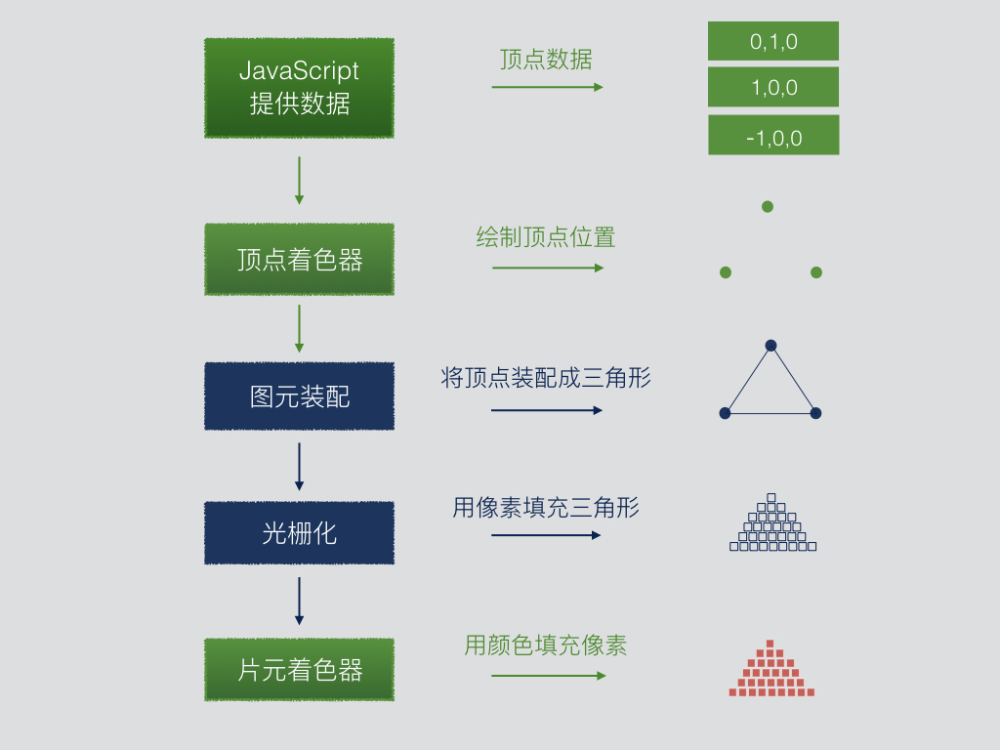


片元着色器渲染过程

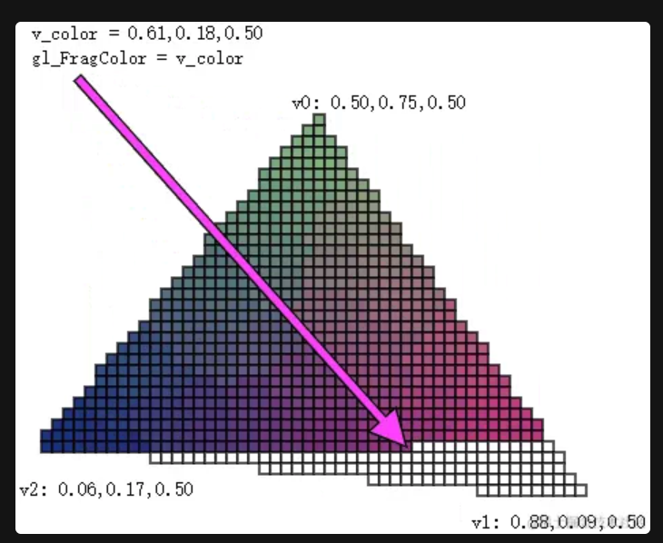

varying变量在计算线段上每个片元的颜色时

会根据`起点`和`终点`的值, 使用线性插值的方式生成一系列`中间值`

比如, 起点是`红色`, 终点是`蓝色`, 如果内插三个片元, 每个片元的r+b=1

可以得到如下图的插值, 每个片元的颜色不同, 逐渐变化

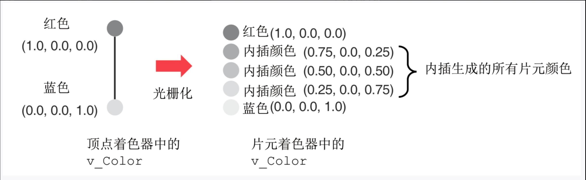

下面的 `插值渐变例子` 中就能看出，虽然仅仅是设置了三个顶点的颜色，但是需要得到一个渐变的三角形


### WebGL坐标系

#### 1.顶点如何渲染到屏幕上？

 需要将点的坐标从 CPU 通过 JavaScript 传递给 GPU ，GPU 接收到顶点坐标，进行一些坐标转换（通常将转换过程放在 JavaScript 中）[2]，然后将坐标赋值给 **gl_Position**

 **gl_Position** = vec4(x, y, z, 1);

 **gl_Position** 接收一个 4 维向量表示的坐标，即(X, Y ,Z ,W)，W 不等于 0，这个坐标是在`裁剪坐标系`中，我们称它为裁剪坐标。

 透视除法[3]

 GPU得到裁剪坐标后，下一步会对坐标进行透视触发。所谓透视除法就是将裁剪坐标的各个分量同时除以W分量，使得W分量为1.经过透视除法得到的坐标便处在NDC坐标系（独立设备坐标系）中[1]，NDC 坐标系是一个可见范围是边长为 2 的立方体（x,y,z ∈ [-1,1]），超出正方体的顶点都将被抛弃，不会显示到屏幕上。

 视口转换

 顶点此时的坐标已经转变到 NDC 坐标系中，但是 NDC 坐标系和屏幕坐标系不一致，所以就产生了最后一个坐标变换，视口转换，将顶点坐标从 NDC 坐标系下转换到屏幕坐标系下的坐标，最终将顶点显示在屏幕的指定位置上


#### 2.坐标系分类

 模型坐标系 -- 世界坐标系 -- 观察坐标系（又称相机坐标系、视图坐标系）-- 裁剪坐标系（ gl_Position 接收的值 ）-- NDC 坐标系 -- 屏幕坐标系

 裁剪坐标系之前的这几个坐标系的**变换矩阵**，都可以使用JavaScript控制。从裁剪坐标系到 NDC 坐标系，这一个步骤是 顶点着色器最后自动完成的，无法干预


#### 3.坐标转换流水线

 CPU 中将模型坐标系转换成裁剪坐标[4]

```tex
[ a_Position (模型空间) ]
            |
            | * M (模型矩阵)
            v
[ 世界空间 ]
            |
            | * V (视图矩阵 / 摄像机逆)
            v
[ 视图空间 View/Eye ]
            |
            | * P (投影矩阵: 透视或正交)
            v
[ 裁剪空间 Clip: gl_Position = (x_c,y_c,z_c,w_c) ]
            |
            | 裁剪测试: -w <= x,y,z <= w
            v
[ 通过裁剪的顶点 ]
            |
            | 透视除法: (x_ndc,y_ndc,z_ndc) = (x_c/w_c, y_c/w_c, z_c/w_c)
            v
[ NDC: (-1..1)^3 ]
            |
            | 视口变换: 映射到 (x_win,y_win,z_win)
            v
[ 屏幕/窗口坐标 ]
            |
            | 光栅化生成片元 + 插值 (varyings)
            v
[ 片元着色器 → 测试(深度/模版) → 混合 ]
            |
            v
[ 最终帧缓冲图像 ]
```

示例:a_Position接收模型坐标，经过模型 视图 投影 三个矩阵的连乘矩阵，得到裁剪坐标提供给gl_Position

```glsl
// 接收JavaScript传入的顶点位置数据
attribute vec3 a_Position;

// 接收 模型-视图-投影矩阵
uniform mat4 u_MvpMatrix;

void main() {
  gl_Position = u_MvpMatrix * vec4(a_Position, 1.0);
}
```


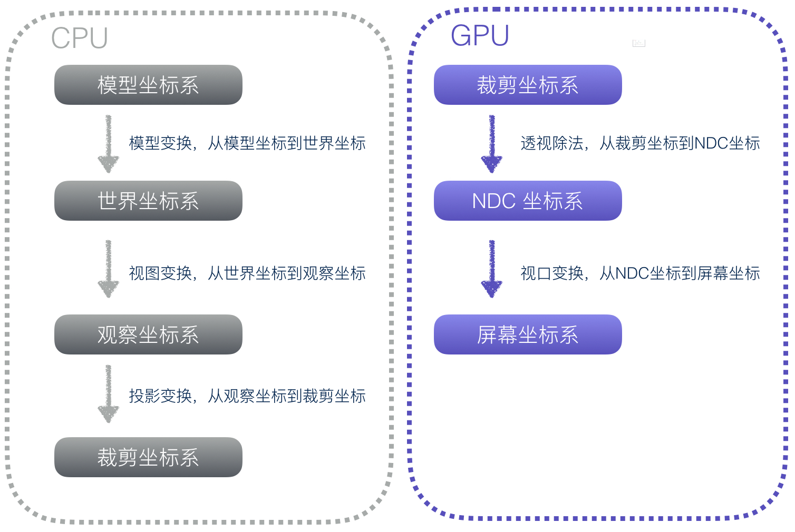


#### 4.模型坐标系

 一个物体通常有很多点构成，每个点在模型的什么位置？我们需要用一个坐标系来参照，这个坐标系就叫模型坐标系，各个坐标轴遵循右手坐标系，即X轴向右，Y轴向上，Z轴朝向屏幕外

 总结：描述点 相对于模型自身原点的位置


#### 5.世界坐标系

 我们创建好的模型需要放置在世界中的各个位置，默认情况模型坐标系和世界坐标系重合。如果模型不再世界坐标系坐标系中心，那么就需要对模型坐标系进行转换，将模型的 各个 相对于模型中心的顶点坐标，转换成世界坐标系下的坐标

 假如模型中有一点P，相对于模型中心的坐标（1，1）

 该模型在世界坐标系的（3，0）位置，那么，顶点P在世界坐标系中的坐标变成了 (1+3, 1+0) = (4, 1)

 总结：世界坐标系，就是把场景中所有模型统一放进去时使用的公共参考系


#### 6.观察坐标系（相机坐标系）

 观察坐标系是将 世界空间坐标 转化为 用户视野前方坐标而产生的结果。人眼或者摄像机看到的世界中的物体，相对于他自身的位置所参照的坐标系，就叫做观察坐标系

 日常生活中，精准表述一个街道，我们一般用经纬度表示，但是如果有人问你：某某街道在什么位置？如果我们告诉他世界坐标：某某街道在东经 M 度，北纬 N 度，我想他会打你。。

 一般我们都会用这样易于理解的描述：“在前面多远，往左或右走多远”

 这种坐标就称为观察坐标，也叫相机坐标

 之所以有相机坐标系，是为了模仿人眼看待世界的效果。世界很大，有很多物体，但是不能把整个世界都显示到屏幕上，只显示人眼所能看到的一部分，这样我们就能通过改变“人眼所处的方位，人眼所在的位置”，看到整个3D空间的不同部分

**摄像机看向负 Z 轴**方向，所以z轴对于屏幕来说是方向是指向外边的

 总结：以人眼/摄像机为原点而建立的坐标系


正射投影

经过正射投影矩阵映射后的坐标分量 w 不会改变，始终是1，所以在经过透视除法后物体的轮廓比例不会发生改变，没有进大远小的效果

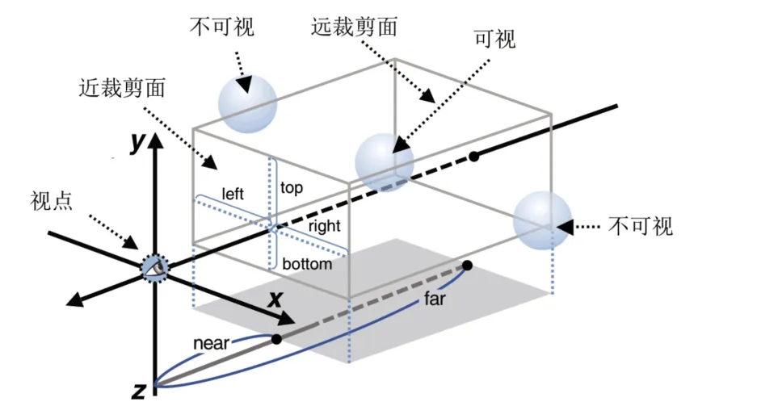

透视投影

透视投影将给定的平截头体范围映射到裁剪空间，除此之外它还会修改每个顶点坐标的 w 值，使得离人眼越远的物体坐标 w 值越大。因为相机是从正z看向负z的，所以只要z越小，w越大，等进行透视除法之后得到 NDC 坐标后，就能产生近大远小的效果了。

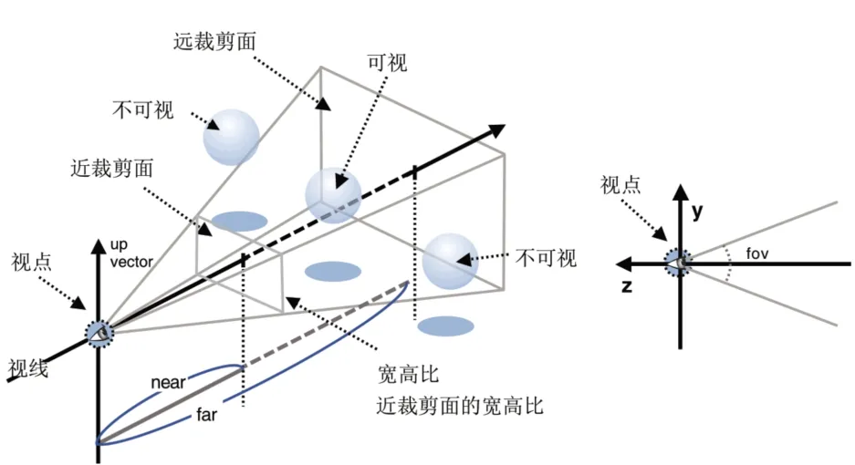


#### 7.裁剪坐标系

 右手

 裁剪坐标 就是将 相机(观察)坐标 进行**投影变换**后得到的齐次坐标 (x, y, z, w)，即顶点着色器写入 gl_Position 的值。

注意：在 "投影变换之前" 其实已经在使用含 w 的其次坐标形式，只是它通常是1，没有发生变化。仅仅是在透视投影之后，这里的 w 变成与 z 相关，不再是1。而正交投影之后，这里 w 仍然保持 1 ，所以说 “不会改变”

 相机(视图)空间  以摄像机为原点组织整个场景；其中由 fov、aspect、near、far（或正交盒尺寸）定义出一块“候选可见区域”——透视时称视锥体（平截头体），正交时称轴对齐盒。

 投影矩阵把这块  相机(视图)空间  的**可见体** 编码并映射到裁剪空间中的  规范裁剪体  ，使其满足 -w ≤ x,y,z ≤ w。这里的**可见体**指的就是**视图空间可见体**

**视图空间可见体**（见上图）

- 透视：平截头体（四棱台）。由 fov、aspect、near、far 定义。
- 正交：轴对齐长方体。由 left/right/top/bottom/near/far 定义。

 在  规范裁剪体  外的部分会被裁剪或剔除；落入范围内的几何“有机会”继续通过深度测试等最终映射到屏幕像素。

 随后固定管线执行透视除法 (x_ndc, y_ndc, z_ndc) = (x / w, y / w, z / w)，得到标准化设备坐标 (NDC)，使坐标落入 [-1,1]^3。

 总结：裁剪坐标系是由相机坐标系经过投影变换而来，其坐标系下的点坐标是齐次坐标，能很方便的做透视除法，得到NDC坐标


#### 8.NDC坐标系（标准化设备坐标）

 右手

 NDC 坐标系（标准化设备坐标）是裁剪阶段保留的顶点在透视除法 (x/w, y/w, z/w) 后得到的 3D 立方体空间，范围为 x,y,z ∈ [-1,1]（WebGL/OpenGL）。

 透视除法只对通过裁剪阶段的顶点执行

 通过裁剪阶段的顶点：位于规范裁剪体内，条件 -w ≤ x,y,z ≤ w

 WebGL 常用右手约定：摄像机看向 -Z；在 NDC 中 z = -1 为近平面，z = 1 为远平面，z 值越接近 -1 表示越靠近摄像机


#### 9.屏幕坐标系

 有了NDC坐标之后，GPU 会执行最后异步变换操作，视口变换，这个过程会将所有在 [-1,1] 之间的坐标映射到屏幕空间中，并被换成片段

 

 视口变换标准公式（WebGL/OpenGL）

 给定 NDC 坐标 (x_ndc, y_ndc, z_ndc)，视口参数 (vx, vy, vw, vh)，以及深度范围 (n_d, f_d)（默认 0,1）：

 x_window = vx + (x_ndc + 1) * 0.5 * vw

 y_window = vy + (y_ndc + 1) * 0.5 * vh

 z_window = n_d + (z_ndc + 1) * 0.5 * (f_d - n_d) // 默认就是 (z_ndc + 1)/2


 例子： NDC 坐标 (0,0)，在你设置的视口 gl.viewport(0, 0, 500, 300) 下会映射到窗口坐标 (250, 150)

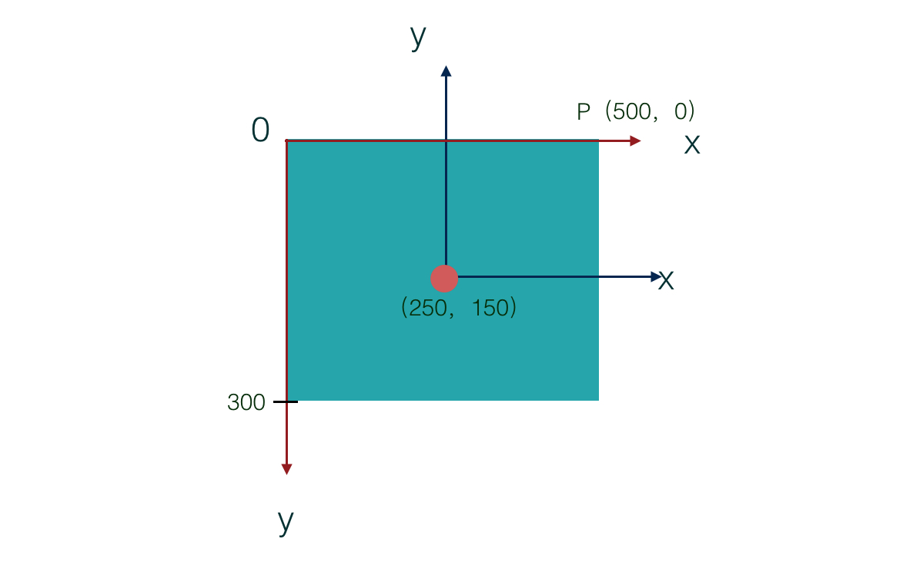


屏幕转裁剪实例

```glsl
//设置浮点数精度为中等精度
precision mediump float;
//接收点在 canvas 坐标系上的坐标 (x, y)
attribute vec2 a_Position;
//接收 canvas 的宽高尺寸
attribute vec2 a_Screen_Size;
void main(){
    //start 将屏幕坐标系转化为裁剪坐标（裁剪坐标系）
   vec2 position = (a_Position / a_Screen_Size) * 2.0 - 1.0; 
   position = position * vec2(1.0, -1.0);
   gl_Position = vec4(position, 0, 1);
   //end 将屏幕坐标系转化为裁剪坐标（裁剪坐标系）
   //声明要绘制的点的大小。
   gl_PointSize = 10.0;
}
```


`vec2 position = (a_Position / a_Screen_Size) * 2.0 - 1.0` 首先除以屏幕尺寸，将（x, y) 转化到 [0, 1] 区间，再将[0, 1]之间的值乘以 2 转化到 [0, 2] 区间，之后再减去1，转化到[-1, 1]之间的值，即 NDC 坐标

因为这是一个平面图形，所以W为1，因此NDC和裁剪是一样的，所以把NDC直接赋值给了gl_Position


#### 序号解释

[1]:
为什么一做 x /= w, y /= w, z /= w 这个运算，就‘进入’了 NDC 坐标系？
  扼要说明；“透视触发得到NDC",既是硬件固定执行的算法步骤（除W），也是图形API规范对该步骤产出数据赋予的语义命名

[2]:
转换过程放在 JavaScript 中”到底指什么？
  模型→世界→观察→裁剪 这套“逐顶点”的矩阵乘法是在 GPU 的顶点着色器里做的---顶点坐标逐个乘矩阵（大量数据）
  JavaScript（CPU）里只是计算好几个整体矩阵（model、view、projection），再通过 uniform 传给 GPU.  因为矩阵的构建与相乘、只需算一次或每帧算一次即可。
为什么这句话说的是 “GPU 接收到顶点坐标” 而流水线里描述的是 “CPU 做到裁剪坐标再给 GPU”？
  GPU 接收的是你通过缓冲区传过去的原始顶点属性（通常处在模型坐标系）。顶点着色器拿到这些属性与传入的矩阵（uniform），在 GPU 上完成模型→世界→观察→裁剪的矩阵连乘，结果赋给 gl_Position。流水线说的仅仅是“准备矩阵”这一层次发生在CPU中的JavaScript，“应用矩阵”进行计算这一层次发生在GPU

[3]:
顶点着色器自动做的，不用写代码

[4]:
更准确的说法是：CPU 计算矩阵，GPU 顶点着色器负责把模型坐标变换到裁剪坐标


### 图元类型

#### 三角形图元

* gl.TRIANGLES：基本三角形。
* gl.TRIANGLE_STRIP：三角带。
* gl.TRIANGLE_FAN：三角扇。


基本三角形（TRIANGLES）

基本三角形是一个个独立的三角形，假如提供给着色器六个顶点，那么webgl 会绘制两个三角形，前三个顶点绘制一个，后三个顶点绘制另一个，互不相干

举个例子来说，假如我们有六个顶点【v1, v2, v3, v4, v5, v6】，采用基本三角形图元进行绘制，绘制完是这个样子：

 【v1, v2, v3】为一个三角形，【v4, v5, v6】 为另一个三角形。

`绘制三角形的数量 = 顶点数 / 3`。

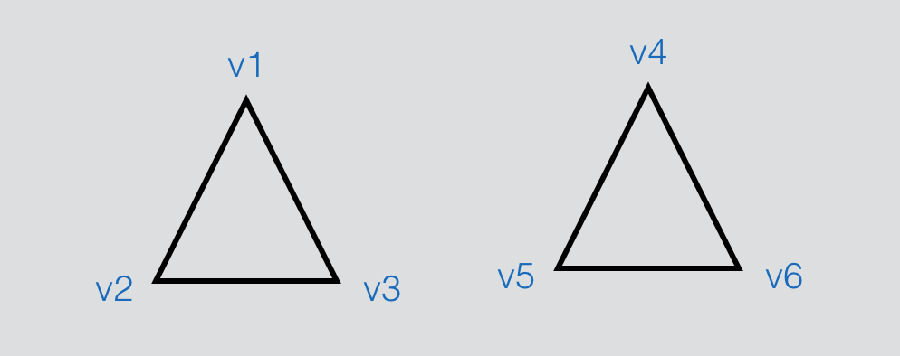


三角带（TRIANGLE_STRIP）

同样是六个顶点，如果采用三角带的方式绘制的话，则会绘制 【v1, v2, v3】, 【v3, v2, v4】, 【v3, v4, v5】, 【v5, v4, v6】 共计 4 个三角形，从这里发现，三角带的绘制特点是前后两个三角形是共线的，如下图所示：

`绘制三角形的数量 = 顶点数 - 2`

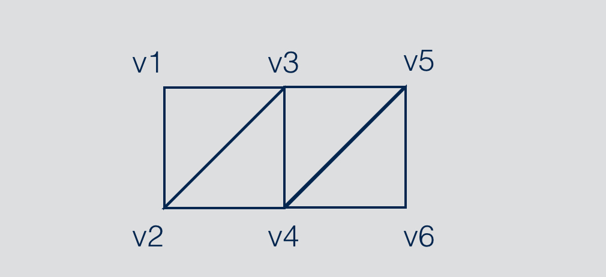


三角扇（TRIANGLE_FAN）

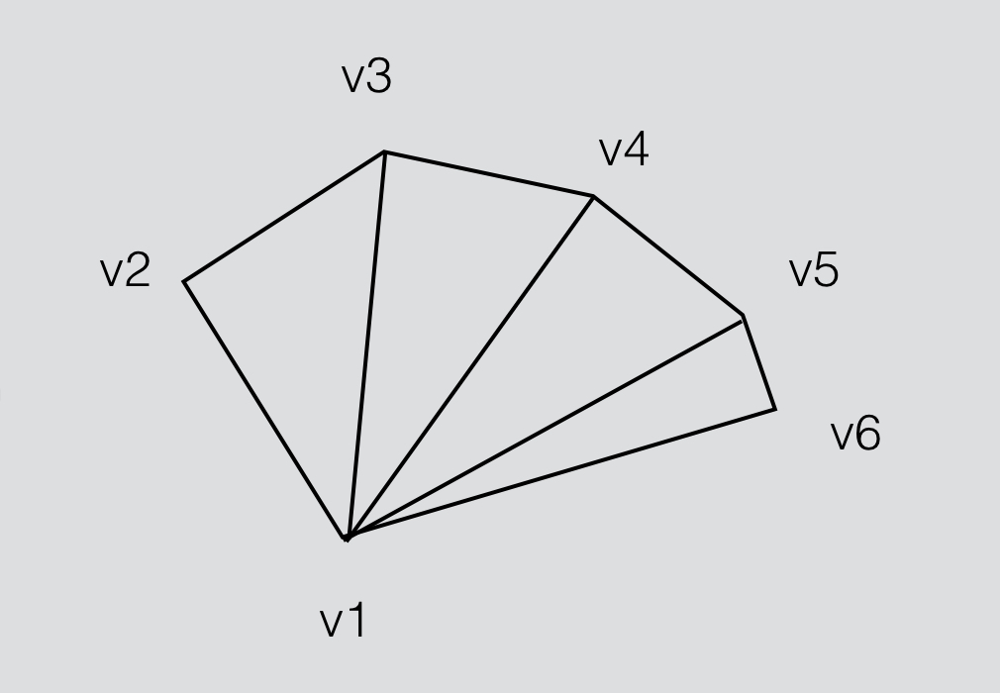

可以看出，三角扇的绘制方式是以第一个顶点作为所有三角形的顶点进行绘制的。采用三角扇绘制方式所能绘制的三角形的数量和顶点个数的关系如下：

`绘制三角形的数量 = 顶点数 - 2`


#### 线段图元

* LINES：基本线段。
* LINE_STRIP：带状线段。
* LINE_LOOP：环状线段。

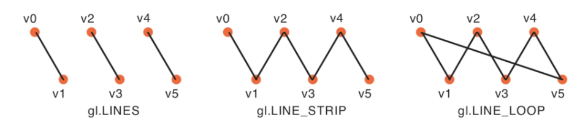

LINES 图元称为基本线段图元，绘制每一条线段都需要明确指定绘制每一条线段的两个端点

LINE_STRIP 绘制线段时，会采用前一个顶点为当前线段的起始端点，

LINE_LOOP 除了包含 LINE_STRIP 的绘制特性，还会将线段的终点和第一条线段的起点进行连接，形成一个线段闭环


### 纹理贴图

* 图片坐标系统的特点是：
  * 左上角为原点(0, 0)。
  * 向右为横轴正方向，横轴最大值为 1，即横轴坐标范围【1，0】。
  * 向下为纵轴正方向，纵轴最大值为 1，即纵轴坐标范围【0，1】。


* 纹理坐标系统不同于图片坐标系统，它的特点是：
  * 左下角为原点(0, 0)。
  * 向右为横轴正方向，横轴最大值为 1，即横轴坐标范围【1，0】。
  * 向上为纵轴正方向，纵轴最大值为 1，即纵轴坐标范围【0，1】。

纹理坐标系统

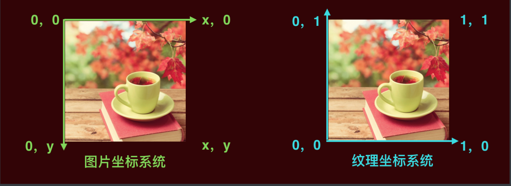

将纹理坐标系（UV）下的坐标转换为 WebGL坐标系 下的坐标的过程叫 UV映射

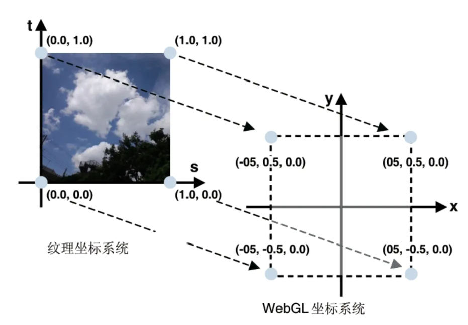


为什么仅仅只是指定三角形顶点对应的 UV 坐标，GPU 就能够将纹理图片的其它坐标的颜色贴到三角形的表面呢？

因为在光栅化阶段，GPU处理两件事情：

​	计算图元覆盖了哪些像素

​	GPU在光栅化阶段会对覆盖的每个像素，用三个顶点的纹理坐标做插值，得到该像素的纹理坐标 (u, v)，像素内部的 UV 由 GPU 自动插值

光栅化结束后，来到片元着色器，此时片元着色器知道每个像素的 UV 坐标，根据当前像素的 UV 坐标，找到纹理资源对应的颜色信息，赋值给当前像素，从而能够为图元表面的每个像素贴上正确的纹理颜色（每个像素就可以根据纹理坐标在纹理图片上采样，从纹理图中取出对应的颜色赋值给像素）


### 顶点重复

顶点的重复与否，不只取决于顶点的坐标信息一致，还取决于顶点所包含的其他信息是否一致。比如顶点纹理坐标 uv，顶点法线，顶点颜色等。一旦有一个信息不同，就不能把它当作同一个顶点复用，只有全部属性相同才是重复顶点，可以合并/忽略重复项

```js
// 顶点属性组合：position + uv
// 注意：V0_left 与 V0_right 几何位置相同 (30,30)，因为 uv 不同视为两个不同顶点
const positionsUvs = new Float32Array([
  // 三角形1
  30,  30,  0.0, 0.0,   // V0_left
  30, 300,  0.0, 1.0,   // V1
 300, 300,  0.5, 1.0,   // V2_left

  // 三角形2
  30,  30,  0.5, 0.0,   // V0_right
 300, 300,  1.0, 1.0,   // V2_right
 300,  30,  1.0, 0.0    // V3
]);

const indices = new Uint16Array([
  0, 1, 2,   // 第一个三角形
  3, 4, 5    // 第二个三角形
]);
```


### 环境光

颜色的本质（红色物体在在白光下的例子）

白光（含全部可见波长）照射物体，物体吸收红光以外的其它波长，红光被反射进入眼睛 —> 视觉系统解析为红色

如果是蓝光照射物体，红色物体吸收蓝色光（无法反射红光成分），结果几乎没有光线返回 → 视觉上呈黑色

<hr>
光照前提下，颜色在计算机中的表示


渲染时的“物体颜色”本质上表示“物体能反射光的比例”（每个通道 R/G/B 的反射系数）

引入光源后：进入眼睛的最终颜色 = 光源的颜色分量 x 物体的颜色分量（逐通道乘）

```glsl
vec3 light  = vec3(1, 1, 1);   // 白光
vec3 color  = vec3(1, 0, 0);   // 红色物体
vec3 result = light * color;   // = (1,0,0)

vec3 light  = vec3(0, 0, 1);   // 蓝光
vec3 color  = vec3(1, 0, 0);   // 红物体
vec3 result = light * color;   // = (0,0,0) → 黑
```

<hr>


为什么需要环境光

现实中，漫反射光线在多个粗糙表面之间多次散射，让即使未被直接照亮的区域也不是完全黑暗。精确模拟多次散射成本极高，于是引入环境光近似，用一个低强度的全局光照通道模拟来自四周的积累间接光

环境光不是漫反射本身，而是多次反射汇总的近似


## 语法&使用

### GLSL 

`GLSL` 的中文意思是 OpenGL 着色语言，英文全称是 OpenGL Shading Language，它是用来在 OpenGL 编写`着色器程序`的语言。

语法近似 C + 额外的向量/矩阵 + 内置数学与纹理函数。

着色器种类

- 顶点着色器（Vertex Shader）：每顶点运行，负责位置与向 FS 传递插值数据。
- 片元着色器（Fragment Shader）：每片元运行，输出颜色（及可选深度修改）。

#### 核心结构

顶点着色器代码

```glsl
attribute vec3 aPosition;
uniform mat4 uMVP;
varying vec2 vUV;

void main() {
    vUV = aPosition.xy * 0.5 + 0.5;
    gl_Position = uMVP * vec4(aPosition, 1.0);
}
```

片元着色器代码

```glsl
precision mediump float;
varying vec2 vUV;
uniform sampler2D uTex;

void main() {
    vec4 base = texture2D(uTex, vUV);
    gl_FragColor = base;
}
```


#### 关键词

有内置属性，数据类型

```glsl
gl_Position: 顶点的 裁剪坐标系坐标，包含X,Y,Z,W四个坐标分量，顶点着色器接收到这个坐标之后，对它进行透视除法，即将各个分量同时除以W，转换成NDC坐标，NDC坐标每个分量的取值范围都在[-1,1]之间，GPU获取这个属性值作为顶点的最终位置进行绘制

gl_FragColor：片元像素的颜色，包含 R G B A 四个颜色分量，且每个分量的取值范围在[0,1]之间，GPU 获取这个值作为像素的最终颜色进行着色。平常采用的颜色值 R G B A 对应的转换公式为： (R值/255，G值/255，B值/255，A值/1）。拿红色举例，在CSS中，红色用 `RGBA` 形式表示是（255，0，0，1），那么转换成 GLSL 形式就是(255 / 255, 0 / 255, 0 / 255, 1 / 1)，转换后的值为（1.0, 0.0, 0.0, 1.0)。

gl_PointSize: 绘制到屏幕的点的大小，需要注意的是，gl_PointSize只有在绘制图元是点的时候才会生效，当绘制线段或者三角形的时候，gl_PointSize是不起作用的

vec4: 包含四个浮点数的 容器类型，vec是 vector（向量）的单词简写，vec4代表包含4个浮点数的向量。此外，还有vec2，vec3等类型，代表包含两个 或者 三个 浮点数的容器

attribute变量: 只能在 顶点着色器 中定义，js中通过 gl.getAttribLocation 获取位置，gl.vertexAttribXX进行传值

uniform变量: 既可以 在顶点着色器 中定义，也可以在 片元着色器中定义，js通过gl.getUniformLocation获取位置，gl.uniformXX进行传值

varying变量: 用来从 顶点着色器 中往 片元着色器 传递数据。使用varying可以在顶点着色器中声明一个变量并对其进行赋值，经过插值处理后，在片元着色器中取出插值后的值来使用
    
// 根据纹理坐标从纹理中采样颜色 参数：纹理、纹理坐标
vec4 color = texture2D(texture, v_Uv);

uniform sampler2D是 GLSL 中用于采样 2D 纹理的变量类型。它本质上是一个指向纹理的句柄/引用，允许着色器在运行时从纹理中读取像素颜色值。
uniform sampler2D myTexture;  // 声明一个纹理采样器
// 使用纹理坐标 (0.5, 0.5) 从纹理中采样颜色
vec4 color = texture2D(myTexture, vec2(0.5, 0.5));
```


| 类型                  | 方向                  | 频率                               | 说明                 |
| --------------------- | --------------------- | ---------------------------------- | -------------------- |
| Attribute（顶点属性） | CPU→GPU（缓冲）       | 很少改动（静态网格）或每帧（动态） | 位置/法线/UV 等      |
| Uniform（全局参数）   | CPU→GPU 状态          | 每帧或每次材质变化                 | 矩阵、光照、材质系数 |
| Texture（纹理）       | CPU→GPU（上传后驻留） | 初始化或少量更新                   | 图像/高度/法线贴图   |
| Varying（插值）       | VS→FS（内部）         | 自动插值                           | 承载光照/UV/颜色     |

数据流：attribute → varying → fragment。


#### 环境光

公式：ambientColor = ambientFactor * lightColor

- lightColor：设定的环境光颜色（通常白色）
- ambientFactor：强度系数（0 ~ 1 的浮点数，常用小值如 0.1 ~ 0.3）

```glsl
vec3 lightColor = vec3(1, 1, 1);
float ambientFactor = 0.1;
vec3 ambientColor = ambientFactor * lightColor; (0.1, 0.1, 0.1)
```

最终片元颜色（仅环境光 + 物理颜色）：finalColor = ambientColor * objectColor


### WebGL API

#### 方法一览

```js
// 绘制
gl.drawArrays(gl.POINTs, 0, 1); // 绘制点
参数：
  mode 代表图元类型
  first 代表从第几个点开始绘制
  count 代表绘制的点的数量

gl.drawArrays(gl.LINES, 0, positions.length / 2); // 基本线段

gl.drawArrays(gl.LINE_STRIP, 0, positions.length); // 带状线段

gl.drawArrays(gl.LINE_LOOP, 0, positions.length); // 环状线段

gl.drawElements(mode, count, type, offset) // 按照顶点索引进行绘制，能避免定义重复顶点，进而节省存储空间
参数：
	mode 指定绘制图元的类型
    count 指定绘制图形的顶点个数
    type 指定索引缓冲区中的值的类型，常用的两个值：`gl.UNSIGNED_BYTE`和`gl.UNSIGNED_SHORT`，前者为无符号8位整数值，后者为无符号16位整数。
    offset 指定索引数组中开始绘制的位置
  

//JavaScript 如何往着色器中传递数据
getAttribLocation: 找到着色器中的 attribute 变量地址

gl.vertexAttrib2f: 给着色器属性赋值，值为两个浮点数

gl.vertexAttrib3f: 给着色器属性赋值，值为三个浮点数
  
getUniformLocation: 找到着色器中的 uniform 变量地址

gl.uniform4f: 给全局变量赋值 4 个浮点数

gl.uniform1i: 给全局变量赋值一个整数

vertexAttrib2f：给 `attribute 变量`传递两个浮点数。

gl.uniformMatrix4fv(u_Matrix, false, matrix)
参数：
	uniform变量的位置
	是否要转置矩阵，WebGL中必须为false
	要传递的矩阵数据


// 类型化数组
Float32Array：32位浮点数组
Uint16Array: 16位无符号整数数组   对应gl.UNSIGNED_SHORT
Uint8Array：8位无符号整数数组  对应gl.UNSIGNED_BYTE
mat4: 表示4x4浮点矩阵


// 使用缓冲区传递数据
gl.createBuffer：创建buffer

gl.bindBuffer 绑定某个缓冲区对象为当前缓冲区

gl.bufferData 往缓冲区中复制数据

gl.enableVertexAttribArray 启用顶点数据

gl.vertexAttribPointer 设置顶点属性从缓冲区中读取数据的方法


// 设置纹理
gl.createTexture: 创建纹理对象

gl.activeTure: 激活纹理单元

gl.bindTexture: 绑定纹理对象到当前纹理

gl.textImage2D: 将图片数据传递给 GPU

gl.texParamenterf: 设置图片放大缩小时的过滤算法
```


#### 着色器程序对象

##### 编译&建立连接

创建与编译着色器源码 → 构建 Program → 链接 → 使之成为当前使用的 GPU 着色器管线

```js
// 引入顶点着色器源码
import vertexShader from '../shader/3.修改点的位置/vertex.glsl'
// 引入片元着色器源码
import fragmentShader from '../shader/3.修改点的位置/fragment.glsl'

// 获取canvas元素
const canvas = document.querySelector('canvas')

// 获取WebGL上下文
const gl = canvas.getContext('webgl')

/**
 * 创建一个顶点着色器对象
 * @param {WebGLRenderingContext} 为gl.VERTEX_SHADER（顶点着色器） 或 gl.FRAGMENT_SHADER（片元着色器）两者中的一个
 * @returns {WebGLShader} - 创建的顶点着色器对象
 */
const vertexShaderObject = gl.createShader(gl.VERTEX_SHADER)
/**
 * 把顶点着色器的 GLSL 源代码（字符串）关联到刚创建的着色器对象上
 * 为随后的 gl.compileShader(vertexShaderObject) 编译步骤提供源码
 * @param {WebGLShader} vertexShaderObject - 顶点着色器对象
 * @param {string} vertexShader - 顶点着色器源码字符串
 */
gl.shaderSource(vertexShaderObject, vertexShader)
/**
 * 编译顶点着色器
 * @param {WebGLShader} vertexShaderObject - 顶点着色器对象
 */
gl.compileShader(vertexShaderObject)

/**
 * 返回给定的着色器信息
 * @param {WebGLShader} vertexShaderObject - 顶点着色器对象
 * @param {number} pname - 要查询的信息类型 gl.COMPILE_STATUS: 标示着色器是否编译成功，是（GL_TRUE）不是（GL_FALSE）
 * @returns {any} - 着色器信息
 */
let success = gl.getShaderParameter(vertexShaderObject, gl.COMPILE_STATUS)
if (!success) {
  // 获取最后一次编译的错误日志
  let info = gl.getShaderInfoLog(vertexShaderObject)
  console.error('顶点着色器编译失败：', info)
  // 用于将给定的 WebGLShader 对象标记为删除状态。当着色器不再使用时，它将被删除。
  gl.deleteShader(vertexShaderObject)
}

// 创建片元着色器对象
const fragmentShaderObject = gl.createShader(gl.FRAGMENT_SHADER)
// 把片元着色器源码关联到片元着色器对象上
gl.shaderSource(fragmentShaderObject, fragmentShader)
// 编译片元着色器
gl.compileShader(fragmentShaderObject)
// 检查片元着色器是否编译成功
success = gl.getShaderParameter(fragmentShaderObject, gl.COMPILE_STATUS)
if (!success) {
  const info = gl.getShaderInfoLog(fragmentShaderObject)
  console.error('片元着色器编译失败：', info)
  gl.deleteShader(fragmentShaderObject)
}
/**
 * 用于创建和初始化一个 WebGLProgram 对象
 * @returns {WebGLProgram} - 一个 WebGLProgram 对象由两个编译过后的 WebGLShader 组成 - 顶点着色器和片段着色器（均由 GLSL 语言所写）。这些组合成一个可用的 WebGL 着色器程序。
 */
const program = gl.createProgram()

/**
 * WebGL API 的 WebGLRenderingContext.attachShader() 方法负责往 WebGLProgram 添加一个片段或者顶点着色器。
 * 将一个 WebGLShader（顶点着色器或片元着色器）附加到一个 WebGLProgram 对象上
 * @param {WebGLProgram} program - WebGLProgram 对象
 * @param {WebGLShader} vertexShaderObject - 顶点着色器对象
 */
gl.attachShader(program, vertexShaderObject)
// 同上
gl.attachShader(program, fragmentShaderObject)

// 链接给定的WebGLProgram，从而完成为程序的片元和顶点着色器准备 GPU 代码的过程。
gl.linkProgram(program)
// 检查链接是否成功
success = gl.getProgramParameter(program, gl.LINK_STATUS)
if (!success) {
  const info = gl.getProgramInfoLog(program)
  console.error('Program 链接失败：', info)
  gl.deleteProgram(program)
}
// 将定义好的WebGLProgram 对象添加到当前的渲染状态中。之后的渲染调用（设置 uniform、绘制 drawArrays/drawElements 等）会使用该程序生成的着色器流水线。
gl.useProgram(program)
```


##### 程序对象作用

- 场景分两端：JS 在 CPU 内存里运行，着色器源码编译后在 GPU 显存执行。二者不能直接共享变量。
- program（WebGLProgram）的作用：把编译好的顶点/片元着色器“链接”为一个可执行的 GPU 程序，并在链接时为 attribute/ uniform/varying 等接口分配或确定索引（位置）。这就是“中间人”。

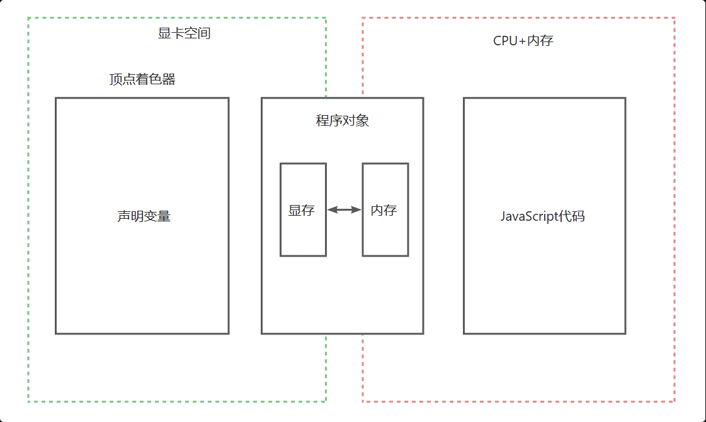

- 具体映射流程：
  - gl.linkProgram 将两段着色器的接口匹配并确定位置（queryable）。
  - gl.getAttribLocation / gl.getUniformLocation 读取 program 中该变量对应的索引或句柄。
  - JS 通过 gl.vertexAttrib*/gl.vertexAttribPointer、gl.uniform* 等 API 把数据提交到 GL 状态（这是一组由 GL 管理的状态/缓冲/显存绑定），GPU 在绘制时用当前激活的 program 和这些状态去执行着色器。


#### 缓冲区

##### drawArrays绘制

顶点绘制

顶点着色器代码

```glsl
//接收顶点坐标 (x, y)
attribute vec2 a_Position;

void main(){
   gl_Position = vec4(a_Position, 0, 1);
}
```


首先定义三角形三个顶点

```js
var positions = [1,0, 0,1, 0,0];
```

通过缓冲区才能向着色器传递多个顶点数据，创建缓冲区对象

```js
let buffer = gl.createBuffer();
```

缓冲区创建好了，我们绑定该缓冲区为 WebGL 当前缓冲区 `gl.ARRAY_BUFFER`，绑定之后，对缓冲区绑定点的的任何操作都会基于该缓冲区（即buffer） 进行。

```js
gl.bindBuffer(gl.ARRAY_BUFFER, buffer);
```

往当前缓冲区中写入数据，`gl.STATIC_DRAW`: 适合不变的数据，`gl.DYNAMIC_DRAW`: 适合动态变化的数据，`gl.STREAM_DRAW`: 适合一次性使用的数据

```js
gl.bufferData(gl.ARRAY_BUFFER, new Float32Array(positions), gl.STATIC_DRAW);
```

注意，着色器程序中的变量需要强类型数据，所以我们在往缓冲区写数据的时候，JS 的弱类型数组一定要用类型化数组转化一下。上面的 `new Float32Array(positions)`，目的就是将 JavaScript 中的弱类型数组转化为强类型数组。

> 以上这些代码属于初始化过程，在渲染过程中一般不会再次调用。


接下来就是如何把顶点组成的模型放到屏幕上

这里需要告诉 webgl 如何从之前创建的缓冲区中获取数据，并传递给顶点着色器中的`a_Position`属性

首先先获取 attribute 变量的存储位置

```js
const a_Position = gl.getAttribLocation(program, 'a_Position') 
```

接着启用对应属性 `a_Position`

```js
gl.enableVertexAttribArray(a_Position);
```

设置从缓冲区中读取数据的方式

```js
//每次取两个数据
var size = 2;
//每个数据的类型是32位浮点型
var type = gl.FLOAT;  
//不需要归一化数据
var normalize = false; 
// 每次迭代运行需要移动数据数 * 每个数据所占内存 到下一个数据开始点。
var stride = 0;   
// 从缓冲起始位置开始读取     
var offset = 0; 
// 将 a_Position 变量获取数据的缓冲区指向当前绑定的 buffer。
gl.vertexAttribPointer(
   a_Position, size, type, normalize, stride, offset)
```


vertexAttribPointer参数详解

gl.vertexAttribPointer (target, size, type, normalize, stride, offset)。

* target： 允许哪个属性读取当前缓冲区的数据。
* size：一次取几个数据赋值给 `target` 指定的目标属性。在示例中，顶点着色器中 a\_Position 是 vec2 类型，即每次接收两个数据，所以 `size` 设置为 2
* type：数据类型，一般都是浮点型。
* normalize：是否需要将非浮点类型数据`单位化`到【-1, 1】区间。
* stride：步长，即每个顶点所包含数据的字节数，默认是 0 ，0 表示一个属性的数据是连续存放的。在例子中，一个顶点包含两个分量，X 坐标和 Y 坐标，每个分量都是一个 Float32 类型，占 4 个字节，所以，stride = 2 * 4 = 8 个字节。所以stride 可以设置为 2 * 4 = 8（也可以传 0 表示紧密存放）
* offset：在每个步长的数据里，目标属性需要偏移多少字节开始读取。

```js
// 创建要绘制点的数组，能组成一个三角形
const vertices = new Float32Array([
  -0.5,  0.5,  1.0, 0.0, 0.0, // 左上 - 红
  -0.5, -0.5,  0.0, 0.0, 0.1, // 左下 - 蓝
   0.5, -0.5,  0.0, 1.0, 0.0  // 右下 - 绿
])


// 略过创建，绑定，写入，跳到如何取数的api.......


// 位置属性 
// 5*4 = 每个顶点的字节数(位置2+颜色3) * 每个浮点数4字节
gl.vertexAttribPointer(a_Position, 2, gl.FLOAT, false, 5 * 4, 0)
gl.enableVertexAttribArray(a_Position) // 启用顶点属性数组

// 颜色属性 
// 第5个参数offset(以字节为单位)，表示从缓冲区开头跳过多少字节才到该 attribute 的的一个分量，这里要跳过位置属性的2个分量，一个分量是4字节，所以是2*4
gl.vertexAttribPointer(a_Color, 3, gl.FLOAT, false, 5 * 4, 2 * 4)
gl.enableVertexAttribArray(a_Color) // 启用顶点属性数组
```


<hr>


##### drawElements 绘制

索引绘制

除了准备储存顶点信息的数组，还要准备储存顶点索引的数组

```js
//存储顶点信息的数组
var positions = [
    30, 30, 255, 0, 0, 1,    //V0
    30, 300, 255, 0, 0, 1,   //V1
    300, 300, 255, 0, 0, 1,  //V2
    300, 30, 0, 255, 0, 1    //V3
];
//存储顶点索引的数组
var indices = [
    0, 1, 2, //第一个三角形
    0, 2, 3  //第二个三角形
];
```

除了多准备一个容器存储顶点索引以外，还需要将索引传递给GPU，所以，仍然需要创建一个索引 buffer

```js
let indicesBuffer = gl.createBuffer();
```

创建完 buffer ,我们需要绑定，这里要和 ARRAY_BUFFER 区分开来，索引 buffer 的绑定点是 gl.ELEMENT_ARRAY_BUFFER

```js
gl.bindBuffer(gl.ELEMENT_ARRAY_BUFFER, indicesBuffer);
```

现在可以往 indicesBuffer 中传入顶点索引了

```
gl.bufferData(gl.ELEMENT_ARRAY_BUFFER, new Uint16Array(indices), gl.STATIC_DRAW);
```

索引缓冲只是存放索引（0,1,2,3...），drawElements 函数读取索引并把这些索引当作数组下标区读取顶点属性。索引本身并不需要vertexAttribPointer


绘制

```js
gl.drawElements(gl.TRIANGLES, 6, gl.UNSIGNED_SHORT, 0);

// gl.drawElements 是如何识别读取哪个数组的呢？读取的是当前 gl 状态里绑定到 TARGET = gl.ELEMENT_ARRAY_BUFFER 的哪个缓冲区

// gl.drawArrays 读取的是“每个已启用 attribute 的 vertexAttribPointer 描述”，因为 vertexAttribPointer 在调用时会把当时绑定到gl.ARRAY_BUFFER 的缓冲、stride、offset 等信息记录到该 attribute 的状态里
```


##### 流程建模

心智模型对应表（顺序不是确定好的）

| 步骤 | API                      | 角色/隐喻                                    | 内部发生了什么                                               |
| ---- | ------------------------ | -------------------------------------------- | ------------------------------------------------------------ |
| 1    | getAttribLocation        | 找插座编号                                   | 从已链接的 Program 查询 attribute 在“插座面板”中的整数索引   |
| 2    | createBuffer             | 造一个空货箱                                 | 浏览器创建一个 WebGLBuffer 句柄（尚未知道用途/类型/尺寸）    |
| 3    | bindBuffer(ARRAY_BUFFER) | 把货箱推到“ARRAY_BUFFER 装卸口”              | 上下文状态机记录：ARRAY_BUFFER 现在指向这个 buffer           |
| 4    | bufferData               | 往箱子里装货（或预留空间）                   | 分配 GPU 显存并把 TypedArray 复制过去（或仅分配 size）       |
| 5    | vertexAttribPointer      | 告诉装货工：取什么，每次取几件、间隔、多长条 | 在“当前顶点数组状态”里，为某 attribute index 记录：来源 buffer（快照），步长 stride，偏移 offset，类型与分量数 |
| 6    | enableVertexAttribArray  | 打开开关让装货工真的去取                     | 标记该 attribute index 在 draw 时启用；否则它会使用一个常量值 |


状态转移模型


#### 纹理贴图

定义六个顶点，这六个顶点能够组成一个矩形，并为顶点指定纹理坐标。

```javascript
    var positions = [
      30, 30, 0, 0,    //V0
      30, 300, 0, 1,   //V1
      300, 300, 1, 1,  //V2
      30, 30, 0, 0,    //V0
      300, 300, 1, 1,  //V2
      300, 30, 1, 0    //V3
    ]
```

创建缓冲区，往缓冲区中写入上述顶点信息数组，接着让顶点着色器中的 `attribute` 变量读取缓冲区中的 顶点位置坐标 UV 坐标


当图片加载完成后，即在`img.onload`的回调函数中进行如下操作：

激活 0 号纹理通道 `gl.TEXTURE0`，0 号纹理通道是默认值

```js
gl.activeTexture(gl.TEXTURE0)
```

然后创建一个纹理对象

```js
const texture = gl.createTexture()
```

将创建好的纹理对象 `texture` 绑定到当前纹理绑定点上，即 `gl.TEXTURE_2D`。绑定完后对当前纹理对象的所有操作，都将基于 `texture` 对象，直到重新绑定

```js
gl.bindTexture(gl.TEXTURE_2D, texture)
```

指定二维纹理图像

```js
gl.texImage2D(gl.TEXTURE_2D, 0, gl.RGBA, gl.RGBA, gl.UNSIGNED_BYTE, img);
```

l.texImage2D 方法是一个重载方法，其中有一些参数可以省略：  

>glTexImage2D(GLenum target, GLint level, GLint components, GLsizei width, glsizei height, GLint border, GLenum format, GLenum type, const GLvoid *pixels);  

| 参数       | 含义                                                         |
| ---------- | ------------------------------------------------------------ |
| target     | 纹理类型，TEXTURE_2D代表2维纹理                              |
| level      | 表示多级分辨率的纹理图像的级数，若只有一种分辨率，则 level 设为 0，通常我们使用一种分辨率 |
| components | 纹理通道数，通常我们使用 RGBA 和 RGB 两种通道                |
| width      | 纹理宽度，可省略                                             |
| height     | 纹理高度，可省略                                             |
| border     | 边框，通常设置为0，可省略                                    |
| format     | 纹理映射的格式                                               |
| type       | 纹理映射的数据类型                                           |
| pixels     | 纹理图像的数据                                               |

将img 变量指向图片数据，并传递给片元着色器，取对应纹理坐标的 RGBA 四个通道值，赋给片元，每个通道的数据格式是无符号单字节整数

设置图片在放大或者缩小时采用的算法`gl.LINEAR`

gl.LINEAR 代表采用最靠近像素中心的四个像素的加权平均值，这种效果表现的更加平滑自然

gl.NEAREST 采用最靠近像素中心的纹素，该算法可能导致图像走样，但是执行效率高，不需要额外计算

```js
gl.texParameterf(gl.TEXTURE_2D, gl.TEXTURE_MAG_FILTER, gl.LINEAR);
gl.texParameterf(gl.TEXTURE_2D, gl.TEXTURE_MIN_FILTER, gl.LINEAR);
```

之后为像素传递 0 号纹理单元

```js
// 获取片元着色器中采样器变量texture的位置
const uniformTexture = gl.getUniformLocation(program, 'texture') 
// 为片元着色器传递0号纹理单元
gl.uniform1i(uniformTexture, 0)
```


## 代码示例


### 开发环境搭建

`glsl插件`可以加载`glsl格式`的`shader`文件

```
pnpm i vite-plugin-glsl -D
pnpm i dat.gui


安装vscode插件
WebGL GLSL Editor
glsl文件有代码提示
```


完整文件目录如下

```
webgl第60天练习
├─ package.json
├─ index.html
├─ vite.config.js
└─ src
   ├─ main.js
   └─ exercise
      └─ 1.开发环境搭建测试.js
```


```
pnpm init
pnpm i vite

package.json中配置启动脚本语句  可以使用 pnpm dev 启动
"scripts": {
    "dev": "vite",
  },
```


vite.config.js

```js
// vite.config.js
import { defineConfig } from 'vite'
import glsl from 'vite-plugin-glsl' // 引入 glsl 插件

export default defineConfig({
  plugins: [glsl()],
})
```


index.html 引入设置好的入口js文件

```html
<body>
  <canvas></canvas>
  <script src="/src/main.js" type="module"></script>
</body>
```


main.js中引入功能函数

```js
import './exercise/1.开发环境搭建测试.js'
```


1.开发环境搭建测试.js

```js
const canvas = document.querySelector('canvas')

// 获取webgl上下文
const gl = canvas.getContext('webgl')

// 给canvas画布设置背景色 rgba(0.0, 0.0, 0.0, 0.3)
gl.clearColor(0.0, 0.0, 0.0, 0.3) // rgba 半透明黑色

// 清空canvas画布
gl.clear(gl.COLOR_BUFFER_BIT)
```


pnpm dev 启动项目测试效果

canvas画布被设置背景色


### WebGL编程

WebGL编程的本质

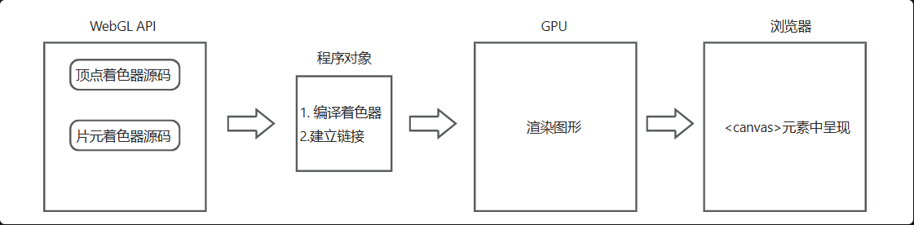

1. **WebGL API：着色器源码**
   - 顶点着色器源码
   - 片元着色器（像素着色器）源码
2. **程序对象（Program）：编译和链接**
   - 编译着色器
   - 建立链接（把顶点着色器和片元着色器结合为一个可用的“程序”）
3. **GPU：渲染图形**
   - 把程序对象、顶点数据、纹理等发送给GPU
   - GPU执行着色器并渲染出图形
4. **浏览器：显示到`<canvas>`元素中**
   - GPU渲染结果通过WebGL上下文，最终在canvas上显示


- - 


### 绘制一个点

目录结构

```
webgl第60天练习
 └─ src
    ├─ exercise
    │  └─ 2.绘制一个点.js
    │  └─ 2.绘制一个点_不封装.js
    └─ shader
       └─ 2.绘制点
          ├─ vertex.glsl
          └─ fragment.glsl
```

单词

shader： 著色器；着色程序

vertex：顶点

fragment：碎片；片段；残存部分


##### 代码示例

vertex.glsl	顶点着色器代码

```js
void main() {
  gl_Position = vec4(0.0, 0.0, 0.0, 1.0); // 齐次坐标 (x, y, z, w)
  gl_PointSize = 10.0; // 点的像素大小
}

/**
顶点着色器和片元着色器是GPU管线的不同阶段，是各自独立的程序，各自有各自的main()。

顶点着色器负责输出顶点相关的数据（如 gl_Position、gl_PointSize、以及要传给片元的 varying）
片元着色器负责计算像素颜色（使用传入的 varying 或内建值）
*/
```


fragment.glsl	片元着色器代码

```js
void main() {
  // 设置片元颜色
  gl_FragColor = vec4(1.0, 0.0, 0.0, 1.0); // 红色 rgba(1.0, 0.0, 0.0, 1.0)
}

/**
在着色器里，main 是每个着色器的入口点（片元着色器每个片元执行一次，顶点着色器每个顶点执行一次），返回类型通常是 void，

WebGL1 (GLSL ES 1.00)：片元着色器常用 gl_FragColor 输出，需要在片元着色器里声明精度，precision mediump float;
*/
```


2.绘制一个点_不封装.js

```js
// 1. 引入着色器源码（字符串）
import vertexShaderSource from '../shader/2.绘制点/vertex.glsl'
import fragmentShaderSource from '../shader/2.绘制点/fragment.glsl'

// 2. 获取 canvas
const canvas = document.querySelector('canvas')

// 3. 获取 WebGL 上下文
const gl = canvas.getContext('webgl')

// 4. 创建 顶点着色器 对象
const vertexShader = gl.createShader(gl.VERTEX_SHADER)
// 5. 填入顶点着色器源码
gl.shaderSource(vertexShader, vertexShaderSource)
// 6. 编译顶点着色器
gl.compileShader(vertexShader)
// 7. 检查编译是否成功
if (!gl.getShaderParameter(vertexShader, gl.COMPILE_STATUS)) {
  console.error('顶点着色器编译失败：', gl.getShaderInfoLog(vertexShader))
  gl.deleteShader(vertexShader)
}

// 8. 创建 片元着色器 对象
const fragmentShader = gl.createShader(gl.FRAGMENT_SHADER)
// 9. 填入片元着色器源码
gl.shaderSource(fragmentShader, fragmentShaderSource)
// 10. 编译片元着色器
gl.compileShader(fragmentShader)
// 11. 检查编译是否成功
if (!gl.getShaderParameter(fragmentShader, gl.COMPILE_STATUS)) {
  console.error('片元着色器编译失败：', gl.getShaderInfoLog(fragmentShader))
  gl.deleteShader(fragmentShader)
}

// 12. 创建 Program 程序对象
const program = gl.createProgram()
// 13. 把两个已编译的着色器附加进程序
gl.attachShader(program, vertexShader)
gl.attachShader(program, fragmentShader)
// 14. 链接程序
gl.linkProgram(program)
// 15. 检查链接是否成功
if (!gl.getProgramParameter(program, gl.LINK_STATUS)) {
  console.error('Program 链接失败：', gl.getProgramInfoLog(program))
  gl.deleteProgram(program)
}
// 16. 使用这个程序
gl.useProgram(program)

// （此例着色器内部直接写死 gl_Position / gl_PointSize，无需提供顶点缓冲数据）

// 17. 发出绘制命令：画 1 个点
gl.drawArrays(gl.POINTS, 0, 1)
// 参数说明：
// gl.POINTS  表示绘制点
// 0         从第 0 个顶点开始
// 1         一共绘制 1 个顶点
```


##### 效果

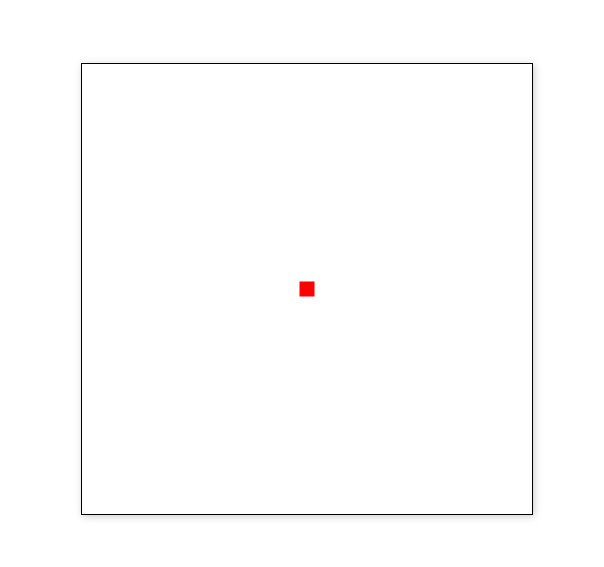


##### 配置程序对象的封装过程

也可以将把着色器源码变成可以使用的 program程序的过程封装成一个函数，放到另外的js文件中按需引入

```js
提供 initShader(gl, vshader_source, fshader_source)：把顶点/片元着色器源码编译、链接成一个 WebGL program 并返回该 program


/**
 * 初始化着色器, 创建并配置程序对象, 返回
 * @param {WebGLRenderingContext} gl : webgl上下文对象
 * @param {string} vshader_source : 顶点着色器源码
 * @param {string} fshader_source : 片元着色器源码
 * @returns: program程序对象
 */

// 把片元/顶点着色器源码编译，链接成一个WebGLProgram程序对象，并返回program对象
function initShader(gl, vshader_source, fshader_source) {
  const vertexShader = createShader(gl, gl.VERTEX_SHADER, vshader_source) // 创建顶点着色器对象
  const fragmentShader = createShader(gl, gl.FRAGMENT_SHADER, fshader_source) // 创建片元着色器对象

  const program = gl.createProgram() // 创建程序对象
  gl.attachShader(program, vertexShader) // 附加顶点着色器
  gl.attachShader(program, fragmentShader) // 附加片元着色器

  gl.linkProgram(program) // 链接程序对象

  gl.useProgram(program) // 使用程序对象
}

// 创建并编译着色器
function createShader(gl, type, source) { 
  const shader = gl.createShader(type); // 创建着色器对象
  gl.shaderSource(shader, source); // 设置着色器源码
  gl.compileShader(shader); // 编译着色器
  // 检查编译状态
  const success = gl.getShaderParameter(shader, gl.COMPILE_STATUS);
  if (success) {
    return shader; // 编译成功，返回着色器对象
  }
  console.error(gl.getShaderInfoLog(shader)); // 打印错误信息
  gl.deleteShader(shader); // 删除着色器对象
}
```


### 修改点的位置

##### 示例代码

vertex.glsl

```glsl
// 顶点着色器代码

// 声明一个 attribute 变量
// 通过 a_Position 可以接收从外部传入的顶点位置数据
// attribute 储存限定符：只能在顶点着色器中使用，且只能是输入变量
// vec4 表示这是一个 4 分量向量 (x, y, z, w)
// a_Position 变量名可以自定义，但要和 JS 代码中 getAttribLocation 获取的位置一致
attribute vec4 a_Position; 
void main() {
  gl_Position = a_Position; // 齐次坐标 (x, y, z, w)
  gl_PointSize = 10.0; // 点的像素大小
}
```


fragment.glsl

```glsl
// 片元着色器代码

void main() {
  // 设置片元颜色
  gl_FragColor = vec4(1.0, 0.0, 0.0, 1.0); // 红色 rgba(1.0, 0.0, 0.0, 1.0)
}
```


修改点的位置

```js
// 省略编译webgl代码和建立链接的过程.....


// 改变点的位置
const a_Position = gl.getAttribLocation(program, 'a_Position') // 获取 attribute 变量的存储位置
// 点的位置
const position = {
  x: 0.0,
  y: 0.0
}

const gui = new dat.GUI()
gui.add(position, 'x', -1.0, 1.0).onChange(val => {
  gl.vertexAttrib3f(a_Position, val, position.y, 0.0) 
  // 改变点位置之后，清屏重新绘制
  gl.clear(gl.COLOR_BUFFER_BIT) // 清除颜色缓冲区
  gl.drawArrays(gl.POINTS, 0, 1)
})
gui.add(position, 'y', -1.0, 1.0).onChange(val => {
  gl.vertexAttrib3f(a_Position, position.x, val, 0.0)
  gl.clear(gl.COLOR_BUFFER_BIT) // 清除颜色缓冲区
  gl.drawArrays(gl.POINTS, 0, 1)
})
/**
 * 传入点的位置
 * @param {number} a_Position - attribute 变量的存储位置
 * @param {number} x - 点的 x 坐标
 * @param {number} y - 点的 y 坐标
 */
gl.vertexAttrib3f(a_Position, position.x, position.y, 0.0) // 将数据传给 attribute 变量

gl.drawArrays(gl.POINTS, 0, 1)
```


##### 效果


### 在鼠标点击处绘制点

##### 仅仅保持一个点

仅仅在点击出绘制一个点，之前的点不会保留

```js
// 获取 attribute 变量的存储位置
const a_Position = gl.getAttribLocation(program, 'a_Position') 

// canvas监听鼠标点击事件
canvas.addEventListener('click', e => {
  // 得到canvas元素左上角的坐标
  const { left, top } = e.target.getBoundingClientRect()
  
  // 鼠标点击处相对于canvas左上角的坐标
  const x = e.clientX - left
  const y = e.clientY - top
  
  // 将鼠标点击位置的屏幕坐标转换成WebGL标准坐标
  const x_in_canvas = (x / canvas.width) * 2 - 1
  const y_in_canvas = -((y / canvas.height) * 2 - 1) 

  // 将点的位置传递给attribute变量
  gl.vertexAttrib3f(a_Position, x_in_canvas, y_in_canvas, 0.0)
  // 绘制一个点
  gl.drawArrays(gl.POINTS, 0, 1)
})
```

vertex.glsl

```glsl
// 顶点着色器代码

// 声明一个 attribute 变量
// 通过 a_Position 可以接收从外部传入的顶点位置数据
// attribute 储存限定符：只能在顶点着色器中使用，且只能是输入变量
// vec4 表示这是一个 4 分量向量 (x, y, z, w)
// a_Position 变量名可以自定义，但要和 JS 代码中 getAttribLocation 获取的位置一致
attribute vec4 a_Position; 
void main() {
  gl_Position = a_Position; // 齐次坐标 (x, y, z, w)
  gl_PointSize = 10.0; // 点的像素大小
}
```

fragment.glsl	片元着色器代码

```js
void main() {
  // 设置片元颜色
  gl_FragColor = vec4(1.0, 0.0, 0.0, 1.0); // 红色 rgba(1.0, 0.0, 0.0, 1.0)
}
```


##### 缓冲区绘制多点

思路：点击时存点 → 重建/更新缓冲 → 一次性 drawArrays 画所有点。


```js
// 获取 attribute 变量的存储位置
const a_Position = gl.getAttribLocation(program, 'a_Position') 

// 创建缓冲区对象
const positionBuffer = gl.createBuffer()

/**
 * 将缓冲区对象绑定到目标
 * @param {GLenum} target - gl.ARRAY_BUFFER: 包含顶点属性的 Buffer，如顶点坐标，纹理坐标数据或顶点颜色数据。
 * buffer - 要绑定的 WebGLBuffer 对象
 */
gl.bindBuffer(gl.ARRAY_BUFFER, positionBuffer)

// 将缓冲区数据设置给 attribute变量a_Position
gl.vertexAttribPointer(a_Position, 2, gl.FLOAT, false, 0, 0)

// 连接attribute变量与分配给它的缓冲区对象
gl.enableVertexAttribArray(a_Position)


// 存放累计的点
const g_points = []

// canvas监听鼠标点击事件
canvas.addEventListener('click', e => {
  // 得到canvas元素左上角的坐标
  const { left, top } = e.target.getBoundingClientRect()
  // 鼠标点击处相对于canvas左上角的坐标
  const x = e.clientX - left
  const y = e.clientY - top
  // 将鼠标点击位置的屏幕坐标转换成WebGL标准坐标
  const x_in_canvas = (x / canvas.width) * 2 - 1
  const y_in_canvas = -((y / canvas.height) * 2 - 1) 

  // 将点存到数组中
  g_points.push(x_in_canvas, y_in_canvas)
  console.log(g_points)
  
  // 传全部点数据到 GPU
  gl.bindBuffer(gl.ARRAY_BUFFER, positionBuffer)
  /**
 * gl.bufferData(target, size or data, usage)
 * @param {GLenum} target - gl.ARRAY_BUFFER 或 gl.ELEMENT_ARRAY_BUFFER
 * @param {GLsizeiptr | ArrayBufferView} size or data - 指定要创建的缓存区对象的数据存储大小（以字节为单位），或者包含要复制到缓存区对象的数据的 ArrayBufferView（如 Float32Array）。
 * @param {GLenum} usage - 指定缓存区对象的预期使用模式。它可能是以下值之一：gl.STATIC_DRAW: 适合不变的数据，gl.DYNAMIC_DRAW: 适合动态变化的数据，gl.STREAM_DRAW: 适合一次性使用的数据
 */
  gl.bufferData(gl.ARRAY_BUFFER, new Float32Array(g_points), gl.STATIC_DRAW)

  // 清屏并一次性绘制所有点
  gl.clear(gl.COLOR_BUFFER_BIT) // 清除颜色缓冲
  gl.drawArrays(gl.POINTS, 0, g_points.length / 2) // 绘制所有点
})
```


##### 效果


##### 案例缓冲区使用流程

```
 [getAttribLocation a_Position]
        │
        ▼
 [createBuffer -> positionBuffer]  (GPU 分配缓冲对象句柄)
        │
        ▼
 [bindBuffer(ARRAY_BUFFER, positionBuffer)]
        │  设定“当前 ARRAY_BUFFER” = positionBuffer
        ▼
 [vertexAttribPointer(a_Position, 2, FLOAT,...)]
        │  记录：a_Position 读取来源=当前绑定的 ARRAY_BUFFER，步长=2*4B
        ▼
 [enableVertexAttribArray(a_Position)]
        │  让 a_Position 使用“缓冲数组模式”而不是常量模式
        ▼
 ┌────────────────  每次点击  ────────────────┐
 │   bindBuffer(ARRAY_BUFFER, positionBuffer)  (可省，保证当前)│
 │   bufferData(ARRAY_BUFFER, Float32Array(g_points), STATIC_DRAW)
 │        ─ 将全部点数据一次性上传/覆盖 GPU 缓冲
 │   clear(COLOR_BUFFER_BIT)
 │   drawArrays(POINTS, 0, g_points.length / 2)
 │        ─ 顶点着色器顺序读取缓冲区中每 2 个 float 组成顶点位置
 └───────────────────────────────────────────┘
```

gl.vertexAttribPointer: 记录“如何从当前绑定缓冲解析 a_Position”的取数格式（不传数据）。只描述格式与来源，不拷贝数据。

gl.enableVertexAttribArray: 使 a_Position 使用缓冲取“逐顶点数据”模式。切换 attribute变量 为“数组取值”模式；若禁用则会使用 gl.vertexAttrib* 设定的常量。

bufferData 才执行 CPU → GPU 拷贝（覆盖旧内容）。


### 点击绘制不同颜色点

在片元着色器中声明uniform变量

通过程序对象进行传递


##### 示例代码

vertex.glsl	顶点着色器代码

```js
// 顶点着色器代码

// 声明一个 attribute 变量
// 通过 a_Position 可以接收从外部传入的顶点位置数据
// attribute 储存限定符：只能在顶点着色器中使用，且只能是输入变量
// vec4 表示这是一个 4 分量向量 (x, y, z, w)
// a_Position 变量名可以自定义，但要和 JS 代码中 getAttribLocation 获取的位置一致
attribute vec4 a_Position; 
void main() {
  gl_Position = a_Position; // 齐次坐标 (x, y, z, w)
  gl_PointSize = 10.0; // 点的像素大小
}

```


fragment.glsl	片元着色器代码

```js
// 片元着色器代码

// 声明浮点数精度
precision mediump float;

// 创建uniform变量
uniform vec4 u_FragColor; // 颜色

void main() {
  // 设置片元颜色
  gl_FragColor = u_FragColor;
}
```


点击绘制颜色点

```js
// 获取 attribute 变量的存储位置
// 参数1：program
// 参数2：在shader中定义的attribute变量的名称
const a_Position = gl.getAttribLocation(program, 'a_Position') 
// 获取 uniform 变量的存储位置
const u_FragColor = gl.getUniformLocation(program, 'u_FragColor')


// 存放累计的点
const points = []

// canvas监听鼠标点击事件
canvas.addEventListener('click', e => {
  // 得到canvas元素左上角的坐标
  const { left, top } = e.target.getBoundingClientRect()
  // 鼠标点击处相对于canvas左上角的坐标
  const x = e.clientX - left
  const y = e.clientY - top
  // 将鼠标点击位置的屏幕坐标转换成WebGL标准坐标
  const x_in_canvas = (x / canvas.width) * 2 - 1
  const y_in_canvas = -((y / canvas.height) * 2 - 1) 

  // 将点存到数组中
  points.push({
    x: x_in_canvas,
    y: y_in_canvas,
    r: Math.random(),
    g: Math.random(),
    b: Math.random()
  })

  // 遍历points数组，循环绘制所有点
  points.forEach(point => {
    const { x, y, r, g, b } = point
    // 将点的位置传递给 a_Position
    gl.vertexAttrib3f(a_Position, x, y, 0.0)
    // 将点的颜色传递给 u_FragColor
    gl.uniform4f(u_FragColor, r, g, b, 1.0)
    // 绘制一个点
    gl.drawArrays(gl.POINTS, 0, 1)
  })
  //每次 gl.drawArrays 都把点像素写入当前帧缓冲（framebuffer）。没有调用 gl.clear 或重绘全帧，所以之前写入的像素会“保留”在画布上，因此看起来点在累积。
})
```


##### 效果

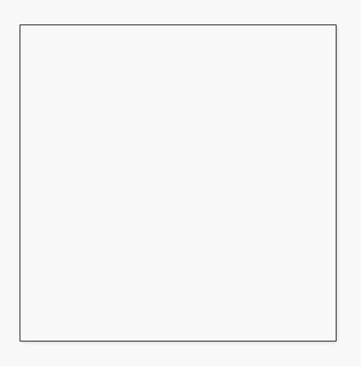


### 不同绘制模式

vertex.glsl	顶点着色器代码

```js
// 顶点着色器代码

// 声明一个 attribute 变量
// 通过 a_Position 可以接收从外部传入的顶点位置数据
// attribute 储存限定符：只能在顶点着色器中使用，且只能是输入变量
// vec4 表示这是一个 4 分量向量 (x, y, z, w)
// a_Position 变量名可以自定义，但要和 JS 代码中 getAttribLocation 获取的位置一致
attribute vec4 a_Position; 
void main() {
  gl_Position = a_Position; // 齐次坐标 (x, y, z, w)
  gl_PointSize = 10.0; // 点的像素大小
}

```


fragment.glsl	片元着色器代码

```js
// 片元着色器代码

void main() {
  // 设置片元颜色
  gl_FragColor = vec4(1.0, 0.0, 0.0, 1.0); // 红色 rgba(1.0, 0.0, 0.0, 1.0)
}
```


JavaScript代码

```js
// 获取 attribute 变量的存储位置
const a_Position = gl.getAttribLocation(program, 'a_Position') 

// 使用缓冲区对象 一次绘制多个点
const vertices = new Float32Array([
  -0.5, 0.5,   // 点1
  -0.5, -0.5,  // 点2
  0.5, -0.5,   // 点3
  0.5, 0.5     // 点4
])

// 创建缓冲区对象
const vertexBuffer = gl.createBuffer()

// 将缓冲区对象绑定到目标 设定当前ARRAY_BUFFER为vertexBuffer
gl.bindBuffer(gl.ARRAY_BUFFER, vertexBuffer)

// 向缓冲区对象写入数据
gl.bufferData(gl.ARRAY_BUFFER, vertices, gl.STATIC_DRAW)

// 将缓冲区数据设置给 attribute变量a_Position
gl.vertexAttribPointer(a_Position, 2, gl.FLOAT, false, 0, 0)

// 连接attribute变量与分配给它的缓冲区对象
gl.enableVertexAttribArray(a_Position)


const gui = new dat.GUI()
// 定义一个数据模型
const vModel={
  drawType:'POINTS'
}
gui.add(vModel,'drawType', ['POINTS', 'LINE_STRIP', 'LINE_LOOP', 'LINES', 'TRIANGLE_STRIP', 'TRIANGLE_FAN', 'TRIANGLES']).name('绘制方式').onChange(value=>{
  gl.drawArrays(gl[value], 0, 4)
})
gl.drawArrays(gl.POINTS, 0, 4)
```


##### 效果

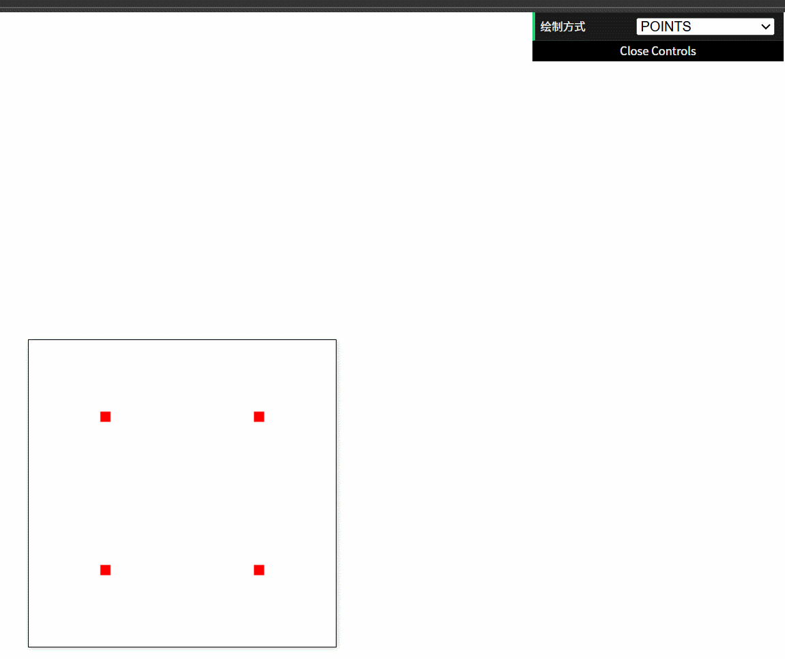


### 绘制不同位置不同颜色大小点

##### 示例代码

顶点着色器代码

```glsl
// 顶点着色器代码

// 声明一个 attribute 变量 顶点位置
attribute vec4 a_Position; 
// 声明一个 attribute 变量 点的大小
attribute float a_PointSize;
// 颜色从缓冲区中读取
attribute vec3 a_Color;
// varying限定词可以将数据从顶点传到片元
varying vec3 v_Color;
void main() {
  gl_Position = a_Position; // 齐次坐标 (x, y, z, w)
  gl_PointSize = a_PointSize; // 点的像素大小
  v_Color = a_Color; // 将颜色传递给片元着色器
}

```

片元着色器代码

```glsl
// 片元着色器代码
precision mediump float; // 设置精度为中等
// 接收从顶点着色器传递过来的颜色
varying vec3 v_Color;
void main() {
  // 设置片元颜色
  gl_FragColor = vec4(v_Color, 1.0); // 使用varying变量
}

```

绘制的js代码

```js
// 省略构建管线的代码


// 获取 attribute 变量的存储位置
const a_Position = gl.getAttribLocation(program, 'a_Position') 
const a_PointSize = gl.getAttribLocation(program, 'a_PointSize')
const a_Color = gl.getAttribLocation(program, 'a_Color')

// 创建要绘制点的数组  位置 大小 颜色rgba
const vertices = new Float32Array([
  -0.5, 0.5,  10.0,  1.0, 0.0, 0.0, 0.0,  // 点1
  -0.5, -0.5, 20.0,  0.0, 1.0, 0.0, 0.0,  // 点2
  0.5, -0.5,  30.0,  1.0, 1.0, 0.0, 0.0,   // 点3
  0.5, 0.5,   40.0,  1.0, 0.0, 0.0, 0.0    // 点4
])

const bytes=vertices.BYTES_PER_ELEMENT // 获取每个数据占用的字节数  Float32Array 每个数据占4个字节

// 使用缓冲区对象 一次绘制多个点
const positionBuffer = gl.createBuffer()
gl.bindBuffer(gl.ARRAY_BUFFER, positionBuffer)
gl.bufferData(gl.ARRAY_BUFFER, vertices, gl.STATIC_DRAW)

// 为不同的变量设置不同的偏移量
// 设置顶点位置属性指针
gl.vertexAttribPointer(a_Position, 2, gl.FLOAT, false, 7 * bytes, 0)
gl.enableVertexAttribArray(a_Position)
// 设置点的大小属性指针 参数5“步长”表示每个顶点属性的字节数间隔，参数6“偏移量”表示从缓冲区开头到该属性的第一个分量的字节数间隔
gl.vertexAttribPointer(a_PointSize, 1, gl.FLOAT, false, 7 * bytes, 2 * bytes)
gl.enableVertexAttribArray(a_PointSize)
// 设置点的颜色属性指针
gl.vertexAttribPointer(a_Color, 4, gl.FLOAT, false, 7 * bytes, 3 * bytes)
gl.enableVertexAttribArray(a_Color)

// 绘制点
gl.drawArrays(gl.POINTS, 0, 4)
```


##### 效果

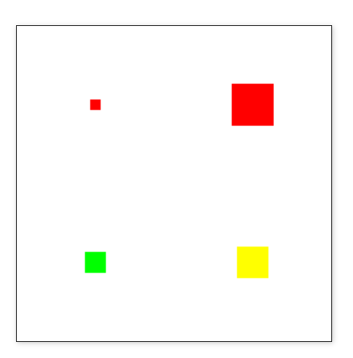


##### 流程

1. 查询 attribute 位置
   - gl.getAttribLocation(program,'a_Position' / 'a_PointSize' / 'a_Color')，得到三个属性索引。
2. 组织顶点数据（CPU）
   - 按顶点打包为交错数组（interleaved）： [x, y, size, r, g, b, a] * 4 点。
   - 每顶点共 7 个 float；bytesPerVertex = 7 * 4。
3. 创建与绑定缓冲
   - gl.createBuffer -> gl.bindBuffer(gl.ARRAY_BUFFER, buffer)。
   - gl.bufferData(gl.ARRAY_BUFFER, verticesFloat32Array, gl.STATIC_DRAW) 上传到 GPU。
4. 配置属性指针（描述如何从缓冲读取）
   - a_Position: gl.vertexAttribPointer(locPos, 2, gl.FLOAT, false, stride=7*4, offset=0)
   - a_PointSize: gl.vertexAttribPointer(locSize, 1, gl.FLOAT, false, stride, offset=2*4)
   - a_Color: gl.vertexAttribPointer(locColor, 4, gl.FLOAT, false, stride, offset=3*4)
   - 对每个属性调用 gl.enableVertexAttribArray 启用“逐顶点”模式。
5. （可选）设置视口与清屏
   - gl.viewport(0,0,canvas.width,canvas.height)
   - gl.clearColor(...) + gl.clear(gl.COLOR_BUFFER_BIT)。
6. 发出绘制命令
   - gl.drawArrays(gl.POINTS, 0, 4)；GPU 按属性指针解析每 7 个 float 作为一组顶点数据，执行 4 次顶点着色器。
   - 顶点阶段输出 gl_Position / gl_PointSize，颜色通过 varying 插值（POINTS 不插值，直接传递）到片元阶段。
   - 片元着色器用 v_Color 生成最终像素。


### 顶点插值渐变

#### 示例代码

顶点着色器代码

```glsl
// 接收从缓冲区传入的顶点位置
attribute vec4 a_Position; 
// 接收从缓冲区传入的顶点颜色
attribute vec3 a_Color; 

varying vec3 v_Color; // 用于传递给片元着色器的变量

void main() {
  gl_Position = a_Position; 
  v_Color = a_Color; // 将顶点颜色传递给片元着色器
}
```

片元着色器代码

```glsl
precision mediump float; // 声明浮点数精度中等

varying vec3 v_Color; // 接收从顶点着色器传递过来的颜色

void main() {
  // 设置片元颜色
  gl_FragColor = vec4(v_Color, 1.0); // 使用varying变量
}
```

JavaScript代码

```js
// 获取 attribute 变量的存储位置
const a_Position = gl.getAttribLocation(program, 'a_Position') 
const a_Color = gl.getAttribLocation(program, 'a_Color')

// 创建要绘制点的数组，能组成一个三角形 位置+ 颜色
// 每个顶点位置(x,y) + 颜色(r,g,b)
const vertices = new Float32Array([
  -0.5,  0.5,  1.0, 0.0, 0.0, // 左上 - 红
  -0.5, -0.5,  0.0, 0.0, 0.1, // 左下 - 蓝
   0.5, -0.5,  0.0, 1.0, 0.0  // 右下 - 绿
])


// 使用缓冲区对象 一次绘制多个点
const positionBuffer = gl.createBuffer()
// 将缓冲区对象绑定到目标
gl.bindBuffer(gl.ARRAY_BUFFER, positionBuffer)
// 向缓冲区对象写入数据
gl.bufferData(gl.ARRAY_BUFFER, vertices, gl.STATIC_DRAW)

// 位置属性 
// 5*4 = 每个顶点的字节数(位置2+颜色3) * 每个浮点数4字节
gl.vertexAttribPointer(a_Position, 2, gl.FLOAT, false, 5 * 4, 0)
gl.enableVertexAttribArray(a_Position) // 启用顶点属性数组

// 颜色属性 
// 第5个参数offset(以字节为单位)，表示从缓冲区开头跳过多少字节才到该 attribute 的的一个分量，这里要跳过位置属性的2个分量，一个分量是4字节，所以是2*4
gl.vertexAttribPointer(a_Color, 3, gl.FLOAT, false, 5 * 4, 2 * 4)
gl.enableVertexAttribArray(a_Color) // 启用顶点属性数组

// 绘制三角形
gl.drawArrays(gl.TRIANGLE_FAN, 0, 3)
```


#### 效果

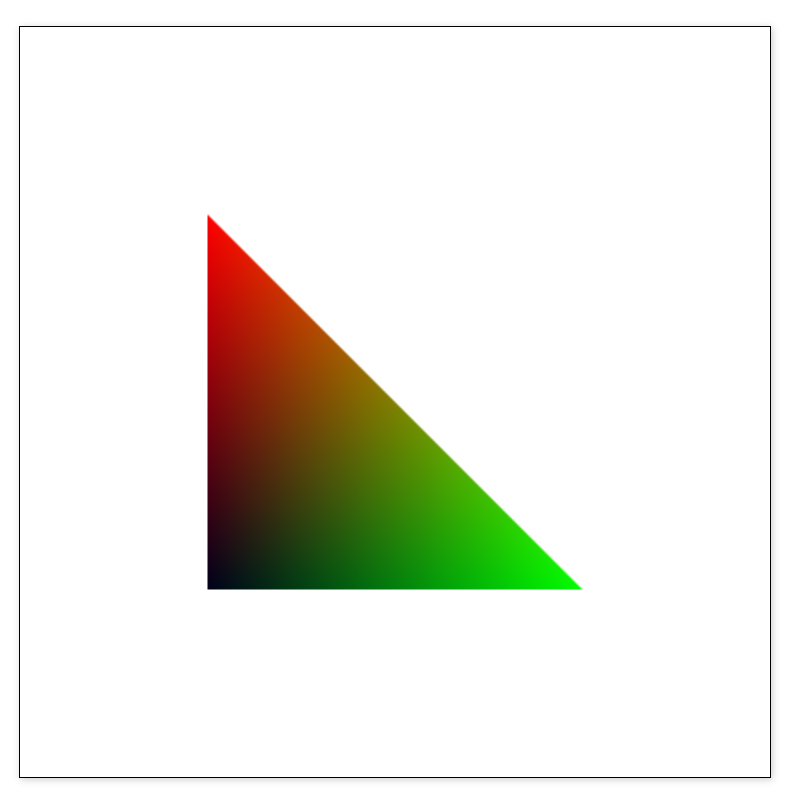

### 画布颜色插值

#### 示例代码

片元着色器代码

```glsl
precision mediump float; // 声明浮点数精度中等

// 传入当前画布的尺寸
uniform vec2 u_Resolution;

void main() {
  // 通过shader模拟片元插值
  vec3 color1 = vec3(1.0, 0.0, 0.0); // 红色
  vec3 color2 = vec3(0.0, 1.0, 0.0); // 绿色

  // 计算当前片元的坐标比例 gl_FragCoord 是片元的坐标，y 轴从下到上递增 x 轴从左到右递增
  vec2 normalizePos = gl_FragCoord.xy / u_Resolution; // 归一化坐标 (0.0 - 1.0)
  
  // 计算插值颜色 
  vec3 color = mix(color1, color2, normalizePos.x); // 根据 x 坐标比例插值 参数1是起始颜色，参数2是结束颜色，参数3是插值比例
  gl_FragColor = vec4(color, 1.0); // 输出最终颜色
}
```

WebGL 入门与实践 链接:https://pan.baidu.com/s/1QcXo33SkEH0amLBSoul7kg?pwd=j1ys 提取码:j1ys 复制这段内容后打开百度网盘手机App，操作更方便哦

顶点着色器代码

```glsl
// 声明一个 attribute 变量 顶点位置
attribute vec4 a_Position; 
void main() {
  gl_Position = a_Position; 
}
```


对应JavaScript代码

```js
// 获取 attribute 变量的存储位置
const a_Position = gl.getAttribLocation(program, 'a_Position') 

const u_Resolution = gl.getUniformLocation(program, 'u_Resolution') // 获取 uniform 变量的存储位置
gl.uniform2f(u_Resolution, canvas.width, canvas.height) // 设置画布分辨率

// 创建要绘制点的数组  位置 
const vertices = new Float32Array([
  -0.5, 0.5,   // 点1
  -0.5, -0.5,  // 点2
  0.5, -0.5,    // 点3
  0.5, 0.5,    // 点4
])


// 使用缓冲区对象 一次绘制多个点
const positionBuffer = gl.createBuffer()
gl.bindBuffer(gl.ARRAY_BUFFER, positionBuffer)
gl.bufferData(gl.ARRAY_BUFFER, vertices, gl.STATIC_DRAW)

// 设置顶点位置属性指针
gl.vertexAttribPointer(a_Position, 2, gl.FLOAT, false, 0, 0)
gl.enableVertexAttribArray(a_Position)

// 绘制四边形
  gl.drawArrays(gl.TRIANGLE_FAN, 0, 4)
```


#### 效果

当矩形移动是，范围内的片元就会被附着上本来的颜色


webgl坐标系


### 变换


#### 平移，缩放，旋转

使用gui调整参数，让矩形做各种变换操作

顶点着色器代码

```glsl
// 声明一个 attribute 变量 顶点位置
attribute vec4 a_Position; 

// 平移的值
uniform vec2 u_Translate;
// 缩放的倍数
uniform float u_Scale;
// 旋转
uniform float u_SinB;
uniform float u_CosB;


void main() {
  // 平移
  float x = a_Position.x + u_Translate.x;
  float y = a_Position.y + u_Translate.y;
  // 缩放
  x = x * u_Scale;
  y = y * u_Scale;
  // 旋转
  float x1 = x * u_CosB - y * u_SinB;
  float y1 = x * u_SinB + y * u_CosB;


  gl_Position = vec4(x1, y1, a_Position.z, a_Position.w); // 齐次坐标 (x, y, z, w)
}
```


JavaScript代码

```js
// 获取 attribute 变量的存储位置
const a_Position = gl.getAttribLocation(program, 'a_Position') 
const u_Resolution = gl.getUniformLocation(program, 'u_Resolution') // 获取 uniform 变量的存储位置
gl.uniform2f(u_Resolution, canvas.width, canvas.height) // 设置画布分辨率
// 基本变换
const u_Translate = gl.getUniformLocation(program, 'u_Translate') // 获取 uniform 变量的存储位置
const u_Scale = gl.getUniformLocation(program, 'u_Scale')
const u_SinB = gl.getUniformLocation(program, 'u_SinB')
const u_CosB = gl.getUniformLocation(program, 'u_CosB')


const gui = new dat.GUI() // 创建一个GUI对象
const params = {
  translateX: 0.0,
  translateY: 0.0,
  scale: 1.0,
  angle: 0.0
}

// 创建要绘制点的数组  位置 
const vertices = new Float32Array([
  -0.5, 0.5,   // 点1
  -0.5, -0.5,  // 点2
  0.5, -0.5,    // 点3
  0.5, 0.5,    // 点4
])

const bytes=vertices.BYTES_PER_ELEMENT // 获取每个数据占用的字节数  Float32Array 每个数据占4个字节

// 使用缓冲区对象 一次绘制多个点
const positionBuffer = gl.createBuffer()
gl.bindBuffer(gl.ARRAY_BUFFER, positionBuffer)
gl.bufferData(gl.ARRAY_BUFFER, vertices, gl.STATIC_DRAW)

// 为不同的变量设置不同的偏移量
// 设置顶点位置属性指针
gl.vertexAttribPointer(a_Position, 2, gl.FLOAT, false, 0, 0)
gl.enableVertexAttribArray(a_Position) // 启用顶点属性数组


gui.add(params, 'translateX', -1, 1, 0.01).name('平移X轴').onChange(render)
gui.add(params, 'translateY', -1, 1, 0.01).name('平移Y轴').onChange(render)
gui.add(params, 'scale', 0.1, 3, 0.01).name('缩放').onChange(render)
gui.add(params, 'angle', 0, 360, 1).name('旋转').onChange(render)


function render() {
  gl.clear(gl.COLOR_BUFFER_BIT) // 清空画布

  gl.uniform2f(u_Translate, params.translateX, params.translateY) // 设置平移距离
  gl.uniform1f(u_Scale, params.scale) // 设置缩放比例
  const angle = (params.angle * Math.PI) / 180.0 // 角度转弧度
  gl.uniform1f(u_SinB, Math.sin(angle)) // 设置旋转参数sinB
  gl.uniform1f(u_CosB, Math.cos(angle)) // 设置旋转参数cosB
  requestAnimationFrame(render)
  // 绘制四边形
  gl.drawArrays(gl.TRIANGLE_FAN, 0, 4)
}
render()
```


片元着色器代码(无关，仅仅上色)

```glsl
precision mediump float; // 声明浮点数精度中等

// 传入当前画布的尺寸
uniform vec2 u_Resolution;

void main() {
  // 通过shader模拟片元插值
  vec3 color1 = vec3(1.0, 0.0, 0.0); // 红色
  vec3 color2 = vec3(0.0, 1.0, 0.0); // 绿色

  // 计算当前片元的坐标比例
  // gl_FragCoord 是片元的坐标，y 轴从下到上递增 x 轴从左到右递增
  vec2 normalizePos = gl_FragCoord.xy / u_Resolution; // 归一化坐标 (0.0 - 1.0)
  // 计算插值颜色 
  vec3 color = mix(color1, color2, normalizePos.x); // 根据 x 坐标比例插值 参数1是起始颜色，参数2是结束颜色，参数3是插值比例
  gl_FragColor = vec4(color, 1.0); // 输出最终颜色
}
```


#### 效果


#### 矩阵变换

```
https://glmatrix.net/

pnpm add gl-matrix
import * as mat4 from 'gl-matrix/mat4'
```


使用一个变换矩阵乘上当前的每个顶点坐标


顶点着色器

```glsl
// 声明一个 attribute 变量 顶点位置
attribute vec4 a_Position; 

// u_ModelMatrix模型矩阵，用于变换
uniform mat4 u_ModelMatrix;


void main() {
  gl_Position = u_ModelMatrix * a_Position; 
}
```


JavaScript

```js
// 获取 attribute 变量的存储位置
const a_Position = gl.getAttribLocation(program, 'a_Position') 
const u_Resolution = gl.getUniformLocation(program, 'u_Resolution') // 获取 uniform 变量的存储位置
gl.uniform2f(u_Resolution, canvas.width, canvas.height) // 设置画布分辨率
// 基本变换
const u_ModelMatrix = gl.getUniformLocation(program, 'u_ModelMatrix') // 获取 uniform 变量的存储位置


const gui = new dat.GUI() // 创建一个GUI对象
const params = {
  translateX: 0.0,
  translateY: 0.0,
  scale: 1.0,
  angle: 0.0
}

// 创建要绘制点的数组  位置 大小 颜色rgba
const vertices = new Float32Array([
  -0.5, 0.5,   // 点1
  -0.5, -0.5,  // 点2
  0.5, -0.5,    // 点3
  0.5, 0.5,    // 点4
])

const updateModelMatrix = () => {
  const u_ModelMatrix = gl.getUniformLocation(program, 'u_ModelMatrix')
  let modelMatrix = mat4.create() // 创建一个4x4的单位矩阵
  const rad = (params.angle * Math.PI) / 180.0 // 角度转弧度
  // 添加平移变换 参数1：目标矩阵 参数2：源矩阵 参数3：[x, y, z]
  mat4.translate(modelMatrix, modelMatrix, [params.translateX, params.translateY, 0])
  // 添加旋转变换 参数3：弧度值
  mat4.rotateZ(modelMatrix, modelMatrix, rad)
  // 添加缩放变换 参数3：[x, y, z]
  mat4.scale(modelMatrix, modelMatrix, [params.scale, params.scale, 1])
  // 将矩阵传递给顶点着色器 参数2：是否转置矩阵 参数3：矩阵数据
  gl.uniformMatrix4fv(u_ModelMatrix, false, modelMatrix)
}

// 使用缓冲区对象 一次绘制多个点
const positionBuffer = gl.createBuffer()
gl.bindBuffer(gl.ARRAY_BUFFER, positionBuffer)
gl.bufferData(gl.ARRAY_BUFFER, vertices, gl.STATIC_DRAW)


// 设置顶点位置属性指针
gl.vertexAttribPointer(a_Position, 2, gl.FLOAT, false, 0, 0)
gl.enableVertexAttribArray(a_Position) // 启用顶点属性数组


gui.add(params, 'translateX', -1, 1, 0.01).name('平移X轴').onChange(render)
gui.add(params, 'translateY', -1, 1, 0.01).name('平移Y轴').onChange(render)
gui.add(params, 'scale', 0.1, 3, 0.01).name('缩放').onChange(render)
gui.add(params, 'angle', 0, 360, 1).name('旋转').onChange(render)


function render() {
  gl.clear(gl.COLOR_BUFFER_BIT) // 清空画布

  updateModelMatrix() // 更新矩阵
  requestAnimationFrame(render)
  // 绘制四边形
  gl.drawArrays(gl.TRIANGLE_FAN, 0, 4)
}
render()
```


效果同上，但是旋转中心始终在事物几何中心


### 使用索引方式绘制矩形

顶点着色器代码

```glsl
// 顶点着色器代码

// 接收外部传入的顶点位置数据
attribute vec2 a_Position; 

// 接收浏览器窗口尺寸
attribute vec2 a_ScreenSize;

// 从外部接收颜色数据
attribute vec4 a_Color;

// 将颜色数据传递给片元着色器
varying vec4 v_Color;


void main() {
  vec2 position = ( a_Position / a_ScreenSize ) * 2.0 - 1.0;
  position = position * vec2(1.0, -1.0); // 翻转Y轴
  gl_Position = vec4(position, 0.0, 1.0);
  v_Color = a_Color;
}
```

片元着色器代码

```glsl
// 片元着色器代码

precision mediump float; // 声明浮点数精度中等

varying vec4 v_Color; // 接收从顶点着色器传递过来的颜色

void main() {
  vec4 color = v_Color / vec4(255.0, 255.0, 255.0, 1.0); // 颜色归一化
  gl_FragColor = color;
}
```

JavaScript代码

```js
// 省略程序对象的创建过程


// 使用索引方式进行绘制
//存储顶点信息的数组
var positions = [
    30, 30, 255, 0, 0, 1,    //V0
    30, 300, 255, 0, 0, 1,   //V1
    300, 300, 255, 0, 0, 1,  //V2
    300, 30, 0, 255, 0, 1    //V3
];


// 创建缓冲区对象存储顶点数据
const vertexBuffer = gl.createBuffer()
// 绑定缓冲区对象到目标
gl.bindBuffer(gl.ARRAY_BUFFER, vertexBuffer)
// 将顶点数据写入缓冲区
gl.bufferData(gl.ARRAY_BUFFER, new Float32Array(positions), gl.STATIC_DRAW)

// 获取 a_Position 的存储位置
const a_Position = gl.getAttribLocation(program, 'a_Position')
// 设置从缓冲区中读取数据的方式
gl.vertexAttribPointer(a_Position, 2, gl.FLOAT, false, 4 * 6, 0)
// 启用 a_Position 属性
gl.enableVertexAttribArray(a_Position)

// 获取 a_Color 的存储位置
const a_Color = gl.getAttribLocation(program, 'a_Color')
// 设置从缓冲区中读取数据的方式
gl.vertexAttribPointer(a_Color, 4, gl.FLOAT, false, 4 * 6, 2 * 4)
// 启用 a_Color 属性
gl.enableVertexAttribArray(a_Color)

// 获取a_ScreenSize 的存储位置
const a_ScreenSize = gl.getAttribLocation(program, 'a_ScreenSize')
// 将canvas的宽高传递给a_ScreenSize
gl.vertexAttrib2f(a_ScreenSize, canvas.width, canvas.height)


//存储顶点索引的数组
var indices = [
    0, 1, 2, //第一个三角形
    0, 2, 3  //第二个三角形
];
// 创建缓冲区对象存储顶点索引数据
const indexBuffer = gl.createBuffer()
// 绑定缓冲区对象到目标
gl.bindBuffer(gl.ELEMENT_ARRAY_BUFFER, indexBuffer)
// 将顶点索引数据写入缓冲区
gl.bufferData(gl.ELEMENT_ARRAY_BUFFER, new Uint16Array(indices), gl.STATIC_DRAW)
/**
 * 索引缓冲只是存放索引（0,1,2,3...），drawElements 函数读取索引并把这些索引当作数组下标区读取顶点属性。索引本身并不需要vertexAttribPointer
 */

// 设置清空canvas的颜色
gl.clearColor(0.0, 0.0, 0.0, 1.0)
// 利用索引方式进行绘制
gl.drawElements(gl.TRIANGLES, indices.length, gl.UNSIGNED_SHORT, 0)
// gl.drawElements 是如何识别读取哪个数组的呢？读取的是当前 gl 状态里绑定到 TARGET = gl.ELEMENT_ARRAY_BUFFER 的哪个缓冲区

// gl.drawArrays 读取的是“每个已启用 attribute 的 vertexAttribPointer 描述”，因为 vertexAttribPointer 在调用时会把当时绑定到gl.ARRAY_BUFFER 的缓冲、stride、offset 等信息记录到该 attribute 的状态里
```

#### 效果

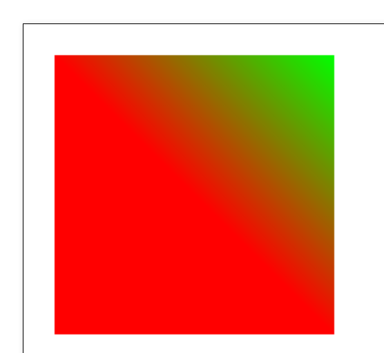


### 纹理贴图

#### 加载纹理图像示例

顶点着色器代码

```glsl
// 接收顶点坐标 (x, y)
attribute vec2 a_Position;
// 接收 canvas 尺寸(width, height)
attribute vec2 a_Screen_Size;
// 接收JavaScript传递过来的顶点 uv 坐标。
attribute vec2 a_Uv;
// 将接收的uv坐标传递给片元着色器
varying vec2 v_Uv;
void main(){
  vec2 position = (a_Position / a_Screen_Size) * 2.0 - 1.0;
  position = position * vec2(1.0,-1.0);
  gl_Position = vec4(position, 0, 1);
  // 将接收到的uv坐标传递给片元着色器
  v_Uv = a_Uv;
}
```


片元着色器代码

```js
precision mediump float; // 声明浮点数精度中等

varying vec2 v_Uv; // 接收从顶点着色器传递过来的纹理坐标

// 接收从JavaScript代码传递过来的纹理
uniform sampler2D texture;  

void main() {
  // 根据纹理坐标从纹理中采样颜色
  vec4 color = texture2D(texture, v_Uv);
  // 设置片元颜色
  gl_FragColor = color;
}
```


JavaScript代码

```js
// 省略创建webgl程序对象的过程.....


// 定义顶点位置和纹理坐标
let positions = [
  30, 30, 0, 0,    //V0
  30, 300, 0, 1,   //V1
  300, 300, 1, 1,  //V2
  30, 30, 0, 0,    //V0
  300, 300, 1, 1,  //V2
  300, 30, 1, 0    //V3
]
// 加载图片
const img = new Image()
img.src = '/src/assets/wave.jpg'
console.log(img)

// 传画布尺寸
const a_Screen_Size = gl.getAttribLocation(program, 'a_Screen_Size')
gl.vertexAttrib2f(a_Screen_Size, canvas.width, canvas.height)

// 找到属性 a_Position 的存储位置
const a_Position = gl.getAttribLocation(program, 'a_Position')
// 找到属性 a_Uv 的存储位置
const a_Uv = gl.getAttribLocation(program, 'a_Uv')
// 缓冲区
const positionBuffer = gl.createBuffer()
gl.bindBuffer(gl.ARRAY_BUFFER, positionBuffer)
gl.bufferData(gl.ARRAY_BUFFER, new Float32Array(positions), gl.STATIC_DRAW)
// 设置属性 a_Position 从缓冲区读取数据
gl.vertexAttribPointer(a_Position, 2, gl.FLOAT, false, 16, 0)
gl.enableVertexAttribArray(a_Position)
// 设置属性 a_Uv 从缓冲区读取数据
gl.vertexAttribPointer(a_Uv, 2, gl.FLOAT, false, 4 * 4, 2 * 4)
gl.enableVertexAttribArray(a_Uv)

// 图像加载完成后执行
img.onload = () => {
  // 创建纹理对象
  const texture = gl.createTexture()
  // 激活0号纹理单元
  gl.activeTexture(gl.TEXTURE0)
  // 绑定纹理对象到目标
  gl.bindTexture(gl.TEXTURE_2D, texture)
  // 指定二维纹理图像
  gl.texImage2D(gl.TEXTURE_2D, 0, gl.RGBA, gl.RGBA, gl.UNSIGNED_BYTE, img)
  // 设置图片在放大或缩小时采用的算法
  gl.texParameteri(gl.TEXTURE_2D, gl.TEXTURE_MIN_FILTER, gl.LINEAR)
  gl.texParameteri(gl.TEXTURE_2D, gl.TEXTURE_MAG_FILTER, gl.LINEAR)
  // 获取片元着色器中采样器变量texture的位置
  const uniformTexture = gl.getUniformLocation(program, 'texture') 
  // 为片元着色器传递0号纹理单元
  gl.uniform1i(uniformTexture, 0)
  // 绘制
  gl.drawArrays(gl.TRIANGLES, 0, 6)
}

```

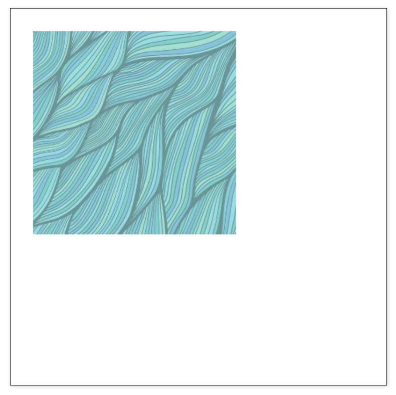


#### 重复，采样方式，mipMpa

顶点着色器代码

```glsl
// 声明一个 attribute 变量 顶点位置
attribute vec4 a_Position; 

// 从缓冲区中获取uv坐标
attribute vec2 a_UV;

// 将uv坐标传递给片元着色器
varying vec2 v_UV;


void main() {
  gl_Position = a_Position; // 设置顶点位置
  v_UV = a_UV; // 将uv坐标传递给片元着色器
}
```

片元着色器代码

```glsl
precision mediump float; // 声明浮点数精度中等

varying vec2 v_UV; // 接收从顶点着色器传递过来的uv坐标

// 从webgl程序中获取图片数据
uniform sampler2D u_Sampler;

void main() {
  texture2D(u_Sampler, v_UV); // 通过uv坐标从图片中采样颜色，返回一个 vec4 参数：1是图片数据，参数2是uv坐标
  gl_FragColor = texture2D(u_Sampler, v_UV); // 输出最终颜色
}
```


JavaScript代码实现，使用gui调整图片显示方式

```js
// 绘制一个矩形 顶点坐标 + 纹理坐标
const vertices = new Float32Array([
  -0.8, 0.8,   0.0, 2.0, // 左上角
  -0.8, -0.8,  0.0, 0.0, // 左下角
  0.8, 0.8,   2.0, 2.0, // 右上角
  0.8, -0.8,  2.0, 0.0 // 右下角
])

// 获取 a_Position 的存储位置
const a_Position = gl.getAttribLocation(program, 'a_Position')
// 获取 a_UV 的存储位置
const a_UV = gl.getAttribLocation(program, 'a_UV')

// 创建一个缓冲区对象
const vertexBuffer = gl.createBuffer()
// 将缓冲区对象绑定到目标
gl.bindBuffer(gl.ARRAY_BUFFER, vertexBuffer)

// 向缓冲区对象写入顶点数据
gl.bufferData(gl.ARRAY_BUFFER, vertices, gl.STATIC_DRAW)


// 将缓冲区对象分配给 a_Position 变量
gl.vertexAttribPointer(
  a_Position, // 指定属性变量
  2, // 每个顶点属性的组件数量（每个顶点属性有多少个值组成），这里是 x 和 y 两个分量
  gl.FLOAT, // 数组数据类型
  false, // 是否归一化
  4 * Float32Array.BYTES_PER_ELEMENT, 
  0 
)

// 连接 a_Position 变量与分配给它的缓冲区对象
gl.enableVertexAttribArray(a_Position)

// 将缓冲区对象分配给 a_UV 变量
gl.vertexAttribPointer(
  a_UV, // 指定属性变量
  2, // 每个顶点属性的组件数量（每个顶点属性有多少个值组成），这里是 u 和 v 两个分量
  gl.FLOAT, // 数组数据类型
  false, // 是否归一化
  4 * Float32Array.BYTES_PER_ELEMENT, 
  2 * Float32Array.BYTES_PER_ELEMENT 
)
// 连接 a_UV 变量与分配给它的缓冲区对象
gl.enableVertexAttribArray(a_UV)


// 将设置图片的过程封装成函数
function setupTexture(filterType = 'LINEAR', repeatType = 'REPEAT', useMipMap = false) {
  // 获取图片
  const baseUrl = '/src/assets/keping.png'
  const image = new Image()
  image.src = baseUrl
  image.onload = () => {
    // 选择要用的纹理单元 texture unit
    gl.activeTexture(gl.TEXTURE0) 
    // 创建 + 绑定纹理对象
    const texture = gl.createTexture() 
    gl.bindTexture(gl.TEXTURE_2D, texture)

    // 设置像素解包行为 上下颠倒
    gl.pixelStorei(gl.UNPACK_FLIP_Y_WEBGL, 1) 

    if (useMipMap) {
      // 启用mipmap
      gl.generateMipmap(gl.TEXTURE_2D)
    }
    // 设置纹理缩小过滤方式
    gl.texParameteri(gl.TEXTURE_2D, gl.TEXTURE_MIN_FILTER, gl[filterType])
    gl.texParameteri(gl.TEXTURE_2D, gl.TEXTURE_WRAP_S, gl[repeatType]) // 设置纹理水平重复方式
    gl.texParameteri(gl.TEXTURE_2D, gl.TEXTURE_WRAP_T, gl[repeatType]) // 设置纹理垂直重复方式
    // 把浏览器 Image 数据上传到 GPU 纹理存储
    gl.texImage2D(
      gl.TEXTURE_2D,
      0,
      gl.RGBA,
      gl.RGBA,
      gl.UNSIGNED_BYTE,
      image
    )
    // 将片元着色器的 u_Sampler 变量设置为0号纹理单元
    const u_Sampler = gl.getUniformLocation(program, 'u_Sampler')
    gl.uniform1i(u_Sampler, 0)


    // 发起绘制
    gl.drawArrays(gl.TRIANGLE_STRIP, 0, 4)
  }
}
setupTexture()

const gui = new dat.GUI()
const params = {
  filterType: 'LINEAR', // 纹理过滤方式
  repeatType: 'REPEAT', // 纹理重复方式
  useMipMap: false // 是否使用mipmap
}
gui.add(params, 'filterType', ['NEAREST', 'LINEAR']).onChange((value) => {
  setupTexture(value)
})
// 'CLAMP_TO_EDGE'表示不重复纹理，超出部分拉伸最后一个像素
gui.add(params, 'repeatType', ['REPEAT', 'CLAMP_TO_EDGE', 'MIRRORED_REPEAT']).onChange((value) => {
  setupTexture(params.filterType, value)
})
gui.add(params, 'useMipMap').onChange((value) => {
  setupTexture(params.filterType, params.repeatType, value)
})
```


### 构建立方体

一个只包含坐标信息的立方体实际上是由 6 个正方形组成，每个正方形由两个三角形组成，每个三角形由三个顶点组成，所以一个立方体由 6 * 2 * 3 = 36个顶点组成，但是这36个顶点有很多是重复的，一个立方体实际上由 6 个矩形面，或者 8 个不重复顶点组成


顶点着色器

```glsl
// 接收JavaScript传入的顶点位置数据
attribute vec3 a_Position;

// 接收JavaScript传入的颜色数据
attribute vec4 a_Color;

// 把颜色数据传递给片元着色器
varying vec4 v_Color; 

// 接收从javaScript传入的正交投影矩阵
uniform mat4 u_Matrix;

void main() {
  gl_Position = u_Matrix * vec4(a_Position, 1.0);
  v_Color = a_Color;
}
```


片元着色器

```glsl
precision mediump float; // 声明浮点数精度中等

varying vec4 v_Color; // 接收从顶点着色器传递过来的颜色

void main() {
  gl_FragColor = v_Color; // 设置片元颜色
}
```


JavaScript代码

```js
// 使用索引方式进行绘制
//正方体 8 个顶点的坐标信息
let zeroX = 0.5;
let zeroY = 0.5;
let zeroZ = 0.5;
let positions = [
  [-zeroX, -zeroY, zeroZ],  //V0
  [zeroX, -zeroY, zeroZ],  //V1
  [zeroX, zeroY, zeroZ],   //V2
  [-zeroX, zeroY, zeroZ],  //V3
  [-zeroX, -zeroY, -zeroZ],//V4
  [-zeroX, zeroY, -zeroZ], //V5
  [zeroX, zeroY, -zeroZ],  //V6
  [zeroX, -zeroY, -zeroZ]  //V7
]
// 定义6个面包含的顶点索引
const CUBE_FACE_INDICES = [
  [0, 1, 2, 3], //前面
  [4, 5, 6, 7], //后面
  [0, 3, 5, 4], //左面
  [1, 7, 6, 2], //右面
  [3, 2, 6, 5], //上面
  [0, 4, 7, 1] // 下面
];
// 定义6个面的颜色信息
const FACE_COLORS = [
  [1, 0, 0, 1], // 前面，红色
  [0, 1, 0, 1], // 后面，绿色
  [0, 0, 1, 1], // 左面，蓝色
  [1, 1, 0, 1], // 右面，黄色
  [1, 0, 1, 1], // 上面，品色
  [0, 1, 1, 1]  // 下面，青色
]

// 为每个面复制 4 个顶点 并赋相同颜色， 生成三角形索引
const positionsArr = []
const colorsArr = []
const indicesArr = []
let indexOffset = 0 
for (let face = 0; face < CUBE_FACE_INDICES.length; face++) {
  // 当前面的顶点索引
  const currentFace = CUBE_FACE_INDICES[face]
  // 当前面的颜色
  const color = FACE_COLORS[face]
  // 为当前面创建4个顶点数据和颜色数据
  for (let i = 0; i < 4; i++) {
    const position = positions[currentFace[i]]
    positionsArr.push(...position) // 24个顶点数据
    colorsArr.push(...color) // 24个顶点对应的颜色数据
  }
  // 为当前面创建两个三角形索引数据 24个顶点数据，因此索引对应0-23
  indicesArr.push(indexOffset, indexOffset + 1, indexOffset + 2)
  indicesArr.push(indexOffset, indexOffset + 2, indexOffset + 3)
  indexOffset += 4
}

positions = new Float32Array(positionsArr)
let indices = new Uint16Array(indicesArr)
let colors = new Float32Array(colorsArr)


// 位置缓冲区
const positionBuffer = gl.createBuffer()
gl.bindBuffer(gl.ARRAY_BUFFER, positionBuffer)
gl.bufferData(gl.ARRAY_BUFFER, positions, gl.STATIC_DRAW)
const a_Position = gl.getAttribLocation(program, 'a_Position')
gl.vertexAttribPointer(a_Position, 3, gl.FLOAT, false, 4 * 3, 0)
gl.enableVertexAttribArray(a_Position)

// 索引缓冲区
const indexBuffer = gl.createBuffer()
gl.bindBuffer(gl.ELEMENT_ARRAY_BUFFER, indexBuffer)
gl.bufferData(gl.ELEMENT_ARRAY_BUFFER, indices, gl.STATIC_DRAW)

// 颜色缓冲区
const colorBuffer = gl.createBuffer()
gl.bindBuffer(gl.ARRAY_BUFFER, colorBuffer)
gl.bufferData(gl.ARRAY_BUFFER, colors, gl.STATIC_DRAW)
const a_Color = gl.getAttribLocation(program, 'a_Color')
gl.vertexAttribPointer(a_Color, 4, gl.FLOAT, false, 4 * 4, 0)
gl.enableVertexAttribArray(a_Color)


// 创建一个矩阵看见多个面
// 设置视口并清除缓存
gl.viewport(0, 0, canvas.width, canvas.height)
gl.clearColor(0.0, 0.0, 0.0, 1.0)
gl.clear(gl.COLOR_BUFFER_BIT | gl.DEPTH_BUFFER_BIT)
gl.enable(gl.DEPTH_TEST) // 开启深度测试

// 生成投影、视图、模型矩阵
const projMatrix = mat4.create()
const fovy = 45 * Math.PI / 180 // 将视角（field of view）从度数 45° 转为弧度
const aspect = canvas.width / canvas.height // 画布宽高比
// 生成透视投影矩阵 参数：输出矩阵、视角、宽高比、近裁剪面、远裁剪面
mat4.perspective(projMatrix, fovy, aspect, 0.1, 100.0)

const viewMatrix = mat4.create()
// eye 在 (3,3,0) 看向原点，up 向量为 +Y
mat4.lookAt(viewMatrix, [3, 3, 0], [0, 0, 0], [0, 1, 0]) 

const modelMatrix = mat4.create()
// 如果想旋转立方体，让多个面可见：
mat4.rotateY(modelMatrix, modelMatrix, Math.PI / 3) // 绕 Y 旋转 60°
mat4.rotateX(modelMatrix, modelMatrix, Math.PI / 12) // 绕 X 旋转 15°

// 组合：M = proj * view * model
const m = mat4.create()
mat4.multiply(m, viewMatrix, modelMatrix) // m = view * model
mat4.multiply(m, projMatrix, m)           // m = proj * view * model

// 上传到 shader（假设 uniform 名为 u_Matrix）
const u_Matrix = gl.getUniformLocation(program, 'u_Matrix')
gl.uniformMatrix4fv(u_Matrix, false, m)


// 绘制
gl.drawElements(gl.TRIANGLES, indices.length, gl.UNSIGNED_SHORT, 0)


```


#### 效果

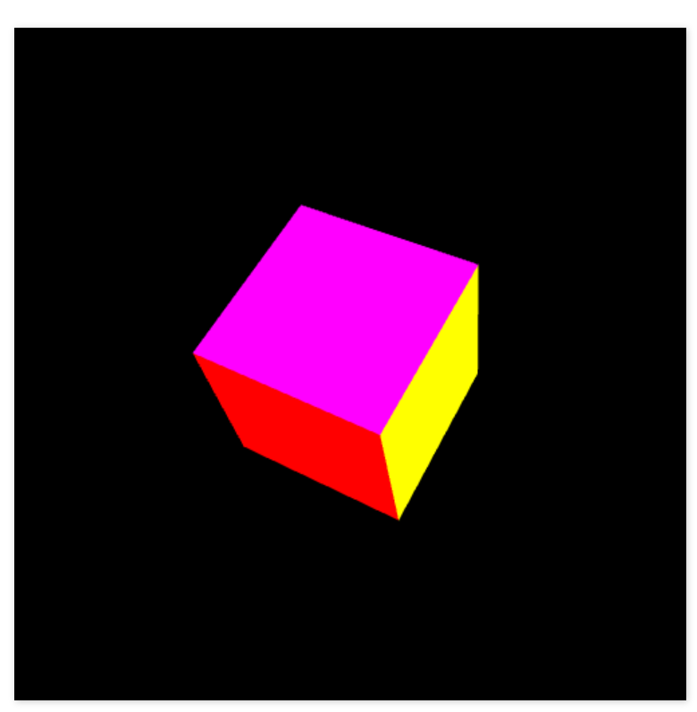


### 环境光


# 着色器函数


### mix(x, y, alpha)

```glsl
mix(x, y, alpha)
基于第三个参数 alpha，在两个值之间进行线性插值。0表示完全使用x，1表示完全使用y
mix(2.0, 5.0, 0.25);  // 返回2.75

2.0 ─────────────────────── 5.0
  ↑
  0%
    
2.0 ──── 2.75 ──────────── 5.0
          ↑
         25% 处


mix(vec3(1.0, 0.0, 0.0), vec3(0.0, 1.0, 0.0), 0.5);  // 返回 (0.5, 0.5, 0.0)
mix(vec4(1.0, 0.0, 0.0, 1.0), vec4(0.0, 1.0, 0.0, 1.0), 0.5);  // 返回 (0.5, 0.5, 0.0, 1.0)
https://bimant.com/docs/glsl-es/mix/
```


### length

```glsl
float length(vec2 x);
float length(vec3 x);
float length(vec4 x);
length函数用于计算一个向量的长度（模）。
vec3 position = vec3(1.0, 2.0, 3.0);
float len = length(position);   // len的值为sqrt(1.0*1.0 + 2.0*2.0 + 3.0*3.0)
https://bimant.com/docs/glsl-es/length/
```


### clamp

```glsl
float clamp(float x, float minVal, float maxVal)
用于限制一个值的范围在指定的最小值和最大值之间
x：需要限制范围的值。
minVal：限制范围的最小值。
maxVal：限制范围的最大值。
    
vec3 v = vec3(1.2, -0.5, 2.0);
vec3 clampedV = clamp(v, vec3(0.0，0.0，0.0), vec3(1.0，1.0，1.0));
向量v的每个分量都被限制在0和1之间。因此，得到的限制后的值为(1.0, 0.0, 1.0)。
https://bimant.com/docs/glsl-es/clamp/
```


### normalize

```glsl
normalize函数将一个向量x除以它的长度，从而得到一个方向相同但长度为1的向量
vec3 normalize(vec3 x)
x：需要被规范化的向量
返回一个长度为1的向量
https://bimant.com/docs/glsl-es/normalize/
```


### step()

语法

```glsl
float step(float edge, float x)
// x <  edge  →  返回 0.0
// x >= edge  →  返回 1.0
```

它就是一个台阶函数：在 `edge` 处从 0 瞬间跳到 1。


和 `if` 的等价关系

```glsl
// 写法 A：分支
if (uv.x > 0.5) col = vec3(1.0);

// 写法 B：算术
col = vec3(step(0.5, uv.x));
```

视觉结果完全一样：右半屏变白。

为什么 GPU 更喜欢 B？

GPU 是**一组像素共用一条指令流**在跑。如果同一组里有的像素走 `if` 的 true 分支、有的走 false 分支（叫**分支发散**），硬件只能：**两条路都跑一遍，再把不要的结果丢掉**。开销翻倍。

而 `step` 是纯数学运算，没有分支，所有像素走同一条路。

> 在 shader 里，能用算术表达的判断，就别写 `if`。这是贯穿整个 shader 编程的习惯。


关键通则：内置函数都是「逐分量」的

```glsl
col = vec3(step(0.5, uv), 0.0);   // uv 是 vec2，返回 vec2
```

`step` 同时对 `uv.x` 和 `uv.y` 各做一次，返回 `vec2`。结果是屏幕被切成**四块**（左下黑、右下红、左上绿、右上黄）。

这条规则对 **几乎所有** GLSL 数学函数都成立：`sin` `cos` `abs` `floor` `sqrt` `step` `mix`... 传向量进去，就是每个分量各算各的。

> 看到函数只需记标量版本，向量版本自动成立


`step` 的真正用法：当遮罩（mask）

`step` 输出的 0/1 最常见的搭档是 `mix`：

```glsl
float m = step(0.5, uv.x);          // 遮罩：0 或 1
vec3 col = mix(colorA, colorB, m);  // m=0 取 A，m=1 取 B
```

`mix(a, b, t)` = `a\*(1-t) + b\*t`，线性插值。
「**用 step 算遮罩 → 用 mix 选颜色**」是 shader 里最通用的选色套路，比 `if` 出现频率高得多。

例子：

```glsl
void mainImage(out vec4 fragColor, in vec2 fragCoord)
{
    vec2 uv = fragCoord / iResolution.xy;

    float m = step(0.5, uv.x);
    vec3 col = mix(vec3(1.0, 0.2, 0.2), vec3(0.2, 0.4, 1.0), m);

    fragColor = vec4(col, 1.0);
}
```

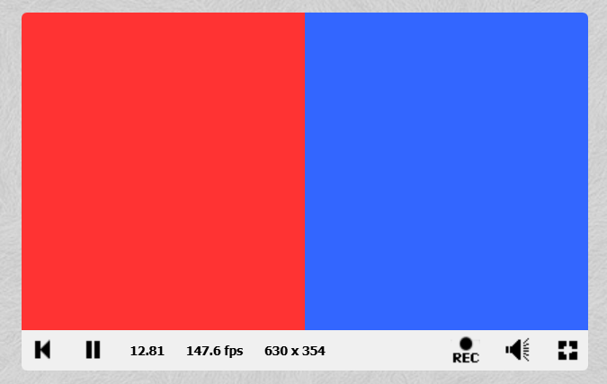

把 `step` 换成 `smoothstep(0.45, 0.55, uv.x)` 再跑一次 —— 硬边变成渐变。这就是抗锯齿的伏笔。

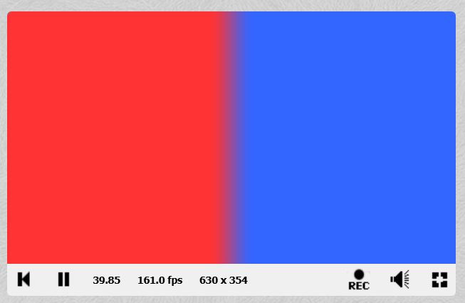

step和smoothstep

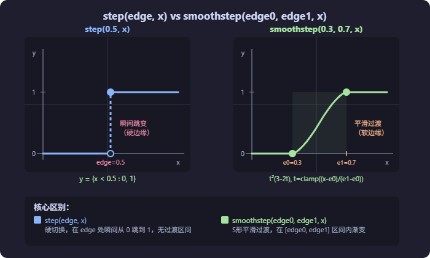


https://bimant.com/docs/glsl-es/step/


### faceforward()

```glsl
faceforward() 
函数用于判断向量朝向，它可以通过比较入射向量与几何法线的方向，是否一致确定向量朝向。

vec3 faceforward(vec3 N, vec3 I, vec3 Nref)
N：要调整的法线向量（通常是表面法线）
I：入射向量（光线或观看方向）
Nref：参考法线（用于判断方向的参考）
    
// faceforward() 的等价实现
vec3 faceforward(vec3 N, vec3 I, vec3 Nref)
{
    if (dot(Nref, I) < 0.0)
        return N;           // Nref 和 I 方向一致，返回 N
    else
        return -N;          // Nref 和 I 方向相反，翻转 N
}

如果夹角 > 90°（即 dot < 0），说明方向相反，翻转法线
```


### min(x, y)

```glsl
min(x, y)
用于返回两个数值中的最小值
x: 第一个参数，可为任意数据类型。
y: 第二个参数，与x数据类型相同。

计算两个浮点数的最小值：
float a = 2.5;
float b = 3.8;
float min_val = min(a, b);
// min_val的值为2.5 

计算两个向量各个元素中的最小值：
vec3 u = vec3(2.0, 3.0, 1.0);
vec3 v = vec3(1.0, 4.0, 2.0);
vec3 min_val = min(u, v);
// min_val的值为(1.0, 3.0, 1.0)
```


### cross(vec3 x, vec3 y)

```glsl
cross(vec3 x, vec3 y)
x：vec3类型，表示第一个3D向量。
y：vec3类型，表示第二个3D向量。
返回一个新的vec3类型的向量，表示两个向量的叉积 
    
vec3 v1 = vec3(1.0, 0.0, 0.0);
vec3 v2 = vec3(0.0, 1.0, 0.0);
vec3 v3 = cross(v1, v2); // v3 = vec3(0.0, 0.0, 1.0)

对于线性无关的两个向量a和b，它们的外积写作a×b,是a和b所在平面的法线向量，与a和b都垂直。
```


### fract：返回参数的“小数部分”

```glsl
fract(x) = x - floor(x)
```

无论 x 是正是负，`floor(x)` 都向下取整，所以：

| x    | floor(x) | fract(x) |
| :--- | :------- | :------- |
| 3.7  | 3        | 0.7      |
| 0.3  | 0        | 0.3      |
| 1.0  | 1        | 0.0      |
| -0.3 | -1       | 0.7      |
| -1.3 | -2       | 0.7      |

# maths

```
三角函数的标准形式为：
y = A·sin(ωx + φ) + k
或
y = A·cos(ωx + φ) + k

振幅	A	函数离中心线的最大距离，控制波的高度
角频率	ω (omega)	控制波的周期快慢，ω越大波振动越快	弧度/单位
初相位	φ (phi)	函数的水平偏移量，控制波的左右移动	弧度
竖直偏移	k	函数图像在竖直方向上的平移，控制中心线高度	


假如结合单位圆来看：
圆心在原点，半径为1的圆上的点：
(cos θ, sin θ)

当点在单位圆上旋转时：

θ = ωt + φ （t是时间，ω是角速度）

点的坐标：(cos(ωt + φ), sin(ωt + φ))

三角函数图像其实是圆周运动在时间轴上的投影！
```


```
正方形方程：
max(abs(x), abs(y)) - 2 = 0
         ↓
max(abs(x), abs(y)) = 2

意思就是abs(x) 和 abs(y) 中较大的那个等于 2,然后分四个象限讨论

第一象限（x ≥ 0, y ≥ 0）

• x = 2, 0 ≤ y ≤ 2  （竖直线段）
或
• y = 2, 0 ≤ x ≤ 2  （水平线段）
构成了第一象限的第一个角

其它三个象限依次类推
```


# Shadertoy 


## shader前置


### 着色器思维

shader代码写的不是"画图程序"，而是"一个像素的问答函数"

GPU 会拿这个函数，同时问屏幕上 200 万个像素：「你是什么颜色？」

```glsl
GPU会为每个像素各自启动一个独立的着色器线程，每个线程并行运行，有自己的私有局部变量，独立的fragCoord，按顺序执行函数里的每一行，线程之间互不干扰
void mainImage(out vec4 fragColor, in vec2 fragCoord) {
    vec2 uv = fragCoord / iResolution.xy;   // 第1行
    vec3 col = vec3(0.0, 0.0, 1.0);         // 第2行
    fragColor = vec4(col, 1.0);             // 第3行
}

像素(100,200) 的线程:  第1行 → 第2行 → 第3行   
像素(101,200) 的线程:  第1行 → 第2行 → 第3行
像素(102,200) 的线程:  第1行 → 第2行 → 第3行  
```

> 在物理 GPU 上，并不是真正为每个像素单独分配一个独立的核心。通常是以 **warp / wavefront（32 或 64 个线程一组）** 为单位并行执行，组内线程共享指令流。但从**编程模型**角度，把它们看作一个个独立的线程是允许的，也是着色器语言的设计初衷。


#### 与普通编程思维不同的几个点

1：你没有"画布"，只有"当前这个像素"

| 普通编程（Canvas 2D）                         | Shader                                                       |
| --------------------------------------------- | ------------------------------------------------------------ |
| `ctx.fillRect(10, 10, 50, 50)` 我去画一个方块 | 我不能画。我只能回答：「**我这个像素**，是不是落在那个方块里？是就返回红色，不是就返回黑色」 |
| 命令式：我操作画布                            | 声明式：画布来问我                                           |

所有"画形状"在 Shader 里都变成 "判断当前像素在不在形状内"。


2：像素之间完全隔离，不能通信

- **拿不到**旁边像素的颜色。
- **没有**全局可变变量能让像素之间传值。
- **不知道**哪个像素先执行（顺序完全不确定）。

普通编程里"先算好一个数组再遍历"的套路，在这里直接不成立。


 3：无状态 —— 帧与帧之间没有记忆

每一帧，你的函数从零重新执行一遍。你**不能**写：

```glsl
x = x + 1;  // 想让它每帧递增 —— 做不到，下一帧 x 又回初始值
```

所以：**动画不是"累加"出来的，而是"用时间算"出来的**。动画 = f(iTime)。任何随时间变化的东西，都必须写成时间的函数。

```glsl
float x = iTime;  // 唯一的时间来源，Shadertoy 注入的全局变量（单位：秒）
```


4：没有 `console.log`，调试靠颜色

想看某个变量的值？把它涂到屏幕上：

```glsl
fragColor = vec4(vec3(myValue), 1.0);  // 黑=0，白=1，灰=中间
```


5：函数必须返回颜色，不能"跳过"

没有 `return;` 提前退出不画。每个像素每一帧都**必须**产出一个颜色。想让它"透明/不画"？在 Shadertoy 里就是涂成背景色。


### 渲染管线

Vertex → Assembly → Geometry → Rasterization → **Fragment** → Blending

- Shadertoy **只给你片段着色器（Fragment Shader）**。
- 前面的几何阶段是固定的：永远只有**一个铺满屏幕的矩形**。
- 所以 Shadertoy 里**不存在"物体"**。没有球体、没有立方体，只有一块平面画布。
- 看到的所有 3D 效果，都是靠**数学在每个像素上现算出来的**（ Ray Marching / SDF）。

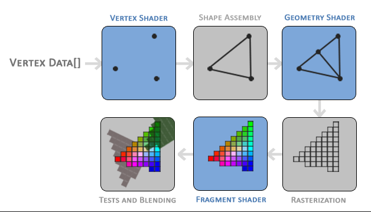


三个点 → 黄色三角形

插值：顶点定义角，GPU 自动填中间。但在 Shadertoy 里这一步跟开发者无关，因为对于开发者来说，"三角形"永远是整个屏幕。

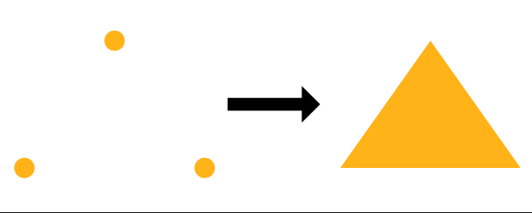


### shadertoy界面

只需要认 4 个东西

| 编号 | 是什么                                 |
| ---- | -------------------------------------- |
| ①    | 画布，你的输出                         |
| ②    | 时间控制（倒回 / 播放暂停 / 当前秒数） |
| ⑧    | 编译按钮 + 报错信息                    |
| ④    | 分辨率，对应 `iResolution`             |

③fps、⑤录制、⑥多脚本 Buffer、⑦全局变量列表、⑨纹理通道、⑩字号 —— 现在都可以忽略。

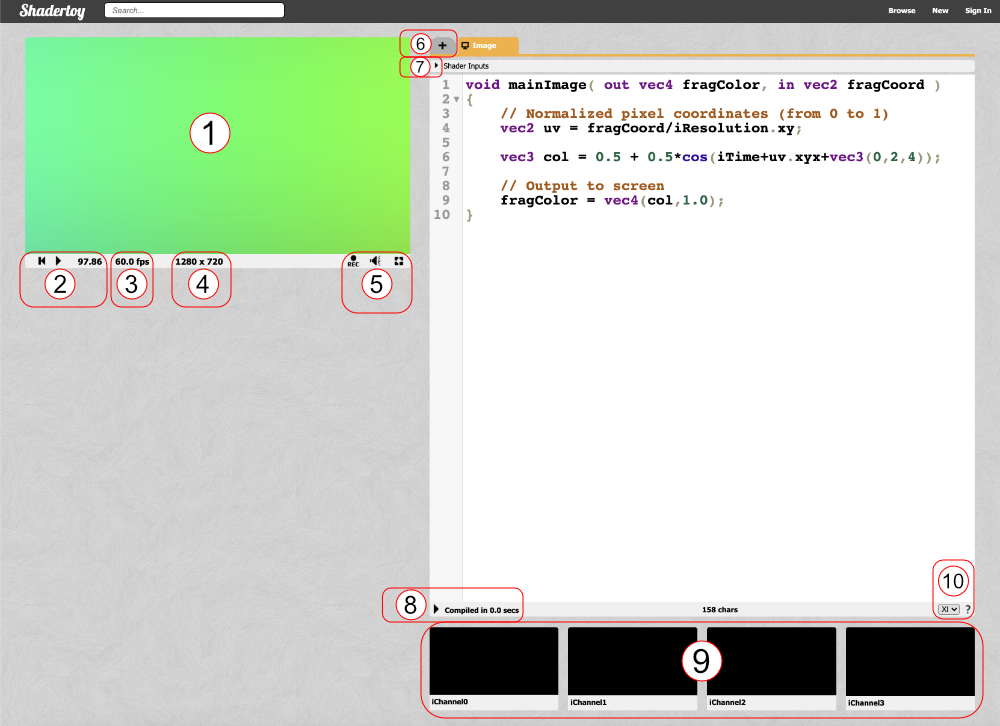


### 数据类型

```glsl
glsl是一种静态类型的变成语言，类型包括bool（布尔类型）、int（整数类型）、float（十进制浮点数）、vec2/vec3/vec4（向量类型）、mat2/mat3/mat4（矩阵类型）等。
```


### 向量类型

本质是容纳1~4个值的数组

```
vec2 —— 包含 x、y 两个分量
vec3 —— 包含 x、y、z 三个分量
vec4 —— 包含 x、y、z、w 四个分量
```


### Swizzling：向量分量的自由重组

语法

```glsl
vec3 col = vec3(0.2, 0.4, 0.6);

col.xyx    // → vec3(0.2, 0.4, 0.2)   重复取
col.zyx    // → vec3(0.6, 0.4, 0.2)   逆序
col.xy     // → vec2(0.2, 0.4)        降维
col.x      // → float 0.2
```

三套等价的名字

| 组   | 分量名    | 语义场景   |
| ---- | --------- | ---------- |
| 位置 | `x y z w` | 坐标、向量 |
| 颜色 | `r g b a` | 颜色       |
| 纹理 | `s t p q` | UV 坐标    |

三套**完全等价**，只是可读性差异。`col.r` 和 `col.x` 是同一个数。
唯一规则：**不能混用**，`col.xg` 非法。

```glsl
uv.x *= iResolution.x / iResolution.y;   // 只改 x 分量
col.rg = vec2(1.0, 0.0);                 // 一次改两个
```

但左值不能重复分量：`col.xx = ...` 非法（一个位置要写两个值，无意义）。


价值：Swizzling 让开发者**免去建临时变量**，代码短且没有性能代价（编译期就展开了）。


### 坐标系统

#### Shadertoy 坐标系

`fragCoord` 表示当前像素在画布上的 XY 坐标（单位：像素）。符合数学上的二维直角坐标系

```glsl
（0， iResolution.y）                     （iResolution.x， iResolution.y)
                    ---------------------
                    |                   |
                    |                   | 
                    |                   |
                    |                   |
                    ---------------------                   
          （0， 0）                      （iResolution.x， 0）
```

- 左下角为 `(0, 0)`
- 右上角为 `(iResolution.x, iResolution.y)`


#### Canvas 2D 坐标系

```glsl
（0， 0）                       （canvas.width， 0）
        ---------------------
        |                   |
        |                   |
        |                   |
        ---------------------
（0， canvas.height）           （canvas.width， canvas.height）
```


与网页的css坐标系一致，如此设置是因为西文/中文都是从上到下，从左到右的顺序进行读写，网页就自然沿用了


#### 分辨率 / 归一化坐标

iResolution 画布分辨率

```
iResolution 是一个 vec3：
  iResolution.x = 画布宽度（像素）
  iResolution.y = 画布高度（像素）
  iResolution.z = 像素纵横比，通常为 1.0（表示正方形像素）
```


uv 归一化坐标

```glsl
fragCoord表示当前像素在画布上的坐标


vec2 uv = fragCoord / iResolution.xy;

// 等价于分量逐个相除：
uv.x = fragCoord.x / iResolution.x;
uv.y = fragCoord.y / iResolution.y;
```

> uv一词源于 3D 建模中的uv贴图，用于把纹理映射到 3D 表面


#### 把原点搬到中心

```glsl
uv -= 0.5;   // 变成 -0.5..0.5
```

不做的话，圆心 (0,0) 在左下角


### 函数

语法

```glsl
着色器中的函数结构示意图：

┌─ 返回类型
│         ┌─ 函数名       ┌─ 参数名称
│         │              │
│         │              │
vec4 myFunction(in vec2 coord, out float value, float scale)
                    │ ↑                          │ ↑
                    │ 修饰符                     │ 默认in
                    └ 参数类型                    └ 参数类型
in表示输入参数，out表示输出参数，默认情况下参数是输入参数，可以省略in修饰符
    
    
    
GLSL里面的函数有多个输出通道，可以同时输出两个值，一个通过返回值，一个通过 out 参数
float myFunc(in vec2 coord, out vec3 normal) {
  normal = vec3(0.0, 1.0, 0.0);  // 直接把值输进输入参数
  return length(coord);          // 返回值
}

// 调用时：
vec3 n;
float len = myFunc(uv, n); // 调用后 n 被填充了，len 也有值
```


例子

```glsl
// fragColor：输出参数，要设置的像素最终颜色，写入帧缓冲
// fragCoord：输入参数，当前像素的屏幕坐标（以像素为单位），来自光栅化阶段
void mainImage( out vec4 fragColor, in vec2 fragCoord ) 
{
  // Normalized pixel coordinates (from 0 to 1)
  vec2 uv = fragCoord / iResolution.xy;

  // 设置颜色为蓝色
  vec3 col = vec3(0.0, 0.0, 1.0); 

  // 输出到屏幕
  fragColor = vec4(col, 1.0); 
}

最终得到的是一个完全为蓝色的画布，着色器程序对画布上的每个像素同时（in parallel）运行。编写代码的时候一定要时刻记住，如何根据像素坐标更改像素的颜色，只需要像素坐标就能创作出令人惊叹的艺术品
    
fragColor和fragCoord是Shadertoy/GLSL规定的函数签名，显卡驱动认识这个接口
```

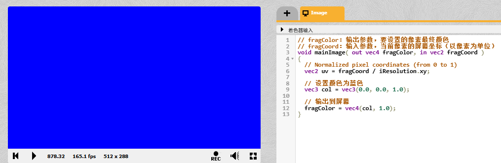


### 颜色表示

着色器中颜色使用 **0.0 ~ 1.0** 的归一化范围指定 RGB 值。 如果原始值在 0~255 之间，需要除以 255 来归一化。

```glsl
vec3 col = vec3(1.0, 0.0, 0.0);     // 纯红
vec3 col = vec3(255.0/255.0, 0, 0); // 等价写法
```


### 调试技巧

Shadertoy等着色器环境没有 `console.log()`,通常通过把变量映射到颜色来 “看见” 它的值。

```glsl
void mainImage( out vec4 fragColor, in vec2 fragCoord )
{
  // 归一化像素坐标（0 ~ 1）
  vec2 uv = fragCoord/iResolution.xy;

  // 把uv当作颜色输出：r = uv.x, g = uv.y, b = 0
  vec3 col = vec3(uv, 0);

  // Output to screen
  fragColor = vec4(col,1.0);
}
```

左下角黑色，uv = (0, 0)

右下角红色，uv.x增加，R通道增强

左上角绿色，uv.y增加，G通道增强

右上角黄色，R 和 G 都为1

底部由黑变红，证明x坐标从左到右是递增的

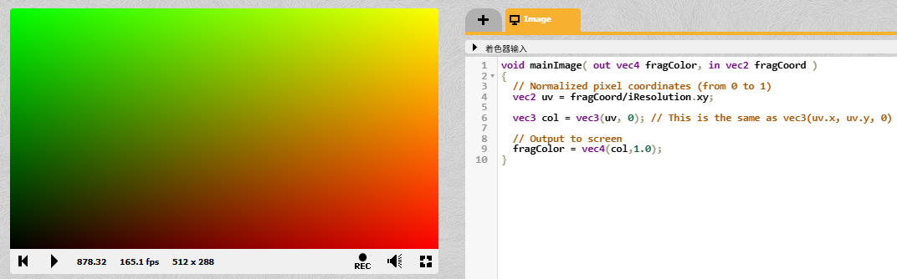


### shadertoy界面

只需要认 4 个东西

| 编号 | 是什么                                 |
| ---- | -------------------------------------- |
| ①    | 画布，你的输出                         |
| ②    | 时间控制（倒回 / 播放暂停 / 当前秒数） |
| ⑧    | 编译按钮 + 报错信息                    |
| ④    | 分辨率，对应 `iResolution`             |

③fps、⑤录制、⑥多脚本 Buffer、⑦全局变量列表、⑨纹理通道、⑩字号 —— 现在都可以忽略。


### Shadertoy内置变量

| 变量                      | 类型        | 说明                                                         |
| ------------------------- | ----------- | ------------------------------------------------------------ |
| **iResolution**           | `vec3`      | 视口分辨率（像素），其中 `x` 和 `y` 是宽高，`z` 通常未使用   |
| **iTime**                 | `float`     | 着色器播放时间（秒），从0开始持续递增                        |
| **iTimeDelta**            | `float`     | 单帧渲染耗时（秒），即两帧之间的时间差                       |
| **iFrameRate**            | `float`     | 着色器帧率（每秒帧数，FPS）                                  |
| **iFrame**                | `int`       | 当前帧编号（整数），从0开始                                  |
| **iChannelTime[4]**       | `float[4]`  | 4个输入通道各自的播放时间（秒）                              |
| **iChannelResolution[4]** | `vec3[4]`   | 4个输入通道的分辨率（像素）                                  |
| **iMouse**                | `vec4`      | 鼠标信息：`xy` = 当前鼠标位置（左键按下时��，`zw` = 鼠标点击时的位置 |
| **iChannel0..3**          | `samplerXX` | 输入纹理采样器，`XX` 可以是 `2D`（2D纹理）或 `Cube`（立方体贴图） |
| **iDate**                 | `vec4`      | 日期和时间：`x` = 年，`y` = 月，`z` = 日，`w` = 当天经过的秒数 |
| **iSampleRate**           | `float`     | 音频采样率（通常为44100 Hz）                                 |


## 从「画形状」到「算距离」


### 核心

不是在画形状，而是在让每个像素回答一个问题："我离这个形状有多远？"

传统绘图是「命令式」的：`drawCircle(x, y, r)` —— 开发者告诉系统去画一个圆。

Shader 是「查询式」的：每个像素独立问一句"我在圆里还是圆外"，然后自己决定颜色。


### SDF

定义

**Signed Distance Function（有符号距离函数）**：输入一个点，输出**该点到形状表面的最短距离**，并用符号表示内外。

| `d` 的值 | 含义               |
| -------- | ------------------ |
| `d < 0`  | 点在形状**内部**   |
| `d = 0`  | 点正好在**表面**上 |
| `d > 0`  | 点在形状**外部**   |

「Signed（有符号）」这个词的全部含义就是：**负号代表在里面**。


画面建立：想象一张无限大的二维坐标纸，画布上的每个像素就是坐标纸上的一个点。当 shader 运行时，每个点**同时**向形状边界"伸出一根触角量距离"，得到一个有符号的数字。然后根据这个数字决定自己是什么颜色。


边界与前提

- SDF 返回的是**距离**，单位和你的坐标系一致。UV 在 `[-0.5, 0.5]` 时，`r = 0.2` 才合理
- 它是一个**标量场**：整个平面上每一点都有一个值，形状只是这个场里 `d = 0` 的那条等高线
- 严格的 SDF 要求距离**精确**；有些公式只保证符号正确、距离被低估，那叫「有界距离场」。2D 上色不影响，3D Ray Marching 时会影响（可能穿模）


### 圆的 SDF

```glsl
float sdfCircle(vec2 p, float r) {
    return length(p) - r;
}
```

推导极其朴素：

- `length(p)` = 点到原点的距离
- 减去半径 `r`：距离刚好等于 r 时结果为 0（在圆周上），小于 r 为负（在圆内），大于 r 为正（圆外）

`length(vec2(x,y))` 就是 
$$
\sqrt{x^2+y^2}
$$
即圆方程 
$$
x^2+y^2-r^2=0
$$
 的开方版本。**开方的意义**：结果的单位变回了"长度"，是真实的距离，而不是距离的平方。这一点后面做描边、光晕、Ray Marching 时至关重要。


### SDF设计理念

为什么 Shader 用 SDF

1. 形状变成了函数 —— 不需要顶点、不需要几何数据，一行公式就是一个圆

2. 分辨率无关 —— 放大到任何倍数都是完美的边，因为它是实时算的

3. 可组合

   ```glsl
   min(d1, d2)    // 并集：两个形状合并
   max(d1, d2)    // 交集：重叠部分
   max(d1, -d2)   // 差集：从 d1 里挖掉 d2
   ```

4. d 本身携带信息 —— 不只是内外，它还告诉你"离边缘多远"。这个数值可以直接拿来做：描边、发光、阴影、软边、3D 里的步进距离


SDF 把「几何问题」翻译成了「求值问题」，而求值正是 GPU 最擅长的事。


### 用 SDF上色

```glsl
float d = sdfCircle(uv, 0.2);
vec3 col = d > 0.0 ? vec3(1.0) : vec3(0.0, 0.0, 1.0);
```

`d` 只是一个数，怎么用完全由你决定。这里是硬阈值（有锯齿），换成 `smoothstep` 就抗锯齿了。


实验：把距离场本身画出来

```glsl
void mainImage(out vec4 fragColor, in vec2 fragCoord)
{
    vec2 uv = fragCoord / iResolution.xy - 0.5;  // 把像素坐标归一化到 [0,1]×[0,1]，再减 0.5 平移到 [-0.5,0.5]×[-0.5,0.5]，于是屏幕中心正好是 (0,0)
    uv.x *= iResolution.x / iResolution.y;  // 纵横比修正

    float d = length(uv) - 0.2;

    // 直接把距离当亮度，你会看到一圈圈从圆心向外扩散的灰度
    vec3 col = vec3(d);

    fragColor = vec4(col, 1.0);  // 输出不透明颜色
}
```

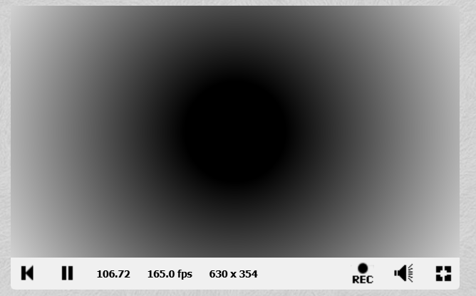

中心是黑的（负数被 clamp 到 0），向外越来越亮。


### 变换

平移：为什么是**减法**

```glsl
float d = length(uv - offset) - r;   // 圆心移到 offset
```

想让圆**往右移**，却要**减**一个正数 

因为根本没有移动形状，移动的是「提问的位置」。

`length(uv)` 永远是"到原点的距离"，公式本身写死了圆心在原点。要让圆看起来在 `offset` 处，就得在计算前把整个坐标系**反向平移**，让 `offset` 那个点变成新的"原点"。

类比：想让照片里的人往右挪，等价于**把相机往左挪**。


这是所有空间变换的通用套路

变换的是空间（坐标），不是物体。所以永远用逆变换：

| 想要的效果       | 对坐标做的操作             |
| ---------------- | -------------------------- |
| 形状右移 `a`     | `uv - a`                   |
| 形状放大 `s` 倍  | `uv / s`                   |
| 形状顺时针转 `θ` | 坐标逆时针转 `θ`           |
| 形状阵列重复     | `fract(uv)` / `mod(uv, n)` |

这套「先扭曲空间，再求距离」的思路叫 **Domain Warping（域变形）**，是 shader 里做复杂图形最核心的手法之一。**一个 SDF 公式 + 无限种坐标变换 = 无限种图形。**


实验：一行代码画一排圆

```glsl
void mainImage(out vec4 fragColor, in vec2 fragCoord)
{
    vec2 uv = fragCoord / iResolution.xy - 0.5;
    uv.x *= iResolution.x / iResolution.y;

    uv = fract(uv * 4.0) - 0.5;   // 空间切成 4x4 格，每格坐标重置为 [-0.5,0.5]

    float d = length(uv) - 0.2;
    vec3 col = d > 0.0 ? vec3(1.0) : vec3(0.0, 0.0, 1.0);

    fragColor = vec4(col, 1.0);
}
```

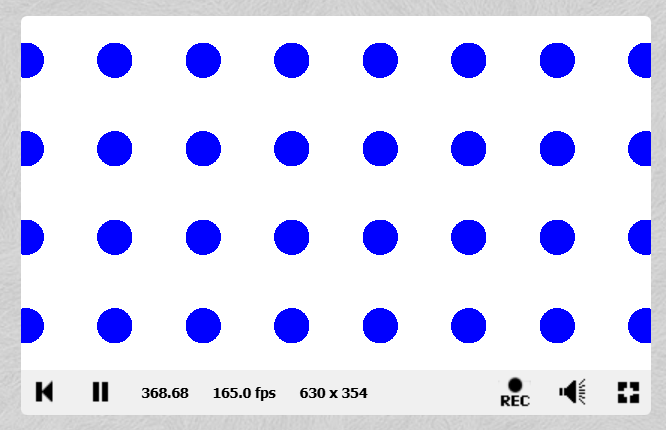


### 时间：让画面动起来

`iTime`

Shadertoy 提供的全局变量，单位**秒**，从播放开始累加。这是画面里唯一的"动力源"。


`sin` / `cos` 的三个旋钮

```
A * sin(f * iTime + φ)
```

| 参数 | 名称 | 作用                    |
| ---- | ---- | ----------------------- |
| `A`  | 振幅 | 摆动幅度多大            |
| `f`  | 频率 | 摆动多快                |
| `φ`  | 相位 | 起始位置在哪 / 错开多少 |

sin、cos 是 shader 里制造周期运动的**默认工具**，因为它们输出永远在 `[-1, 1]`、无限循环、且平滑无跳变。


通用工具：范围重映射

```glsl
0.5 + 0.5 * sin(x)      //  [-1,1] → [0,1]
a + (b - a) * (0.5 + 0.5 * sin(x))   //  [-1,1] → [a,b]
```

**为什么必须做这一步**：颜色的有效范围是 `[0,1]`。直接用 `sin` 的输出，负数部分会被硬性截断（clamp）成 0 —— 你会失去一半的动画，画面有一段时间是死黑的。

 `0.5 + 0.5 * cos(iTime + uv.xyx + vec3(0,2,4))` 就是这个公式：

- `iTime` → 随时间变色
- `uv.xyx` → 随空间产生渐变
- `vec3(0,2,4)` → **给 R/G/B 三通道各错开一个相位**，三条正弦波不同步，才有彩虹感（都用同一个相位的话只会是灰度闪烁）


实验：圆周运动

```glsl
vec2 offset = vec2(sin(iTime), cos(iTime)) * 0.2;
```

单位圆的参数方程。注意方向：

- `vec2(sin t, cos t)`：t=0 时在**正上方**，t 增大 x 变正 → **顺时针**
- `vec2(cos t, sin t)`：t=0 时在**正右方**，t 增大 y 变正 → **逆时针**

完整代码：

```glsl
void mainImage(out vec4 fragColor, in vec2 fragCoord)
{
    vec2 uv = fragCoord / iResolution.xy - 0.5;
    uv.x *= iResolution.x / iResolution.y;

    vec2 offset = vec2(sin(iTime * 2.0), cos(iTime * 2.0)) * 0.2;

    float d = length(uv - offset) - 0.1;
    vec3 col = d > 0.0
        ? vec3(0.0)
        : 0.5 + 0.5 * cos(iTime + uv.xyx + vec3(0, 2, 4));

    fragColor = vec4(col, 1.0);
}
```


## 2D形状和动画

有符号距离函数 SDF （Signed Distance Field）的本质是定义在整个二维平面上的标量场，即对平面上每一个点 `(x, y)`，都赋予一个**实数值**

> 这个**实数值**表示该点到SDF形状边界的有符号距离
>
> - `d < 0`：点在形状**内部**
> - `d = 0`：点恰好在**边界上**
> - `d > 0`：点在形状**外部**，值越大离得越远


使用SDF绘制形状的模型：

```
画布上每个像素（同时、并行的）：
	1、知道自己的坐标（uv）
	2、调用sdf（uv）→ 得到一个距离值d
	3、用 d 的符号、大小 → 决定自己的颜色
	4、输出颜色
```


画面建立：想象一张无限大的二维坐标纸，画布上的每个像素就是坐标纸上的一个点。当 shader 运行时，每个点**同时**向形状边界"伸出一根触角量距离"，得到一个有符号的数字。然后根据这个数字决定自己是什么颜色。


### SDF画圆

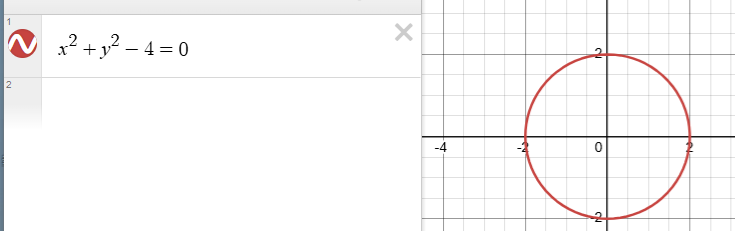

```glsl
在Shadertoy中，可以利用方程（ x^{2}+y^{2}-4=0 ）的左侧来画一个圆，创建一个名为sdfCircle的函数，该函数返回 XY 坐标处每个像素的颜色，如果像素在圆的内部，则返回蓝色，如果在圆的外部，则返回白色，圆心位于原点，半径为0.2

vec3 sdfCircle(vec2 uv, float r) {
  float x = uv.x;
  float y = uv.y;

  // 计算向量<x, y>的模长，减去半径r，这个d的值，就是SDF的"带符号距离"
  float d = length(vec2(x, y)) - r; 

  // 这一行利用SDF做判断，如果d大于0，返回白色，否则返回蓝色
  return d > 0.0 ? vec3(1, 1, 1) : vec3(0, 0, 1); 
}

void mainImage( out vec4 fragColor, in vec2 fragCoord )
{
  vec2 uv = fragCoord/iResolution.xy; // <0, 1>

  uv -= 0.5; // 左加右减，将像素坐标系的原点从左下角移动到屏幕中心

  vec3 col = sdfCircle(uv, 0.2); 

  fragColor = vec4(col, 1.0);
}
```

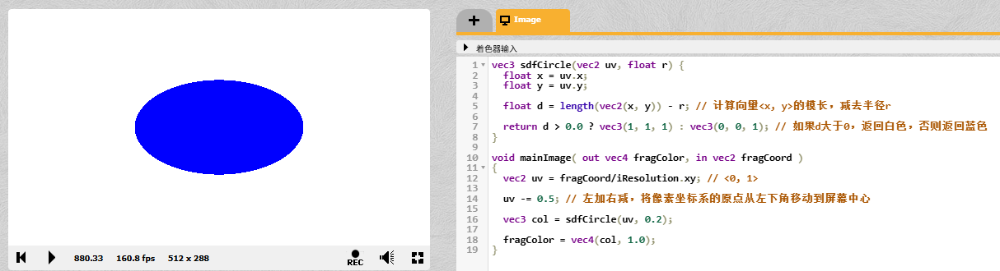


```glsl
画布的圆形在x方向看起来有些拉长，像一个椭圆，这是由画布的纵横比引起的，这是由于画布的纵横比引起的。当画布的宽度和高度不匹配时，圆圈将显示为拉伸，可以通过将uv坐标的x分量乘以画布的纵横比来纠正这个问题，
    
添加
    
uv.x *= iResolution.x / iResolution.y; 
```

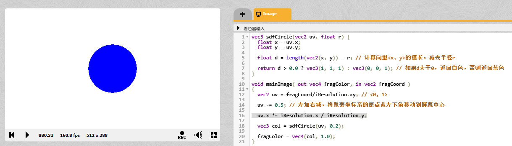


#### 纵横比详解

本质：确保在x方向上和y方向上的像素密度是相同的

```glsl
假设屏幕是 宽1920px × 高1080px（16:9的比例）

原始像素坐标范围：
  x: [0, 1920]  →  归一化后: [0, 1]
  y: [0, 1080]  →  归一化后: [0, 1]

代码：uv = fragCoord / iResolution.xy

结果：
  uv.x 的范围: [0, 1]	(范围宽度 = 1)
  uv.y 的范围: [0, 1]	(范围宽度 = 1)
  
y方向：1080个像素分布在范围 [0, 1]，步长 = 1/1080
x方向：1920个像素分布在范围 [0, 1]，步长 = 1/1920

因为 1/1920 < 1/1080，所以x方向的像素在逻辑坐标上"更密集"，同样逻辑范围内，像素更多，排列的越长

屏幕实际情况（从上往下看）：

Y轴
↑  像素是这样排列的（1920×1080）：
│  ■■■■■■■■■■■■■■■■■■■■■■■
│  ■■■■■■■■■■■■■■■■■■■■■■■
│  ■■■■■■■■■■■■■■■■■■■■■■■
│  ■■■■■■■■■■■■■■■■■■■■■■■
└─────────────────────────→ X轴

宽度：1920像素（很多！）
高度：1080像素（较少）

画圆时：
- Y方向：1080个像素点覆盖范围 [0, 1]
- X方向：1920个像素点覆盖范围 [0, 1]

同样的逻辑范围，X方向有更多像素，所以看起来更"宽"
```


解决方案的原理：让逻辑坐标范围和像素数量成正比

```glsl
uv.x *= (屏幕宽度) / (屏幕高度)
uv.x *= iResolution.x / iResolution.y;

修正因子 = 1920 / 1080 ≈ 1.78

修正后：
  uv.x 的范围: [0, 1] × 1.78 = [0, 1.78]
  uv.y 的范围: [0, 1]  (保持不变)
  uv.x 的范围/uv.y 的范围 == iResolution.x / iResolution.y;


修正前：
■■■■■■■■■■■■■■■■■■■■■■■■■■■■■■■■■■■■■■■
|←─────── 范围宽度 = 1.0 ─────→|
1920个像素挤在1.0的范围内

像素密度 = 1920 / 1.0 = 1920 像素/单位范围

画半径 r=0.2 的圆时：
圆的直径在逻辑坐标上 = 0.4
该范围包含的像素数 = 0.4 × 1920 = 768 个像素

结果：在屏幕上看起来很宽（768个像素占据很大的宽度）
    
    

修正后：
■■■■■■■■■■■■■■■■■■■■■■■■■■■■■■■■■■■■■■■
|←──────── 范围宽度 = 1.78 ────→|
1920个像素分散在1.78的范围内

像素密度 = 1920 / 1.78 ≈ 1078 像素/单位范围

画半径 r=0.2 的圆时：
圆的直径在逻辑坐标上 = 0.4
该范围包含的像素数 = 0.4 × 1078 ≈ 431 个像素

结果：在屏幕上看起来正常宽度（像素数减少了，视觉上"收窄"了）
```


#### 移动圆圈

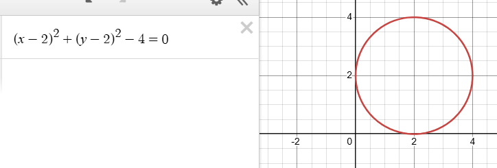

```js
vec3 sdfCircle(vec2 uv, float r, vec2 offset) {
  float x = uv.x - offset.x;
  float y = uv.y - offset.y;
  float d = length(vec2(x, y)) - r; // 计算向量<x, y>的模长，减去半径r

  return d > 0.0 ? vec3(0, 0, 0) : vec3(0, 0, 1);
}

void mainImage( out vec4 fragColor, in vec2 fragCoord )
{
  vec2 uv = fragCoord/iResolution.xy; // <0,1>
  uv -= 0.5;
  uv.x *= iResolution.x / iResolution.y;

  vec2 offset = vec2(0.2, 0.2);

  vec3 col = sdfCircle(uv, 0.2, offset);

  fragColor = vec4(col, 1.0);
}
```

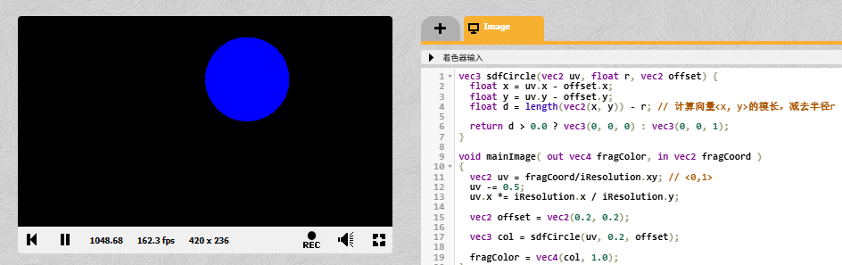


### 旋转矩阵

```glsl
旋转矩阵：
| cos(θ)  -sin(θ) |
| sin(θ)   cos(θ) |
```

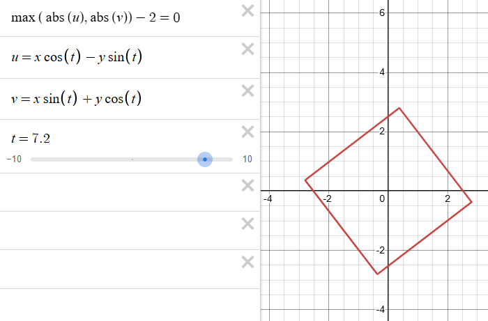


要使用这个矩阵，用uv坐标去叉乘矩阵即可

```glsl
// 旋转函数，输入UV坐标和旋转角度，返回旋转后的UV坐标
vec2 rotate(vec2 uv, float th) {
  return mat2(cos(th), -sin(th), sin(th), cos(th)) * uv;
}
```


### 更多2D SDF形状

```
https://iquilezles.org/articles/distfunctions2d/
```


## 2D SDF操作

样板

```glsl
// 背景颜色
vec3 getBackgroundColor(vec2 uv) {
  uv = uv * 0.5 + 0.5; // remap uv from <-0.5,0.5> to <0.25,0.75>
  vec3 gradientStartColor = vec3(1., 0., 1.);
  vec3 gradientEndColor = vec3(0., 1., 1.);
  return mix(gradientStartColor, gradientEndColor, uv.y); // gradient goes from bottom to top
}

// 定义圆形SDF
float sdCircle(vec2 uv, float r, vec2 offset) {
  float x = uv.x - offset.x;
  float y = uv.y - offset.y;

  return length(vec2(x, y)) - r;
}

// 定义正方形SDF
float sdSquare(vec2 uv, float size, vec2 offset) {
  float x = uv.x - offset.x;
  float y = uv.y - offset.y;

  return max(abs(x), abs(y)) - size;
}

// 绘制场景
vec3 drawScene(vec2 uv) {
  vec3 col = getBackgroundColor(uv);
  float d1 = sdCircle(uv, 0.1, vec2(0., 0.));
  float d2 = sdSquare(uv, 0.1, vec2(0.1, 0));

  float res; // 最终的SDF结果
  
  res = d1;  // 只使用圆的SDF

  res = step(0., res); // res < 0 ? 形状内部 : 形状外部

  col = mix(vec3(1,0,0), col, res);
  return col;
}

void mainImage( out vec4 fragColor, in vec2 fragCoord )
{
  vec2 uv = fragCoord/iResolution.xy; // <0, 1>
  uv -= 0.5; // <-0.5,0.5>
  uv.x *= iResolution.x/iResolution.y; // fix aspect ratio

  vec3 col = drawScene(uv);

  fragColor = vec4(col,1.0); // Output to screen
}
```

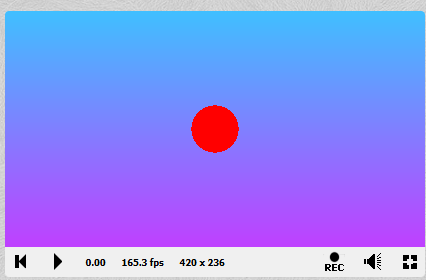


### 组合操作

就是对每个像素分别执行两个SDF函数，每个像素持有两个有符号距离值，分别是到两个形状边界的距离值，接着通过max/min处理，把每个像素中的两个有符号距离值合并为一个新距离值，新距离值<0就上色，>=0就不上色


```glsl
并集 min(d1, d2)
一个点属于"d1 或 d2 的并集"，当且仅当它在 d1 内 或 在 d2 内，即 d1 < 0 或 d2 < 0。
min(d1, d2) < 0 ↔ 至少有一个为负 ✓

vec3 drawScene(vec2 uv) {
  ...
  res = min(d1, d2); // union，联合操作，取两个SDF的最小值，表示两个形状的并集
  ...
}
```

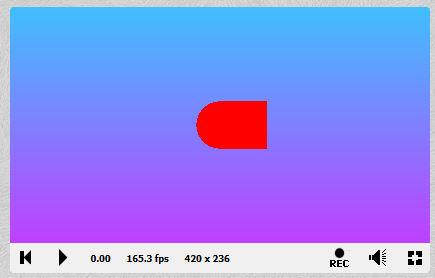


```glsl
交集 max(d1, d2)
一个点属于"d1 与 d2 的交集"，当且仅当 d1 < 0 且 d2 < 0。
max(d1, d2) < 0 ↔ 两个都为负 ✓

vec3 drawScene(vec2 uv) {
  ...
  res = max(d1, d2); // intersection，交集操作，取两个SDF的最大值，表示两个形状的交集
  ...
}
```

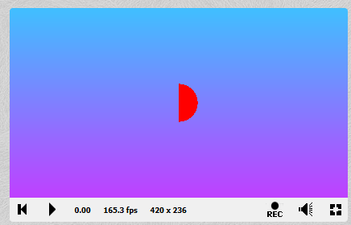


```glsl
差集 max(-d1, d2)
"d2 减去 d1"，即在 d2 内部 且 在 d1 外部：d2 < 0 且 d1 > 0（即 -d1 < 0）。
max(-d1, d2) < 0 ↔ -d1 < 0 且 d2 < 0 ↔ d1 > 0 且 d2 < 0 ✓

vec3 drawScene(vec2 uv) {
  ...
  res = max(-d1, d2); // difference，差集操作，取第一个SDF的负值和第二个SDF的最大值，表示d2-d1的结果
  ...
}
```

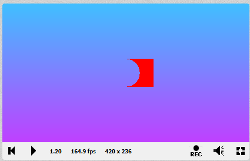


```glsl
异或 max(min(d1,d2), -max(d1,d2))
"在 d1 或 d2 中，但不在两者交集中"，即属于并集但排除交集：

vec3 drawScene(vec2 uv) {
  ...
  res = max(min(d1, d2), -max(d1, d2)); // difference，差集操作，取第一个SDF的负值和第二个SDF的最大值，表示d2-d1的结果
  ...
}
```

XOR = **并集** 再减去 **交集**，即 (d1∪d2)∖(d1∩d2) 。

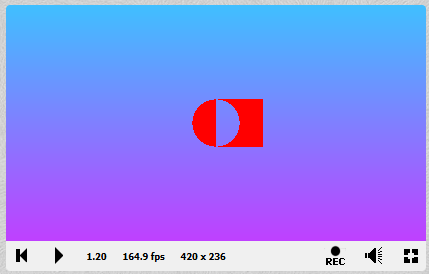


### 图形重复

在着色器中，通过sdf绘制形状的底层逻辑就是像素根据自身的位置（uv）去计算有符号距离，根据不同位置的像素持有的有符号距离不同，进行填色，图形重复本质上就是让能绘制出图形的像素区域，其像素坐标位置在参考系中进行重复，让像素位置重复后，再去跑sdf就能在重复区域对应处画出圆，根据重复的方式绘制一个或者双倍数量

草图大概是这样，让蓝色区域的坐标值在参考系中横着重复四次，就绘制出了四个圆形

图中的q表示为p(position)经过数学操作映射成的局部坐标


```svg
<svg xmlns="http://www.w3.org/2000/svg" width="620" height="370" viewBox="0 0 620 370">
  <rect width="620" height="370" fill="white"/>

  <defs>
    <marker id="arrowRed" markerWidth="9" markerHeight="9" refX="8" refY="3.5" orient="auto">
      <path d="M0,0 L0,7 L9,3.5 z" fill="red"/>
    </marker>
    <marker id="arrowBlue" markerWidth="7" markerHeight="7" refX="6" refY="3.5" orient="auto">
      <path d="M0,0 L0,7 L7,3.5 z" fill="#4488cc"/>
    </marker>
  </defs>

  <!-- ── Axes ── -->
  <line x1="20"  y1="190" x2="600" y2="190" stroke="red" stroke-width="1.5" marker-end="url(#arrowRed)"/>
  <line x1="130" y1="355" x2="130" y2="20"  stroke="red" stroke-width="1.5" marker-end="url(#arrowRed)"/>
  <text x="607" y="194" font-size="13" fill="red" font-style="italic">x</text>
  <text x="134" y="16"  font-size="13" fill="red" font-style="italic">y</text>
  <text x="113" y="207" font-size="13" fill="red">O</text>

  <!-- ── Cell 1 (reference, darker fill) ── -->
  <rect x="130" y="110" width="100" height="160"
        fill="rgba(68,136,204,0.14)" stroke="#2266bb" stroke-width="2"/>
  <!-- ── Cells 2–4 ── -->
  <rect x="230" y="110" width="100" height="160"
        fill="rgba(68,136,204,0.05)" stroke="#4488cc" stroke-width="1.5"/>
  <rect x="330" y="110" width="100" height="160"
        fill="rgba(68,136,204,0.05)" stroke="#4488cc" stroke-width="1.5"/>
  <rect x="430" y="110" width="100" height="160"
        fill="rgba(68,136,204,0.05)" stroke="#4488cc" stroke-width="1.5"/>

  <!-- ── Circles (dashed) ── -->
  <circle cx="180" cy="190" r="34" fill="none" stroke="#2266bb" stroke-width="1.8" stroke-dasharray="5,3"/>
  <circle cx="280" cy="190" r="34" fill="none" stroke="#4488cc" stroke-width="1.5" stroke-dasharray="5,3"/>
  <circle cx="380" cy="190" r="34" fill="none" stroke="#4488cc" stroke-width="1.5" stroke-dasharray="5,3"/>
  <circle cx="480" cy="190" r="34" fill="none" stroke="#4488cc" stroke-width="1.5" stroke-dasharray="5,3"/>

  <!-- ── "原始 SDF 定义域" badge on cell 1 ── -->
  <rect x="134" y="112" width="92" height="16" rx="3"
        fill="#2266bb" opacity="0.85"/>
  <text x="180" y="124" text-anchor="middle" font-size="9.5"
        fill="white" font-weight="bold">原始 SDF 定义域</text>

  <!-- ── "复制" labels on cells 2–4 ── -->
  <text x="280" y="127" text-anchor="middle" font-size="10" fill="#4488cc">复制</text>
  <text x="380" y="127" text-anchor="middle" font-size="10" fill="#4488cc">复制</text>
  <text x="480" y="127" text-anchor="middle" font-size="10" fill="#4488cc">复制</text>

  <!-- ── Local q labels inside each cell ── -->
  <text x="180" y="148" text-anchor="middle" font-size="9.5" fill="#2266bb" font-style="italic">q ∈ [-c/2, c/2]</text>
  <text x="280" y="148" text-anchor="middle" font-size="9.5" fill="#4488cc" font-style="italic">q ∈ [-c/2, c/2]</text>
  <text x="380" y="148" text-anchor="middle" font-size="9.5" fill="#4488cc" font-style="italic">q ∈ [-c/2, c/2]</text>
  <text x="480" y="148" text-anchor="middle" font-size="9.5" fill="#4488cc" font-style="italic">q ∈ [-c/2, c/2]</text>

  <!-- ── X-axis ticks & labels ── -->
  <line x1="130" y1="186" x2="130" y2="194" stroke="red" stroke-width="1.2"/>
  <line x1="230" y1="186" x2="230" y2="194" stroke="red" stroke-width="1.2"/>
  <line x1="330" y1="186" x2="330" y2="194" stroke="red" stroke-width="1.2"/>
  <line x1="430" y1="186" x2="430" y2="194" stroke="red" stroke-width="1.2"/>
  <line x1="530" y1="186" x2="530" y2="194" stroke="red" stroke-width="1.2"/>

  <text x="130" y="210" text-anchor="middle" font-size="12" fill="red">0</text>
  <text x="230" y="210" text-anchor="middle" font-size="12" fill="red">c</text>
  <text x="330" y="210" text-anchor="middle" font-size="12" fill="red">2c</text>
  <text x="430" y="210" text-anchor="middle" font-size="12" fill="red">3c</text>
  <text x="530" y="210" text-anchor="middle" font-size="12" fill="red">4c</text>

  <!-- ── p-range labels below cells ── -->
  <text x="180" y="293" text-anchor="middle" font-size="10.5" fill="#555" font-style="italic">p ∈ [0, c]</text>
  <text x="280" y="293" text-anchor="middle" font-size="10.5" fill="#555" font-style="italic">p ∈ [c, 2c]</text>
  <text x="380" y="293" text-anchor="middle" font-size="10.5" fill="#555" font-style="italic">p ∈ [2c, 3c]</text>
  <text x="480" y="293" text-anchor="middle" font-size="10.5" fill="#555" font-style="italic">p ∈ [3c, 4c]</text>

  <!-- ── Bottom bracket ── -->
  <line x1="130" y1="308" x2="530" y2="308" stroke="#999" stroke-width="1.2"/>
  <line x1="130" y1="303" x2="130" y2="308" stroke="#999" stroke-width="1.2"/>
  <line x1="530" y1="303" x2="530" y2="308" stroke="#999" stroke-width="1.2"/>
  <text x="330" y="325" text-anchor="middle" font-size="11" fill="#555">
    q = mod(p + c/2, c) − c/2　将每格不同的 position 都折叠回 [-c/2, c/2]
  </text>
  <text x="330" y="343" text-anchor="middle" font-size="11" fill="#555">
    ∴ 四格像素得到相同 q → 相同 SDF → 绘出相同的圆
  </text>

  <!-- ── Arrows from cell-2/3/4 pointing back to cell-1 ── -->
  <path d="M280,160 Q255,100 205,130" stroke="#4488cc" stroke-width="1"
        fill="none" stroke-dasharray="4,3" marker-end="url(#arrowBlue)"/>
  <path d="M380,160 Q330,90  205,125" stroke="#4488cc" stroke-width="1"
        fill="none" stroke-dasharray="4,3" marker-end="url(#arrowBlue)"/>
  <path d="M480,160 Q390,82  210,122" stroke="#4488cc" stroke-width="1"
        fill="none" stroke-dasharray="4,3" marker-end="url(#arrowBlue)"/>
</svg>
```


沿 x 轴创建重复的 2D 形状。如果在 vec2(0.2, 0) 的偏移量处绘制一个圆，那么将在 vec2(-0.2,0) 处绘制一个等效的圆。

```glsl
// 沿x轴对称绘制,参数：p：坐标点，r：圆半径
float opSymX(vec2 p, float r) {
  // abs(p.x)会将其转换为正值，从而在x轴的负半部分也绘制出和正半部分相同的圆形。
  p.x = abs(p.x); 
    
  // 函数参数，p: 坐标点，r: 圆半径，圆心
  return sdCircle(p, r, vec2(0.2, 0));
}

vec3 drawScene(vec2 uv) {
  vec3 col = getBackgroundColor(uv);

  float res; // result
  res = opSymX(uv, 0.1);

  res = step(0., res);
  col = mix(vec3(1,0,0), col, res);
  return col;
}
```

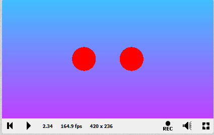

实际上：


y轴对称

```glsl
float opSymY(vec2 p, float r)
{
  p.y = abs(p.y);
  return sdCircle(p, r, vec2(0, 0.2));
}
```


沿 x 轴和 y 轴创建副本，从而生成四个圆

```glsl
// 参数：p：坐标点，r：圆半径
float opSymXY(vec2 p, float r) {
  p = abs(p);
  return sdCircle(p, r, vec2(0.2, 0.2));
}
```

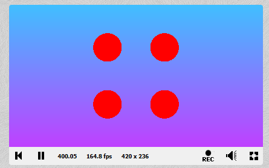


无限重复对象

```glsl
// 跨一个或多个轴创建无限数量的 2D 对象，使用 opRep 操作沿选择的轴重复圆圈,
// 参数：p：坐标点，r：圆半径，c：重复周期
float opRep(vec2 p, float r, vec2 c) {
  vec2 q = mod(p+0.5*c,c)-0.5*c;
  return sdCircle(q, r, vec2(0.0, 0.0));
}

// 绘制场景
vec3 drawScene(vec2 uv) {
  vec3 col = getBackgroundColor(uv);

  float res; // 最终的SDF结果

  res = opRep(uv, 0.05, vec2(0.2, 0.2)); 

  res = step(0., res); // res < 0 ? 形状内部 : 形状外部

  col = mix(vec3(1,0,0), col, res);
  return col;
}

   

以一维来理解：
q = mod(p+0.5c,c)−0.5c
其中 c 是一个常数，p 是输入。

这里 mod (a,b) 一般表示“将 a 对 b 取模，结果落在 [0,b) 区间”。

- 第一步： p+0.5c 先对 c 取模，得到 [0,c) 之间的 q 值。
- 第二步： 再减去 0.5c，得到的结果就在 [−0.5c,0.5c) 区间内的 q 值。

所以这一变换实际上是把任何实数 p*p* 映射到 [−0.5c,0.5c) 区间内（平移取模的效果）。
```

这里假设c=10，一个区间在-5到5之间循环的函数

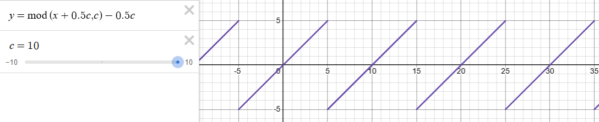

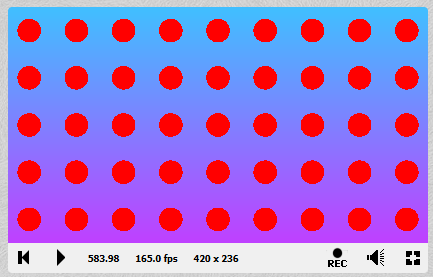


重复一定次数

```glsl
// 如果指向重复2D对象一定次数而不是无限次，使用 opRepLimit 操作
// 参数：p：坐标点，r：圆半径，c：重复周期，limit：重复次数限制
float opRepLimit(vec2 p, float r, float c, vec2 limit) {
  vec2 q = p - c * clamp(round(p / c), -limit, limit); // q是p在重复空间中的位置
  return sdCircle(q, r, vec2(0.0, 0.0));
}

// 绘制场景
vec3 drawScene(vec2 uv) {
  ...
  res = opRepLimit(uv, 0.05, 0.15, vec2(2.0, 2.0)); // 在x和y轴上重复图形，重复范围为-0.3到0.3，重复周期为0.15
  ...
}


y = x - c * clamp(round(x / c), -L, L)
在 [−Lc, Lc] 范围内是周期性的锯齿波（每段范围是 [−c/2,c/2]），但超出这个范围后锯齿波停止重复，函数变成斜率为 1 的直线（偏移量线性增长，意味着没有任何格子中心可以匹配了）

此时uv坐标的范围：[-0.5, 0.5]
    
当p.x进入这个函数之后，p.x会被映射到[-0.3, 0.3]范围内，重复周期为0.15，这样就会在[-0.3, 0.3]范围内,p.x的值会一直在[-0.15, 0.15]范围内循环，重复周期为0.15,当p.x 为-0.3，-0.15，0.0，0.15，0.3时，p.x的值会为0.0，在这些位置周围就是圆形边界里面，然后就会产生重复的图形，直到超出[-0.3, 0.3]范围为止
    
p.y同理
    
函数一维效果如下图：
```

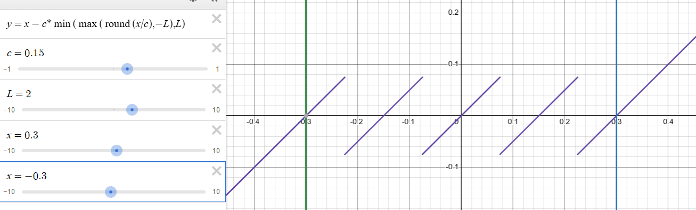

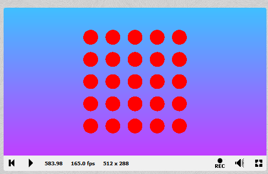


### 图形扭曲

通过操纵 uv 坐标，并将其与从 SDF 返回的值相加，对 SDF 执行变形或扭曲

```glsl
// 通过操纵 uv 坐标，并将其与从 SDF 返回的值相加，对 SDF 执行变形或扭曲
float opDisplace(vec2 uv, float r) {
  float d1 = sdCircle(uv, r, vec2(0.0, 0.0));
  float s = 0.5;

  float d2 = sin(s * uv.x * 1.8); 

  return d1 + d2;
}

// 绘制场景
vec3 drawScene(vec2 uv) {
  ...
  res = opDisplace(uv, 0.1); // 扭曲圆形

  res = step(0., res); // res < 0 ? 形状内部 : 形状外部
  ...
}

opDisplace里面的d2值，在uv.x为负的的区域，sin(s * uv.x * 1.8)也为负值,使得d1+d2的结果比d1更小，更左侧区域的像素被减小为负值，在uv.x为正的区域，sin(s * uv.x * 1.8)为正值，使得d1+d2的结果比d1更大，更右侧区域的像素被加大为正值，因此被判定不在形状内部，形成向左的扭曲效果
    
此时uv坐标的范围：[-0.5, 0.5]
```


### 抗锯齿

用smoothstep函数替换step函数

```glsl
vec3 getBackgroundColor(vec2 uv) {
  uv = uv * 0.5 + 0.5; // remap uv from <-0.5,0.5> to <0.25,0.75>
  vec3 gradientStartColor = vec3(1., 0., 1.);
  vec3 gradientEndColor = vec3(0., 1., 1.);
  return mix(gradientStartColor, gradientEndColor, uv.y); // gradient goes from bottom to top
}

float sdCircle(vec2 uv, float r, vec2 offset) {
  float x = uv.x - offset.x;
  float y = uv.y - offset.y;

  return length(vec2(x, y)) - r;
}

float sdSquare(vec2 uv, float size, vec2 offset) {
  float x = uv.x - offset.x;
  float y = uv.y - offset.y;

  return max(abs(x), abs(y)) - size;
}

vec3 drawScene(vec2 uv) {
  vec3 col = getBackgroundColor(uv);
  float d1 = sdCircle(uv, 0.1, vec2(0., 0.));
  float d2 = sdSquare(uv, 0.1, vec2(0.1, 0));

  float res; // result
  res = min(d1, d2); // union

  res = smoothstep(0., 0.02, res); // antialias entire result

  col = mix(vec3(1,0,0), col, res);
  return col;
}

void mainImage( out vec4 fragColor, in vec2 fragCoord )
{
  vec2 uv = fragCoord/iResolution.xy; // <0, 1>
  uv -= 0.5; // <-0.5,0.5>
  uv.x *= iResolution.x/iResolution.y; // fix aspect ratio

  vec3 col = drawScene(uv);

  fragColor = vec4(col,1.0); // Output to screen
}
```


还可以使用 **smoothstep** 来创建自发光对象或霓虹灯发光效果


## 光线步进（ray marching）

### ray 射线

```
下面的图可以看作是一条光线，圆圈表示光线原点，红色箭头表示光线指向某个方向

可以在 GLSL 中创建一个变量来表示原点：

vec2 rayOrigin = vec2(0, 0);
在 GLSL 等着色器语言中，可以使用 vec2 来存储想要的任意两个值，就好像它是一个数组一样（不要与 GLSL 语言规范中的实际数组混淆），这里使用 vec2 来存储 x 和 y 坐标，例如这里的（0, 0）

光线方向是经过归一化的向量，其大小为 1。在二维中，可以在 GLSL 中创建一个变量来表示方向：

vec2 rayDirection = vec2(1, 0);

通过将光线方向设置为vec2(1, 0)，表示光线沿着 x 轴正方向传播。

如果光线未被归一化，可以使用normalize函数来归一化它

作为约定，这里使用归一化向量来表示方向。所以这里将使用的一些算法只关心光线的方向，而不关心光线的大小（或长度）。不在乎光线有多长。
```


```
shadertoy中的坐标系：
x轴：从左到右增加
y轴：从下到上增加
z轴：正向指向屏幕外

x 轴为红色，y 轴为绿色，z 轴为蓝色。这是有意为之的

约定使用右手规则(right-hand rule)。用右手将拇指指向右侧，食指笔直向上，中指指向自己，每个手指都指向正向的方向

阅读其他人的代码或在线阅读其他教程时，有时会看到此约定沿 z 轴反转。当 z 轴远离您时，它们可能会使 z 轴变为正值，当 z 轴靠近您时，z 轴变为负值，但 x 轴和 y 轴保持不变。这称为左手定则
```


### 光线算法理论基础

```
光线步进 (ray marching)是 Shadertoy 中用于开发 3D 场景的最常用算法，

光线行进和光线追踪都是用于使用光线在 2D 屏幕上绘制 3D 场景的算法。在现实生活中，太阳等光源以光子的形式向大量不同方向投射光线。当一个光子撞击一个物体时，能量被物体的原子晶格吸收，并释放出另一个光子。根据材料原子晶格的晶体结构，光子可以沿随机方向发射（漫反射 diffuse），也可以以进入材料的角度发射（镜面反射 specular 或镜面反射 mirror-like reflection）

如果尝试从光源开始建模3D场景，然后将其追溯到相机，最终会浪费计算资源。这种“前向 forward”模拟将导致大量光线永远不会照射到我们的相机上。

通常使用的是“向后 backward” 模拟，其中光线是从相机或 “眼睛” 射出的。逆向工作！光通常来自太阳等光源，从一堆物体上反射，然后照射到我们的相机上。相反，我们的相机将向许多不同的方向发射光线。这些光线将从场景中的物体（包括地板等表面）反弹，其中一些光线会照射到光源上。如果光线从表面反弹并击中物体而不是光源，那么它被认为是“阴影光线”，并告诉我们应该绘制一个深色像素来表示阴影。（光线被另一个物体拦截，无法到达光源，表明这一块的光源被遮挡，没有直接光，此物体处在另一个物体投下的阴影中）
```


```glsl
上图中因为相机从不同的方向发射光线，至于光线数量，可以画布中的每个像素都对应一条光线。所以可以使用Shadertoy画布中每个像素的坐标来生成光线，每个像素在 x 轴和 y 轴上都有一个坐标，z分量就如上所说，正向指向屏幕外。

从摄像机发射的每条光线的原点将与摄像机的位置相同。每条射线都有一个射线方向，其中包含 x 分量、y 分量和 z 分量。

阴影光线的光线原点将等于相机光线照射到表面的点。每次光线撞击表面时，都可以通过从该点生成新的光线来模拟光线的“反弹”或反射。


光线算法之间的区别

光线投射 (ray casting)：一种更简单的光线追踪形式，它发射单条光线并在击中目标时停止。

光线步进 (ray marching)：一种使用有符号距离场 （SDF） 的光线投射方法，通常是一种球体跟踪算法，该算法以增量方式“行进”光线，直到它击中最近的对象。
球体追踪是光线行进的一种实现类型。在 Shadertoy 上看到的大多数光线步进技术都将使用球体追踪，这仍然是一种光线步进算法。

光线追踪 (ray tracing)：光线投射的一种更复杂的版本，它发射光线，计算光线与表面的交集 (ray-surface intersections)，并在每次反射时递归创建新光线。

路径追踪 (path tracing)：一种光线追踪算法，每个像素发射数百或数千条光线，而不仅仅是一条。使用 Monte Carlo 方法将光线射向随机方向，最终像素颜色是通过对到达光源的光线进行采样来确定的。
    

```


### Ray Marching 绘制3D

编写如下场景中的代码

创建一个简单的摄像机，并在布置一个球体在 Shadertoy 画布中模拟 3D 场景


上图显示了在 Shadertoy 中创建的 3D 场景的侧视图。未显示 x 轴，因为它指向查看器。摄像机将被视为一个坐标为 （0， 0， 5） 的点，这意味着它沿 z 轴距离画布 5 个单位。这里还是会重新映射 UV 坐标，使原点位于画布的中心。


以 x 轴（红色）和 y 轴（绿色）表示从摄像机的视角来看的画布。

从摄像机的视角查看场景。从摄像机直接射出的光线穿过画布的原点，将击中球体。如果光线没有击中任何东西，那么我们将渲染背景色。

```glsl
// 全局变量
const int MAX_MARCHING_STEPS = 255;       // 最大步进步数
const float MIN_DIST = 0.0;               // 最小距离
const float MAX_DIST = 100.0;             // 最大距离
const float PRECISION = 0.001;            // 精度


/*
参数：p：光线步进点的坐标，r：球体半径

这里：球体在画布原点处（0, 0, 0）
距离 = |p的坐标| - 半径
     = p到原点的距离 - 半径
length(p) 计算的是点 p 相对于原点 (0,0,0) 的距离
*/
float sdSphere(vec3 p, float r) 
{
  return length(p) - r; // 光线步进点到球体表面的距离
}


/*
从 0 的深度开始，然后逐渐增加深度。测试点等于光线原点（相机位置）加上深度乘以光线方向。光线行进算法将针对每个像素运行，并且每个像素将确定不同的光线方向。
*/
// 参数：ro：光线原点，rd：光线方向，start：开始距离，end：结束距离
float rayMarch(vec3 ro, vec3 rd, float start, float end)
{
  float depth = start;
  
  for (int i = 0; i < MAX_MARCHING_STEPS; i++) {
    vec3 p = ro + depth * rd;            // 计算下一个光线步进点位的坐标
    float d = sdSphere(p, 1.0);          // 计算步进点到球体表面的距离
    
    /*
    按 sdSphere 函数返回的距离值来增加深度。如果距离与球体的距离在 0.001 个单位以内，那么我们认为它离球体足够近。这表示精度。如果要使该值更准确，可以降低该值。

    如果距离大于某个阈值（在本例中为 100），则光线走得太远，我们应该停止光线行进循环。我们不希望光线继续到无穷大，因为这会浪费计算资源，如果光线没有击中任何东西，就会使 for 循环永远运行。
    */
    depth += d;                              // 增加深度，d
    if (d < PRECISION || depth > end) break; // 停止循环
  }

  return depth; // 返回最终深度
}


void mainImage(out vec4 fragColor, in vec2 fragCoord)
{
  /*
  vec2 uv = fragCoord/iResolution.xy;
  uv -= 0.5;
  uv.x *= iResolution.x/iResolution.y;
  上面三行转为下面一行，关键点在于下面的分解：
  vec2 uv = fragCoord/iResolution.xy;
  // 等价于：
  uv.x = fragCoord.x / iResolution.x;
  uv.y = fragCoord.y / iResolution.y;
  */
  vec2 uv = (fragCoord - .5 * iResolution.xy) / iResolution.y;

  vec3 col = vec3(0.0, 0.0, 0.0);

  // 光线原点 ro 将是相机的位置。将它设置在我们正在查看的 “画布” 后面 5 个单位。
  vec3 ro = vec3(0, 0, 5);

  // 添加光线方向 rd，该方向将根据像素坐标而变化。将 z 分量设置为 -1，以便每条光线都射向我们的场景。随后对rd进行归一化。
  vec3 rd = normalize(vec3(uv, -1));

  // 设置一个变量，该变量接收返回光线行进的距离
  float d = rayMarch(ro, rd, MIN_DIST, MAX_DIST);

  // 根据光线是否击中物体来设置像素颜色
  if (d > MAX_DIST) {
    col = vec3(0.6, 0.6, 0.6); // 没有击中物体，设置为灰色
  } else {
    col = vec3(0.0, 0.0, 1.0); // 击中物体，设置为蓝色
  }

  fragColor = vec4(col, 1.0);
}
```

会看到一个球体的图像。它看起来像一个圆圈，但它绝对是一个球体！


改变相机的位置，可以放大和缩小以证明这是个 3D 对象。将场景中摄像机和虚拟画布之间的距离从 5 增加到 3 应该会使球体看起来更大，就像我们向前移动了一点一样。

`vec3 ro = vec3(0, 0, 3);`


#### 光线方向问题

```glsl
上面的代码中，光线方向被设置为：rd = normalize(vec3(uv, -1))，而不是像下图中的那样配置：

相机位置：ro = (0, 0, 5)
画布位于 z = 0 平面
画布上某像素：(uv.x, uv.y, 0)
光线方向：从相机指向画布像素
rd = normalize( (uv.x, uv.y, 0) - (0, 0, 5) )
   = normalize( vec3(uv, -5) )
```


```glsl
代码中实际所使用的方式：
rd = normalize( vec3(uv, -1) )
   = normalize( (uv.x, uv.y, -1) )
    
代码中使用-1其实就相当于把虚拟画布放在z=4，也就是距离相机一个单位处的情形

相机 (0,0,5)
    |
    |  ← 画布可以放在这里 z=4（距相机1单位）
    |
    |  
    |
   球体 (0,0,0)  ← 或者放在这里 z=0（距相机5单位）
    
    
虚拟画布放在哪里并不影响最终结果，因为只关心光线的方向，而方向由"相机→画布像素"这条线唯一确定。
只要光线碰撞到物体，然后对实际画布上位于uv坐标处的像素进行着色即可，只要虚拟画布上的像素坐标对应到的只有x和y两个维度的真实画布上的像素坐标即可
    
实际画布（屏幕）上的像素 (uv.x, uv.y)
         ↕ 一一对应
虚拟画布上的像素 (uv.x, uv.y, z_virtual)
         ↕ 决定
光线方向 rd
         ↕ 决定
该像素最终颜色
    
    
normalize(vec3(uv, -1)) 是 Shadertoy 社区的标准惯用写法，把虚拟画布默认放在相机前方1个单位处，-1 这个值实际上控制了视野角（FOV）的大小
    
虚拟画布就相当于近裁剪面，角度fov可以等同于由相机和虚拟画布的上下两边界的夹角，虚拟画布距离相机越远，fov角度越小
```


.png)


### Lighting 照明

为了使这个形状看起来更像一个球体，需要添加光照。在现实世界中，光线会沿随机方向从对象上散射。


图中的黑色箭头表示球体的一些表面法线。如果表面法线指向光源，则球体上的该点看起来比球体的其余部分更亮。如果表面法线完全远离光源，则球体的该部分将显得更暗。


```
这里用 Lambert 照明来模拟漫反射。这通常是通过在光源的光线方向和表面法线 (surface normal)方向之间取点积来完成的。
vec3 diffuseReflection = dot(normal, lightDirection);

表面法线通常是归一化向量，因为我们只关心方向。要找到这个方向，我们需要使用 gradient(梯度)。表面法线将等于在表面上某一点的梯度。
补充解释：为何在这里表面法线等于在表面上某一点的梯度？在三维空间中，描述一个表面通常有两种数学形式，
  1.显式形式：z = f(x, y)，比如 z = x^2 + y^2 描述了一个抛物面，此时的法线指向的是最陡上升方向，即梯度方向。
  2.隐式形式：F(x, y, z) = 0，比如 F(x, y, z) = x^2 + y^2 + z^2 - r^2 描述了一个球体，可以移项为：F(x,y,z) = x^2 + y^2 + z^2 - r^2 = 0，这就变成了一个等值面，在等值面上走，F永远都是不变的，变化最快的方向反而变成了垂直于表面上那一点向外的方向，此时梯度和法线是重合的。

求梯度就像求一条线的斜率，Δy/Δx。在 3D 坐标空间中，可以使用渐变来查找表面上的点指向的 “方向”。

要找到表面的梯度，需要两个点。可以在球体表面上取一个点，并从中减去一个小数字以获得第二个点。然后，我们可以将此梯度值用作表面法线

给定一个表面 f（x，y，z），沿该表面的梯度将具有以下方程：
```


```glsl
// 全局变量
const int MAX_MARCHING_STEPS = 255;       // 最大步进步数
const float MIN_DIST = 0.0;               // 最小距离
const float MAX_DIST = 100.0;             // 最大距离
const float PRECISION = 0.001;            // 精度

float sdSphere(vec3 p, float r) 
{
  return length(p) - r; 
}


// 参数：ro：光线原点，rd：光线方向，start：开始距离，end：结束距离
float rayMarch(vec3 ro, vec3 rd, float start, float end)
{
  float depth = start;
  
  for (int i = 0; i < MAX_MARCHING_STEPS; i++) {
    vec3 p = ro + depth * rd;                 // 计算下一个光线步进点的坐标
    float d = sdSphere(p, 1.0);          // 计算步进点到球体表面的距离
    depth += d;                               // 增加深度，d
    if (d < PRECISION || depth > end) break;  // 停止循环
  }

  return depth; 
}


/*
计算表面法线
参数：p：光线与物体交点坐标
*/
vec3 calcNormal(vec3 p) {
  float e = 0.0005; // epsilon
  float r = 1.; // radius of sphere
  return normalize(vec3(
    sdSphere(vec3(p.x + e, p.y, p.z), r) - sdSphere(vec3(p.x - e, p.y, p.z), r),
    sdSphere(vec3(p.x, p.y + e, p.z), r) - sdSphere(vec3(p.x, p.y - e, p.z), r),
    sdSphere(vec3(p.x, p.y, p.z  + e), r) - sdSphere(vec3(p.x, p.y, p.z - e), r)
  ));
}


void mainImage(out vec4 fragColor, in vec2 fragCoord)
{
  vec2 uv = (fragCoord - .5 * iResolution.xy) / iResolution.y;

  vec3 col = vec3(0.0, 0.0, 0.0);

  // 光线原点 ro 将是相机的位置。
  vec3 ro = vec3(0, 0, 5);

  // 添加光线方向 rd，该方向将根据像素坐标而变化。将 z 分量设置为 -1，以便每条光线都射向我们的场景。随后对rd进行归一化。
  vec3 rd = normalize(vec3(uv, -1));

  // 设置一个变量，该变量接收返回光线行进的距离
  float d = rayMarch(ro, rd, MIN_DIST, MAX_DIST);

  // 根据光线是否击中物体来设置像素颜色
  if (d > MAX_DIST) {
    col = vec3(0.6, 0.6, 0.6); // 没有击中物体，设置为灰色
  } else {
    vec3 p = ro + rd * d;               // 计算光线与物体交点的坐标
    vec3 normal = calcNormal(p);        // 计算交点处的表面法线
    vec3 lightPosition = vec3(2, 2, 4);          // 为光源指定一个位置
    vec3 lightDirection = normalize(lightPosition - p);  // 让光源方向指向球体中心

    // 通过点积，算出照射到球体表面的光量，这里计算的是漫反射的光量
    float dif = dot(normal, lightDirection);

    col = vec3(dif, dif, dif); // 击中物体，设置为根据光照计算的颜色
  }

  fragColor = vec4(col, 1.0);
}
```

漫反射光亮应该限制在[0, 1]之间：

```glsl
float dif = clamp(dot(normal, lightDirection), 0.0, 1.0);
```


如果要添加一点环境光，可以调整限制范围，这样球体在着色区域中就不会完全显示为黑色

```glsl
float dif = clamp(dot(normal, lightDirection), 0.3, 1.0);
```


## 多个 3D 对象

### 绘制多个 3D 对象

添加 sdScene 函数负责返回场景中最近的形状

`sdSphere` 的每个实例都已替换为 `sdScene`。如果想向场景中添加更多对象，我们可以使用 **min 函数**来获取场景中最近的对象。

```cpp
float sdScene(vec3 p) {
  float sphereLeft = sdSphere(p, 1.);
  float sphereRight = sdSphere(p, 1.);
  return min(sphereLeft, sphereRight);
}
```


不过，目前，这些球体是相互重叠的。让我们向 sdSphere 函数添加一个 offset 参数：

```cpp
float sdSphere(vec3 p, float r, vec3 offset )
{
  return length(p - offset) - r;
}
```


然后，我们可以为每个球体添加偏移量：

```cpp
float sdScene(vec3 p) {
  float sphereLeft = sdSphere(p, 1., vec3(-2.5, 0, -2));
  float sphereRight = sdSphere(p, 1., vec3(2.5, 0, -2));
  return min(sphereLeft, sphereRight);
}
```


完整代码

```glsl
// 全局变量
const int MAX_MARCHING_STEPS = 255;       // 最大步进步数
const float MIN_DIST = 0.0;               // 最小距离
const float MAX_DIST = 100.0;             // 最大距离
const float PRECISION = 0.001;            // 精度

float sdSphere(vec3 p, float r, vec3 offset) 
{
  return length(p - offset) - r; 
}

float sdScene(vec3 p) {
  float sphereLeft = sdSphere(p, 1.0, vec3(-2.5, 0, -2));
  float sphereRight = sdSphere(p, 1.0, vec3(2.5, 0, -2));
  return min(sphereLeft, sphereRight);
}


// 参数：ro：光线原点，rd：光线方向，start：开始距离，end：结束距离
float rayMarch(vec3 ro, vec3 rd, float start, float end)
{
  float depth = start;
  
  for (int i = 0; i < MAX_MARCHING_STEPS; i++) {
    vec3 p = ro + depth * rd;                 // 计算下一个光线步进点的坐标
    float d = sdScene(p);          // 计算步进点到场景中最近物体表面的距离
    depth += d;                               // 增加深度，d
    if (d < PRECISION || depth > end) break;  // 停止循环
  }

  return depth; 
}


/*
计算表面法线
参数：p：光线与物体交点坐标
*/
vec3 calcNormal(vec3 p) {
  float e = 0.0005; // epsilon
  float r = 1.; // radius of sphere
  return normalize(vec3(
    sdScene(vec3(p.x + e, p.y, p.z)) - sdScene(vec3(p.x - e, p.y, p.z)),
    sdScene(vec3(p.x, p.y + e, p.z)) - sdScene(vec3(p.x, p.y - e, p.z)),
    sdScene(vec3(p.x, p.y, p.z  + e)) - sdScene(vec3(p.x, p.y, p.z - e))
  ));
}


void mainImage(out vec4 fragColor, in vec2 fragCoord)
{
  vec2 uv = (fragCoord - .5 * iResolution.xy) / iResolution.y;

  vec3 col = vec3(0.0, 0.0, 0.0);

  // 光线原点 ro 将是相机的位置。
  vec3 ro = vec3(0, 0, 5);

  // 添加光线方向 rd，该方向将根据像素坐标而变化。将 z 分量设置为 -1，以便每条光线都射向我们的场景。随后对rd进行归一化。
  vec3 rd = normalize(vec3(uv, -1));

  // 设置一个变量，该变量接收返回光线行进的距离
  float d = rayMarch(ro, rd, MIN_DIST, MAX_DIST);

  // 根据光线是否击中物体来设置像素颜色
  if (d > MAX_DIST) {
    col = vec3(0.6, 0.6, 0.6); // 没有击中物体，设置为灰色
  } else {
    vec3 p = ro + rd * d;               // 计算光线与物体交点的坐标
    vec3 normal = calcNormal(p);     // 计算交点处的表面法线
    vec3 lightPosition = vec3(2, 2, 4);          // 为光源指定一个位置
    vec3 lightDirection = normalize(lightPosition - p);  // 让光源方向指向球体中心

    // 通过点积，算出照射到球体表面的光量，这里计算的是漫反射的光量
    float dif = dot(normal, lightDirection);

    col = vec3(dif, dif, dif); // 击中物体，设置为根据光照计算的颜色
  }

  fragColor = vec4(col, 1.0);
}

```


### 添加地板

可以通过以下功能添加一个地板，该地板将位于我们的球体下方一个单位：

```cpp
float sdFloor(vec3 p) {
  return p.y + 1.;
}
```


p点是光线与物体的交点坐标，也可以是光线当前的步进点，只有穿越下半像素的光线才可能让p点y分量为负值，让sdFloor返回值值小于零，判定在地板内

.png)


然后，可以再次使用 `min` 函数将地板添加到 `sdScene` 函数中：

```cpp
float sdScene(vec3 p) {
  float sphereLeft = sdSphere(p, 1., vec3(-2.5, 0, -2));
  float sphereRight = sdSphere(p, 1., vec3(2.5, 0, -2));
  float res = min(sphereLeft, sphereRight);
  res = min(res, sdFloor(p));
  return res;
}
```


完整代码

```glsl
// 全局变量
const int MAX_MARCHING_STEPS = 255;       // 最大步进步数
const float MIN_DIST = 0.0;               // 最小距离
const float MAX_DIST = 100.0;             // 最大距离
const float PRECISION = 0.001;            // 精度

float sdSphere(vec3 p, float r, vec3 offset) 
{
  return length(p - offset) - r; 
}

float sdFloor(vec3 p) 
{
  return p.y + 1.0; 
}

float sdScene(vec3 p) {
  float sphereLeft = sdSphere(p, 1.0, vec3(-2.5, 0, -2));
  float sphereRight = sdSphere(p, 1.0, vec3(2.5, 0, -2));
  float res = min(sphereLeft, sphereRight);
  res = min(res, sdFloor(p));
  return res;
}


// 参数：ro：光线原点，rd：光线方向，start：开始距离，end：结束距离
float rayMarch(vec3 ro, vec3 rd, float start, float end)
{
  float depth = start;
  
  for (int i = 0; i < MAX_MARCHING_STEPS; i++) {
    vec3 p = ro + depth * rd;                 // 计算下一个光线步进点的坐标
    float d = sdScene(p);          // 计算步进点到场景中最近物体表面的距离
    depth += d;                               // 增加深度，d
    if (d < PRECISION || depth > end) break;  // 停止循环
  }

  return depth; 
}


/*
计算表面法线
参数：p：光线与物体交点坐标
*/
vec3 calcNormal(vec3 p) {
  float e = 0.0005; // epsilon
  float r = 1.; // radius of sphere
  return normalize(vec3(
    sdScene(vec3(p.x + e, p.y, p.z)) - sdScene(vec3(p.x - e, p.y, p.z)),
    sdScene(vec3(p.x, p.y + e, p.z)) - sdScene(vec3(p.x, p.y - e, p.z)),
    sdScene(vec3(p.x, p.y, p.z  + e)) - sdScene(vec3(p.x, p.y, p.z - e))
  ));
}


void mainImage(out vec4 fragColor, in vec2 fragCoord)
{
  vec2 uv = (fragCoord - .5 * iResolution.xy) / iResolution.y;
  vec3 backgroundColor = vec3(0.835, 1, 1);  // 设置背景颜色为淡蓝色

  vec3 col = vec3(0);
  // 光线原点 ro 将是相机的位置。
  vec3 ro = vec3(0, 0, 5);

  // 添加光线方向 rd，该方向将根据像素坐标而变化。将 z 分量设置为 -1，以便每条光线都射向我们的场景。随后对rd进行归一化。
  vec3 rd = normalize(vec3(uv, -1));

  // 设置一个变量，该变量接收返回光线行进的距离
  float d = rayMarch(ro, rd, MIN_DIST, MAX_DIST);

  // 根据光线是否击中物体来设置像素颜色
  if (d > MAX_DIST) {
    col = backgroundColor; // 没有击中物体，设置为灰色
  } else {
    vec3 p = ro + rd * d;               // 计算光线与物体交点的坐标
    vec3 normal = calcNormal(p);     // 计算交点处的表面法线
    vec3 lightPosition = vec3(2, 2, 4);          // 为光源指定一个位置
    vec3 lightDirection = normalize(lightPosition - p);  // 让光源方向指向球体中心

    // 通过点积，算出照射到球体表面的光量，这里计算的是漫反射的光量
    float dif = dot(normal, lightDirection);

    col = vec3(dif, dif, dif); // 击中物体，设置为根据光照计算的颜色
  }

  fragColor = vec4(col, 1.0);
}

```


