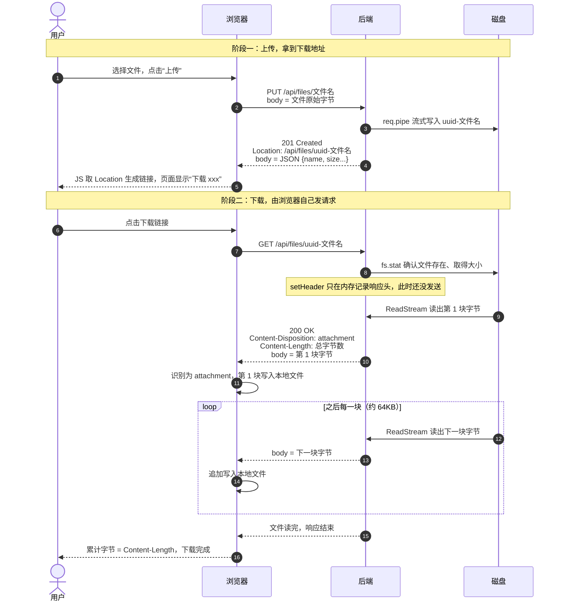
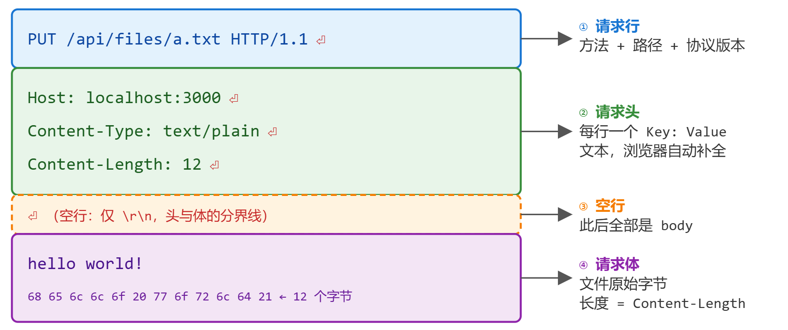
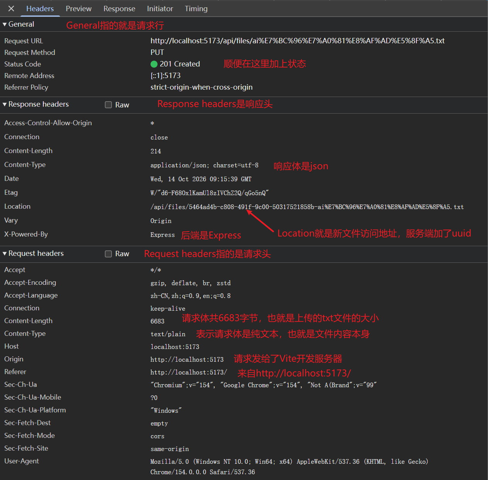
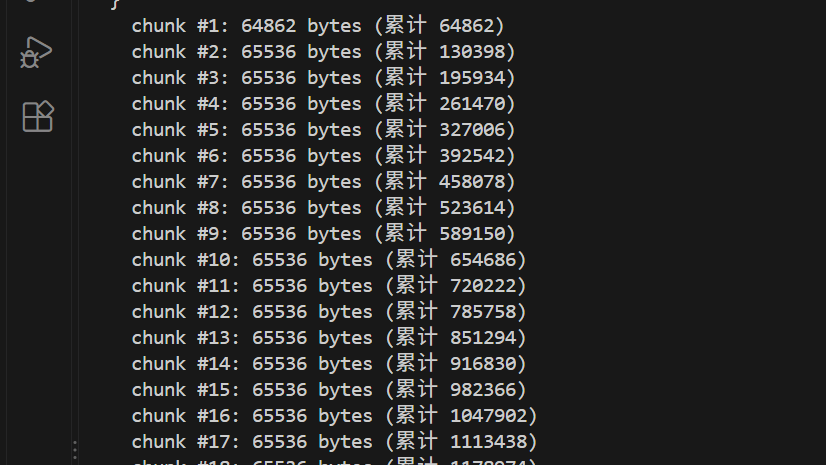
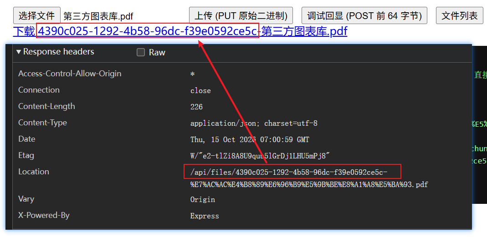
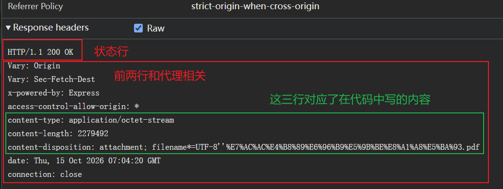
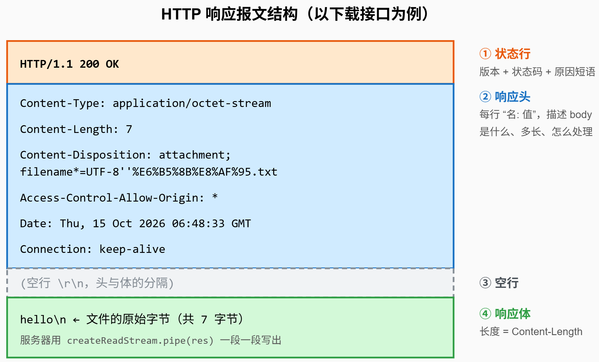

### 整体时序关系




### bit → Blob

bit：只能是 `0` 或 `1`，就像开关：

字节（byte）：8 个开关排成一排，一个字节 = 8 个比特，一共有 2⁸ = 256 种组合，可以表示 0~255 的数字：

```
  一个字节 (8 bit)
  ┌───┬───┬───┬───┬───┬───┬───┬───┐
  │ 0 │ 1 │ 0 │ 0 │ 1 │ 0 │ 0 │ 0 │   = 十进制 72 = 十六进制 48
  └───┴───┴───┴───┴───┴───┴───┴───┘
   128  64  32  16   8   4   2   1     ← 每一位的权重
         ↑                   ↑
        64        +          8      = 72
```

“字节”本身没有含义，含义来自约定，这个约定就叫做编码/格式

```
            01001000
               │
   ┌───────────┼───────────────┐
   ▼           ▼               ▼
 当作数字     当作 ASCII/UTF-8   当作灰度像素
   72          字符 'H'         中等偏暗的灰色
```

文字→字节

```
  字符:        H                 i
               │                 │
               ▼  查编码表       ▼
  十进制:      72               105
  十六进制:    48                69
  二进制:   01001000          01101001
            ┌─┬─┬─┬─┬─┬─┬─┬─┐ ┌─┬─┬─┬─┬─┬─┬─┬─┐
  字节:     │0│1│0│0│1│0│0│0│ │0│1│1│0│1│0│0│1│
            └─┴─┴─┴─┴─┴─┴─┴─┘ └─┴─┴─┴─┴─┴─┴─┴─┘
               第 0 个字节         第 1 个字节
```

文本落到磁盘或网络上时，本质上就是一排字节。

磁盘上的文件（file）：一长串字节 + 外部信息

```
  磁盘上的文件 a.txt
  ┌────────────────────────────────────────┐
  │ 内容：  48 69 （00110000 01000101）	   │  ← 字节序列（"原始数据"）
  └────────────────────────────────────────┘
  文件系统另外记录：  名字 a.txt、大小 2、修改时间…
                     （这些不在内容字节里）
```

图片 `photo.jpg` 同理，只是内容字节更长、格式更复杂：

```
  FF D8 FF E0 00 10 4A 46 49 46 ... (几百 KB 字节) ... FF D9
  └── JPEG 格式头 ──┘            └─ 压缩后的图像数据 ─┘
```

一般前端中提到的“原始数据” = 上面那一排字节。`Blob` 就是浏览器里装这排字节的盒子：

```
              ┌───────────── Blob ─────────────┐
              │  内容: [48][69]  ← 原始字节     │
              │  size: 2                        │
              │  type: "text/plain"  ← 类型标签 │
              └─────────────────────────────────┘
                          ▲
                          │ 继承（File 是一种 Blob）
              ┌───────────┴───── File ──────────┐
              │  Blob 的全部内容和能力           │
              │  + name: "a.txt"                │
              │  + lastModified: 1760000000000  │
              └─────────────────────────────────┘
```


### 文件从前端到服务器磁盘

1、浏览器：File → Blob
`<input type=file>` 给出 `File` 对象，它只是磁盘文件的引用，内容并未读入内存。


2、fetch 发起请求
`fetch(url, { method: 'PUT', body: file })`，body 直接放 `File`。浏览器自动设置 `Content-Length`（文件大小）和 `Content-Type`，并在发送时才从磁盘分块读取字节。


3、HTTP 请求报文结构



对应Network界面

请求体不在 Headers 页，要点旁边的 Payload 标签。这里是因为 PUT 请求体是原始二进制或文本，Chrome 有时不展示。要确认文件内容有没有发出去，看 `Content-Length: 6683` 就够了，它说明这 6683 字节确实发出去了。




4、TCP
报文被切成 TCP 段通过网卡送达，交给 Node 的 socket。


5、Node：IncomingMessage 可读流
Node 的 http 模块解析请求头，`req` 是一个 `Readable` 流，body 以多个 `Buffer` chunk 到达

```js
const app = express() // 创建一个 Express 应用实例，后面所有中间件和路由都挂在它上面。

// 注册一个全局中间件,参数 _res 前面加下划线，表示这里用不到响应对象。
app.use((req, _res, next) => { 
  ...
  // req 是一个可读流，请求体不会一次性读完，而是分成一块块（chunk）到达。每来一块就触发一次 data 事件。
  req.on('data', (chunk) => {
    received += chunk.length
    chunks++
    console.log(`  chunk #${chunks}: ${chunk.length} bytes (累计 ${received})`)
  })
 ...
}
```

终端打印：



`Buffer` 是 Node 里一块原始字节的容器，里面装着 0~255 的数字。

`chunk` 是一整份数据被切开后的其中一小块。

`buffer chunk`在当前代码中指代的就是 65,536 字节(byte) 的 bit数据

`req` 是 Readable 流（Stream）

```
客户端 ──[chunk1][chunk2][chunk3]...──▶ 水管(req) ──▶ 上述代码
```


6、写入磁盘
`req.pipe(fs.createWriteStream(...))` 边收边写，内存里只有当前 chunk，所以大文件也不会占满内存。


7、响应

写完后返回 `201 Created`，`Location` 指向新资源。


### 数据从后端流向前端（下载）


① 上传，前端拿到下载地址

- 前端用 `fetch PUT` 把文件字节发给服务器。服务器 `pipe` 写入磁盘，文件名加上 uuid 前缀。
- 服务器返回 `201`，在响应头 `Location` 里放下载地址，响应体是 JSON（文件名、大小等）。

```js
res.status(201).location(`/api/files/${encodeURIComponent(storedName)}`).json({...})
```


② 前端把 `Location` 变成链接

- 前端从响应头里取出 `Location`，从 JSON 里取出文件名。
- 它创建一个 `<a>`，`href` 就是 `Location` 的值。

```js
const info = await res.json()
showDownloadLink(res.headers.get('Location')!, info.name)
// a.href = url
```

uuid前缀是一样的




③ 用户点击链接，浏览器发 GET 请求

- 请求发到 `/api/files/<uuid>-文件名`，经 vite 代理转到 3000 端口。
- 服务器路由 `app.get('/api/files/:name')` 接住请求。
- 它先用 `fs.stat` 确认文件存在，不存在就返回 404 JSON。


④ 服务器按顺序写出响应

- 状态行：`res.status(200)`，对应 `HTTP/1.1 200 OK`。

- 响应头：

  ```js
  res.setHeader('Content-Type', 'application/octet-stream')  // 告诉浏览器：这是二进制，别当网页渲染
  res.setHeader('Content-Length', stat.size)         // body 一共多少字节，浏览器据此显示进度、判断是否收完
  res.setHeader('Content-Disposition', `attachment; filename*=UTF-8''...`) // attachment 表示“下载保存”，filename* 给出保存的文件名（中文要 URL 编码）
  ```

- 空行：Node 在响应头写完后自动插入。

- 响应体：

  ```js
  fs.createReadStream(target).pipe(res)
  ```

  磁盘文件按Buffer chunk 读出，直接写到响应体里面，不会整个读进内存。



响应报文结构：Devtools为了方便查看就直接放在一起显示




⑤ 浏览器收到响应后怎么处理

1. 先解析状态行和响应头。
2. 看到 `Content-Disposition: attachment`，就不在页面里打开，改为弹出保存。
3. 响应体的字节依次写入本地文件。写到 `Content-Length` 规定的字节数时，下载结束。

