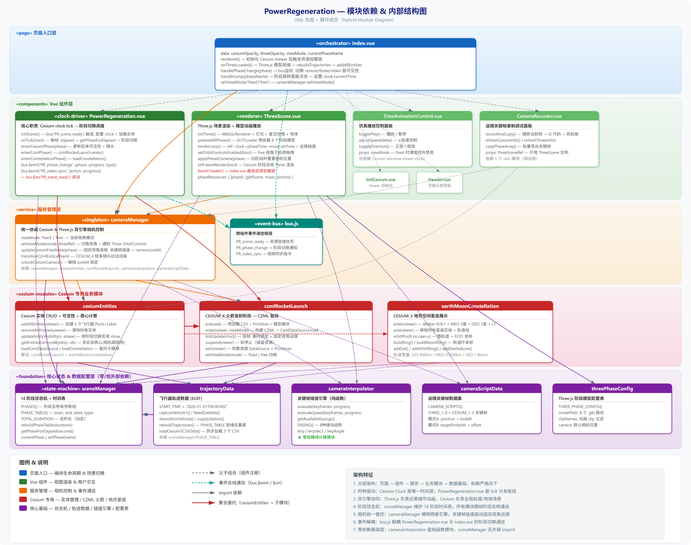

## 动画封装

如果有很多动画效果,可以通过封装Promise函数, 将动画的耗时操作放进去, 实现每次通过调用函数添加动画效果,而不是用冗长的css代码去做


利用 CSS `transform` + `transition` 做动画，结合 Promise 封装异步等待，配合 async/await 顺序控制

- `animation()` 函数返回一个 Promise，并在动画结束时调用 `resolve()`。

- `wave()` 函数使用 async/await 让动画按代码顺序执行，直观易懂。
- 例如等待左手先转，再等待右手转。
- `isAnimation` 用于标志动画是否进行中，避免动画被重复触发导致冲突或状态紊乱。只允许动画完成后，才能再次触发。

```js
 const arms = document.querySelectorAll('.arm') //双手

let isAnimation = false  //定义一个变量, 判断当前是否有动画正在进行


// 封装一个基础动画:由于动画是个耗时操作,可以封装到一个Promise中
/*
参数
  要执行动画的元素
  要执行动画的样式变化(位移 旋转等) transforms 有可能有多个效果叠加,这里将来传数组
  要执行动画的过渡时长 duration
返回值
  无
**/
function animation(element, transforms, duration) {
  return new Promise((resolve, reject) => {
    /*
    设置动画的样式
    tarnsforms将来会传一个数组, 假如这个元素有旋转和位移的动画, 传入的值就值[rotate(90deg), translateX(30px)]
    将来用在CSS中中是这么设置的 transform:rotate(90deg) translateX(30px), 需要将数组元素转成'rotate(90deg) translateX(30px)'
    **/
    element.style.transform = transforms.join(' ')

    // 设置动画的特效
    element.style.transition = `transform ${duration}ms linear`  // 只针对transform样式使用平滑的过渡

    // 动画完成之后, 清空过渡效果
    setTimeout(() => {
      element.style.transition = ''
      resolve()
    }, duration)
  })
}


//  实现挥手功能
async function wave() {
  if (isAnimation) return // isAnimation有值,说明动画正在进行中,不执行下面的代码
  isAnimation = true

  // 显然两只手竖起来
  await animation(arms[0], ['rotate(90deg)'], 300)
  await animation(arms[1], ['rotate(-90deg)'], 300)

  // 左右手交替摆动
  for (let i = 0; i < 4; i++) {
    if (i % 2 == 0) {
      //先摆动左手
      await animation(arms[0], ['rotate(60deg)'], 300)
      await animation(arms[0], ['rotate(-30deg)'], 300)
    } else {
      // 再摆动右手
      await animation(arms[1], ['rotate(60deg)'], 300)
      await animation(arms[1], ['rotate(-30deg)'], 300)
    }
  }

  // 所有手臂同时恢复到初始状态
  await Promise.all([
    animation(arms[0], ['rotate(0)'], 300),
    animation(arms[1], ['rotate(0)'], 300)
  ])

  isAnimation = false
}
```


如果需要多个元素同时进行动画播放,可以使用`Promise.all()`

```js
  // 双腿摆动,加上身体移动
  for (let i = 0; i <= 6; i++) {
    await Promise.all([
      animation(legs[0], ['rotate(-25deg)'], 300),
      animation(legs[1], ['rotate(25deg)'], 300),
      animation(robot, [`translateX(${80 * (i % 2 ? -1 : 1)}px)`], 300)
    ])
    await Promise.all([
      animation(legs[0], ['rotate(25deg)'], 300),
      animation(legs[1], ['rotate(-25deg)'], 300)
    ])
  }
```


## 自定义属性批量操作动画

```
1,在html页面中找到要添加动画的元素,加上data-reveal自定义属性,值分别为bottom,left,right
2,在css页面编写页面元素的初始样式的和复位样式
3,监听页面的加载事件,在页面加载完成之后,遍历所有的动画元素,添加复位样式
4,监听页面的滚动事件,在事件处理函数中,当元素距离可视区域小于一屏的时候,才添加复位样式
```

html

```html
<section class="section3">
	<div class="content w">
		<div class="text-area" data-reveal="left">...
		</div>.
		<div class="rest rest-1" data-reveal="right">...
		</div>
		<div class="rest rest-2" data-reveal="left">...
		</div>
		<div class="rest rest-3" data-reveal="right">...
	</div>
</section>
```

css

```css
/* 从上往下动画初始样式 */
[data-reveal = bottom] {
  transform: translateY(20px);
  opacity: 0;
  transition: var(--transition-2);
}

/* 从上往下动画初始样式 */
[data-reveal = left] {
  transform: translateX(-20px);
  opacity: 0;
  transition: var(--transition-2);
}

/* 从上往下动画初始样式 */
[data-reveal = right] {
  transform: translateX(20px);
  opacity: 0;
  transition: var(--transition-2);
}

/* 所有效果复位样式 */
.reset{
  transform: translate(0, 0);
  opacity: 1;
}
```

js

```js
// 获取页面中添加动画的元素
let items = document.querySelectorAll('[data-reveal]')

// 将复位元素的操作单独提取粗来,作为一个命名函数,将来传递到下面两个事件中
function resetItem() {
  items.forEach(function (item) {
    // 如果当前元素举例浏览器可视区域顶部小于一屏的时候,才添加复位演示
    if (item.getBoundingClientRect().top < window.innerHeight - 100) {
      item.classList.add('reset')
    }
  })
}
```


## 抽取公共样式

```css
/* 样式表中通过:root伪类抽取了常用的公共样式 通过var()使用 
:root 选择器是一个伪类，表示文档根元素，所有主流浏览器均支持 ，除了 IE8 及更早的版本。
在:root中声明相当于全局属性，只要当前页面引用了:root所在文件，都可以使用var()来引用。
*/
/* 公共样式 */

:root {
  /* 颜色相关样式 */
  /* 本项目中的颜色模式采用hsl 可以理解为和RGB类似 3个参数分别表示色相 饱和度 和明度 一般由设计师决定 */
  --sonic-silver: hsl(0, 0%, 47%);
  --marigold: hsl(39, 96%, 48%);
  --white: hsl(0, 0%, 100%);
  --jet: hsl(0, 0%, 21%);
  --light-gray: hsl(0, 0%, 83%);
  --davys-gray: hsl(0, 0%, 30%);
  /* 字体相关样式 */
  --ff-wryh: "微软雅黑", sans-serif;
  --fs-1: 7rem;
  --fs-2: 4.2rem;
  --fs-3: 3.8rem;
  --fs-4: 3.6rem;
  --fs-5: 3.4rem;
  --fs-6: 3.2rem;
  --fs-7: 3rem;
  --fs-8: 2.4rem;
  --fs-9: 2rem;
  --fs-10: 1.8rem;
  --fs-11: 1.4rem;
  --fs-12: 1.2rem;
  /* 间距 */
  --section-padding: 100px;
  /* 圆角 */
  --radius-circle: 50%;
  --radius-20: 20px;
  --radius-15: 15px;
  --radius-10: 10px;
  /* 阴影 */
  --shadow-1: 0 0 30px 4px hsla(0, 0%, 0%, 0.05);
  --shadow-2: -1px 15px 26px -4px hsla(0, 5%, 61%, 0.15);
  /* 过渡动画 */
  --transition-1: 0.25s ease;
  --transition-2: 0.5s ease;
}
```


## 鼠标样式

```
cursor: not-allowed;       /* 鼠标悬停时显示禁止标识 */

opacity: 0.5;:

设置透明度为 0.5，使得该元素看起来是禁用的状态

pointer-events: none;:

这个属性使得该元素不响应任何鼠标事件，包括点击事件。这意味着用户无法与此元素进行任何交互。
```


## before&after的妙用

```html
<div class="radio checked" data-type="all">全部</div>
<div class="radio" data-type="hero_type" data-value="3">坦克</div>
```

把::before和::after设置成绝对定位, 通过移动让两者位置重合, 


重合


配合样式的添加就可以达到单选框的效果

```css
.radio::before {
  content: "";
  position: absolute;
  left: 0;
  top: 50%;
  width: 20px;
  height: 20px;
  transform: translateY(-50%);
  border: 1px solid #ccc;
  border-radius: 50%;
}
.radio::after {
  content: "";
  position: absolute;
  left: 4px;
  top: 50%;
  width: 14px;
  height: 14px;
  background: #5f89cf;
  transform: translateY(-50%) scale(0);
  border-radius: 50%;
  transition: 0.25s;
}
.radio.checked::after {
  transform: translateY(-50%) scale(1);
}
```


```js
const radios = document.querySelectorAll('.radio')
radio.addEventListener('click', () => {
  // 清除其它radio的样式
  radios.forEach( item => item.classList.remove('checked'))
  // 给选中的radio添加样式
  radio.classList.add('checked')
})
```


## 从点击元素中获取特定值方便筛选使用

通过设置非标准特性,dataset来获取特定值

```
<div class="radio" data-type="pay_type" data-value="10">本周免费</div>
<div class="radio" data-type="pay_type" data-value="11">新手推荐</div>
```


```
//获取上面的radio元素之后
const type = radio.dataset.type
const value = radio.dataset.value
console.log(type, value)
```


## 搜索关键字高亮

获取元素, 关键字用replaceAll替换

```js
const ul  = document.querySelector('.list')
const content = ul.innerHTML.replaceAll(value, `<span style="color: red;">${value}</span>`)
ul.innerHTML = content
```


## 数组数据快速生成元素填充

比`elem.insertAdjacentHTML(where, html)`更快的办法

```js
ul.innerHTML = list.map(item => `<li>${item.label}</li>`).join('')
```


## 状态管理 - 变量持有

```js
主动移除旧的 canvas 并只保留一个新的，体现了对资源的“创建-使用-销毁”流程的管理。
通过这个变量，随时能知道“页面上有没有预览结果”、“它指向哪个节点”。

//变量持有
	用一个变量专门保存用于显示裁剪结果的 canvas 节点。每次点击按钮时，如果变量里已有旧的 canvas 节点，就将其从页面中移除。然后创建新的 canvas 节点，显示本次裁剪结果，并把这个新节点赋值给变量。这样页面上始终只会有一个裁剪结果 canvas 节点。
let previewCanvas = null;
btn.addEventListener('click', () => {
  if (previewCanvas) previewCanvas.remove();

  previewCanvas = document.createElement('canvas');
  。。。。
});
```

比如可以找到之前已经点击过的元素,然后恢复

```js
    // 在展开之前,获取当前页面下有没有已经展开的选择框
    const selectedExpand = document.querySelector('.select.expand')
    // 如果当前页面有展开的下拉框,并且不是我点击的整个,就把它收起来
    if(selectedExpand && selectedExpand != province) {
      selectedExpand.classList.remove('expand')
    }

```


## 状态管理 - 引用持有

- 只允许 shapes 列表中**有且仅有一个对象**的 `status` 为 `'my-seat'`（即选中状态）。
- 用 `currentSeat` 变量**持有并追踪**这个唯一的“被选中”对象。
- 每次选中新的座位时：
  1. 如果有旧的 `currentSeat`，先把它还原成 `'available'`（可选状态）。
  2. 再把当前点击的座位设为 `'my-seat'`，并更新 `currentSeat` 的指向。

```js
const shapes = [{}, {}, {}, ...]
...
if (currentSeat) { // 还原之前被选中的座位
  currentSeat.status = 'available';
}
seat.status = 'my-seat'; // 设置新选中的座位
currentSeat = seat;      // 记录当前唯一选中的引用
```

- **优势：** 无须遍历所有对象查找“谁是被选中状态”，操作高效且易于维护。


## 状态管理 - 路线模式

单一状态 + 映射 + 统一入口

代码

```js
// 当前路线模式，响应式状态
const routeMode = ref('drive')

// 路线模式对应的标签
const modeLabel = { drive: '开车去', bus: '公交去', walk: '步行去' }

// 设置路线模式的函数
function setMode(mode) {
  if (routeMode.value === mode) return     // 如果当前模式和传入相同，直接返回
  routeMode.value = mode                    // 更新路线模式状态
  // 清理与路线相关的其他响应式状态
  suggestionsRouteLine.value = []
  routesPlanningIsShow.value = false
  isRoutesShow.value = false
  isRotated.value = false
}

// 根据当前路线模式调用对应规划路线的方法
function planRoute() {
  if (routeMode.value === 'drive') return getDrivingRoute()
  if (routeMode.value === 'bus')   return getTransferRoute()
  if (routeMode.value === 'walk')  return getWalkingRoute()
}

```


解释

```js
1. 单一状态（Single Source of Truth）
含义：所有与路线模式相关的逻辑，都围绕这个唯一的响应式状态 routeMode 来展开。无论是界面显示、路线规划，还是模式切换，状态都只依赖这个单一变量。
好处：避免多处状态冗余和同步问题，集中管理当前模式，提升代码可维护性。


2. 映射（Mapping）
含义：把 routeMode 的可能值映射到对应的显示文本（label），这样代码中不需要写多个 if-else 或 switch 来判断显示什么文本。
这种映射思想也体现在 planRoute 函数中，尽管写成了 if-else，但本质是根据 routeMode 调用不同的函数，体现了“模式 → 行为”映射。

    
3. 统一入口（Unified Entry Point）
含义：所有模式切换都通过 setMode 函数这个统一入口来处理，避免模式切换逻辑分散在多个地方。
这个函数会完成模式切换和相关状态的清理，确保状态整体的正确和一致。
在按钮点击事件里调用的 setMode('drive')、setMode('bus')、setMode('walk') 都最终走向该入口，保持了逻辑统一。
```


## 编程方式适用场景

函数式编程（FP）

面向对象编程（OOP）


| 需求场景                     | 推荐范式 | 原因/说明                        |
| ---------------------------- | -------- | -------------------------------- |
| 有多个“实体”、生命周期、状态 | OOP      | 易于建模、封装、管理复杂性       |
| 数据流/数据变换/管道式处理   | FP       | 易组合、可预测、方便测试         |
| 需要“即插即用”功能模块       | FP       | 每个函数都是独立模块，可自由组合 |
| 对象间复杂交互/关系          | OOP      | 封装对象交互更自然               |
| 既有数据流又有对象结构       | 混合     | 结构用OOP，数据处理用FP          |


实际开发中**两者常常结合使用**：如用类描述实体对象，用纯函数处理数据变换，或用hooks包裹逻辑。


## 通过自定义属性绑定事件取消监听

在beforeUnmount阶段：要移除事件监听，避免内存泄漏和不必要的行为


要通过自定义属性绑定事件，然后删除

```sql
当元素挂载到页面时：
    定义一个事件处理函数 handler
    给元素添加事件监听器，监听某个事件（如mousedown），回调是 handler
    把 handler 保存在元素的自定义属性上，比如 element._myHandler

当元素从页面卸载时：
    从元素的自定义属性中取出 handler
    用 handler 移除事件监听器
    删除元素上的自定义属性，进行清理
```

伪代码

```js
// 挂载阶段
function onMount(element) {
    function handler(event) {
        // 事件处理逻辑 ...
    }
    element.addEventListener('event', handler)
    element._handlerRef = handler   // 把handler函数的引用保存到元素的自定义属性_handlerRef上
}

// 卸载阶段
function onUnmount(element) {
    element.removeEventListener('event', element._handlerRef)  // 在卸载阶段通过element._handlerRef拿到当初那个handler函数
    delete element._handlerRef      // 删除元素节点element上的自定义属性_handlerRef
}
```


不能直接通过下面这种方式实现吗？

```js
element.removeEventListener('event', handler)
```

`onMouseDown` 是在 `mounted` 作用域里的一个变量，等到 `beforeUnmount` 时无法直接访问到（因为钩子函数的作用域不同）。

这时，就需要**把 `onMouseDown` 的引用保存到 DOM 元素本身上**，这样在 `beforeUnmount` 时可以拿到。


## 双向绑定pinia

输入框变化（`input` 事件）

→ 触发 `v-model` 内部逻辑
→ 调用你 `computed` 的 `set(value)`
→ 你在 `set` 里执行 `selectBoxStore.setSearchCity(value)`（或直接赋值）
→ 修改 Pinia 中的 `SearchCity`（一个 `ref`）
→ 该 `ref` 触发依赖更新（包括其他组件里用到它的 `computed`、`watch`）
→ 其他组件（如 B）中的 `watch` 回调执行


```vue
<!-- ComponentA.vue -->
<script setup>
import { useSelectBoxStore } from '@/stores/selectBox'
const selectBoxStore = useSelectBoxStore()
// 如果你不做解构，直接这样用是响应式的：
</script>

<template>
  <input v-model="selectBoxStore.searchCity" placeholder="输入城市" />
</template>
```


```js
// stores/selectBox.js
import { defineStore } from 'pinia'
import { ref } from 'vue'

export const useSelectBoxStore = defineStore('selectBox', () => {
  const searchCity = ref('')
  return { searchCity }
})
```


组件 B 监听变化

```vue
<script setup>
import { watch } from 'vue'
import { useSelectBoxStore } from '@/stores/selectBox'
import { storeToRefs } from 'pinia'

const store = useSelectBoxStore()
const { searchCity } = storeToRefs(store)

watch(searchCity, (nv, ov) => {
  console.log('searchCity 变化:', ov, '=>', nv)
})
</script>
```


## 数组/工厂 + 遍历”模式  

可读性/维护性更好

- 控件定义都在一个数组里，属性一目了然，易于批量修改和查找。
- 新增、删除控件只需改数组，不用改逻辑代码，减少重复。
- 配置驱动，支持更复杂配置（比如动态参数、额外事件绑定）。
- 加了 try-catch，可以优雅处理控件初始化失败的情况。

```js
// 定义控件配置数组（描述性好）
const controlDefs = [
  { key: 'zoom', ctor: Zoom, options: { position: 'rightcenter' } },
  { key: 'scale', ctor: Scale, options: { position: 'rightbottom' } },
  { key: 'mapTheme', ctor: MapTheme, options: { options: themeOptions, position: 'righttop' } },
]

// 创建控件实例并注册
const created = []
for (const def of controlDefs) {
  try {
    const instance = new def.ctor(def.options)
    scene.addControl(instance)
    created.push({ key: def.key, instance })
  } catch (e) {
    console.warn('add control failed', def.key, e)
  }
}

// 返回可清理的函数
return {
  remove() {
    for (const c of created) {
      try { scene.removeControl(c.instance) } catch (_) {}
    }
  }
}
```


## try-catch的使用

- **开发阶段**
   使用 `try-catch` 可以捕获异常，防止页面或整个程序崩溃，同时打印错误信息，帮助快速定位问题。这对调试和开发非常有用。
- 捕获异常后还能保证流程继续

功能稳定、错误可控时，确实可以考虑移除一些 `try-catch`，使代码更简洁，避免掩盖潜在错误。


## Vue 中模块/组件之间不直接相互引入传递消息的常用方式

- 利用 Vue 3 的 `reactive`、`ref` 创建全局状态对象，模块之间共享状态，无需相互导入。
- 示例：

```js
// globalState.js
import { reactive } from 'vue';
export const globalState = reactive({
  message: ''
});

// 发送方
import { globalState } from './globalState';
globalState.message = 'Hello from module A';

// 接收方
import { globalState } from './globalState';
watch(() => globalState.message, (newVal) => {
  console.log(newVal);
});
```


## bfs（广域优先搜索实现）

当输入起点和终点后，后端导肮线路数据是坏的，没法接收到数据，就想，反正是纯地铁站点之间的路径规划，而且站点和站点之间仅走地铁，于是就有了思路，可以获取所有的站点数据进行规划，从起点开始向前向后找，遇到能换乘的站点就延伸到另一条地铁线上向前向后找，直到找到最目的地

因为地铁每站之间花费的时间是差不多的，所以假定每一条边的权重都是1，然后对每个站点建立一个 `neighbors:[]`,然后把整个站点周围一个边内的站点全部推到这个数组中。当直到起点和终点时，只需要找到这个站点，然后通过这个站点的`neighbors`中的站点的`neighbors`不断延伸查找，直到找到终点


假如把所有的地铁站点构造成这样一个图：

`对于每个站点建立一个 neighbors: []，然后把和它直接相连的一条边之内的所有站点都放进去。`

```ts
graph = Map {
  // 1号线 A 站
  "A_1" => {
    name: "A",
    lineId: 1,
    lineName: "1号线",
    isTransfer: false,
    neighbors: ["B_1"]            // 同一条线的下一站
  },

  // 1号线 B 站
  "B_1" => {
    name: "B",
    lineId: 1,
    lineName: "1号线",
    isTransfer: true,              // 在1号线定义成 isChange=1
    neighbors: ["A_1", "C_1", "B_2"] // 前一站 A_1，后一站 C_1，换乘到 2 号线的 B_2
  },

  // 1号线 C 站
  "C_1" => {
    name: "C",
    lineId: 1,
    lineName: "1号线",
    isTransfer: false,
    neighbors: ["B_1"]             // 前一站 B_1
  },

  // 2号线 B 站
  "B_2" => {
    name: "B",
    lineId: 2,
    lineName: "2号线",
    isTransfer: true,
    neighbors: ["D_2", "B_1"]      // 同线后一站 D_2 + 换乘到1号线的 B_1
  },

  // 2号线 D 站
  "D_2" => {
    name: "D",
    lineId: 2,
    lineName: "2号线",
    isTransfer: false,
    neighbors: ["B_2"]             // 前一站 B_2
  },
}
```


蓝色一号，红色二号


假设我们要规划：从 A 到 D（不指定线路 id），调用：

```js
startNodes = ["A_1"]   // 所有名字叫 A 的节点，这里只有 A_1
endNodes   = ["D_2"]   // 所有名字叫 D 的节点，这里只有 D_2
```


3.1 初始化 BFS 队列

```js
queue   = [ { node: "A_1", path: ["A_1"] } ]
visited = Set { "A_1" }
bestPath = []
minStations = Infinity
```

3.2 第一轮出队：从 A_1 扩展

```js
出队: { node: "A_1", path: ["A_1"] }

currentNode = graph.get("A_1")
// currentNode.neighbors = ["B_1"]

遍历 neighbors:
  neighbor = "B_1"
  因为 "B_1" 不在 visited 中:
    visited 加入 "B_1"
    queue.push({ node: "B_1", path: ["A_1", "B_1"] })

此时:
  queue   = [ { node: "B_1", path: ["A_1", "B_1"] } ]
  visited = { "A_1", "B_1" }
```

3.3 第二轮出队：从 B_1 扩展

```js
出队: { node: "B_1", path: ["A_1", "B_1"] }

currentNode = graph.get("B_1")
// neighbors = ["A_1", "C_1", "B_2"]

遍历 neighbors:
  1) neighbor = "A_1"
     "A_1" 已在 visited，忽略（防止回头死循环）

  2) neighbor = "C_1"
     不在 visited:
       visited.add("C_1")
       queue.push({ node: "C_1", path: ["A_1", "B_1", "C_1"] })

  3) neighbor = "B_2"
     不在 visited:
       visited.add("B_2")
       queue.push({ node: "B_2", path: ["A_1", "B_1", "B_2"] })

此时:
  queue = [
    { node: "C_1", path: ["A_1", "B_1", "C_1"] },
    { node: "B_2", path: ["A_1", "B_1", "B_2"] }
  ]
  visited = { "A_1", "B_1", "C_1", "B_2" }
```

3.4 第三轮：从 C_1 出队（但到不了终点）

```js
出队: { node: "C_1", path: ["A_1", "B_1", "C_1"] }

currentNode = graph.get("C_1")
// neighbors = ["B_1"]

neighbor = "B_1" 已访问，啥也不加

此时:
  queue = [ { node: "B_2", path: ["A_1", "B_1", "B_2"] } ]
```

3.5 第四轮：从 B_2 出队，终于扩展到 D_2

```js
出队: { node: "B_2", path: ["A_1", "B_1", "B_2"] }

currentNode = graph.get("B_2")
// neighbors = ["D_2", "B_1"]

遍历 neighbors:
  1) neighbor = "D_2"
     不在 visited:
       visited.add("D_2")
       queue.push({ node: "D_2", path: ["A_1", "B_1", "B_2", "D_2"] })

  2) neighbor = "B_1"
     已访问，忽略

现在:
  queue = [ { node: "D_2", path: ["A_1", "B_1", "B_2", "D_2"] } ]
  visited = { "A_1", "B_1", "C_1", "B_2", "D_2" }
```

3.6 第五轮：D_2 出队，命中终点

```js
出队: { node: "D_2", path: ["A_1", "B_1", "B_2", "D_2"] }

因为 "D_2" ∈ endNodes:
  这条 path 长度是 4，比 Infinity 小
  => bestPath = ["A_1", "B_1", "B_2", "D_2"]
  => minStations = 4

BFS 对这个起点来说可以结束了
```

3.7 最终 bestPath 的字面量

```
bestPath = ["A_1", "B_1", "B_2", "D_2"]
```


## vue3+cesium 处理viewer的获取问题

概括：

获取 Promise 构造函数参数 executor 里的 resolve 函数，把它存起来

让所有调用 async 函数的地方都 await 那个 Promise

至于什么是时候调用 resolve 解除所有等待，完全有我自己决定 


Cesium的viewer是一个超大对象，用Proxy包裹会出现问题，必须使用markRaw(viewer)，不能使用响应式劫持

创建时机受限，必须在Vue组件onMounted之后，有一个真实的元素节点才能 new Cesium.Viewer(container)

其它ts文件会提前使用viewer，比如在Pinia的store中写：

```
const viewerSt
```

这些代码会在vue文件还没 onMounted 前就执行了，此时 viewer 还不存在，但又不能报错，而是应该等它准备好

<hr>

应该如何处理

单例+非响应式

真正创建 viewer 的逻辑在 CesiumApp.create(container)里，cesiumApp 是 ES module 单例

CesiumApp.ts里

```ts
class CesiumAPp{
  constructor() {....}
  create(): Cesium.Viewer {....} // 创建viewer的方法
}
export const cesiumApp = new CesiumApp() // 单例导出
```

- 任意文件 `import { cesiumApp } from '@/core/CesiumApp'` 得到的是同一个对象


在Pinia的store里：

```ts
const v = cesiumApp.create(container) // 创建真正的viewer实例
this.viewer = markRaw(v)
```

这样：

所有地方 import 的 cesiumApp 是同一个对象（ESM单例）

create 里内部 itself 也会值创建一次 viewer

放到 Pinia 里时再用 markRaw 禁止响应式 → this.viewer 是原生的 Viewer 实例


提前调用也能等到获取 viewer 的关键：readyPromise + _resolve

核心在 pinia 的 state 初始化这段：

```ts
state: () => {
  let resolveFn: (v: Cesium.Viewer) => void;
  const p = new Promise<Cesium.Viewer>(r => { resolveFn = r });
  return {
    viewer: null,
    ready: false,
    readyPromise: p,
    _resolve: resolveFn!
  }
},
```

- 一上来（store 初始化时）就创建一个 `Promise<Cesium.Viewer>`
- **不立即 resolve，它的 `resolve` 函数先存在 `_resolve` 上**
- 任何时候，只要有人调用 `getViewerAsync()`，就等这个 promise

```ts
async getViewerAsync(): Promise<Cesium.Viewer> {
  if (this.isReady) {
    return this.viewer!;
  } else {
    return await this.readyPromise;
  }
}
```

当真正创建 viewer 的时候（使用store中的`init(container)`）：

```ts
init(container: HTMLElement) {
  if (this.viewer) return this.viewer;
  const v = cesiumApp.create(container)
  this.viewer = markRaw(v)
  this._resolve?.(v); // 把前面promies 一次性 resolve 掉
  return v
}
```

先调用 `getViewerAsync()` 的人， 走的是`await this.readyPromise`，会挂起等待

- 等在vue文件中挂载时执行`viewerStore.init(mapRef.value)：`
  - 创建 viewer
  - 调用 `_resolve(viewer)`，一次性唤醒所有在等的 `getViewerAsync()`

- 之后再调用 `getViewerAsync()` 的人，因为 `isReady === true`，就直接返回 `this.viewer!`


## dom-to-image截图流程

- `domtoimage.toPng(this.containerElement)`
  使用 [dom-to-image](https://github.com/tsayen/dom-to-image) 这个库，把指定的 DOM 节点（如一个 div、某张表格、一块内容区）截取为一张 PNG 图片。
  返回值是一个 Promise，最终解析出来的是这个图片的 Data URL。
- `await`
  这里用 `await` 等待异步渲染完成，拿到数据。
- `dataUrl`
  最终结果是一个形式为：`data:image/png;base64,xxxxxxx`

```js
// 1. 将指定的 DOM 元素渲染为 PNG 格式的图片，得到 base64 编码的数据地址（Data URL）
const dataUrl = await domtoimage.toPng(this.containerElement);

// 2. 创建一个新的 <a>（超链接）元素，用于触发下载
const link = document.createElement('a');

// 3. 设置 <a> 的 href 属性为刚刚生成的 PNG 图片的 Data URL
link.href = dataUrl;

// 4. 设置 <a> 的下载文件名（download 属性），这样点击后会下载成指定名字的图片
link.download = `screenshot_${Date.now()}.png`;

// 5. “点击”这个 <a> 元素，自动触发浏览器的下载动作，把图片保存到本地
link.click();
```


## canvas录屏

```js
// 1. 获取要录制的 canvas 元素
const canvas = document.querySelector('canvas');

// 2. 从 canvas 生成一个 MediaStream（参数 60 表示帧率为 60fps，可自调）
const stream = canvas.captureStream(60);

// 3. 检查浏览器是否支持 'video/webm;codecs=vp9' 格式，否则降级为 'video/webm'
const mimeType = MediaRecorder.isTypeSupported('video/webm;codecs=vp9')
    ? 'video/webm;codecs=vp9'
    : 'video/webm';

// 4. 创建 MediaRecorder，把 stream 作为输入
const recorder = new MediaRecorder(stream, { mimeType });

// 5. 用于收集录制的数据块
const chunks = [];

// 6. 当有媒体数据可用时，把块加入数组
recorder.ondataavailable = e => {
  if (e.data.size > 0) chunks.push(e.data);
};

// 7. 当录制停止时，合成接收到的数据块为一个 Blob，生成下载链接并自动触发下载
recorder.onstop = () => {
  const blob = new Blob(chunks, { type: 'video/webm' }); // 合成视频文件
  const url = URL.createObjectURL(blob);                // 创建临时 URL
  const a = document.createElement('a');                // 创建链接元素
  a.href = url;
  a.download = 'canvas_record.webm';                    // 设置下载文件名
  a.click();                                            // 触发下载
  URL.revokeObjectURL(url);                             // 释放内存
};

// 8. 开始录制
recorder.start();

// 9. 举例：5 秒后停止录制（实际可以根据需求手动停止）
setTimeout(() => recorder.stop(), 5000);
```

- Stream（媒体流）
  "摄像机的镜头"——它源源不断地提供视频画面数据（来自 canvas、屏幕、摄像头等）。
- MediaRecorder（媒体录制器）
  "录像机的录制装置"——它接收摄像机镜头提供的数据流，把它们一块块地存储下来。


ondataavailable

- **事件类型**：`dataavailable` 事件触发时的处理函数。

- **何时触发**：当录制器有**一块可用的媒体数据**时触发。

- **用途**：收集每一块录制的数据片段。

- `ondataavailable` 事件的参数 `event` 中，**`event.data` 包含了一块视频数据**

- ```
  event.data
  类型：Blob 对象
  内容：一块已编码的视频数据（比如 VP9 格式的字节数据）
  大小：根据录制时长和码率决定，可能几 KB 到几 MB
  ```

  


onstop

- **事件类型**：`stop` 事件触发时的处理函数。
- **何时触发**：当录制**停止**时触发（调用 `recorder.stop()` 或流结束）。
- **用途**：合并所有数据块，下载或保存视频文件。

时间线

```
开始录制（recorder.start()）
        ↓
【ondataavailable 事件触发】→ 收集 chunk1
        ↓
【ondataavailable 事件触发】→ 收集 chunk2
        ↓
【ondataavailable 事件触发】→ 收集 chunk3
        ↓
停止录制（recorder.stop()）
        ↓
【onstop 事件触发】→ 合成视频、下载
```


## 读取xlsx

```js
import * as XLSX from 'xlsx';

/**
 * XLSX 库解析 Excel 文件的完整流程演示
 * 
 * Excel 原始文件内容：
 * ┌─────────────────────────────────────────────────────┐
 * │ satellite_trajectory 工作表                         │
 * ├─────────┬──────────────┬──────────────┬──────────────┤
 * │ Time    │ Walker_P1_S1_X│ Walker_P1_S1_Y│ Walker_P1_S1_Z│
 * ├─────────┼──────────────┼──────────────┼──────────────┤
 * │ 45048.5 │ -6371000.5   │ 0.0          │ 0.0          │
 * │ 45048.51│ -6371001.2   │ 10.5         │ 5.3          │
 * │ 45048.52│ -6371002.0   │ 20.8         │ 10.2         │
 * └─────────┴──────────────┴──────────────┴──────────────┘
 */

async function demonstrateXLSXParsing() {
  // 第1阶段：获取 Excel 文件（ArrayBuffer）
  const res = await fetch("/data/satellite_data.xlsx", { cache: "no-store" });
  const arrayBuffer = await res.arrayBuffer();
  
  // 类型：ArrayBuffer（二进制数据）
  // 内容：Excel 文件的原始字节数据，无法直接读取
  console.log('第1阶段 - ArrayBuffer:', {
    type: 'ArrayBuffer',
    byteLength: arrayBuffer.byteLength,  // 例如：1048576（1MB）
    示例: '...(二进制数据，无法直接显示)...'
  });


    
  // 第2阶段：XLSX.read() - 解析 ArrayBuffer → Workbook 对象
  const workbook = XLSX.read(arrayBuffer, { type: "array" });
  
  // 类型：Workbook 对象（XLSX 内部数据结构）
  // 结构：{ SheetNames: [], Sheets: {}, ... }
  console.log('第2阶段 - Workbook 对象:', {
    type: 'Object (XLSX.WorkBook)',
    SheetNames: workbook.SheetNames,  // ['satellite_trajectory', 'missile_trajectory', '指标结果']
    Sheets: Object.keys(workbook.Sheets),  // 可用的工作表名称
    结构: {
      SheetNames: ['satellite_trajectory', 'missile_trajectory', '指标结果'],
      Sheets: {
        'satellite_trajectory': { /* 工作表对象 */ },
        'missile_trajectory': { /* 工作表对象 */ },
        '指标结果': { /* 工作表对象 */ }
      }
    }
  });


    
  // 第3阶段：获取工作表对象
  const satSheet = workbook.Sheets["satellite_trajectory"];
  
  // 类型：Worksheet 对象（表格的内部表示）
  // 结构：{ A1: {t, v}, B1: {t, v}, A2: {t, v}, ... }（稀疏矩阵）
  console.log('第3阶段 - Worksheet 对象:', {
    type: 'Object (XLSX.WorkSheet)',
    描述: '以单元格地址为键，单元格内容为值',
    示例内容: {
      'A1': { t: 's', v: 'Time' },           // 字符串类型
      'B1': { t: 's', v: 'Walker_P1_S1_X' },
      'C1': { t: 's', v: 'Walker_P1_S1_Y' },
      'D1': { t: 's', v: 'Walker_P1_S1_Z' },
      'A2': { t: 'n', v: 45048.5 },          // 数字类型（Excel 日期序列值）
      'B2': { t: 'n', v: -6371000.5 },
      'C2': { t: 'n', v: 0.0 },
      'D2': { t: 'n', v: 0.0 },
      'A3': { t: 'n', v: 45048.51 },
      'B3': { t: 'n', v: -6371001.2 },
      'C3': { t: 'n', v: 10.5 },
      'D3': { t: 'n', v: 5.3 },
      'A4': { t: 'n', v: 45048.52 },
      'B4': { t: 'n', v: -6371002.0 },
      'C4': { t: 'n', v: 20.8 },
      'D4': { t: 'n', v: 10.2 }
    },
    单元格对象说明: {
      t: '类型标识 (s=string, n=number, d=date, b=boolean)',
      v: '实际值'
    }
  });

    
  
  // 第4阶段：sheet_to_json() - 转换为二维数组
  const satData = XLSX.utils.sheet_to_json(satSheet, { header: 1 });
  
  // 类型：Array<Array> 二维数组
  // header: 1 表示用数组索引作为列标识，不用列名
  // 结构：[[表头行], [数据行1], [数据行2], ...]
  console.log('第4阶段 - sheet_to_json() 输出（二维数组）:', {
    type: 'Array<Array<any>>',
    长度: satData.length,  // 4（1个表头 + 3个数据行）
    完整内容: [
      // 行0：表头行（第1行）
      [
        'Time',           // [0][0]
        'Walker_P1_S1_X', // [0][1]
        'Walker_P1_S1_Y', // [0][2]
        'Walker_P1_S1_Z'  // [0][3]
      ],
      // 行1：第1个数据行（Excel 的第2行）
      [
        45048.5,          // [1][0] - Excel 日期序列值
        -6371000.5,       // [1][1] - X 坐标
        0.0,              // [1][2] - Y 坐标
        0.0               // [1][3] - Z 坐标
      ],
      // 行2：第2个数据行（Excel 的第3行）
      [
        45048.51,         // [2][0]
        -6371001.2,       // [2][1]
        10.5,             // [2][2]
        5.3               // [2][3]
      ],
      // 行3：第3个数据行（Excel 的第4行）
      [
        45048.52,         // [3][0]
        -6371002.0,       // [3][1]
        20.8,             // [3][2]
        10.2              // [3][3]
      ]
    ]
  });
}

// 执行演示
demonstrateXLSXParsing().then(data => {
  console.log('✅ 解析完成！', data);
});
```


## 读取csv

两种方式

```javascript
/**
 * 使用 fetch + text() + split 方法读取CSV文件
 * （不使用xlsx库，用原生方法）
 */

// 假设有这样一个CSV文件内容：
Time,Walker_P1_S1_X,Walker_P1_S1_Y,Walker_P1_S1_Z
0.0, 1.2, 2.3, 3.4
0.1, 1.3, 2.4, 3.5
0.2, 1.4, 2.5, 3.6

async function parseCSVWithFetch() {
  // 【第1阶段】获取文件 - 返回 Response 对象
  const response = await fetch('data.csv');
  // response:  Response { ok: true, status: 200, ...  }
  
    
  // 【第2阶段】转换为字符串 - 返回 string 类型
  const csvText = await response.text();
  // csvText: "Time,Walker_P1_S1_X,Walker_P1_S1_Y,Walker_P1_S1_Z\n0.0,1.2,2.3,3.4\n0.1,1.3,2.4,3.5\n0.2,1.4,2.5,3.6"
  
    
  // 【第3阶段】按行拆分 - 返回 string[] 类型
  const rows = csvText.split('\n');
  // rows: [
  //   "Time,Walker_P1_S1_X,Walker_P1_S1_Y,Walker_P1_S1_Z",
  //   "0.0,1.2,2.3,3.4",
  //   "0.1,1.3,2.4,3.5",
  //   "0.2,1.4,2.5,3.6",
  //   "" // 可能最后有空行
  // ]
  
    
  // 【第4阶段】提取表头 - 返回 string[] 类型
  const headers = rows[0]. split(',');
  // headers: ["Time", "Walker_P1_S1_X", "Walker_P1_S1_Y", "Walker_P1_S1_Z"]
  
  // 【第5阶段】解析数据行 - 返回 string[][] 类型
  const dataRows = rows
    .slice(1) // 跳过表头
    .filter(row => row.trim() !== '') // 过滤空行
    .map(row => row. split(',')); // 每行按列拆分
  
  // dataRows: [
  //   ["0.0", "1.2", "2.3", "3.4"],
  //   ["0.1", "1.3", "2.4", "3.5"],
  //   ["0.2", "1.4", "2.5", "3.6"]
  // ]
  
  // 【第6阶段】转换为对象数组 - 返回 Record<string, any>[] 类型
  const result = dataRows.map(row => {
    const obj = {};
    headers.forEach((header, index) => {
      // 如果是数字列，转换为 number；否则保持 string
      obj[header] = isNaN(row[index]) ? row[index] : parseFloat(row[index]);
    });
    return obj;
  });
  
  // result: [
  //   { Time: 0.0, Walker_P1_S1_X: 1.2, Walker_P1_S1_Y: 2.3, Walker_P1_S1_Z: 3.4 },
  //   { Time: 0.1, Walker_P1_S1_X:  1.3, Walker_P1_S1_Y: 2.4, Walker_P1_S1_Z: 3.5 },
  //   { Time: 0.2, Walker_P1_S1_X: 1.4, Walker_P1_S1_Y: 2.5, Walker_P1_S1_Z:  3.6 }
  // ]
  
  console.log(result);
  return result;
}

// 调用函数
parseCSVWithFetch();
```


```javascript
/**
 * 使用 xlsx 库读取CSV文件
 * 需要先引入：<script src="https://cdn.jsdelivr.net/npm/xlsx@0.18.5/dist/xlsx.full.min.js"></script>
 */

// 【方法1】读取本地文件（通过File Input）
function parseCSVWithXLSX(file) {
  const reader = new FileReader();
  
  reader.onload = (event) => {
    // 【第1阶段】读取文件内容 - ArrayBuffer 类型
    const data = event.target.result;
    // data: ArrayBuffer { byteLength: 256, ...  }
    
    // 【第2阶段】用 xlsx 解析 - 返回 Workbook 对象
    const workbook = XLSX.read(data, { type: 'array' });
    // workbook: {
    //   SheetNames: ["Sheet1"],
    //   Sheets: { Sheet1: {... } },
    //   ... 
    // }
    
    // 【第3阶段】获取第一个工作表名称 - string 类型
    const sheetName = workbook.SheetNames[0];
    // sheetName: "Sheet1"
    
    // 【第4阶段】获取工作表 - 返回 Worksheet 对象
    const worksheet = workbook.Sheets[sheetName];
    // worksheet:  { A1: {... }, B1: {...}, ... }
    
    // 【第5阶段】转换为JSON数组 - 返回 Record<string, any>[] 类型
    const result = XLSX.utils.sheet_to_json(worksheet);
    
    // result: [
    //   { Time: 0.0, Walker_P1_S1_X:  1.2, Walker_P1_S1_Y: 2.3, Walker_P1_S1_Z: 3.4 },
    //   { Time: 0.1, Walker_P1_S1_X: 1.3, Walker_P1_S1_Y: 2.4, Walker_P1_S1_Z:  3.5 },
    //   { Time: 0.2, Walker_P1_S1_X: 1.4, Walker_P1_S1_Y: 2.5, Walker_P1_S1_Z: 3.6 }
    // ]
    
    console.log(result);
  };
  
  reader.readAsArrayBuffer(file);
}

// HTML：<input type="file" id="csvFile" accept=".csv,. xlsx" />
document.getElementById('csvFile').addEventListener('change', (e) => {
  parseCSVWithXLSX(e.target.files[0]);
});
```


## xlsx的时间解析

### excel时间类型

 Excel 序列值（数字）

格式说明：

- Excel 中日期以数字形式存储
- 基准日期：1899-12-30 = 0（实际应为 1900-01-01，但 Excel 有 bug）
- 每整数 = 1 天

具体例子：

```javascript
parseTime(44927);    // 2023-01-01 的 Excel 序列值
parseTime(44958);    // 2023-02-01 的 Excel 序列值
parseTime(45292);    // 2024-01-01 的 Excel 序列值
parseTime(45413);    // 2024-05-02 的 Excel 序列值

// 返回 Unix 时间戳（秒）
// 例如：44927 → 1672531200

// Unix时间戳是指自 1970年1月1日 00:00:00 UTC 起经过的秒数（不考虑闰秒）
```

在 xlsx 表中对应：

```
Time 列显示为数字：44927, 44928, 44929, ... 
或显示为日期：2023-01-01, 2023-01-02, 2023-01-03, ... 
（取决于 Excel 单元格格式）
```

<hr>


ISO 8601 格式字符串

ISO 8601 是国际标准化组织制定的日期和时间表示标准，旨在消除因地区习惯和格式差异带来的歧义

具体例子：

```javascript
parseTime("2023-01-01");                    // ✅
parseTime("2023-01-01T00:00:00Z");          // ✅
parseTime("2023-01-01T00:00:00+08:00");     // ✅
parseTime("2023-01-01 00:00:00");           // ✅
parseTime("01/01/2023");                    // ✅（部分浏览器）
parseTime("2023-01-01T08:30:45");           // ✅

// 返回 Unix 时间戳（秒）
// 例如：1672531200
```


```
2023-01-01T00:00:00Z
│      │  │ │  │  │ │
│      │  │ │  │  │ └─ Z：表示 UTC 时区（零时区）
│      │  │ │  │  └─── 秒
│      │  │ │  └────── 分
│      │  │ └───────── 时
│      │  └─────────── T：日期和时间的分隔符
│      └───────────── 月份
└──────────────────── 年份（4位数字）
```

<hr>


数字字符串（Excel 序列值的字符串形式）

格式说明： 将 Excel 序列值作为字符串输入

具体例子：

```javascript
parseTime("44927");     // 字符串 "44927" → 转换为数字 → Excel 日期
parseTime("44958.5");   // 字符串 "44958.5" → 中午 12 点的日期
parseTime("45413");     // 字符串 "45413" → Excel 日期

// 返回 Unix 时间戳（秒）
```


### 时间处理函数

执行流程

```
parseTime(value)
├─ typeof value === 'number'
│  └─ 调用 excelDateToUnixTimestamp()
│     → 44927 → 1672531200
│
├─ typeof value === 'string'
│  ├─ Date.parse(str) 尝试解析
│  │  ✅ "2023-01-01" → 1672531200
│  │  ✅ "2023-01-01T00:00:00Z" → 1672531200
│  │
│  └─ parseFloat(str) 尝试转数字
│     ✅ "44927" → 44927 → 调用 excelDateToUnixTimestamp()
│
└─ 都失败 → throw Error
```

具体代码

```js
/**
 * Excel 日期序列值转 Unix 时间戳（秒）
 * Excel 序列值：1900-01-01 = 1（注意 Excel 的 1900 闰年 bug）
 */
function excelDateToUnixTimestamp(excelSerial) {
  // Excel 基准日期：1899-12-30（实际应为 1900-01-01，但 Excel 有 bug）
  // const excelEpoch = new Date(1899, 11, 30).getTime();

  // 使用 Date.UTC() 而不是 new Date()，避免本地时区（UTC+8）的影响
  const excelEpoch = Date.UTC(1899, 11, 30); // 返回 UTC 毫秒时间戳
  const msPerDay = 24 * 60 * 60 * 1000;
  
  // 转换为毫秒时间戳
  let timestamp = excelEpoch + excelSerial * msPerDay;

  // // Excel 数据是北京时间（UTC+8），需要加 8 小时后再转为秒，这样 Cesium 才能正确显示 UTC 时间
  // const chinaTimeOffset = 8 * 60 * 60 * 1000; // 8 小时的毫秒数
  // timestamp += chinaTimeOffset;

  return timestamp / 1000; // 返回秒
}

/**
 * 智能解析时间：支持日期字符串和 Excel 序列值
 */
function parseTime(value) {
  // 情况1：数字（Excel 序列值）
  if (typeof value === 'number') {
    return excelDateToUnixTimestamp(value);
  }
  
  // 情况2：字符串
  if (typeof value === 'string') {
    const str = value.trim();
    
    // 尝试直接解析 ISO/标准格式
    const tMs = Date.parse(str);
    if (Number.isFinite(tMs)) {
      return tMs / 1000;
    }
    
    // 尝试解析为数字（可能是字符串形式的序列值）
    const num = parseFloat(str);
    if (Number.isFinite(num)) {
      return excelDateToUnixTimestamp(num);
    }
  }
  
  throw new Error(`Unable to parse time: ${value}`);
}
```


## 订阅广播机制实现

```js
// 最简单的订阅-广播模式
class EventEmitter {
  constructor() {
    this.subscribers = [];  // 存储订阅者回调
  }

  // 订阅：注册回调函数
  subscribe(callback) {
    this.subscribers.push(callback);
    // 返回取消订阅函数
    return () => {
      const index = this.subscribers.indexOf(callback);
      if (index > -1) {
        this.subscribers.splice(index, 1);
      }
    };
  }

  // 广播：调用所有已注册的回调
  emit(data) {
    for (const callback of this.subscribers) {
      callback(data);
    }
  }
}
```


图示：

```
订阅过程：将回调函数注册到数组中
【第一次订阅】
emitter.subscribe(callback1)
    ↓
subscribers = [callback1]

【第二次订阅】
emitter.subscribe(callback2)
    ↓
subscribers = [callback1, callback2]

【第三次订阅】
emitter.subscribe(callback3)
    ↓
subscribers = [callback1, callback2, callback3]


广播过程： 在合适的时机，循环调用数组中的所有回调
emitter.emit(data) 被调用
    ↓
┌──────────────────────────────────────┐
│ for (const callback of subscribers)  │
└──────────────────────────────────────┘
    ↓
    ├─→ callback1(data)  →  执行第一个订阅者
    │   ├─ console.log(data)
    │   └─ 完成
    │
    ├─→ callback2(data)  →  执行第二个订阅者
    │   ├─ console.log(data)
    │   └─ 完成
    │
    └─→ callback3(data)  →  执行第三个订阅者
        ├─ console.log(data)
        └─ 完成
```


## 位运算优化运行速度

```js
除以2的操作（向下取整）

mid = (lo + hi) >> 1   // 位运算（快）
mid = (lo + hi) / 2    // 除法（慢）

>> 1 是直接的位运算操作（CPU 硬件级别）
/ 2  需要计算除法（较复杂）

在大规模循环中，>> 1 性能更好


位运算：
7 的二进制：
  111 (十进制 7)

���移 1 位：
  111 >> 1 = 11 (二进制)
  
11 (二进制) = 3 (十进制)

结果：7 >> 1 = 3 ✓

n >> 1	右移 1 位	除以 2（整除）
n >> 2	右移 2 位	除以 4（整除）
```


## 二分查找

```js
二分查找	O(log n)	每次排除一半的数据
线性遍历	O(n)	逐个检查每个元素

大规模数据比线性遍历性能好的多

// 二分查找
let lo = 0, hi = trajectory.length - 1;
while (lo < hi - 1) {
  const mid = (lo + hi) >> 1;
  if (trajectory[mid].time <= elapsedTime) lo = mid;
  else hi = mid;
}
const t0 = trajectory[lo];
const t1 = trajectory[hi];
const alpha = (elapsedTime - t0.time) / (t1.time - t0.time);  // 当前时间-起点/区间长度
const lerp = (a, b) => a + alpha * (b - a);
return {
  x: lerp(t0.x, t1.x),
  y: lerp(t0.y, t1.y),
  z: lerp(t0.z, t1.z),
  xSpeed: lerp(t0.xSpeed, t1.xSpeed),
  ySpeed: lerp(t0.ySpeed, t1.ySpeed),
  zSpeed: lerp(t0.zSpeed, t1.zSpeed),
};
```


直观展示计算过程

```
目的就是找到需要插值点附近的两个数据，假如这里要对time = 4处插值

trajectory = [
  {time: 0,  x: 0,  y: 0},   // 索引 0
  {time: 1,  x: 10, y: 5},   // 索引 1
  {time: 3,  x: 20, y: 15},  // 索引 2
  {time: 5,  x: 40, y: 25},  // 索引 3
  {time: 7,  x: 60, y: 30},  // 索引 4
  {time: 9,  x: 80, y: 35},  // 索引 5
]

现在要找：elapsedTime = 4 时的位置


初始状态
lo = 0, hi = 5

目标：找到 time ≤ 4 和 time > 4 的相邻两个点
     即：time=3 (lo=2) 和 time=5 (hi=3)

可视化：
┌─────┬─────┬─────┬─────┬─────┬─────┐
│ t=0 │ t=1 │ t=3 │ t=5 │ t=7 │ t=9 │
├─────┼─────┼─────┼─────┼─────┼─────┤
│  0  │  1  │  2  │  3  │  4  │  5  │
└─────┴─────┴─────┴─────┴─────┴─────┘
  ↑                               ↑
 lo=0                            hi=5

要找的 elapsedTime=4 应该在这两个之间 ↓
                      t=3 ↓ ↓ t=5


第1次迭代
while (lo < hi - 1)  ← 检查：0 < 5-1 = 4？ YES，继续

mid = (0 + 5) >> 1 = 2  ← 计算中点
trajectory[2].time = 3

比较：3 <= 4？ YES
所以：lo = 2（左边界右移）

┌─────┬─────┬─────┬─────┬─────┬─────┐
│ t=0 │ t=1 │ t=3 │ t=5 │ t=7 │ t=9 │
├─────┼─────┼─────┼─────┼─────┼─────┤
│  0  │  1  │  2  │  3  │  4  │  5  │
└─────┴─────┴─────┴─────┴─────┴─────┘
          ↑                       ↑
         lo=2                    hi=5
         
         

第2次迭代
while (lo < hi - 1)  ← 检查：2 < 5-1 = 4？ YES，继续

mid = (2 + 5) >> 1 = 3  ← 计算中点
trajectory[3].time = 5

比较：5 <= 4？ NO
所以：hi = 3（右边界左移）

┌─────┬─────┬─────┬─────┬─────┬─────┐
│ t=0 │ t=1 │ t=3 │ t=5 │ t=7 │ t=9 │
├─────┼─────┼─────┼─────┼─────┼─────┤
│  0  │  1  │  2  │  3  │  4  │  5  │
└─────┴─────┴─────┴─────┴─────┴─────┘
          ↑         ↑
         lo=2      hi=3
         
         
         
第3次迭代
while (lo < hi - 1)  ← 检查：2 < 3-1 = 2？ NO，退出循环

最终：lo=2, hi=3


夹逼过程可视化：

第0步：范围很大
┌────────────────────────────────────────┐
│ lo                                 hi  │
└────────────────────────────────────────┘

第1步：左边界向右移动
           ┌────────────────────────┐
           │ lo                 hi  │
           └────────────────────────┘

第2步：右边界向左移动
           ┌──────────┐
           │ lo   hi  │
           └──────────┘

最终：两个边界"夹住"了目标区间
    ┌───────┬───────┐
    │  lo   │  hi   │
    │ (t=3) │ (t=5) │
    └───────┴───────┘
           相邻！
```


## Blob创建文件

创建一个blob(虚拟文件)，设置指向该内存的临时 URL

```js
Blob 接口表示一个 blob，即不可变的原始数据文件对象；它们可作为文本或二进制数据读取，用来表示一段“不可变的原始二进制数据”

Blob可表示非JavaScript原生格式的数据，File结构基于Blob构建

把 Blob 理解为：存在于内存里的一个"虚拟文件"，它不在硬盘上，但有大小、有类型，行为跟文件一样。

// 创建一个 Blob，第一个参数是内容数组，第二个是配置（MIME 类型）
const blob = new Blob(['Hello, World!'], { type: 'text/plain' });

console.log(blob.size);  // 13（字节数）
console.log(blob.type);  // "text/plain"
可以把Blob理解为，存在于内存里的一个“虚拟文件”


通过Blob创建文件的最简原理
// 1. 准备数据（字符串 / ArrayBuffer / 其他 Blob）
const content = 'a,b,c\n1,2,3';

// 2. 创建 Blob（内存中的"虚拟文件"）
const blob = new Blob([content], { type: 'text/csv' });

// 3. 生成一个指向该内存块的临时 URL（blob: 协议）
const url = URL.createObjectURL(blob);

// 4. 触发下载
const a = document.createElement('a');
a.href = url;
a.download = 'data.csv';
a.click();

// 5. 释放内存（URL 失效，Blob 被 GC 回收）
URL.revokeObjectURL(url);
```


csv和xlsx的区别

```
CSV，纯文本，逗号分隔，所以可以用 new Blob([字符串])完整表示它。
XLSX，ZIP 压缩包，内含多个 XML 文件
```


## 快速了解项目结构的图

UML 包图 + 展开成员的混合方案（Hybrid Module Diagram）

1. **纯 UML 类图不合适**：这是 JS/Vue 项目，模块以单例对象 + 导出函数为主，不是传统 OOP 继承体系，强套类图会失真
2. **纯依赖关系图太浅**：只画箭头看不出每个模块"到底干了什么"，缺少对方法/数据的认知
3. **混合方案最匹配**：用 UML 包图的分层泳道表达模块间依赖方向，同时把每个模块展开为"卡片"，列出关键属性和方法——兼具全局结构感和局部细节


