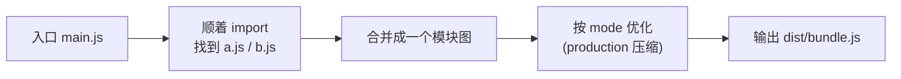
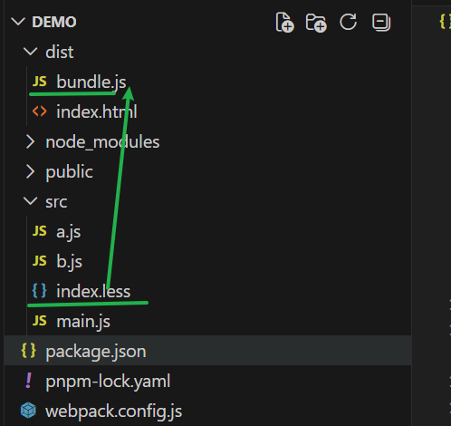
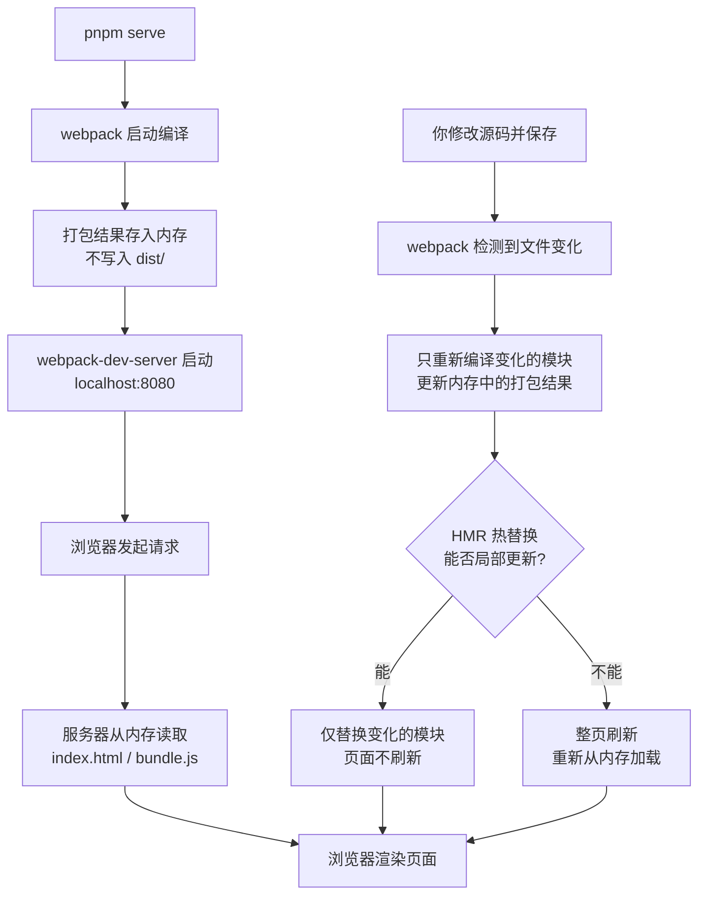
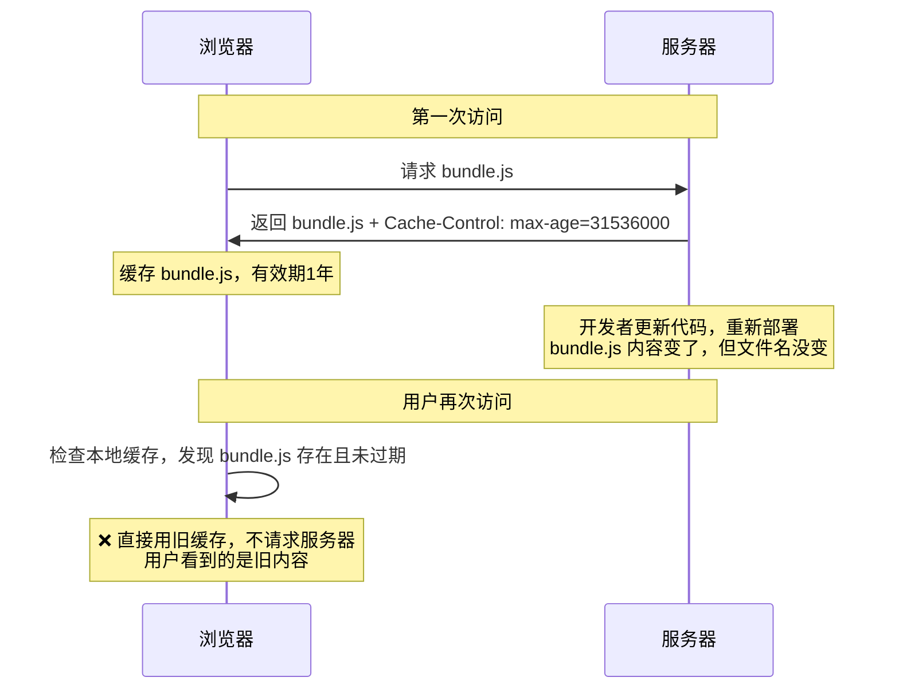
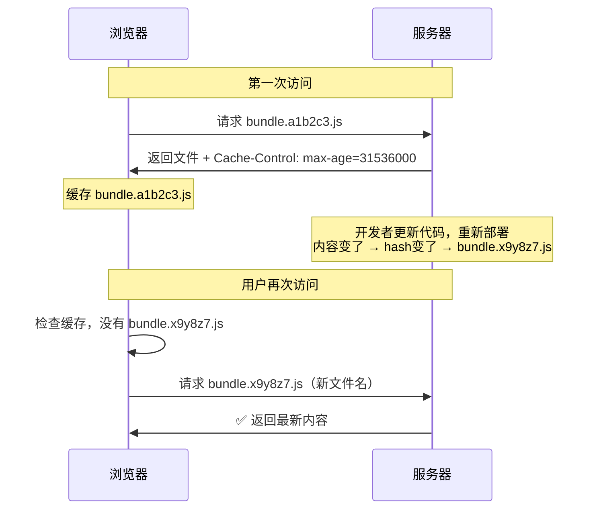
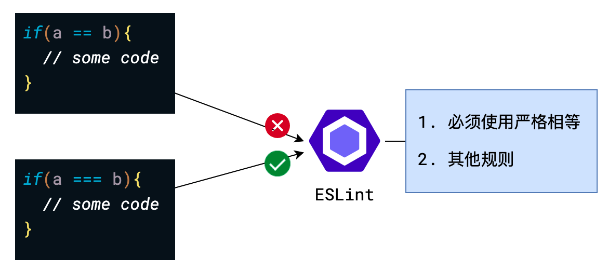

## 工程化

### 导入导出

#### 速查

只有前四个常用

| 出写法                              | 导入写法                                        |
| -------------------------------- | ------------------------------------------- |
| `export function f() {}`         | `import { f } from './A.js'`                |
| `export { f }`                   | `import { f } from './A.js'`                |
| `export { f as g }`              | `import { g } from './A.js'`                |
| `export function f() {}`         | `import { f as myF } from './A.js'`         |
| `export default function f() {}` | `import f from './A.js'`                    |
| `export { f }`                   | `import * as obj from './A.js'` → `obj.f()` |
| `export { f } from './x.js'`     | `import { f } from './index.js'`            |


#### 1、命名导出（声明时）＋ 命名导入

```js
// ── A.js（导出方）──
export function sayHi() {
  console.log('Hi');
}
```

```js
// ── B.js（导入方）──
import { sayHi } from './A.js';
sayHi(); // Hi
```


#### 2、命名导出（分离式）＋ 命名导入

```js
// ── A.js（导出方）──
function sayHi() { console.log('Hi'); }
function sayBye() { console.log('Bye'); }

export { sayHi, sayBye }; // 声明与 export 分开写
```

```js
// ── B.js（导入方）──
import { sayHi, sayBye } from './A.js';
sayHi();  // Hi
sayBye(); // Bye
```


#### 3、 别名（as）—— 导出时改名

```js
// ── A.js（导出方）──
function sayHi() { console.log('Hi'); }

export { sayHi as hi }; // 对外暴露的名字是 hi
```

```js
// ── B.js（导入方）──
import { hi } from './A.js';
hi(); // Hi
// sayHi 这个名字在 B.js 里不存在
```

- A.js 模块记录里登记的键名是 `"hi"`，`sayHi` 只是 A.js 的内部局部名，外界看不到它。
- B.js 用 `{ hi }` 精确匹配 A.js 模块记录里的键名。


#### 4.、别名（as）—— 导入时改名

```js
// ── A.js（导出方）──
export function sayHi() { console.log('Hi'); }
```

```js
// ── B.js（导入方）──
import { sayHi as hi } from './A.js';
hi(); // Hi
// B.js 内部只有 hi，没有 sayHi
```

- A.js 模块记录的键名仍是 `"sayHi"`，但链接阶段把 B.js 的本地名 `hi` 绑到了这个槽位。
- A.js 不受影响


#### 5、默认导出 ＋ 默认导入

```js
// ── A.js（导出方）──
export default function sayHi() {
  console.log('Hi');
}
```

```js
// ── B.js（导入方）──
import sayHi from './A.js'; // 不需要花括号，名字可以随便取
sayHi(); // Hi
```

- 导入时不写花括号，引擎自动读取 `"default"` 槽位，把它绑定到你写的任意本地名（这里是 `sayHi`，写 `myFunc` 也行）。
- 每个文件只能有一个 `"default"` 槽位，所以 `export default` 只能写一次。


#### 6、命名空间导入（import \*）

```js
// ── A.js（导出方）──
export function sayHi() { console.log('Hi'); }
export function sayBye() { console.log('Bye'); }
```

```js
// ── B.js（导入方）──
import * as say from './A.js';
say.sayHi();  // Hi
say.sayBye(); // Bye
```

- 引擎把 A.js 模块记录里所有导出的槽位打包成一个**命名空间对象（Module Namespace Object）**，赋给 `say`。


#### 7、重新导出（Re-export）

```js
// ── helpers.js（原始导出方）──
export function login() { console.log('login'); }
export function logout() { console.log('logout'); }
```

```js
// ── index.js（中转方，聚合导出）──
export { login, logout } from './helpers.js';
// 注意：login / logout 在 index.js 内部不可用，这不是先 import 再 export
```

```js
// ── main.js（最终使用方）──
import { login } from './index.js';
login(); // login
```


### npm包


#### 包、包管理器

**包（package）**：一个或多个 JS 文件的集合

**包管理器（npm）**：帮开发者一键下载、升级、卸载包的工具


#### Node.js 查找模块的顺序

```js
require("a")
```

Node 按以下顺序查找模块a：

1. 是否是内置模块（如 `fs`、`path`）
2. 当前目录的 `node_modules/a`
3. 上级目录的 `node_modules/a`
4. 再上级……直到根目录

这解释了为什么 `npm install` 会把包安装在项目的node_modules文件夹中。


#### 镜像源

npm默认从国外服务器下包，速度慢。国内可以使用淘宝镜像

```bash
# 查看当前源
npm config get registry

# 切换淘宝源（快）
npm config set registry https://registry.npm.taobao.org

# 切回官方源
npm config set registry https://registry.npmjs.org/
```


#### 初始化项目

```
npm init      # 交互式填写项目信息
npm init -y   # 全部默认，直接生成
```

执行后生成 `package.json`。


#### package.json 结构

```json
{
  "name": "my-project",
  "version": "1.0.0",
  "scripts": {
    "start": "node index.js"
  },
  "dependencies": {
    "qrcode": "^1.4.4"
  },
  "devDependencies": {
    "webpack": "^5.0.0"
  }
}
```

| 字段              | 作用                                               |
| ----------------- | -------------------------------------------------- |
| `dependencies`    | 项目运行时需要的包                                 |
| `devDependencies` | 只在开发时需要（打包工具、测试框架等），上线不需要 |
| `scripts`         | 自定义命令快捷方式                                 |


#### 包安装方式

```bash
# 本地安装（装进当前项目的 node_modules）
npm install qrcode             # 装到dependencies中
npm install -D webpack         # 装到devDependencies
npm install webpack --save-dev # 装到devDependencies

# 全局安装（装到系统，提供命令行工具）
npm install -g moeda
```

**判断用哪个**：

- 代码里 `require()` 的包 → 本地安装
- 提供终端命令的工具 → 全局安装


#### 还原依赖

`node_modules` 不提交到 git（体积大）。别人拉取代码后，运行：

```bash
npm install               # 还原所有依赖
npm install --production  # 只还原 dependencies，不装 devDependencies
```

npm 会读取 `package.json` 自动把所有包装回来。


#### 卸载包

```bash
npm uninstall qrcode       # 卸载本地包
npm uninstall -g moeda     # 卸载全局包
```

卸载后package.json里对应的记录会自动删除


#### scripts 脚本

```json
"scripts": {
  "start": "node index.js",
  "build": "webpack --config webpack.config.js"
}
```

```bash
npm run start    # 运行 start 脚本
npm start        # start 是特殊名称，可以省略 run
npm run build    # 其他脚本必须加 run
```

**作用**：把长命令收进 `package.json`，团队成员统一用 `npm run xxx` 执行，不需要记具体命令。


### css工程化

工程化指的就是一套工具的合集


#### 工程化本质

原生css没有变量，没有嵌套，没有复用机制。阅读困难，写起来麻烦

于是采用更好写的Less来写样式

```
写 .less文件  →  写完后让 lessc 编译  →  浏览器读 .css文件
```

Node在这里给lessc这类工具提供运行环境，负责读写文件（把 .less 文件转成 .css 文件）。


#### 编译概念（lessc / npm / npx）

转换代码，称之为编译(compile)

**less 包**：npm 上的工具包，提供 lessc 命令行工具

**本地安装**：装在项目的 node_modules 里

**npx**：npm 自带的小工具，用来运行 node_modules 里的命令


本地安装 + 使用

```bash
# 1. 初始化项目（如果还没有 package.json）
npm init -y

# 2. 本地安装 less
npm install less --save-dev

# 3. 用 npx 运行 lessc，把 index.less 编译成 index.css
npx lessc index.less index.css
```


#### Less 变量

**解决什么问题：** 同一个值（颜色、尺寸）到处重复写，改一处要改全文。

**语法：** `@变量名: 值;`，使用时直接写 `@变量名`。

```less
/* 定义变量 */
@primary: #008c8c;
@font-size-base: 16px;

/* 使用变量 */
.title {
  color: @primary;
  font-size: @font-size-base;
}

.btn {
  background: @primary;   /* 改颜色只改这一行 */
}
```

编译后css

```css
.title {
  color: #008c8c;
  font-size: 16px;
}
.btn {
  background: #008c8c;
}
```


#### Less 嵌套（含 `&`）

**解决什么问题：** 原生 CSS 写父子关系要重复写父选择器，层级越深越难读。

```css
/* 原生 CSS：啰嗦 */
.list { display: flex; }
.list li { margin: 1em; }
.list li:hover { background: red; }
```

嵌套：把子规则写在父规则的花括号里，`&` 代表"当前元素自身"

```less
.list {
  display: flex;

  li {                    /* 编译后 → .list li */
    margin: 1em;

    &:hover {             /* & 代表当前选择器本身 */
      background: red;    /* 编译后 → .list li:hover */
    }
  }
}
```


#### Less 混合（Mixins）

复用整块规则，比如居中


**语法：** 用 `.名字()` 定义一个混合，在其他规则里直接调用它。

```css
/* 定义混合：绝对定位居中 */
.abs-center() {
  position: absolute;
  top: 50%;
  left: 50%;
  transform: translate(-50%, -50%);
}

/* 使用混合 */
.modal {
  .abs-center();    /* 把上面那四行全部插入这里 */
  width: 400px;
}

.tooltip {
  .abs-center();
  background: black;
}
```


### Volta管理node

**工具链**："写代码之前，需要先装好的一套工具"。


工具举例：

1. `node`：运行 JS 代码的引擎
2. `npm / pnpm / yarn`：装项目依赖的包管理器
3. `tsc`：把 TypeScript 编译成 JS
4. `vite / webpack`：把源码打包成浏览器能跑的文件
5. `eslint`：检查代码规范


Volta就是工具链管理器


#### `volta`安装

Windows：

```bash
winget install Volta.Volta
```

重新打开vscode在终端验证：

```bash
volta --version
```


#### `volta install` — 安装工具

```bash
volta install node@22.17.0   # 安装 Node，自动设为默认版本
volta install vite            # 安装 vite CLI
```


#### `volta pin` — 切换工具版本

在某个项目目录下执行：

```bash
volta pin node@20.11.0
```

会自动在package.json中写入：

```json
{
  "volta": {
    "node": "20.11.0",
  }
}
```

如果想切换别的版本：

```bash
volta install node@22.17.0
volta pin node@22.17.0

#下面语句检验node版本
node -v

#终端打印
22.17.0
```


任何人 clone 这个项目、进入目录，Volta **自动切换**到对应版本，不需要手动操作。如果本地没有这个版本，Volta 会自动下载。


**pin Node 就够了**，npm 跟随 Node 版本自动搭配


#### `volta uninstall` — 卸载工具

```bash
volta uninstall eslint
```


#### mvn切换node版本问题

`npm install vue` 生成的 `./node_modules` 就是项目目录里的一个普通文件夹，**任何 Node 版本都能读它**

`npm install -g express-generator`，全局安装（`-g`）会把工具安装到系统`node_modules`文件夹中，nvm 下全局工具装在这里：

```
~/.nvm/versions/node/v16.17.1/lib/node_modules/express-generator/...
                          ↑ 路径里直接带着 Node 版本号
```

如果使用`nvm use 22`切换node版本→全局目录路径改变 → 旧工具找不到


Volta 的 shim 修的正是这点——把所有工具的入口固定在**同一个目录**（`%LOCALAPPDATA%\Volta\bin`），不再带 Node 版本号。


#### volta install & npm install


shim只能拦截终端命令，代码里的 `import 'vue'` 走的是 node_modules 解析

所以库永远是`npm install`，命令工具用`volta`


`node` `npm` `pnpm` `eslint` `vite` `tsc`）→ `volta`；

被你代码 `import`/`require` 的（`vue` `express` `lodash`）→ `npm`


### 库和工具的区别

分界线package.json里有没有 `bin` 字段。

`eslint`、`vite`、`tsc`、`vue-cli` 这些命令行工具之所以能在终端用命令控制，是因为各自的 package.json 声明了 `bin`：

```json
// eslint 的 package.json
{
  "name": "eslint",
  "bin": { "eslint": "./bin/eslint.js" }   // ← 这一行让它变成一个命令
}
```

 `node_modules\eslint\bin\eslint.js` 文件开头通常有一行 `#!/usr/bin/env node`，告诉系统"用 node 来跑我"


`vue、lodash`这类库 `package.json`里面就没有`bin`字段


### webpack例子

#### 打包JS

最终项目目录结构

```
demo/
├── node_modules/          # 第三方依赖（webpack 等），不需要提交到 git
├── src/                   # 源代码目录（我们自己写的代码）
│   ├── a.js
│   ├── b.js
│   └── main.js            # 入口文件，程序从这里开始
├── dist/                  # 打包产物目录（webpack 自动生成）
│   └── bundle.js          # 最终输出的单个文件
├── package.json           # 项目说明书 + 依赖清单 + 命令脚本
├── pnpm-lock.yaml         # 依赖版本锁定文件（pnpm 生成）
└── webpack.config.js      # webpack 打包配置
```


#####  1、`pnpm init`（或手动创建）生成 `package.json`


##### 2、安装打包工具 —— `webpack` + `webpack-cli`

```powershell
pnpm add -D webpack webpack-cli
```

装**两个**包，缺一不可：

- `webpack`：打包引擎本身（负责分析模块、合并、压缩）。
- `webpack-cli`：命令行工具，能在终端里敲 `webpack` 命令去驱动引擎。
- `-D`：装到 `devDependencies`。因为打包工具只在开发/构建阶段用，上线运行的代码里并不包含它。


##### 3、编写源码

```js
// src/a.js
export default 'a';

// src/b.js
export default 'b';

// src/main.js（入口）
import a from './a';
import b from './b';
console.log(a, b);
```


##### **4、编写打包配置 —— `webpack.config.js`**

```js
const path = require('path');

module.exports = {
  entry: './src/main.js',                       // 入口
  output: {
    filename: 'bundle.js',                      // 输出文件名
    path: path.resolve(__dirname, 'dist'),      // 输出目录
    clean: true,                                // 打包前清空 dist
  },
  mode: 'development',                           // 默认模式
};
```

| 配置     | 作用       | 现实意义                                        |
| -------- | ---------- | ----------------------------------------------- |
| `entry`  | 打包起点   | 应用的“大门”，从这里开始扫描依赖                |
| `output` | 产物去向   | 决定最终部署到服务器上的文件                    |
| `clean`  | 清理旧产物 | 避免上次打包的残留文件造成困扰                  |
| `mode`   | 打包模式   | `development` 易调试；`production` 自动压缩优化 |

真实的 `webpack.config.js` 会复杂得多，还会配置 **loader**（处理 CSS、图片、TS、Vue 文件等非 JS 资源）和 **plugin**（生成 HTML、提取 CSS、分析体积等）。


##### 5、配置命令脚本 —— `package.json` 的 `scripts`

```json
"scripts": {
  "build": "webpack --mode production",
  "dev": "webpack --mode development",
  "watch": "webpack --watch"
}
```

| 命令             | 作用                                     |
| ---------------- | ---------------------------------------- |
| `pnpm run build` | 生产打包，代码被压缩，体积最小，用于上线 |
| `pnpm run dev`   | 开发打包，不压缩，保留可读性，方便调试   |
| `pnpm run watch` | 监听文件改动，一改动就自动重新打包       |

`build`和`dev`的差别

```
build → webpack --mode production    （生产/上线）
dev   → webpack --mode development    （开发/调试）
```

mode会让webpack对同一份源码做完全不同的处理

|              | `dev`(development) | `build`(production) |
| ------------ | ------------------ | ------------------- |
| 代码压缩     | ❌ 不压缩,保持可读  | ✅ 压缩到最小        |
| 多余代码删除 | ❌ 保留             | ✅ 删掉              |
| 打包速度     | 快                 | 慢一些(要做优化)    |
| 调试体验     | 好(能对应到源码行) | 差(代码被压成一行)  |
| 用途         | 本地开发边写边调   | 打包上线给用户      |

假设源码为：

```js
// 源码 main.js
import a from './a';
import b from './b';

const neverUsed = () => '我是没用到的函数';   // 多余代码

console.log(a, b);
```

`pnpm run dev`(development) 打出来的 `bundle.js` ≈(保留可读性):

```js
// 变量名、注释、换行都保留，方便你调试
(() => {
  const a = 'a';            // 来自 a.js
  const b = 'b';            // 来自 b.js
  const neverUsed = () => '我是没用到的函数';
  console.log(a, b);
})();
```

`pnpm run build`(production) 打出来的 `bundle.js` ≈(极致压缩):

```js
(()=>{console.log("a","b")})();
```


##### 6、执行打包

```powershell
pnpm run build
```

输出：

```
asset bundle.js 44 bytes [emitted] [minimized] (name: main)
./src/main.js 62 bytes [built] [code generated]
webpack 5.108.3 compiled successfully
```

webpack 完成了这样一条流水线：



最终 `dist/bundle.js` 就是一个可以直接 `<script>` 引入浏览器运行的文件。


#### webpack打包直觉

浏览器（尤其老版本）不认模块语法，而一个应用又被拆成成百上千个模块；**核心行为是**——在**编译时**从入口出发，顺着 `import` 找全所有依赖，合并压缩成"已经没有任何模块语法"的产物文件。

红框是源码，绿框对应的是压缩产物，平时运行的都是压缩产物


#### 形成单页应用（SPA）

打包文件里一般都有一个`index.html`文件，作为单页应用（SPA）里**唯一的那个 HTML 页面**，这个html文件几乎为空白，所有的内容均靠js生成

`index.html` 是**壳**，不需要编译，所以放 `public/`


index.htm里面回引入

```html
<!doctype html>
<html lang="zh-CN">
  <head>
    <meta charset="UTF-8" />
    <meta name="viewport" content="width=device-width,initial-scale=1" />
    <title>Demo</title>
    <!-- 引入打包好的js文件 -->
    <script defer="defer" src="bundle.js"></script>
  </head>
  <body>
    <div id="app"></div>
  </body>
</html>
```

HtmlWebpackPlugin差距读取它作为模板，把打包后的 JS/CSS 路径注入进去，再输出到 [dist](vscode-file://vscode-app/c:/Application/Microsoft VS Code/7e7950df89/resources/app/out/vs/code/electron-browser/workbench/workbench.html)。


配置步骤

1. 安装插件到开发依赖中，`pnpm add -D html-webpack-plugin`

2. 创建 `public/index.html` 模板

3. 修改 `webpack.config.js`，在文件中添加

   ```js
   const HtmlWebpackPlugin = require('html-webpack-plugin');
   
   module.exports = {
     // ...
     plugins: [
       new HtmlWebpackPlugin({
         template: path.resolve(__dirname, 'public/index.html'),
       }),
     ],
   };
   ```

4. 打包验证，`pnpm build / pnpm dev`


#### plugins作用

webpack只能打包JS模块，其他所有功能（生成 HTML、提取 CSS、压缩图片……）都靠插件扩展。

plugins数组就是告诉 webpack："打包过程中，额外执行这些插件"。会在js代码打包完成后执行

```
plugins: [
  new HtmlWebpackPlugin({ template: '...' }),
]
```


#### 打包css

1、安装所需包

```
pnpm add -D less less-loader css-loader style-loader
```

| 包名         | 作用                               |
| ------------ | ---------------------------------- |
| `less`       | Less 编译器本体                    |
| less-loader  | 让 webpack 调用 Less 编译器        |
| css-loader   | 处理 CSS 中的 `@import` / `url()`  |
| style-loader | 把 CSS 通过 `<style>` 标签注入页面 |


2、webpack.config.js中添加

```js
module.exports = {
 // ...
  module: {
    rules: [
      {
        test: /\.(css|less)$/i, // 匹配 .css 和 .less 文件
        use: [
          'style-loader', // ③ 把 CSS 注入到页面的 <style> 标签
          'css-loader',   // ② 处理 CSS 中的 @import / url()
          'less-loader',  // ① 把 Less 编译成普通 CSS
        ],
      },
    ],
  },
};

```


3、在入口文件引入 .less或者 .css文件


4、打包验证

用 style-loader，CSS 被**打进了 `bundle.js`** 里，浏览器运行时动态插入 `<style>` 标签，**dist下不会有独立的 `.css` 文件**。




#### public目录

webpack会非常暴力的将public目录中的所有文件（除页面模板外），复制到打包结果中


#### 开发服务器

有了开发服务器，每次调试无需先打包再运行

打包结果放入内存 → webpack启动开发服务器 → 浏览器请求 → 开发服务器从内存中读取打包好的代码 → 浏览器渲染页面




启动步骤

1、安装 `webpack-dev-server`

```
pnpm add -D webpack-dev-server
```


2、 在 webpack.config.js 里加上服务器配置

```js
module.exports = {
  // ...
  devServer: {
    port: 8080, // 服务器端口
    open: true, // 启动后自动打开浏览器
  },
  // ...
};
```


 3、在 package.json 里添加 `serve` 脚本

```json
{
// ...
  "scripts": {
    "serve": "webpack serve",
    // ...
  },
//...
}
```


4、启动 `pnpm serve`


#### 打包图片

webpack直接内置了图片打包功能

1、webpack.config.js中添加图片处理规则

```js
module.exports = {
  // ...
  module: {
    rules: [
      // ...
      {
        test: /\.(png|jpg|jpeg|gif|webp|svg)$/i, // 匹配图片文件
        type: 'asset/resource', // webpack5 内置，直接输出为独立文件并返回 URL
      },
    ],
  },
  // ...
};
```


2、main.js中将图片插入页面

```js
// ...
import imgUrl from '../public/Age Of empires Def Edition rome-1920x1080.jpg';

const img = document.createElement('img');
img.src = imgUrl;
img.style.width = '100%';
document.body.appendChild(img);

// ...
```


#### [contenthash]文件名

修改webpack.config.js配置，重新打包

```js
module.exports = {
  // 输出配置：打包后的文件放在 dist/bundle.js
  output: {
    filename: 'bundle.[contenthash].js', // 内容变化时 hash 变，文件名随之变化
    //...
  },
  // ...
};
```


原因：

打包结果文件名不随内容改变 → 面对浏览器缓存+同命复用策略 → 后续更改服务器内容 → 客户端服务器因为复用不修改内容



使用contenthash文件名




#### 资源路径

webpack只能处理经过webpack模块系统的路径

```js
import url from './assets/1.png'   // ✅ webpack 处理了这个 import，知道这个文件
                                    //    会把 url 替换成打包后的真实路径
```

```css
background: url('./assets/1.png')  // ✅ css-loader 会解析 CSS 中的 url()
                                    //    同样替换成打包后的真实路径
```


webpack无法识别一个字符串是否是路径

```js
const url = './assets/1.png'  // ❌ 这只是一个字符串，webpack 不知道它是路径
img.src = url                 //    打包后这个字符串原封不动，指向一个不存在的位置
```


#### 缺省的文件和后缀名

导入模块时，所有文件可省略`.js`

```js
import './home'; // 若存在home.js，可省略js
import './movie'; // 若movie是一个目录，此次导入的是 ./movie/index.js
```


#### 路径别名

```js
// 不用数有几个 ../
import '../../../b/b1'   ❌ 容易数错，移动文件后还得改

// 直接从 src/ 根目录出发
import '@/b/b1'          ✅ 永远是绝对定位，不受文件层级影响
```

在webpack.config.js中配置

```js
module.exports = {
  //...
  resolve: {
    alias: {
      '@': path.resolve(__dirname, 'src'), // @ 指向 src 目录
    },
  },
  //...
};

```


#### JS兼容性

- `babel.config.js`：通过配置该文件，可以设置对哪些js代码进行降级处理
- `.browserslistrc`：通过配置该文件，可以设置在降级时，要兼容哪些浏览器，兼容的范围越光，降级产生的代码就越多，自然，打包后的体积就越大


配置过程

1、安装所需包

```
pnpm add -D @babel/core @babel/preset-env babel-loader core-js
```

| 包                  | 作用                                                         |
| ------------------- | ------------------------------------------------------------ |
| `@babel/core`       | Babel 编译器核心                                             |
| `@babel/preset-env` | 根据目标浏览器自动决定降级哪些语法                           |
| babel-loader        | 让 webpack 把 JS 交给 Babel 处理                             |
| `core-js`           | 提供新 API 的 polyfill（如 `Promise`、[Array.from](vscode-file://vscode-app/c:/Application/Microsoft VS Code/7e7950df89/resources/app/out/vs/code/electron-browser/workbench/workbench.html)） |


2、创建 babel.config.js

告诉 Babel 用什么规则降级，以及按需引入 polyfill：

```js
module.exports = {
  presets: [
    ['@babel/preset-env'], // 根据目标浏览器自动降级语法
  ],
  plugins: [
    [
      'babel-plugin-polyfill-corejs3',
      {
        method: 'usage-global', // 按需引入 polyfill，只引入代码中实际用到的
        version: '3', // 使用 core-js 第三版
      },
    ],
  ],
};
```


 3、创建 .browserslistrc

告诉 Babel 需要兼容哪些浏览器

```
> 1%
last 3 versions
not dead
```

| 规则              | 含义                       |
| ----------------- | -------------------------- |
| `> 1%`            | 全球使用率超过 1% 的浏览器 |
| `last 3 versions` | 每款浏览器的最近 3 个版本  |
| `not dead`        | 排除官方已停止维护的浏览器 |


4、webpack.config.js 添加 babel-loader 规则

```js
module.exports = {
  //...
  module: {
    rules: [
      //...
      {
        test: /\.js$/i,           // 匹配所有 .js 文件
        exclude: /node_modules/,  // 排除 node_modules（第三方包已经处理过了）
        use: 'babel-loader',      // 交给 Babel 进行语法降级
      },
    ],
  },
  //...
};
```


5、引入对应polyfill

```
pnpm add -D babel-plugin-polyfill-corejs3
```

扫描代码，找出用到了哪些新 API，然后自动从 `core-js` 里引入对应的 polyfill。

比如用了 `Promise.allSettled()`，旧浏览器不支持。它会自动在打包结果里加入：

```js
import "core-js/modules/es.promise.all-settled.js"; // 自动补上，无需手写
```


#### 源码地图 source map

作用：浏览器开发者工具里看到报错时，点击错误位置跳转，显示的将是你写的原始源码，而不是压缩混淆后的打包代码。


在webpack.config.js里配置devtool选项

```js
module.exports = {
  //...
  devtool: 'source-map', // 生成独立的 .map 文件，报错时浏览器定位到源码位置
  //...
};
```

打包后：

```
bundle.3118370d5e299cfb3a18.js
bundle.3118370d5e299cfb3a18.js.map   ← 新增的源码地图
index.html
```


#### CSS工程化

webpack **默认只认识 CSS**，且需要 css-loader。`less`/`sass`/`stylus` 都必须**安装对应的 loader**（如 [ess-loader）才能处理。


##### 厂商前缀

厂商同一个 CSS 特性在不同浏览器（尤其是旧版本）上都能生效

| 前缀       | 厂商/内核       |
| ---------- | --------------- |
| `-webkit-` | Chrome、Safari  |
| `-moz-`    | Firefox         |
| `-ms-`     | IE / Edge（旧） |
| `-o-`      | Opera（旧）     |


通过，打包工具会在打包代码上自动补上浏览器兼容前缀

```css
/* 你写的 */
.box { display: flex; }

/* 自动变成 */
.box {
  display: -webkit-box;   /* 老 Safari */
  display: -ms-flexbox;   /* 老 IE */
  display: flex;
}
```


配置步骤

 1、安装依赖

```
pnpm add -D postcss postcss-loader autoprefixer
```

| 包             | 作用                                |
| -------------- | ----------------------------------- |
| `postcss`      | PostCSS 核心引擎                    |
| postcss-loader | 让 webpack 把 CSS 交给 PostCSS 处理 |
| `autoprefixer` | PostCSS 的插件，真正负责加厂商前缀  |


2、创建 postcss.config.js

在项目根目录创建，告诉 PostCSS 使用 `autoprefixer` 插件：

```js
module.exports = {
  plugins: ['autoprefixer'], // 自动根据 .browserslistrc 添加厂商前缀
};
```


3、webpack.config.js的 CSS 规则里插入 postcss-loader

```js
module.exports = {
  // ...
  module: {
    rules: [
      {
        use: [
          'style-loader', 
          'css-loader', 
          'postcss-loader', // ② 交给 PostCSS（autoprefixer 加厂商前缀）
          'less-loader',
        ],
      },
      //...
    ],
  },
};

```


处理流程总结

```
.less 文件
  │
  ▼ less-loader     把 Less 编译成标准 CSS
  │
  ▼ postcss-loader  调用 autoprefixer，读 .browserslistrc
  │                 → 按目标浏览器按需加厂商前缀
  │
  ▼ css-loader      解析 @import / url()
  │
  ▼ style-loader    注入页面
```


##### CSS Module — 解决类名冲突

css代码文件带.module，类名自动哈希成全局唯一


假如两个文件都写了 `.title`，打包后互相覆盖。如果文件名带.module

```
a.module.css  .title  →  ._a1b2c3
b.module.css  .title  →  ._x9y8z7   ← 不会冲突
```

**代价：** 类名被改了，你没法直接写字符串，得通过导入的对象去取：

```js
import styles from './index.module.css';

// ❌ 错误：'title' 不是最终类名
dom.classList.add('title');

// ✅ 正确：styles.title 里存的是哈希后的真实类名
dom.classList.add(styles.title);
```


### npx

`npx` 是随 `npm` 一起提供的命令，只做一件事——找到一个可执行命令并运行它。

`npm install` 是为了把依赖留在项目里；`npx` 常常是"用完就可能丢"。


场景 A —— 项目里已经装过的工具：执行过 `npm install eslint --save-dev`，现在运行：

```
npx eslint .
```

本地 `node_modules/.bin/eslint` 已经存在，npx 直接加载运行，不联网，也不会弹确认框。


场景 B —— 从没装过、只想用一次：

```
npx cowsay "hello npx"
```

本地找不到 `cowsay`，npm 会去 registry 解析这个包，弹出类似下面的提示：

```
Need to install the following packages:          // 询问是否安装
  cowsay@1.6.0
Ok to proceed? (y)
```

按 `y` 之后，它被装进 npm 缓存的临时目录并运行；命令跑完之后，你的全局环境和项目里都不会多出这个包。


### ESLint

ESLint 是一个静态分析工具：它不运行你的程序，只是读一遍源代码，按一套可以自己开关的"规则"检查有没有可能的 bug 或者不一致的写法。

"静态"这个词是关键——和它对比的是运行时才会暴露的错误

ESLint 在按下运行键之前，就能先挑出一部分问题。




#### 检查报告

一段没有语法错误、但有两处"规则问题"的代码：

```js
function greet(name) {
  let unused = 42;
  if (name == "world") {
    console.log("hello world");
  }
}

greet("world");
```

在这份代码所在的目录下运行：

```
npx eslint sample.js
```

际跑出来的结果：

```powershell
.../sample.js
  2:7   error    'unused' is assigned a value but never used  no-unused-vars
  3:12  warning  Expected '===' and instead saw '=='          eqeqeq

✖ 2 problems (1 error, 1 warning)
```

这是 ESLint 默认的输出格式，官方叫它 `stylish`。每一行问题从左到右依次是：

| 位置                          | 含义                                                   |
| :---------------------------- | :----------------------------------------------------- |
| `2:7`                         | 第 2 行第 7 列——问题具体出在哪个字符                   |
| `error` / `warning`           | 严重级别                                               |
| 中间那句话                    | 人话描述的问题内容                                     |
| 最右边（如 `no-unused-vars`） | 触发这条报告的规则名——以后查文档、开关规则都靠这个名字 |

最后一行 `✖ 2 problems (1 error, 1 warning)` 是总数汇总。


#### error 和 warning，差在哪

ESLint 的规则严重级别只有三档，配置文件里字符串、数字写法都认：

| 写法            | 意思                              |
| :-------------- | :-------------------------------- |
| `"off"` / `0`   | 关闭这条规则，完全不检查          |
| `"warn"` / `1`  | 报告问题，但不影响命令的退出码    |
| `"error"` / `2` | 报告问题，且让命令以非 0 状态退出 |

上面表格里 severity 的 `0`/`1`/`2`（off/warn/error）说的是这条规则多严重，和下面的退出码无关


#### 退出码

| 退出码 | 含义                                                         |
| :----- | :----------------------------------------------------------- |
| `0`    | 没有 error（若配了 `--max-warnings`，warning 数也没超过阈值） |
| `1`    | 至少有 1 个 error；或者 warning 数超过了 `--max-warnings` 阈值 |
| `2`    | ESLint 自己跑失败了（配置错误、内部异常）——跟报告里有几个问题无关 |

：CI 流水线、提交前检查，通常就是靠"退出码是不是 0"来判断要不要拦下这次提交或合并。

上面例子里有 1 个 error，实测这条命令的退出码是 `1`——warning 再多也不会让它变成非 0（除非专门配置了 `--max-warnings`）。这也是为什么团队常把"确定是问题"的规则设成 error、把"提醒一下、慢慢改"的规则设成 warn。

把练习文件临时换成 2 个 error（0 个 warning）再跑一次，退出码还是 `1`，不会因为多了一个 error 就变成 `2`：

```
✖ 2 problems (2 errors, 0 warnings)
Exit code: 1
```


#### 最基础的配置

ESLint 默认什么规则都不开——项目里必须有配置文件告诉它检查哪些规则。

现在的标准写法是项目根目录下的 `eslint.config.js`文件进行编辑

最简单的形式就是一个数组，其中一项带 `rules`：

```js
export default [
  {
    rules: {
      "no-unused-vars": "error",
      eqeqeq: "warn",
    },
  },
];
```

上面报告里的两条问题，就是这份配置产生的。真实项目通常不会一条条手写所有规则，而是先 `extends` 一份别人整理好的推荐配置（比如官方的 `js/recommended`），再按需要开关个别规则。