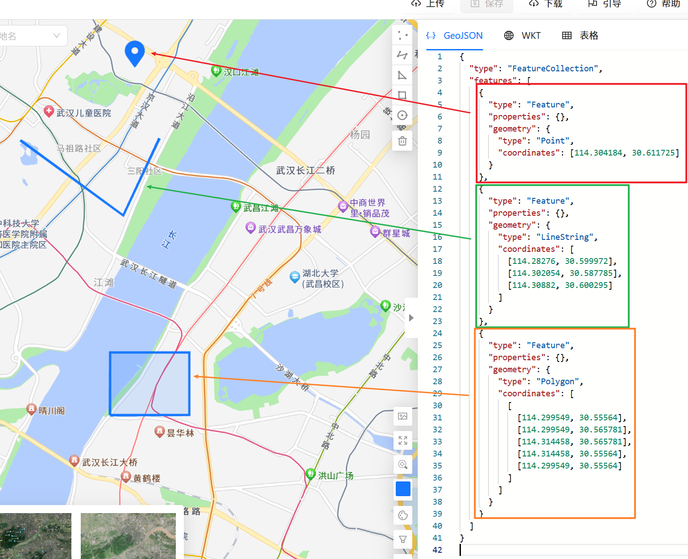
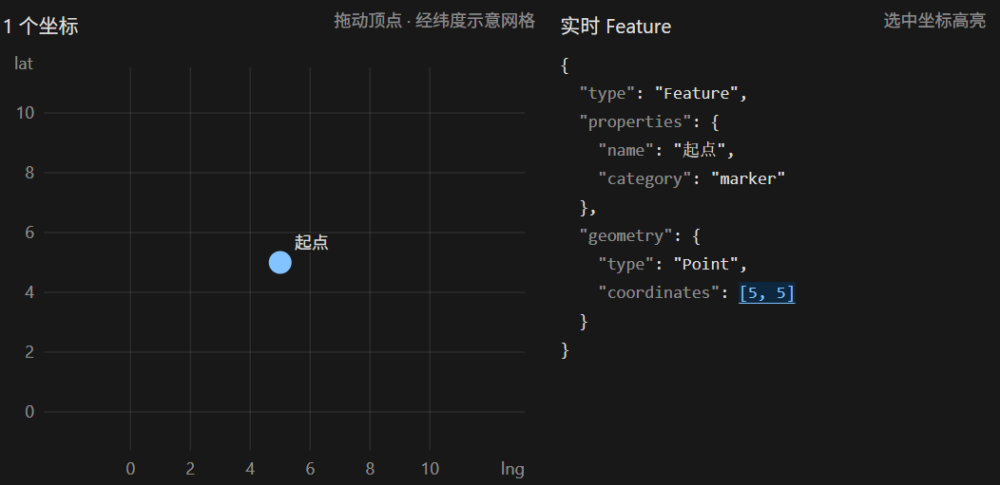
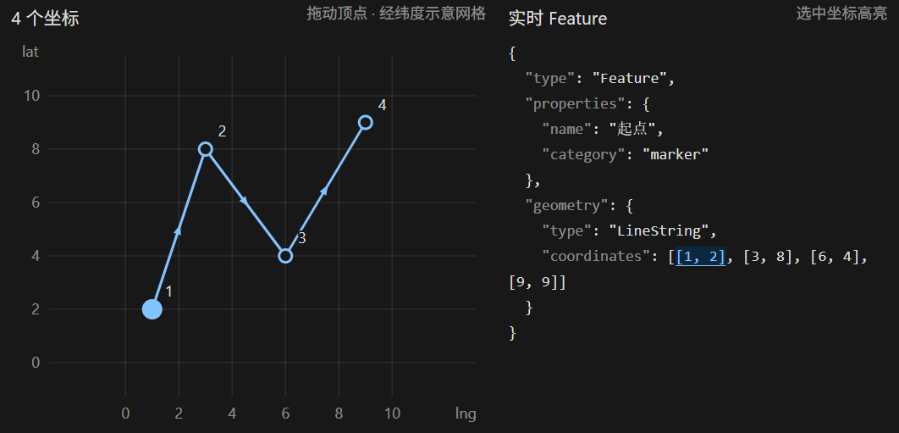
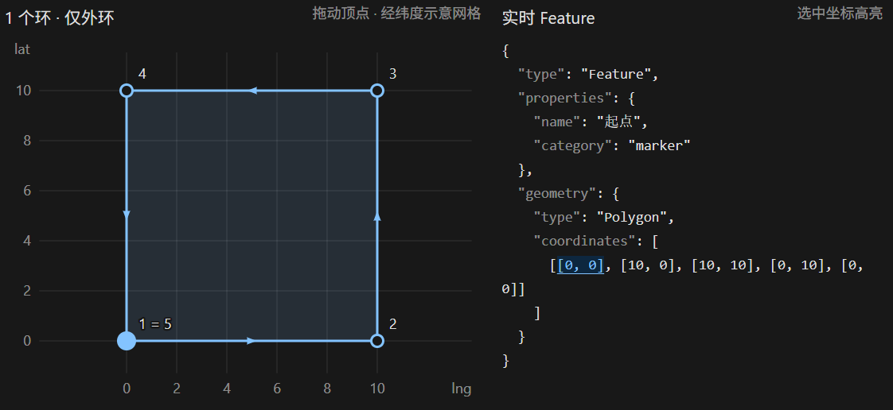
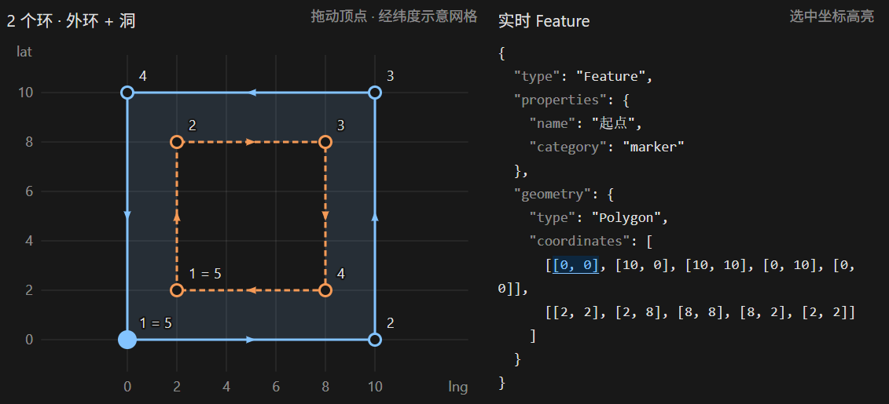
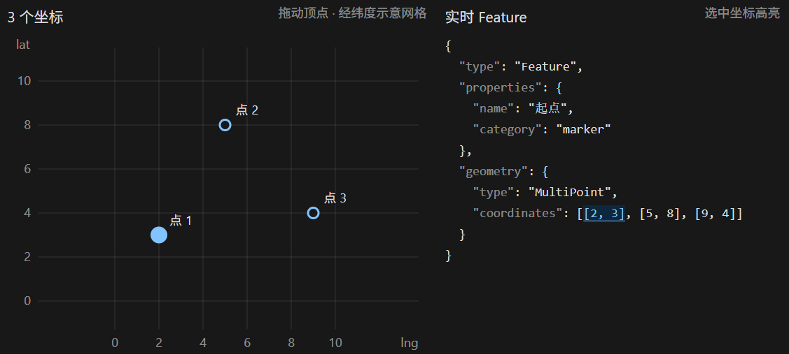
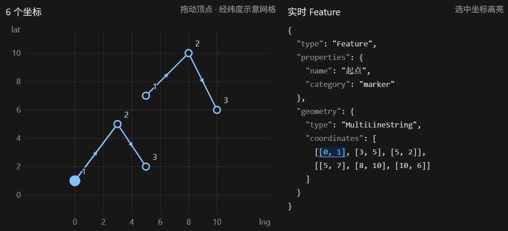
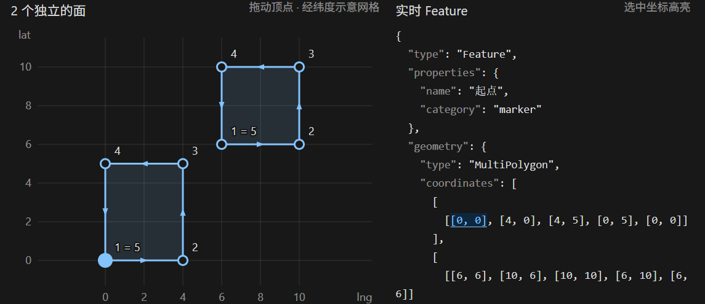
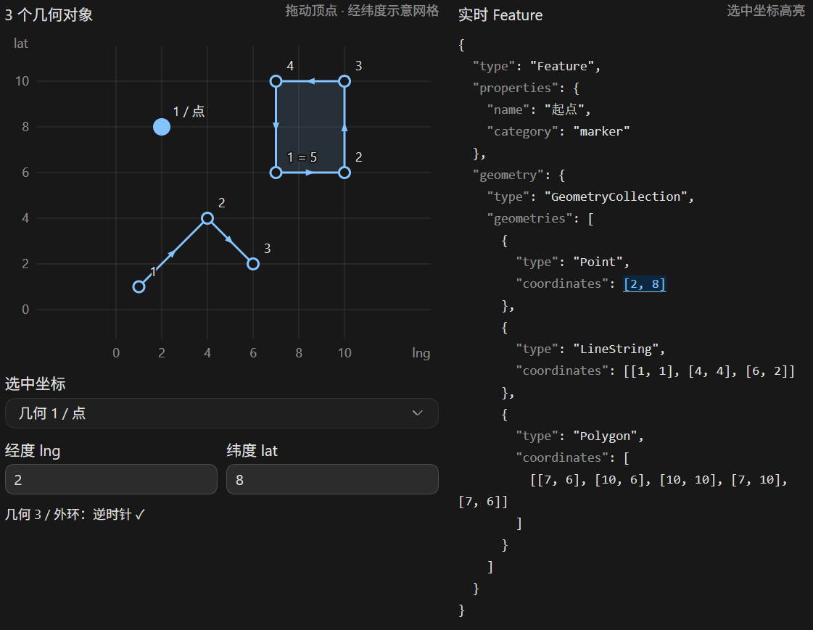

一整个图层的数据，就可以用一份 GeoJSON 来描述。


GeoJSON是一组要素数据


### features

features是一个存放各种具体对象的数组，数组中的每个feature对象分别对应一个要素，这里的示例便是对应点、线、面三个要素



图中GeoJSON数据

```json
{
  "type": "FeatureCollection",
  "features": [
    {
      "type": "Feature",
      "properties": {},
      "geometry": {
        "type": "Point",
        "coordinates": [114.304184, 30.611725]
      }
    },
    {
      "type": "Feature",
      "properties": {},
      "geometry": {
        "type": "LineString",
        "coordinates": [
          [114.28276, 30.599972],
          [114.302054, 30.587785],
          [114.30882, 30.600295]
        ]
      }
    },
    {
      "type": "Feature",
      "properties": {},
      "geometry": {
        "type": "Polygon",
        "coordinates": [
          [
            [114.299549, 30.55564],
            [114.299549, 30.565781],
            [114.314458, 30.565781],
            [114.314458, 30.55564],
            [114.299549, 30.55564]
          ]
        ]
      }
    }
  ]
}
```


### properties

展示一些描述信息，放任意键值对，GeoJSON规范不限制内容

```json
"properties": { "name": "起点", "category": "marker" }
```


### geometry

描述几何信息，由 `type` 和 `coordinates` 组成，`type` 决定形状。


一个坐标对应一个点。coordinates只能有一个`[lng, lat]`




按数组顺序连接各坐标；箭头表示连接顺序。




外环：逆时针 ✓




第一个环是外环，后面的环是内环（洞），外环：顺时针（应逆时针）；洞 1：逆时针（应顺时针）




多个独立点：嵌套层级与 LineString 相同，连接方式由 type 决定。




每个子数组是一条独立的线，线与线之间不相连




面 1 / 外环：逆时针 ✓；面 2 / 外环：逆时针 ✓




GeometryCollection

`geometries → 几何对象[]（各自拥有 type）`


