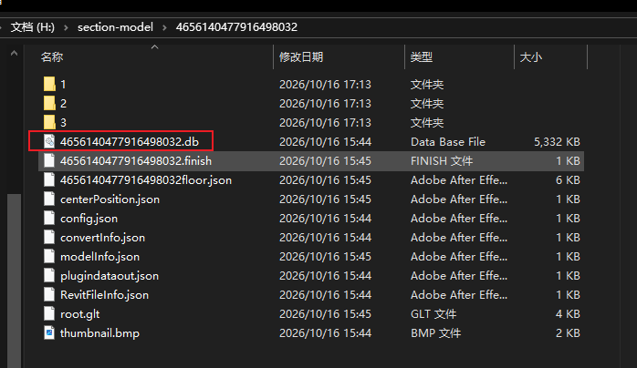
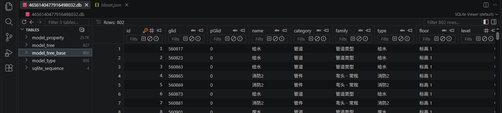
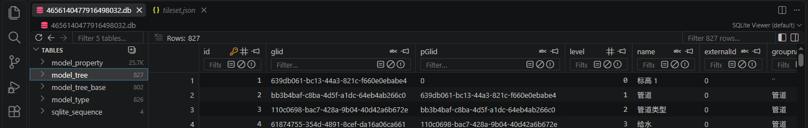
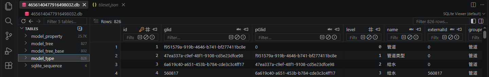
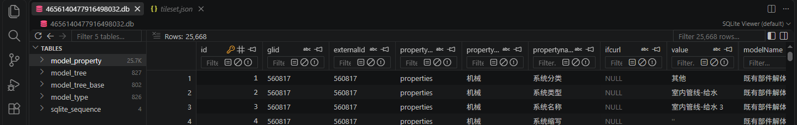

### 概念关系：BIM、Revit、.rvt

```
BIM（建筑信息模型）      ← 一种方法/理念：用带信息的三维对象来表达工程
   │
Revit                    ← 实现 BIM 的软件之一（Autodesk 出品）
   │
.rvt                     ← Revit 保存工程的文件格式
```

- BIM 是概念：模型里的每个东西不是"一堆线和面"，而是"一个有身份、有属性的构件"。Building Information Modeling
- Revit 是软件：设计师用它画管道、墙、设备。
- .rvt 是文件：设计师画完保存下来的工程文件，就是"BIM 数据"在 Revit 里的存在形式。


### `.rvt` 里的 BIM 数据怎么组织

BIM数据组织方式

```
项目 Project
 └─ 标高 Level（标高 1）
     └─ 类别 Category（管道、管件、卫浴装置…）
         └─ 族 Family（管道类型）
             └─ 类型 Type（给水 / 消防 / 废水…）
                 └─ 实例 Instance（构件，ID=560817）
                     ├─ 身份：ElementId / UniqueId
                     ├─ 参数：实例参数 + 类型参数
                     ├─ 几何：网格 / 拉伸 / 扫掠…
                     └─ 关系：所在标高、连接的管件、所属系统
```

平时所说的Revit 参数指的是挂在“构件”上的键值属性，也就是上图里实例下的参数（实例参数，类型参数）

例如：

| 参数名   | 值            |
| -------- | ------------- |
| 系统分类 | 其他          |
| 系统类型 | 室内管线-给水 |
| 标高     | 标高 1        |

"构件"是现实里的一个具体物件：一根管道、一个阀门、一面墙、一扇门。

实例（Instance）是""构件""在 Revit 里的名字。


### 轻量化过程

```
武汉动车段 .rvt（×3）
        │  Revit 插件导出 + 平台转换
        │  （config.json 里记录了转换参数）
   ┌────┴────────────┐
   ▼                 ▼
 外形这一支        信息这一支
 把参数化外形      把参数、分类、
 变成三角网格，    树结构抄进
 Draco 压缩，      SQLite 数据库
 切成 tile
```

目的：让浏览器能流畅展示，并且仍能点选查属性。

代价：外形不能再改，参数化能力丢失


### 轻量化结果

```
4656140477916498032/
├─ 4656140477916498032.db        ← 信息：属性 + 分类 + 树（非几何，SQLite）
├─ root.glt、1/1.glt …            ← 分块索引（zip 内是 .bin，推断）
├─ 1/ 2/ 3/Batchedtile_N/
│   ├─ tile_N.glm                ← 外形：zip 内是 b3dm（网格/法线/纹理）
│   └─ tileset.json              ← 该 tile 的定位、包围盒、含哪些 glid
├─ 4656140477916498032floor.json ← 楼层 → glid 列表
└─ config / centerPosition / plugindataout / convertInfo
   / RevitFileInfo / modelInfo / .finish / thumbnail.bmp
                                 ← 转换参数、定位、来源、统计等元数据
```




#### db数据

glendale平台的轻量化产生的db数据就是Revit参数

```
Revit 概念                  .db 表 / 字段
─────────────────────────────────────────────────────
标高 / 类别 / 族 / 类型  →  model_tree_base
                            (floor, category, family, type)
层级树（可展开的树）     →  model_tree、model_type
                            (glid, pGlid, level)
实例的每个参数           →  model_property
                            (glid, propertySetName, propertyname, value)
实例的几何               →  不在 .db，在 tile_N.glm (b3dm)
```

.db 不是轻量化后才产生的新信息。 轻量化工具（插件）在 Revit 里导出时，读取了每个构件已有的信息，原样抄进 SQLite 文件里。


1. 标高 / 类别 / 族 / 类型 对应 `model_tree_base`

   | 表                | 行数 | 存什么                                                       | 对应 Revit 中的哪部分                              |
   | ----------------- | ---- | ------------------------------------------------------------ | -------------------------------------------------- |
   | `model_tree_base` | 802  | 每个构件一行：`glid`、`name`、`category`、`family`、`type`、`floor` | 实例的身份信息：类别、族、类型、所在标高，摊平成表 |

   

   

2. 层级树 对应 `model_tree`、`model_type`

   | 表           | 行数 | 存什么                                         | 对应 Revit 中的哪部分                                        |
   | ------------ | ---- | ---------------------------------------------- | ------------------------------------------------------------ |
   | `model_tree` | 827  | 树节点：`glid`、`pGlid`（父）、`level`、`name` | 按"标高 → 类别…"分组的展示树。这是工具自己的分组，不是 Revit 原生结构 |
   | `model_type` | 826  | 同上                                           | 按"类别 → 类型"分组的展示树                                  |

   

   

   

3. 实例的每个参数 对应 `model_property`

   | 表               | 行数  | 存什么                                                       | 对应 Revit 中的哪部分            |
   | ---------------- | ----- | ------------------------------------------------------------ | -------------------------------- |
   | `model_property` | 25668 | 每个参数一行：`glid`、`propertySetName`、`propertyname`、`value` | 实例的参数，平均每个构件约 32 个 |

   

   

4. 实例的几何 不在 .db 里
   构件的外形（三角网格）单独存在 `tile_N.glm` 里，通过相同的 `glid` 和 `.db` 对应。


### 点选一个构件时发生什么

```
1. 浏览器加载 tile_N.glm，渲染外形

2. 用户点中一块几何
   → 通过 tileset.json 的 subObj.names 得知它属于构件 560817

3. 拿 560817 去查 .db（需后端提供接口）
   ├─ model_tree_base：类别、族、类型、标高
   └─ model_property：全部参数，显示在属性面板

4. 按楼层/类别过滤：
   先从 .db 或 floor.json 取出一批 glid，再用它们控制对应几何的显示
```

