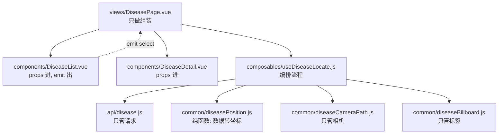
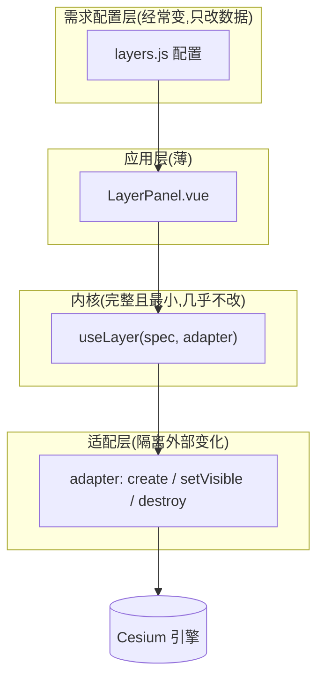
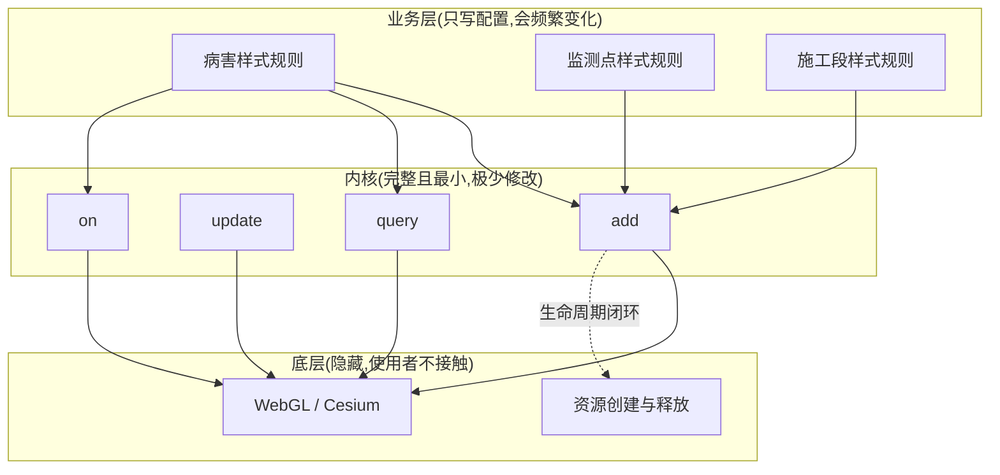

### 登堂入室级

1. 每个文件只回答一个问题
2. 每个文件模块只通过互相导出函数交流，不读写对方内部状态
3. 对于一个完整功能的实现，里面需要有一个完整的功能编排模块，里面规定了各个功能模块间的执行顺序，模块相互之间不直接进行中转，全部由编排模块组织。
   - 比如下面例子：`composables/useDiseaseLocate.js` 模块—— 唯一知道"定位病害"完整流程的地方。
4. 视图依赖编排层，编排层依赖工具模块，没有反向或平级调用。
   - 视图层依赖编排层的原因：依赖编排层的话，视图层只需从编排层引入一个组织业务流程的函数。其它内容都放在展示什么上，后续UI复用直接复制就行。如果视图混入了各种功能模块，复用时要处理的代码会更多。
   - 例子中的`views/DiseasePage.vue`模块 —— 只做组装,没有业务细节
5. UI组件不做任何业务，可复用。
6. 保证大多数需求变更是调整模块组合或替换某个模块，尽可能避免改动函数内部。
7. 每个模块职责明确，写清注释


场景：

病害列表点击某条记录后,三维场景飞到该病害位置,显示标签,并展示详情。


组织方式：




伪代码

```js
// api/disease.js —— 只管请求,不碰 UI、不碰三维
export function fetchDiseaseList(params) {
  return http.get('/disease/list', { params })
}
export function fetchDiseaseDetail(id) {
  return http.get(`/disease/${id}`)
}
```

```js
// common/diseasePosition.js —— 纯函数,无副作用,易测试
export function toWorldPosition(disease) {
  // 桩号/里程 + 偏移 -> 世界坐标
  return { x, y, z }
}
```

```js
// common/diseaseCameraPath.js —— 只关心 viewer 和坐标
export function flyTo(viewer, position, options) {
  // 计算相机目标点、执行动画
  return promise // 动画结束后 resolve
}
```

```js
// common/diseaseBillboard.js —— 只关心标签的增删显隐
export function showLabel(viewer, disease, position) { /* ... */ }
export function clearLabels(viewer) { /* ... */ }
```

```js
// composables/useDiseaseLocate.js —— 唯一知道"定位病害"完整流程的地方
export function useDiseaseLocate(viewer) {
  const current = ref(null)
  const loading = ref(false)

  async function locate(id) {
    loading.value = true
    try {
      const detail = await fetchDiseaseDetail(id)       // 1 取数据
      const pos = toWorldPosition(detail)               // 2 转坐标
      clearLabels(viewer)                               // 3 清旧标签
      await flyTo(viewer, pos)                          // 4 飞过去
      showLabel(viewer, detail, pos)                    // 5 显示新标签
      current.value = detail
    } finally {
      loading.value = false
    }
  }
  return { current, loading, locate }
}
```

```vue
<!-- components/DiseaseList.vue —— 不知道三维的存在，只显示列表 -->
<script>
props: { list: Array }
emits: ['select']
// 点击某行 -> emit('select', row.id)
</script>
```

```vue
<!-- views/DiseasePage.vue —— 只做组装,没有业务细节 -->
<template>
  <DiseaseList :list="list" @select="locate" />
  <DiseaseDetail :data="current" :loading="loading" />
</template>

<script>
const list = ref([])
const { current, loading, locate } = useDiseaseLocate(viewer)
onMounted(async () => { list.value = await fetchDiseaseList() })
</script>
```

需求变更时怎么改

| 需求变更             | 改动位置                                        |
| -------------------- | ----------------------------------------------- |
| 换一种相机飞行动画   | 只改 `diseaseCameraPath.js` 内部                |
| 标签样式变了         | 只改 `diseaseBillboard.js`                      |
| 接口字段变了         | 只改 `api` 和 `diseasePosition.js`              |
| 定位后要先弹提示再飞 | 只改 `useDiseaseLocate.js` 的步骤顺序(重组模块) |
| 列表换成表格         | 只换组件,`locate` 不变                          |


局限：

对应文中"测绘科室也要维护设备"的问题:

- 相机飞行如果还要考虑地形贴地、加载中的模型范围,`flyTo` 就会开始依赖其他模块的信息,边界被打破。
- 流程变多后 `useDiseaseLocate` 会膨胀成新的"大函数"。
- 模块是按当前需求划分的,换一类需求(如不再是"病害"而是"设备")时,仍要大量重写。

要突破这些,需要进入五级:抽出"在场景中定位并标注一个对象"的最小通用原语,把病害、设备等变成配置。


小故事

```
这一次，领导终于找了个“大学期间就能写个小游戏”的。

这位终于把事情理了个妥妥贴贴:高内聚低耦合，你们这都搞成了什么?难怪你们画毛线团，难怪
你们惧怕需求变更!

于是，在他的整理下，每一块代码都“只做一件事，把一件事做好”--这样哪怕需求变更了，只要不是太天翻地覆的改变，都不需要修改函数内部实现，经常甚至连模块内部实现都不用动:经常只需重新组织一下模块、偶尔需要改改模块内部重新组合一下函数，各种情况就解决了。

在他看来，“模块”就相当于“科室”，一个科室负责一个领域的工作;各个科室任务分开，不要相互扯皮;所有交给彼此的任务都要通过“正式公文”(模块接口API)提交、一切任务都要有存根、要核查完成情况.....

至此，注释终于有办法写了。因为软件开始整体有序了;一个个模块功能明确、职责分明，那当然有办法写注释--如果像前任那样稀里糊涂的，每个模块又像做A又像做B、需求一变推倒重来，那注释工作就是给Linus，他也不知道该怎么写!

然后，那些傻码农们有福了!

他们不再需要学习掌握各种复杂的专业知识;只要知道自己所在的科室、知道领导给自己安排的工作，按照格式填报表就完事了。

不过呢，虽然.....但是......

随着软件规模扩大、细化需求越来越多，这位也开始疲于奔命，也开始一把一把薅头发.

小游戏作者瞪着无神的眼睛，祥林嫂般一遍遍呢喃着
”是啊，过去我以为，测绘科室只管测绘就好了.....谁知道也要维护设备的.....我真傻，真的”
这些天被我痛骂的微软razorpages团队大概就这个水平了。嗯，或许还没到...
```


### 殿堂级别

1、需求不进代码，新增业务只需改配置数据

2、内核能通过数据表达任何业务，要完整且最小，要让使用者觉得没有修改的必要

3、资源管理要在内核中自动完成，比如资源的申请和释放，不要让使用者写销毁代码。

下面只是举例子，用这种方式组织代码的前提是领域真的稳定，比如会计学几十年不变，而业务里的"图层"往往不满足这个前提。抽象过早，比没抽象更难改。平时默认用登堂入室级别的架构即可。


场景：

需求是显示或隐藏"病害点、管线、BIM 模型"等图层。

殿堂级写法不会为每个图层各写一套 `showDiseaseLayer()`、`hidePipeLayer()`，而是先提炼出一个"完整且最小"的内核,图层需求只作为配置存在。


组织方式




伪代码

```js
// ① core/useLayer.js —— 内核:只有一个原语,不认识任何具体业务
/**
 * spec: 图层配置对象
 * adapter: 适配器对象,实现 create / setVisible / destroy
 */
export function useLayer(spec, adapter) {
  const visible = ref(spec.visible ?? false) 
  let handle = null       // 该变量用来保存引擎创建出来的图层对象

  watchEffect(() => {
    if (visible.value && !handle) handle = adapter.create(spec)  // 开关为开、并且还没创建过，才调用 adapter.create(spec) 创建
    if (handle) adapter.setVisible(handle, visible.value)        // 只要已创建，就把当前 visible 同步给引擎，开则显示，关则隐藏。
  })

  onScopeDispose(() => handle && adapter.destroy(handle))        // 这里表示注册一个清理回调

  return { visible }                                             // 唯一对外状态
}
```
```js
// ② adapter/cesiumAdapter.js —— 适配层:只实现 3 个动作,换引擎只改这里
export const cesiumAdapter = {
  create:     spec => viewer.dataSources.add(load(spec.type, spec.url)),
  setVisible: (h, v) => (h.show = v),
  destroy:    h => viewer.dataSources.remove(h, true),
}
```

```js
// ③ config/layers.js —— 需求层:只有数据,没有逻辑
export default [
  { id: 'disease', label: '病害点', type: 'geojson',  url: '/data/disease.json' },
  { id: 'pipe',    label: '管线',   type: 'czml',     url: '/data/pipe.czml', visible: true },
  { id: 'bim',     label: 'BIM模型', type: '3dtiles', url: '/data/bim/tileset.json' },
]
```

```vue
<!-- ④ LayerPanel.vue —— 应用层:只负责"遍历配置 + 渲染开关" -->
<script setup>
const layers = layerConfig.map(spec => ({ spec, ...useLayer(spec, cesiumAdapter) }))
</script>
<template>
  <label v-for="l in layers" :key="l.spec.id">
    <input type="checkbox" v-model="l.visible" /> {{ l.spec.label }}
  </label>
</template>
```


小故事

```
到了这个级别，设计者反而不问需求了.......

哦，不是不问需求，而是禁止需求过问实现:我前些天和客户谈过，需求已经确定了。对对对，我略懂管理，也略懂流水线，大概也懂点公文流程.....对对，客户那边没问题，他们认为我不仅已经是他们这个行当的内行，甚至过去做一个中层领导/中级技术员都没问题了。对，就吃的有这么透，所以需求您就别担心了。至于怎么实现，我心中有数，但实现和需求不搭界，别往一块扯。

然后，他可能是这么设计的:

1、客户需要的模块包含记账模块;当然，他们有自己的特殊要求，但记账就那么回事，天下所有公
司/实体记账都一样。我们先把客户的特殊要求，以及所有公司的特殊的记账需求都先扔掉，先看看记账究竟是怎么个原理，都有多少种方法.....怎么防错，怎么防抵赖，怎么交叉验证.....对，先把自
己学成会计学专家!

2、实现一个完整且最小的会计系统，支持完整的会计方法--对，别管客户要不要，这个基础系统必须做完整。报表格式?不需要报表格式!我们只关注会计相关的核心字段，这些字段名字、作用都要可配置;彼此的关联也要可配置。泛化，泛化懂不懂?对对，就好像数据库一样，createtable可以创建任意二维表，不需要也不应该支持createxx保险公司保单，那是应用层的事。我们核心层不管这些，我们只支持元功能(metaprogram)

3、有了功能完整且最小的会计系统，现在我们用这个系统搞一个可定制的报表系统

4、用这个可定制报表系统的定制功能，给客户实现记账模块

大学财会专业教的知识，够不够给任何公司记账?

你看，如此一来，只要会计学不出现天翻地覆的变化、只要大学财会专业课程不推倒重来，是不是压根就不存在什么“需求变更”了?你要新配置文件?行，你说，我改!每一个子系统都夯实到这个水平，这样的代码好不好维护?好不好更新?改一个配置文件而已，算什么更新。

至于核心那个“完整且最小的会计系统”，那没必要修改更新了一-因为它完整，任何会计相关需求都可落地，所以没必要新增功能;同时它“最小”，这意味着它功能精简、算法效率到了极致，所以也极少有修改的必要:就是真优化了效率，那也不影响接口、不影响外部使用者。

这就是昨天我发那一系列想法提到的做法:

当然，我拿会计系统举例是因为它对外行来说好懂;实际上，软件系统的每个部分都可以这样搞。

invalid s的想法
很多时候，我可以直接通过架构设计把内存管理的需求给卡没了，那将来自然不用头疼一大堆new它对应的delete都对不对、有没有哪条路径遗漏了或者如果哪里意外抛出异常会不会造成内存泄漏......统统都没了，这个系统(对其他人来说)不存在动态内存分配，我们不需要。类似的，我喜欢把很多很多工作，比如锁的申请释放、状态同步/恢复/协调.....统统通过架构直接给它卡没--

于是，又是那个经典场面:我们的那么一大堆任务呢?刚才还放在这里的，怎么突然不见了?谁把我们的大工程搞没了?
更爽的是，这样大刀阔斧的一通砍，砍的我这也不做那也不干.....最终往往并不是系统功能/需求被砍了，而是“莫名其妙”的超额完成了很多很多任务，包括但不限于任务存档-重做、更强的泛用支持和未来扩展性，各种只有“超级正式”的系统才能有的功能/性能，在我这里都是自动的、免费的获得的一-以至于经常还得故意限制不给用户用，掏钱买高级版再去掉限制。

一切都藏在接口里，藏在接口描绘出来的那个抽象里--资源生命周期闭环在接口抽象里，而不是本来没什么复杂度、却套皮“高端术语”裱裱糊糊画了一千层浓妆、把苗条的过分的蛇精画成土肥圆。

资源管理不是资源自己的事情，而是功能的伴随物。

所以资源管理不能只从资源着眼，而是要先把功能理顺、抽象做好，于是资源自然而然就会随着功能的使用出现和消失。

最终，使用者只需使用我抽象出来的功能即可，别的，我知道他用到什么程度了、还用不用，我就知道资源该不该回收。这两者本来就是强耦合的，蹩脚设计者往往处理不了这个耦合，这才制造出了资源管理难题。伴随着的，功能分割非常非常重要。你必须真正把“功能对象”逐个独立识别出来，确保这个对象抽象语义完整且永不泄漏，此时，你才可能“按功能分别管理其资源”，或者更准确点，按功能抽象接口，让接口层独立;而资源管理直接在“完整且最小的接口”的语义中闭环。于是，对接口使用者来说，资源管理就不再需要，放心大胆的用就是了;而对接口实现者来说，但，能够完成这种设计的前提是，你必须是一个合格的架构师，真正能玩转操作系统那种，不是接口被调用本身就是资源申请、使用、释放的触发点。

沐猴而冠那种--两者的关键区别就是，你看得到功能之间那条历历分明的分界线，而且有能力跟踪整个系统的状态、确保这条分界线在任何情况下都没有“被突破的必要”注意是“被突破的必要”，不是“被突破的可能”;或者，我常说的，对修改封闭不是我声明成private禁止别人修改，而是我的接口完整、功能完备，没有修改的必要。

当你能把一个系统内部的诸多复杂功能剖分的自然、彻底之后，你才有资格说，资源管理不需要了，它是功能的伴随物。
```


### 大师级

两个问题：新需求能否只靠组合现有原语完成？内核是否完全不知道业务概念？

原语：指的是在某个领域里不能再拆分、也不依赖其它操作来实现的基本操作。比如乐高的基础木块

Cesium 属于"大师级思路"的典型参照，Cesium 的 `Entity + Property + DataSource + Viewer` 在这方面做得不错,但它 API 面很大,更接近"殿堂级 + 部分大师级"。


场景：

在 3D 场景里展示"病害点"


反例:需求目录式

```js
showCrackMarker(); showLeakMarker(); showSpallingMarker(); // 每种病害一个函数
highlightCrack(); highlightLeak();                         // 新需求继续加
```

大师级:内核只有 4 个原语

```js
// ===== 内核(完整且最小,不关心"病害"是什么)=====
Scene = {
  add(data, styleRule)   -> handle   // 数据 + 样式规则 => 画面元素
  update(handle, data)               // 数据变,画面自动变
  query(predicate)       -> handle[] // 按条件找元素
  on(event, handler)                 // 点击/悬停等统一事件
}
// 生命周期闭环:add 返回 handle,handle.remove() 或 scene.destroy() 自动释放全部资源
// 使用者不需要手动管理资源

// ===== 业务层(只写配置,不改内核)=====
const diseaseStyle = (d) => ({
  shape:  "billboard",
  color:  d.level > 3 ? "red" : "yellow",
  label:  d.name,
  visible: d.status !== "已处理",
})

diseases.forEach(d => scene.add(d, diseaseStyle))   // 展示病害
scene.query(h => h.data.level > 3).forEach(highlight) // 高危高亮
scene.on("click", h => openDetailPanel(h.data))      // 点击详情

// 新需求:展示监测点、设备、施工段?
sensors.forEach(s => scene.add(s, sensorStyle))      // 只加一条配置,内核零改动
```


组织方式




小故事

```
如果是殿堂级是“识别”出系统内部的、不变的内核、然后围绕它做设计的话，那么大师级就要在多变的世界中，硬生生创造出一个不变的内核。

比如，GUI编程--这玩意儿有多少种需求、多少种可能啊!

它当然是“本质复杂”的，神仙都没法降低它的复杂性!

但大师出手了:一切GUI程序，核心都是MVC三大要素。

Model管数据，View管呈现，Control管操控。

而所有数据无非是那几个标准容器，至多是可定制的二维表或者多维表格-对，结构体数组也是二维表。

所有的呈现组件无非是窗口、按钮、选择框、输入框、下拉列表、文本框、图片.....不管表现如何，那都是屏幕上的一个图片以及和它的各种交互一-交互无非是光标移动/点击/选择/拖放、键盘输入......

所有的control归根结底都是点一个按钮然后执行一段程序、光标掠过执行一段程序.....换句话说，输入事件就那么多，然后针对每个事件写一段程序......写程序那是使用者的事，我不管;我只管在事件发生时调用他写的那段程序。

你看，这么一拆分，GUI支持系统马上精简了、稳定了--完整且最小了。

这其实就是学科创立者的思维;当然，具体到MVC这个设计上，它其实又太小了，小的不配和信息论、复变函数这样真正的学科相提并论;但思路是一样的，思维方式训练方式都是一样的--归根结底，都是在混沌中找到秩序。

更大更经典的，比如:

关系模型与关系代数把一切二维表格以及数据集之间关联的所有相关需求统合，就有了数据库;

图灵机入演算以简单基本结构支持一切可计算问题，这才有了计算机;

《自然哲学的数学原理》以牛顿三定律和万有引力描摹宇宙万物.....

咳咳，这些就太大了。

总之，让我们回到你面对的问题上:寻找秩序、确立边界、探索能力上限一-三板斧下去，完整且最小的接口功能集就跳出来了。

你要没经过这个训练，“完整且最小”五个字看似简单，但你却不可能搞定它。因为完整、最小这两个判据都要求极高的思维质量和思维层次，都要求你一眼看到问题边界一-如果你不经常尝试站在创造者的视角观察、干预、实践的话，是不可能做到的。

因为，完整并不是:我把能想到的功能都做了。

而是:在我划定的问题域内，任何合法问题都能由这组原语表达。

最小也不是:代码行数尽可能少。

而是:去掉任何一个原语以后，这个能力空间都会真正缩小。

这实际上已经非常接近数学里面“基” “生成集” “公理系统”的味道了。

于是，一个优秀接口真正值得问的问题，不是:API有几个函数?

而是:这几个操作生成的能力空间有多大?

例如一个设计拥有五十个API，不一定完整;可能来了第51个需求还得增加API。

另一个系统只有:
create
transform
compose
query
四个基本操作，但它们闭包之后可以表达整个领域，那么反而更接近“完整且最小”

所以"探索能力上限”这一步尤其重要。

很多人会寻找秩序，也会划边界，却停在那里。他们设计出一个很漂亮的:
UserService
OrderService
PaymentService
ReportService
模块关系也很清爽。

问题在于他从来没有问:
这个抽象到底能表达什么?
哪些需求无法由已有操作组合出来?
为了表达那个需求，我到底缺一个真正的新原语，还是只是不会组合已有原语?

这一步没有做，所谓模块化就仍然可能只是把需求目录重新誉写成类目录。

也就是我前文嘲讽的:
"不是给功能起个名字就叫模块。
找到一组不变量/生成规则，让无限现象变成有限规则的外围展开。这就是“完整且最小”的终极形态--完整到覆盖该领域所有可能，最小到只剩生成规则。

所以“完整且最小”这五个字，确实不是编码规范，而是认知判据。

完整，意味着接口语义封闭，领域内所有合法操作都能表达，且不泄漏内部状态;最小，意味着没有多余概念、没有重复抽象、没有为了“以后可能用得上”而预留的伪扩展点。

更狠一点说:完整且最小的接口，应该让非法状态不可表示，让资源生命周期随功能调用自然闭环。

资源管理不是资源自己的事，而是功能抽象的伴随物一-这句话是殿堂级和普通架构师的分水岭。
```

