# 前端框架由来

#### 阶段一：服务端渲染（SSR）

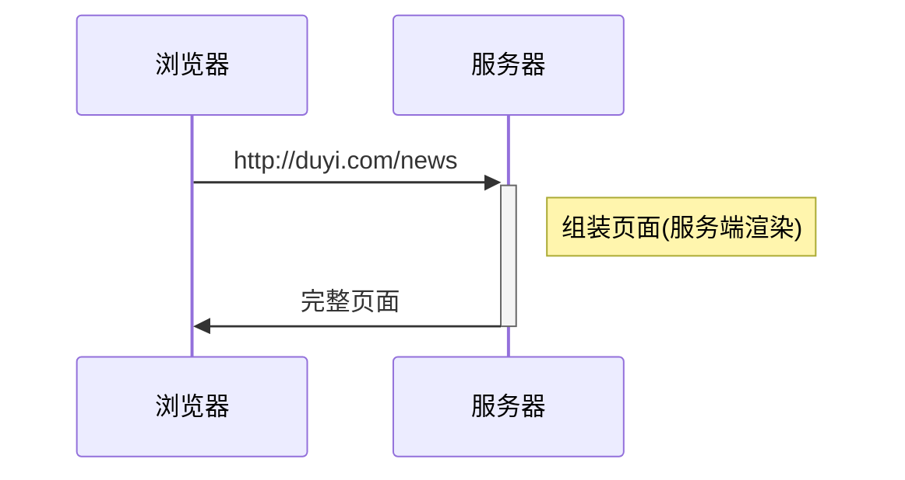

浏览器请求一个网址，服务器把数据和 HTML 模板拼装成一个完整的页面返回。

优点：简单直接，首屏快，天然对 SEO 友好（爬虫直接能看到内容）。

问题：

- 每次交互（哪怕只改一小块）都要刷新整个页面，重新向服务器要一整份 HTML，体验差。
- 前后端代码耦合在一起，难以分工。


#### 阶段二：前后端分离

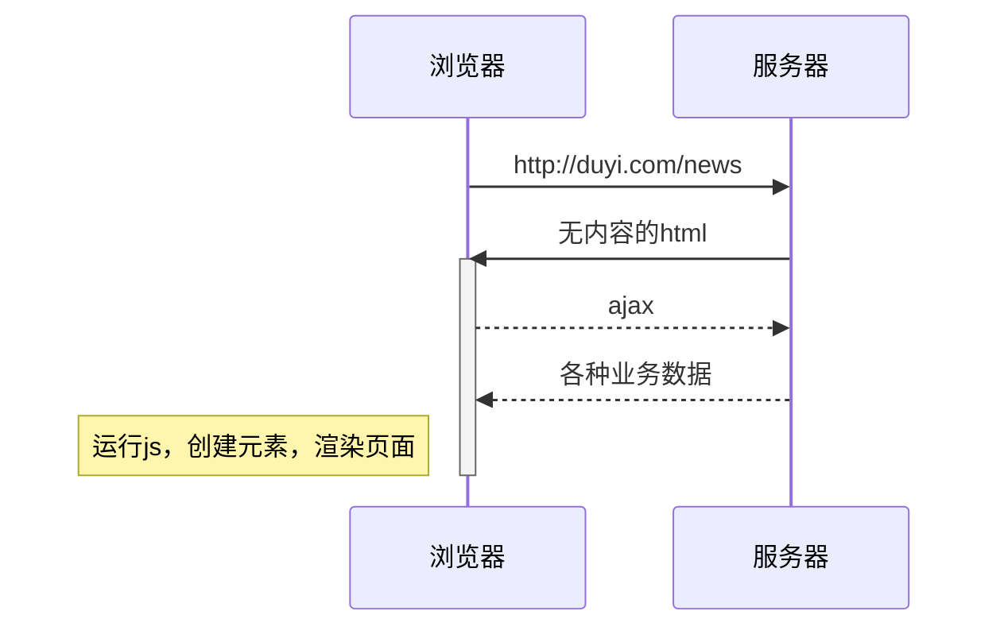

**要解决的问题**：把"数据"和"页面"解耦，让前后端能独立开发。

**优点**：服务器只提供**数据接口**，前端只做界，分工清晰。

**问题**：和阶段一一样，跳转页面时，服务器返回一个新的空HTML文件，然后ajax拿数据，重新渲染，过程白屏明显。就像平时浏览器新开一个标签页一样。


#### 阶段三：单页应用（SPA）

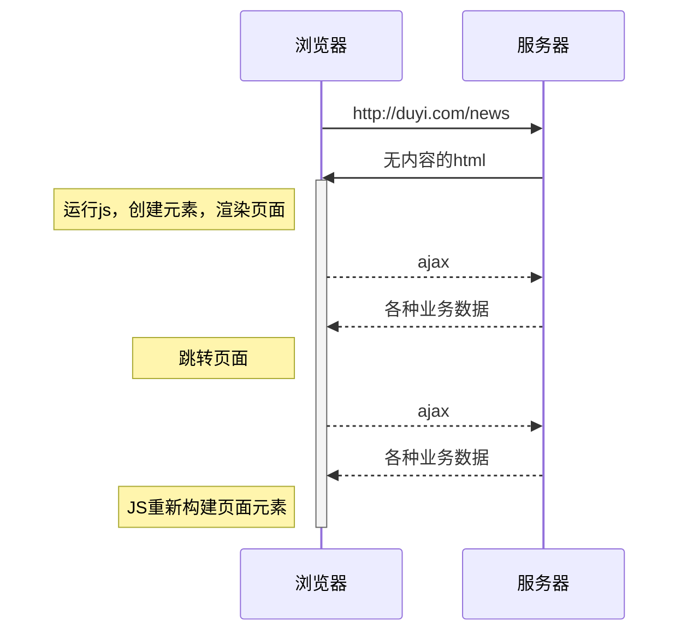

要解决的问题：让页面跳转也不再刷新

核心思想：整个网站只加载一个 HTML。之后所有的"跳转"其实都不再向服务器要新页面，而是由 JS 拦截跳转、重新构建页面元素，数据依旧通过 AJAX 按需获取。

问题：

- 手动管理路由（哪个 URL 显示哪块内容）、手动同步"数据变化 → DOM 更新"变得极其复杂。
- 改了数据还要改界面，代码难维护。


#### 阶段四：Vue 框架

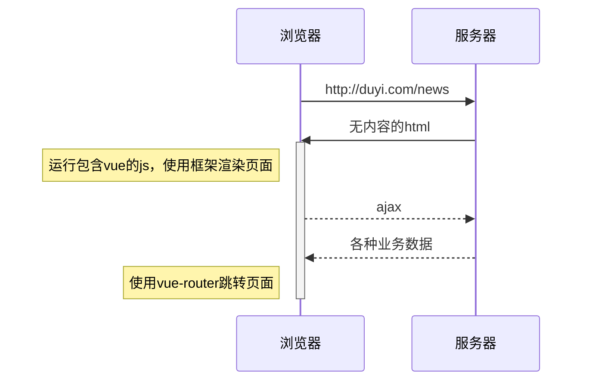

要解决的问题：单页应用要干的麻烦事情交给框架自动完成

"手动"被换成了框架能力：

- 开发者只需要改数据，页面自动修改，无需写dom操作 → 响应式
- 跳转页面使用`vue-router`统一管理，逻辑清晰

本质：Vue（以及 React、Angular）并没有改变 SPA 的通信模型，只是让开发大型SPA变得可控、可维护


# vue

## 核心概念

```
注入：存在是因为你想在模板/代码里像普通变量一样用数据和方法；核心行为是 new Vue(配置) 时把 data/computed/methods 每个成员都变成 vm.xxx。

虚拟 DOM(vnode)：存在是因为直接频繁操作真实 DOM 很慢；核心行为是先用普通 JS 对象 {tag, children, text} 描述界面，比较都在轻对象上做（单根）。

vnode 三来源：存在是因为 Vue 需要一份"界面蓝图"；核心行为是按优先级找——有 render 直接跑、否则编译 template、再否则拿 el 的 outerHTML，最终都得到 vnode tree。

编译→生成→挂载：存在是因为 vnode 只是描述、屏幕上还没东西；核心行为是编译成 render 函数 → 生成真实 DOM(vm.$el) → 挂载进页面(el/$mount)。

响应式重新渲染：存在是因为数据变了界面要跟着变、但整棵重建太浪费；核心行为是 data 装了 getter/setter 使改动可侦测 → 生成新 vnode 树 → 与旧树 patch/diff、只改差异。

模板四件套：存在是因为要表达最常见四件事；核心行为是 {{}} 插文本、:attr 绑属性、v-for+:key 循环、@事件 接 method。


单元 1 —【Vue 实例与「注入」：new Vue(配置) / data / computed / methods】
核心问题：为什么把数据和方法塞进一个配置对象再 new，模板里就能直接写 title、totalStock？运行时这些配置去哪了？
（合并理由：data/computed/methods 是"被注入的东西"，"注入"是它们的归宿——动机与结果，必须同一单元。对应第 1 张图。）

单元 2 —【虚拟 DOM 树 vnode：真实 DOM 的性能痛点 + 用 JS 对象描述界面 + 单根规则】
核心问题：Vue 为什么不直接建真实 DOM，非要先造一棵"用普通 JS 对象描述界面"的 vnode 树？
（合并理由：痛点【真实 DOM 慢】直接导致结果【用 vnode 描述】。）

单元 3 —【vnode 的三个来源：render / template / el 的 outerHTML，及其优先级】
核心问题：Vue 凭什么知道你想渲染什么？为什么这三种来源是"有就用、没有就往下找"的一条链？
（对应"render? / template?"决策图。三个来源共享同一目的——生成 vnode tree。）

单元 4 —【从 vnode 到界面：编译 → 生成 → 挂载（el / $mount）】
核心问题：一棵 JS 对象树怎么变成屏幕上看得见的东西？"挂载"这一步到底把结果放到了哪里？
（合并理由：编译→生成→挂载是一条不可切分的流水线；"挂载"的验证代码必须依赖前面已生成的真实 DOM。对应第 2 张图。）

单元 5 —【响应式重新渲染：数据变动 → 新旧 vnode diff → patch 只改差异】
核心问题：改一个数据界面就自动变，为什么不整棵 DOM 重建，而是"比较两棵 vnode 树、只改不同的地方"？这兑现了单元 2 里 vnode 的哪个好处？
（合并理由：呼应单元 2 的痛点，是虚拟 DOM 存在理由的"兑现"。对应 patch 图 + 完整流程图。这里我会补充课件没展开的「响应式原理」——为什么"改数据"这件事本身能被 Vue 侦测到。）

单元 6 —【模板语法四件套：插值 {{}} / v-bind : / v-for + :key / 事件 @】
核心问题：在模板里，我怎么把注入进来的成员显示出来、绑到属性上、循环成列表、以及点一下就改数据？
```


#### 1、Vue 实例与「注入」

new Vue(配置) 时，Vue 把 data/computed/methods 里的每个成员都变成实例自身的属性 vm.xxx。

```js
new Vue({
  data:     { msg: 'hi', count: 0 },
  computed: { double() { return this.count * 2 } },
  methods:  { add() { this.count++ } }
})
```


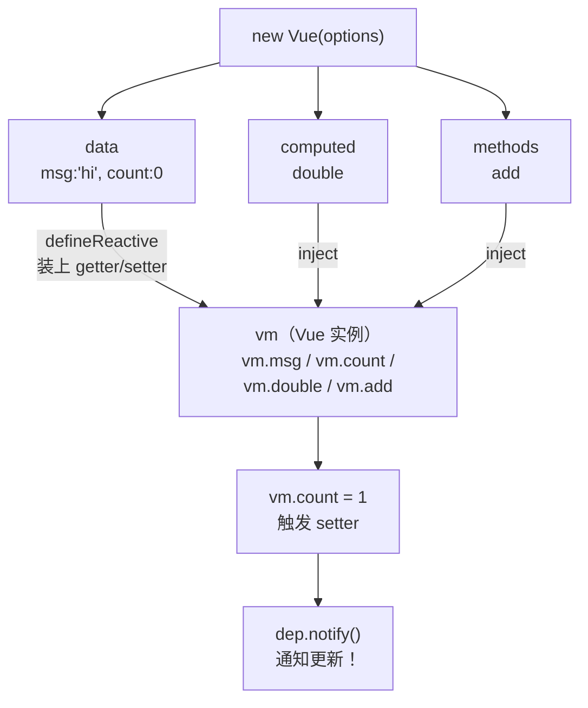


#### 2、虚拟 DOM （vnode）

vnode：虚拟DOM节点

「虚拟 DOM」存在是因为——直接、频繁地操作真实 DOM 很慢；它的核心行为是—— **先用一个普通 JS 对象把界面描述出来**， 之后的比较操作都在这些轻对象上做（且一棵 vnode 树只能有一个根）

真实 DOM（浏览器内部 C++ 对象，操作昂贵）

```js
<div id="app">
  <p class="title">Hello</p>
  <ul>
    <li>A</li>
    <li>B</li>
  </ul>
</div>
```

对应的 vnode（普通 JS 对象，极轻）

```js
{
  tag: 'div',
  data: { attrs: { id: 'app' } },
  children: [
    {
      tag: 'p',
      data: { class: 'title' },
      children: [{ text: 'Hello' }]   // 文本节点
    },
    {
      tag: 'ul',
      children: [
        { tag: 'li', children: [{ text: 'A' }] },
        { tag: 'li', children: [{ text: 'B' }] }
      ]
    }
  ]
}
```


#### 3、 vnode 的三个来源

render / template / el 的 outerHTML、

「render/template/el」存在是因为——Vue 需要一份「界面蓝图」才能生成 vnode 树； 它的核心行为是——**按优先级找蓝图：有 render 就直接跑它；否则编译 template； 再否则把 el 元素的 outerHTML 当模板**，三条路最终都得到 vnode tree。

```js
new Vue({
  el:       '#app',
  template: '<div>...</div>',
  render:   h => h('div', '...')
})
```


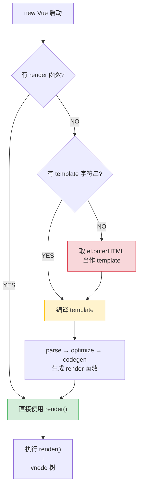


el / render / template 的关系

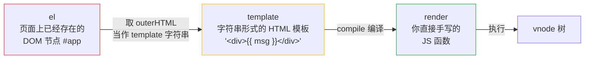


el是什么

```html
<!-- 页面上已经写好的 HTML -->
<div id="app">
  <p>{{ msg }}</p>
</div>

<script>
new Vue({ el: '#app' })
// Vue 做的事：
// 1. 找到 #app 这个 DOM 节点
// 2. 取它的 outerHTML → '<div id="app"><p>{{ msg }}</p></div>'
// 3. 把这个字符串当作 template，走编译流程
</script>
```


render 是什么

render 是你跳过 template、**直接手写**「怎么构建 vnode」的函数。 `h()` 是 Vue 提供的工具函数，作用就是创建一个 vnode 对象。

```js
// template 写法（需要编译）
template: '<p class="red">{{ msg }}</p>'

// 等价的 render 写法（直接是 JS，不需要编译）
render(h) {
  return h('p', { class: 'red' }, this.msg)
  //      ↑标签  ↑属性              ↑子内容
  // h() 返回的就是一个 vnode 对象
}
```


#### 4、从 vnode 到界面

编译 → 生成 → 挂载

「编译→生成→挂载」存在是因为——vnode 只是「描述」，屏幕上还什么都没有； 它的核心行为是——**编译把模板变成 render 函数，生成把 vnode 变成真实 DOM（vm.$el）， 挂载把这棵真实 DOM 塞进页面指定位置（el / $mount("#xx")）**。

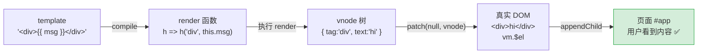

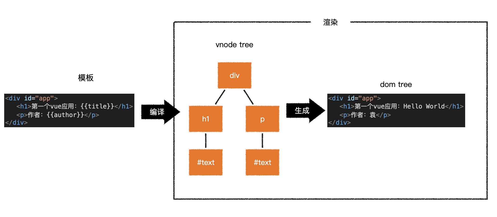


#### 5、响应式重新渲染（patch / diff）

「响应式重新渲染」存在是因为——数据变了界面要跟着变，但整棵 DOM 重建太浪费； 它的核心行为是——**注入时给 data 装了 getter/setter 使「改数据」能被侦测到， 改动后生成新 vnode 树、与旧树做 patch/diff，只把差异更新到真实 DOM**。

```js
// 伪代码：Vue 如何把 data 变成"可被侦测"的

function defineReactive(obj, key, val) {
  const dep = new Dep()           // 每个属性一个"订阅中心"

  Object.defineProperty(obj, key, {
    get() {
      dep.depend()                // 有人读我 → 把当前 watcher 记下来
      return val
    },
    set(newVal) {
      val = newVal
      dep.notify()               // 有人改我 → 通知所有 watcher：去更新！
    }
  })
}
```


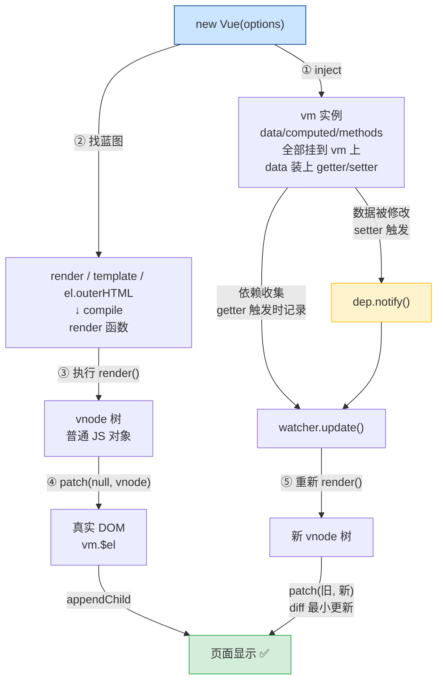


## Vue2


### Vue配置项（非工程化）

`new Vue({})`里四个常用配置项

| 配置项    | 作用                           |
| --------- | ------------------------------ |
| `el`      | 告诉 Vue 接管页面哪个 DOM 节点 |
| data      | 要管理的数据，变了界面自动刷新 |
| template  | 渲染到页面的 HTML 内容         |
| `methods` | 方法，模板里的事件调用这里     |


```html
<!DOCTYPE html>
<html lang="zh">
  <head>
    <meta charset="UTF-8" />
    <title>Q1 - new Vue({}) 配置是什么</title>
  </head>
  <body>
    <div id="app"></div>

    <script src="./vue.min.js"></script>
    <script>
      // ─────────────────────────────────────────────────────────────
      // new Vue({}) 就是"创建一个 Vue 实例"
      // 括号里的 {} 叫"配置对象"，你通过它告诉 Vue：
      //   数据放哪里、模板长什么样、挂载到哪个 DOM 节点、有哪些方法……
      // Vue 拿到配置对象后，会替你完成：数据监听、虚拟DOM、界面渲染
      // ─────────────────────────────────────────────────────────────

      var vm = new Vue({
        // ── 配置项1：el ─────────────────────────────────────────────
        // 告诉 Vue "接管" 页面上哪个 DOM 元素
        // Vue 会把渲染结果挂到这里
        // 等价写法：不写 el，最后调用 vm.$mount("#app")
        el: "#app",

        // ── 配置项2：data ────────────────────────────────────────────
        // 这个实例要管理的"数据"
        // Vue 会对这里的每个属性做"响应式处理"——数据变了，界面自动更新
        // 实例的 data 可以是对象，也可以是函数（组件里必须是函数，后面讲）
        data: {
          title: "Vue 配置对象演示",
          count: 0,
          name: "",
        },

        // ── 配置项3：template ────────────────────────────────────────
        // Vue 渲染到 #app 里的 HTML 内容
        // 双花括号 {{ }} 插入数据，@click 绑定事件，v-model 双向绑定
        // 如果不写 template，Vue 会直接把 el 指向的 DOM 当模板用
        template: `
          <div>
            <h2>{{ title }}</h2>

            <p>点击次数：{{ count }}</p>
            <button @click="add">+1</button>
            <button @click="reset">重置</button>

            <hr />

            <p>输入你的名字：<input v-model="name" placeholder="请输入" /></p>
            <p v-if="name">你好，{{ name }}！</p>
          </div>
        `,

        // ── 配置项4：methods ─────────────────────────────────────────
        // 放"方法"的地方
        // 模板里的 @click="add" 就是调用这里的 add()
        // 方法内部用 this.xxx 访问 data 里的数据
        methods: {
          add() {
            this.count++;          // 修改数据 → 界面自动刷新
          },
          reset() {
            this.count = 0;
          },
        },

        // ── 其他常见配置项──────────────
        // computed: {}  计算属性
        // watch:    {}  侦听器
        // created() {}  生命周期钩子（实例创建完毕时触发）
        // mounted() {}  生命周期钩子（挂载到页面后触发）
      });

      // 实例造好后，vm 就是那个 Vue 实例对象
      // 可以在控制台打印 vm.count、vm.name 来观察
      console.log("Vue 实例对象 vm：", vm);
    </script>
  </body>
</html>

```


### 组件（HTML）

大页面拆成小块，好维护。一块UI写一次，好复用。


组件本质就是一个普通的JS配置对象，写法和`new Vue({})`的配置一样

```js
var MyButton = {
  data() {
    return { count: 0 };
  },
  template: `<button @click="count++">点击了{{count}}次</button>`,
};
```


#### 注册&使用

全局注册

```js
Vue.component('my-comp', MyComp); // 之后任何组件/实例里都能用
```

缺点：**即使没用到也会被打包进去**，工程化项目里不利于优化（tree-shaking）


局部注册

```js
var OtherComp = {
  components: {
    MyComp,   // ES6 速写，等价于 MyComp: MyComp
  },
  template: `<div><MyComp /></div>`,
};
```


命名规范

```html
<my-comp></my-comp>   <!-- ✅ -->
<my-comp />           <!-- ✅ 自闭合 -->
<my-comp>             <!-- ❌ 没结束，报错 -->
```

`<MyComp/>` 和 `<my-comp/>` 都行，前提是写在template标签中


#### 与Vue实例的差异

组件里data必须是函数

如果 data 是对象 → 所有实例共享同一个对象引用

如果 data 是函数 → 每次造实例都调用一次，返回全新对象 → 各自独立


组件里必须写写 template 或 render

因为vue实例里面有el，可以用el.outerHTML构建vnode


```html
  <body>
    <div id="app"></div>

    <script src="./vue.min.js"></script>
    <script>
      // ── 组件定义 ────────────────────────────────────────────────────
      var Counter = {
        // 差异1：没有 el（组件不知道要挂在页面哪里，由父级决定）
        // el: "#app",   ← 写了这行没用，甚至会报警告

        // 差异2：data 必须是函数，每次调用返回全新对象
        data() {
          return { count: 0 };
          // 如果改成 data: { count: 0 }，Vue会报错：
          // [Vue warn]: The "data" option should be a function
        },

        // 差异3：没有 el，所以必须自己写 template（或 render）
        template: `
          <div class="box">
            <p>我的count：{{ count }}</p>
            <button @click="count++">+1</button>
          </div>
        `,
      };

      // ── Vue实例 ─────────────────────────────────────────────────────
      var vm = new Vue({
        // 实例有 el，指定挂载到哪里
        el: "#app",

        // 实例的 data 可以直接是对象（没有复用问题，只有一个实例）
        data: {
          msg: "下面放了3个Counter组件，每个count独立互不影响",
        },

        components: { Counter },

        // 实例也必须有模板（这里写在 template 里，也可以不写template，
        // 直接在 index.html 的 <div id=app> 里写 HTML）
        template: `
          <div>
            <h2>{{ msg }}</h2>
            <p>点任意一个按钮，观察另外两个不变 ↓</p>

            <Counter />
            <Counter />
            <Counter />

            <hr />
            <p style="color:gray; font-size:13px">
              原因：每个Counter实例调用一次data()，拿到各自独立的 {count:0}
            </p>
          </div>
        `,
      });
    </script>
  </body>
```


#### 组件树

组件里可以再用组件，层层嵌套，形成一棵树：

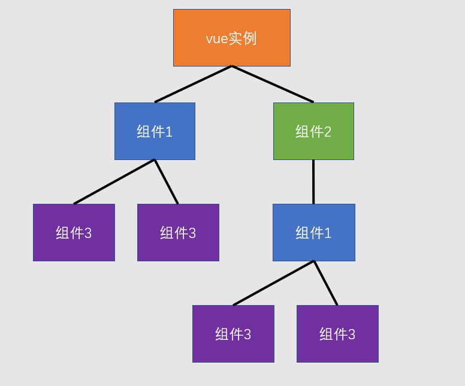


#### props父传子

父组件在子组件标签中写要传递的内容

子组件通过props属性接收父组件传递的内容


子组件用，单向数据流，子组件不能改

```js
  // ── 子组件：UserCard ────────────────────────────────────────────
  var UserCard = {
    // 声明这个组件能接收哪些属性
    // 父组件传来的值会自动挂到组件实例上，模板里直接用
    props: ["name", "age", "isVip"],

    template: `
      <div class="card">
        <h3>{{ name }}</h3>
        <p>年龄：{{ age }}</p>
        <p>age 的类型：<b>{{ typeof age }}</b></p>
        <p>VIP：{{ isVip }}</p>
        <p>isVip 的类型：<b>{{ typeof isVip }}</b></p>
      </div>
    `,
  };
```


父组件传

在template向子组件传

可以传递表达式或者变量

```js
  // ── 父（Vue 实例）────────────────────────────────────────────────
  var vm = new Vue({
    el: "#app",
    data: {
      userName: "王五",
      userAge: 28,
    },
    components: { UserCard },

    template: `
      <div>
        
        <UserCard :name="userName" :age="userAge" :isVip="true" />

      </div>
    `,
  });
```


### 计算属性


#### 语法

```js
export default {
  data() {
    return { firstName: '张', lastName: '三' }
  },
  computed: {
    // 计算属性：描述“一个派生数据”
    fullName() {
      return this.firstName + this.lastName
    }
  },
  methods: {
    // 方法：描述“一个操作”
    getFullName() {
      return this.firstName + this.lastName
    }
  }
}
```

用法差异

```html
<p>{{ fullName }}</p>      <!-- 计算属性：当数据，不加括号 -->
<p>{{ getFullName() }}</p>  <!-- 方法：当操作，必须加括号 -->
```


#### 完整写法（getter + setter）

本质上是包含 getter 和 setter 的方法，一个带缓存的、派生出来的响应式数据


如果计算属性的作用仅仅是只读，就用上面的简写语法，如果需要计算属性用来赋值，用下面的完整形式

```js
computed: {
  fullName: {
    get() {
      return this.firstName + ' ' + this.lastName
    },
    set(value) {          // 参数固定：只有一个，就是被赋的新值
      const [first, last] = value.split(' ')
      this.firstName = first
      this.lastName = last
    }
  }
}
```


读取触发get

```js
console.log(this.fullName)  // → "John Doe"
<p>{{ fullName }}</p>
```


赋值触发set

```js
this.fullName = 'Jane Smith'
// 自动执行 set，拆分后：
// this.firstName = 'Jane'
// this.lastName = 'Smith'

<input v-model="fullName" />
```


getter **没有参数**，setter **只有一个参数**；而普通方法参数任意。所以“需要传参”的场景只能用方法。


#### 缓存

```vue
computed: {
  fullName() {
    console.log('computed 执行了')
    return this.firstName + this.lastName
  }
},
methods: {
  getFullName() {
    console.log('method 执行了')
    return this.firstName + this.lastName
  }
}
```

在模板里各用三次

```vue
{{ fullName }} {{ fullName }} {{ fullName }}
{{ getFullName() }} {{ getFullName() }} {{ getFullName() }}
```

结果：

- `computed 执行了` → **只打印 1 次**（后两次直接吃缓存）
- `method 执行了` → **打印 3 次**（每次调用都重跑）


#### 收集依赖

```js
computed: {
  fullName() {
    return this.firstName + this.lastName  // ← 这一行是关键
  }
}
```

当

```js
firstName  →  [fullName]   // firstName 变了，要通知 fullName 重算
lastName   →  [fullName]   // lastName  变了，要通知 fullName 重算
```


### new  Vue()  → 单文件组件


#### 1、纯 HTML 引入 Vue

最原始的用法，直接在 HTML 中用 `<script>` 引入 Vue，然后 `new Vue()` 挂载到某个 DOM 元素上。

```html
<!-- index.html -->
<!DOCTYPE html>
<html>
<body>
  <div id="app">
    <p>{{ message }}</p>
    <button @click="greet">点击</button>
  </div>

  <script src="https://cdn.jsdelivr.net/npm/vue@2/dist/vue.js"></script>
  <script>
    new Vue({
      el: '#app',          // 挂载目标：找到页面上 id="app" 的元素
      data: {
        message: 'Hello Vue!'
      },
      methods: {
        greet() {
          alert(this.message)
        }
      }
    })
  </script>
</body>
</html>
```

1. Vue 找到 `el: '#app'` 对应的 DOM 节点
2. 把节点内的 HTML 当作**模板**编译成渲染函数


#### 2、注册组件

```html
<div id="app">
  <my-card title="用户卡片"></my-card>
</div>

<script>
  // 全局注册一个组件
  Vue.component('my-card', {
    props: ['title'],           // 接收父组件传入的数据
    template: `<div class="card">
                 <h2>{{ title }}</h2>
                 <p>内容...</p>
               </div>`,         // 模板是一个字符串！
    data() {                    // 注意：组件的 data 必须是函数
      return { count: 0 }
    }
  })

  new Vue({ el: '#app' })
</script>
```

- 根实例 `data` 是对象，但**组件的 `data` 必须是函数**（确保每个实例有独立的数据副本）
- 模板写成字符串 `template: \`...``，没有语法高亮、难以调试


#### 3、Vue CLI + 单文件组件

项目结构

```
vue-cli 项目结构：
src/
  main.js          ← 入口文件，替代了 HTML 里的 new Vue()
  App.vue          ← 根组件
  components/
    MyCard.vue     ← 子组件
```


入口文件 `main.js`：

```js
import Vue from 'vue'
import App from './App.vue'   // 引入根组件

new Vue({
  el: '#app',
  render: h => h(App)         // 用 render 函数渲染，替代了 HTML 模板
})
```


根组件 `App.vue`：

```html
<template>
  <div id="app">
    <!-- 使用子组件，像 HTML 标签一样 -->
    <MyCard title="用户卡片" />
  </div>
</template>

<script>
import MyCard from './components/MyCard.vue'

export default {
  name: 'App',
  components: { MyCard },    // 局部注册子组件
  data() {
    return { msg: 'hello' }
  }
}
</script>

<style scoped>
/* scoped: 样式只作用于本组件，不污染全局 */
#app { font-family: sans-serif; }
</style>
```


子组件 `MyCard.vue`：

```html
<template>
  <div class="card">
    <h2>{{ title }}</h2>
    <button @click="count++">点击了 {{ count }} 次</button>
  </div>
</template>

<script>
export default {
  name: 'MyCard',
  props: {
    title: {
      type: String,
      required: true
    }
  },
  data() {
    return { count: 0 }
  }
}
</script>

<style scoped>
.card { border: 1px solid #ccc; padding: 16px; }
</style>
```


#### 4、单文件组件语法

data：组件内部状态（必须是函数，返回对象）

props: 父组件传入的数据

computed:基于响应式数据派生的值（有缓存）

methods: 事件处理/业务函数

watch: 监听响应式数据变化，执行副作用

生命周期：created、mounted、beforeDestroy、destroyed


子组件：Demo.vue

```vue
<script>
export default {
  name: "DemoComponent",

  // props：父组件传入的数据
  props: {
    initial: {
      type: Number, // 类型校验
      default: 0 // 默认值
    },
    label: {
      type: String,
      default: 'Demo'
    }
  },

  // data：组件内部状态（必须是函数，返回对象）
  data() {
    return {
      count: this.initial, // props可以用于初始化data(后续别直接盖 props)
      title: this.label
    }
  },

  // computed:基于响应式数据派生的值（有缓存）,依赖变了才重算
  computed: {
    doubleCount() {
      return this.count * 2
    }
  },

  // methods: 事件处理/业务函数
  methods: {
    inc() {
      this.count++
    },
    reset() {
      this.count = this.initial
    }
  },

  // watch: 监听响应式数据变化，执行副作用
  watch: {
    count(newVal, oldVal) { // 监听 count 变化,这里的count是data里的
      console.log(`Count changed from ${oldVal} to ${newVal}`)
    },
    initial(val) {
      this.count = val // 父组件修改initial，更新count
    }
  },

  // 生命周期钩子：创建、挂载、更新、销毁
  created() {
    console.log('DemoComponent created')
  },
  mounted() {
    console.log('DemoComponent mounted')
  },
  beforeDestroy() {
    console.log('组件即将被销毁，执行清理工作')
  },
  destroyed() {
    console.log('DemoComponent destroyed')
  }
}
</script>

<template>
  <div class="demo">
    <h2>{{ title }}</h2>

    <p>count计数: {{ count }}</p>
    <p>doubleCount双倍计数: {{ doubleCount }}</p>

    <button @click="inc">+1</button>
    <button @click="reset">reset</button>
  </div>
</template>

<style scoped>
.demo { padding: 12px; }
</style>
```


### 父传子props

父组件把数据"塞进"子组件标签的属性里，子组件用 `props` 接收使用

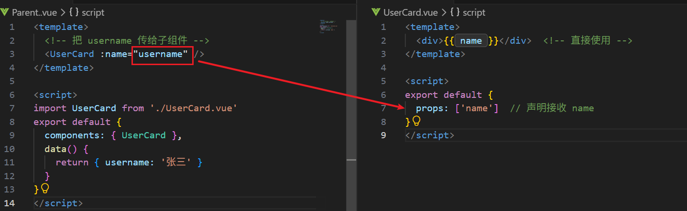


### 子传父$emit

子组件通过$emit('事件名', 数据)将数据广播出去，父组件在子组件标签上通过监听“事件名”来接收数据

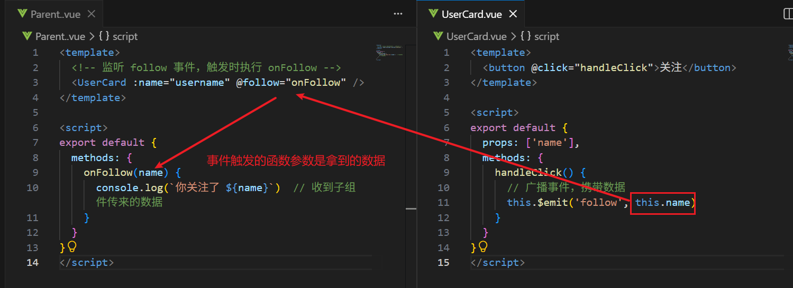


### Vue 2 模板语法

父组件：App.vue

```vue
<template>
  <div id="app">
    <DemoComponent/>
  </div>
</template>

<script>
import DemoComponent from './components/Demo.vue'
export default {
  name: 'App',
  components: {
    DemoComponent
  }
}
</script>
```


#### `v-if / v-else-if / v-else` + `@click`

```vue
<script>
export default {
  name: "DemoComponent",
  data() {
    return {
      status: 'loading'
    };
  },
  methods: {
    toggle() {
      if (this.status === 'loading') {
        this.status = 'error';
      } else if (this.status === 'error') {
        this.status = 'success';
      } else {
        this.status = 'loading';
      }
    },
  }
}
</script>

<template>
  <div class="demo">
    <button @click="toggle">toggle</button>

    <p v-if="status === 'loading'">loading...</p>
    <p v-else-if="status === 'error'">Error</p>
    <p v-else>Success</p>
  </div>
</template>

<style scoped>
.demo { padding: 12px; }
</style>
```

组件效果：点击按钮，依次切换显示loading、error、success状态

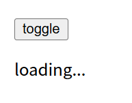


#### `v-for="item in list"` + `:key`

```vue
<script>
export default {
  name: "DemoComponent",
  data() {
    return {
      list: [
        { id: 1, name: 'A' },
        { id: 2, name: 'B' }
      ]
    }
  },
  methods: {
    remove(id) {
      this.list = this.list.filter(x => x.id !== id);
    }
  }
}
</script>

<template>
  <div class="demo">
    <ul>
      <li v-for="item in list" :key="item.id">
        {{ item.id }} - {{ item.name }}
        <button @click="remove(item.id)">remove</button>
      </li>
    </ul>
  </div>
</template>

<style scoped>
.demo { padding: 12px; }
</style>

<!-- 
组件效果：点击remove按钮，可以删除对应的列表项
-->
```

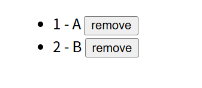


#### `v-model`（表单）+ 表单修饰符 `.trim .number .lazy`

v-model 的作用：双向绑定数据和视图
v-model 修饰符：
.trim：去除输入内容两端空格
.number：将输入内容转换为数字类型
.lazy：在输入框失去焦点或按下回车键时更新数据

```vue
<script>
export default {
  name: "DemoComponent",
  data() {
    return {
      name: '',
      age: 0,
      note: ''
    }
  }
}
</script>

<template>
  <div class="demo">
    <div>
      <label>name (.trim): </label>
      <input v-model.trim="name" placeholder="  hello  " />
      <p>name: "{{ name }}"</p>
    </div>

    <div>
      <label>age (.number): </label>
      <input v-model.number="age" type="number" />
      <p>age: {{ age }} (type: {{ typeof age }})</p>
    </div>

    <div>
      <label>note (.lazy): </label>
      <input v-model.lazy="note" placeholder="change on blur/enter" />
      <p>note: {{ note }}</p>
    </div>
  </div>
</template>

<style scoped>
.demo { padding: 12px; }
</style>

<!-- 
组件效果：
1. name 输入框，输入内容前后有空格时，显示时会自动去除空格
2. age 输入框，输入内容会被转换为数字类型
3. note 输入框，内容只有在失去焦点或按下回车键时才会更新显示
-->
```

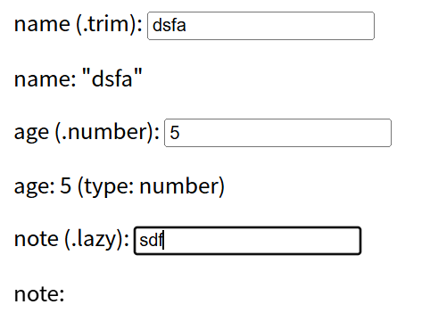


#### `:class`、`:style`（动态绑定）

动态 class 和 style 可以通过绑定对象的方式来实现，根据数据的变化动态应用不同的样式。

```vue
<script>
export default {
  name: "DemoComponent",
  data() {
    return {
      active: false,
      count: 0,
      size: 16
    }
  }
}
</script>

<template>
  <div>
    <button @click="active = !active">toggle active</button>

    <p :class="{ active, danger: count >= 3}">
      class Demo
    </p>

    <button @click="count++">count++</button>
    <p :style="{ color: count >= 3 ? 'red' : '#333', fontSize: size + 'px' }">
      style demo (count={{ count }})
    </p>

    <input type="number" v-model.number="size">
  </div>
</template>

<style scoped>
.active { font-weight: 700; }
.danger { text-decoration: underline; }
</style>

<!-- 
组件效果：点击 ”toggle active“ 按钮切换段落的粗体样式，点击 ”count++“ 按钮增加计数，当计数达到3及以上时，段落文字变为红色并添加下划线。通过输入框可以动态调整段落文字的大小。
-->
```

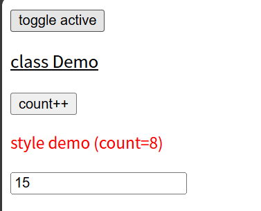


#### 事件修饰符 `.stop .prevent .once`

事件修饰符

.stop 阻止事件冒泡

.prevent 阻止默认行为

.once 事件只触发一次

```vue
<template>
  <div class="outBox">
    <div class="box" @click="onOuter">
      outer (click me)

      <button @click.stop="onInner">inner (.stop)</button>
    </div>

    <a href="https://example.com" @click.prevent="onLink">link (.prevent)</a>

    <button @click.once="onOnce">once (.once)</button>
  </div>
</template>

<script>
export default {
  name: 'DemoComponent',
  methods: {
    onOuter() {
      console.log('outer click')
    },
    onInner() {
      console.log('inner click (stopped)')
    },
    onLink() {
      console.log('prevent default navigation')
    },
    onOnce() {
      console.log('run only once')
    }
  }
}
</script>

<style scoped>
.box { padding: 12px; border: 1px solid #aaa; margin: 10px;}
.outBox { border: 1px solid #aaa; }
</style>


<!-- 

组件效果：点击内层按钮，控制台打印 "inner click (stopped)"，且不会触发外层盒子的点击事件；点击链接，不会跳转页面，控制台打印 "prevent default navigation"；点击 once 按钮，只会在第一次点击时打印 "run only once"，之后的点击不会有任何反应。
-->
```

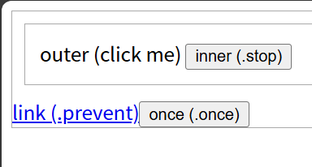


## Vue3

### vite构建vue工程


#### 指令

```
初始化 创建package.json文件
pnpm init

安装vite 
pnpm i vite -D

pnpm create vite

Project name:
vite-project

Select a framework:
Vue

Select avariant:
0fficial Vue Starter.

Select features to include inyour project:
none

Select experimental features to include in your project
none

Skip all example code and start with a blank Vue project:
Yes

安装所有依赖包
pnpm install
```

pnpm dev启动


#### 完整项目结构

项目结构如下：

- **.vscode**：这个文件夹通常包含了 Visual Studio Code 的配置文件，用来设置代码格式化、主题样式等。
- **node_modules**：这个文件夹内包含项目所需的所有 node 包。当运行 npm install 或 yarn 时，所有在 package.json 中列出的依赖都会被安装到这个文件夹下。
- **public**：用来存放静态资源的文件夹，这部分静态资源是不会经过构建工具处理的。例如 favicon 图标文件。
- **src**：源码文件夹，我们的开发工作主要就是在这个目录下面。通常包括 Vue 组件、JavaScript 文件、样式文件等。
  - assets：这个同样是静态资源目录，放在该目录下的静态资源在打包的时候会被构建工具处理。
  - components：组件目录，存放各种功能组件
  - App.vue：根组件
  - main.js：入口 JS 文件
- **.eslintrc.cjs**：ESLint 的配置文件，用于检查代码错误和风格问题，cjs 是 CommonJS 的配置文件格式。
- **.gitignore**：Git 的配置文件，用于设置不需要加入版本控制的文件或文件夹。
- **.prettierrc.json**：Prettier 的配置文件，Prettier 是一个代码格式化工具。
- **index.html**：项目的入口 HTML 文件，Vite 将利用它来处理应用的加载。
- **jsconfig.json**：JavaScript 的配置文件，用于告诉 VS Code 如何处理 JavaScript 代码，例如设置路径别名。
- **package-lock.json**：锁定安装时的包的版本，确保其他人在 npm install 时，大家的依赖能保持一致。
- **package.json**：定义了项目所需的各种模块以及项目的配置信息（例如项目的名称、版本、许可证等）。
- **README.md**：项目的说明文件，通常包含项目介绍、使用方法、贡献指南等。
- **vite.config.js**：Vite 的配置文件，用于定制 Vite 的构建和开发服务等。


| 对比项     | `src/assets`（经过处理）            | `public`（不经过处理） |
| ---------- | ----------------------------------- | ---------------------- |
| 引用方式   | 用 `import` 或相对路径              | 用绝对路径 `/xxx`      |
| 文件名     | 构建后加哈希 `img.a3f2c1.png`       | 文件名原样保留         |
| 压缩优化   | 会被压缩、合并                      | 原封不动复制到输出目录 |
| 小文件内联 | 小于阈值会转为 base64 内联到 JS/CSS | 不会内联               |
| 缓存控制   | 哈希文件名，可永久缓存              | 依赖服务器缓存策略     |


#### VSCode Snippets

快速生成 Vue 代码模板

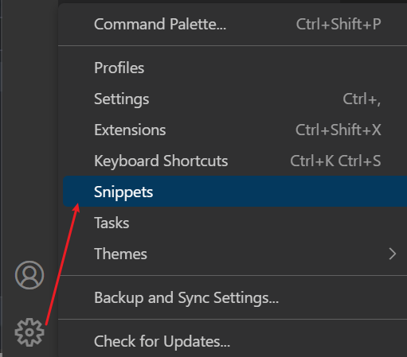

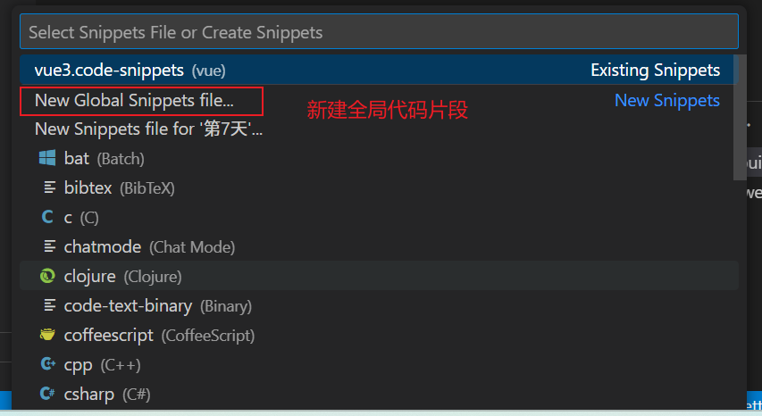

起名后打开

```json
{
	// Place your global snippets here. Each snippet is defined under a snippet name and has a scope, prefix, body and 
	// description. Add comma separated ids of the languages where the snippet is applicable in the scope field. If scope 
	// is left empty or omitted, the snippet gets applied to all languages. The prefix is what is 
	// used to trigger the snippet and the body will be expanded and inserted. Possible variables are: 
	// $1, $2 for tab stops, $0 for the final cursor position, and ${1:label}, ${2:another} for placeholders. 
	// Placeholders with the same ids are connected.
	// Example:
  "Print to console": {
    "scope": "vue",
    "prefix": "<vue",
    "body": [
      "<template>",
      "$1",
      "</template>",
      "",
      "<script setup>",
      "</script>",
      "",
      "<style scoped>",
      "</style>",
    ],
    "description": "vue template"
  }
}
```


在空白vue文件中输入`<vue + tab` 即可快速补全


ts版本

```json
"Print to console": {
  "scope": "vue",
  "prefix": "<vue",
  "body": [
    "<script setup lang=\"ts\">",
    "</script>",
    "",
    "<template>",
    "$1",
    "</template>",
    "",
    "<style scoped>",
    "</style>",
  ],
  "description": "vue template"
}
```


#### vite机制


**冷启动**（首次启动）：

webpack：打包代码、放入内存 → webpack启动开发服务器 → 浏览器请求 → 开发服务器从内存中读取打包好的代码 → 浏览器渲染页面 

Vite: 直接启动服务器，不做预打包。利用浏览器原生支持的 ES Module（ESM），浏览器自己去解析 import 语句，按需向 Vite dev server 请求对应的模块文件，Vite 收到请求后才做按需编译（transform）


**热更新**：

webpack：修改代码 → webpack重新打包整条依赖链相关的模块

Vite: 修改代码 → 精准定位失效模块 → 浏览器只请求失效模块


#### vite优势

vite开发体验强于webpack的原因

webpack 的问题：必须全做完才能开始

```
启动 → 找入口 → 顺着import递归找所有文件 → 全部transform → 合并bundle → 服务器才就绪
```

vite快在哪里：webpack必须全部做完才能开始，而Vite是懒执行，

```
启动 → 服务器立刻就绪（什么都没做）
↓
浏览器请求 main.js → Vite 只处理 main.js
浏览器解析到 import App.vue → 浏览器发起请求 → Vite 只处理 App.vue
浏览器解析到 import router → 浏览器发起请求 → Vite 只处理 router
...
```

只处理当前页面真正用到的文件，没被 import 到的文件完全不碰。


#### vite常用配置

编写在`vite.config.js`文件夹中

常用的配置如下：

1. **base**：用于设置项目的基础路径。这对于部署到非根目录的项目特别有用。
2. **server**：配置开发服务器的选项，例如
   - 端口（port）
   - 自动打开浏览器（open）
   - 跨源资源共享（cors）
   - 代理配置（proxy）
   - .....
3. **build**：包含构建过程的配置，例如
   - 输出目录（outDir）
   - 生产环境源码地图（sourcemap）
   - 压缩（minify）
   - 分块策略（rollupOptions）
   - .....
4. **css**：用于配置 CSS 相关选项，如预处理器配置、模块化支持等。
5. **esbuild**：可以自定义 ESBuild 的配置，例如指定 JSX 的工厂函数和片段。
6. **optimizeDeps**：用于预构建依赖管理，可以指定需要预构建的依赖，以加速冷启动时间。
7. **define**：允许你定义在源码中全局可用的常量替换。
8. **publicDir**：设置公共静态资源目录，默认为 public。


示例代码：

```js
// vite.config.js
import { defineConfig } from 'vite'
import vue from '@vitejs/plugin-vue'

export default defineConfig({
  // 1. 基础路径（部署到子目录时使用）
  base: '/my-app/',

  // 2. 开发服务器配置
  server: {
    port: 3000,
    open: true,
    cors: true,
    proxy: {
      '/api': {
        target: 'http://localhost:8080',
        changeOrigin: true,
        rewrite: (path) => path.replace(/^\/api/, '')
      }
    }
  },

  // 3. 构建配置
  build: {
    outDir: 'dist',
    sourcemap: true,
    minify: 'esbuild',
    rollupOptions: {
      output: {
        manualChunks: {
          vendor: ['vue', 'vue-router']
        }
      }
    }
  },

  // 4. CSS 配置
  css: {
    preprocessorOptions: {
      scss: {
        additionalData: `@import "@/styles/variables.scss";`
      }
    },
    modules: {
      localsConvention: 'camelCase'
    }
  },

  // 5. ESBuild 配置
  esbuild: {
    jsxFactory: 'h',
    jsxFragment: 'Fragment'
  },

  // 6. 预构建依赖
  optimizeDeps: {
    include: ['vue', 'axios']
  },

  // 7. 全局常量定义
  define: {
    __APP_VERSION__: JSON.stringify('1.0.0'),
    __DEV__: true
  },

  // 8. 公共静态资源目录
  publicDir: 'public',

  plugins: [vue()]
})
```


### 文本插值 `{{ }}`

把js数据渲染成页面文本

```vue
<template>
  <div>{{ name }}</div>   <!-- 渲染：Steve -->
</template>

<script setup>
const name = 'Steve'
</script>
```


#### 模板沙盒化

模板表达式只能访问**有限的全局对象**（`Math`、`Date`、`JSON` 等约 60 个），无法访问任意挂在 `window` 上的东西：

```vue
<template>
  <div>{{ Math.random() }}</div>  <!-- ✅ Math 在白名单内 -->
  <div>{{ MyLib.fn() }}</div>     <!-- ❌ 自定义全局对象，会报错 -->
</template>
```

需要暴露全局对象给模板时

通过 `app.config.globalProperties`（在 `main.js` 中配置）：

```js
// main.js
import { createApp } from 'vue'
import App from './App.vue'

const app = createApp(App)

app.config.globalProperties.$myLib = {
  greet: () => 'Hello!'
}

app.mount('#app')
```


```vue
<!-- 任意组件模板中可访问 -->
<template>
  <div>{{ $myLib.greet() }}</div>  <!-- Hello! -->
</template>
```

习惯上用 `$` 前缀避免和组件数据冲突。


### 原始 HTML：`v-html`

数据本身是一段html，需要解析成html渲染而不是文本输出时，使用`v-html`

```vue
<template>
  <!-- 错误做法：会原样输出字符串 -->
  <div>{{ htmlCode }}</div>

  <!-- 正确做法：v-html 会解析 HTML -->
  <div v-html="htmlCode"></div>
</template>

<script setup>
const htmlCode = '<span style="color:red">这是红色文字</span>'
</script>
```


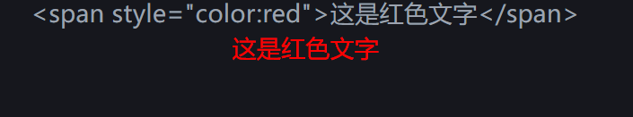


### 属性绑定：`v-bind`

vue的核心思想，template中的所有东西都应该由JS中的数据控制，除了文本之外。

所以属性也应该由数据控制


Vue 3.4以上版本---`v-bind:`的简写`:`

```vue
<template>
  <!-- 静态写法：id 值写死为 "box1"，永远不会变 -->
  <div id="box1">我是静态 id</div>

  <!-- 动态绑定：id 值由变量 boxId 决定，变量改了，id 就跟着变 -->
  <div :id="boxId">我是动态 id</div>
</template>

<script setup>
// 修改这个变量的值，第二个 div 的 id 就会跟着变
const boxId = 'my-box'
</script>
```


布尔类型属性，disabled`、`checked`、`required

如果该属性绑定的值是真的，属性存在，反之不存在

```vue
<template>
  <button :disabled="isDisabled">按钮A</button>  <!-- 渲染为 disabled，按钮不可点 -->
  <button :disabled="null">按钮B</button>         <!-- disabled 属性被移除，按钮可点 -->
</template>

<script setup>
const isDisabled = true   // 真值 → 属性存在
// null / undefined → 属性被忽略（移除）
</script>
```


对象批量绑定

```vue
<template>
  <div v-bind="attrs">hello</div>
  <!-- 等价于 <div id="container" class="wrapper">hello</div> -->
</template>

<script setup>
const attrs = {
  id: 'container',
  class: 'wrapper'
}
</script>
```

 


#### `{{ }}` 和 `:属性` 内部可写 JS 表达式

```vue
<template>
  <div>{{ number + 1 }}</div>                          <!-- 算术 -->
  <div>{{ ok ? '晴天' : '雨天' }}</div>                <!-- 三元运算 -->
  <div>{{ message.split('').reverse().join('') }}</div> <!-- 方法链 -->
  <div :id="`list-${id}`">{{ id + 100 }}</div>         <!-- 模板字符串 -->
</template>

<script setup>
const number = 1
const ok = true
const message = 'hello'
const id = 1
</script>
```

能不能写在 `return` 后面 → 能就是表达式，不能就是语句

语句不能写在`{{ }}` 和 `:属性` 内部


### ref & reactive

被`ref/reactive`包裹的数据会变成响应式对象，template中依赖这些数据的试图会自动重新渲染


#### ref使用

```vue
<template>
  <div>{{ name }}</div>   <!-- 自动变成 name.value -->
</template>
<script setup>
import { ref } from 'vue'
const name = ref('Bill')
console.log(name.value)  // 'Bill'
</script>
```

template标签中的内容在进行编译时，Vue会对顶层ref自动加 `.value`


#### ref原理

ref 返回一个对象，要用 `.value` 访问

vue响应式的本质是拦截数据的读写，JS 里能被拦截的只有对象（通过 `Proxy` 或 getter/setter），而 `number`/`string`/`boolean` 这种原始值是**值传递**、无法拦截的。

```js
let count = 1
count = 2   // 没有任何办法监听到这行赋值 —— Vue 根本不知道你改了
```

vue的解决办法是用一个对象把原始值包起来，把它变成对象的一个属性，这样就能在整个属性上装监听器

```js
// ref 的极简手写版，理解它是个「带 getter/setter 的对象」
function myRef(raw) {
  return {
    get value() {          // 读 .value → 依赖收集
      track()              // 记下“谁用了我”
      return raw
    },
    set value(newVal) {    // 写 .value → 触发更新
      raw = newVal
      trigger()            // 通知“用过我的地方”重新执行
    }
  }
}
```


#### ref深层响应式

```js
const bill = ref({ nested: { count: 1 } })
bill.value.nested.count += 2   // 改到第 3 层，视图照样更新
```

ref内部把对象交给了reactive，并进行深层追踪


#### DOM异步更新

```js
count.value = 2
console.log(container.innerText)  // 打印的还是旧值 '1'
```

Vue不会每改完一次数据就同步渲染，而是把重新渲染任务丢到微队列中，等本轮同步代码跑完，一次性刷新DOM

也就死积攒一批，下一个微任务再刷

“改完数据立刻读 DOM”读到的是旧的。


`nextTick` 字面含义下一张票，会等到元素节点刷新完毕才执行

```js
setTimeout(async () => {
  count.value = 2
  await nextTick()                       // 等这一批 DOM 刷完
  console.log(container.innerText)       // 现在是 '2' ✅
}, 2000)

// 下面的回调写法和上面async/await等价
count.value = 2
nextTick(() => { console.log(container.innerText) })  
```


#### reactive使用

```js
import { reactive } from 'vue'
const state = reactive({ count1: 0, nested: { count2: 0 } })
state.count1++            // 能够触发响应式更新
state.nested.count2 += 2  // 同样能够触发响应式更新
```

底层就是 `new Proxy(对象, handler)`


#### reacitve局限

结论：首选使用ref，ref能避免下面的前两条限制

```js
// ref 可以包任意类型
const count = ref(0)      // ✅ 基本类型没问题
const obj = reactive(0)   // ❌ 无效，reactive 只接受对象

// ref能整体重新赋值
const state = ref({ count: 0 })
state.value = { count: 999 }  // ✅ 通过 .value setter，响应式保留
```


只能用来包对象，不能包原始值

```js
reactive(0)         // 无效，number 不是对象
reactive('hi')      // 无效
```


整体替换后丢失响应式

```js
let state = reactive({ count: 0 })
state = reactive({ count: 1 })  // ❌ 模板还指向旧 Proxy，界面不再变
```

原理

```
初始：
  let state ──────────────► Proxy({ count: 0 })  ◄── 模板绑定这里
                                 ↑
                            Vue 追踪这个 Proxy

重新赋值后：
  let state ──────────────► 新的 Proxy({ count: 999 })  （模板不知道）
  旧 Proxy({ count: 0 }) ◄── 模板仍然绑定这里！
```


解构/传参丢失响应式

```js
const state = reactive({ count: 0 })
let { count } = state   // count 变成普通值 0，从此和 state 无关
count++                 // 只是普通变量 +1，视图不动
```

解构丢失响应式可以使用`toRefs` 补救，`toRefs` 会把reactive对象的每个属性都转成ref

```
import { reactive, toRefs } from 'vue'
const state = reactive({ count: 0, name: 'Bill' })

let { count, name } = toRefs(state)  // count/name 都是 ref
count.value++                        // ✅ state.count 也变成 1，视图更新
```


### 计算属性`computed` 

有响应式为何需要计算属性：

```html
<!-- 逻辑塞进模板：臃肿、不能写语句、无法复用 -->
<span>{{ author.books.length > 0 ? 'Yes' : 'No' }}</span>
```

期望效果：模板里只放结果，不放计算过程


#### 用法

computed返回的是一个ref

```vue
<script setup>
import { reactive, computed } from 'vue'

const author = reactive({
  name: 'John Doe',
  books: ['Vue2', 'Vue3']
})

const isPublishBook = computed(() => {
  return author.books.length > 0 ? 'Yes' : 'No'
})

// 在 JS 里读它，必须加 .value
console.log(isPublishBook.value) // 'Yes'
</script>

<template>
  <!-- 在模板里会自动解包(unwrap)，不用写 .value -->
  <span>{{ isPublishBook }}</span>
</template>
```


#### 依赖改变 → 重算

```js
// author.books 是 isPublishBook 的"依赖"
setTimeout(() => {
  author.books = []   // 依赖变化 → 计算属性重新计算 → 模板从 Yes 变 No
}, 2000)
```

依赖是getter运行时，实际读取过的数据


#### 可写计算属性

默认只读

```js
const firstName = ref('Xie')
const lastName = ref('Jie')

const fullName = computed({
  get() {
    return firstName.value + ' ' + lastName.value
  },
  set(newName) {
    [firstName.value, lastName.value] = newName.split(' ')
  }
})

fullName.value = 'Zhang San'
// 触发 set → 反过来改 firstName / lastName → get 再次生效
```

这里set去修改它依赖的“源数据”（firstName / lastName），源数据改变，get自然算出新值


#### 缓存机制

计算属性会缓存，仅仅在第一次进行计算


原理

计算属性内部维护两样东西：

- 一个缓存值 `_value`
- 一个脏标记 `dirty`（初始为 `true`）

```
读 .value 时：
  ├─ dirty 为 true  → 运行 getter，结果存进 _value，dirty 置为 false
  └─ dirty 为 false → 直接返回 _value（不运行 getter）

依赖发生变化时：
  └─ 只把 dirty 置回 true（⚠️ 不立即运行 getter！）
```


### :class

**响应式驱动**：class/style 绑定的值来自 `ref`/`reactive`/`computed`。当这些响应式数据变化时，触发组件重新渲染，Vue 重新计算 class/style 字符串

静态 `class="demo"` 和动态 `:class` 不会互相覆盖，Vue 底层会把它们拼在一起

无论传对象还是数组，Vue 内部都会把它「归一化」成最终的字符串再塞进 DOM。


#### 用法

键是类名，值是布尔。值为 `true` 挂上，`false` 摘掉。

```vue
<template>
  <div class="demo" :class="{ active: isActive, 'text-danger': hasError }">
    绑定样式类
  </div>
</template>

<script setup>
import { ref } from 'vue'
const isActive = ref(true)
const hasError = ref(false)
setTimeout(() => { hasError.value = true }, 3000)
</script>
```

初始渲染成 `<div class="demo active">`；3 秒后 `hasError` 变 `true`，自动变成 `<div class="demo active text-danger">`。


#### 语法动机

```js
// 痛苦且易错：手动拼空格、判断真假
:class="(isActive ? 'active' : '') + ' ' + (hasError ? 'text-danger' : '')"
```

所以 Vue 专门为 `class`/`style` 开了「对象 / 数组」两种入口，把「拼接」这件脏活交给框架


#### class 对象

键 = CSS 属性名，值 = 属性值


用 `reactive`

```vue
<template>
  <div class="demo" :class="classObj">绑定样式类</div>
</template>

<script setup>
  import { reactive } from 'vue'
  const classObj = reactive({ active: true, 'text-danger': false })
</script>
```


用 `computed`

值不用手动改，而是由别的状态推导出来

```vue
<template>
  <div class="demo" :class="classObj">绑定样式类</div>
</template>


<script setup>
import { ref, computed } from 'vue'
const isActive = ref(true)
const error = ref(null)

const classObj = computed(() => ({
  active: isActive.value && !error.value,
  'text-danger': error.value && error.value.type === 'fatal'
}))
</script>
```


#### class 数组

数组里每一项求值后是一个类名

```vue
<template>
  <div class="demo" :class="[activeClass, errorClass]">绑定样式类</div>
</template>

<script setup>
import { ref } from 'vue'
const activeClass = ref('active')       // 值就是类名字符串
const errorClass = ref('text-danger')
</script>
```

数组里可以走三目

```html
<div :class="[isActive ? 'active' : '', 'text-danger']"></div>
```


### 条件和列表渲染

#### 条件渲染

 `v-if` / `v-else-if` / `v-else`

现象：`v-if` 为 `false` 时，元素在 DOM 里根本不存在

必须是**紧挨着的兄弟元素**，中间不能插入其他元素

```html
<div v-if="type === 1">晴天</div>
<p>❌ 这里插一个元素，下面的 v-else-if 就断了</p>
<div v-else-if="type === 2">阴天</div>
```


`<template>` 是一个只用来分组的标签

```html
<template v-if="true">
  <div>条件为真时显示的内容</div>
</template>
<template v-else>
  <div>条件为假时显示的内容</div>
</template>
```


`v-show`

只切换元素的 `display` CSS 属性

```html
<template>
  <div v-if="isShow">v-if 的元素</div>
  <div v-show="isShow">v-show 的元素</div>
</template>
<!-- 当 isShow = false 时： -->
<!-- v-if 的  → 变成 <!--v-if--> 注释，DOM 里没有这个 div -->
<!-- v-show 的 → 还是 <div style="display: none">，DOM 里还在 -->
```

- `v-if`：**切换开销高**（销毁/重建 DOM、子组件、事件监听），初始为 false 则完全不渲染（惰性）。→ **条件很少变，用 `v-if`**
- `v-show`：**初始渲染开销高**（无论如何都先渲染），切换只改 CSS。→ **频繁切换，用 `v-show`**
- `v-show` **不支持 `<template>`**（因为 template 没有真实 DOM，无法设置 display）。


#### 列表渲染

`v-for` 基本语法

```html
<li v-for="(product, index) in products" :key="product.id">
```

支持解构

```html
<li v-for="({ name, price }, index) in products" :key="index">
  {{ name }} - {{ price }}
</li>
```

遍历对象（顺序：值、键、索引）：

```html
<div v-for="(value, key, index) in stu" :key="key">
  {{ index }} - {{ key }} - {{ value }}
</div>
```


`key` 的正确用法

只要列表会「增删、排序、过滤」，就**必须用数据的唯一 id 当 key，不要用 index**

举个例子，原列表 `[A, B, C]`，我在**头部插入 X**：

```
用 index 当 key（0,1,2 → 0,1,2,3）：
  旧: key0=A  key1=B  key2=C
  新: key0=X  key1=A  key2=B  key3=C
  Vue 认为：key0 从 A 变 X（打补丁）、key1 从 B 变 A（打补丁）、
           key2 从 C 变 B（打补丁）、key3 新增 C
  → 结果：几乎每个节点都被修改，等于没优化 ❌

用唯一 id 当 key：
  Vue 发现 A、B、C 的 key 都还在，直接复用，只在头部新建一个 X
  → 只动了一个节点 ✅
```

Vue跟新列表的时候，会拿两个新旧虚拟节点，按key一一对比，**key相同就复用同一个DOM**，不相同才销毁重建

保证key和数据的对应能最大程度上减少DOM消耗


状态错位

```vue
<template>
  <div>
    <button @click="list.unshift({ id: Date.now(), name: '新项目' })">
      头部插入
    </button>
    <ul>
      <!-- 把 key 换成 index 试试，勾选状态会错乱！ -->
      <li v-for="(item, index) in list" :key="item.id">
        <input type="checkbox" /> {{ item.name }}
      </li>
    </ul>
  </div>
</template>

<script setup>
import { ref } from 'vue'
const list = ref([
  { id: 1, name: 'A' },
  { id: 2, name: 'B' },
  { id: 3, name: 'C' }
])
</script>
```

勾选第一项 A 的 checkbox → 点「头部插入」

用 `:key="item.id"`：勾选状态**跟着 A** 走，正确 ✅

用 `:key="index"`：勾选状态**留在第一行**（现在第一行是新项目），A 的勾没了 ❌

因为原先name为A的index为0，现在新项目的index为0，key相同的情况下，dom会复用

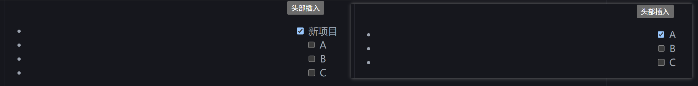


 优先级，`v-if` 比 `v-for` 高

```html
<!-- ❌ Vue3 中报错：v-if 先跑，此时还没有 todo -->
<li v-for="todo in todos" v-if="!todo.isComplete">{{ todo.name }}</li>
```


### 事件


#### 原理

`@click="add"` 是 `v-on:click="add"` 的语法糖。它最终被编译成给 DOM 元素挂一个事件监听


Vue 不是每次都 `addEventListener`，而是挂一个"**调用器 invoker**"，真正的 handler 存在 `invoker.value` 上。你改变 handler 时，Vue 只换 `invoker.value`，不重新绑/解绑监听器

```
@click="add"   ≈   el.addEventListener('click', invoker)
                   invoker() { invoker.value(event) }
```


#### 事件对象写法

```html
<!-- A. 方法处理器：event 自动作为最后一个实参 -->
<button @click="add">+1</button>
function add(event) { console.log(event.target) }


<!-- B. 内联+传参：必须用 $event -->
<button @click="add('Hello', $event)">+1</button>
function add(msg, event) { console.log(msg, event.clientX) }


<!-- C. 箭头函数包装：形参名随意，不再要求叫 $event -->
<button @click="(e) => add('Hello', e)">+1</button>
```


#### 内联 / 方法处理器

Vue靠等号后面的值字符串长什么样子来区分

| 写法                 | 判定                            | 事件对象怎么拿                  |
| -------------------- | ------------------------------- | ------------------------------- |
| `@click="add"`       | 方法处理器（是标识符/属性路径） | 自动传入，形参声明 `event` 即可 |
| `@click="obj.fn"`    | 方法处理器                      | 同上                            |
| `@click="count++"`   | 内联处理器（是表达式）          | 用特殊变量 `$event`             |
| `@click="add('hi')"` | 内联处理器（带调用括号）        | 用 `$event` 显式传              |


#### 事件修饰符

把 `stopPropagation()`、`preventDefault()` 这类样板代码从函数体里挪到模板上

| 修饰符     | 等价原生代码                                    | 本质                                |
| ---------- | ----------------------------------------------- | ----------------------------------- |
| `.stop`    | `event.stopPropagation()`                       | 阻止冒泡                            |
| `.prevent` | `event.preventDefault()`                        | 阻止默认行为                        |
| `.self`    | `if (e.target !== e.currentTarget) return`      | 只在元素自身触发                    |
| `.capture` | `addEventListener(type, fn, { capture: true })` | 捕获阶段触发                        |
| `.once`    | `addEventListener(type, fn, { once: true })`    | 只触发一次                          |
| `.passive` | `addEventListener(type, fn, { passive: true })` | 承诺不 preventDefault，提升滚动性能 |


#### 按键修饰符

```html
<input @keyup.enter="submit" />        <!-- e.key === 'Enter' -->
<input @keyup.alt.enter="submit" />    <!-- Alt 按住时按 Enter -->
```

`.meta`：Mac 上是 ⌘ command，Windows 上是 ⊞ Win 键。


`.exact` 精确匹配

控制"必须是且仅是"这些修饰键：

```html
<button @click.ctrl="a">按住 ctrl 就行，同时按 alt 也触发</button>
<button @click.ctrl.exact="b">只有 ctrl、不能有别的键</button>
<button @click.exact="c">一个系统修饰键都不能按</button>
```


`.left / .right / .middle` 指定哪个鼠标键

```html
<button @contextmenu.prevent="onRight">右键菜单</button>
```


### 表单处理

让数据和表单控件的显示保持双向同步

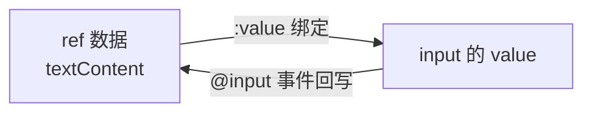


```vue
<template>
  <input type="text" :value="textContent" @input="(e) => (textContent = e.target.value)" />
  <p>你当前输入的内容为：{{ textContent }}</p>
</template>

<script setup>
import { ref } from 'vue'
const textContent = ref('')
</script>
```

`:value="textContent"` 是**数据 → 视图**：ref 包裹的变量 textContent 一变，输入框显示就变

`@input="e => textContent = e.target.value"` 是**视图 → 数据**：每次敲键盘，把输入框最新的 `value` 写回 ref 变量 textContent


#### v-model 是语法糖

```html
<input type="text" v-model="textContent" />
```

根据元素类型，自动展开成不同的 ”属性 + 事件“组合：

| 元素                       | 绑定的属性 | 监听的事件 | v-model 值的类型         |
| -------------------------- | ---------- | ---------- | ------------------------ |
| `input[text]` / `textarea` | `value`    | `input`    | 字符串                   |
| `checkbox`（单个）         | `checked`  | `change`   | 布尔（或自定义值）       |
| `checkbox`（多个）         | `checked`  | `change`   | **数组**                 |
| `radio`                    | `checked`  | `change`   | 字符串（选中项的 value） |
| `select`（单选）           | `value`    | `change`   | 字符串                   |
| `select`（多选）           | `value`    | `change`   | **数组**                 |

对照表

```html
<!-- 文本框 -->
<input v-model="text">
<!-- ≈ -->
<input :value="text" @input="text = $event.target.value">

<!-- 单个复选框 -->
<input type="checkbox" v-model="checked">
<!-- ≈ -->
<input type="checkbox" :checked="checked" @change="checked = $event.target.checked">

<!-- 单选框 -->
<input type="radio" value="男" v-model="gender">
<!-- ≈ -->
<input type="radio" value="男" :checked="gender === '男'" @change="gender = $event.target.value">
```


#### 文本框 / 文本域

`v-model` 直接写在标签上

```html
<textarea cols="30" rows="10" v-model="textContent"></textarea>
```


#### 复选框

单个

`v-model` 绑一个布尔值：`true` 选中、`false` 未选中。

```html
<input type="checkbox" v-model="checked" />
```

用 `true-value` / `false-value` 可以自定义"选中/未选中"分别代表什么值：

```html
<template>
  <input type="checkbox" v-model="checked" :true-value="customTrue" :false-value="customFalse" />
  <button @click="toggle">切换选中</button>
</template>

<script setup>
import { ref } from 'vue'
const checked = ref('yes')
// 现在相当于是自定义什么值是选中，什么值是未选中
// 之前是默认true是选中，false是未选中
// 现在是yes是选中，no是未选中
const customTrue = ref('yes')
const customFalse = ref('no')
function toggle() {
  checked.value === 'yes' ? (checked.value = 'no') : (checked.value = 'yes')
}
</script>

<style scoped></style>
```

- 选中时 `checked` 变成 `'yes'`，未选中变成 `'no'`（不再是布尔）。
- 注意 `:true-value`（带冒号）是**动态绑定**，能绑非字符串（数字、对象）；写成 `true-value="yes"`（不带冒号）就永远是字符串 `"yes"`。


多个

多个 checkbox 绑到**同一个数组**，勾中谁就把谁的 `value` 塞进数组：

```vue
<template>
  <div v-for="(item, index) in arr" :key="index">
    <label :for="item.id">{{ item.title }}</label>
    <input type="checkbox" v-model="hobby" :id="item.id" :value="item.value" />
  </div>
  <p>{{ message }}</p>
</template>

<script setup>
import { ref, computed } from 'vue'
const hobby = ref([])
const arr = ref([
  { id: 'swim', title: '游泳', value: '游个泳' },
  { id: 'run', title: '跑步', value: '跑个步' },
  { id: 'game', title: '游戏', value: '玩个游戏' }
])
const message = computed(() =>
  hobby.value.length === 0 ? '请选择爱好' : `您选择了${hobby.value.join('、')}`
)
</script>
```


`hobby` 是数组，勾选 → `value` 入数组，取消 → 从数组移除

数组里元素的**顺序 = 你的勾选顺序**，不是 `arr` 的顺序


#### 单选框

一组 radio 共用一个 `v-model`，哪个被选中取决于数据等于哪个 `value`

```vue
<template>
  <input type="radio" id="male" v-model="gender" value="男" /><label for="male">男</label>
  <input type="radio" id="female" v-model="gender" value="女" /><label for="female">女</label>
  <input type="radio" id="secret" v-model="gender" value="保密" /><label for="secret">保密</label>
</template>

<script setup>
import { ref } from 'vue'
const gender = ref('保密')            // 初始就选中"保密"
</script>
```


#### 下拉列表

单选绑字符串，多选绑数组

`v-model` 写在 `<select>` 上，不是写在 `<option>` 上：

```vue
<template>
  <!-- 单选：绑字符串 -->
  <select v-model="hometown1">
    <option value="" disabled>请选择</option>
    <option v-for="(item, index) in list" :key="index" :value="item.key">{{ item.value }}</option>
  </select>
  <p>{{ hometown1 }}</p>
</template>

<script setup>
import { ref } from 'vue'
const hometown1 = ref('')   // 与 value="" 的占位 option 对上，初始显示"请选择"
const list = ref([
  { key: '成都', value: '成都' },
  { key: '帝都', value: '北京' },
  { key: '魔都', value: '上海' }
])
</script>
```


多选

```vue
<template>
  <!-- 多选：加 multiple，绑数组 -->
  <select v-model="hometown2" multiple>
    <option v-for="(item, index) in list" :key="index" :value="item.key">{{ item.value }}</option>
  </select>
  <p>{{ hometown2 }}</p>
</template>

<script setup>
import { ref } from 'vue'
const hometown2 = ref([])   // 多选必须是数组
const list = ref([
  { key: '成都', value: '成都' },
  { key: '帝都', value: '北京' },
  { key: '魔都', value: '上海' }
])
</script>
```


#### 修饰符

| 修饰符    | 作用                                                        | 副作用 / 注意                                                |
| --------- | ----------------------------------------------------------- | ------------------------------------------------------------ |
| `.lazy`   | 从 `input` 事件改成 `change` 事件才更新（失焦或回车才同步） | 打字过程中数据不实时变                                       |
| `.number` | 把输入内容用 `parseFloat` 转成数字                          | 转不动就**原样返回字符串**；变成数字后 `.length` 是 `undefined` |
| `.trim`   | 去掉两端空格                                                | 只去**首尾**，中间空格保留                                   |

```html
<input v-model.lazy="mess1" />   <!-- 失焦/回车才更新 -->
<input v-model.number="mess2" /> <!-- typeof 可能从 string 变 number -->
<input v-model.trim="mess3" />   <!-- 两端空格自动删 -->
```


### 生命周期

组件从“被创建”到“被销毁”，Vue 内部会走一条固定流水线：初始化数据 → 编译模板 → 生成真实dom → 插入页面 → （期间数据变了就更新）→ 最后页面移除

在这条流水线的几个固定时间点上，留了一些“挂钩子的位置”。把函数挂上去，vue 走到这个点时必须先把函数执行完，才继续往下走。这个函数就是**生命周期钩子**


#### 钩子全景图

组合式 API 没有 `onBeforeCreate` / `onCreated`——`setup` 已替代它们

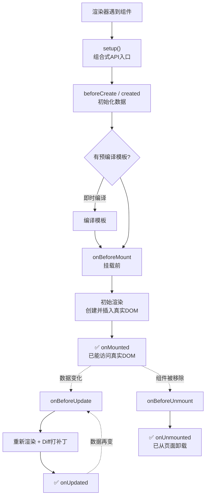


#### API钩子清单

| 阶段       | Vue2 选项式     | Vue3 组合式            | 触发时机                   |
| ---------- | --------------- | ---------------------- | -------------------------- |
| 创建前     | `beforeCreate`  | ❌ **无**（用 `setup`） | 实例初始化                 |
| 创建后     | `created`       | ❌ **无**（用 `setup`） | 数据已就绪，DOM 还没有     |
| 挂载前     | `beforeMount`   | `onBeforeMount`        | 即将首次渲染               |
| **挂载后** | `mounted`       | **`onMounted`**        | **真实 DOM 已生成并插入**  |
| 更新前     | `beforeUpdate`  | `onBeforeUpdate`       | 数据变了、DOM 还没更新     |
| 更新后     | `updated`       | `onUpdated`            | DOM 已按新数据更新         |
| 卸载前     | `beforeDestroy` | `onBeforeUnmount`      | 组件即将被移除             |
| 卸载后     | `destroyed`     | `onUnmounted`          | 组件已被移除、副作用该清了 |


#### `onMounted`

```vue
<template>
  <h1>用户列表</h1>
  <p ref="titleRef">我是一个用真实 DOM 演示的标题</p>

  <ul v-if="!loading">
    <li v-for="user in users" :key="user.id">{{ user.name }} - {{ user.email }}</li>
  </ul>
  <div v-if="loading">加载中...</div>
  <div v-if="error">出错啦：{{ error }}</div>
</template>

<script setup>
import { ref, onMounted } from 'vue'

const users = ref([])
const loading = ref(false)
const error = ref(null)
const titleRef = ref(null)   // 模板里 ref="titleRef" 会把真实 DOM 塞进来

onMounted(async () => {
  // ① 证明此刻能拿到"真实 DOM"
  console.log('真实 DOM 元素：', titleRef.value)          // <p> 元素，不是 null
  console.log('它的文字宽度：', titleRef.value.offsetWidth) // 只有真实 DOM 才有布局尺寸

  // ② 最常见的用途：请求后端数据
  loading.value = true
  try {
    const res = await fetch('https://jsonplaceholder.typicode.com/users')
    if (!res.ok) throw new Error('请求失败')
    users.value = await res.json()
  } catch (err) {
    error.value = err.message
  } finally {
    loading.value = false
  }
})
</script>
```


#### `onBeforeUpdate` / `onUpdated`

```vue
<template>
  <h2>{{ count }}</h2>
  <button @click="count++">+1</button>
</template>

<script setup>
import { ref, onBeforeUpdate, onUpdated } from 'vue'

const count = ref(0)

onBeforeUpdate(() => {
  // 数据已经变了，但页面 DOM 还没更新
  console.log('beforeUpdate — 页面上还是旧值：', document.querySelector('h2').textContent)
})

onUpdated(() => {
  // DOM 已经按新数据打完补丁
  console.log('updated — 页面已是新值：', document.querySelector('h2').textContent)
})
</script>
```


点击按钮，控制台打印

```
beforeUpdate — 页面上还是旧值：0
updated — 页面已是新值：1
```


#### 卸载阶段：`onBeforeUnmount` / `onUnmounted`

```vue
<template>
  <p>已经过去 {{ seconds }} 秒</p>
</template>

<script setup>
import { ref, onMounted, onUnmounted } from 'vue'

const seconds = ref(0)
let timer = null

onMounted(() => {
  timer = setInterval(() => seconds.value++, 1000)  // 组件出现时开启定时器
  console.log('Clock 挂载，定时器启动')
})

onUnmounted(() => {
  clearInterval(timer)   // ★ 组件消失时必须关掉，否则它会一直在后台跑
  console.log('Clock 卸载，定时器已清除')
})
</script>
```

 如果不执行`clearInterval`：组件虽然从页面消失了，但 `setInterval` 还在后台每秒执行、还在改一个已卸载组件的数据——这就是**内存泄漏**。


### `watch` - 侦听器

和computed类似，都是依赖响应式数据。


#### 作用区别：

computed：数据变化时做二次计算，做不涉及副作用的操作

watch：依赖的数据变化时，做一些副作用操作

|            | computed 计算属性 | watch 侦听器                            |
| ---------- | ----------------- | --------------------------------------- |
| 目的       | **算出一个新值**  | **做一件事（副作用）**                  |
| 有无副作用 | ❌ 不能有          | ✅ 就是干这个的                          |
| 典型场景   | 全名 = 姓+名      | 发请求、改 DOM、存 localStorage、打日志 |

**副作用**=函数除了返回值之外，对外部世界造成的影响：发 fetch、改 `document.title`、写缓存、`console.log`……


#### 语法

```js
watch(
  source,              // ① 数据源：盯谁
  (newVal, oldVal) => {// ② 回调：变了干啥，能拿到新值和旧值
    /* 副作用 */
  },
  { immediate: true }  // ③ 选项(可选)
)
```


watch支持监听的数据源

| 写法                             | 传入                   | Vue 内部包装成            |
| :------------------------------- | :--------------------- | :------------------------ |
| `watch(count, cb)`               | ref                    | `() => count.value`       |
| `watch(fullName, cb)`            | computed（本质是 ref） | `() => fullName.value`    |
| `watch(user, cb)`                | reactive 对象          | `() => user`，且强制 deep |
| `watch(() => obj.count, cb)`     | getter 函数            | 直接用，不再包装          |
| `watch([a, b, () => obj.x], cb)` | 数组                   | 每一项按上面规则分别处理  |


Vue内部把读到的数据包装成函数的原因

如果直接读取值

```js
// 你传入的是 ref
watch(count, cb)

// Vue 如果直接拿值用：
const value = count.value  // 只读了一次，之后 value 是死的普通数字
```

包装成 getter 函数之后

```
const getter = () => count.value

getter()  // 第一次执行：读取
// 数据变化...
getter()  // 再次执行：读取新值 → 得到最新结果
```

vue内部需要一个能反复调用的东西，以保证时刻读取到新值，而不是定死的原始数据

- 每次调用它 → 读取数据 
- 数据变化后再调用它 → 拿到新值

函数天然满足这个需求


#### 深度侦听

默认深浅

| 数据源                       | 默认是否深度侦听 | 想深度侦听怎么办    |
| ---------------------------- | ---------------- | ------------------- |
| `reactive({...})`            | ✅ **默认深**     | 天生就是            |
| `ref({...})`（ref 里装对象） | ❌ **默认浅**     | 加 `{ deep: true }` |
| `() => 返回对象的 getter`    | ❌ **默认浅**     | 加 `{ deep: true }` |


```js
const state = ref({ count: 0 })

// 默认浅：只有整个 .value 被"换掉"才触发
watch(state, () => console.log('触发'))
state.value.count++        // ❌ 不触发！（对象没换，只是内部变了）
state.value = { count: 9 } // ✅ 触发（换了新对象）

// 想监听内部变化 → 开 deep
watch(state, () => console.log('触发'), { deep: true })
state.value.count++        // ✅ 现在触发了
```


语法章节说了

`watch(ref)` 内部会包装成 getter函数：`() => ref.value`，只读了`.value`这一层，所以只有`.value`属性被重新赋值之后才算依赖变化。

开`deep`后，Vue会用一个`traverse`函数递归访问对象的每个嵌套属性，把它们全部登记为依赖


**Vue 3.5 新增**：`deep` 可以是数字，限制递归层数，缓解性能问题：

```js
watch(source, cb, { deep: 2 }) // 只深入 2 层
```


#### options参数

```js
watch(source, cb, {
  immediate: true, // 创建时立即先跑一次回调（常用于"进页面就加载初始数据"）
  once: true,      // 只触发一次就自动停（Vue 3.4+）
  deep: true,      // 强制深度侦听
  flush: 'post',   // 回调时机
})
```


#### watchEffect

自动收集依赖

```js
// watch：必须显式指定依赖数据 todoId
watch(todoId, async () => {
  data.value = await (await fetch(`.../todos/${todoId.value}`)).json()
}, { immediate: true })

// watchEffect：回调里用到谁，谁就自动成为依赖，且默认立即执行一次
watchEffect(async () => {
  data.value = await (await fetch(`.../todos/${todoId.value}`)).json()
})
```


对比

|          | watch                    | watchEffect                    |
| -------- | ------------------------ | ------------------------------ |
| 指定依赖 | 手动                     | 自动（回调里读到的响应式数据） |
| 初始执行 | 默认懒（要 `immediate`） | **默认立即执行一次**           |
| 拿旧值   | ✅ 有 newVal/oldVal       | ❌ 没有                         |


#### flush

回调触发时机

| flush           | 时机                     | 场景                                                   |
| --------------- | ------------------------ | ------------------------------------------------------ |
| `'pre'`（默认） | DOM 更新**前**           | 大多数逻辑                                             |
| `'post'`        | DOM 更新**后**           | **回调里要读更新后的 DOM**（量高度、量宽度、滚动位置） |
| `'sync'`        | 数据一变**同步**立即执行 | 极少用，可能有性能问题                                 |


例子：

```js
watch(isShow, () => {
  height.value = divRef.value?.offsetHeight ?? 0 // 默认 pre → 拿到 0
}, { flush: 'post' })    
```

如果不加 `flush:'post'`，你 `divRef.value.offsetHeight` 拿到的是**旧 DOM**（元素可能还没渲染出来，高度是 0）。


#### 停止侦听器

```js
const stop = watch(source, cb)
stop() // 手动停止
```

同步创建的侦听器会随着组件写在自动停止，异步创建的（放在 `setTimeout`、`await` 之后、Promise 回调里）不会自动停止，必须手动stop()，否则内存泄漏

```
// ✅ 自动停止
watchEffect(() => {})

// ❌ 不会自动停止，必须手动管理
setTimeout(() => {
  const stop = watchEffect(() => {})
}, 100)
```

Vue 靠"当前活跃组件实例"把才能找到在当前组件生效的侦听器，卸载时统一清理。

异步回调执行并创建侦听器时，那个"当前实例"上下文已经丢了，Vue 收集不到，所以管不了它。


#### 副作用清理 `onWatcherCleanup`

监听的数据快速连续变化，会先清理掉上一次监听数据变化带来的副作用，然后执行新变化带来的副作用

```js
import { watch, onWatcherCleanup } from 'vue' // Vue 3.5+

watch(question, async (newValue) => {
  const controller = new AbortController()
  // 注册清理：下次回调触发前 / 侦听器停止时会调用
  onWatcherCleanup(() => controller.abort())

  const res = await fetch('https://yesno.wtf/api', { signal: controller.signal })
  answer.value = (await res.json()).answer
})
```


```
question 变成 "A"
  → 回调第一次执行
  → 创建 controllerA
  → 注册清理函数：() => controllerA.abort()
  → 发出请求 fetchA（还没返回...）

question 变成 "B"          ← 第一次回调还没执行完！
  → Vue 先执行上一次注册的清理函数  ← onWatcherCleanup 注册的就在这里被调用
  → controllerA.abort()            ← 取消掉 fetchA
  → 回调第二次执行
  → 创建 controllerB
  → 注册清理函数：() => controllerB.abort()
  → 发出请求 fetchB
```


### 组件


#### 是什么

一个组件 = **结构（template）+ 样式（style）+ 逻辑（script）** 打包成一个可复用的单元。

页面不是一个巨大的文件，而是一棵**组件树**：

```
App（根组件）
├── Header
├── Sidebar
│   └── Menu
└── Content
    ├── Article
    └── Comment
```

项目main.js

```js
createApp(App).mount('#app')
// App 是根组件，mount 把整棵树挂到 index.html 里 id=app 的元素上
```


#### 构建工具作用

组件结构

```vue
<template>
  <button @click="count++">Count is: {{ count }}</button>
</template>

<script setup>
import { ref } from 'vue'
const count = ref(0)
</script>

<style scoped>
button { padding: 15px; }
</style>
```

.vue文件是给构建工具看的，构建工具做的事：

App.vue  ──► (`@vitejs/plugin-vue` 编译)──►  纯 JS 对象 { `render`, `setup`, ... }  ──►  浏览器执行

.vue是源码，浏览器跑的是编译后的js


#### `scoped` 的作用

编译器做了两件事：

根据组件分类，给模板里**每个元素**加一个独一无二的属性，比如 `data-v-7ba5bd90`：

```html
<button data-v-7ba5bd90>Count</button>
```

把css选择器改写成带属性选择器的形式

```css
/* 源代码 */      button { padding: 15px; }
/* 编译后变成 */  button[data-v-7ba5bd90] { padding: 15px; }
```

这样条件样式只能命中“带着本组件哈希”的元素 → 天然隔离


#### 组件注册

全局注册，注册后处处可用

```js
import { createApp } from 'vue'
import MyComponent from './MyComponent.vue'

const app = createApp({})
app.component('MyComponent', MyComponent)   // 可链式：.component(...).component(...)
```


局部注册，哪个组件用，就在哪个组件使用

```vue
<script setup>
import TestCom from './components/TestCom.vue'
// 就这一行 import，模板里直接能用 <TestCom />
</script>

<template>
  <TestCom />
</template>
```

编译器会**扫描你的模板**，发现用到了 `<TestCom>`，就自动把导入进来的 `TestCom` 注册进去。


推荐局部注册

1. 全局注册的组件即使没被用到，也会被打进最终包里；局部 `import` 没用到就能被摇掉。
2. 依赖关系清晰


#### 组件名规范

- 推荐大驼峰 PascalCase：`<TestCom />`、`<UserCard />`
  - 好处：和原生 HTML 标签（全小写）一眼区分开
- **（补充）** 也可用短横线 kebab-case：`<test-com />`。在 SFC 里两种都行，Vue 会自动互转。


###  Props

父组件通过Props将数据传递到子组件处

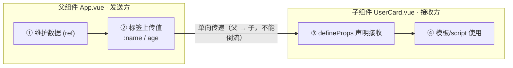


#### 语法

发送方在子组件标签中写上要传递的数据

子组件作为接收方在`defineProps`里声明要接收的参数

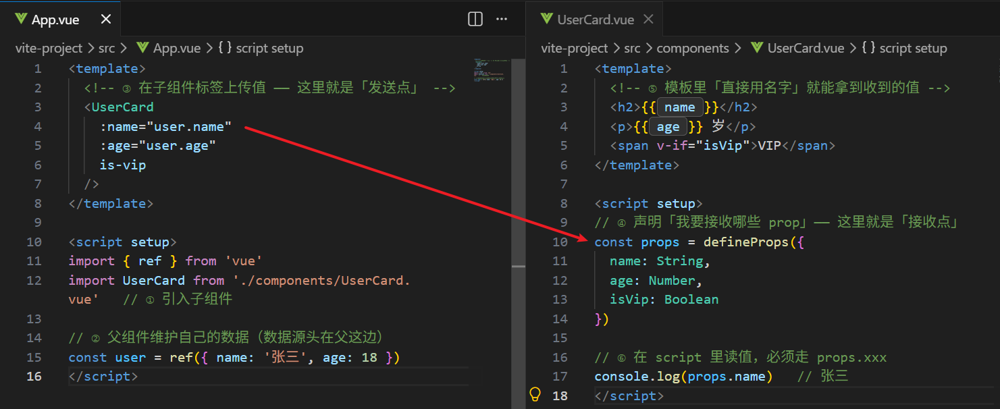


#### 传非字符串

（数字/布尔/数组/对象）

**必须加 `:`** 

：`<UserCard :age="18" />`

**发送方一旦漏了 `:`**，子组件收到的就是字符串：

```html
<UserCard age="18" />    <!-- 父忘了加 : -->
```

```js
console.log(typeof props.age)  // 子这边：'string'，不是 number！
```


#### 动态传值

父数据一变，子自动更新

父组件代码`:name="user.name"，且 user 是 ref；父改 user.name`

子组件：什么都不用做，模板 `{{ name }}` 自动刷新


#### 命名配对

父组件：模板里用 **kebab-case**：`avatar-url="..."`

子组件：声明用 **camelCase**：`avatarUrl: String`

Vue 自动把 `avatar-url` ↔ `avatarUrl` 互相对应。**发送方写短横线，接收方写小驼峰**，这是约定。


#### 加工接收值

父组件：正常传值即可

子组件：**不能改 props**（只读）。两种改动方式：

1. 拷贝：`const n = ref(props.name)`
2. 派生：`const big = computed(() => props.name.toUpperCase())`

```js
// 子组件里 —— ❌ 直接改会警告：target is readonly
props.name = '李四'
```

因为数据源头只准有一个，那就是父组件，子组件能随意改就乱套了。所以子组件想要有自己的可变版本，就要在本地另存。


#### 接收校验

父组件：正常传值

子组件：用校验规定只接收什么值

```js
// 子组件设「验收标准」
defineProps({
  name: { type: String, required: true },      // 父必须传
  age:  { type: Number, default: 18 },          // 父没传就用 18
  level:{ validator: v => ['金','银'].includes(v) } // 父传的值必须在范围内
})
```


### emit

子组件向父组件传递数据

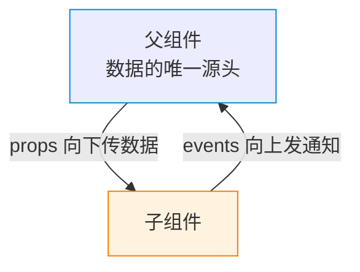


#### 语法

子组件通过`emit`把事件+数据发出去，父组件通过@事件名监听并接收

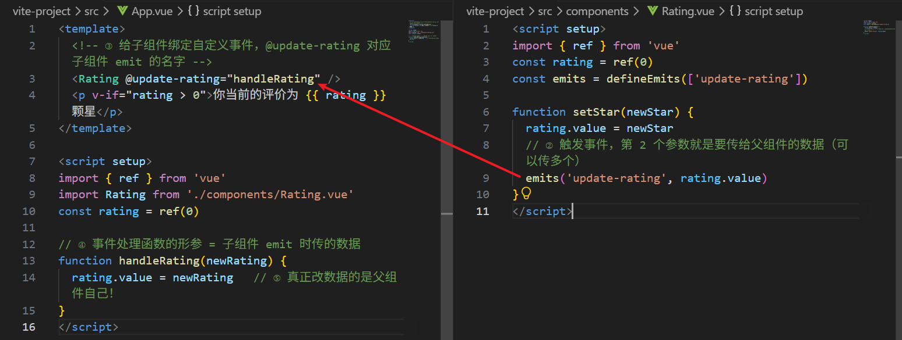


##### defineEmits

```vue
<script setup>
// ① 声明：本组件会对外触发一个叫 update-rating 的事件
//    defineEmits 是编译器宏（compiler macro），不用 import，和 defineProps 一样
const emits = defineEmits(['update-rating'])
</script>
```

`defineEmits`：声明"我会发哪些事件"

`defineEmits` 返回一个 `emit` 函数（当前组件中命名为emits）


##### emit()

`emit()`：触发事件 + 把数据"喊"出去

```vue
<script setup>
import { ref } from 'vue'
const rating = ref(0)
const emits = defineEmits(['update-rating'])

function setStar(newStar) {
  rating.value = newStar
  // ② 触发事件，第 2 个参数就是要传给父组件的数据（可以传多个）
  emits('update-rating', rating.value)
}
</script>
```

`emits('update-rating', 5)` 执行的那一刻，父组件里绑定在 `@update-rating` 上的函数会**立刻被调用**，参数 `5` 被送过去。

**可以传多个值**：`emits('update-rating', star, '备注', true)`，父组件的处理函数就用多个形参接：`handleRating(star, note, flag)`。


##### 父组件

`@事件名` 监听并接收

```vue
<template>
  <!-- ③ 给子组件绑定自定义事件，@update-rating 对应子组件 emit 的名字 -->
  <Rating @update-rating="handleRating" />
  <p v-if="rating > 0">你当前的评价为 {{ rating }} 颗星</p>
</template>

<script setup>
import { ref } from 'vue'
import Rating from './components/Rating.vue'
const rating = ref(0)

// ④ 事件处理函数的形参 = 子组件 emit 时传的数据
function handleRating(newRating) {
  rating.value = newRating   // ⑤ 真正改数据的是父组件自己！
}
</script>
```


#### $emit

如果不写单独函数，可以在模板里直接用 `$emit`

子组件

```vue
<template>
  <!-- $emit 是内置的，模板里直接可用，不需要 defineEmits 拿返回值 -->
  <span
    v-for="star in 5" :key="star"
    class="star"
    @click="$emit('update-rating', star)"
  >
    {{ rating >= star ? '★' : '☆' }}
  </span>
</template>
```


#### 事件命名规范

多单词事件名用 kebab-case（短横线）

```
✅ emits('update-rating', v)   →   父组件 @update-rating="fn"
```


#### 事件校验

`defineEmits` 传**对象**，键是事件名，值是校验函数，返回布尔值

```vue
<script setup>
const emits = defineEmits({
  'update-rating': (value) => {
    if (value < 1 || value > 5) {
      console.warn('传递的值有问题！！！')
      return false    // 校验不通过
    }
    return true       // 校验通过
  }
})

function setStar(newStar) {
  emits('update-rating', 100)   // 课件这里传了 100
}
</script>
```


### 组件v-model

把父组件数据传递给子组件，子组件改完再通知父组件修改这两件事，合并成一行`v-model="数据"`


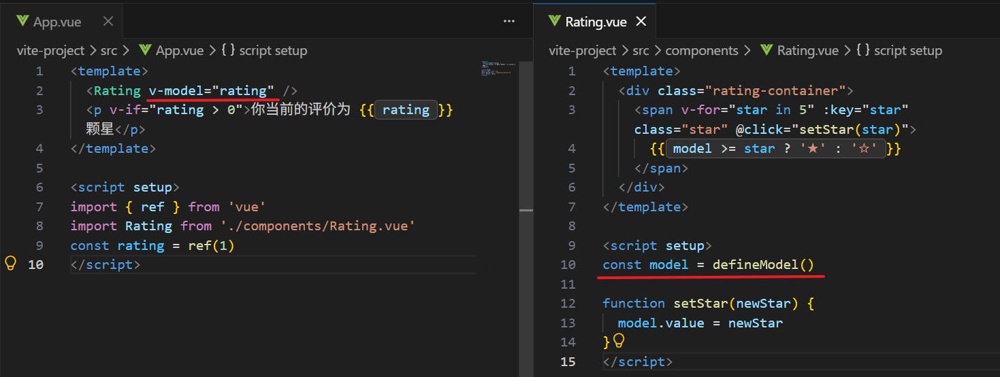

`defineModel()`

它返回的 `model` 是一个特殊的 ref：

- **读** `model.value` → 等价于读 `props.modelValue`
- **写** `model.value = x` → 等价于 `emits('update:modelValue', x)`


### 插槽


#### 本质

插槽是父组件传给子组件的一个“返回模板的函数”


把插槽想象成回调函数：

- 子组件里的 `<slot>` = **调用**这个函数、并把返回的内容渲染在这个位置（所以叫"出口 outlet"）
- 父组件写的插槽内容 = **函数体**（返回一段 vnode）
- 子组件 `<slot :x="data">` 上绑的属性 = **调用函数时传的参数**
- 父组件 `v-slot="props"` = **函数的形参**

一个具名插槽的例子：

```js
// 子组件： <slot name="header" :count="1"></slot>
// 大致编译成：
renderSlot(slots, 'header', { count: 1 })
//  ≈  (slots.header ?? 后备内容函数)({ count: 1 })   ← 就是在“调用函数并传参”

// 父组件：
// <Child>
//   <template #header="{ count }"> <h1>{{ count }}</h1> </template>
// </Child>
// 大致编译成：把一个 slots 对象传给子组件
h(Child, null, {
  header: ({ count }) => [ h('h1', count) ]   // ← 一个接收参数、返回 vnode 的函数
})
```


#### 默认插槽

最基础的替换

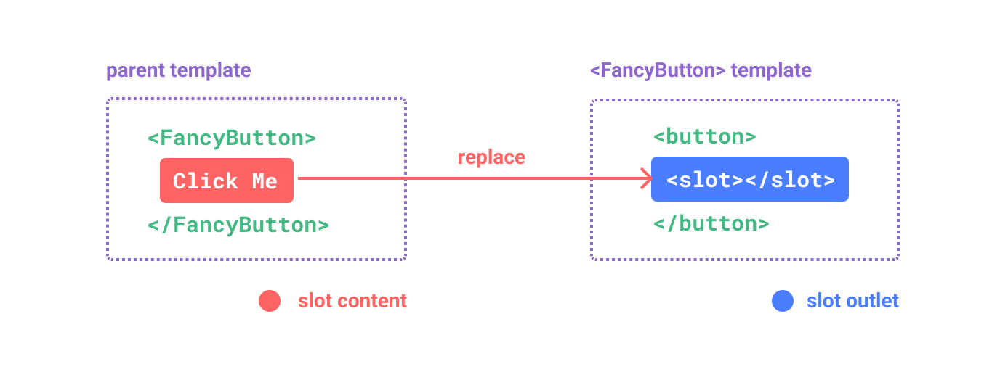

子组件

```vue
<template>
  <button class="fancy-btn">
    <slot></slot>  <!-- 出口：父组件传的内容会渲染在这 -->
  </button>
</template>
```


父组件

标签之间写的内容，就是要插入的内容

```vue
<template>
  <FancyButton>Click Me</FancyButton>
</template>

<script setup>
import FancyButton from './components/FancyButton.vue'
</script>
```


#### 默认内容

`<slot>`标签中间可以显示默认内容，父组件没传时显示它

```vue
<!-- 子组件 -->
<button class="fancy-btn">
  <slot>提交</slot>  <!-- 没传 → 显示“提交” -->
</button>
```

```vue
<FancyButton />            <!-- 显示：提交 -->
<FancyButton>删除</FancyButton>  <!-- 显示：删除 -->
```


#### 具名插槽

如果子组件中有多个位置要填充内容，可以给`<slot>`起名字来对号入座。

父组件用 `<template v-slot:名字>` 指定填哪个坑。图为简写

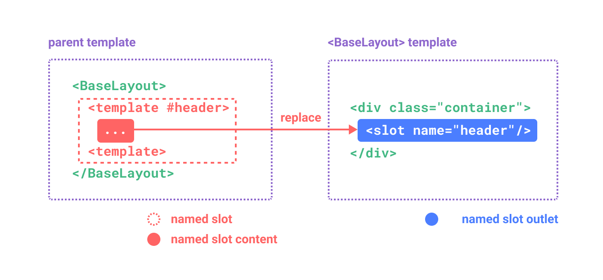


子组件

```vue
<template>
  <div class="card">
    <div class="card-header">
      <slot name="header"></slot>   <!-- 具名插槽 -->
    </div>
    <div class="card-body">
      <slot></slot>                 <!-- 默认插槽，隐含 name="default" -->
    </div>
  </div>
</template>
```


父组件

`v-slot:header` 可简写成 `#header`：

```vue
<Card>
  <template #header>我的卡片标题</template>
  这是卡片的内容  <!-- 没包 template 的顶层内容 → 自动进 default 插槽 -->
</Card>
```


####  动态插槽

插槽名可以是变量，用 `#[变量名]`

```vue
<script setup>
import { ref } from 'vue'
const slotName = ref('header')
</script>

<template>
  <Card>
    <template #[slotName]>动态决定我进哪个坑</template>
  </Card>
</template>
```


#### 插槽数据作用域

模板里的表达式，只能访问它"所在组件"的数据。

- 父组件模板 → 只能访问父组件数据
- 子组件模板 → 只能访问子组件数据
- 插槽内容虽然写在子组件标签里，但它属于"父组件模板"，所以只能访问父组件数据

```vue
<!-- 父组件 -->
<Card>
  <template #default>
    <p>父组件数据：{{ parentData }}</p>   <!-- ✅ 能访问 -->
    <p>子组件数据：{{ childData }}</p>     <!-- ❌ 报错！访问不到子组件的 -->
  </template>
</Card>
```


#### 作用域插槽——传值

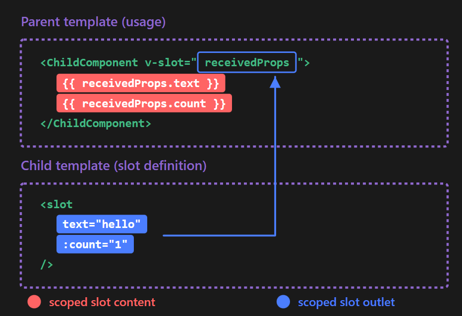


**子组件**：在 `<slot>` 上像绑 props 一样绑数据，把子组件数据"当参数传出去"。

```vue
<!-- 子组件 MyComponent.vue -->
<div>
  <slot :text="greetingMessage" :count="1"></slot>
</div>

<script setup>
import { ref } from 'vue'
const greetingMessage = ref('hello')
</script>
```

**父组件**：用 `v-slot="slotProps"` 接住这些参数（它就是那个"函数的形参"）。

```vue
<MyComponent v-slot="slotProps">
  {{ slotProps.text }} {{ slotProps.count }}
</MyComponent>
```

也可以直接解构

```vue
<MyComponent v-slot="{ text, count }">
  {{ text }} {{ count }}
</MyComponent>
```


### 前端路由

#### 解决了什么问题

只有一个 HTML 的单页应用里，让"URL 变化"和"页面某块视图变化"对应起来，而整个过程浏览器不向服务器重新请求页面、不刷新。


**多页时代**（单页应用之前）：点一个链接 → 浏览器向服务器要一个新的 `.html` → 整页白屏刷新重来。

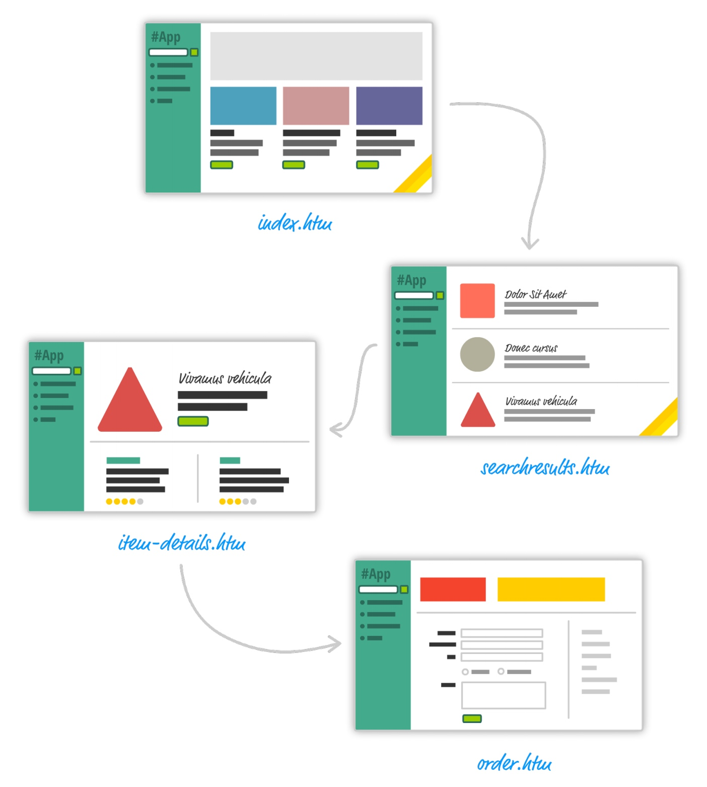


**单页时代**：绿色侧边栏 `#App` 是**始终不变的外壳**，红框里的内容区才随路由切换。切换时只换红框里的组件，**外壳和整个页面都不重新加载**。

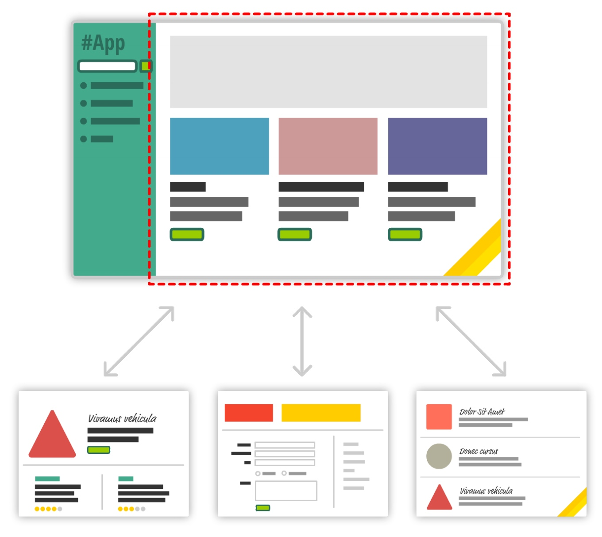


#### 原理

前端路由能"改 URL 不刷新"，靠的是浏览器提供的两套机制，对应 Vue Router 的两种模式。


#### Hash 模式

`createWebHashHistory()`

URL 长这样：`http://localhost:5173/#/about`，`#` 后面的部分叫 **hash**

**特性**：改变 hash（`#` 后面的内容）**浏览器不会向服务器发请求、不会刷新页面**，只会触发一个 `hashchange` 事件。

Vue Router 干的事就是：监听 `hashchange` → 读出新 hash → 找到对应组件 → 塞进 `router-view`。


例子，点击链接、URL变、内容变、但页面没变

```html
<!DOCTYPE html>
<html>
<body>
  <a href="#/home">首页</a>
  <a href="#/about">关于</a>
  <div id="view"></div>

  <script>
    const routes = {
      '/home': '<h1>🏠 首页内容</h1>',
      '/about': '<h1>ℹ️ 关于我们</h1>'
    }
    function render() {
      const path = location.hash.slice(1) || '/home' // 去掉开头的 #
      document.getElementById('view').innerHTML = routes[path] || '<h1>404</h1>'
    }
    window.addEventListener('hashchange', render) // 核心：监听 hash 变化
    window.addEventListener('load', render)
  </script>
</body>
</html>
```

- 优点：不需要服务器做任何配置，直接就能用。
- 缺点：URL 里有个丑丑的 `#`；对 SEO 不友好。


#### History 模式

`createWebHistory()`

URL 很干净：`http://localhost:5173/about`（没有 `#`）。

靠的是 HTML5 的 **History API**：

```js
// 地址栏变成 /about，但页面不刷新、不向服务器发请求
history.pushState({}, '', '/about')

// 用户点浏览器"前进/后退"按钮时触发
window.addEventListener('popstate', () => { /* 重新渲染视图 */ })
```

- 优点：URL 干净漂亮，跟真实路径一样。
- **缺点**：当用户停在 `/about` 页面**按 F5 刷新**，浏览器会真的向服务器请求 `/about` 这个地址，但服务器上根本没有这个文件 → **404**。所以 history 模式**上线时需要服务器配置**：把所有找不到的路由都指回 `index.html`。（开发时 Vite 已经帮你处理好了，所以本地不会 404。）


#### SEO

**SEO（Search Engine Optimization，搜索引擎优化）** 让网页更容易被 Google、百度这类搜索引擎"找到"并排在前面。


想象搜索引擎有一个"爬虫机器人"，它会：

1. **爬取**：不断访问互联网上的网页，顺着链接一个页面跳一个页面
2. **解析**：读取页面的 HTML 内容，理解这个页面是关于什么的
3. **建索引**：把这些内容记录下来，存入数据库
4. **排名**：当用户搜索时，根据相关性决定谁排第一、第二……


`#` 对 SEO 不友好的问题就出在爬虫对SEO的理解上：

| 模式         | URL 示例                       | 爬虫看到的                 |
| :----------- | :----------------------------- | :------------------------- |
| Hash 模式    | `example.com/shop#/detail/123` | 只看 `#` **前面**的部分    |
| History 模式 | `example.com/shop/detail/123`  | 完整路径，每段都能独立索引 |

`#` 后面的内容（fragment）在 HTTP 协议里是"只给浏览器用的"，**请求压根不会发到服务器**，爬虫也通常不会执行后面的 JS 去渲染内容。

比如电商网站的 1000 个商品页，如果使用Hash模式，对于爬虫来说，可能"看起来"都是同一个地址 `example.com/shop`，**全部无法被单独收录**。


#### Vue Router使用

安装

```
pnpm add vue-router@4
```


在 `src`下建 `views/` 目录，放页面级组件 `Home.vue`、`About.vue`（内容随便写个 `<h1>` 即可）。


建 `src/router/index.js`，写路由配置：

```js
import { createRouter, createWebHistory } from 'vue-router'
import Home from '../views/Home.vue'
import About from '../views/About.vue'

const router = createRouter({
  history: createWebHistory(), // 想体验 hash 就换成 createWebHashHistory()
  routes: [
    { path: '/',      name: 'Home',  component: Home },
    { path: '/about', name: 'About', component: About }
  ]
})
export default router
```


在 `main.js` 挂载

```js
import { createApp } from 'vue'
import './style.css'
import App from './App.vue'
import router from './router'   // 引入路由实例

createApp(App).use(router).mount('#app')
```


改`App.vue`

```vue
<template>
  <nav>
    <router-link to="/">Home</router-link> |
    <router-link to="/about">About</router-link>
  </nav>
  <router-view />   <!-- 匹配到的组件渲染在这里 -->
</template>

<script setup></script>
```


#### router-link和`<a>`的区别

如果直接写 `<a href="/about">`，点击会**触发整页刷新**，SPA 就废了。`router-link` 会**拦截点击事件**，改用前面讲的 History API 跳转，所以**不刷新**。


#### router-view

用来渲染匹配到的组件


用法&参数，很多后面会遇到

```vue
<router-view v-slot="{ Component, route }">
  <component :is="Component" />
</router-view>
```

| 变量        | 类型                    | 说明                                |
| :---------- | :---------------------- | :---------------------------------- |
| `Component` | VNode                   | 当前路由匹配到的组件                |
| `route`     | RouteLocationNormalized | 当前路由对象（含 params、query 等） |


```vue
<!-- 1. 配合 keep-alive 缓存组件 -->
<router-view v-slot="{ Component }">
  <keep-alive>
    <component :is="Component" />
  </keep-alive>
</router-view>

<!-- 2. 配合 transition 添加过渡动画 -->
<router-view v-slot="{ Component }">
  <transition name="fade">
    <component :is="Component" />
  </transition>
</router-view>

<!-- 3. 两者结合 -->
<router-view v-slot="{ Component }">
  <transition name="fade">
    <keep-alive>
      <component :is="Component" />
    </keep-alive>
  </transition>
</router-view>
```


#### 编程式导航：在JS里跳转

`router-link` 是模板里点的。如果要在"登录成功后自动跳首页"这种**逻辑里**跳转，用 `useRouter()`：

```vue
<script setup>
import { useRouter } from 'vue-router'
const router = useRouter()

function goAbout() {
  router.push('/about')       // 跳转（会留下历史记录，能后退）
  // router.replace('/about') // 跳转但替换当前记录（不能后退回来）
  // router.back()            // 后退，相当于浏览器后退键
  // router.go(-2)            // 前进/后退 n 步
}
</script>
```


#### 动态路由 & 参数

场景：假如有1000个商品，每个商品都是详情页，不可能配一千条路由。在`src/router/index.js`可以用 `:id` 占位：

```js
{ path: '/user/:id', name: 'User', component: User }
```

在 `User.vue` 里用 `useRoute()`（注意是 `useRoute`，不带 `r`，和 `useRouter` 别搞混）读参数：

```vue
<script setup>
import { useRoute } from 'vue-router'
const route = useRoute()
// 访问 /user/42        → route.params.id === '42'
// 访问 /list?page=2    → route.query.page === '2'
console.log(route.params.id, route.query.page)
</script>
```

|        | `useRouter()`               | `useRoute()`                       |
| ------ | --------------------------- | ---------------------------------- |
| 是什么 | 整个路由**器**（司机）      | 当前这条路由**信息**（当前位置）   |
| 干什么 | 用来**跳转** `push/replace` | 用来**读**当前 `params/query/path` |


#### 重定向 & 嵌套

```js
{ path: '/', redirect: '/home' },          // 访问 / 自动跳到 /home
{
  path: '/user', component: User,
  children: [                              // 嵌套：User 里再放一个 router-view
    { path: 'profile', component: Profile }// 匹配 /user/profile
  ]
}
```


### 动态组件 + KeepAlive 缓存

#### 动态组件 `<component :is>`

渲染哪个组件由is决定

```vue
<script setup>
import { shallowRef } from 'vue'
import Home from './views/Home.vue'
import About from './views/About.vue'

const current = shallowRef(Home)   // is 可以是「组件对象」
</script>

<template>
  <button @click="current = Home">Home</button>
  <button @click="current = About">About</button>

  <component :is="current" />       <!-- current 指向谁就渲染谁 -->
</template>
```

`is` 的值有两种：

- **组件对象**（如上，import 进来的 [Home](vscode-file://vscode-app/c:/Application/Microsoft VS Code/5264f2156c/resources/app/out/vs/code/electron-browser/workbench/workbench.html)）——推荐
- **字符串**（如 `"div"` 或全局注册的组件名 ["Home"](vscode-file://vscode-app/c:/Application/Microsoft VS Code/5264f2156c/resources/app/out/vs/code/electron-browser/workbench/workbench.html)）


#### 为什么需要 KeepAlive

Keep用来缓存状态，如果没有的话:

```vue
<!-- Home.vue -->
<script setup>
import { ref } from 'vue'
const count = ref(0)
const text = ref('')
</script>

<template>
  <h1>Home Page</h1>
  <button @click="count++">count = {{ count }}</button>
  <input v-model="text" placeholder="随便打点字" />
</template>
```

**验现象（不加 KeepAlive）**：

1. 在 Home 页面把 count 点到 5，输入框打字 "hello"
2. 点导航去 About页面，再回 Home
3.  **count 归 0，输入框清空**


#### KeepAlive原理

普通切换组件时，vue的行为：

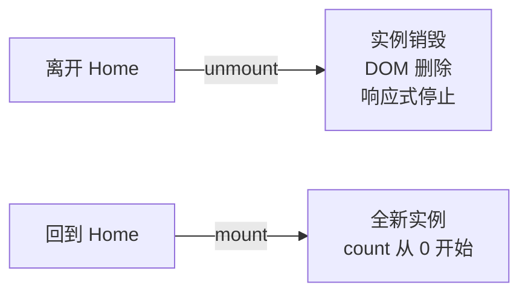

实例一销毁，ref就没了，再次切回来时变成了全新实例，自然从0开始：


**KeepAlive 做的事**：当子组件本该被卸载时，它**不销毁**，而是：

1. 把组件**实例**存进内部的一个 `Map`（缓存）
2. 把真实 **DOM 从页面搬到一个隐藏容器**里（不是删除）
3. 下次再进来，直接把缓存的实例和 DOM **搬回来**

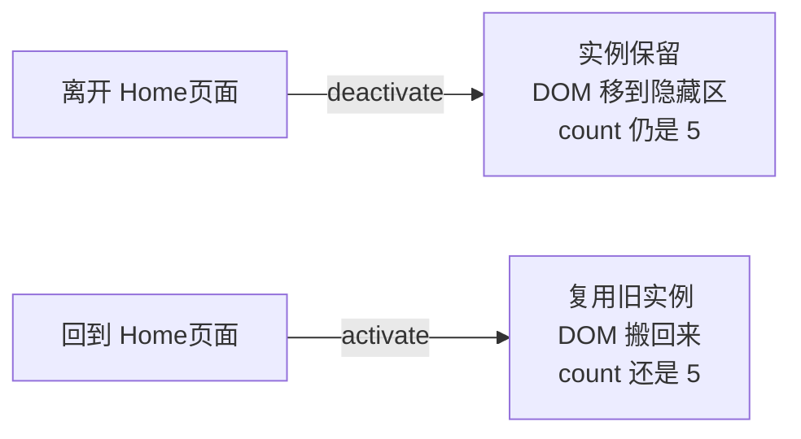


#### keepAlive用法

```vue
<!-- App.vue -->
<template>
  <nav>
    <router-link to="/">Home</router-link> |
    <router-link to="/about">About</router-link>
  </nav>

  <router-view v-slot="{ Component }">
    <keep-alive>
      <component :is="Component" />
    </keep-alive>
  </router-view>
</template>
```

router-view 通过**作用域插槽** `v-slot="{ Component }"` 把「当前路由匹配到的组件」解构出来，交给 `<component :is>` 渲染

外面裹一层 `<keep-alive>` → 状态被缓存


#### onActivated / onDeactivated

缓存的组件**不会卸载/重建**，那么：

| 命周期          | 第一次进入 | 之后每次切走/回来          |
| --------------- | ---------- | -------------------------- |
| `onMounted`     | ✅ 触发     | ❌ **不再触发**             |
| `onUnmounted`   | ❌          | ❌ **不触发**（除非被淘汰） |
| `onActivated`   | ✅ 触发     | ✅ **每次回来都触发**       |
| `onDeactivated` | ❌          | ✅ **每次切走都触发**       |

所以对于呗KeepAlive包裹的组件，把「每次进入都要做」的逻辑（刷新、埋点、开定时器）放进 **`onActivated`**，把「离开要清理」的逻辑（关定时器）放进 **`onDeactivated`**。


#### keepAlive 的 `include` / `exclude`

| 属性      |               作用               |
| :-------- | :------------------------------: |
| `include` |     **只有**匹配的组件才缓存     |
| `exclude` | **匹配的组件不缓存**，其余都缓存 |
| `max`     | 最多缓存几个组件实例（LRU 策略） |


`include` / `exclude` 匹配的是组件的 **`name` **

```vue
<!-- 字符串（逗号分隔） -->
<keep-alive include="Home,About">
  <component :is="Component" />
</keep-alive>

<!-- 正则表达式 -->
<keep-alive :include="/Home|About/">
  <component :is="Component" />
</keep-alive>

<!-- 数组（推荐） -->
<keep-alive :include="['Home', 'About']">
  <component :is="Component" />
</keep-alive>
```


vue3默认推断组件名称作为组件name

```js
views/Home.vue        →  name = 'Home'
views/AboutView.vue   →  name = 'AboutView'
views/user-list.vue   →  name = 'UserList'  (转为大驼峰)
```


#### keepAlive 的 `max` 

```vue
<keep-alive :max="3">
  <component :is="Component" />
</keep-alive>
```

最多缓存 3 个实例。当第 4 个进来、缓存满了，Vue 用 **LRU（最近最少使用）** 算法：**把「最久没被访问」的那个真正卸载掉**，给新的腾位置。被淘汰的那个组件此刻才会触发 `onUnmounted`。


### Pinia

#### 需求来源

**传统 props/emit**面对复杂的组件树里、组件之间数据的传递，只能被迫沿着树枝一层一层接力，先 `emit` 往上冒到父、爷、根，再用 `props` 一层层往下传到目标。中间的节点明明不关心这个数据，却被迫当二传手

**STORE**状态管理解法，可以把组件间点对点的传递，变成所有人对一个中心仓库的读写，让层级的深浅不再是负担

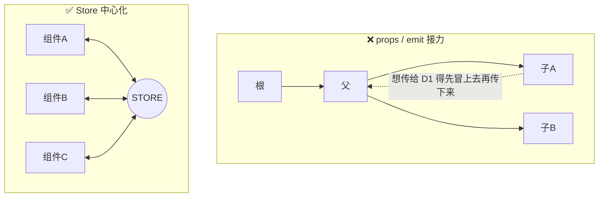


#### 核心-state、getters、actions

Pinia 把一个组件里熟悉的三样东西「抽」到仓库里：

| 组件里的东西 | Pinia 里    | 作用                                  |
| ------------ | ----------- | ------------------------------------- |
| `data`       | **state**   | 存数据（源头）                        |
| `computed`   | **getters** | 基于 state 的派生/计算值（有缓存）    |
| `methods`    | **actions** | 改 state 的方法（**同步、异步都行**） |


#### Pinia配置

安装

```
#vite-project 目录
pnpm add pinia
```

main.js

```js
import { createApp } from 'vue'
import './style.css'
import App from './App.vue'
import router from './router'
import { createPinia } from 'pinia'   // 1. 引入

const pinia = createPinia()           // 2. 创建实例

createApp(App)
  .use(pinia)                         // 3. 挂载（插件）
  .use(router)
  .mount('#app')
```


#### 定义 Pinia的Store

选项式 Option Store

```js
import { defineStore } from 'pinia'

export const useCounterStore = defineStore('counter', {
  // 数据：注意是「函数返回对象」，不是直接对象！
  state: () => ({
    count: 0
  }),
  // 派生值：像 computed，自动缓存
  getters: {
    doubleCount: (state) => state.count * 2
  },
  // 方法：用 this 访问 state
  actions: {
    increment() { this.count++ },
    decrement() { this.count-- }
  }
})
```

组合式 Setup Store（推荐）

```js
import { defineStore } from 'pinia'
import { ref, computed } from 'vue'

export const useCounterStore = defineStore('counter', () => {
  const count = ref(0)                              // ← state
  const doubleCount = computed(() => count.value * 2) // ← getter
  function increment() { count.value++ }            // ← action
  function decrement() { count.value-- }

  return { count, doubleCount, increment, decrement } // 必须 return 出去
})
```

两种写法对应关系

| 组合式                     | 选项式    |
| -------------------------- | --------- |
| `ref` / `reactive`         | `state`   |
| `computed`                 | `getters` |
| `function`                 | `actions` |
| 必须 `return` 才能被外部用 | 自动暴露  |


#### 组件中使用

store仓库内容见上衣章节

```vue
<script setup>
import { useCounterStore } from '../stores/counter'

const counter = useCounterStore()   // 拿到仓库实例
</script>

<template>
  <h1>计数：{{ counter.count }}</h1>
  <p>两倍：{{ counter.doubleCount }}</p>
  <button @click="counter.increment()">+</button>
  <button @click="counter.decrement()">-</button>
</template>
```

只要**始终带着 `counter.` 前缀**去访问，一切正常、保持响应式。


直接解构会失去响应式

```
const { count, doubleCount } = counter   // ❌
```

因为`counter`是一个响应式代理对象。解构相当于把当前这一刻的值拷出来放进普通变量，`count`变成了一个普通数字0，和仓库的代理断开了追踪，之后仓库怎么变都没法改变当前解构出来的值了


**用 `storeToRefs`**，它把 state / getters 每一项都重新包成 `ref`，恢复响应式：

```vue
<script setup>
import { storeToRefs } from 'pinia'
import { useCounterStore } from '../stores/counter'

const counter = useCounterStore()

// ✅ 数据/计算值 → 用 storeToRefs 解构，保持响应式
const { count, doubleCount } = storeToRefs(counter)

// ✅ 方法 → 直接从 store 解构就行（函数不需要响应式）
const { increment, decrement } = counter
</script>

<template>
  <h1>{{ count }} / 两倍 {{ doubleCount }}</h1>
  <button @click="increment">+</button>
</template>
```


#### 进阶语法

getters 访问其它getter

```js
export const useUserStore = defineStore('user', {
  state: () => ({ users: [{ id: 1, name: 'Tom' }] }),
  getters: {
    count: (state) => state.users.length,
    // 带参数：让 getter 返回一个函数
    getById: (state) => (id) => state.users.find(u => u.id === id)
  }
})

// 在另一个store中调用当前在useUserStore中定义的方法：userStore.getById(1)
```

Store 之间调用

```js
import { defineStore } from 'pinia'
import { useUserStore } from './user'

export const useCartStore = defineStore('cart', () => {
  function checkout() {
    const user = useUserStore()      // 直接拿另一个仓库
    console.log('下单人：', user.users)
  }
  return { checkout }
})
```


#### 底层原理

`state` 为什么必须是「函数返回对象」

Store 文件是个模块，只会执行一次。如果 `state` 是直接对象，它就成了一个**被所有地方共享的单例对象**。如果使用函数返回，每次都会在堆上开辟一块新内存，返回一个全新的对象。

```js
const state = () => ({
  count: 0
})
```


`efineStore` 返回的为什么是个「函数」`useXxxStore`，还得叫 use 开头

```js
// 定义
const useCounterStore = defineStore('counter', {
  state: () => ({ count: 0 })
})

// 使用
const store = useCounterStore()  // 要调用才能拿到 store
```

避免成为一个所有模块共享的单例对象

「Hook」性质的，命名遵循 `useXxx` 约定；


Pinia的响应式怎么来的

组合式 Store 里，写的 `ref` 就是响应式数据、`computed` 就是带缓存的派生值——**Pinia 本质就是把「一堆 `ref` + `computed` + 函数」收集起来，挂到一个全局单例上**，再包一层 `reactive` 代理，并集成 devtools、插件、SSR。


#### 插件与持久化

Pinia 状态默认存在内存里，**刷新页面就归零**。想存进 localStorage，用官方推荐插件：

```
pnpm add pinia-plugin-persistedstate
```

```js
// main.js
import { createPinia } from 'pinia'
import persist from 'pinia-plugin-persistedstate'

const pinia = createPinia()
pinia.use(persist)   // 装上插件
```

```js
// 选项式：加第三个配置
export const useCounterStore = defineStore('counter', {
  state: () => ({ count: 0 }),
  persist: true       // 自动存/取 localStorage
})
```


### vue相关组件库

1. **Vuetify** - Vuetify 是一个广受欢迎的 Vue UI 组件库，提供了广泛的材料设计组件。它非常适合快速开发，拥有丰富的组件和详细的文档。

   官网地址：https://vuetifyjs.com/en/

2. **Element Plus** - Element Plus 是 Element UI 的 Vue 3 版本，是一个面向企业级产品的组件库，它提供了一系列可配置的组件和丰富的 API。

   官网地址：https://element-plus.org/

3. **PrimeVue** - PrimeVue 是 PrimeFaces Team 针对 Vue 开发的组件库，它提供了丰富的组件和主题，适合用于各种商业应用。

   官网地址：https://primevue.org/

4. **Ant Design Vue** - 这是 Ant Design 的 Vue 实现，特别适合用于企业级应用。它提供了丰富的 Vue 组件，是构建后台应用界面的理想选择。

   官网地址：https://antdv.com/components/overview

5. **Naive UI** - 一个相对较新的 Vue 3 组件库，采用 TypeScript 编写，提供了一套完整的组件，以灵活性和轻量级著称，还被尤雨溪推荐过。

   官网地址：https://www.naiveui.com/zh-CN/os-theme

6. **BootstrapVue** - 尽管 BootstrapVue 最初是为 Vue 2 开发的，但社区已经在为支持 Vue 3 而努力。它将 Bootstrap 的功能与 Vue 的反应性相结合。

   官网地址：https://bootstrap-vue.org/

7. **Vant** - Vant 是一个轻量级、可靠的移动端 Vue 组件库，由有赞前端团队开发和维护。

   官网地址：https://vant-ui.github.io/vant/#/en-US


# vue原理

## 虚拟dom本质

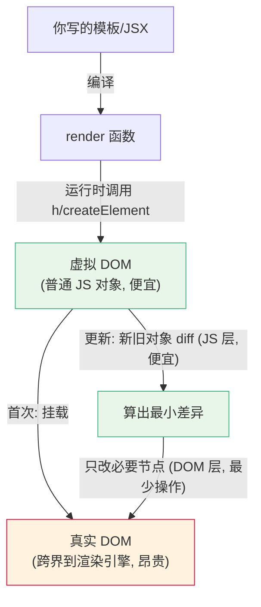


### 操作dom非常慢的原因

通信开销

JS 代码住在"JS 引擎"这个世界里，而真实 DOM 住在"渲染引擎"那个世界里，它们是两套独立的运行时系统，导致每次操作DOM都要进行一次跨系统操作，通信开销非常大。

```
        代码                JS 引擎              浏览器内核         渲染引擎
document.createElement  ──识别为 API 调用──►  ────发出请求────►   真正创建 DOM
   ('div')         ◄──────────────────────── 返回结果 ────────────────┘
```

JS 引擎（如 V8）和渲染引擎（如 Blink）都是用 C++ 写的


JS如何调用C++能力

接口定义 → C++ 实现 → 绑定层 → 注册到 JS 引擎

`document`、`createElement` 这些不是 JS 语言自带的，而是浏览器用 C++ 实现好、再通过"绑定层"暴露给 JS 的一扇扇"门"。每调一次，就是敲一次门让 C++ 那边干活。


主要原因

1. **跨界封送成本**：JS 的字符串/数字要转换成 C++ 能用的类型，来回都要翻译。
2. **DOM 对象本身很"重"**：一个真实 DOM 节点挂着上百个属性，还连着渲染树，不是一个轻飘飘的 JS 对象。
3. **可能触发重排/重绘（reflow/repaint）**：一旦你把节点接到页面上、或读取 `offsetHeight` 这类几何属性，浏览器可能被迫**同步重新计算布局**，这才是实战中最大的性能杀手。


### 真实DOM

真实 DOM 指的就是"浏览器底层（渲染引擎）已经真正调用过 C++ 的 API、在渲染树里实际存在的那个节点"。

- `{ tag: 'div' }` —— 这只是个 JS 对象，**不是**真实 DOM，渲染引擎根本不知道它存在。
- `document.createElement('div')` 的返回值 —— 这是真实 DOM，因为它是跨界让 C++ 造出来的。


### 虚拟DOM

用来描述 UI 结构的普通 JS 对象

ue 里的 `h()` 函数、React 里的 `createElement`，调用后返回的就是这么个对象，大致长这样：

```js
// h('div', { class: 'message' }, [...]) 的返回值
{
  tag: 'div',
  props: { class: 'message' },
  children: [
    { tag: 'span', props: { id: 'name' }, children: ['张三'] },
    { tag: 'span', props: null,          children: ['2024.5.6'] }
  ]
}
```

相当于先在 JS 世界里用偏移的对象把UI “画” 出来，需要时再按照草图去指挥渲染引擎干活


### 三种dom更新方式

当前前端常用的dom更改方式如下

| 方式                                   | 涉及的计算                                  | 分别在哪一层                                   |
| -------------------------------------- | ------------------------------------------- | ---------------------------------------------- |
| 原生命令式（`createElement` 一句句写） | 直接下命令造/改节点                         | 全在 **DOM 层**，无多余计算 → **单次操作最快** |
| innerHTML                              | ① 解析 HTML 字符串 → ② 创建/销毁 DOM 节点   | ① JS 层 ② DOM 层                               |
| 虚拟 DOM                               | ① 造 JS 对象 + diff 比对 → ② 只改必要的 DOM | ① JS 层 ② DOM 层                               |

JS 层的计算（造对象、比对象）是便宜的；DOM 层的计算（跨界建/删节点）是昂贵的。优化的思路就是----尽量把活留在便宜的 JS 层，把昂贵的 DOM 层操作压缩到最少。

**单次**、**直接**的 DOM 操作，命令式最快（没有中间层）。但落到**整个应用**上，纯手写命令式反而常常更慢、更容易出 bug，因为人手很难做到"只改该改的地方"，容易做一堆多余操作。虚拟 DOM 用一点 JS 层的开销，换来自动帮开发者"只改必要 DOM"的能力。


原生命令式：

```
全部就是js语句，看不到html结构，心智负担非常大
```


innerHTML更新时：

```
① 销毁整块旧 DOM（DOM 层，贵）
② 解析整段新字符串（JS 层）
③ 重新创建整块 DOM（DOM 层，贵）   ← 哪怕只有一个时间数字变了，也全部重建
```

`innerHTML` 推倒重建会**丢失当前状态**——比如输入框里正在打的字、光标位置、滚动位置、已绑定的事件监听全没了；而虚拟 DOM 只改必要节点，**这些状态原封不动**。


虚拟 DOM 更新时：

```
用 diff 比对新旧两个 JS 对象，算出"只有时间那个文本变了"（JS 层，便宜）
只执行 timeSpan.textContent = 新时间（DOM 层，只动一个节点）
```

所以，虚拟DOM真正厉害的敌方是更新，能有效防止”重渲染"阶段，因为大量不必要的操作导致性能恶化


### 虚拟 dom diff 计算

diff 就是**拿新旧两棵虚拟 DOM 树做对比，找出最小的差异，只把差异同步到真实 DOM 上**（这个过程 React 里叫 reconciliation / 协调）

```
旧虚拟DOM                        新虚拟DOM
div                              div
├─ span "张三"                   ├─ span "张三"     ← 一样，跳过
└─ span "10:00:00"               └─ span "10:00:05" ← 不一样！只补这里
```

1. **同层比较，O(n) 而非 O(n³)**：完整比较两棵树的理论复杂度是 O(n³)，无法接受。所以框架用了**启发式策略**：只比同一层级的节点，不跨层移动。这才让 diff 在实际中够快。
2. **key 的作用**：渲染列表时框架要求你写 `:key`（Vue）/ `key`（React）。key 就像每个节点的"身份证"，让 diff 能准确认出"这还是原来那个节点，只是挪了位置"，接着根据key进行一一比对，而不是傻乎乎地销毁重建。


### 性能之外的好处 

好处一：跨平台（依赖倒置）
虚拟 DOM 是一层"抽象中间层"。UI 用抽象的 JS 对象来描述，具体"渲染成什么"可以换后端：

- 换成浏览器渲染引擎 → 网页
- 换成原生渲染 → App（React Native）
- 换成 canvas / 小程序 / 服务端字符串 → 各种平台

让**描述与渲染解耦，同一份"草图"能喂给不同的"施工队"。**


好处二：框架自身能灵活升级
React 从 15 的 Stack 架构升级到 16 的 Fiber 架构，内部翻天覆地，但业务代码几乎不用改——因为虚拟 DOM 这层把"代码"和"框架内部实现"隔开了。


### "无虚拟 DOM"新趋势

Svelte、Solid.js，以及 Vue 的 Vapor（"蒸汽")模式，走的是另一条路：**在编译阶段就把组件直接编译成精准的命令式 DOM 操作代码**，运行时不需要造虚拟 DOM、也不需要 diff。


编译（compile）= 把一种代码，转换成另一种代码。

在前端框架里，具体是这样：

- 你写的 Svelte/Vue 组件（`.svelte`、`.vue` 文件）**浏览器根本看不懂**——里面混了 HTML 模板、特殊语法、`<script>` 等等。
- 所以在你**把代码部署上线之前**，会有一个工具（编译器 / 构建工具，比如 Vite）把这些文件**转换成浏览器能运行的纯 JavaScript**。

"编译阶段"就是指这个"转换代码"的时间点——在你的电脑/构建服务器上进行，发生在用户打开网页之前。


**现代前端框架**（Svelte/Vue/React 等），代码生效确实分两大阶段：

| 阶段                                | 什么时候             | 在哪里发生               | 做什么                                          |
| :---------------------------------- | :------------------- | :----------------------- | :---------------------------------------------- |
| **编译阶段**（build time / 编译时） | 写完代码、准备上线时 | 开发者的电脑或构建服务器 | 把 `.vue`/`.svelte` 等源码翻译成浏览器能懂的 JS |
| **运行时**（runtime）               | 用户打开网页时       | **用户的浏览器**         | 执行翻译好的 JS，真正在屏幕上显示、响应点击等   |


编译阶段生成dom操作代码的原理

假如在 Svelte/Vue Vapor 里写的模板长这样（伪代码）：

```vue
<button @click="count++">
  你点了 {{ count }} 次
</button>
```

编译器在编译阶段读到这段模板后，会分析它：

> "这里有个按钮，按钮里的文字包含一个会变化的 `count`。当 `count` 变了，我只需要更新这一个文字节点就行，别的都不用动。"

编译器**直接生成**类似这样的命令式 DOM 操作代码（简化示意）：

```js
// 编译器"翻译"出来的成品代码（大意）
const btn = document.createElement('button');
const text = document.createTextNode('');
btn.appendChild(text);

// 当 count 变化时，精准地只更新这个文字
function updateCount(count) {
  text.data = `你点了 ${count} 次`;
}
```

这段代码里已经明确写死了"要改哪个节点"（就是 `text`）。 这就是"编译时就算好了该改哪里"。


### 自测

1. 我们写的 `document.createElement('div')` 到底"跨"过了哪几层，为什么这一跨很贵？
2. 我们平时说的"真实 DOM"，到底指什么？
3. 虚拟 DOM 的**本质**是什么？（一句话）
4. 原生命令式 / `innerHTML` / 虚拟 DOM，三种更新 UI 的方式各自的计算发生在哪一层？
5. 虚拟 DOM 到底"快"在哪？"快"是有前提的，前提是什么？
6. diff 做的事情是什么？
7. 除了性能，虚拟 DOM 还带来什么好处？为什么又出现了"无虚拟 DOM"框架？


## 模板的本质

Vue 运行时根本不需要"模板"。它只认"渲染函数"和渲染函数产出的"虚拟 DOM"。模板只是写给人看的、更省心的"语法糖"，会被"模板编译器"翻译成渲染函数。


### 渲染函数 `h()`

调用后返回一个普通对象

```js
h(type, propsOrNull, childrenOrText)
//  ↑标签名/组件   ↑属性&事件对象   ↑字符串(文本) 或 数组(子节点)
```


`h()` 不碰真实 DOM，它只是"造一个描述对象"然后返回。这个对象就是虚拟 DOM（VNode）：

```js
h('div', { class: 'box' }, [ h('h2', null, 'John') ])

// 返回 ↓（简化版）

{ 
  type: 'div', 
  props: { class: 'box' }, 
  children: [ 
    { 
      type: 'h2', 
      props: null, 
      children: 'John' 
    } 
  ] 
}
```


### 形成渲染函数的三条路径

```
路径①  <template>...</template>
          │  （编译阶段：vue-compiler 把模板编译成 render 函数）
          ↓
路径②  setup() { return () => h(...) }
          │  （自己手写 render 函数，无需编译）
          ↓
路径③  render() { return h(...) }
          │  （Vue2 经典写法，也是手写 render 函数）
          ↓
    ┌─────────────────────────┐
    │   render 函数（渲染函数） │  ← 运行时真正需要的东西
    └─────────────────────────┘
          ↓
       返回 VNode（虚拟 DOM）
          ↓
       挂载 / patch 成真实 DOM
```


### 编译模板 ＝字符串处理

对编译器来说，模板 = 一个字符串

开发者眼里：

```html
<div><h1 :id="someId">Hello</h1></div>
```

编译器眼里：

```js
'<div><h1 :id="someId">Hello</h1></div>'   // 就是一串字符
```

"模板编译"本质上是一道 **字符串处理题**：输入一个字符串，输出一段 JS 代码字符串。


### 字符串 → 渲染函数

解析器→转换器→生成器

- **解析器**：先把字符串切成一个个 **token**（记号），再用 token 拼出**模板 AST**。

每一步的输入都是上一步的输出。


字符串 →(解析器)→ 模板AST →(转换器)→ JS AST →(生成器)→ 渲染函数

比如下面这个简单模板：

```html
<div><span>Hi</span></div>
```

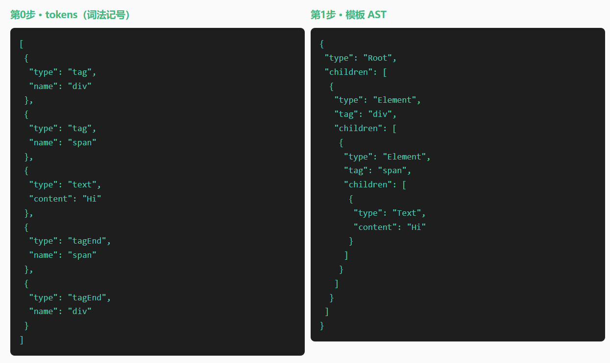

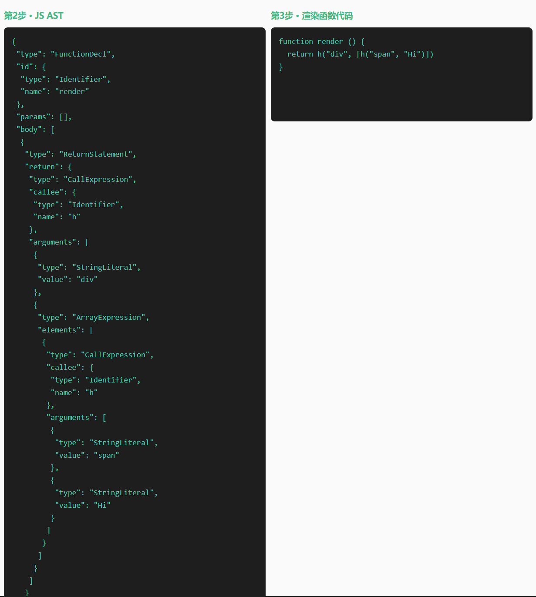


两种 AST

|              | 模板 AST                                      | JS AST                                                       |
| ------------ | --------------------------------------------- | ------------------------------------------------------------ |
| 描述的是     | "模板长什么样"                                | "JS 代码长什么样"                                            |
| 节点类型举例 | `Root` / `Element` / `Text`                   | `FunctionDecl` / `CallExpression` / `StringLiteral`          |
| 例子         | `{ type:'Element', tag:'p', children:[...] }` | `{ type:'CallExpression', callee:{name:'h'}, arguments:[...] }` |


### 编译时机

|              | 运行时编译              | 预编译                       |
| ------------ | ----------------------- | ---------------------------- |
| 发生在       | 浏览器里、页面运行时    | 打包构建时（你的电脑上）     |
| 典型场景     | CDN 直接引入 Vue        | Vite/Webpack 工程化项目      |
| 浏览器拿到的 | 模板 + 编译器，现场编译 | **纯渲染函数，完全没有模板** |
| 代价         | 每次都要编译，慢、包大  | 运行时零编译成本，包小       |

引入CDN就是运行时编译


### 预编译优势

编译器能做手写 `h()` 做不到的优化：

- **静态提升 hoistStatic**：不会变的节点被提到渲染函数外面，只创建一次。
- **patchFlag**：给动态节点打标记（比如"只有文本会变"），运行时更新时**只检查被标记的地方**，静态部分直接跳过。
- **block tree**：整棵静态子树在 diff 时被跳过。


### 对比无虚拟DOM

|            | 有虚拟 DOM                              | 无虚拟 DOM（如 Solid.js / Vue Vapor）             |
| :--------- | :-------------------------------------- | ------------------------------------------------- |
| 编译产物   | 模板 → **渲染函数**（返回 VNode 树）    | 模板 → **直接 DOM 操作代码**                      |
| 运行时更新 | 新旧 VNode 树 **diff** → patch 真实 DOM | **跳过 diff**，直接调用具体 DOM API               |
| 响应式粒度 | 通常是**组件级**重新渲染                | 可以做到**绑定级**（单个表达式对应单个 DOM 节点） |
| 内存开销   | 每次渲染都创建 VNode 对象               | 无 VNode 对象分配                                 |


### 自测

| #    | 知识点                                                     | 达标标准                                                     |
| ---- | ---------------------------------------------------------- | ------------------------------------------------------------ |
| 1    | 渲染函数 `h()` 是什么、返回什么                            | 能说出它返回一个普通对象（VNode），并手写一个                |
| 2    | 模板 / `setup` 返回 render / options `render` 三种写法等价 | 能把一个模板改写成 `h()` 形式                                |
| 3    | 对编译器来说，模板只是一个"字符串"                         | 理解"编译"就是字符串→代码的转换                              |
| 4    | 三段式流水线：解析器→转换器→生成器                         | 能说出每一段的输入和输出                                     |
| 5    | 两种 AST：模板 AST vs JS AST，为什么要 AST                 | 能说清两者区别，以及"为什么不直接拼字符串"                   |
| 6    | 编译时机：运行时编译 vs 预编译                             | 能说出各自发生在什么时候、浏览器拿到的是什么                 |
| 7    | 预编译为什么更好（含编译期优化）                           | 能说出体积/性能/安全，以及"静态提升、patchFlag"              |
| 8    | 怎么亲眼看到编译结果                                       | 会用 Template Explorer / vite-plugin-inspect / 我给你的演示页 |


## 组件树和虚拟DOM树


### DOM树

DOM 树就是浏览器把 HTML 解析后，在内存中创建的、可以用 JavaScript 操作的树形对象结构


 HTML 是这样的文本：

```html
<html>
  <body>
    <div id="app">
      <h1>标题</h1>
      <p>段落</p>
    </div>
  </body>
</html>
```

浏览器解析这段文本后，会在**内存中**创建一个对应的**对象结构**，这个结构就叫 **DOM 树**。

```
Document
└── html
    └── body
        └── div#app
            ├── h1
            │   └── "标题"（文本节点）
            └── p
                └── "段落"（文本节点）
```

每一个节点都是一个 **JavaScript 对象**，有属性和方法，比如：

```js
document.getElementById('app')  // 拿到 div 节点对象
div.children      // 子节点
div.style.color   // 样式
div.textContent   // 文本内容
```

```js
// 虚拟 DOM 节点就是个普通对象
{ tag: 'div', props: { id: 'app' }, children: [...] }

// 真实 DOM 节点是浏览器的 C++ 对象，操作成本高得多
document.createElement('div')
```


### 组件的本质

组件 = 结构(模板/DOM) + 状态(data) + 行为(methods/逻辑)

每个组件实例的状态是相互隔离的


组件 = 把"一段 UI + 它自己的状态 + 它自己的逻辑"打包成一个**可复用、状态隔离**的单元。


### 组件树&虚拟DOM树

组件树的一个节点 = 虚拟DOM树的一整颗子树

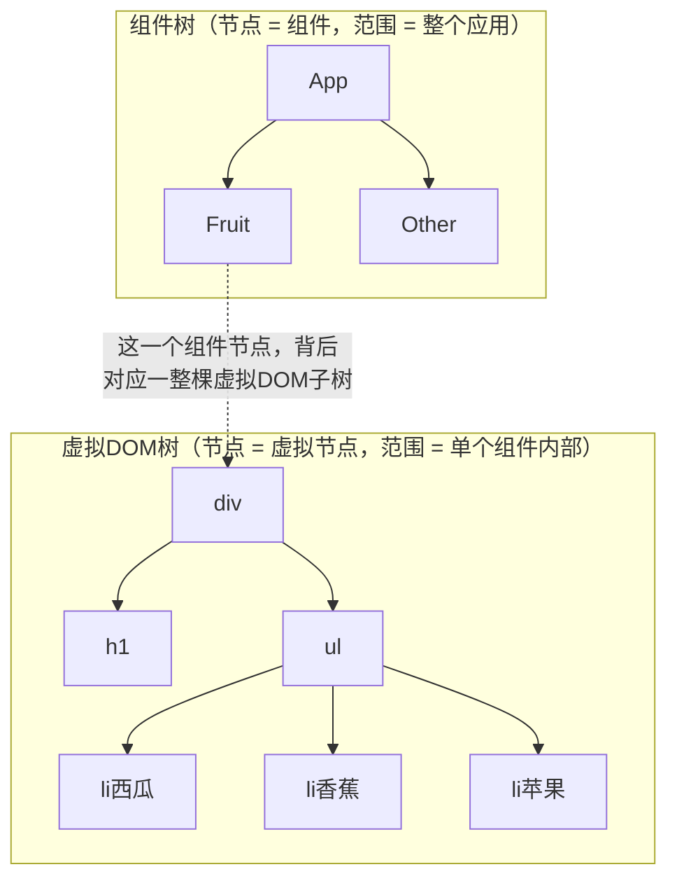


### 响应式三件套

- **`defineReactive`**：拦截读写操作，把数据变成响应式。
- **`Dep`（发布者）**：每个响应式数据配一个 Dep，负责**收集**订阅者（谁用了数据）、数据变了就**通知**订阅者执行副作用。
- **`Watcher`（订阅者）**：谁用了数据谁就是 watcher，定义“数据变了要做什么”，被通知后重新执行。

最小可运行内核：

```js
let activeWatcher = null;                 // 用一个变量存储当前正在求值的 watcher

// 发布者：每个数据一个
class Dep {                               
  constructor() { this.subs = new Set(); } // subs：订阅者集合（用 Set 自动去重）
  depend()  { if (activeWatcher) this.subs.add(activeWatcher); } // 读时收集
  notify()  { this.subs.forEach(w => w.update()); }             // 写时通知
}

// 把属性变"响应式"
function defineReactive(obj, key) {       
  let val = obj[key];
  const dep = new Dep();              // ← 每个属性一个专属 dep
  Object.defineProperty(obj, key, {
    get() { dep.depend(); return val; },              // 读 → 收集依赖
    set(v) { if (v === val) return; val = v; dep.notify(); }  // 写 → 通知更新
  });
}

// 订阅者
class Watcher {                           
  constructor(fn) { this.fn = fn; this.run(); }
  run()    { activeWatcher = this; this.fn(); activeWatcher = null; }
  update() { this.run(); }                // 数据变了 → 重新执行
}
```

**关系**：数据 ↔ Dep 是**一对一**；Dep ↔ Watcher 是**一对多**（同一个数据被引用多次，就有多个 watcher 订阅它）


defineReactive参数，obj是要处理的对象，key是要变成响应式的属性名

```js
defineReactive(data, "name");  // 把 data.name 变为响应式
defineReactive(data, "age");   // 把 data.age 变为响应式
```

Watcher中

- `fn`：定义“数据变了要做什么”
- `run()`：
  1. 把自己挂到全局 `activeWatcher`
  2. 执行 `fn()`，触发属性的 `get` → `dep.depend()` → 把自己收集进去
  3. 执行完后清空 `activeWatcher`


完整运行示例

```js
const data = { name: "Alice", age: 18 };
defineReactive(data, "name");
defineReactive(data, "age");

new Watcher(() => {
  console.log(`姓名: ${data.name}, 年龄: ${data.age}`);
});
// 立即输出: 姓名: Alice, 年龄: 18

data.name = "Bob";   // 数据改变，Watcher输出: 姓名: Bob, 年龄: 18
data.age = 20;       // 数据改变，Watcher输出: 姓名: Bob, 年龄: 20
```


### watcher (订阅者)的"粒度"

Vue 1.x —— 细粒度：模板引用几次，就建几个 watcher

```html
<div class="msg1">{{ msg }}</div>   <!-- watcher 1 -->
<div class="msg2">{{ msg }}</div>   <!-- watcher 2 -->
```

`msg` 变了 → 它的 Dep 直接通知 watcher1、watcher2 → 两个 watcher **各自精准改自己那个文本节点**。

- 优点：**精准**，直接命中，根本不需要 diff。
- 缺点：引用越多，watcher 越多。一个复杂应用成千上万个引用 → **watcher 爆炸 → 内存吃紧**。


Vue 2.x —— 组件级：整个组件只建 1 个 watcher

同样两个 `{{ msg }}`，但现在整个组件共用**一个 render watcher**（它的 fn 就是组件的 render 函数）：

```
msg 变 → 通知那唯一的 render watcher → 重新执行 render()
       → 产出一棵新虚拟DOM → 和旧的 diff → 找出真正变的节点 → patch
```

- 优点：watcher 恒为 1，**极省内存**。
- 代价：watcher 只知道"**这个组件**要更新了"，**却不知道组件内部具体哪个节点变了**——所以整个组件的虚拟DOM都要重新diff一遍。


两者分工的思维

**响应式**精确到**组件级**（回答"哪个**组件**要更新"）→ 对应**组件树**。

**虚拟DOM + diff** 精确到**节点级**（回答"这个组件里**哪个节点**要更新"）→ 对应**虚拟DOM树**。

一个负责"哪棵树要动"，一个负责"树上哪片叶子要动"。**这正是为什么 Vue 要同时保留响应式和虚拟DOM**


Vue3.x

Vue3 的架构没变，还是"响应式 + 虚拟DOM"，但两处都换了引擎：

(1) 响应式：`Object.defineProperty` → `Proxy`

(2) diff：从"全量比对" → "编译器提前留小抄"
Vue2 的 diff 要**从头到尾遍历整棵虚拟DOM树**。Vue3 因为**同时掌握编译器和运行时**，能在编译模板时就把"哪里是死的、哪里是活的"标注出来，运行时直接抄近路。

- **静态提升 (hoistStatic)**：`<h1>标题</h1>` 这种永远不变的，只创建一次，之后 diff 直接跳过。
- **patchFlag（补丁标记）**：`<p>{{ msg }}</p>` 编译后带个标记 `1 /* TEXT */`，告诉运行时"这节点**只有文本会变**，别的属性别检查了"。
- **block tree（树打平）**：把整棵树里所有"会变的节点"抽出来拉平成一个数组，更新时**只遍历这个数组**，静态节点根本不进入 diff。


现在的无虚拟DOM新趋势

Vue1 那种"细粒度、无虚拟DOM"的精准，如今又回来了。SolidJS、Svelte 5、以及 Vue 官方正在做的 Vapor Mode，都在抛弃虚拟DOM，回到细粒度响应式。


### 自测

| #    | 知识点                                                    | 课件是否覆盖 | 掌握程度要求                  |
| ---- | --------------------------------------------------------- | ------------ | ----------------------------- |
| 1    | DOM 树是什么                                              | ✅            | 知道即可                      |
| 2    | 组件的本质                                                | ⚠️ 不完整     | **需补充**：不只是"DOM 复用"  |
| 3    | 组件树 vs 虚拟DOM树（两棵不同的树）                       | ✅            | **必须分清**                  |
| 4    | 响应式三件套：`Object.defineProperty` / `Dep` / `Watcher` | ✅            | **必须理解发布订阅**          |
| 5    | Vue1.x：细粒度 watcher，无虚拟DOM                         | ✅            | **必须理解"精准但费内存"**    |
| 6    | Vue2.x：组件级 watcher + 虚拟DOM diff                     | ✅            | **本课核心**                  |
| 7    | 为什么需要"响应式 + 虚拟DOM"两者并存                      | ✅            | **本课灵魂**                  |
| 8    | Vue3.x：Proxy + 优化的 diff                               | ⚠️ 太笼统     | **需补充**：diff 到底优化了啥 |
| 9    | 历史钟摆：细粒度响应式的回归（Signals / Vapor）           | ❌            | 加分项，帮你看清大局          |


## 数据拦截的本质


### vue为什么需要

普通对象读写是"直达"的：

```js
const obj = { name: "张三" };
obj.name;          // 直接读
obj.name = "李四"; // 直接写
```

数据拦截 = 在正真的读写之前/之后插入自己的逻辑

Vue 要做到"数据一变，视图自动更新"。它的做法就是把每个数据的读写都拦截：

- 拦截"读"(get) → 依赖收集：记住"谁（哪个组件/effect）用到了数据"
- 拦截"写"(set) → 派发更新：通知所有用到数据的地方"数据变了，快重新渲染"


### Object.defineProperty

vue2使用该方法进行数据拦截

具体内容在JS笔记里，这里简要说明

```js
Object.defineProperty(obj, prop, descriptor);
```

给对象添加新属性

参数：

- obj：要添加属性的对象
- prop：要添加的属性名
- descriptor：属性描述符对象

描述符分类

| 类型       | 字段                          | 作用                                |
| ---------- | ----------------------------- | ----------------------------------- |
| 数据属性   | `value` / `writable`          | 存值、是否可写                      |
| 访问器属性 | `get` / `set`                 | 读/写时触发的函数（拦截靠这俩）     |
| 公共       | `enumerable` / `configurable` | 可枚举 / 可配置(可删除、可改描述符) |

用 `defineProperty` 定义属性时，`writable/enumerable/configurable` 默认全是 `false`。

经常要手动补 `enumerable: true, configurable: true`，否则属性"读不到、删不掉"。


用 get/set 拦截例子：

```js
function Student() {
  let stuName = "张三";           // 真正存值的地方（闭包变量）
  Object.defineProperty(this, "name", {
    get() { return stuName; },
    set(value) {
      stuName = isNaN(value) ? value : "张三";
    },
  });
}
```


### Proxy

vue3更换为Proxy进行代理

具体去JS笔记查看

```
const p = new Proxy(target, handler);
```

- `target` —— 是要包装的对象，可以是任何东西，包括函数。
- `handler` —— 一个**普通对象**，里面可以定义一系列**捕捉器方法（traps）**，用来拦截对 `target` 对象的各种操作。
- 返回：**代理对象**，之后所有读写都要走代理 `p`，操作原对象是不会被拦截的


客户 → 代理 → 本体，后面所有操作都是通过代理去碰

```js
const obj = { name: "张三", data: "一些数据" };
const p = new Proxy(obj, {
  get(target, prop) {
    console.log(`读取 ${prop}`);
    return target[prop];
  },
  set(target, prop, value) {
    console.log(`设置 ${prop}`);
    target[prop] = value;
    return true;            // set 必须返回 true
  },
});
```


### Proxy、defineProperty区别

共同点

- 都能拦截读写
- 都能做深度（嵌套对象）拦截，但都要开发者自己写递归


差异

| 维度            | `Object.defineProperty`          | `Proxy`                                                   |
| --------------- | -------------------------------- | --------------------------------------------------------- |
| 拦截目标        | 对象的**某个具体属性**           | **整个对象**                                              |
| 拦截行为        | 只有属性读/写                    | 读、写、删、`in`、`Object.keys`、原型操作、函数调用…13 种 |
| 新增属性        | ❌ 拦不到（只对已存在的属性生效） | ✅ 天然拦得到                                              |
| 删除属性        | ❌ 拦不到                         | ✅ `deleteProperty`                                        |
| 数组下标/length | ❌ 基本无能为力（下详）           | ✅ 拦得到                                                  |
| 初始化          | 需递归遍历，深对象慢             | 懒代理，用到才递归                                        |
| 兼容性          | IE9+                             | 不支持 IE，无法 polyfill                                  |


### Vue2缺陷

`Object.defineProperty` 对数组"下标赋值"和"改 length"无能为力：

```js
// Vue2 中
this.arr[0] = 100;   // ❌ 视图不更新
this.arr.length = 0; // ❌ 视图不更新
this.arr.push(4);    // ✅ 更新（因为 Vue 重写了 push）
```

给数组的每个下标都装 getter/setter 性能太差（数组可能上万项）。所以 **Vue2 的方案是"重写 7 个数组方法"**：`push / pop / shift / unshift / splice / sort / reverse`——调这些方法时手动派发更新。

这就是vue2中，`vue.$set`语法存在的意义：对象新增属性、数组下标修改，`defineProperty` 拦不到，只能用 `Vue.set` 手动补一次响应式处理。


### Proxy性能优势

defineProperty 初始化是递归全量遍历，对象越深、属性越多越慢，且首屏一次性开销大。

 Proxy 是惰性的——只有真正访问到某层嵌套对象时才代理它，没访问的分支永远不代理，因此初始化更快、内存更省。


直观说明

```
// 假设这是数据
const data = {
  user: {
    profile: {
      address: {
        city: "Beijing"  // 深层嵌套
      }
    }
  }
}
```

`defineProperty` 的初始化：对每个属性递归调用 `defineProperty`

```
Vue 2 启动时 ↓

遍历 data          ✅ 处理
遍历 data.user     ✅ 处理
遍历 data.user.profile        ✅ 处理
遍历 data.user.profile.address        ✅ 处理
遍历 data.user.profile.address.city   ✅ 处理

← 不管用不用，全部递归处理完才结束
```

`Proxy` 的初始化：**只有一句 `new Proxy(data, handler)`**，深层对象在 `get` 被触发时才会被动态包一层 Proxy。

```
Vue 3 启动时 ↓

只代理 data 这一层  ✅ 处理（仅此而已）

之后：
你访问 data.user          → 此刻才代理 user
你访问 data.user.profile  → 此刻才代理 profile
你从未访问 address        → 永远不处理 ❌（省了）
```


`Proxy` 推荐配合 `Reflect`

```js
const p = new Proxy(obj, {
  get(target, prop, receiver) {
    return Reflect.get(target, prop, receiver);   // 正确处理继承/getter 中的 this
  },
  set(target, prop, value, receiver) {
    return Reflect.set(target, prop, value, receiver); // 自带返回布尔值
  },
});
```


### 自测

1. **数据拦截是什么、为什么需要**（和 Vue 响应式的关系）
2. `Object.defineProperty` 的语法 + 6 个描述符（数据属性 vs 访问器属性，为什么互斥）
3. 为什么 setter 里不能直接写 `obj[key] = value`（无限递归陷阱）
4. `Proxy` 的语法 + `target/handler` + 常用捕获器（trap）
5. 两者**共同点**：都能拦截读写、都能靠递归做深度拦截
6. 两者**差异点**（重点）：拦截广度、新增属性、数组、性能
7. **Vue2 的缺陷**到底缺在哪，`Vue.set` 为什么存在
8. （补充）`Proxy` 里为什么推荐配合 `Reflect`


## 响应式数据


### 两种机制

响应式数据 = 被拦截的对象。

对对象做操作（读/写/删/增）时，中间插入自己的逻辑，可以做"额外的事"（收集依赖、通知更新）。


JS 里只有两种东西能架关卡：

**`Object.defineProperty`** —— 把某个属性变成"访问器属性"，只能拦 **这一个特定属性** 的**读**和**写**

```js
const obj = {};
let real = 1;
Object.defineProperty(obj, 'value', {
  get() { console.log('拦到读取'); return real; },
  set(v) { console.log('拦到赋值'); real = v; }
});
obj.value;      // 拦到读取
obj.value = 5;  // 拦到赋值
obj.foo;        // ❌ 拦不到，foo 没被 define
delete obj.value; // ❌ delete 不走 get/set
```

局限：必须提前知道属性名、拦不了新增/删除。


**`Proxy`** —— 代理整个对象，任意成员的 **读 / 写 / 新增 / 删除** 全能拦：

```js
const p = new Proxy({ a: 1 }, {
  get(t, k)      { console.log('读', k);  return Reflect.get(t, k); },
  set(t, k, v)   { console.log('写', k);  return Reflect.set(t, k, v); },
  deleteProperty(t, k) { console.log('删', k); return Reflect.deleteProperty(t, k); }
});
p.a;      // 读 a
p.b = 2;  // 写 b（新增也走 set）
delete p.a; // 删 a
```

这就是 `ref` 和 `reactive` 的两块基石


### `ref` 的构造

源码里 `RefImpl` 的关键就两行：给对象加一个 `get value()` / `set value()`，并且 如果传进来的是对象，就用 `toReactive` 转成 `reactive`（Proxy）：

```js
class RefImpl {
  constructor(value) {
    // 是对象 → reactive(Proxy)；是原始值 → 原样存
    this._value = toReactive(value);
  }
  get value() { /* 收集依赖 */ return this._value; }
  set value(v){ /* 派发更新 */ this._value = toReactive(v); }
}
const toReactive = v => isObject(v) ? reactive(v) : v;
```

由此推出 `ref` 的拦截规律：

- **唯一被拦的入口是 `.value`**（读或写）。

- `ref(基本类型)`：只有 `.value` 会拦。给它挂别的属性（`state.a`）是"编外属性"，**不拦**。

- `ref(对象)`：第一词拦截发生在访问 `.value` 时，位置是`state.value`，`RefImpl` 上的 **getter 访问器**进行拦截，第二次拦截发生在访问 `.a` 时，位置是`state.value.a`，**Proxy**（即 reactive 代理）的 get 进行拦截。

  ```js
  代码：const state = ref({ a: 1 })
  
  内存里长这样：
  
  ┌─────────────────────────────────┐
  │  RefImpl 实例 (state)           │
  │                                 │
  │  .value ──────────────────────► Proxy({ a: 1 })   ← 第②层：reactive()
  │           ↑                          │
  │       访问器拦截                      └─ 访问 .a 时触发 Proxy 的 get
  │       (第①层拦截)                
  └─────────────────────────────────┘
  ```


### `reactive` 的构造

`reactive` 只用 Proxy

```js
const state = reactive({});
state.a = { b: { c: 3 } };   // 存进去的是"生的"普通对象，还没被代理
state.a.b.c;  // 直到你访问 state.a，get 陷阱里才把 {b:{c:3}} 临时包成 Proxy
```

Proxy是惰性包装


### 判断是否被拦截

第一步：只有两种入口会拦截：

- 一个 `ref` 对象的 **`.value`**
- 一个 **Proxy 代理对象** 的成员

第二步：操作类型是"读 / 写 / 删 / 增"才可能被 handler 抓到。

第三步：链式访问逐段拆，一段一段判断。 `a.b.c` 拆成"读 a、读 b、读 c"分别看。


### 依赖收集与派发更新

- 依赖收集：所谓依赖收集，其实就是收集的一些函数。因为当数据发生变化的时候，需要重新执行这些函数，因此需要提前收集起来。
- 派发更新：所谓派发更新，就是通知被收集了的函数，现在数据已经更新了，你们需要重新执行一遍。


依赖

**响应式数据**和**函数**之间有依赖关系。**当函数在运行期间用到了响应式数据，那么我们可以称之为两者之间有依赖**。


建依赖吗？ —— 过三扇门：

```
是「被监控函数」吗?（watchEffect/watch/render/effect）  ──否──▶ 不建依赖
       │是
读取在「同步执行期间」吗? (await 后不算) ──否──▶ 不建依赖
       │是
这次读取「被拦截」吗? (ref.value / reactive 成员) ──否──▶ 不建依赖
       │是
   ✅ 记下一条依赖：(对象, 属性)
```


### 自测

| #    | 知识点                     | 会 = 能回答                                                  |
| ---- | -------------------------- | ------------------------------------------------------------ |
| 1    | 响应式数据的本质           | "响应式数据 = 被拦截的对象" 这句话为什么成立                 |
| 2    | 两种拦截机制               | `Object.defineProperty`（访问器属性）vs `Proxy`（陷阱）分别拦什么 |
| 3    | `ref` 的内部构造           | 为什么必须写 `.value`；`ref(对象)` 时内部藏了个 `reactive`   |
| 4    | `reactive` 的内部构造      | 为什么是 Proxy；为什么是"惰性"包装嵌套对象                   |
| 5    | 判断拦截                   | 拿任意一行代码判断会不会拦截（核心技能）                     |
| 6    | 什么是「用到」（依赖成立） | 能判断一次读取**有没有被拦截**——这是全课的判断核心           |
|      |                            |                                                              |
|      |                            |                                                              |
|      |                            |                                                              |


## 响应式驱动组件渲染

主要链路

```
改数据 → trigger 派发 → 把「组件的更新任务」入队 queueJob →（本轮同步代码跑完）→ 微任务里冲刷 flushJobs → render 重新执行得到新 vnode → patch/diff 比对新旧 → 只改真正变了的那一个真实 DOM 节点。
```

`render` 就是「读了响应式数据的那个被监控函数」，所以数据一变它就被安排重跑；但**为了合并抖动，重跑被推迟到微任务**；重跑产出新 vnode 后，**diff 保证只动该动的节点**。


### 模板的本质 = render 函数

Vue 的 `<template>` 不是直接操作 DOM 的，它会被**编译器**转成一个 JS 函数（render 函数），这个函数执行后返回**虚拟 DOM**（一个描述真实 DOM 的普通 JS 对象）。

下面就是编译产物：

```js
function _sfc_render(_ctx, _cache, $props, $setup, $data, $options) {
  return (_openBlock(), _createElementBlock(_Fragment, null, [
    _createElementVNode("div", _hoisted_1, _toDisplayString($setup.name), 1 /* TEXT */),
    _createElementVNode("div", _hoisted_2, _toDisplayString($setup.age),  1 /* TEXT */)
  ], 64 /* STABLE_FRAGMENT */))
}
```

- `_createElementVNode("div", ...)` 就是"创建一个描述 `<div>` 的虚拟 DOM 节点"。
- 所以 **模板 `{{ name }}` ≈ `_toDisplayString($setup.name)`**，一个字符串插值变成了函数里的一次**读取**。


### 响应式原理

读时收集、写时触发

**track（依赖收集）**：当**读**取一个响应式属性时，Vue把用这个属性的函数记下来，放到属性对应的依赖列表中

**trigger（触发更新）**：当**写**这个响应式属性时，Vue找到这个属性所对应的依赖列表，把依赖列表中的所有函数全部执行一遍


最小版响应式实现

```js
// ===== 极简响应式系统：演示"读时收集、写时触发" =====
let activeEffect = null; // 当前正在运行的函数（对应 render）

function reactive(obj) {
  const depMap = new Map(); // key -> Set<effect>  每个属性一组依赖它的函数

  return new Proxy(obj, {
    get(target, key) {
      if (activeEffect) {                       // 有函数正在运行
        if (!depMap.has(key)) depMap.set(key, new Set());
        depMap.get(key).add(activeEffect);      // 【track】把这个函数记为 key 的依赖
      }
      return target[key];
    },
    set(target, key, value) {
      target[key] = value;
      const effects = depMap.get(key);
      if (effects) effects.forEach(fn => fn());  // 【trigger】重跑所有依赖它的函数
      return true;
    }
  });
}

function watchEffect(fn) {   // 模拟"被监控的函数"，比如 render
  activeEffect = fn;
  fn();                      // 首次运行 → 触发 get → 完成依赖收集
  activeEffect = null;
}
```

模拟vue组件

```js
const state = reactive({ name: 'Bill', age: 18 });

// 把这个函数当作 render：它"读"了 name 和 age
watchEffect(() => {
  console.log(`虚拟DOM = <div>${state.name}</div><div>${state.age}</div>`);
});

// 现象：下面每改一次，上面的"render"就自动重跑一次
state.name = 'Tom';  // 自动打印新结果
state.age = 20;      // 自动打印新结果
```


### render与响应式

1. render 函数执行时，读了 `state.name`（章节 1：`{{name}}` → 读取）。
2. 读取触发 `get` 拦截，此时 Vue 正好记录着"当前运行的是这个 render"，于是把 render 存进 `name` 的依赖表（章节 2：track）。
3. 关联建立完成。以后 `name` 一变，走 `set` → trigger → render 重跑。


### vue2/3的diff算法

章节：组件树和虚拟DOM树 → watcher“粒度”


组件级：

一个组件对应一个更新 effect"。所以 A 组件用的数据变了，只会拽回 A 组件的 effect 重跑，B 组件**完全不动**。


节点级（diff算法）：

一个组件重跑 render 会得到**整棵**新虚拟 DOM，然后依靠diff算法对比新旧虚拟DOM()

- Vue2：双端 diff
- Vue3：快速 diff

vue的编译优化让 diff 更快：

- `1 /* TEXT */` 叫 **PatchFlag（补丁标记）**：编译时就标好"这个 div 只有**文本**是动态的"。diff 时 Vue 只比对文本，`class`、`id` 等静态部分**直接跳过**。
- `_hoisted_1` / `_hoisted_2` 叫 **静态提升**：静态的属性对象被提到 render 函数**外面**，只创建一次，重跑 render 时复用，不再重复创建。
- `_openBlock()` + `64 /* STABLE_FRAGMENT */`：**Block Tree**，把动态节点收集进一个数组，diff 时**只遍历动态节点数组**，跳过所有静态节点。

总之就是diff时，跳过不变的东西，只diff动态内容


### 组件间数据共享原理

**一个响应式数据可以被多个组件的 render 同时读取**，于是它进了多个组件的依赖表；它一变，多个组件一起被 trigger 重跑。

```js
const store = reactive({ count: 0 });

// 模拟组件 A 的 render：读了 count
watchEffect(() => console.log('组件A 渲染, count =', store.count));
// 模拟组件 B 的 render：也读了 count
watchEffect(() => console.log('组件B 渲染, count =', store.count));

store.count++;   // 现象：A 和 B 两个"render"都自动重跑了！
```

把响应式数据抽出来 → 多组件依赖 → 一处改动，多处更新

所以裸 reactive 就能共享


### Pinia的价值

裸 `reactive` 对象**能**共享数据，但 Pinia 在它之上补了工程价值

**能力层面**（课件已列）：开发工具 devtools 支持、热替换 HMR、插件机制、自动补全、SSR 友好。

**语义层面**（课件的点，很重要）：

- 一个裸 `reactive` 对象，语义上"可能是任何东西"，读代码的人不知道它是不是全局状态。
- 一个 Pinia store，语义上就是明确的"**全局共享状态仓库**"，降低心智负担、提升可读性。


能记多少记忆多少，不重要


### 自测

| #    | 能回答的问题                                           |
| ---- | ------------------------------------------------------ |
| 1    | 模板到底是什么？为什么说它"本质是一个函数"？           |
| 2    | 响应式的本质是什么？"依赖关系"是怎么建立起来的？       |
| 3    | render 函数和响应式数据是**怎么关联**上的？谁监控谁？  |
| 4    | 为什么 Vue 的更新是"组件级"的？精准到具体节点靠什么？  |
| 5    | 为什么把响应式数据抽出来就能实现跨组件数据共享？       |
| 6    | 既然裸 `reactive` 就能共享，Pinia 多出来的价值是什么？ |


## 实现响应式系统

### 监听读写(Proxy + Reflect)

响应式的第一要素是"监听数据读写"。JS 里能拦截对象读写的只有两种方案:

|                 | [Object.defineProperty](vscode-file://vscode-app/c:/Application/Microsoft VS Code/8a7abeba6e/resources/app/out/vs/code/electron-browser/workbench/workbench.html) | [Proxy](vscode-file://vscode-app/c:/Application/Microsoft VS Code/8a7abeba6e/resources/app/out/vs/code/electron-browser/workbench/workbench.html) (本课采用) |
| --------------- | ------------------------------------------------------------ | ------------------------------------------------------------ |
| 拦截粒度        | 只能拦 **已知属性** 的 get/set                               | 拦 **整个对象** 的 13 种操作                                 |
| 新增/删除属性   | ❌ 拦不到                                                     | ✅ has/ deleteProperty                                        |
| 数组下标/length | ❌ 需 hack                                                    | ✅ 原生支持                                                   |
| 遍历 `for...in` | ❌                                                            | ✅ ownKeys                                                    |

这就是 Vue3 抛弃 Vue2 的 `defineProperty`


类型判断 → 查缓存 → 建代理

```js
const proxyMap = new WeakMap(); // 原始对象 -> 代理对象

export function reactive(target) {
  if (!isObject(target)) return target;        // ① 不是对象,原样返回
  if (proxyMap.has(target)) return proxyMap.get(target); // ② 代理过就复用
  const proxy = new Proxy(target, handlers);   // ③ 建代理
  proxyMap.set(target, proxy);
  return proxy;
}
```

- 懒代理：只有当真正读到某个对象成员时,才把它转成响应式:

  ```js
  const result = Reflect.get(target, key);
  if (isObject(result)) return reactive(result); // 用到才代理,省性能
  ```

- `proxyMap` 缓存保证 reactive(obj) === reactive(obj),同一个对象不会被代理两次。

  


### track本质

二层 `depsMap`(属性 → 函数集合)

读的时候记下"谁在读"(track),写的时候通知"所有读过的人"(trigger)

```js
let activeEffect = null;          // 中间人:当前正在执行的函数
const depsMap = new Map();        // key -> Set<fn>

function track(target, key) {     // 收集器:读时调用
  if (!activeEffect) return;
  let deps = depsMap.get(key);
  if (!deps) depsMap.set(key, deps = new Set());
  deps.add(activeEffect);         // 把"当前函数"记到这个 key 名下
}

function trigger(target, key) {   // 触发器:写时调用
  depsMap.get(key)?.forEach(fn => fn());
}

function effect(fn) {
  activeEffect = fn;   // ① 先把自己登记为"当前函数"
  fn();                // ② 执行,期间读属性 -> 触发 track -> 收集到自己
  activeEffect = null; // ③ 收工,清空
}


```

`activeEffect` 是整个系统的"灵魂":`track` 是在 `get` 拦截器里被动触发的,它根本不知道是哪个函数在读。所以 `effect` 先把函数塞进全局的 `activeEffect`,`track` 就能"顺藤摸瓜"拿到它。


### effect 进化 —— 三个 bug,三个补丁

最终代码

```js
export let activeEffect = undefined;
const effectStack = [];  // 补丁③:函数栈

export function effect(fn, options = {}) {
  const environment = () => {              // 补丁①:环境函数
    try {
      activeEffect = environment;
      effectStack.push(environment);       // 补丁③:入栈
      cleanup(environment);                // 补丁②:先清旧依赖
      return fn();
    } finally {
      effectStack.pop();                   // 补丁③:出栈
      activeEffect = effectStack[effectStack.length - 1]; // 恢复上一层
    }
  };
  environment.deps = [];
  environment.options = options;
  if (!options.lazy) environment();
  return environment;
}
```

**补丁①**: environment 环境函数(解决"重新执行不再收集")

- Bug:第一版 activeEffect = fn 收集的是裸函数。数据变化后 trigger 重新执行的是 fn,但此时 activeEffect 已是 null,track 里 if(!activeEffect) 直接 return,再也收集不到依赖。
- 补丁:收集的不再是裸 fn,而是包了一层的 environment。它第一行就重设 activeEffect = environment,所以每次重新执行都能重新进入收集流程。

**补丁②**:cleanup解决"分支切换,旧依赖残留")

- Bug:

  ```js
  effect(() => { state.a === 1 ? state.b : state.c }); // a=1 收集 a,b
  state.a = 2; // 现在应该收集 a,c,但 b 的旧依赖还在
  ```

- 补丁:每次执行 fn 前先 cleanup,把自己从所有旧的 Set 里删掉,再重新收集。environment.deps 数组就是"我被哪些 Set 收录了"的反向记录:

  ```js
  export function cleanup(environment) {
    environment.deps.forEach(dep => dep.delete(environment));
    environment.deps.length = 0;
  }
  ```

**补丁③**:effectStack(解决"嵌套 effect")

- **Bug**:effect(外 () => { effect(内) ; state.b })。内层执行完把 activeEffect 置为 `null`,导致外层后面读的 state.b收集不到。
- **补丁**:用**栈**模拟调用层级。内层出栈后,`activeEffect`恢复成栈顶(外层),外层继续正常收集。


### 解决边读边写 effectFn === activeEffect

state.a = state.a + 1,读 a 又写 a，写a又触发读a，无限循环......

跳过"正在跑的自己"

```js
effect(() => { state.a = state.a + 1; }); // 读 a(收集自己)→ 写 a(触发自己)→ 又读又写…💥
```

```js
for (const effectFn of effectFns) {
  if (effectFn === activeEffect) continue; // 正在执行的就是我自己,跳过,断开死循环
  ...
}
```


### 四层数据结构

章节：依赖收集本质

依赖收集结构二层够用，但有个缺陷:无法区分不了**"你是怎么读的"**。看最终的四层结构:

```
targetMap (WeakMap)   对象      -> propMap
  propMap (Map)       属性 key  -> typeMap
    typeMap (Map)     操作类型  -> depSet     ← 关键新增的这一层
      depSet (Set)              -> 依赖函数们
```


如果想精确更新，就要在写操作发生时，去通知哪些“会受影响”的读操作。

```
state.a          // GET：我想知道 a 的值
'a' in state     // HAS：我想知道 a 这个键存不存在
for (k in state) // ITERATE：我想知道有哪些键
```

- `GET` 关心：**某个键的值**
- `HAS` 关心：**某个键存不存在**
- `ITERATE` 关心：**键的集合**


写法不同的影响

| 写操作   | 发生了什么               | 举例                          |
| :------- | :----------------------- | :---------------------------- |
| `SET`    | **改已有键的值**，键没变 | `state.a = 999`（a 本来就有） |
| `ADD`    | **新增一个键**           | `state.c = 3`（c 是新的）     |
| `DELETE` | **删除一个键**           | `delete state.a`              |


 分析triggerTypeMap(操作类型层)

```js
const triggerTypeMap = {
  [SET]:    [GET],                 // 只改值，键没变
  [ADD]:    [GET, ITERATE, HAS],   // 新增键
  [DELETE]: [GET, ITERATE, HAS],   // 删除键
};
```

**SET → 只通知 GET**

> `state.a = 999`，键 `a` 还在，只是值变了
>
> - `GET` 受影响 ✅（值变了，你要重新读）
> - `HAS` 不受影响 ❌（`'a' in state` 结果没变，还是 true）
> - `ITERATE` 不受影响 ❌（键的集合没变，`for...in` 结果一样）

**ADD → 通知 GET + HAS + ITERATE**

> `state.c = 3`，`c` 是全新的键
>
> - `GET` 受影响 ✅（现在 `state.c` 有值了）
> - `HAS` 受影响 ✅（`'c' in state` 从 false 变成了 true）
> - `ITERATE` 受影响 ✅（键的集合多了一个）

**DELETE → 通知 GET + HAS + ITERATE**（和 ADD 对称，略）


例子

```js
effect(() => { for (const k in state) console.log(k); });
//  ↑ 这个函数走 ITERATE 通道收集依赖

state.a = 999;  // SET 操作 → 只触发 GET 依赖
                // ITERATE 不在 SET 的通知名单里 → 遍历函数不重跑 ✅

state.c = 3;    // ADD 操作 → 触发 GET + HAS + ITERATE 依赖
                // ITERATE 在 ADD 的通知名单里 → 遍历函数重跑 ✅
```


### 自测

| 知识点                               | 核心问题(能答上来就算掌握)                                   |
| ------------------------------------ | ------------------------------------------------------------ |
| Proxy / Reflect / reactive 入口      | 为什么用 Proxy 不用 `defineProperty`?为什么要递归?为什么要缓存? |
| track / trigger / activeEffect       | 依赖收集的本质是什么?[activeEffect](vscode-file://vscode-app/c:/Application/Microsoft VS Code/8a7abeba6e/resources/app/out/vs/code/electron-browser/workbench/workbench.html) 这个全局变量凭什么能"配对"函数和数据? |
| environment / cleanup / effectStack  | 三个各解决什么 bug?(重新收集 / 分支切换 / 嵌套)              |
| effectFn === activeEffect            | [state.a = state.a + 1](vscode-file://vscode-app/c:/Application/Microsoft VS Code/8a7abeba6e/resources/app/out/vs/code/electron-browser/workbench/workbench.html) 为什么会死循环?怎么断? |
| 四层结构 + 操作类型 + triggerTypeMap | 为什么要分 get/has/iterate 三种类型?新增属性为什么要触发 iterate? |
|                                      |                                                              |
|                                      |                                                              |


## 手写computed


### 响应式地基

| 函数         | 干什么                                             | 一句话     |
| ------------ | -------------------------------------------------- | ---------- |
| `effect(fn)` | 把函数变成「副作用」，运行时自动记录它读了哪些数据 | 谁在读数据 |
| `track`      | 读数据时：把「当前 effect」收进依赖表              | 收集依赖   |
| `trigger`    | 改数据时：把依赖表里的 effect 拿出来重跑           | 派发更新   |


### computed用法

首先回顾一下 computed 的基本用法：

```js
import { reactive, computed } from 'vue'

const state = reactive({
  a: 1,
  b: 2
})

const sum = computed(() => {
  return state.a + state.b
})

console.log(sum.value) // 3

state.a = 10
console.log(sum.value) // 12

// ❌ 不能写入，会报警告
// sum.value = 100
```

可写入：

```js
import { ref, computed } from 'vue'

const firstName = ref('John')
const lastName = ref('Doe')

const fullName = computed({
  // 读取时触发
  get() {
    return firstName.value + ' ' + lastName.value
  },
  // 赋值时触发
  set(newValue) {
    ;[firstName.value, lastName.value] = newValue.split(' ')
  }
})

console.log(fullName.value) // 'John Doe'

// ✅ 可以写入，会触发 setter
fullName.value = 'Zhang San'
console.log(firstName.value) // 'Zhang'
console.log(lastName.value)  // 'San'
```


### 1、参数规范化

统一两种computed调用方式

```js
computed(() => a + b)  // 方式一：传函数
computed({ get() {…}, set(v) {…} })  // 方式二：传对象
```

```js
/**
 * computed 的参数规范化
 * @param {Function | {get:Function, set:Function}} getterOrOptions - getterOrOptions 可以是一个函数，也可以是一个对象
 * @returns {{getter: Function, setter: Function}}
 */
function normalizeParameter(getterOrOptions) {
  let getter, setter;
  if (typeof getterOrOptions === "function") {
    getter = getterOrOptions;                    // 传函数 → 它就是 getter
    setter = () => console.warn("没有 setter");  // 只读，写了就警告
  } else {
    getter = getterOrOptions.get;                // 传对象 → 拆出 get/set
    setter = getterOrOptions.set;
  }
  return { getter, setter };
}
```


### 2、惰性 + 缓存

`lazy effect` + `dirty` 开关

这是 `computed` 区别于普通函数的第一层价值

```js
let value;          // 缓存上次算出来的结果
let dirty = true;   // 缓存脏了吗？true=需要重算，false=直接用缓存

// lazy effect：getter 里的数据会和它建立依赖，但不立即执行
const effectFn = effect(getter, { lazy: true });

const obj = {
  get value() {
    if (dirty) {          // 脏了才真正计算
      value = effectFn(); // 手动跑一次 getter
      dirty = false;      // 算过就标记为「干净」
    }
    return value;         // 没脏就直接�∵返回缓存
  },
};
```

`dirty` 是一个「脏标记」。第一次读时它是脏的，算一次并缓存；之后再读，只要没人动过依赖，就一直吃缓存，不重算。


### 3、订阅者更新

`computed` 有两副面孔：

- **对内是订阅者**：它的 getter 读了 `state.a/b`，所以它订阅了 state。
- **对外是发布者**：渲染函数读了 `computed.value`，所以渲染函数订阅了它。

数据变化要「接力」：`state` 变 → 通知 computed → computed 再通知渲染函数。


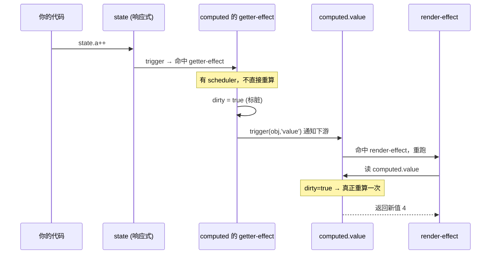


`scheduler` 接第一棒

```js
const effectFn = effect(getter, {
  lazy: true,
  scheduler() {
    if (!dirty) {
      dirty = true;                              // ① 缓存标脏
      trigger(obj, TriggerOpTypes.SET, "value"); // ② 通知依赖我的人
    }
  },
});
```


`get value` 里接第二棒

`trigger(obj, …)` 想通知别人，前提是先有人被「收集」进来。所以读 `.value` 时补一句 `track`：最后返回新值

```js
get value() {
  track(obj, TrackOpTypes.GET, "value");  // 谁在读我(如渲染函数)，就把它收进来
  if (dirty) { value = effectFn(); dirty = false; }
  return value;
}
```


## 手写watch


### watch用法

第一个参数可以传：响应式对象 / getter函数

第二个参数可以传回调


监听单个ref

```js
const count = ref(0)

// 监听单个ref
watch(count, (newVal, oldVal) => {
  console.log(`count: ${oldVal} → ${newVal}`)
})
```


监听getter函数

```js
const x = reactive({
  a: 1,
  b: 2
})

// 监听单个属性
watch(
  () => x.a,
  (newA, oldA) => {
    console.log(`a: ${oldA} → ${newA}`)
  }
)

// 监听计算结果
watch(
  () => x.a + x.b,
  (sum) => {
    console.log(`sum is: ${sum}`)
  }
)
```


### 从0手写

数据流动

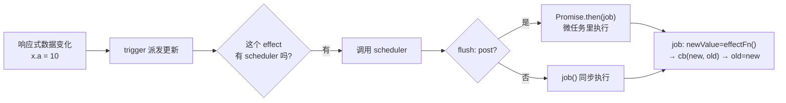


① 参数归一化 —— 不管你传 getter 还是响应式对象，统一成一个 [getter](vscode-file://vscode-app/c:/Application/Microsoft VS Code/8a7abeba6e/resources/app/out/vs/code/electron-browser/workbench/workbench.html) 函数，后面逻辑就只面对一种情况：

```js
let getter;
if (typeof source === "function") getter = source;          // watch(() => x.a+x.b, cb)
else getter = () => traverse(source);                        // watch(state, cb) 深度遍历
```


② 准备新旧值格子： let oldValue, newValue;


③ 把「要干的活」提成 `job` —— 重新取值 → 回调 → 沉淀旧值：

```js
const job = () => {
  newValue = effectFn();   // 重跑 getter 拿最新值
  cb(newValue, oldValue);  // 交给你的回调
  oldValue = newValue;     // 这次的新值，成为下次的旧值
};
```


④ 用 lazy effect 包住 getter,scheduler 接管「变化后做什么」：

```js
const effectFn = effect(() => getter(), {
  lazy: true,
  scheduler: () => {
    if (options.flush === "post") Promise.resolve().then(job); // 进微任务，晚于同步代码
    else job();                                                // 默认同步
  },
});
```


⑤ immediate 与首次取值：

```js
if (options.immediate) job();          // 立即回调一次（此时 oldValue 是 undefined）
else oldValue = effectFn();            // 不回调，但要跑一次 getter：收集依赖 + 记录初始旧值
```


⑥ 返回停止函数： [return () => cleanup(effectFn);


### 完整实现

```js
// ============================================================
// 从零手写 Vue 的 watch
// 一句话心法：watch = 一个 lazy 的 effect + 一个 scheduler。
//   - lazy effect：负责"读一遍数据"，把依赖收集起来；
//   - scheduler：负责"数据变了之后做什么"——也就是重新取值 + 调用你的回调。
// 只要前面的响应式系统（effect/track/trigger）写好了，watch 就水到渠成。
// ============================================================

import { effect, cleanup } from "./reactivity/effect.js";

/**
 * @param {Function | Object} source  要侦听的源：可以是 getter 函数，也可以是响应式对象
 * @param {Function} cb                变化时执行的回调：(newValue, oldValue) => {}
 * @param {{immediate?: boolean, flush?: 'post'|'sync'}} options 选项
 * @returns {Function} 调用它可停止侦听（unwatch）
 */
export function watch(source, cb, options = {}) {
  // 【第 1 步：参数归一化】无论用户传什么，都统一成一个 getter 函数。
  // 后面的逻辑就只需要面对"函数"这一种情况，非常清爽。
  let getter;
  if (typeof source === "function") {
    // 用户直接传了 getter，例如 () => x.a + x.b
    getter = source;
  } else {
    // 用户传了一个响应式对象，例如 watch(state, cb)。
    // 用 traverse 把它"从里到外读一遍"，好让每个嵌套属性都被依赖收集（深度侦听）。
    getter = () => traverse(source);
  }

  // 【第 2 步：准备两个格子，装新值和旧值】
  let oldValue, newValue;

  // 【第 3 步：把"真正要干的活"提取成 job】
  // 干三件事：重新取最新值 → 把新旧值交给回调 → 让这次的新值成为下次的旧值。
  const job = () => {
    newValue = effectFn(); // 手动重跑 getter，拿到最新值
    cb(newValue, oldValue); // 调用用户回调，传入新旧值
    oldValue = newValue; // 新值沉淀为下一次的旧值
  };

  // 【第 4 步：用 lazy effect 包住 getter，并交出 scheduler 掌管"变化后做什么"】
  // - lazy: true  → 创建时不立即执行，何时执行由我们说了算
  // - scheduler   → 依赖变化时，trigger 不会直接重跑 effect，而是调用这个函数
  const effectFn = effect(() => getter(), {
    lazy: true,
    scheduler: () => {
      // flush: 'post' —— 把 job 丢进微任务队列，
      // 等当前同步代码（以及 Vue 的 DOM 更新）都结束后再执行回调。
      if (options.flush === "post") {
        Promise.resolve().then(job);
      } else {
        // 默认（含 'sync'）：同步立即执行
        job();
      }
    },
  });

  // 【第 5 步：immediate 与首次取值】
  if (options.immediate) {
    // 配了 immediate：立刻先跑一次回调（此时还没有旧值，oldValue 是 undefined）
    job();
  } else {
    // 没配 immediate：也要先跑一次 getter。
    // 目的有二：① 完成第一次依赖收集；② 把首次结果记为"旧值"，供下次对比。
    oldValue = effectFn();
  }

  // 【第 6 步：返回"停止侦听"的函数】
  // 把 effectFn 从所有依赖集合里摘掉，之后数据再变也不会触发回调。
  return () => {
    cleanup(effectFn);
  };
}

/**
 * 深度遍历一个对象，把所有嵌套属性都"读"一遍，从而触发它们的依赖收集。
 * @param {*} value 要遍历的值
 * @param {Set} seen 已访问集合，防止对象循环引用导致的死递归
 */
function traverse(value, seen = new Set()) {
  // 不是对象 / 是 null / 已经访问过 → 没必要再往下钻，直接返回
  if (typeof value !== "object" || value === null || seen.has(value)) {
    return value;
  }

  // 标记为已访问
  seen.add(value);

  // 遍历每个属性：读取 value[key] 这个动作会触发 get → 依赖收集
  for (const key in value) {
    traverse(value[key], seen);
  }

  return value;
}

```


## 指令的本质


### vue阶段

```mermaid
flowchart LR
    A["模板 template<br/>(给人看的语法糖)"] -->|编译时 compile| B["渲染函数 render()<br/>(纯 JS)"]
    B -->|运行时 runtime| C["虚拟 DOM<br/>VNode"]
    C -->|挂载/更新| D["真实 DOM"]
```

- **模板**是给开发者用的"友好外壳"，里面的 `v-if`、`v-for`、`<slot>` 都只是**书写约定**。

- 真正执行的是**渲染函数**。图里看到的 `_sfc_render` 就是它

  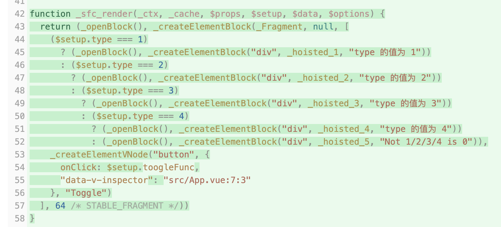

指令和插槽的本质指的就是：这些语法糖被编译成立什么JS代码


### 逐个指令：编译前 → 编译后

| 指令                        | 模板写法                | 编译产物（本质）                                             |
| --------------------------- | ----------------------- | ------------------------------------------------------------ |
| `v-if / v-else-if / v-else` | `<div v-if="type===1">` | **三目运算符** `type===1 ? h('div',...) : type===2 ? ... : ...` |
| `v-for`                     | `v-for="(p,i) in list"` | **`_renderList(list, (p,i) => h('li',...))`**                |
| `v-bind`                    | `<div v-bind:id>`       | props 对象里的属性 `{ id: $setup.id }`                       |
| `v-on`                      | `@click="count++"`      | props 对象里的 `{ onClick: $event => count++ }`              |
| `v-html`                    | `<div v-html="raw">`    | props 里的 `{ innerHTML: raw }`                              |
| `{{ }}` 插值                | `{{ product.name }}`    | `_toDisplayString(product.name)`                             |

v-if：`$setup.type === 1 ? (...) : $setup.type === 2 ? (...) : ...` —— 纯三目，**没有任何叫 "v-if" 的东西**。


v-for：核心是 `_renderList($setup.products, (product, index) => {...})`。`renderList` 是运行时的一个内部辅助函数（源码 `packages/runtime-core/src/helpers/renderList.ts`），它本质就是对数组做 `map`，每一项返回一个 VNode。

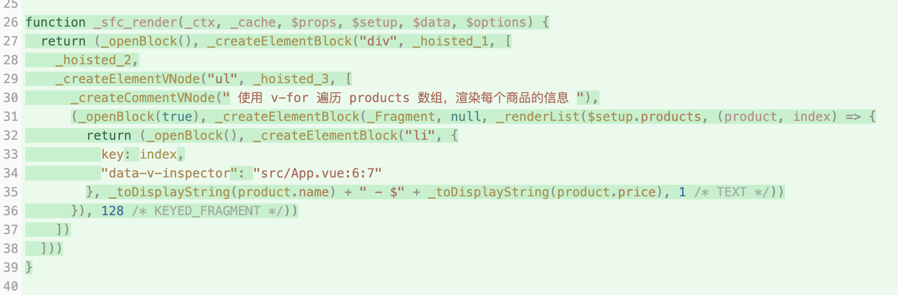


v-bind：`{ id: $setup.id }` —— 就是把响应式值放进了 VNode 的 props 对象。

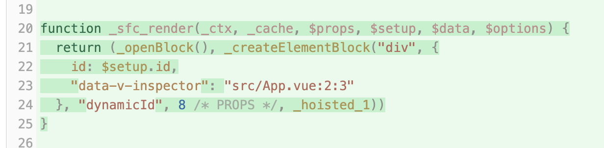


渲染函数在一个 effect 里执行。`$setup.type`、`$setup.id`、`$setup.products` 都是响应式数据，读取时会**track**收集依赖；值变化时**trigger**，重新执行渲染函数 → 生成新 VNode → diff → 更新 DOM。


### 自测

-  能说清"编译时 vs 运行时"两个阶段
-  能默写 v-if→三目、v-for→renderList、v-bind→props属性、v-on→onXxx、v-html→innerHTML
-  能解释"值变了为什么重渲染"（接响应式 track/trigger）


## 插槽的本质


### 插槽 = 函数（返回 VNode）

插槽就是"父组件传给子组件的一组函数"

**父组件**这样写：

```vue
<Card>
  <template #header="{ title }">
    <h1>{{ title }}</h1>
  </template>
  <template #default>
    <p>正文内容</p>
  </template>
</Card>
```

**编译产物**（本质）——传给子组件的第三个参数就是一个**对象，值全是函数**：

```js
_createVNode(Card, null, {
  header: _withCtx(({ title }) => [
    _createElementVNode("h1", null, _toDisplayString(title), 1)
  ]),
  default: _withCtx(() => [
    _createElementVNode("p", null, "正文内容")
  ]),
  _: 1
})
```

可以看作是这样：插槽就是父组件传递给子组件的一组函数

```js
{
  default: function(){ return /* VNode */ },
  header:  function(){ return /* VNode */ },
}
```

更本质一点，父组件会给子组件传递一个插槽对象，插槽名为键，创建VNode的函数为值，也就是“插槽对象”


**子组件**这样写：

```vue
<div class="card">
  <div class="card-header">
    <slot name="header" :title="title"></slot>
  </div>
  <div class="card-body">
    <slot></slot>
  </div>
</div>
```

**编译产物**——`<slot>` 编译成 `renderSlot(...)`：

```js
_renderSlot($slots, "header", { title: $setup.title })  // 具名 + 传数据
_renderSlot($slots, "default")                           // 默认插槽
```

`renderSlot` 的核心逻辑（源码 `packages/runtime-core/src/helpers/renderSlot.ts`）简化后就是：

```js
function renderSlot(slots, name, props = {}) {
  const slotFn = slots[name]        // 取出父组件传来的那个函数
  return slotFn ? slotFn(props) : fallback  // 调用它，把 props 作为实参传进去
}
```


### 三种插槽，一个本质

三种插槽的区别仅仅只是“调函数时传不传参”的区别

| 插槽类型   | 子组件调用                | 说明                               |
| ---------- | ------------------------- | ---------------------------------- |
| 默认插槽   | `slots.default()`         | 不传参                             |
| 具名插槽   | `slots.header()`          | 按名字取函数再调                   |
| 作用域插槽 | `slots.header({ title })` | **调用时传参**，参数流回父组件模板 |

作用域插槽，需要子组件传递数据在父组件模板里用

远视力：`renderSlot(slots, "header", { title: 子组件的数据 })`，子组件把自己的数据作为**实参**传进了那个函数。而这个函数是父组件写的（`({ title }) => ...`），所以父组件的模板就能通过解构 `{ title }` 拿到子组件的数据。

**作用域插槽 = 子组件调用父组件给的函数时，顺手把数据当参数递过去。**


### 手写插槽函数

`<slot>` 标签只是 `slots.xxx()` 调用的语法糖

```js
setup(_, { slots }) {                 // slots 就是父组件传来的"函数对象"
  const deaultSlotsVNode = slots.default()          // 调默认插槽函数 → VNode
  let headerSlotsVnode = null
  if (slots.header) {
    headerSlotsVnode = slots.header({ title: title.value })  // 调具名+作用域插槽，传数据
  }
  // ...兜底默认内容
  return () => h('div', ..., [
    h('div', ..., headerSlotsVnode),   // 把拿到的 VNode 放进结构里
    h('div', ..., deaultSlotsVNode)
  ])
}
```


### 自测

-  能说出"插槽 = 父传给子的一组函数，函数返回 VNode"
-  能写出插槽对象结构 `{ default: fn, header: fn }`
-  能解释 `<slot>` = `renderSlot` = 调函数拿 VNode
-  能用"调用时传参"统一解释三种插槽
-  能说清作用域插槽数据为什么"来自子组件"


## v-model本质

v-model 的本质 = 一条向下的数据流（value/prop） + 一条向上的事件流（event 把值赋回去）


### 原生表单v-model

和表单元素绑定

```vue
<template>
  <div>
    <p>输入的内容为：{{ message }}</p>
    <input type="text" v-model="message" placeholder="请输入内容" />
  </div>
</template>

<script setup>
import { ref } from 'vue'
const message = ref('Hello')
</script>
```


```js
import { vModelText as _vModelText } from "vue"

_withDirectives(
  _createElementVNode("input", {
    type: "text",
    // ① 向上：input 事件把新值赋回 message
    "onUpdate:modelValue": $event => (($setup.message) = $event),
    placeholder: "请输入内容"
  }, null, 512 /* NEED_PATCH */),
  [
    // ② 向下：靠这个"运行时指令"把 message 的值写进 DOM 的 el.value
    [_vModelText, $setup.message]
  ]
)
```

- **向下**：`[_vModelText, $setup.message]` 这个指令在 `mounted/updated` 钩子里执行 `el.value = message`。当 message 变 → 渲染函数重跑 → 指令的绑定值变 → 指令把新值写回 `el.value`。
- **向上**：`vModelText` 指令内部还偷偷帮你监听了原生 `input` 事件（以及中文输入法的 `compositionstart/compositionend`），事件触发时读取 `el.value`、处理 `.trim/.number` 修饰符，再调用上面的 `onUpdate:modelValue` 把值赋回 message。

因为原生控件 API 不统一：`<input>` 用 `value`+`input`，`checkbox` 用 `checked`+`change`，`select` 又不一样，还要处理中文输入法。指令把这些差异全封装了。所以 Vue 针对不同元素编译出不同指令：`vModelText / vModelCheckbox / vModelRadio / vModelSelect / vModelDynamic`。


### 组件上的 v-model

父组件 `<RatingComponent v-model="rating" />` 编译成：

```js
_createVNode(RatingComponent, {
  modelValue: $setup.rating,                       // ① 向下：传 modelValue prop
  "onUpdate:modelValue": $event => (($setup.rating) = $event)  // ② 向上：监听 update:modelValue
})
```

**组件上没有指令**，就是干干净净的 "一个 prop + 一个事件监听"。因为组件的接口是统一的 props/events，不需要指令去抹平差异。

如果**不用** `defineModel`，子组件手写版就是：

```js
const props = defineProps(['modelValue'])
const emit = defineEmits(['update:modelValue'])

function setRating(newRating) {
  emit('update:modelValue', newRating)  // 触发向上的事件
}
// 模板里用 props.modelValue 显示
```


### defineModel

`const model = defineModel()` 不只是"prop + event"，它还给你一个**可读可写、且和父组件自动同步的本地 ref**：

- 读 `model.value` → 拿到 `props.modelValue`
- 写 `model.value = x` → 自动 `emit('update:modelValue', x)`

编译后大致是：

```js
props: { modelValue: {}, modelModifiers: {} },
emits: ["update:modelValue"],
setup(__props, { emit }) {
  const model = useModel(__props, "modelValue") // 官方内部 helper，返回一个"写就 emit"的特殊 ref
  return { model }
}
```


### 具名 & 多个 v-model

使用

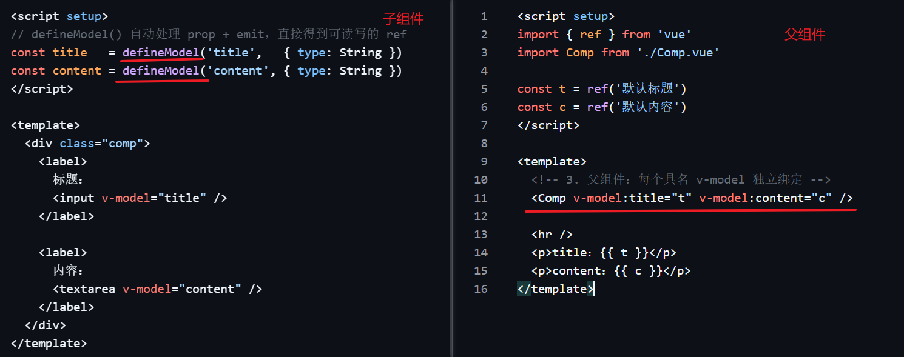


```vue
<Comp v-model:title="t" v-model:content="c" />
```

展开为两组：`title` prop + `update:title` 事件、`content` prop + `update:content` 事件。子组件里 `const title = defineModel('title')`。规律：**`v-model:xxx` → prop 名 = `xxx`，事件名 = `update:xxx`**。


### 自测

| #    | 知识点                                                 | 会了的标准                          |
| ---- | ------------------------------------------------------ | ----------------------------------- |
| 1    | 双向 = 向下数据 + 向上事件                             | 能手写出 v-model 的展开形式         |
| 2    | **原生元素**和**组件**上的 v-model 是**两套不同机制**  | 能说出各自编译成什么                |
| 3    | 原生元素靠**运行时指令**（vModelText 等）而非 `:value` | 能解释编译产物里为什么没有 `value:` |
| 4    | 组件上 = `modelValue` prop + `update:modelValue` 事件  | 能手写子组件的 props/emits 版       |
| 5    | `defineModel` 只是宏，展开成 prop + event + 本地 ref   | 能说出它比手写多做了什么            |
| 6    | 具名 v-model & 多个 v-model                            | 会 `v-model:title` 的展开           |


## setup 语法标签的本质


### 演进链

- **Options API**：`data/methods/computed` 分散，逻辑按"选项种类"组织，一个功能拆到好几处 → 难复用。
- **早期 setup()**：Composition API，逻辑可以按"功能"聚在一起、抽成组合函数复用。**代价**：要手动 `return` 一大堆东西给模板。
- **defineComponent**：只是给 TS 用的**类型辅助**，本质没变。
- **`<script setup>`**：省掉 return、宏简化 props/emits、导入自动可用 → **纯 DX（开发体验）提升**。


### `<script setup>`语法糖

`<script setup> 组件编译后 ≈ 一个 defineComponent({ setup() {...} })：`

```js
// 你写的 <script setup>
const props = defineProps({ initialTasks: { type: Array, required: true } })
const emit  = defineEmits(['task-completed'])
const tasks = ref([...])
const addTask = () => { /* ... */ }
```

编译后大致：

```js
export default {
  props: { initialTasks: { type: Array, required: true } },  // ← defineProps 变这里
  emits: ['task-completed'],                                  // ← defineEmits 变这里
  setup(__props, { emit }) {
    const props = __props
    const tasks = ref([...])
    const addTask = () => { /* ... */ }
    // ↓ 顶层变量被编译器自动收集，暴露给渲染函数（你没写 return，编译器写了）
    return { tasks, addTask, props, emit }
  }
}
```

- `defineProps/defineEmits` **不是函数调用**，是**编译宏**：编译后被"挪"到 `props`/`emits` 选项上，然后**从代码里消失**。所以它们**不用 import**、不能写在条件里、不能包在函数里。
- **没写 `return`**，是编译器自动收集顶层变量 return 的 → 这就是"自动暴露给模板"的真相。


### setup补充

`setup` 是 **Composition API 的入口**，运行时机在**所有生命周期钩子之前**（在 `beforeCreate` 之前），它**替代**了 `beforeCreate`/`created`。把它叫"入口函数"比"生命周期钩子"更准确。

**setup 里没有 `this`**（是 `undefined`）。因为它执行时组件实例还没完全建好。这也是为什么 Options API 用 `this.xxx`，而 setup 里直接用变量。

 **Vue 3.5+ 已把"响应式 props 解构"转正**，可以直接 `const { initialTasks } = defineProps(...)` 而不丢响应式（编译器会处理）。两种都行，知道即可。


### expose暴露

这里需要先解释一下什么是 expose：

>一般来讲，父组件管理父组件的数据和方法，子组件管理子组件的数据和方法，如果涉及到通信，那么通过 props 的方式来进行传递。但如果一个组件通过 ref 获取到组件实例，在早期的 Composition API 中，能够拿到组件内部所有数据和方法的。

Vue 提供了一个名为 expose 的方法，由组件自己来决定，如果外部拿到我这个组件实例，我能暴露哪些成员给对方。

```js
export default {
  setup(props, { emit, expose }) {
    expose({
      // 要暴露的成员
    })
  }
}
```

而到了 setup 标签写法中，则**默认行为就是不向外部暴露任何的成**员。如果想要暴露某个成员，仍然是通过 expose 的方式，这里会涉及到一个 defineExpose 的宏。

```js
defineExpose({
  // 要暴露的成员
})
```

使用

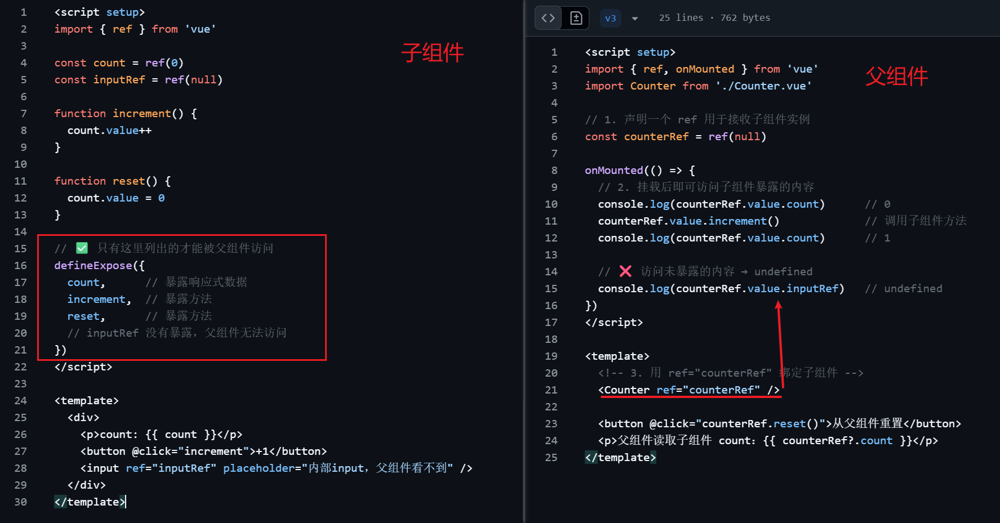


### 自测

| #    | 知识点                                                       | 会了的标准                      |
| ---- | ------------------------------------------------------------ | ------------------------------- |
| 1    | 演进链：Options → setup() → defineComponent → `<script setup>` | 能说出每步解决什么问题          |
| 2    | `<script setup>` 是**编译期语法糖**，运行时=普通 `setup()`   | 能把它"反编译"成 setup() 写法   |
| 3    | 顶层变量**自动暴露**给模板（不用 return）                    | 知道靠编译器收集顶层绑定        |
| 4    | `defineProps/Emits/Model/Expose` 是**编译宏**，非运行时函数  | 知道它们编译后消失、不用 import |
| 5    | setup 里**没有 `this`**，运行时机在 `beforeCreate` 之前      | 能解释为什么没有 this           |
| 6    | `<script setup>` **默认不对外暴露**任何成员                  | 知道要 `defineExpose`           |


## 组件生命周期

### 生命周期全景

```
渲染器遇到组件
   │
   ├─ setup()            ← 组合式 API，最早执行
   ├─ beforeCreate       ← 实例创建前（此时拿不到 data/methods）
   │  [初始化选项式 API：把 data 变成响应式、装配 methods/computed…]
   ├─ created            ← 实例创建后（能拿到数据，但没 DOM）
   │  [模板编译：有预编译模板就用，没有就即时编译]
   ├─ beforeMount        ← 挂载前（还没有真实 DOM）
   │  [初始渲染：创建并插入真实 DOM]
   ├─ mounted            ← 挂载后（真实 DOM 已生成，能操作）
   │
   │   —— 之后进入「响应式待命」状态 ——
   │
   ├─ 数据变化 → beforeUpdate → [重新渲染 + 打补丁] → updated
   │
   └─ 组件被移除 → beforeUnmount → [卸载] → unmounted
```


| 阶段      | 钩子                          | 此刻能做什么                                      | 此刻 **不能** 做什么                         |
| --------- | ----------------------------- | ------------------------------------------------- | -------------------------------------------- |
| 创建后    | `created` / `setup`           | 读写响应式数据、发首屏请求                        | ❌ 操作 DOM（还没有）                         |
| 挂载后    | `mounted`                     | 操作真实 DOM、初始化第三方库（图表/地图）、加监听 | —                                            |
| 更新前    | `beforeUpdate`                | 拿到**更新前**的旧 DOM                            | —                                            |
| 更新后    | `updated`                     | 拿到**更新后**的新 DOM                            | ❌ 别在这里改会再次触发渲染的数据（易死循环） |
| 卸载前/后 | `beforeUnmount` / `unmounted` | 清定时器、解绑事件、取消订阅                      | —                                            |


### 生命周期本质

生命周期：在合适的时机调用用户设置的回调函数

```js
function mountComponent(vnode, container, anchor) {
  const options = vnode.type
  // ① 先把用户写的钩子从选项对象里「取出来」
  const { render, data, beforeCreate, created,
          beforeMount, mounted, beforeUpdate, updated } = options

  beforeCreate && beforeCreate()          // ← 就是在这一行调用

  const state = reactive(data())          // 初始化响应式数据（选项式 API）
  const instance = { state, isMounted: false, subTree: null }
  vnode.component = instance

  created && created.call(state)          // ← 数据好了，DOM 还没，所以 created 能读数据

  effect(() => {                          // 这个 effect 就是「更新引擎」
    const subTree = render.call(state, state)
    if (!instance.isMounted) {            // isMounted 是「首次 or 更新」的开关
      beforeMount && beforeMount.call(state)
      patch(null, subTree, container, anchor)   // 首次挂载：第一个参数 null
      instance.isMounted = true
      mounted && mounted.call(state)      // ← patch 之后才有 DOM，所以 mounted 能操作 DOM
    } else {
      beforeUpdate && beforeUpdate.call(state)
      patch(instance.subTree, subTree, container, anchor)  // 更新：新旧子树 diff
      updated && updated.call(state)
    }
    instance.subTree = subTree
  }, { scheduler: queueJob })
}
```

1. **`instance.isMounted` 是「首次挂载 / 后续更新」的开关**——首次走 `beforeMount/mounted`，之后每次数据变化走 `beforeUpdate/updated`。
2. **`created` 在 `patch` 之前**，所以此时没有 DOM；`mounted` 在 `patch` 之后，所以能操作 DOM。这不是规定，是代码位置决定的。
3. **更新为什么会自动发生**：因为 `render` 跑在 `effect` 里，读了响应式数据就建立了依赖，数据一变 `effect` 重跑 → 走到 `else` 分支 → `beforeUpdate/updated`。（这正好接上你之前手写响应式的 `effect/track/trigger`。）


整体流程

以后一个复杂函数的流程图可以简化成这样

```js
beforeCreate
    ↓
reactive(data())        ← 响应式数据初始化
    ↓
created
    ↓
  effect(() => {        ← 副作用/更新引擎（数据变化时自动重跑）
      render()
        ↓
    [首次]  beforeMount → patch(null, subTree) → mounted
    [更新]  beforeUpdate → patch(old, new)     → updated
  })
```


### 钩子直观现象

`created` 拿不到 DOM，`mounted` 才能拿到

```vue
<script setup>
import { ref, onBeforeMount, onMounted } from 'vue'
const el = ref(null)          // 模板 ref
onBeforeMount(() => console.log('beforeMount, el =', el.value))  // → null
onMounted(()   => console.log('mounted,   el =', el.value))       // → <p> 真实元素
</script>
<template><p ref="el">hello</p></template>
```


`beforeUpdate` 看到旧 DOM，`updated` 看到新 DOM

```vue
<script setup>
import { ref, onBeforeUpdate, onUpdated } from 'vue'
const count = ref(0)
const el = ref(null)
onBeforeUpdate(() => console.log('before:', el.value.textContent)) // 点第一次时打印 0（旧）
onUpdated(()     => console.log('after :', el.value.textContent)) // 打印 1（新）
</script>
<template>
  <p ref="el">{{ count }}</p>
  <button @click="count++">+1</button>
</template>
```


`unmounted` 用来「善后」——最典型的定时器泄漏：

```vue
<script setup>
import { onMounted, onUnmounted } from 'vue'
let timer
onMounted(()   => { timer = setInterval(() => console.log('tick'), 1000) })
onUnmounted(() => { clearInterval(timer) })   // 不写这行，组件没了但定时器还在跑 → 内存泄漏
</script>
```


### 嵌套组件的执行顺序

**父组件的渲染过程「包裹」着子组件的渲染过程**（递归），所以父的「before 阶段」先于子，父的「完成阶段」后于子。以 A 包含 B 为例：

```
A: setup → beforeCreate → created → beforeMount
  B: setup → beforeCreate → created → beforeMount → mounted
A: mounted        ← 父的 mounted 最后
```

因为父的 `render` 执行时才发现「里面有个子组件 B」，于是先把 B 整个挂载完，父自己才算挂载完成

- 更新（父传的 props 变了）：`A beforeUpdate → B beforeUpdate → B updated → A updated`
- 卸载：`A beforeUnmount → B beforeUnmount → B unmounted → A unmounted`


### keep-alive生命周期

keep-alive作用：把组件「缓存」起来，别反复创建销毁

```vue
<keep-alive :include="['TabA', 'TabB']" :max="10">
  <component :is="tabs[current]" />
</keep-alive>
```

| 属性      | 作用                                            | 可接受写法           |
| --------- | ----------------------------------------------- | -------------------- |
| `include` | 只缓存匹配的组件（按组件 `name`）               | 字符串 / 正则 / 数组 |
| `exclude` | 排除不缓存的组件                                | 字符串 / 正则 / 数组 |
| `max`     | 最多缓存几个，超了就按 **LRU（最久未用）** 淘汰 | 数字                 |


从组件A切换到组件B:

无keep-alive

```
A beforeUnmount → B created → B beforeMount → A unmounted → B mounted
```


加了 keep-alive 后，来回切换**不再触发** `beforeUnmount/unmounted` 和 `beforeMount/mounted`（因为组件没被销毁、也没重建，只是被「藏起来 / 拿出来」）。于是需要一对新钩子感知「激活 / 失活」：

| 操作                           | 触发的钩子                                               |
| ------------------------------ | -------------------------------------------------------- |
| 首次进入                       | `setup → … → mounted → activated`（全套 + activated）    |
| 切走（失活）                   | 只触发 `deactivated`（**不会** beforeUnmount/unmounted） |
| 切回（激活）                   | 只触发 `activated`（**不会** 再走 created/mounted）      |
| keep-alive 被销毁 / `max` 淘汰 | 缓存里的组件此时才真正 `beforeUnmount → unmounted`       |


### 自测

-  能背出**完整生命周期的时间轴**（5 大阶段对应哪些钩子），并知道每个钩子**触发时 DOM 处于什么状态**
-  理解生命周期的**本质**：不是什么魔法，就是「在 `mountComponent` 的固定位置，调用你传入的回调」
-  知道每个钩子**该干什么、不该干什么**（比如为什么发请求写 `created`、操作 DOM 写 `mounted`、清理写 `unmounted`）
-  说清 `setup` 的**真实执行时机**（这里课件的表格有个容易误解的点）
-  能推理**嵌套组件**的钩子执行顺序，并解释「为什么父的 `mounted` 在子之后」
-  理解 `keep-alive` 解决的问题，会用 `include / exclude / max`
-  分清**有无 keep-alive** 时切换组件的钩子差异，掌握 `onActivated / onDeactivated` 的触发时机（含课件漏掉的一个关键补充）


## keepalive本质

完整流程图

```mermaid
sequenceDiagram
    participant U as 用户
    participant R as 渲染器
    participant K as KeepAlive实例
    participant P as 页面容器
    participant H as 隐藏容器div

    Note over P: 首次已正常挂载在页面
    U->>R: 切走组件(触发 unmount)
    R->>R: 发现 vnode.shouldKeepAlive
    R->>K: _deActivate(vnode)
    K->>H: move → insert(subTree.el, 隐藏容器)
    Note over H: DOM+实例+状态 全都活着(deactivated)

    U->>R: 切回组件(触发 patch, n1为空)
    R->>R: 发现 n2.keptAlive
    R->>K: _activate(vnode, 页面, anchor)
    K->>P: move → insert(subTree.el, 页面容器)
    H-->>P: (DOM 实际从这里被移走)
    Note over P: 状态原封不动回到页面(activated)
```


### ①：keep-alive 是"搬运工"，不是"画家"

普通组件的渲染函数返回"要画的内容"。keep-alive 的渲染函数只是把内部组件原样 return 出去，自己不画任何东西：

```js
return () => {
  let rawVNode = slots.default(); // 拿到被包裹的那个组件
  // ...贴几个"暗号"标记...
  return rawVNode;                // 原样返回，keep-alive 自己不产生 DOM
};
```

**为什么必须渲染器支持？** 因为"卸载时别真删、改成搬走"这个动作发生在**渲染器的 unmount / patch 流程里**，组件自己管不到别人怎么卸载它。所以 keep-alive 只能通过"贴暗号"让渲染器代劳。

渲染器是 Vue 内部负责"把虚拟 DOM 变成真实 DOM 操作"的那套代码，核心入口是 `createRenderer` 函数，里面包含了：

- `patch`：对比新旧 vnode，决定如何更新
- `unmount`：卸载组件/元素
- `mountComponent`：挂载组件


### ②："假卸载" = 搬到隐藏容器

```js
const storageContainer = createElement("div"); // 一个游离在文档外的 div

instance._deActivate = (vnode) => {
  move(vnode, storageContainer);          // 图1：页面 → 隐藏容器 (deactivated)
};
instance._activate = (vnode, container, anchor) => {
  move(vnode, container, anchor);         // 图2：隐藏容器 → 页面 (activated)
};
```

**隐藏容器是一个没挂进文档的 `<div>`**，DOM 挪进去就"看不见"了，但节点、事件、组件实例全都活着。这就是"假卸载"

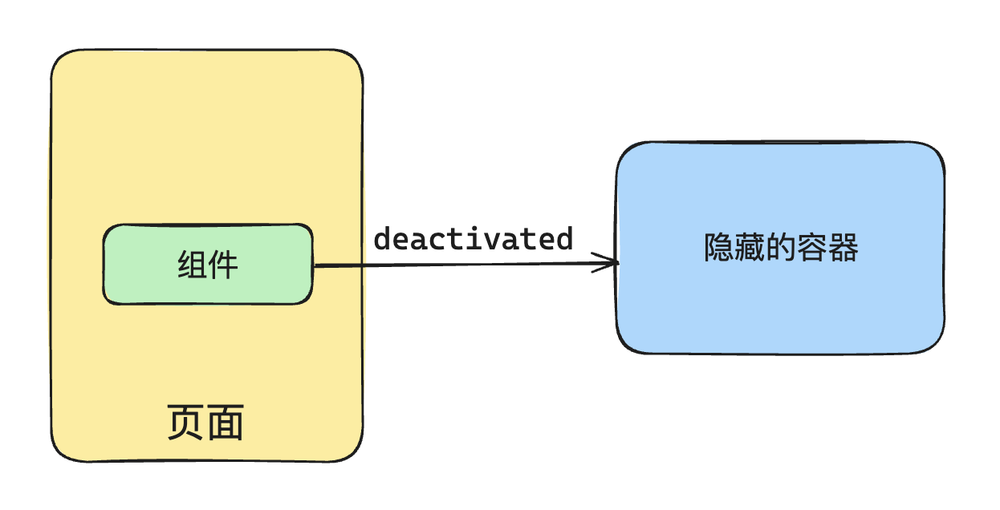

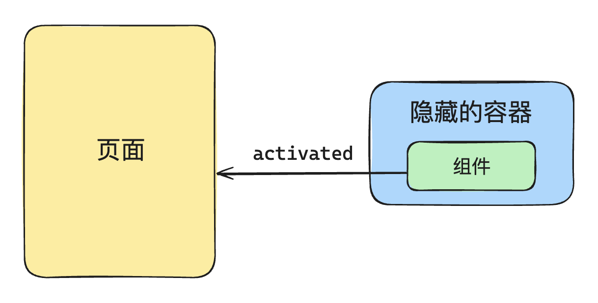


### ③：三个标记 = keep-alive 和渲染器之间的"暗号"

`shouldKeepAlive` 管卸载，`keptAlive` 管挂载，`keepAliveInstance`管关联

```js
rawVNode.shouldKeepAlive = true;      // 给 unmount 看的
rawVNode.keepAliveInstance = instance;// 让 vnode 能找到 keep-alive 实例
// keptAlive 只有"命中缓存"时才贴：
if (cachedVNode) {
  rawVNode.component = cachedVNode.component; // 复用老实例（状态就在这里面！）
  rawVNode.keptAlive = true;                  // 给 patch 看的
}
```

渲染器两个入口分别识别：

```js
// 挂载入口 patch：看到 keptAlive → 别 mount，去 activate（搬回来）
if (!n1) {
  if (n2.keptAlive) n2.keepAliveInstance._activate(n2, container, anchor);
  else              mountComponent(n2, container, anchor);
}

// 卸载入口 unmount：看到 shouldKeepAlive → 别 unmount，去 deactivate（搬走）
if (vnode.shouldKeepAlive) {
  vnode.keepAliveInstance._deActivate(vnode);
} else {
  unmount(vnode.component.subTree);
}
```


### ④：缓存的是"组件实例"，实例是状态的载体

```js
const cache = new Map(); // key: vnode.type(组件配置对象)  value: vnode
```

- key 用 `vnode.type`：同一个组件的 type 是**同一个对象引用**，天然可做 Map 的键。
- 命中缓存时 `rawVNode.component = cachedVNode.component`——**复用的是组件实例**。实例里装着 `state`、`subTree`、响应式数据……所以 count=5 切走再切回还是 5。


渲染器注入细节

```js
cache.set(rawVNode.type, rawVNode); // 首渲染时存入，此刻 rawVNode.component 还是 null！
```

存进去时组件**还没挂载**，`component` 是空的。是渲染器随后在 `mountComponent` 里执行 `vnode.component = instance` 把它填上的。

**注入代码**（②提到的 move 来源）：

```js
// 渲染器 mountComponent 内部
const isKeepAlive = vnode.type.__isKeepAlive;
if (isKeepAlive) {
  instance.keepAliveCtx = {
    move(vnode, container, anchor) {
      // 注意：搬的是"真实 DOM"——组件子树的根元素
      insert(vnode.component.subTree.el, container, anchor);
    },
    createElement, // 就是 document.createElement 的封装，用来造隐藏容器
  };
}
```

`move` 本质就是 `insert(subTree.el, ...)`，**搬 DOM，不是搬 vnode**。这解释了为什么状态能留住：DOM 和实例一直是同一个。


搬运dom的原生JS写法：

```js
const div = document.getElementById('box')
document.body.appendChild(div)  // div 从原来的位置消失，出现在 body 末尾
```


### include / exclude：进缓存前先"安检"

先按组件 name 匹配，不符合就原样返回，根本不进缓存逻辑。

```js
const name = rawVNode.type.name;
if (name &&
    ((props.include && !props.include.test(name)) ||  // 有白名单但没命中
     (props.exclude &&  props.exclude.test(name)))) { // 或命中黑名单
  return rawVNode; // 直接放行，当普通组件处理
}
```


### max + LRU

需要一个 `keys` Set 配合 `cache` Map。`keys` 靠 Set 的"插入有序"特性记录使用顺序：

```js
const cache = new Map();
const keys = new Set();   // 记录使用顺序：越靠后越"新"

function pruneCacheEntry(key) {   // 修剪：两个容器一起删
  cache.delete(key);
  keys.delete(key);
}

// 命中缓存：删了再加 → 把它挪到"最新"位置
if (cache.has(key)) {
  keys.delete(key);
  keys.add(key);
} else {
  // 全新组件：先加，再看超没超上限
  keys.add(key);
  if (max && keys.size > max) {
    pruneCacheEntry(keys.values().next().value); // 超过就删最旧的（Set 第一个）
  }
}
```


### 自测

1. 为什么 keep-alive 必须"渲染器层面支持"，光靠组件自己做不到？
2. "假卸载"到底假在哪——搬去哪、搬的是什么（是 vnode 还是真实 DOM？）
3. 缓存里存的是什么（key 是什么、value 是什么、为什么能保住状态）
4. 三个标记属性各自的分工：`keptAlive` / `shouldKeepAlive` / `keepAliveInstance`
5. 渲染器在挂载(patch)和卸载(unmount)两个入口分别怎么用这些标记
6. `move` 和 `createElement` 从哪来（课件说"渲染器注入"，注入的细节是什么）
7. include / exclude 的匹配逻辑
8. max + LRU 缓存修剪的完整队列逻辑


## Key的本质


### key的本质

VNode 的"身份证"，且只服务于 diff

更新时 Vue 手里有两份东西：`oldChildren`（旧的一排 VNode）和 `newChildren`（新的一排 VNode）。它必须回答一个问题：

> "新数组里的这个节点，对应旧数组里的哪一个？"

key 就是用来精准回答这个问题的唯一标识。判断"是不是同一个可复用节点"的规则（Vue 内部叫 `sameVNode`）是：

```js
// type 相同 且 key 相同 → 认为是"同一个节点" → 复用真实 DOM
function isSameVNode(n1, n2) {
  return n1.type === n2.type && n1.key === n2.key
}
```

**没写 key 时，`key` 都是 `undefined`，`undefined === undefined` 成立**，所以此时匹配只剩下 `type` 相同 —— 这正是"就地复用"的根因。


### 动机：不复用的代价

```html
// 旧
<div>
    <p>1</p>
    <p>2</p>
    <p>3</p>
</div>

// 新
<div>
    <p>4</p>
    <p>5</p>
    <p>6</p>
</div>
```

- **全删全建**：卸载 3 个 + 挂载 3 个 = **6 次 DOM 操作**。
- **复用**：`p` 标签没变，只有文本变了 → 只更新 3 个文本节点 = **3 次 DOM 操作**。

DOM 操作是前端最贵的操作之一，所以能"原地改"就绝不"拆了重建"。这就是复用策略的动机。


### 复用策略的三种情况

① 等长、同类型 —— 逐个 `patch`：

```js
for (let i = 0; i < oldChildren.length; i++) {
  patch(oldChildren[i], newChildren[i]) // 原地更新
}
```

图示

```
旧子节点:  [  <p>A  ]  [  <p>B  ]  [  <p>C  ]
               ↕ patch     ↕ patch     ↕ patch
新子节点:  [  <p>X  ]  [  <p>Y  ]  [  <p>Z  ]

结果:       原地更新，DOM 节点复用，只改内容
```


② 长度变化 —— 先处理公共部分，再补差额：

```js
const common = Math.min(oldLen, newLen)
for (let i = 0; i < common; i++) patch(oldChildren[i], newChildren[i])

if (newLen > oldLen) {
  for (let i = common; i < newLen; i++) patch(null, newChildren[i], container) // 挂载新增
} else {
  for (let i = common; i < oldLen; i++) unmount(oldChildren[i])                // 卸载多余
}
```

新增场景（newLen > oldLen）

```
旧: [ <p>A ] [ <p>B ]
      ↕         ↕
新: [ <p>X ] [ <p>Y ] [ <p>Z ] ← 新增，mount 到容器
     ─────────────────  ──────
        common 部分      新增部分
```

删除场景（oldLen > newLen）

```
旧: [ <p>A ] [ <p>B ] [ <p>C ] ← 多余，unmount 卸载
      ↕         ↕
新: [ <p>X ] [ <p>Y ]
     ─────────────────  ──────
        common 部分      卸载部分
```


③ 顺序 / 类型变化 —— 这是**必须靠 key** 的情况。只按下标 `patch` 会把 `p` 和 `span` 对到一起导致无法复用；而"只按 type 找"在有多个相同 type 时会**对错人**（课件那张三个 `p`/`div` 的"?"图就是这个意思）。所以要引入 key，让"移动 DOM"成为可能。

❌ 无 key，按下标强行 patch（错误）

```
旧:  [ <p>A  ]  [ <span>B ]  [ <p>C  ]
         ↕           ↕           ↕
新:  [ <span>X]  [ <p>Y  ]  [ <p>Z  ]

问题: p ↔ span 类型不同 → 无法复用 → 全部销毁重建，浪费！
```

❌ 只按 type 匹配（错误）

```
旧:  [ <p>A ]  [ <p>B ]  [ <p>C ]
         ?          ?          ?
新:  [ <p>Y ]  [ <p>A ]  [ <p>C ]

问题: 三个 p 长得一样，不知道谁对谁 → 对错人 → 错误更新
```

✅ 有 key，精准复用（正确）

```
旧:  [ <p> key=a ]  [ <p> key=b ]  [ <p> key=c ]
          |               |               |
          └───────────────┼───────────────┘
                          ↓ 按 key 建立映射表
新:  [ <p> key=b ]  [ <p> key=a ]  [ <p> key=c ]
          ↑               ↑               ↑
       找到b，复用      找到a，复用     找到c，复用
       只需移动 DOM，无需销毁重建！
```


### diff算法如何用key

"以新为准，拿 key 去旧里认领；认领到就复用（必要时移动），认领不到就新建；旧里没被认领的就删掉

```js
function patchKeyedChildren(oldChildren, newChildren, container) {
  let lastIndex = 0 // 记录"到目前为止，在旧数组里找到的最大下标"

  for (let i = 0; i < newChildren.length; i++) {
    const newVNode = newChildren[i]
    let found = false

    // 拿新节点的 key，去旧数组里找同一个身份的节点
    for (let j = 0; j < oldChildren.length; j++) {
      const oldVNode = oldChildren[j]
      if (newVNode.key === oldVNode.key) {   // ← key 在这里发挥作用
        found = true
        patch(oldVNode, newVNode, container) // 复用并更新内容（文本/属性）

        if (j < lastIndex) {
          // 这个旧节点的下标"倒退"了 → 说明它在新顺序里要往后挪 → 移动真实 DOM
          move(newVNode, container, /* anchor = 上一个新节点后面 */)
        } else {
          lastIndex = j // 顺序没乱，更新最大下标
        }
        break
      }
    }

    if (!found) {
      // 旧数组里没有这个 key → 全新节点 → 挂载
      patch(null, newVNode, container /*, anchor */)
    }
  }

  // 反过来：旧数组里存在、但新数组里再也找不到这个 key 的 → 卸载
  for (const oldVNode of oldChildren) {
    const still = newChildren.find(v => v.key === oldVNode.key)
    if (!still) unmount(oldVNode)
  }
}


```


n1	旧 VNode（old）	上一次渲染时内存中的虚拟节点

n2	新 VNode（new）	这次更新要渲染的虚拟节点

```mermaid
flowchart TD
    A["patch(n1, n2)"] --> B{n1 存在吗?}
    B -->|否| C["挂载 n2 (mount)"]
    B -->|是| D{"type 和 key 都相同?<br/>(sameVNode)"}
    D -->|否| E["卸载 n1，再挂载 n2<br/>(不能复用)"]
    D -->|是| F["复用真实 DOM<br/>更新 props + 递归 patch 子节点"]
```


### 就地复用"（in-place patch）

没写 key 时，`key` 全是 `undefined`，`sameVNode` 只剩"type 相同"，于是 Vue 采取**就地复用**：不移动 DOM，直接把第 i 个旧节点原地改成第 i 个新数据。

- **无状态时**：高效且无害（就是课件"小王→小宋 只改个名字"那张图，纯文本，随便改）。
- 有状态时：会出错。因为它只对上了"位置/类型"，没对上"身份"。所谓状态包括两类：
  - **子组件内部 state**（比如子组件里自己的计数、展开/收起）；
  - **临时 DOM 状态**（`<input>` 里没绑定到数据的输入值、复选框勾选、光标焦点、滚动位置、CSS 过渡动画）。

DOM 被留在原位、只换了层皮，于是状态跟着位置走，而不是跟着DOM走。


### 为什么不要用下标 index 当 key

**index 是"位置"，不是"身份"。** 

列表一旦排序 / 中间插入 / 中间删除，同一条数据的 index 就变了，key 跟着变，映射全乱。

```js
// 删除前
[{id:1,'Item 1'}, {id:2,'Item 2'}, {id:3,'Item 3'}]
//   index:0          index:1           index:2

// 删除第 2 个后
[{id:1,'Item 1'}, {id:3,'Item 3'}]
//   index:0          index:1  ← Item3 的 key 从 2 变成了 1
```

Vue 一看 `key=1` 还在、`key=2` 还在、`key=2` 没了，就以为"删的是最后一个"，于是把 Item3 当成 Item2 原地改内容 —— 等价于**又退化成了就地复用**，用 index 当 key ≈ 没写 key。


判断"是不是同一个节点"的规则 `sameVNode` 是什么？

type相同，key相同

### 自测

| #    | 你要能回答                                                   | 掌握程度 |
| ---- | ------------------------------------------------------------ | -------- |
| 1    | key 的**本质**是什么？它是给谁用的？                         | 必须     |
| 2    | 更新时为什么要"复用"？不复用代价多大？                       | 必须     |
| 3    | 复用的三种情况（等长同类型 / 长度变化 / 顺序类型变化）分别怎么处理？ | 必须     |
| 4    | **有了 key，diff 算法具体怎么用它做匹配、移动、增删？**（课件没讲，重点补） | 必须     |
| 5    | 没有 key 时的"就地复用"是什么？它什么时候高效、什么时候出 bug？ | 必须     |
| 6    | 为什么**不要用数组下标 index** 当 key？                      | 必须     |
| 7    | 判断"是不是同一个节点"的规则 `sameVNode` 是什么？            | 进阶     |


