## 浏览器渲染原理


### 核心

把 HTML 字符串变成屏幕像素，中间经过 8 道工序；工序被拆给两个执行者，谁在哪个执行者上，决定了它快不快、卡不卡。

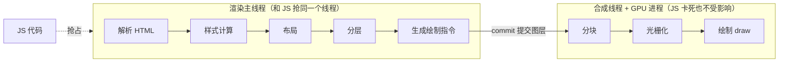


### 八个阶段

| 阶段                 | 在干什么                                  | 产出                        | 对开发的意义                                          |
| -------------------- | ----------------------------------------- | --------------------------- | ----------------------------------------------------- |
| 1 解析 HTML          | 字节 → 字符 → token → 节点                | DOM 树 + CSSOM 树           | 决定**首屏白屏时长**，`script`/`link` 位置在这里生效  |
| 2 样式计算           | 给每个节点算出**每一个** CSS 属性的最终值 | 带 Computed Style 的 DOM 树 | `getComputedStyle` 拿到的就是它；`em/%` 在此变成 `px` |
| 3 布局 Layout        | 算几何：x、y、宽、高                      | Layout Tree                 | **reflow 的本体**；`display:none` 不进这棵树          |
| 4 分层 Layer         | 把页面切成若干独立图层                    | Layer Tree                  | 动画元素单独成层 → 改它不影响别人                     |
| 5 生成绘制指令 Paint | 录制"怎么画"的指令清单（**还没画**）      | Display List                | **repaint 的本体**                                    |
| 6 分块 Tiling        | 图层切成小块                              | Tiles                       | 优先渲染视口附近                                      |
| 7 光栅化 Raster      | 块 → 位图（每像素 RGB）                   | Bitmap                      | GPU 进程干，多线程                                    |
| 8 绘制 Draw          | 按 quad 把位图贴到屏幕，含旋转缩放        | 屏幕帧                      | **transform 只影响这一步**                            |


#### 浏览器渲染整体流程

浏览器，作为用户浏览网页最基本的一个入口，我们似乎认为在地址栏输入 *URL* 后网页自动就出来了。殊不知在用户输入网页地址，敲下回车的那一刻，浏览器背后做了诸多的事情。

去除 *DNS* 查找等这些细枝末节的工作，整个大的部分可以分为两个，那就是**网络**和**渲染**。


首先，浏览器的网络线程会发送 *http* 请求，和服务器之间进行通信，之后将拿到的 *html* 封装成一个渲染任务，并将其传递给渲染主线程的消息队列。在事件循环机制的作用下，渲染主线程取出消息队列中的渲染任务，开启渲染流程。

网络线程和服务器之间通信的过程并非本节课咱们要讨论的，本节课咱们要研究的主要内容，是浏览器的渲染进程如何将一个密密麻麻的 *html* 字符串渲染成最终页面的。

我们先来看一下整体流程，整个渲染流程分为多个阶段，分别是： *HTML* 解析、样式计算、布局、分层、生成绘制指令、分块、光栅化、绘制：


每个阶段都有明确的输入输出，上一个阶段的输出会成为下一个阶段的输入。

这样，整个渲染流程就形成了一套组织严密的生产流水线。

接下来，咱们就一起来看一下每一个阶段的各个流程究竟是在干什么。


#### 解析 *HTML* → DOM、CSS树

首先第一步就是解析 *html*，生成 *DOM* 树。

当我们打开一个网页时，浏览器都会去请求对应的 *HTML* 文件。虽然平时我们写代码时都会分为 *HTML、CSS、JS* 文件，也就是字符串，但是计算机硬件是不理解这些字符串的，所以在网络中传输的内容其实都是 *0* 和 *1* 这些字节数据。

当浏览器接收到这些字节数据以后，它会将这些字节数据转换为字符串，也就是我们写的代码。


当数据转换为字符串以后，浏览器会先将这些字符串通过词法分析转换为标记（ *token* ），这一过程在词法分析中叫做标记化（ *tokenization* ）。

为什么需要标记化呢？原因很简单，现在浏览器虽然将字节数据转为了字符串，但是此时的字符串就如何一篇标题段落全部写在一行的文章一样，浏览器此时仍然是不能理解的。

例如：

```html
<!DOCTYPE html><html lang="en"><head><title>Document</title></head><body><p>this is a test</p></body></html>
```

因此现在所做的标记化，本质就是要将这长长的字符串分拆成一块块，并给这些内容打上标记，便于理解这些最小单位的代码是什么意思。


将整个字符串进行了标记化之后，就能够在此基础上构建出对应的 *DOM* 树出来。


上面的步骤，我们就称之为解析 *HTML*。整个流程如下图：


在解析 *HTML* 的过程中，我们可以能会遇到诸如 *style、link* 这些标签，聪明的你应该已经想到了，这是和我们网页样式相关的内容。此时就会涉及到 *CSS* 的解析。

为了提高解析效率，浏览器在开始解析前，会启动一个预解析的线程，率先下载 *HTML* 中的外部 *CSS* 文件和外部的 *JS* 文件。

如果主线程解析到 *link* 位置，此时外部的 *CSS* 文件还没有下载解析好，主线程不会等待，继续解析后续的 *HTML*。这是因为下载和解析 *CSS* 的工作是在预解析线程中进行的。这就是 *CSS* 不会阻塞 *HTML* 解析的根本原因。


最终，*CSS* 的解析在经历了从字节数据、字符串、标记化后，最终也会形成一颗 *CSSOM* 树。


上面也有提到，预解析线程除了下载外部 *CSS* 文件以外，还会下载外部  *JS* 文件，那么这里同学们自然也会好奇针对 *JS* 代码浏览器是如何处理的？

如果主线程解析到 *script* 位置，会停止解析 *HTML*，转而等待 *JS* 文件下载好，并将全局代码解析执行完成后，才能继续解析 *HTML*。

为什么呢？

这是因为 *JS* 代码的执行过程可能会修改当前的 *DOM* 树，所以 *DOM* 树的生成必须暂停。这就是 *JS* 会阻塞 *HTML* 解析的根本原因。


因此，如果你想首屏渲染的越快，就越不应该在最前面就加载 *JS* 文件，这也是都建议将 *script* 标签放在 *body* 标签底部的原因。

```html
<html>
  <head>
    ...
  </head>
  <body>
    <p></p>
    <script src="..."></script>
  </body>
</html>
```

另外，在现代浏览器中，为我们提供了新的方式来避免 *JS* 代码阻塞渲染的情况：

- *async* 
- *defer* 
- *prefetch* 
- *preload*

关于这几种方式的区别，我们在另外一篇文章中再具体来看。

最后总结一下此阶段的成果，第一步完成后，会得到 *DOM* 树和 *CSSOM* 树，浏览器的默认样式、内部样式、外部样式、行内样式均会包含在 *CSSOM* 树中。

得到了两棵树，如下图所示：


#### 样式计算 → 带样式DOM树

接下来进入第二步：样式计算

拥有了 *DOM* 树我们还不足以知道页面的外貌，因为我们通常会为页面的元素设置一些样式。主线程会遍历得到的 *DOM* 树，依次为树中的每个节点计算出它最终的样式，称之为 *Computed Style*。

在这一过程中，很多预设值会变成绝对值，比如 *red* 会变成 *rgb(255,0,0)*；相对单位会变成绝对单位，比如 *em* 会变成 *px*。


浏览器会确定每一个节点的样式到底是什么，并最终生成一颗样式规则树，这棵树上面记录了每一个 *DOM* 节点的样式。

另外需要注意的是，这里所指的浏览器确定每一个节点的样式，是指在样式计算时会对所有的 *DOM* 节点计算出**所有的**样式属性值。如果开发者在书写样式时，没有写某一项样式，那么大概率会使用其默认值。例如：


关于样式计算的详细过程，请参阅文章《*CSS* 属性计算过程》。

这一步完成后，我们就得到一棵带有样式的 *DOM* 树。也就是说，经过样式计算后，之前的 *DOM* 数和 *CSSOM* 数合并成了一颗带有样式的 *DOM* 树。


#### 布局 → Layout树

前面这些步骤完成之后，渲染进程就已经知道页面的具体文档结构以及每个节点拥有的样式信息了，可是这些信息还是不能最终确定页面的样子。

举个例子，假如你现在想通过电话告诉你的朋友你身边的一幅画的内容：“画布上有一个红色的大圆圈和一个蓝色的正方形”，单凭这些信息你的朋友是很难知道这幅画具体是什么样子的，因为他不知道大圆圈和正方形具体在页面的什么位置，是正方形在圆圈前面呢还是圆圈在正方形的前面。


渲染网页也是同样的道理，只知道网站的文档流以及每个节点的样式是远远不足以渲染出页面内容的，还需要通过布局（*layout*）来计算出每个节点的几何信息（*geometry*）。

生成布局树的具体过程是：主线程会遍历刚刚构建的 *DOM* 树，根据 *DOM* 节点的计算样式计算出一个布局树（*layout tree*）。布局树上每个节点会有它在页面上的 *x，y* 坐标以及盒子大小（*bounding box sizes*）的具体信息。


布局树大部分时候，和 *DOM* 树并非一一对应。虽然它长得和先前构建的 *DOM* 树差不多，但是不同的是这颗树只有那些可见的（*visible*）节点信息。

比如 *display:none* 的节点没有几何信息，因此不会生成到布局树；


又比如使用了伪元素选择器，虽然 *DOM* 树中不存在这些伪元素节点，但它们拥有几何信息，所以会生成到布局树中。


还有匿名行盒、匿名块盒等等都会导致 *DOM* 树和布局树无法一一对应。


#### 分层 → Layer树

在确认了布局树后，接下来就是绘制了么？

还不急，这里还会有一个步骤，就是**分层**。


分层的好处在于，将来某一个层改变后，仅会对该层进行后续处理，从而提升效率。

为了确定哪些元素需要放置在哪一层，主线程需要遍历整颗布局树来创建一棵层次树（*Layer Tree*）


滚动条、堆叠上下文、*transform*、*opacity* 等样式都会或多或少的影响分层结果，也可以通过使用 *will-change* 属性来告诉浏览器对其分层。


#### 生成绘制指令

分层工作结束后，接下来就是生成绘制指令。

主线程会为每个层单独产生绘制指令集，用于描述这一层的内容该如何画出来。


这里的绘制指令，类似于“将画笔移动到 *xx* 位置，放下画笔，绘制一条 *xx* 像素长度的线”，我们在浏览器所看到的各种复杂的页面，实际上都是这样一条指令一条指令的执行所绘制出来的。

如果你熟悉 *Canvas*，那么这样的指令类似于：

```js
context.beginPath(); // 开始路径
context.moveTo(10, 10); // 移动画笔
context.lineTo(100, 100); // 绘画出一条直线
context.closePath(); // 闭合路径
context.stroke(); // 进行勾勒
```

但是你要注意，这一步只是生成诸如上面代码的这种绘制指令集，还没有开始执行这些指令。

另外，还有一个重要的点你需要知道，生成绘制指令集后，渲染主线程的工程就暂时告一段落，接下来主线程将每个图层的绘制信息提交给合成线程，剩余工作将由合成线程完成。


#### 分块 → tiles

合成线程首先对每个图层进行分块，将其划分为更多的小区域。


此时，它不再是像主线程那样一个人在战斗，它会从线程池中拿取多个线程来完成分块工作。


#### 光栅化 → 每像素RGB（bitMap）

分块完成后，进入**光栅化**阶段。所谓光栅化，就是将每个块变成位图。

更简单的理解就是确认每一个像素点的 *rgb* 信息，如下图所示：


光栅化的操作，并不由合成线程来做，而是会由合成线程将块信息交给 *GPU* 进程，以极高的速度完成光栅化。


*GPU* 进程会开启多个线程来完成光栅化，并且优先处理靠近视口区域的块。


#### 绘制 → 屏幕一帧

最后一步，我们总算迎来了真正的绘制。

当所有的图块都被栅格化后，合成线程会拿到每个层、每个块的位图，从而生成一个个「指引（quad）」信息。


指引会标识出每个位图应该画到屏幕的哪个位置，以及会考虑到旋转、缩放等变形。

变形发生在合成线程，与渲染主线程无关，这就是 *transform* 效率高的本质原因。


合成线程会通过 IPC 向浏览器进程（*browser process*）提交（*commit*）一个渲染帧。这个时候可能有另外一个合成帧被浏览器进程的 *UI*线程（*UI thread*）提交以改变浏览器的 *UI*。这些合成帧都会被发送给 *GPU* 完成最终的屏幕成像。

如果合成线程收到页面滚动的事件，合成线程会构建另外一个合成帧发送给 *GPU* 来更新页面。


最后总结一下浏览器从拿到 *html* 文档到最终渲染出页面的整体流程，如下图：


### JS/CSS阻塞

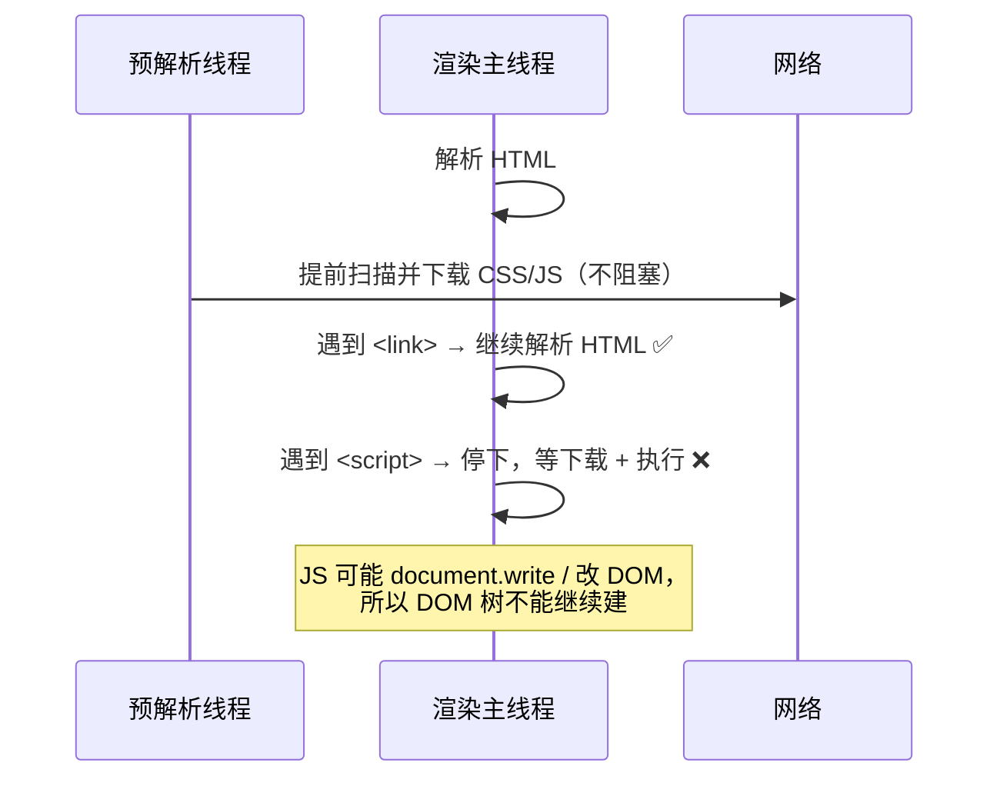

预解析线程扫描 HTML 时发现了 `<link>` 或 `<script src="...">` 里的资源地址，就把这些下载任务交给网络线程。


CSS 不阻塞 HTML 解析：图中显示遇到 `<link>` → 继续解析 HTML ，主线程不会停下来等待 CSS 下载完成，而是继续解析后续 HTML。

但是CSS 阻塞渲染：CSSOM 没好就不能做样式计算 → 白屏。


JS（同步 script）阻塞 HTML 解析：因为它可能改 DOM。


未加载完的 CSS 会阻塞它后面的 `<script>` 执行。

因为 JS 可能读 `getComputedStyle`，浏览器必须保证 CSSOM 就绪。所以"一个慢 CSS"能同时拖慢：首屏渲染 + 所有后续 JS + `DOMContentLoaded`。这是真实项目里最隐蔽的性能坑。


### 语法

```html
<!-- 默认：下载 + 执行都阻塞解析。除非脚本必须立刻改 DOM，否则别用 -->
<script src="a.js"></script>

<!-- defer：并行下载，解析完 HTML 后按顺序执行，在 DOMContentLoaded 之前 -->
<script defer src="a.js"></script>   <!-- 有依赖顺序的业务代码，首选 -->

<!-- async：并行下载，下载完立刻执行（会打断解析），顺序不保证 -->
<script async src="ga.js"></script>  <!-- 埋点、统计等独立第三方脚本 -->

<!-- 模块脚本天然等价于 defer -->
<script type="module" src="main.js"></script>
```


`defer` ：告诉浏览器“你继续解析 HTML，不用停下来等我下载”，虽然下载是并行的，但执行会被推迟且有序

并行下载：主线程继续解析后面的 HTML，同时网络线程在后台下载脚本

```
defer / async 的下载阶段：
解析: ═══════════════════════════════
下载:      ──────────────────────
         ↑ 两件事同时进行，互不阻塞
```

执行推迟且有序：

```
解析: ════════════════════════ HTML 解析完成
下载:      ─────────────── (后台进行)
执行:                          [a.js] → [b.js] → DOMContentLoaded
```

- 下载期间不阻塞解析。
- 执行被推迟到 HTML 解析完成之后，不会打断解析。
- 多个 defer 脚本严格按照文档里的出现顺序执行，即使后面的脚本先下载完，也要排队等前面的先执行。

> `DOMContentLoaded` 是浏览器触发的一个事件，含义是：HTML 已经被完全解析完，DOM 树已经构建完成。


`async`：下载并行，执行立即且无序

```
Text
解析: ═══════█a执行█══════█b执行█══════
下载:    ─a──       ─b──
执行:          a            b
```

- 下载期间不阻塞解析。
- 谁先下载完，谁就立刻执行。
- 如果下载完成时 HTML 还没解析完，执行会打断解析。
- 多个 async 脚本之间不保证顺序。


运行现象差异：`defer` 页面立刻可见、DCL 被推迟；`async` 页面立刻可见但脚本可能在任意时刻插进来卡一下；无标记的 `script` 放在 `<head>` 会让下面的内容全部不显示。


### 触发分层优化

如果整个页面是一张图，任何一点改动都要重画全部。分层后，改动被隔离在一层内，其余层复用已光栅化好的位图。

常见的提升为独立层的触发条件：`transform` / `opacity` 动画、`position: fixed`、`will-change`、`video` / `canvas`、3D 变换。

```css
/* 语法只有这一个值得记：提前告诉浏览器"我要动了，先给我单独分层" */
.card { will-change: transform; }
```

**代价与边界**：每层都要单独占显存。所以 `will-change` 是临时开关，不能全局挂在几百个元素上——那会内存爆炸反而更卡。正确做法是交互开始前加、结束后移除。


### 页面触发更新的三条路径

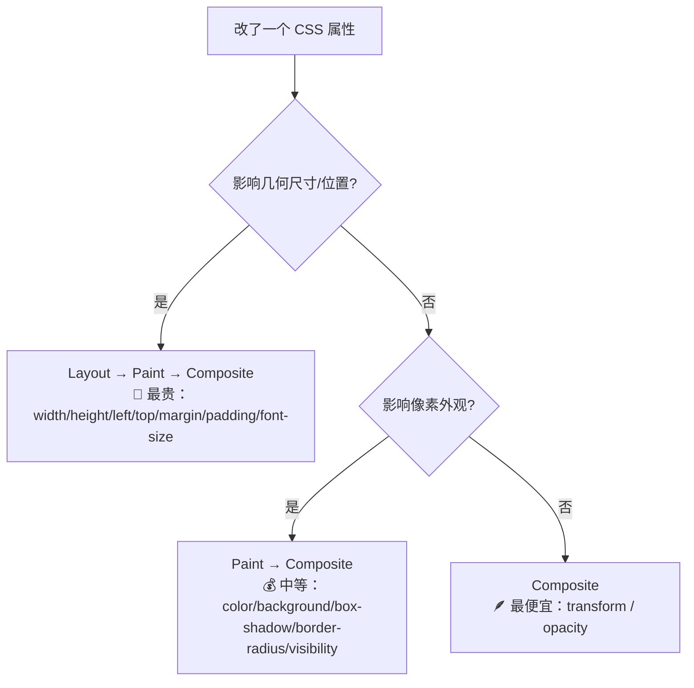

三个术语的准确定义：

- reflow（回流）= 重新计算 Layout 树。一定连带 repaint 和 composite。
- repaint（重绘）= 重新生成绘制指令。不一定 reflow。
- composite（合成）= 只重新贴图。完全发生在合成线程 + GPU。

为什么 transform 效率高（面试标准答案）：它不改变布局，也不改变绘制指令，只影响最后 draw 阶段的 quad 变换；而 draw 在合成线程上，主线程再忙也不影响它。


实验：部分css代码

```css
/* ① 改 left：每帧都要重新布局 → layout + paint + composite（最贵） */
.a { animation: moveLeft 2s linear infinite alternate; }
@keyframes moveLeft { to { left: 740px; } }

/* ② 改 background-color：不影响布局，但要重画 → paint + composite */
.b { animation: flash 2s linear infinite alternate; }
@keyframes flash { to { background: #e0533d; } }

/* ③ 改 transform：既不布局也不重画 → 只在合成线程 composite（最便宜） */
.c { animation: moveT 2s linear infinite alternate; }
@keyframes moveT { to { transform: translateX(740px); } }
```

现象：


### reflow 是异步批量的

写 100 行样式修改，浏览器只把它们标记为脏，攒到本帧末尾统一算一次布局。

但只要你读取布局属性，浏览器为了给你准确值，会被迫立刻算一次布局 —— 这就是 forced synchronous layout。"强制同步布局"

会强制触发布局的读取操作（记住这一类就够）：
`offsetTop/offsetWidth`、`clientHeight`、`scrollTop`、`getBoundingClientRect()`、`getComputedStyle()`


反面教材：布局抖动 layout thrashing

```js
// ❌ 读→写→读→写：每次循环都强制同步布局一次，500 次 = 500 次 reflow
for (const el of items) {
  const w = grid.offsetWidth;      // 读，强制布局
  el.style.width = w / 20 + 'px';  // 写，让布局失效
}

// ✅ 先读后写：只算一次布局，写操作攒到帧末统一处理
const w = grid.offsetWidth;
for (const el of items) el.style.width = w / 20 + 'px';
```

`requestAnimationFrame`

```js
// 用途：把"写样式"对齐到浏览器下一帧渲染之前，避免在一帧内反复触发布局
requestAnimationFrame(() => {
  bar.style.transform = `translateX(${x}px)`;
});
```


### 一帧的生命周期

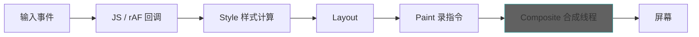

- 一帧 16.7ms，前六格是主线程的预算，只有最后一格不是。
-  JS 越长，留给 Style/Layout/Paint 的时间越少 → 掉帧。
- `transform` 动画直接从最后一格开始，所以主线程死循环时它照样丝滑


## 资源提示关键词


### 核心

从 `defer` 到 `preconnect`，这 6 个关键词看着零散，其实只在做两件事：

| 维度               | 控制什么                       | 相关关键词                                       |
| ------------------ | ------------------------------ | ------------------------------------------------ |
| 时机（When）       | 资源什么时候下载、什么时候执行 | `defer` `async` `preload` `prefetch` `prerender` |
| 优先级（Priority） | 抢带宽时谁先谁后               | `preload`(高) `prefetch`(最低) `fetchpriority`   |


```mermaid
flowchart LR
    A["dns-prefetch<br/>只解析域名"] --> B["preconnect<br/>DNS+TCP+TLS<br/>建好连接"]
    B --> C["prefetch / preload<br/>把字节下下来"]
    C --> D["prerender<br/>连页面都渲染好"]
    style A fill:#9E9E9E
    style B fill:#757575
    style C fill:#616161
    style D fill:#424242
```

从左到右，做的准备越来越多，赌注也越来越大（猜错了浪费的资源越多）


### defer 和 async

默认的 `<script src>` 有个致命性质：解析器遇到它必须停下来，下载 + 执行完才继续。

为什么必须停？因为脚本里可能有 `document.write()`，能凭空往当前解析位置插入 HTML。浏览器不敢赌，只能停。

代价：一个 200KB 的第三方 `SDK` 挂在 `<head>`，整页白屏时间直接 +N 秒。

|                  | 下载         | 执行时机                                     | 阻塞解析？       | 多脚本执行顺序           |
| ---------------- | ------------ | -------------------------------------------- | ---------------- | ------------------------ |
| `<script>`       | 遇到时才开始 | 下载完立即执行                               | 下载+执行都阻塞  | 文档顺序                 |
| `<script async>` | 与解析并行   | 下载完的那一刻立即执行                       | 只有执行瞬间阻塞 | 谁先下完谁先执行（乱序） |
| `<script defer>` | 与解析并行   | HTML 解析完全结束后、`DOMContentLoaded` 之前 | 完全不阻塞       | 文档顺序（有序）         |


defer

```
解析: ════════════════════════ HTML 解析完成
下载:      ─────────────── (后台进行)
执行:                          [a.js] → [b.js] → DOMContentLoaded
```


async

```
Text
解析: ═══════█a执行█══════█b执行█══════
下载:    ─a──       ─b──
执行:          a            b
```


`type="module"` 默认就是 `defer`。所以现代打包产物 `<script type="module" src="...">` 不用再写 defer。


### preload


#### 解决什么问题

浏览器有个"预加载扫描器（Preload Scanner）"，会提前扫 HTML 找出 ``、`<script src>` 提前下载。但它只能看见写在 HTML 里的东西。

看不见的情况（也就是 `preload` 的真正用武之地）：

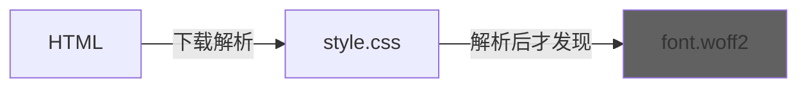


#### 定义

> `preload` = "这个资源本页一定会用，现在就给我用高优先级下下来，但先别执行/应用。"

它只下载，不执行。下完躺在内存里等着，真正用到时零延迟。


#### 语法

```html
<link rel="preload" href="/fonts/inter.woff2" as="font" type="font/woff2" crossorigin>
<link rel="preload" href="/hero.jpg"          as="image">
<link rel="preload" href="/critical.js"       as="script">
<link rel="preload" href="/api/user"          as="fetch" crossorigin>
```

`as` 是必填的，取值：`script` `style` `font` `image` `fetch` `document` `audio` `video` `track` `worker`。

as 干了三件事：

- 决定优先级（font/style = Highest，image = Low）
- 让浏览器发正确的 Accept 头（比如 image 会带 image/webp）
- 决定用哪种缓存槽去匹配，从而能被后续请求复用


漏写 `as` → 资源会被下载两次（预加载的那份匹配不上真实请求）。

字体必须加 `crossorigin`，哪怕是同源。因为字体永远以匿名 CORS 模式请求，不加就匹配不上，同样下两次


### prefetch 与 dns-prefetch


#### `prefetch`：赌下一跳

`prefetch` = "下一个页面（大概率）会用到，浏览器闲下来的时候顺手下一下。"

 `preload` 的差别是**本质性**的，不是程度差别：

|          | `preload`                | `prefetch`                        |
| -------- | ------------------------ | --------------------------------- |
| 服务对象 | 当前页面                 | 未来的页面                        |
| 优先级   | 高（按 `as` 定）         | Lowest（最低）                    |
| 时机     | 立刻                     | 浏览器空闲时                      |
| 没用上   | 控制台警告               | 完全无所谓                        |
| 存哪     | 内存 preload 缓存（~3s） | HTTP 缓存（Chrome 至少留 5 分钟） |

```html
<link rel="prefetch" href="/checkout.js" as="script">
```

页面跳转时，未完成的 prefetch 请求不会被中断 —— 这是它比手写 `fetch()` 预热强的地方。

典型场景：分页列表 prefetch 第 2 页数据。


#### `dns-prefetch`：只做域名解析

```html
<link rel="dns-prefetch" href="//cdn.example.com">
```

只提前跑 DNS 查询，成本极低（几乎零开销），收益也小（省 20~120ms）


### prerender

提前渲染好一个页面，废弃的老写法

```html
<link rel="prerender" href="https://www.keycdn.com">
```


Chrome 从 63 版起就把 `rel=prerender` 降级成了 NoState Prefetch（只下载子资源，不执行 JS、不渲染），后来彻底移除。

替代品是 Speculation Rules API：

```html
<script type="speculationrules">
{
  "prerender": [{ "where": { "href_matches": "/product/*" }, "eagerness": "moderate" }]
}
</script>
```

因为真 prerender 的代价极大：在后台跑一个完整的隐藏页面（执行 JS、发请求、渲染）。猜错 = 白烧一整份 CPU + 带宽 + 用户流量。所以浏览器对它设了严格配额。


### preconnect


#### 解决什么问题

从"我想要这个文件"到"第一个字节到达"，中间有一段纯等待、零传输的握手成本：

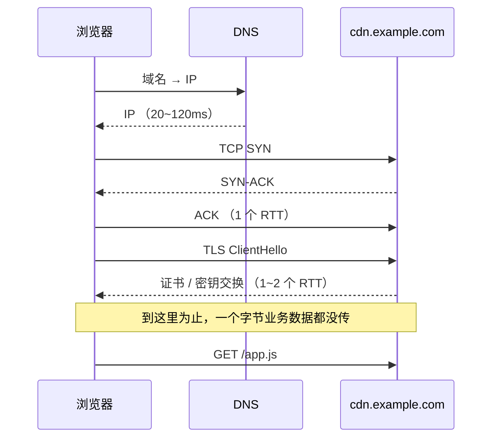

跨域场景下这段成本通常 100~500ms，且每个新域名都要重来一遍。


#### 定义与语法

`preconnect` = "我马上要访问这个域名，先把 DNS + TCP + TLS 全走完，管道铺好等着。"

```html
<link rel="preconnect" href="https://cdn.example.com">
<link rel="preconnect" href="https://fonts.gstatic.com" crossorigin>
```

`crossorigin` 的精确含义

- 加 `crossorigin` → 建立匿名（anonymous）连接，用于不带凭证的 CORS 请求（字体、`fetch()`、`crossorigin` 的脚本）
- 不加 → 建立带凭证的普通连接（图片、普通 `<script src>`、`<link rel=stylesheet>`）

两种连接是分开的两个池子，不通用。 加错了 = 建了个用不上的连接，等于白建。


使用纪律

只用于 2~4 个最关键的域名。每条连接都占用客户端和服务器资源，滥用反而变慢。

连接建好后大约 10 秒内没被使用，浏览器会关掉。所以 preconnect 的域名必须是"马上就要用"的。


### 决策树

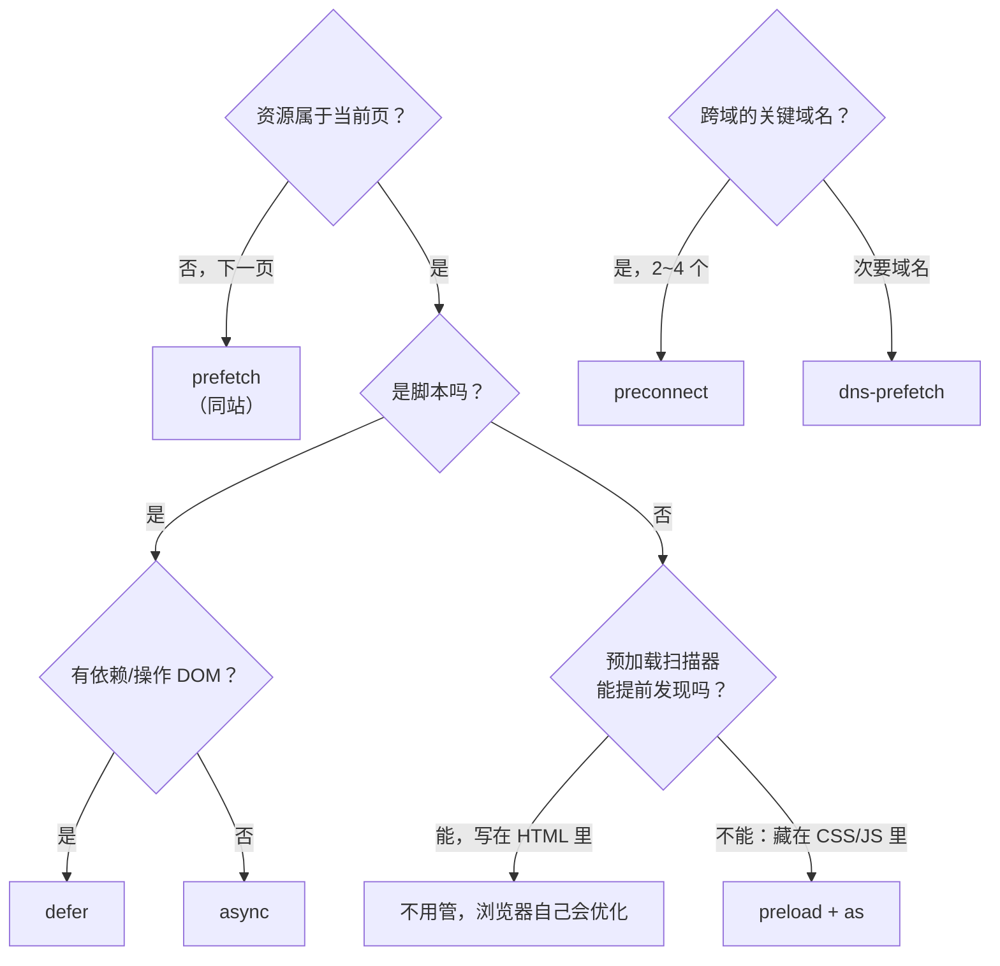


## 浏览器的组成部分


### 是什么

定义：浏览器 = 一种访问互联网信息（HTML/PDF/图片/视频等）的客户端软件。

核心要解决的问题：输入一个 URL，把它变成屏幕上能看、能交互的页面。

为此浏览器内部拆成了 7 个组件协同工作：

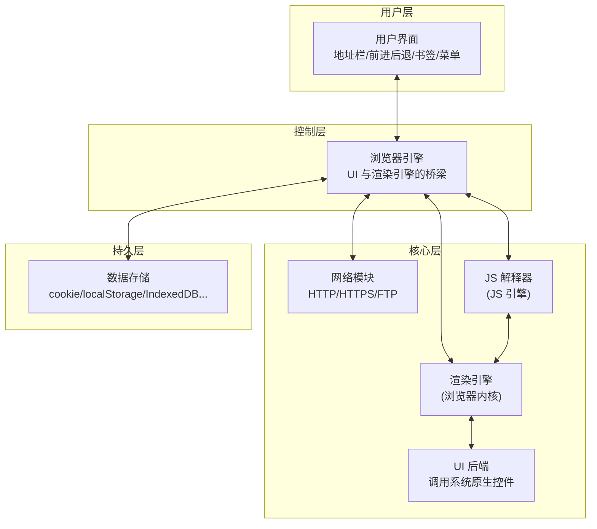


### 7组件职责

|      | 组件       | 一句话职责                            | 现实中对应的东西                                             |
| :--- | :--------- | :------------------------------------ | :----------------------------------------------------------- |
| 1    | 用户界面   | 展示浏览器外壳（地址栏、按钮、菜单）  | Chrome 窗口四周那些非网页区域                                |
| 2    | 浏览器引擎 | UI 和渲染引擎之间的"翻译官"，转递指令 | 你在地址栏敲回车后，真正驱动后续流程的就是它                 |
| 3    | 渲染引擎   | 解析 HTML/CSS，算位置，画像素         | "浏览器内核"，Chrome 是 Blink，Safari 是 WebKit，Firefox 是 Gecko |
| 4    | 网络       | 发起 HTTP/HTTPS 请求，拉资源          | 抓包里看到的那些请求就是它发的                               |
| 5    | JS 解释器  | 编译并执行 JS 代码                    | "JS 引擎"，Chrome 的 V8（Node.js 就基于 V8）                 |
| 6    | UI 后端    | 画原生控件（下拉框、滚动条、弹窗）    | 调操作系统的图形接口                                         |
| 7    | 数据存储   | 浏览器自带的本地存储                  | Cookie、localStorage、IndexedDB 等                           |


### 渲染引擎

浏览器内核指的就是它，整个浏览器 90% 的复杂性都在这一层。

它做什么：拿到 HTML/CSS/JS 二进制数据 → 经过一系列处理 → 在屏幕上画出像素。

这套处理流程叫 关键渲染路径（Critical Rendering Path, CRP）：

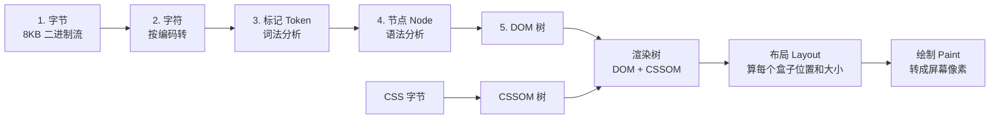


#### 从字节到 DOM


| 阶段       | 输入                        | 输出                                                | 负责模块                 |
| :--------- | :-------------------------- | :-------------------------------------------------- | :----------------------- |
| Bytes      | 网络流 `3C 62 6F 64 79 3E…` | 原始字节                                            | I/O / Encoding           |
| Characters | 字节流                      | 字符序列 `<html><head>…`                            | 编码解码（按 charset）   |
| Tokens     | 字符序列                    | 词法单元 `StartTag: html`、`EndTag: head`、`Hello`… | Tokenizer（词法分析）    |
| Nodes      | 词法单元                    | DOM 节点对象 `{tag:'div', children:[…]}`            | Tree Builder（语法分析） |
| DOM        | 节点                        | 带父子指针的树                                      | Tree Builder 同时完成    |

词法分析（lexer）：把字符串切成 token，比如 `<div>`、`<p>`、文本节点。

语法分析（parser）：按 HTML 语法规则，把 token 组成一棵有父子兄弟关系的节点树——这就是 DOM。


图中：

- Nodes 阶段用扁平的椭圆展示（节点刚被构造，尚未挂到树上）
- DOM 阶段用箭头画出父子关系（节点已连成树）

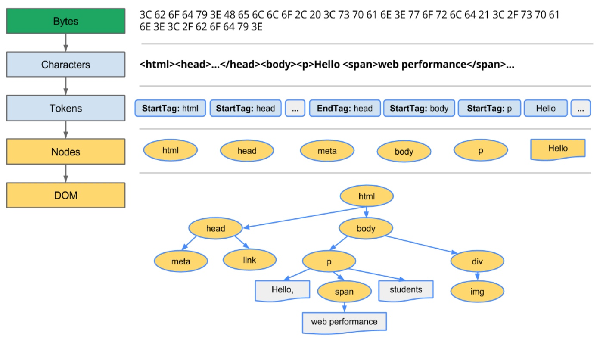


#### CSS 字节到 CSSOM

CSS 原始字节 → 字符 → 标记 → 节点 → CSSOM

过程和 DOM 几乎一样，唯一的区别：CSS 有层叠和继承，浏览器要递归遍历整棵树才能算出某个节点最终的样式。

CSSOM图：

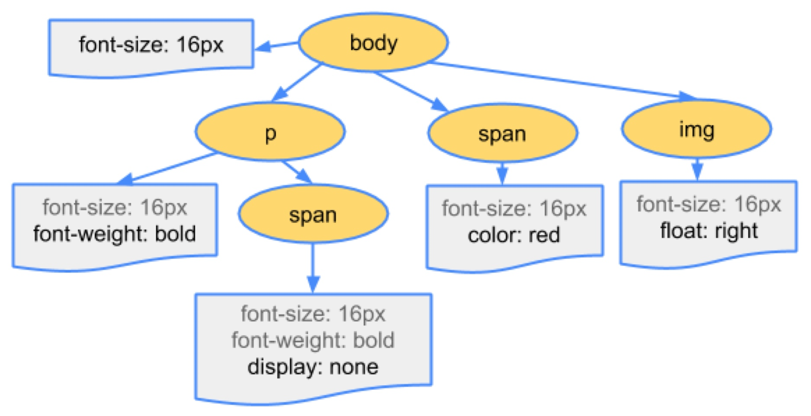


#### 渲染树（Render Tree）

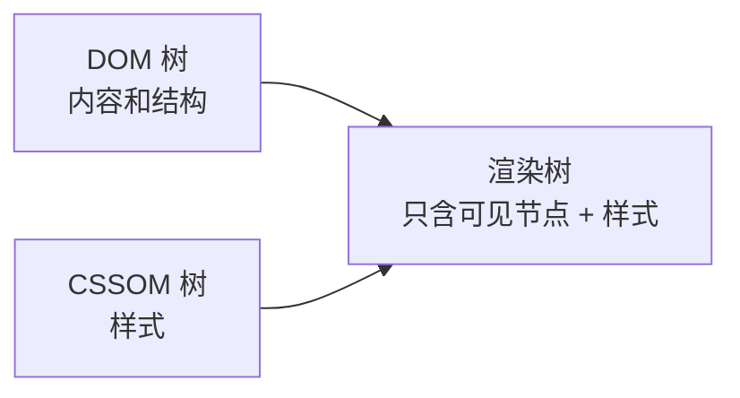

是什么：DOM + CSSOM 合并出的新树。

解决什么问题：DOM 关心"是什么"，CSSOM 关心"长什么样"，渲染树把它们粘合，得出"屏幕上每个可见元素的样式快照"。

关键边界：渲染树只包含可见节点。`<head>`、`display:none` 的元素都不会进入渲染树。但 `visibility:hidden` 的会进入（占位不绘制）。

图中: DOM树中的`<head>`和CSSOM树中的display：none元素在Render Tree里都没有显示

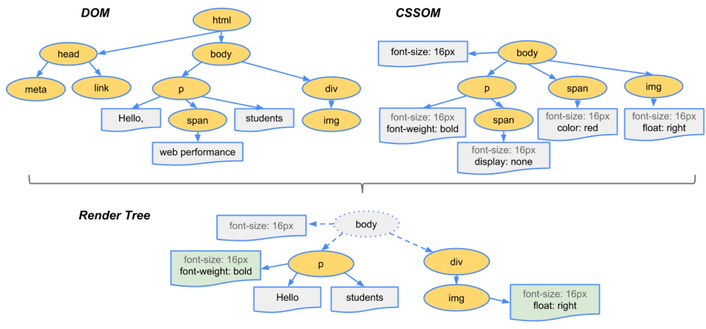


#### 布局（Layout / Reflow）

- 做什么：算出渲染树上每个节点在视口里的精确位置和大小（盒子模型）。
- 输入：渲染树 + 视口尺寸。
- 输出：每个节点的"框模型"——margin、border、padding、width、height 全部转成绝对像素。
- 为什么叫 Reflow：DOM 增删、CSS 改尺寸、窗口 resize 都会重新触发布局，业内叫"重排"，性能开销大。


#### 绘制（Paint / Rasterize）

生成绘制指令之后的步骤

- 做什么：把布局信息转成屏幕上的实际像素。
- 特点：渐进式——网络流式传过来的内容，边收边画，不等整页到齐。
- 注意：改颜色、背景等不影响布局的属性只会重绘，不会Reflow。重绘比重排便宜。(可参考浏览器渲染原理 → 页面触发更新的三条路径)


### JS 解释器（JS 引擎）

- 做什么：把 JS 源码编译执行。
- 主流引擎：Chrome/Node 用 V8、Firefox 用 SpiderMonkey、Safari 用 JavaScriptCore、老 Edge 用 Chakra。
- 执行过程：源码 → AST（抽象语法树） → 字节码 → JIT 编译成机器码执行。

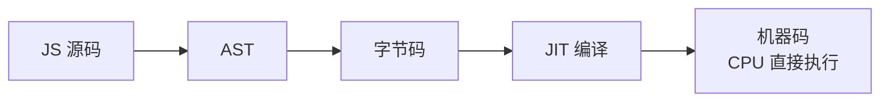

### 数据存储

这是一个持久层。浏览器可能需要在本地保存各种数据

| 存储           | 容量  | 是否随请求发 | 典型用途               |
| :------------- | :---- | :----------- | :--------------------- |
| Cookie         | ~4KB  | 是           | 会话标识、登录态       |
| localStorage   | ~5MB  | 否           | 持久化偏好、缓存       |
| sessionStorage | ~5MB  | 否           | 标签页级临时数据       |
| IndexedDB      | GB 级 | 否           | 结构化大数据、离线应用 |


## IndexedDB


### 是什么

IndexedDB = 浏览器内置的「异步事务型 NoSQL 数据库」，专门解决「本地存大量结构化数据 + 高性能字段检索」的场景。


NoSQL（Not Only SQL，"不仅仅是 SQL"）是一类非关系型数据库的统称，用来解决传统关系型数据库（如 MySQL、PostgreSQL）在某些场景下的局限性。


### 解决什么问题

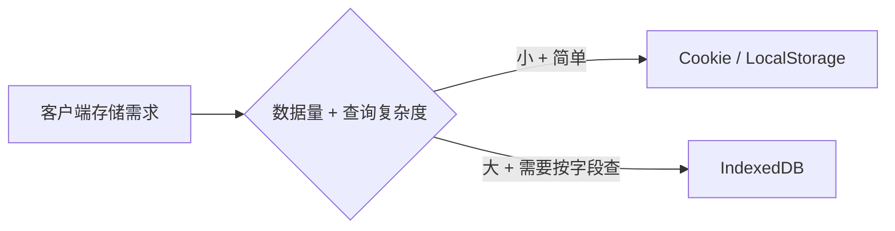

| 方案           | 容量     | 同步/异步        |
| :------------- | :------- | :--------------- |
| Cookie         | ~4KB     | 同步             |
| LocalStorage   | 2.5~10MB | 同步（阻塞渲染） |
| SessionStorage | 2.5~10MB | 同步             |
| IndexedDB      | >250MB   | 异步             |
| WebSQL         | —        | —                |


设计决策：

Cookie：每次 HTTP 都带上 → 不能存多 → 只能存会话身份

LocalStorage：同步 API → 数据一多就卡 → 没有索引 →只能按 key 整存整取

IndexedDB：要解决「多 + 快 + 可查」三个问题，所以必须：异步 + 索引 + 事务


### 核心概念关系图

| 概念           | 是什么                                       | 边界 / 类比          |
| :------------- | :------------------------------------------- | :------------------- |
| IDBDatabase    | 一个域名下可建多个数据库                     | MySQL 的 database    |
| IDBObjectStore | 数据库里的「表」，存的是对象                 | MySQL 的 table       |
| IDBIndex       | 给表的某个字段建索引，加速查询               | MySQL 的 index       |
| IDBTransaction | 一组操作的原子单元，失败就回滚               | MySQL 的 transaction |
| IDBRequest     | 每次操作的「请求对象」，含 onsuccess/onerror | fetch 的 Promise     |
| IDBCursor      | 遍历数据的「指针」，一次走一条               | for循环的迭代器      |
| IDBKeyRange    | 主键的范围描述，配合游标使用                 | SQL 的 WHERE         |


这是最重要的图，记住这张图就理解了 80%：

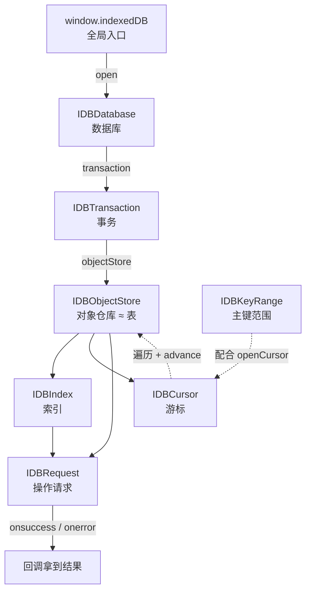


### 五大设计特征

1、键值对 + 对象仓库（不是关系型）

- 是什么：每条记录 = `{ 主键: 数据体 }`，主键不能重复
- 为什么：浏览器侧不要 JOIN、不要复杂关联，NoSQL 更快更简单
- 现实现象：插入两条相同主键直接报错


2、异步

- 是什么：所有 API 都是基于事件回调（没有 await友好版本，要靠 Promise 封装）
- 为什么：存100MB 数据如果同步 → 主线程卡死 → 页面冻结
- 现实现象：连续 add 10 条数据，回调可能乱序到达（因为事务内的请求也会乱序完成）


3、 事务

- 是什么：任何读写删都必须在事务里进行，否则报错
- 为什么：保证「要么全成功，要么全失败」，不会出现写一半的脏数据
- 现实现象：事务会自动 commit / abort，监听 `transaction.oncomplete` / `onerror`即可


4、同源限制

- 是什么：A 域名的网页无法访问 B 域名的 IndexedDB
- 为什么：浏览器同源安全策略的体现- 现实现象：`localhost:8080` 和 `localhost:8081` 端口不同 → 不同源 → 不同库


5、大容量 + 二进制

- 是什么：>250MB，可存 `ArrayBuffer`、`Blob`
- 为什么：现代 web app（IM、可视化、离线应用）需要本地大量数据


### CRUD 操作

```js
db .transaction([storeName], 'readwrite')   // 1. 开事务
  .objectStore(storeName)                  // 2. 拿表
  .<方法>(...) // 3. 执行操作，返回 IDBRequest
```

CRUD 速查表

| 操作       | 方法            | 返回                    | 备注                   |
| :--------- | :-------------- | :---------------------- | :--------------------- |
| 增         | `.add(data)`    | IDBRequest              | 主键已存在 → 报错      |
| 改/存      | `.put(data)`    | IDBRequest              | 不存在则新增（upsert） |
| 删         | `.delete(key)`  | IDBRequest              | 按主键删               |
| 查（单条） | `.get(key)`     | IDBRequest.result       | 按主键                 |
| 查（全部） | `.getAll()`     | IDBRequest.result =数组 | 整张表                 |
| 遍历       | `.openCursor()` | IDBCursor               | 类似迭代器             |


### 数据查询

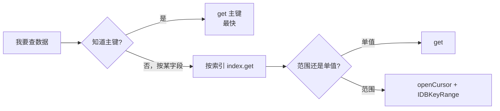


### 生命周期事件

| 对象         | 事件              | 触发时机                                               |
| :----------- | :---------------- | :----------------------------------------------------- |
| `IDBRequest` | `onsuccess`       | 操作成功，`event.target.result` 拿数据                 |
| `IDBRequest` | `onerror`         | 操作失败                                               |
| 数据库       | `onupgradeneeded` | 首次创建 或 版本号升级 时触发（必须在这里建表/建索引） |
| 事务         | `oncomplete`      | 事务内所有请求都成功                                   |
| 事务         | `onerror`         | 任一请求失败 → 整个事务回滚                            |
| 事务         | `onabort`         | 主动调用 `transaction.abort()`                         |


### IndexedDB 语法讲解

#### 案例结构

```
idb-demo/
├── index.html              # 导航页（6 个案例入口）
├── 01-create-db.html       # 案例 1：创建数据库      70 行
├── 02-add.html             # 案例 2：add 新增        79 行
├── 03-put.html             # 案例 3：put 修改        75 行
├── 04-read.html            # 案例 4：三种查询        146 行
├── 05-delete.html          # 案例 5：删除            97 行
└── 06-close-delete.html    # 案例 6：关闭 / 删库     105 行
```


#### 创建数据库


##### 入口 API：`indexedDB.open()`

```js
// 第 1 步：调用 open
// indexedDB 是浏览器全局对象，open() 是唯一的入口方法
//   参数1：'stuDB_01' —— 数据库名。不存在就自动创建
//   参数2：1 —— 版本号，必须是正整数。首次创建传 1；以后改表结构要 2, 3...
//   返回值req：IDBOpenDBRequest（一个请求对象），不是数据库本身
const btn = document.getElementById('btn');
btn.onclick = () => {
	const req = indexedDB.open('stuDB_01', 1);
    // IndexedDB 是异步的，所以它立刻返回一个"请求"，真正结果要靠监听事件拿到
    // ...
}
```


##### 建表事件：`req.onupgradeneeded`

```js
btn.onclick = () => {
    // ...
    req.onupgradeneeded = (e) => {
      const db = e.target.result;
      db.createObjectStore('stu', { keyPath: 'stuId', autoIncrement: true });
    };
    // ...
}
```

- 触发时机：只有两种情况会触发 —— ① 数据库首次创建 ② 传入的版本号比当前版本更高
- 作用：这是建表、建索引的唯一合法时机。普通业务代码里建表会报错
- `e.target.result` → 在这里就是 `db` 实例（注意和 `onsuccess` 里取到的 `db` 是同一个
- `db.createObjectStore(name, options)` → 建一张"表"（IndexedDB 里叫 Object Store 对象仓库）

`createObjectStore` 的两个核心参数：

| 参数            | 值        | 含义                                          |
| :-------------- | :-------- | :-------------------------------------------- |
| `keyPath`       | `'stuId'` | 主键字段：每条记录必须有这个字段，且唯一      |
| `autoIncrement` | `true`    | 主键自增：插入数据时不传 `stuId`，系统自动 +1 |

> 类比理解：`createObjectStore` ≈ `CREATE TABLE stu (stuId INT PRIMARY KEY AUTO_INCREMENT)`（SQL 写法）


##### 成功事件：`req.onsuccess`

```js
btn.onclick = () => {
    // ...
    req.onsuccess = (e) => {
      const db = e.target.result;
      console.log(db.version); // 1
      console.log(db.objectStoreNames);   // DOMStringList ['stu']
      db.close();
    };
    // ...
}
```

- 数据库打开成功后触发
- `e.target.result` → `IDBDatabase` 实例，之后所有增删改查都靠它
- 两个常用只读属性：
  - `db.version` —— 当前版本号（数字）
  - `db.objectStoreNames` —— 所有表名（类数组，可用 `[...xxx]` 转成真数组）


##### 失败事件：`req.onerror`

```js
btn.onclick = () => {
    // ...
    req.onerror = (e) => {
      console.log(e.target.error);  // DOMException
    };
    // ...
}
```

- 任何环节出错都会触发（权限不足、版本号非法等）
- `e.target.error` 是 `DOMException`，`message` / `name` 字段常用


##### 关闭连接：`db.close()`

```js
btn.onclick = () => {
    // ...
    db.close();
}
```

- IndexedDB 是长连接，不用的时候必须手动 `close()`
- 否则连接会一直占用，DevTools 里会看到黄色警告
- 关闭后这个 `db` 对象就废了，下次操作要重新 `open()`


##### 完整代码

```html
<body>
  <button id="btn">点击创建数据库</button>

  <script>
    const btn = document.getElementById('btn');

    btn.onclick = () => {
      const req = indexedDB.open('stuDB_01', 1);

      req.onupgradeneeded = (e) => {
        const db = e.target.result;
        db.createObjectStore('stu', {
          keyPath: 'stuId',
          autoIncrement: true,
        });
      };

      req.onsuccess = (e) => {
        const db = e.target.result;
        console.log(db.version); // 1
        console.log(db.objectStoreNames);   // DOMStringList ['stu']
        db.close();
      };

      req.onerror = (e) => {
        console.log(e.target.error);
      };
    };
  </script>
</body>
```


##### 效果

点击创建数据库按钮后，打开DevTools，名为`stuDB_01`的数据库创建完成，包含一张名为`stu`的表，记录的主键为stuId

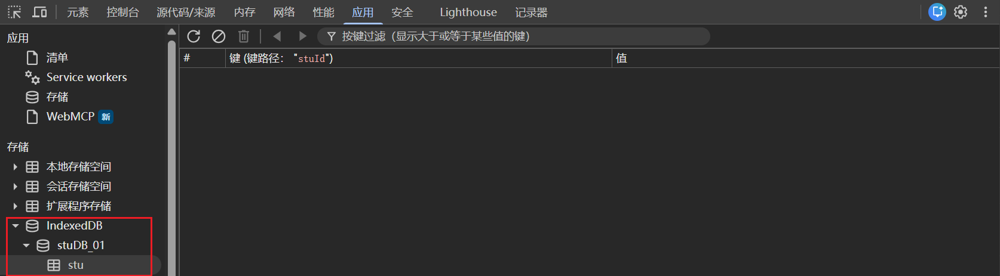


#### add新增


##### 拿到数据库db

下面例子中的变量`db`是一个 `Promise<IDBDatabase>`

成功（resolved） —— 则是 IDBDatabase 实例（数据库连接对象）

失败（rejected） —— 则是 DOMException（例如版本号低于已存在的库、用户禁用了存储等）

```js
function openDB() {
  return new Promise((resolve, reject) => {
    const req = indexedDB.open(DB_NAME, 1);
    req.onupgradeneeded = (e) => {
      e.target.result.createObjectStore('stu', { keyPath: 'stuId', autoIncrement: true });
    };
    req.onsuccess = (e) => resolve(e.target.result);
    req.onerror   = (e) => reject(e.target.error);
  });
}
```


##### 开启事务 ：`db.transaction()`

```js
// ⚠️ transaction 是一次性的：每次写入必须新建
const tx  = db.transaction('stu', 'readwrite');
const req = tx.objectStore('stu').add(stu);
```

`db.transaction(storeNames, mode)`

- 作用：从数据库 `db` 上开启一次事务，这是 IndexedDB 读写操作的"容器"。任何 `add / put / get / delete` 都必须先开事务。
- `storeNames`：字符串或字符串数组，指定本次事务要访问的对象仓库（object store）。这里传 `'stu'`，表示只对 `stu` 这个表操作。
- `mode`：事务模式，三选一：
  - `'readonly'`（默认）：只读
  - `'readwrite'`：可读可写（`add` / `put` / `delete` 必须用它）
  - `'versionchange'`：只能由 `onupgradeneeded` 内部发起，用来改结构
- 返回值：`IDBTransaction` 实例。


再次回忆：`IDBTransaction`是一组操作原子单元


##### 对象仓库：`tx.objectStore(name)`

```js
// ⚠️ transaction 是一次性的：每次写入必须新建
const tx  = db.transaction('stu', 'readwrite');
const req = tx.objectStore('stu').add(stu);
```

`tx.objectStore(name)`

- 作用：从事务中取出指定名称的对象仓库，得到 `IDBObjectStore` 实例（表）。所有 CRUD 方法（`add / put / get / delete / getAll` 等）都挂在它上面。
- `name`：对象仓库名（表名），必须在 `onupgradeneeded` 里 `createObjectStore` 时创建过。


##### add()插入数据

```js
const req = tx.objectStore('stu').add(stu);
```

- 作用：往 `stu` 表里插入一条新记录，返回一个 `IDBRequest`（请求对象）。
- 参数 `stu`：要插入的对象，例如 `{ stuId: 1, stuName: '谢杰', stuAge: 18 }`。对象里 `stuId` 字段就是上面 `keyPath` 指定的主键字段。
- 行为
  - 若主键值在表里不存在 → 插入成功。
  - 若主键值已存在 → 立即抛出 `ConstraintError`，并且整条事务会回滚，本次事务里其他已经 `add` 成功的数据也会一起撤销。
- 返回值 `req`：一个 `IDBRequest`。可以挂 `onsuccess` / `onerror` 监听单次请求的结果，但本例没有挂在这上面，而是监听了事务级的 `oncomplete` / `onerror`。


##### 事务成功：tx.oncomplete

```js
tx.oncomplete = () => resolve();
```

`tx.oncomplete`：当事务里所有 `add` 请求都成功、且事务顺利提交时触发。`addOne` 的 Promise 在这里 `resolve()`，所以 `await addOne(...)` 才会往下走。


##### 事物失败：tx.onerror

```js
tx.onerror = (e) => reject(e.target.error);
```

`tx.onerror`：事务里任意一个请求失败（包括主键冲突导致的 `ConstraintError`）时触发，事务会被回滚。`reject(e.target.error)` 把错误抛出去给调用方 `catch`。


##### 示例：连续插入 3 条

```js
const DB_NAME = 'stuDB_02'; // 数据库名

// 打开数据库（每个案例都自带，避免依赖案例 1）
function openDB() {
  return new Promise((resolve, reject) => {
    const req = indexedDB.open(DB_NAME, 1);
    req.onupgradeneeded = (e) => {
      e.target.result.createObjectStore('stu', { keyPath: 'stuId', autoIncrement: true });
    };
    req.onsuccess = (e) => resolve(e.target.result);
    req.onerror   = (e) => reject(e.target.error);
  });
}

// 用 add() 插入一条
function addOne(db, stu) {
  return new Promise((resolve, reject) => {
    // ⚠️ transaction 是一次性的：每次写入必须新建
    const tx  = db.transaction('stu', 'readwrite');
    const req = tx.objectStore('stu').add(stu);

    // 监听事务级回调（粒度比单 request 大）
    tx.oncomplete = () => resolve();
    tx.onerror    = (e) => reject(e.target.error);
  });
}
```

```js
const db = await openDB();
await addOne(db, { stuId: 1, stuName: '谢杰',   stuAge: 18 });
await addOne(db, { stuId: 2, stuName: '雅静',   stuAge: 20 });
await addOne(db, { stuId: 3, stuName: '谢希之', stuAge: 4  });
```

每次 `await addOne(...)` 都会新开一个事务（文件注释里也强调：`transaction` 是一次性的，写入必须新建），所以是三次独立的 `add`，互不影响提交。

三条记录的 `stuId` 分别是 1 / 2 / 3，依次插入，`stu` 表里最终会有 3 条数据。


结果：数据库`stuDB_02`中的stu表中多了三条数据

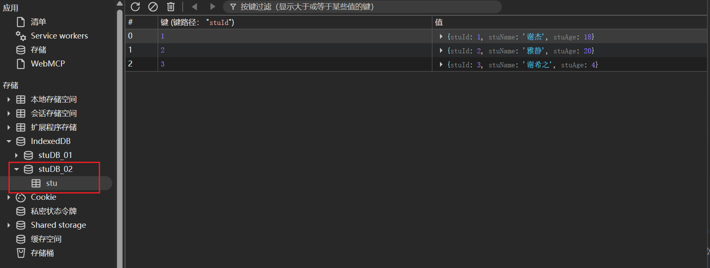


#### put修改

```js
const tx = db.transaction('stu', 'readwrite');
const req = tx.objectStore('stu').put(stu);
tx.oncomplete = () => resolve();
tx.onerror = (e) => reject(e.target.error);
```


##### 创建事务 ：`db.transaction()`

```js
db.transaction('stu', 'readwrite')
```

- 第一个参数 `'stu'`：对象仓库名称（表名）
- 第二个参数 `'readwrite'`：事务模式，必须是可写模式（`put` 是修改操作）


##### put修改

```js
tx.objectStore('stu').put(stu)
```

- `objectStore('stu')`：获取名为 `'stu'` 的对象仓库
- `put(stu)`：执行 upsert 操作
  - 参数 `stu`：要存储的完整对象，必须包含 `keyPath` 字段（本例中是 `stuId`）
  - 返回值：IDBRequest 对象（请求对象）


##### 示例：插入和修改

```js
/**
 * 插入一条数据
 * @param {IDBDatabase} db 数据库实例
 * @param {Object} stu 数据对象
 * @returns {Promise<void>}
 */
function putOne(db, stu) {
  return new Promise((resolve, reject) => {
    const tx = db.transaction('stu', 'readwrite');
    const req = tx.objectStore('stu').put(stu);
    tx.oncomplete = () => resolve();
    tx.onerror = (e) => reject(e.target.error);
  });
}
```

```js
// 插入新记录（stuId=1 不存在）
await putOne(db, { stuId: 1, stuName: '谢杰', stuAge: 18 });

// 修改已有记录（stuId=1 存在，整体替换）
await putOne(db, { stuId: 1, stuName: '谢杰(改)', stuAge: 19 });
```

现象：

表中成功插入数据

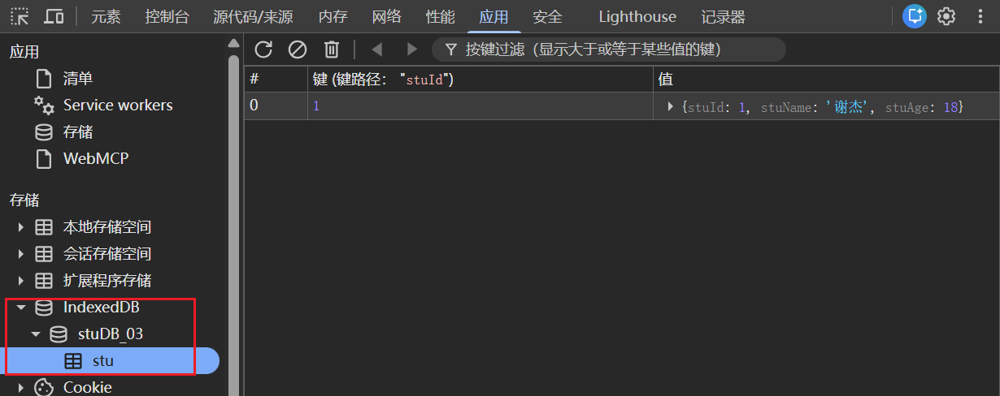

修改已有记录

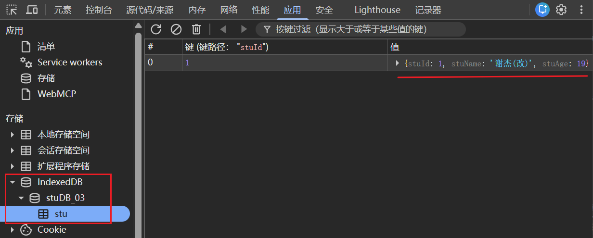


#### 三种查询


##### 索引

是什么

```
stu（对象仓库/表）
  └─ stuAge（索引，基于 stuAge 字段建立）
```

`stuDB_04`数据库相比`stuDB_03`数据库下的stu表多了一个`stuAge`，`stuAge`就是索引

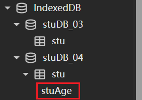


因为 IndexedDB 默认只能按主键快速查。如果想按 `stuAge` 查（比如"找出所有 4 岁的学生"），必须提前在 `onupgradeneeded` 中创建索引：

```js
store.createIndex('stuAge', 'stuAge', { unique: false });
```

- 参数含义：
  - 第 1 个：`stuAge` —— 索引的名字（自己起的）
  - 第 2 个：`stuAge` —— 键路径（见下文）
  - 第 3 个：`{ unique: false }` —— 配置（false 表示允许重复值）


当前索引表中内容：截图可以在后面查看

|      | 键（键路径：`stuAge`） | 主键（键路径：`stuId`） | 值                                    |
| :--- | :--------------------- | :---------------------- | :------------------------------------ |
| 0    | 4                      | 3                       | {stuId:3, stuName:'谢希之', stuAge:4} |
| 1    | 18                     | 1                       | {stuId:1, stuName:'谢杰', stuAge:18}  |
| 2    | 20                     | 2                       | {stuId:2, stuName:'雅静', stuAge:20}  |

为什么有 "键"列 和 "主键"列 这两列键？

这正是索引的工作方式：索引的"键"按索引字段排序，"主键"指向真实数据的位置。

比如想查 `stuAge=4` 的学生：

1. 先在索引的"键"列找到 `4`
2. 拿到对应的主键 `3`
3. 用主键 `3` 去主表拿完整数据 `{stuId:3, stuName:'谢希之', stuAge:4}`


索引内容截图：

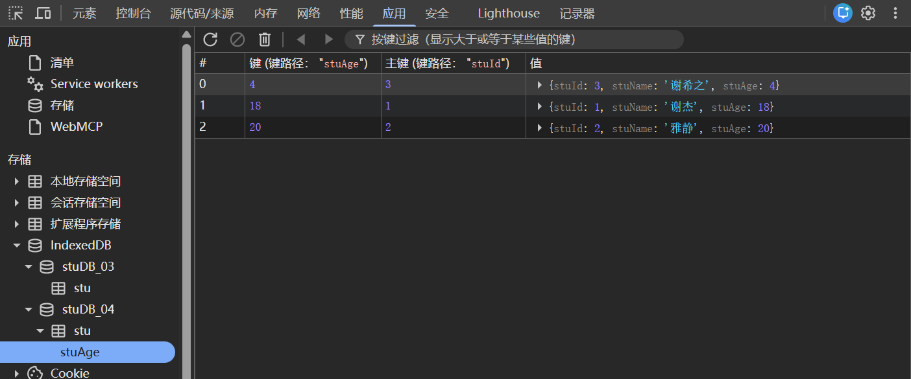


##### 键路径

键路径 = 一个字符串，告诉 IndexedDB："用对象里的哪个属性当键"。


作为主键的键路径（创建对象仓库时）

```js
db.createObjectStore('stu', { keyPath: 'stuId', autoIncrement: true });
// 键路径 = 'stuId'：用每条数据的 stuId 字段当主键
```


作为索引的键路径（创建索引时）

```js
store.createIndex('stuAge', 'stuAge', { unique: false });
// 第 1 个参数 'stuAge' = 索引的名字
// 第 2 个参数 'stuAge' = 索引的键路径：用数据里的 stuAge 字段建立索引
```


支持嵌套路径

```js
// 如果数据是 { info: { name: 'xxx' } }
store.createIndex('byName', 'info.name', { unique: false });
// 键路径 'info.name' 用点语法指向嵌套属性
```


##### 按主键查询：getByKey

最快的查询方式，直接通过主键定位数据。

```js
function getByKey(db, key) {
  return new Promise((resolve, reject) => {
    const tx  = db.transaction('stu', 'readonly');
    const req = tx.objectStore('stu').get(key);
    req.onsuccess = (e) => resolve(e.target.result);
    req.onerror   = (e) => reject(e.target.error);
  });
}

const r = await getByKey(db, 2);
log(JSON.stringify(r));
```

```json
{"stuId":2,"stuName":"雅静","stuAge":20}
```

`db.transaction('stu', 'readonly')`：创建只读事务

- 第一个参数：对象仓库名称（`'stu'`）
- 第二个参数：事务模式（`'readonly'` 表示只读，浏览器会自动做并发优化）

`objectStore('stu').get(key)`：按主键查询

- 参数 `key`：主键值（如 `stuId=2`）
- 返回值：找到返回该记录对象，找不到返回 `undefined`


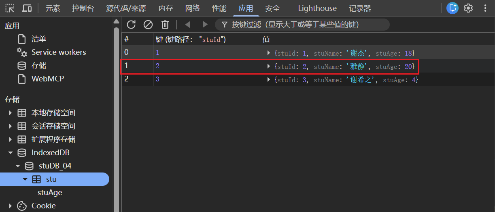


##### 查询全表 (getAll)

```js
function getAll(db) {
  return new Promise((resolve, reject) => {
    const tx  = db.transaction('stu', 'readonly');
    const req = tx.objectStore('stu').getAll();
    req.onsuccess = (e) => resolve(e.target.result);
    req.onerror   = (e) => reject(e.target.error);
  });
}

const r = await getAll(db);
log(JSON.stringify(r, null, 2));
```

`objectStore('stu').getAll()`：获取对象仓库中的所有数据

- 无参数（也可传入 `IDBKeyRange` 限制范围，或传入数字限制数量）
- 返回值：数组，包含所有记录对象


作用：一次性读取对象仓库的全部数据。


结果：

```json
[
  {
    "stuId": 1,
    "stuName": "谢杰",
    "stuAge": 18
  },
  {
    "stuId": 2,
    "stuName": "雅静",
    "stuAge": 20
  },
  {
    "stuId": 3,
    "stuName": "谢希之",
    "stuAge": 4
  }
]
```


##### 按索引查询 (getByIndex)

```js
function getByIndex(db, indexName, value) {
  return new Promise((resolve, reject) => {
    const tx  = db.transaction('stu', 'readonly');
    const idx = tx.objectStore('stu').index(indexName);
    const req = idx.get(value);
    req.onsuccess = (e) => resolve(e.target.result);
    req.onerror   = (e) => reject(e.target.error);
  });
}

const r = await getByIndex(db, 'stuAge', 4);
log(JSON.stringify(r));
```

`objectStore('stu').index(indexName)`：获取索引对象

- 参数 `indexName`：索引名称（如 `'stuAge'`）

- 前提条件： 必须在 `onupgradeneeded`中提前创建索引：

  ```js
  store.createIndex('stuAge', 'stuAge', { unique: false });
  ```

  - 第一个参数：索引名称
  - 第二个参数：哪个属性当键
  - 第三个参数：配置对象（`unique: false` 表示允许重复值）

`idx.get(value)`：通过索引值查询

- 参数 `value`：索引字段的值（如 `stuAge=4`）
- 返回值：第一条匹配的记录（如果有多条匹配，只返回第一条）


#### delete删除


##### 创建读写事务：`db.transaction()`

```js
const tx = db.transaction('stu', 'readwrite');
```

- 参数 1: `'stu'` - 对象仓库名称
- 参数 2: `'readwrite'` - 事务模式（删除操作必须用读写模式）


##### delete删除

获取对象仓库并执行删除

```js
const req = tx.objectStore('stu').delete(key);
```

- `objectStore('stu')` - 获取名为 `stu` 的对象仓库
- `.delete(key)` - 执行删除操作
  - `key` - 要删除记录的主键值（本例中是 `stuId`）

返回值： 返回一个 `IDBRequest` 对象，但通常我们监听事务级别的 `oncomplete` 来确认删除成功


监听事务完成

```js
tx.oncomplete = () => resolve();
tx.onerror = (e) => reject(e.target.error);
```

- `tx.oncomplete` - 事务成功完成时触发（推荐用事务级回调）
- `tx.onerror` - 事务出错时触发


##### 使用示例

```js
/***
 * 按主键删除单条
 * @param {IDBDatabase} db 数据库实例
 * @param {number} key 主键值
 * @returns {Promise<void>}
 */
function deleteByKey(db, key) {
  return new Promise((resolve, reject) => {
    const tx  = db.transaction('stu', 'readwrite');
    const req = tx.objectStore('stu').delete(key);
    // 用事务级回调更稳
    tx.oncomplete = () => resolve();
    tx.onerror    = (e) => reject(e.target.error);
  });
}

await deleteByKey(db, 1);
```


删除前后对比：

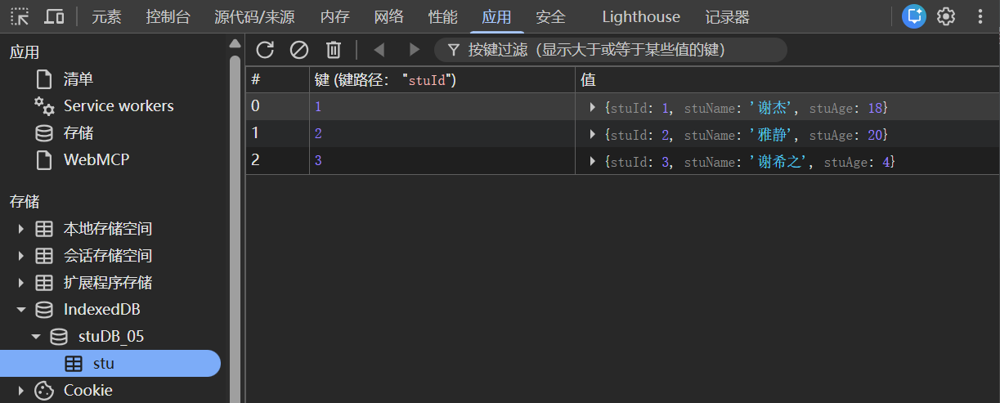

删除第一条

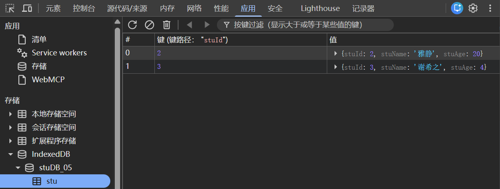


#### 关闭/删除

关闭连接：`db.close()`

变量`db`是一个 `Promise<IDBDatabase>`

成功（resolved） —— 则是 IDBDatabase 实例（数据库连接对象）

失败（rejected） —— 则是 DOMException（例如版本号低于已存在的库、用户禁用了存储等）

`db.close()` 是 `IDBDatabase` 实例上的方法，作用是关闭当前页面对该数据库的连接。


删除数据库：`indexedDB.deleteDatabase(name)`

```js
const DB_NAME = 'stuDB_06';
const req = indexedDB.deleteDatabase(DB_NAME);

req.onsuccess = () => { log('💥 deleteDatabase：stuDB_06 已彻底删除'); resolve(); };
req.onerror   = (e) => { log('❌ 失败：' + e.target.error); reject(e.target.error); };
```

相当于

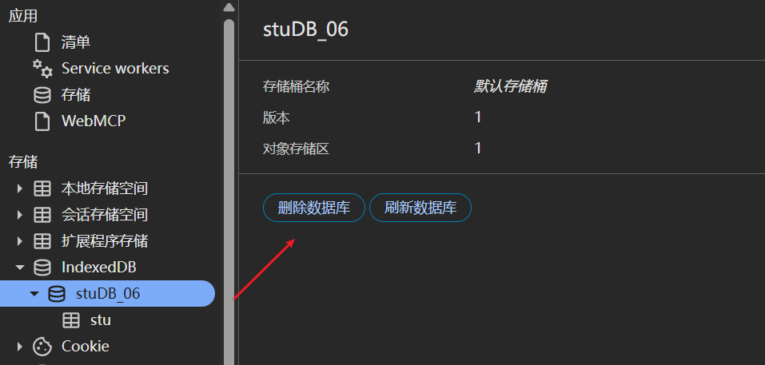


阻塞事件：`req.onblocked`

- 当还有其他连接（其他 tab / iframe / Worker / 本页未关闭的旧 `db`）正持有该数据库时，`deleteDatabase` 不会立即执行，而是持续等待，并反复触发 `onblocked`。
- 只有当所有现存连接都调用 `close()` 或被浏览器强制回收后，删除才会真正进行，然后触发 `onsuccess`。


## File API

```mermaid
graph TB
    A[File API - 客户端文件访问] --> B[File 对象]
    A --> C[FileList 对象]
    A --> D[FileReader 对象]
    A --> E[Blob 对象]
    
    B --> B1[单个文件的元信息]
    C --> C1[多文件的集合]
    D --> D1[异步读取文件内容]
    E --> E1[二进制原始数据]
    
    style A fill:#424242
    style D fill:#757575

```


### 需求

传统的 `<input type="file">` 只能提交给服务器，JavaScript 无法在客户端：

- ❌ 读取文件大小
- ❌ 判断文件类型
- ❌ 预览文件内容
- ❌ 验证文件合法性

HTML5 的 File API 让 JavaScript 能在用户授权后（选择文件或拖拽）访问本地文件。


### File 对象

定义：表示单个文件，包含文件的元信息（名称、大小、类型、修改时间）

继承关系：File 继承自 Blob

常用属性：

```js
file.name          // 文件名 "example.txt"
file.size          // 字节数 1024
file.type          // MIME类型 "text/plain"
file.lastModified  // 时间戳 1638340865992
```

获取方式：

```html
<input type="file">
```

```js
// 方式1：用户选择文件后自动生成
input.onchange = (e) => {
  const file = e.target.files[0]; // File对象
}

// 方式2：手动构造
const file = new File(['内容'], 'test.txt', {type: 'text/plain'});
```


###  FileList 对象

定义：类数组对象，存储多个 File 对象

现实场景：

```html
<input type="file" multiple>  <!--允许多选-->
```

```js
input.onchange = (e) => {
  const fileList = e.target.files; // FileList对象
  console.log(fileList.length);    // 文件数量
  console.log(fileList[0]);        // 第一个File对象
}
```


### FileReader 对象（重点）

定义：异步读取文件内容的工具


#### 4种读取方式

| 方法                   | 返回格式        | 典型场景             | 示例结果                          |
| :--------------------- | :-------------- | :------------------- | :-------------------------------- |
| `readAsText()`         | 纯文本字符串    | 读取 txt、json、csv  | `"Hello World"`                   |
| `readAsDataURL()`      | Base64编码的URL | 图片预览、上传前压缩 | `data:image/png;base64,iVBORw...` |
| `readAsArrayBuffer()`  | ArrayBuffer对象 | 二进制处理、分片上传 | `ArrayBuffer(1024)`               |
| `readAsBinaryString()` | 二进制字符串    | 已废弃，不推荐       | `ÿØÿà\u0000...`                   |


```js
const reader = new FileReader();

// 读为文本（常用于txt、json等）
reader.readAsText(file, 'UTF-8'); 
// result: "文本内容"

// 读为DataURL（常用于图片预览）
reader.readAsDataURL(file);
// result: "data:image/png;base64,iVBORw0KG..."

// 读为ArrayBuffer（常用于二进制处理）
reader.readAsArrayBuffer(file);
// result: ArrayBuffer(1024)

// 读为二进制字符串（少用）
reader.readAsBinaryString(file);
```


事件监听：

```js
reader.onload = (e) => {
  console.log(e.target.result); // 读取完成后的内容
}
reader.onerror = (e) => {
  console.error('读取失败');
}
```


#### 例子

1、读取文本文件

```js
// 在内存中创建了一个文件读取器对象，此时还没有任何操作。
const reader = new FileReader(); 

// 注册了一个回调函数，这个函数现在不会执行，只是告诉浏览器"等文件读完了就调用我"
reader.onload = (e) => {
  const text = e.target.result;
  console.log(text); // 处理文本内容
};
reader.onerror = (e) => {
  console.error('读取失败', e);
};

reader.readAsText(file, 'UTF-8'); // 浏览器开始异步读取文件内容 → 把文件的二进制数据按 UTF-8 编码转成字符串 → 读取完成后，触发 onload 事件，此时 e.target.result 里就是文件的文本内容（如 "Hello World"） → console.log 输出这段文本
```


2、图片预览（最常用）

```js
const reader = new FileReader();

// 回调函数注册，等待触发。
reader.onload = (e) => {
  const dataURL = e.target.result;
  imgElement.src = dataURL; // 直接赋值给 img 标签
};

reader.readAsDataURL(file); // 浏览器读取图片文件的二进制数据 → 把它编码成 Base64 字符串 → 拼接成 Data URL 格式："data:image/png;base64,iVBORw0KG..." → 读取完成后，dataURL 被赋值给 img.src → 页面上立即显示这张图片（无需上传服务器）
```


3、读取二进制数据（如文件上传前校验）

```js
const reader = new FileReader();

// 回调函数注册，等待触发。
reader.onload = (e) => {
  const buffer = e.target.result;  // buffer 是原始二进制数据（ArrayBuffer），人类无法直接读
  const uint8Array = new Uint8Array(buffer); // new Uint8Array(buffer) 把它转成字节数组，每个元素是 0-255 的数字
  // 处理二进制数据，如检查文件签名
  const header = uint8Array.slice(0, 4);
};

reader.readAsArrayBuffer(file); // 把文件读为读为ArrayBuffer，触发onload事件
```


4、带进度条的上传

```js
const reader = new FileReader();

// onprogress事件，在文件读取过程中，每读一部分数据就触发一次
// e.loaded：已读取的字节数（如 500KB）
// e.total：文件总大小（如 2MB）
// 计算百分比后，进度条实时更新（用户能看到 25% → 50% → 100%）
reader.onprogress = (e) => {
  if (e.lengthComputable) {
    const percent = (e.loaded / e.total) * 100;
    progressBar.value = percent;
  }
};
reader.onload = (e) => {
  // 处理完成
};
reader.readAsDataURL(file);
```


5、结合 input 使用（完整流程）

```js
// 用户点击 <input type="file"> 并选择文件，change 事件触发，files[0] 获取用户选的第一个文件对象（File 类型
inputElement.addEventListener('change', (e) => {
  const file = e.target.files[0];
  if (!file) return; ）
  
  const reader = new FileReader();
  reader.onload = (e) => {
    handleFileContent(e.target.result); // 根据文件类型处理 result
  };
  
  // 如果 file.type 是 "image/png"，走 DataURL 路径（显示图片），如果是 "text/plain"，走文本路径（显示文字）
  if (file.type.startsWith('image/')) {
    reader.readAsDataURL(file);
  } else {
    reader.readAsText(file);
  }
});
```

核心模式就是：创建 reader → 绑定事件 → 调用读取方法 → 在 onload 中处理 result


#### 生命周期

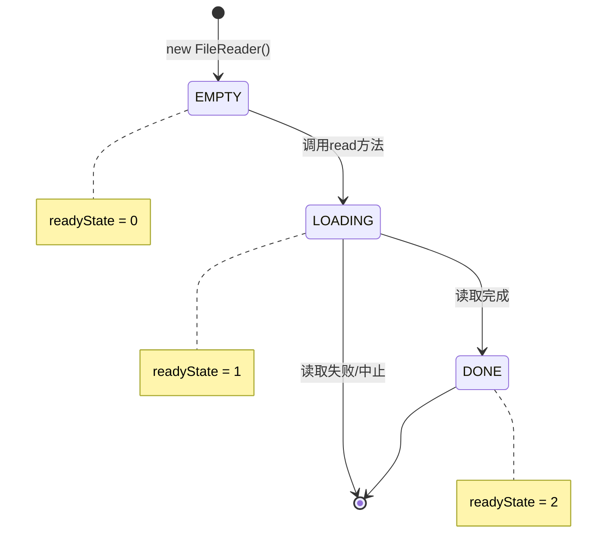


### Blob 对象

定义：二进制大对象（Binary Large Object），File 的父类

关系：File 是特殊的 Blob（带文件名和修改时间）


### 使用场景

场景1：图片预览

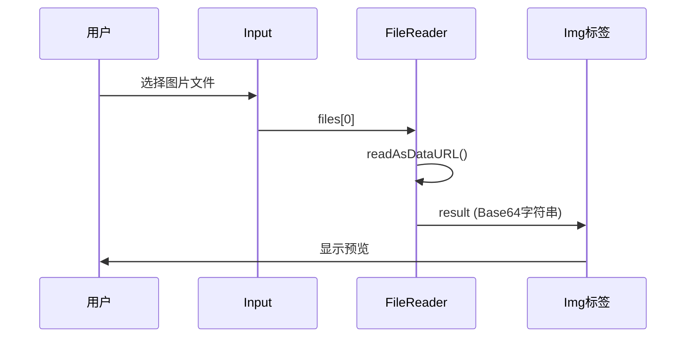


场景2：文件验证

```html
<input type="file" multiple>
```

```js
input.onchange = (e) => {
  const file = e.target.files[0];
  
  // 验证文件类型
  if (!file.type.startsWith('image/')) {
    alert('只能上传图片！');
    return;
  }
  
  // 验证文件大小（5MB）
  if (file.size > 5 * 1024 * 1024) {
    alert('文件不能超过5MB！');
    return;
  }
}
```


### File System Access API

- File API 无法保存文件到本地（只能读取）
- Web 应用需要类似桌面软件的"打开-编辑-保存"能力
- 在线 IDE、图片编辑器等场景的刚需

区别：

```mermaid
graph LR
    A[File API<br/>只读] -->|用户选择文件| B[读取内容]
    C[File System Access API<br/>读写] -->|用户授权目录| D[读取]
    C -->|用户授权目录| E[写入/保存]
    
    style A fill:#424242
    style C fill:#424242
```


## 浏览器缓存


### 为什么需要浏览器缓存

Web应用中最耗时的两个环节：

1. 网络传输：HTTP请求往返时间
2. 服务器计算：数据库查询、业务逻辑处理


解决方案：浏览器缓存直接在客户端存储资源，避免重复请求，减少网络传输和服务器压力。

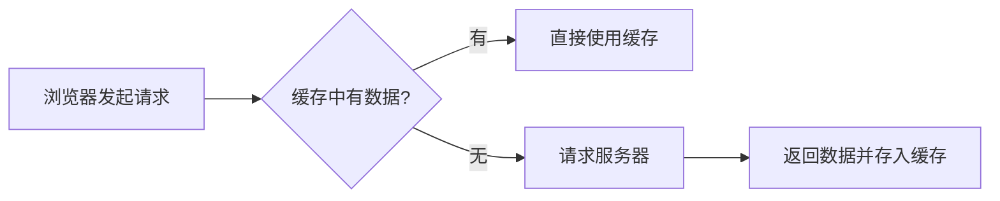


### 缓存存储的四个位置

缓存位置是自动的（浏览器决定），缓存策略是可控的（HTTP头决定）

```mermaid
graph TD
    A[浏览器请求资源] --> B[1. Service Worker]
    B -->|未命中| C[2. Memory Cache 内存]
    C -->|未命中| D[3. Disk Cache 硬盘]
    D -->|未命中| E[4. Push Cache HTTP/2推送]
    E -->|未命中| F[发起网络请求]
```


####  Service Worker

定义：运行在浏览器后台的独立线程，可拦截网络请求

特点：

- 开发者完全可控（自己写代码决定缓存什么）
- 必须使用HTTPS协议（安全性）
- 持久化存储，不会随标签页关闭而释放

边界：它是一个可编程的代理层，不是自动缓存


#### Memory Cache（内存缓存）

定义：存在浏览器进程内存中的缓存

特点：

- 读取速度极快
- 容量小
- 生命周期短（关闭标签页就释放）
- 主要缓存当前页面已加载的资源（图片、CSS、JS等）

运行现象：刷新页面时，很多资源显示`from memory cache`


#### Disk Cache（硬盘缓存）

定义：存储在硬盘上的缓存，也叫HTTP Cache

特点：

- 容量大
- 持久化（跨会话、跨标签页）
- 覆盖面最广，大部分缓存来自这里
- 遵循HTTP协议头字段（强制缓存、协商缓存就是这里的规则）


#### Push Cache（推送缓存）

定义：HTTP/2的服务器推送特性产生的缓存

特点：

- 只在会话期间存在
- 缓存时间很短（Chrome约5分钟）
- 国内使用较少（HTTP/2普及率低）


### HTTP头字段控制缓存

分为强制缓存和协商缓存两种类型。


#### 强制缓存：不发请求，直接用缓存

```mermaid
sequenceDiagram
    participant 浏览器
    participant 缓存数据库
    participant 服务器
    
    浏览器->>缓存数据库: 请求资源
    alt 缓存存在且未过期
        缓存数据库->>浏览器: 200 (from disk cache)
    else 缓存不存在或已过期
        浏览器->>服务器: 发起HTTP请求
        服务器->>浏览器: 返回资源+缓存规则
        浏览器->>缓存数据库: 存储资源
    end
```


HTTP头字段

① Expires（HTTP/1.0，已过时）

```
Expires: Thu, 10 Nov 2017 08:45:11 GMT
```

- 绝对时间，到期前不发请求
- 缺陷：依赖客户端时间，可能不准确

② Cache-Control（HTTP/1.1，主流）

```
Cache-Control: max-age=3600
```

常用值：

| 值                | 含义                            | 运行现象                           |
| :---------------- | :------------------------------ | :--------------------------------- |
| `max-age=3600`    | 缓存有效期3600秒                | 3600秒内请求显示`200 (from cache)` |
| `no-cache`        | 必须验证后才能用缓存            | 每次都发请求，但可能返回304        |
| `no-store`        | 完全不缓存                      | 每次都是全新请求和响应             |
| `public`          | 任何缓存都可存储（CDN、浏览器） | 适用于静态资源                     |
| `private`         | 仅浏览器可缓存（默认）          | 适用于用户私有数据                 |
| `must-revalidate` | 过期后必须重新验证              | 与协商缓存配合使用                 |

优先级：

- Cache-Control > Expires
- no-store > no-cache > max-age=0 > max-age>0


#### 协商缓存：发请求询问服务器，资源没变返回304

```mermaid
sequenceDiagram
    participant 浏览器
    participant 服务器
    
    Note over 浏览器: 首次请求
    浏览器->>服务器: GET /style.css
    服务器->>浏览器: 200 + 资源 + Last-Modified: Mon, 10 Nov 2018 09:10:11 GMT
    
    Note over 浏览器: 再次请求（缓存已过期）
    浏览器->>服务器: GET /style.css<br/>If-Modified-Since: Mon, 10 Nov 2018 09:10:11 GMT
    
    alt 资源未修改
        服务器->>浏览器: 304 Not Modified（无body）
        Note over 浏览器: 使用本地缓存
    else 资源已修改
        服务器->>浏览器: 200 + 新资源 + 新Last-Modified
    end
```


HTTP头字段（两组）

① Last-Modified & If-Modified-Since（基于时间）

| 头字段              | 方向          | 含义                        |
| :------------------ | :------------ | :-------------------------- |
| `Last-Modified`     | 服务器→浏览器 | 资源最后修改时间            |
| `If-Modified-Since` | 浏览器→服务器 | 携带上次的Last-Modified询问 |

运行流程：

```
# 首次响应
Last-Modified: Mon, 10 Nov 2018 09:10:11 GMT

# 再次请求
If-Modified-Since: Mon, 10 Nov 2018 09:10:11 GMT

# 服务器对比时间，相同返回304
```

缺陷：

- 精度只到秒（1秒内多次修改检测不到）
- 动态生成的文件时间总是最新（即使内容不变）


② ETag & If-None-Match（基于内容Hash）

| 头字段          | 方向          | 含义               |
| :-------------- | :------------ | :----------------- |
| `ETag`          | 服务器→浏览器 | 资源内容的Hash值   |
| `If-None-Match` | 浏览器→服务器 | 携带上次的ETag询问 |

运行流程：

```
\# 首次响应
ETag: "33a64df551425fcc55e4d42a148795d9f25f89d4"

\# 再次请求
If-None-Match: "33a64df551425fcc55e4d42a148795d9f25f89d4"

\# 服务器对比Hash，相同返回304
```


对比：

- 精度：`ETag` > `Last-Modified`（内容变化立即检测）
- 性能：`Last-Modified` > `ETag`（不需要计算Hash）
- 优先级：`ETag` > `Last-Modified`（服务器优先检查ETag）


### 完整的缓存读取流程

| 用户操作    | 缓存行为                                      |
| :---------- | :-------------------------------------------- |
| 地址栏回车  | 查找Disk Cache，有则用，无则请求              |
| F5刷新      | 优先使用Memory Cache，其次Disk Cache          |
| Ctrl+F5强刷 | 完全不使用缓存，请求头带`Cache-Control: no-c` |

```mermaid
graph TD
    A[浏览器请求资源] --> B{Service Worker缓存?}
    B -->|有| C[返回SW缓存]
    B -->|无| D{Memory Cache?}
    D -->|有| E[返回内存缓存]
    D -->|无| F{Disk Cache?}
    F -->|无| G[发起网络请求]
    F -->|有| H{强制缓存未过期?}
    H -->|是| I[200 from disk cache]
    H -->|否| J[发起协商缓存请求]
    J --> K{携带ETag/Last-Modified}
    K --> L{服务器验证}
    L -->|未改变| M[304 使用本地缓存]
    L -->|已改变| N[200 返回新资源]
    G --> O[200 返回资源]
    O --> P[存入Disk Cache]
    P --> Q[存入Memory Cache]
    N --> P
```


### 最佳实践

策略1：频繁变动的资源

```
Cache-Control: no-cache
```

配合`ETag`或`Last-Modified`，每次都验证，但内容未变只返回304

适用：HTML页面、API接口响应


策略2：不常变动的资源

```
Cache-Control: max-age=31536000
```

设置超长缓存（1年），但在文件名中加Hash：

```
style.a3f2b1c.css
script.7d8e9f0.js
```

更新机制：修改文件→Hash变化→文件名变化→URL变化→强制缓存失效

适用：CSS、JS、图片等静态资源（webpack打包自动生成Hash文件名）


## 跨标签页通信


### 是什么

简单来讲就是一个标签页能够发送信息给另一个标签页。


我们可以在一个浏览器中打开多个标签页，每个标签页访问不同的网站内容。


### 问题的本质

浏览器里每个标签页都有自己独立的 JS 运行环境（独立的全局对象、独立的变量、通常还是独立的渲染进程）。A 标签页的 `window.x` 和 B 标签页的 `window.x` 毫无关系。

```mermaid
flowchart LR
  subgraph BR[同一个浏览器]
    T1["标签页 A<br/>window / 变量 / 内存"]
    T2["标签页 B<br/>window / 变量 / 内存"]
  end
  T1 -. "无法直接读写对方内存" .-x T2
```

所以"跨标签页通信"要解决的是：在互相隔离的运行环境之间，建立一条数据传递的通路。


### 所有方案思路

```mermaid
flowchart TD
  Q["标签页之间怎么传数据?"]
  Q --> A["思路1: 广播总线<br/>浏览器直接给你一根消息管道"]
  Q --> B["思路2: 共享存储 + 变更通知<br/>写到公共存储, 别人监听变化"]
  Q --> C["思路3: 共享的第三方实体<br/>一个公共进程/线程负责转发"]

  A --> A1["BroadcastChannel"]
  B --> B1["localStorage + storage 事件"]
  B --> B2["IndexedDB / Cookie + 轮询"]
  C --> C1["SharedWorker"]
  C --> C2["Service Worker"]
  C --> C3["WebSocket 服务器中转"]
```

除了服务器中转（WebSocket），所有浏览器端方案都受同源策略限制——协议、域名、端口三者完全相同才能通信。这是安全边界，不是技术限制。


### 方案 1：BroadcastChannel

浏览器提供的命名广播频道。同源页面用相同的频道名创建对象，就自动接入同一根"广播总线"。


#### 语法

1. 创建广播频道

```js
const broadCastChannel = new BroadcastChannel("load");
```

- 使用 `new BroadcastChannel(name)` 创建频道实例
- 所有使用相同名称（如 `"load"`）的标签页会连接到同一个频道


2. 发送消息 (index.html)

```js
broadCastChannel.postMessage(data);
```

- `postMessage()` 方法向所有订阅该频道的其他标签页发送消息
- 可以发送任何可序列化的数据（对象、字符串、数组等）
- 发送消息的标签页自己不会收到这条消息


3. 接收消息 (index2.html)

```js
// 创建一个广播频道，并且传入的字符串要和页面一的一样，1中用channelName这里也要用channelName
const broadCastChannel = new BroadcastChannel("load");

broadCastChannel.onmessage = function(event) {
    console.log(event.data); // 接收到的数据
}
```

- 通过 `onmessage` 事件监听器接收消息
- `event.data` 包含发送的数据内容


#### 完整案例

```mermaid
sequenceDiagram
    participant User as 用户
    participant Tab1 as 标签页1 (index.html)
    participant BC as BroadcastChannel("load")
    participant Tab2 as 标签页2 (index2.html)
    
    Note over Tab1,Tab2: 初始化阶段
    Tab1->>BC: new BroadcastChannel("load")
    Tab2->>BC: new BroadcastChannel("load")
    Tab2->>Tab2: 注册 onmessage 监听器
    
    Note over User,Tab2: 用户交互阶段
    User->>Tab1: 在输入框输入文本
    User->>Tab1: 点击"发送数据"按钮
    
    Note over Tab1,Tab2: 消息传递阶段
    Tab1->>Tab1: 获取 input.value
    Tab1->>BC: postMessage({value: "..."})
    Note over BC: 广播频道分发消息<br/>(发送者不会收到)
    BC->>Tab2: 触发 onmessage 事件
    Tab2->>Tab2: console.log(e.data)
    
    Note over Tab2: 控制台输出: {value: "..."}
```


标签页一：index.html

```html
<input type="text" name="" id="content">
<button id="btn">发送数据</button>
<script>
    const content = document.querySelector('#content');
    const btn = document.querySelector("#btn");

    // 创建一个广播频道
    const broadCastChannel = new BroadcastChannel("load");

    btn.onclick = function(){
        broadCastChannel.postMessage({
            value : content.value
        })
    }
</script>
```


标签页二：index2.html

```html
<script>
    // 创建一个广播频道，并且传入的字符串要和页面一的一样
    const broadCastChannel = new BroadcastChannel("load");

    broadCastChannel.onmessage = function(e){
        console.log(e.data);
    }
</script>
```


### JavaScript 单线程与 Worker

JavaScript 是单线程的，主线程负责：DOM 操作、事件处理、脚本执行，耗时任务（大量计算、网络请求）会阻塞页面交互

```mermaid
graph LR
    A[用户点击按钮] --> B[执行耗时计算 3秒]
    B --> C[页面卡死 无法交互]
    C --> D[计算完成 恢复响应]
    
    style C fill:#ff6b6b
```

Worker 的解决方案

- 创建独立线程处理耗时任务
- 主线程和 Worker 线程通过消息通信
- 不共享作用域，无法直接访问 DOM


### 方案2：Service Worker


#### 是什么

Service Worker 是运行在浏览器后台的独立线程脚本，充当浏览器与服务器之间的代理。


与普通 Web Worker 的区别：

```mermaid
graph TB
    subgraph Web Worker
        A[页面关闭] --> B[Worker 销毁]
    end
    
    subgraph Service Worker
        C[页面关闭] -.-> D[SW 继续运行]
        D --> E[可拦截网络请求]
        E --> F[可控制多个页面]
    end
    
    style D fill:#1B5E20
    style E fill:#1B5E20
    style F fill:#1B5E20

```


核心能力：

1. 离线缓存（Offline First）
   - 拦截请求，优先返回缓存
   - 无网络时仍可访问页面
2. 请求转发与篡改
   - 修改请求头、响应体
   - 实现 Mock 数据、A/B 测试
3. 跨页面通信
   - 一个 SW 控制多个页面
   - 实现页面间消息广播


#### 架构设计

```mermaid
graph TB
    subgraph 浏览器
        P1[页面1<br/>index.html]
        P2[页面2<br/>index2.html]
        P3[页面3...]
        
        SW[Service Worker<br/>独立线程]
        
        P1 -.注册.-> SW
        P2 -.注册.-> SW
        P3 -.注册.-> SW
        
        P1 <-->|postMessage| SW
        P2 <-->|postMessage| SW
        P3 <-->|postMessage| SW
    end
    
    Server[服务器]
    
    SW <-->|拦截/转发<br/>HTTP请求| Server
    
    style SW fill:#38BDF8,stroke:#0EA5E9,color:#fff
    style P1 fill:#424242,stroke:#CBD5E1
    style P2 fill:#424242,stroke:#CBD5E1
    style P3 fill:#424242,stroke:#CBD5E1
```

- 一个域名下只有一个 Service Worker 实例
- 所有同源页面共享这个实例
- Service Worker 处于中间层，可以协调所有页面


#### 工作流程

```mermaid
sequenceDiagram
    participant P1 as 页面1
    participant SW as Service Worker
    participant P2 as 页面2
    participant P3 as 页面3

    Note over P1,P3: 1. 注册阶段
    P1->>SW: register('sw.js')
    P2->>SW: register('sw.js')
    P3->>SW: register('sw.js')
    
    Note over P1,P3: 2. 通信阶段
    P1->>SW: postMessage('hello')
    
    Note over SW: 获取所有页面<br/>clients.matchAll()
    
    SW->>P1: postMessage('hello')
    SW->>P2: postMessage('hello')
    SW->>P3: postMessage('hello')
```


#### 语法


##### 1 注册 Service Worker

```js
// 在页面中注册
navigator.serviceWorker.register('sw.js')
  .then(() => console.log('注册成功'))
```

做什么： 告诉浏览器启动 sw.js 作为后台线程

参数： sw.js 文件路径

现象： 浏览器下载并激活 Service Worker


##### 2 页面 → Service Worker 发送消息

```js
// 页面发送消息
navigator.serviceWorker.controller.postMessage('数据')
```

做什么： 向 Service Worker 发送数据

参数： 任意可序列化的数据

前提： Service Worker 必须已激活（controller 不为 null）


##### 3 Service Worker 接收消息

```js
// sw.js 中监听消息
self.addEventListener('message', event => {
  console.log(event.data) // 接收到的数据
})
```

做什么： 监听页面发来的消息

event.data： 页面传递的数据


##### 4 Service Worker → 页面 发送消息

```js
// sw.js 中获取所有页面并发送
self.clients.matchAll().then(clients => {
  clients.forEach(client => {
    client.postMessage('数据')
  })
})
```

做什么： 向所有管理的页面广播消息

clients： Service Worker 管理的所有页面

现象： 每个页面都能收到消息


##### 5 页面接收 Service Worker 消息

```js
// 页面中监听消息
navigator.serviceWorker.onmessage = event => {
  console.log(event.data)
}
```


#### 完整案例


##### 结构

```mermaid
graph TD
    Start[用户在页面1输入'Hello'并点击发送] --> A[navigator.serviceWorker.controller.postMessage]
    A --> B[Service Worker 收到 message 事件]
    B --> C[self.clients.matchAll 获取所有页面]
    C --> D{遍历所有页面}
    D --> E1[client.postMessage 发给页面1]
    D --> E2[client.postMessage 发给页面2]
    D --> E3[client.postMessage 发给页面3]
    E1 --> F1[页面1的 onmessage 触发]
    E2 --> F2[页面2的 onmessage 触发]
    E3 --> F3[页面3的 onmessage 触发]
    F1 --> G[所有页面显示'收到: Hello']
    F2 --> G
    F3 --> G
    
    style B fill:#01579B,color:#fff
    style C fill:#01579B,color:#fff

```


##### 代码

sw.js

```js
// Service Worker 代码

// 监听来自页面的消息
self.addEventListener('message', async event => {
    console.log('SW 收到消息:', event.data);
    
    // 获取所有被管理的页面
    const clients = await self.clients.matchAll();
    
    console.log('当前管理的页面数量:', clients.length);
    
    // 向所有页面广播消息
    clients.forEach(client => {
        client.postMessage(event.data);
    });
});

// Service Worker 激活事件
self.addEventListener('activate', event => {
    console.log('Service Worker 已激活');
});
```


页面1

```html
<body>
    <h1>页面1 - 发送消息</h1>
    <input type="text" id="msg" placeholder="输入消息">
    <button id="send">发送到所有页面</button>
    <div id="log"></div>

    <script>
        const log = document.getElementById('log');
        
        // 注册 Service Worker
        navigator.serviceWorker.register('sw.js')
            .then(() => {
                log.innerHTML += '<p style="color: green">✓ Service Worker 注册成功</p>';
            });

        // 发送消息
        document.getElementById('send').onclick = function() {
            const msg = document.getElementById('msg').value;
            if (navigator.serviceWorker.controller) {
                navigator.serviceWorker.controller.postMessage(msg);
                log.innerHTML += `<p>📤 发送: ${msg}</p>`;
            }
        };

        // 接收消息
        navigator.serviceWorker.onmessage = function({ data }) {
            log.innerHTML += `<p style="color: blue">📥 收到: ${data}</p>`;
        };
    </script>
</body>
```


页面2

```html
<body>
    <h1>页面2 - 接收消息</h1>
    <div id="log"></div>

    <script>
        const log = document.getElementById('log');
        
        // 注册 Service Worker
        navigator.serviceWorker.register('sw.js')
            .then(() => {
                log.innerHTML += '<p style="color: green">✓ Service Worker 注册成功</p>';
            });

        // 接收消息
        navigator.serviceWorker.onmessage = function({ data }) {
            log.innerHTML += `<p style="color: blue">📥 收到: ${data}</p>`;
        };
    </script>
</body>
```


页面3

```html
<body>
    <h1>页面3 - 接收消息</h1>
    <div id="log"></div>

    <script>
        const log = document.getElementById('log');
        
        // 注册 Service Worker
        navigator.serviceWorker.register('sw.js')
            .then(() => {
                log.innerHTML += '<p style="color: green">✓ Service Worker 注册成功</p>';
            });

        // 接收消息
        navigator.serviceWorker.onmessage = function({ data }) {
            log.innerHTML += `<p style="color: blue">📥 收到: ${data}</p>`;
        };
    </script>
</body>
```


##### 效果

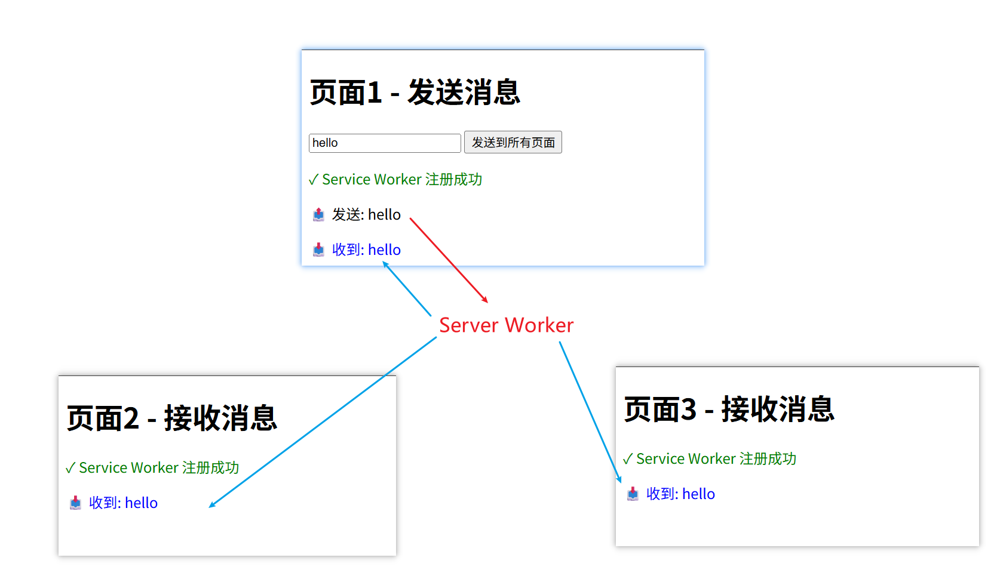


### 方案3：LocalStorage 的 storage 事件监听


#### 是什么

storage 事件是浏览器提供的一个原生事件，当同源的其他页面修改了 `localStorage` 或 `sessionStorage` 时，当前页面会自动收到通知。


边界：

- ✅ 监听同源（协议+域名+端口相同）的其他标签页/窗口的存储变化
- ❌ 不会监听当前页面自己的修改
- ❌ 本地文件（file://）无法触发
- ✅ 必须通过服务器（http://）运行


解决什么问题：多标签页数据同步

```mermaid
graph LR
    A[标签页A<br/>用户登录] -->|修改 localStorage| B[localStorage]
    B -.触发 storage 事件.-> C[标签页B]
    B -.触发 storage 事件.-> D[标签页C]
    C -->|自动更新UI| E[显示登录状态]
    D -->|自动更新UI| F[显示登录状态]
    
    style A fill:#0D47A1
    style C fill:#0D47A1
    style D fill:#0D47A1
    style B fill:#F97316
```

- 用户在标签页A登录 → 标签页B/C 自动更新登录状态
- 用户在标签页A退出登录 → 所有标签页同步退出
- 购物车数据、用户偏好设置等多标签页实时同步


#### 设计原理

核心设计：发布-订阅模式

```mermaid
sequenceDiagram
    participant A as 标签页A
    participant LS as localStorage<br/>(浏览器内核)
    participant B as 标签页B
    participant C as 标签页C
    
    B->>LS: 监听 storage 事件
    C->>LS: 监听 storage 事件
    
    Note over A: 用户操作触发
    A->>LS: localStorage.setItem("name", "张三")
    
    Note over LS: 浏览器内核检测到变化
    LS-->>B: 触发 storage 事件<br/>{key, oldValue, newValue...}
    LS-->>C: 触发 storage 事件<br/>{key, oldValue, newValue...}
    
    Note over A: ❌ A 不会收到事件
    
    B->>B: 执行回调函数
    C->>C: 执行回调函数

```

为什么不通知修改页面自己？

- 修改页面已经知道数据变化（因为是它自己改的）
- 避免无限循环：如果在 storage 事件中又修改 localStorage，会造成死循环


#### 语法

件对象的 5 个属性

```js
window.addEventListener("storage", (e) => {
    console.log(e.key);          // 被修改的键名
    console.log(e.oldValue);     // 修改前的值
    console.log(e.newValue);     // 修改后的值
    console.log(e.storageArea);  // Storage 对象本身（localStorage 或 sessionStorage）
    console.log(e.url);          // 触发修改的页面 URL
});
```


| 操作                              | 是否触发 storage 事件           |
| :-------------------------------- | :------------------------------ |
| `localStorage.name = "张三"`      | ✅ 其他标签页收到                |
| `localStorage.setItem("age", 20)` | ✅ 其他标签页收到                |
| `localStorage.removeItem("name")` | ✅ 其他标签页收到                |
| `localStorage.clear()`            | ✅ 其他标签页收到（key 为 null） |
| 刷新页面                          | ❌ 不触发                        |
| 当前页面自己修改                  | ❌ 当前页面不收到                |


#### 完整案例

```
storage-event-demo/
├── index.html      # 标签页A - 修改数据
└── index2.html     # 标签页B - 监听变化
```

用 Live Server 打开 `index.html`和`index2.html`


标签页A - 修改数据

```html
<label>用户名：</label>
<input type="text" id="nameInput" placeholder="输入用户名">

<label>年龄：</label>
<input type="number" id="ageInput" placeholder="输入年龄">
```

```js
// 修改数据
const name = document.getElementById('nameInput').value;
const age = document.getElementById('ageInput').value;

localStorage.setItem('name', name);
localStorage.setItem('age', age);
localStorage.clear();
```


标签页B - 监听变化

```js
// 监听 storage 事件
window.addEventListener("storage", (e) => {
    console.log('收到 storage 事件:', e);
});
```


### 方案4：*Shared Worker* 定时器轮询


#### 是什么

Shared Worker 是一种特殊的 Web Worker，它可以被多个浏览器上下文（标签页、iframe、窗口）共同访问。

边界条件：

- 必须同源（协议 + 域名 + 端口完全相同）
- 独立的 JavaScript 执行环境（不能访问 DOM）
- 通过消息机制通信


解决的问题：

假设打开了同一个网站的 3 个标签页：

```
标签页A：正在编辑文章草稿
标签页B：正在浏览首页
标签页C：正在查看个人资料
```

问题：

- 如果标签页A更新了用户信息，B和C如何实时知道？
- 每个标签页都要轮询服务器？浪费资源
- 使用 LocalStorage + storage事件？只能传简单数据，且有性能问题


Shared Worker 的解决方案

```mermaid
graph TB
    subgraph "浏览器"
        A[标签页A<br/>发送数据]
        B[标签页B<br/>接收数据]
        C[标签页C<br/>接收数据]
        SW[Shared Worker<br/>共享内存/定时器]
    end
    
    A -->|postMessage| SW
    SW -->|port.postMessage| B
    SW -->|port.postMessage| C
    
    style SW fill:#38BDF8,color:#0F172A
    style A fill:#E65100,color:#fff
```

只需要一个定时器

所有标签页共享同一个 Worker 实例

内存占用更少，性能更好


#### 设计原理

```mermaid
sequenceDiagram
    participant Tab1 as 标签页1
    participant Tab2 as 标签页2
    participant SW as Shared Worker
    
    Tab1->>SW: new SharedWorker('worker.js')
    Note over SW: 创建 port1 连接
    
    Tab2->>SW: new SharedWorker('worker.js')
    Note over SW: 复用同一实例<br/>创建 port2 连接
    
    Tab1->>SW: port.postMessage('hello')
    SW->>Tab2: port.postMessage('hello')
    
    Note over Tab1,Tab2: 每个标签页有独立的 port<br/>Worker 可以区分消息来源

```

设计考量：

- 多对一关系：多个标签页连接同一个 Worker
- 独立通道：每个连接有自己的 `port`，可以单独通信
- 事件驱动：通过 `onconnect` 事件感知新连接


#### 语法

整体架构

```mermaid
graph LR
    subgraph "发送端 index.html"
        I1[输入框] --> B1[发送按钮]
        B1 --> W1[worker.port.postMessage]
    end
    
    subgraph "Shared Worker"
        W[worker.js<br/>data变量存储]
    end
    
    subgraph "接收端 index2.html"
        T[定时器每1秒] --> W2[发送'get'请求]
        W2 --> W
        W --> R[接收数据并打印]
    end
    
    W1 --> W
    
    style W fill:#38BDF8,color:#0F172A
    style B1 fill:#F97316,color:#fff
```


Shared Worker两种启动方式

```js
// 方式1：使用 onmessage 会自动启动
worker.port.onmessage = (e) => { ... }

// 方式2：使用 addEventListener 必须手动启动
worker.port.addEventListener('message', (e) => { ... })
worker.port.start() // ← 必须调用
```


发送端（index.html）：

```js
// // 浏览器检查是否已有该URL的Worker实例，没有则创建并加载worker.js，有则复用
const worker = new SharedWorker('worker.js')
// 发送消息给 Worker
worker.port.postMessage(content.value);
```


接收端（index2.html）：

```js
const worker = new SharedWorker('worker.js'); // 获取已存在的Worker实例（与发送端共享同一个）
worker.port.start()  // 激活port的消息队列，开始接收消息


// 监听来自 Worker 的消息
worker.port.addEventListener('message', (e) => {
    console.log('来自worker的数据：', e.data)
})

// 每秒请求一次数据
setInterval(() => {
    worker.port.postMessage('get') // 约定'get'表示获取数据（触发Worker的onmessage）
}, 1000);
```

Worker 端（worker.js）：

```js
var data = ''; // 共享的数据存储

// 当有新的页面连接到此Worker时触发
onconnect = function (e) {
    var port = e.ports[0] // 获取当前连接的端口
    
    port.onmessage = function (e) {
        if (e.data === 'get') {
            port.postMessage(data);  // 通过port发送数据回对应的页面
            data = ""; // 清空数据
        } else {
            data = e.data  // 通过port发送数据回对应的页面
        }
    }
}
```


### 方案5：*cookie* 定时器轮询


#### 是什么

通过定时器（setInterval）周期性检查 Cookie 值的变化，当检测到 Cookie 被其他标签页修改时，当前标签页就能感知到这个变化，从而实现跨标签页通信。


需求

- 问题场景：同一网站的多个标签页之间需要共享数据（如登录状态同步、购物车同步）
- Cookie 特性：同源的所有标签页共享同一套 Cookie
- 检测需求：Cookie 本身不会主动通知变化，需要主动轮询检测


设计理由

- 优点：实现简单，兼容性好（几乎所有浏览器都支持）
- 缺点：
  - 性能差：持续轮询消耗资源
  - 延迟高：检测间隔决定了通信延迟（示例中是 1 秒）
  - Cookie 大小限制：只能传输 4KB 数据


#### 工作流程

```mermaid
sequenceDiagram
    participant Tab1 as 标签页1
    participant Cookie as Cookie存储
    participant Tab2 as 标签页2(轮询监听)
    
    Note over Tab2: 页面加载时<br/>保存初始Cookie值
    Tab2->>Cookie: 读取 Cookie
    Cookie-->>Tab2: name=zhangsan
    
    loop 每隔1秒轮询
        Tab2->>Cookie: 读取当前 Cookie
        Cookie-->>Tab2: 返回当前值
        Tab2->>Tab2: 比较新旧值
    end
    
    Tab1->>Cookie: 修改 Cookie<br/>name=lisi
    
    Note over Tab2: 下一次轮询时
    Tab2->>Cookie: 读取 Cookie
    Cookie-->>Tab2: name=lisi
    Tab2->>Tab2: 检测到变化！<br/>触发更新逻辑

```


#### 语法

设置 Cookie

```js
document.cookie = "name=zhangsan";
```

- 作用：在浏览器中存储一个键值对
- 特点：同源所有标签页共享


读取 Cookie

```js
var cookie = document.cookie;
// 返回格式："name=zhangsan; age=18" (所有cookie用分号分隔)
```


定时器轮询

```js
setInterval(function(){
    if(cookie !== document.cookie){
        // Cookie 发生了变化
        cookie = document.cookie; // 更新本地缓存
    }
}, 1000); // 每1000毫秒(1秒)执行一次
```

- setInterval：周期性执行函数
- 轮询逻辑：不断比较新旧值


### 方案6：window.postMessage


#### 是什么

跨窗口通信（Window.postMessage）是浏览器提供的一个 API，允许不同窗口之间安全地传递消息，即使这些窗口来自不同的域名（跨域）。


边界：

- 只能在「有引用关系」的窗口间通信（如：父窗口打开的子窗口、iframe 嵌入的页面）
- 不是 WebSocket，不是长连接，是单向消息发送


解决了什么问题：

浏览器有同源策略（Same-Origin Policy）：不同域名的页面无法直接访问对方的 DOM 和 JavaScript 变量。

问题场景：

- 主页面 `https://a.com` 打开了子窗口 `https://b.com`
- 主页面想给子窗口发送数据，但直接访问 `childWindow.someVariable` 会被浏览器阻止

postMessage 的作用：提供一个「受控的通道」，让不同源的窗口可以安全传递消息。


#### 设计原理

核心机制

```mermaid
graph LR
    A[窗口 A<br/>a.com] -->|1. 获取窗口引用| B[窗口 B<br/>b.com]
    A -->|2. postMessage发送| B
    B -->|3. message事件监听| B
    
    style A fill:#0F172A,stroke:#38BDF8,color:#F8FAFC
    style B fill:#0F172A,stroke:#22D3EE,color:#F8FAFC
```

三个关键步骤：

1. 获取目标窗口引用：通过 `window.open()` 或 `iframe.contentWindow` 等方式
2. 发送消息：调用 `targetWindow.postMessage(data, origin)`
3. 接收消息：目标窗口监听 `message` 事件


安全设计：

```mermaid
graph TB
    A[发送方] -->|postMessage data, origin| B{origin验证}
    B -->|匹配| C[接收方收到消息]
    B -->|不匹配| D[拒绝传递]
    
    style A fill:#0F172A,stroke:#38BDF8,color:#F8FAFC
    style B fill:#1E293B,stroke:#F97316,color:#F8FAFC
    style C fill:#0F172A,stroke:#4FD1C5,color:#F8FAFC
    style D fill:#1E293B,stroke:#EF4444,color:#F8FAFC
```

- `origin` 参数：限制哪些域名可以接收消息（`"*"` 表示任何域名，不安全）
- `e.origin` 属性：接收方可以验证消息来源，防止恶意网站伪造


#### 工作流程

```mermaid
sequenceDiagram
    participant P as 父页面<br/>(a.com)
    participant C as 子窗口<br/>(b.com)
    
    P->>P: 1. window.open打开子窗口
    P->>P: 2. 保存窗口引用 opener
    P->>C: 3. opener.postMessage(data, "*")
    C->>C: 4. 监听 message 事件
    C->>C: 5. 获取 event.data
    
    Note over P,C: 如果需要双向通信
    C->>P: 6. event.source.postMessage(reply, "*")
    P->>P: 7. 监听 message 事件

```


#### 语法


发送消息

```js
targetWindow.postMessage(data, targetOrigin);
```

参数：

- `data`：要发送的数据（可以是对象、字符串等，会被结构化克隆）
- `targetOrigin`：目标窗口的域名（如 `"https://b.com"`），`"*"` 表示不限制


接收消息

```js
window.addEventListener('message', function(event) {
    console.log(event.data);   // 接收到的数据
    console.log(event.origin); // 发送方的域名
    console.log(event.source); // 发送方窗口的引用
});
```

关键属性：

- `event.data`：实际传递的数据
- `event.origin`：发送方的完整域名（用于验证）
- `event.source`：发送方窗口对象（可用于回复消息）


#### 完整案例

父页面（主窗口）

```html
<body>
    <button id="popBtn">打开子窗口</button>
    
    <input type="text" id="content" placeholder="输入要发送的消息">
    <button id="btn">发送数据到子窗口</button>
    
    <h3>收到的回复：</h3>
    <div id="reply" style="color: green;"></div>

    <script>
        const popBtn = document.querySelector('#popBtn');
        const content = document.querySelector("#content");
        const btn = document.querySelector("#btn");
        const reply = document.querySelector("#reply");
        
        let childWindow = null; // 保存子窗口的引用

        // 1. 打开子窗口
        popBtn.onclick = function () {
            childWindow = window.open(
                "child.html",   // 子窗口的URL
                "childWindow",  // 子窗口的名称
                "height=400,width=400,top=10,left=500" // 子窗口的属性
            );
        }

        // 2. 发送消息到子窗口
        btn.onclick = function () {
            let data = {
                value: content.value,
                timestamp: Date.now()
            }
            
            // 发送消息（* 表示不限制目标域名）
            childWindow.postMessage(data, "*");
        }

        // 3. 监听子窗口的回复
        window.addEventListener('message', function (e) {
            reply.textContent = JSON.stringify(e.data);
        });
    </script>
</body>
```


子页面（弹出窗口）

```html
<body>
    <h3>收到的消息：</h3>
    <div id="received" style="color: blue;"></div>

    <script>
        const received = document.querySelector('#received');

        // 监听父窗口发来的消息
        window.addEventListener('message', function (e) {
            
            // 显示收到的数据
            received.textContent = JSON.stringify(e.data);

            // 回复父窗口
            e.source.postMessage({
                reply: '子窗口已收到消息',
                originalValue: e.data.value
            }, "*");
        });
    </script>
</body>
```


##### 效果

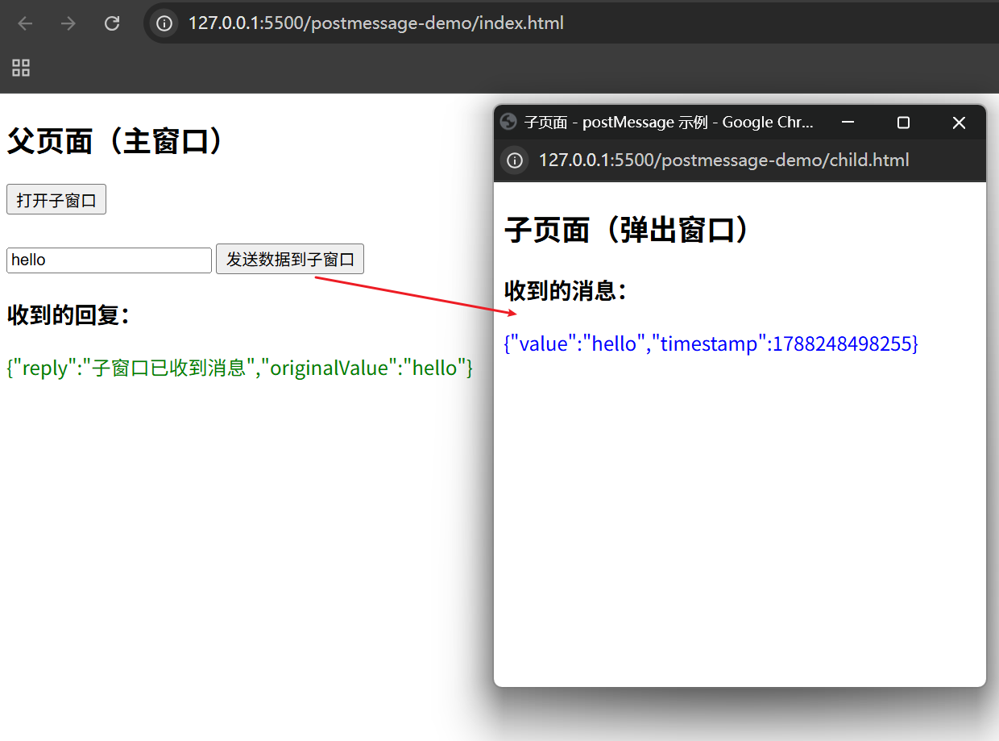


### 方案7：Websocket


#### 是什么

WebSocket 是一种网络通信协议，它在单个 TCP 连接上提供全双工（双向）通信通道

- 全双工 = 客户端和服务器可以同时互相发送消息
- 持久连接 = 一次握手后保持连接，不用反复建立连接
- 协议标识 = `ws://` (普通) 或 `wss://` (加密)


解决的问题：

传统 HTTP 的局限：

- HTTP 是单向请求-响应模型：客户端问，服务器答
- 服务器不能主动推送消息给客户端
- 如果需要实时数据，只能用轮询（反复问服务器"有新消息吗？"）

轮询的问题：

- 大量无效请求浪费资源
- 延迟高（每隔几秒才能拿到新消息）
- 服务器压力大

WebSocket 解决方案：

- 服务器可以主动推送消息
- 连接建立后持续通信，无需反复握手
- 低延迟、低开销


#### 设计原理

```mermaid
sequenceDiagram
    participant C as 客户端
    participant S as 服务器
    
    Note over C,S: 阶段1: HTTP 握手升级
    C->>S: HTTP 请求（Upgrade: websocket）
    S->>C: HTTP 响应（101 Switching Protocols）
    
    Note over C,S: 阶段2: WebSocket 持久连接
    C->>S: 消息1
    S->>C: 消息2
    C->>S: 消息3
    S->>C: 消息4
    
    Note over C,S: 双向通信，连接保持
```

1. 复用 HTTP 握手：通过 HTTP 协议升级（Upgrade），避免重新设计握手机制
2. 帧格式：消息分成小的数据帧传输，支持文本和二进制
3. 心跳机制：通过 ping/pong 帧保持连接活跃
4. 事件驱动：客户端和服务器都通过事件监听处理消息


#### WebSocket 工作流程

```mermaid
graph TD
    A[客户端发起连接] -->|new WebSocket| B[HTTP 握手]
    B -->|协议升级| C[WebSocket 连接建立]
    C --> D{连接状态}
    D -->|open| E[可以收发消息]
    E -->|send| F[发送消息]
    E -->|onmessage| G[接收消息]
    D -->|close| H[连接关闭]
    D -->|error| I[连接错误]
```


#### 语法

应用场景：

```mermaid
graph LR
    subgraph 客户端A
        A1[输入框] --> A2[发送按钮]
        A2 -->|ws.send| A3[WebSocket]
    end
    
    subgraph 服务器
        S1[WebSocket Server]
        S2[客户端列表]
        S1 --> S2
    end
    
    subgraph 客户端B
        B1[WebSocket]
        B1 -->|onmessage| B2[显示消息]
    end
    
    A3 -->|消息| S1
    S1 -->|转发| B1

```

1. 客户端 A 和 B 都连接到服务器
2. 服务器将所有客户端保存在数组中
3. 客户端 A 发送消息
4. 服务器收到消息后，遍历客户端列表
5. 服务器将消息转发给除 A 之外的所有客户端
6. 客户端 B 收到消息并显示


##### 客户端 API

创建连接

```js
const ws = new WebSocket('ws://localhost:8080');
```

- 参数：服务器地址（ws:// 或 wss://）
- 作用：发起 WebSocket 连接请求


事件监听

```js
// 连接成功
ws.onopen = function(event) {
    console.log('连接已建立');
};

// 收到消息
ws.onmessage = function(event) {
    console.log('收到消息:', event.data);
};

// 连接关闭
ws.onclose = function(event) {
    console.log('连接已关闭');
};

// 发生错误
ws.onerror = function(error) {
    console.log('发生错误:', error);
};
```


发送消息

```js
ws.send('Hello Server');
```

- 参数：字符串、ArrayBuffer 或 Blob
- 作用：向服务器发送数据


关闭连接

```js
ws.close();
```


##### 服务端 API (Node.js + ws 库)

1. 创建服务器

```js
const WebSocketServer = require('ws').Server;
const wss = new WebSocketServer({ port: 8080 });
```


2. 监听客户端连接

```js
wss.on('connection', function(client) {
    console.log('新客户端连接');
    
    // 监听该客户端的消息
    client.on('message', function(msg) {
        // 回复消息
        client.send('收到了');
    });
    
    // 监听断开
    client.on('close', function() {
        console.log('客户端断开');
    });
});
```


#### 完整案例

##### 结构

```mermaid
sequenceDiagram
    participant Sender as sender.html
    participant Server as server.js
    participant Receiver1 as receiver.html (窗口1)
    participant Receiver2 as receiver.html (窗口2)
    
    Note over Sender,Receiver2: 1. 建立连接
    Sender->>Server: new WebSocket (连接)
    Receiver1->>Server: new WebSocket (连接)
    Receiver2->>Server: new WebSocket (连接)
    Server->>Server: clients = [Sender, R1, R2]
    
    Note over Sender,Receiver2: 2. 发送消息
    Sender->>Server: ws.send("你好")
    
    Note over Sender,Receiver2: 3. 服务器转发
    Server->>Server: 遍历 clients，排除发送者
    Server->>Receiver1: client.send("你好")
    Server->>Receiver2: client.send("你好")
    
    Note over Sender,Receiver2: 4. 接收端显示
    Receiver1->>Receiver1: onmessage 触发，显示消息
    Receiver2->>Receiver2: onmessage 触发，显示消息

```


##### 代码

服务端

```js
// WebSocket 服务器
const WebSocketServer = require('ws').Server; // 引入WebSocketServer模块
const wss = new WebSocketServer({ port: 8080 }); // 创建WebSocket服务器

// 保存所有连接的客户端
const clients = [];

wss.on('connection', function(client) {
    // 新客户端连接
    clients.push(client); // client参数是新连接的客户端对象
    console.log('在线人数:', clients.length);
    
    // 收到消息
    client.on('message', function(msg) {
        console.log('收到:', msg.toString());
        
        // 转发给其他人
        clients.forEach(function(c) {
            if (c !== client) {
                c.send(msg.toString());
            }
        });
    });
    
    // 断开连接
    client.on('close', function() {
        const index = clients.indexOf(client);
        clients.splice(index, 1);
        console.log('在线人数:', clients.length);
    });
});

console.log('WebSocket 服务器运行在 ws://localhost:8080');
```


发送端

```html
<body>
    <h2>发送消息</h2>
    <input type="text" id="msg" placeholder="输入消息">
    <button id="send">发送</button>
    
    <script>
        // 连接到 WebSocket 服务器
        const ws = new WebSocket('ws://localhost:8080');
        
        ws.onopen = function() {
            console.log('连接成功');
        };
        
        // 点击发送
        send.onclick = function() {
            if (msg.value.trim() !== '') {
                ws.send(msg.value.trim());
                msg.value = '';
            }
        };
        
        // 关闭页面时断开连接
        window.onbeforeunload = function() {
            ws.close();
        };
    </script>
</body>
```


接收端

```html
<body>
    <h2>接收消息</h2>
    <div id="messages"></div>
    
    <script>
        // 连接到 WebSocket 服务器
        const ws = new WebSocket('ws://localhost:8080');
        let count = 1;
        
        ws.onopen = function() {
            console.log('连接成功');
        };
        
        // 收到消息
        ws.onmessage = function(event) {
            const p = document.createElement('p');
            p.textContent = `第 ${count} 条消息: ${event.data}`;
            messages.appendChild(p);
            count++;
        };
        
        // 关闭页面时断开连接
        window.onbeforeunload = function() {
            ws.close();
        };
    </script>
</body>
```


##### 效果

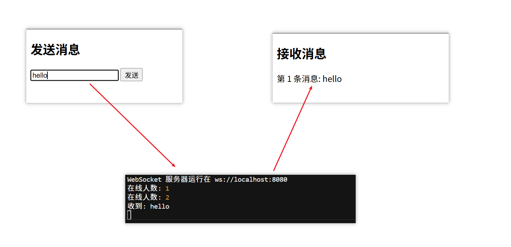


### 方案8：Web Worker


#### 是什么

定义：Web Worker 是 HTML5 提供的一种在后台线程运行 JavaScript 的技术，让 JavaScript 可以多线程执行。

边界：

- 主线程（UI 线程）：处理页面交互、DOM 操作
- Worker 线程（后台线程）：处理耗时计算，不能访问 DOM

```mermaid
graph LR
    A[浏览器主线程] -->|创建| B[Worker 线程]
    A <-->|postMessage/onmessage| B
    A -->|可访问| C[DOM/BOM]
    B -.->|不可访问| C
    B -->|可访问| D[计算/网络请求]

```


为什么需要 Web Worker

JavaScript 是单线程的，遇到耗时操作会阻塞主线程，导致页面卡死。

```js
// 这段代码会让浏览器假死
while(true) {}
```

解决方案：把耗时任务放到 Worker 线程，主线程继续响应用户操作。

```mermaid
sequenceDiagram
    participant 用户
    participant 主线程
    participant Worker线程
    
    用户->>主线程: 点击按钮（触发计算）
    主线程->>Worker线程: 创建 Worker，发送任务
    主线程->>用户: 继续响应其他操作
    Worker线程->>Worker线程: 执行耗时计算
    Worker线程->>主线程: 返回结果
    主线程->>用户: 显示结果

```

设计原理：

1. 隔离性：Worker 运行在独立线程，崩溃不影响主线程
2. 安全性：Worker 不能访问 DOM，避免多线程操作 DOM 的竞态问题
3. 通信机制：通过消息传递（postMessage）而非共享内存，避免线程同步问题


#### Web Worker 的两种类型

```mermaid
graph TD
    A[Web Worker] --> B[Dedicated Worker 专用线程]
    A --> C[Shared Worker 共享线程]
    B --> D[只能被创建它的页面访问]
    B --> E[页面关闭时结束]
    C --> F[可被多个页面同时访问]
    C --> G[所有关联页面关闭时才结束]
```


#### 语法


##### Dedicated Worker（最常用）

通信流程图：

```mermaid
sequenceDiagram
    participant M as 主线程
    participant W as Worker线程
    
    M->>W: new Worker("worker.js") 创建
    M->>W: postMessage(data) 发送数据
    W->>W: onmessage 接收并处理
    W->>M: postMessage(result) 返回结果
    M->>M: onmessage 接收结果
    M->>W: terminate() 终止

```

主线程代码：

```js
// 1. 创建 Worker
var worker = new Worker("worker.js");

// 2. 接收 Worker 发来的消息
worker.onmessage = function(event) {
    console.log("收到数据：", event.data);
}

// 3. 向 Worker 发送消息
worker.postMessage("发送的数据");

// 4. 终止 Worker
worker.terminate();
```

Worker 线程代码（worker.js）：

```js
// 1. 接收主线程消息
onmessage = function(event) {
    console.log("收到主线程数据：", event.data);
    
    // 2. 执行耗时操作
    var result = 计算结果;
    
    // 3. 返回结果给主线程
    postMessage(result);
}

// 4. 导入其他脚本（如需要）
importScripts("other.js");
```


##### Shared Worker（跨标签页通信）

html页面，需要通过 `port` 对象通信

```js
// 创建共享 Worker
var worker = new SharedWorker("worker.js");

// 通过 port 发送消息
worker.port.postMessage("数据");

// 通过 port 接收消息
worker.port.onmessage = function(event) {
    console.log(event.data);
}
```

Shared Worker 内部（worker.js）：

```js
var data = '';

onconnect = function(e) {
    var port = e.ports[0];  // 获取连接的端口
    
    port.onmessage = function(e) {
        // 处理消息
        data = e.data;
        port.postMessage("响应数据");
    }
}
```


#### Dedicated Worker案例

Shared Worker前面有

项目结构

```mermaid
graph LR
    A[index.html 主页面] -->|创建 Worker| B[worker.js 后台计数]
    B -->|每秒返回计数| A
    A -->|显示计数| C[页面 UI]
    A -->|terminate| B

```

html界面

```html
<body>
    <h1>Web Worker 计数器</h1>
    <p>计数：<output id="result">0</output></p>
    <button id="startBtn">开始工作</button>
    <button id="stopBtn">停止工作</button>

    <script>
        var startBtn = document.getElementById("startBtn");
        var stopBtn = document.getElementById("stopBtn");
        var worker; 

        // 开始 Worker
        startBtn.onclick = function () {
            worker = new Worker("worker.js");
            
            // 接收来自 Worker 的数据
            worker.onmessage = function (event) {
                document.getElementById("result").innerHTML = event.data;
            };
        }

        // 停止 Worker
        stopBtn.onclick = function () {
            worker.terminate();
            worker = undefined;
        }
    </script>
</body>
```

worker.js 后台计数

```js
var i = 0;

function timedCount() {
    i++;
    // 每次计数都通过 postMessage 返回给主线程
    postMessage(i);
    setTimeout("timedCount()", 1000);
}

timedCount();
```


## 前端性能优化 — Performance 工具使用

位置：


进入面板显示的内容

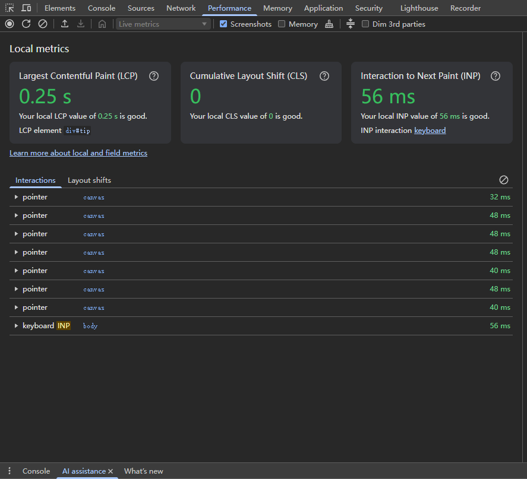

| 指标                                                   | 当前值 | 含义                                                         | 评价标准               |
| ------------------------------------------------------ | ------ | ------------------------------------------------------------ | ---------------------- |
| **LCP**（Largest Contentful Paint，最大内容绘制）      | 0.25 s | 视口内最大的文本块或图片渲染完成的时间。                     | ≤2.5s 良好；>4s 差     |
| **CLS**（Cumulative Layout Shift，累计布局偏移）       | 0      | 页面生命周期内元素意外位移的累计分数，衡量视觉稳定性。       | ≤0.1 良好；>0.25 差    |
| **INP**（Interaction to Next Paint，交互到下一次绘制） | 56 ms  | 交互之后（比如点击、按键、触摸），页面多久能看到反应的最长延迟，衡量响应性。 | ≤200ms 良好；>500ms 差 |

截图中的 LCP 元素是 `div#tip`，对应项目中div#tip元素

```html
    <div id="tip">
勾选「使用优化版」前后各点一次按钮，
并在 DevTools → Performance 中录制对比
    </div>
    <script type="module" src="/src/main.js"></script>
```

意外移动：用户没有做任何操作，页面上显示出来的元素自己改变了位置。


Interactions（交互）列表

列出了每次交互的类型、目标元素和耗时：

- 7 次 `pointer`（目标 `canvas`，即 Cesium 画布上的鼠标拖拽、点击）：32～48 ms
- 1 次 `keyboard`（目标 `body`）：56 ms，带 **INP** 标记，因为它是耗时最长的一次，所以成为 INP 的取值。


其它区域

- Layout shifts 标签页：列出每次布局偏移的详情，当前 CLS 为 0，所以应该是空的。
- Field metrics：把本地数据与 Chrome UX Report 中真实用户的数据对比，需要点击 "Set up" 配置。
- 工具栏选项：Screenshots（录制时截屏）、Memory（记录内存）、Dim 3rd parties（淡化第三方请求）。


Record / Record and reload：开始录制火焰图，用于分析具体的长任务、强制布局等问题。

点击 *(Record)* 按钮，Chrome 会开始记录交互阶段的性能数据，需要手动点击 Stop 停止录制；

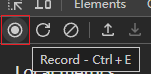

而点击 ( Record and reload) 按钮，Chrome 会重新刷新页面并自动开始记录，等到页面完全渲染出来后自动结束记录。

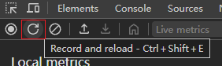


### 例子1

| 按钮            | 问题版                  | 优化版                   | 在 Performance 里看什么         |
| --------------- | ----------------------- | ------------------------ | ------------------------------- |
| 1. 主线程长任务 | 同步执行约 100 次重计算 | 用 `setTimeout` 拆成小块 | Main 轨道的 Long Task(红色角标) |

录制内容

- CPU 图（截图最上方）：约 2000ms 到 14000ms 之间被黄色铺满，黄色代表 Scripting（JS 执行）。这说明该时间段 CPU 持续被 JS 占满。
- Screenshots 截图条：这段时间内画面几乎没变化，球体静止。画面不更新就说明主线程被占住，页面卡死。
- 用鼠标在概览上拖选一段，下方所有面板只分析选中区间。

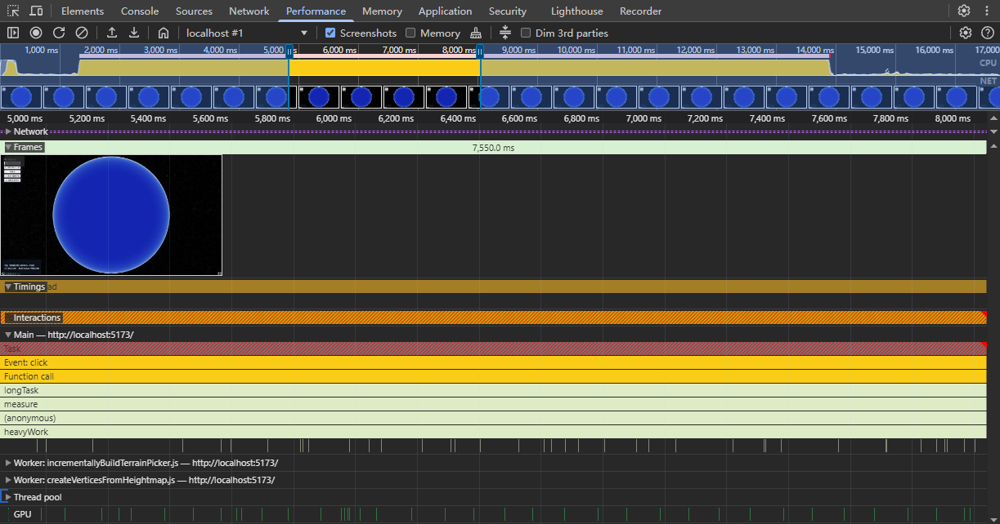

自上而下依次是：

| 轨道             | 你的截图里看到的                        | 含义                                                         |
| ---------------- | --------------------------------------- | ------------------------------------------------------------ |
| **Network**      | 黄色条                                  | 资源加载，和本次问题无关                                     |
| **Timings**      | `longTask-bad`                          | 来自 `performance.measure("longTask-bad")`，是你在 `main.js` 的 `measure()` 里埋的标记，长度约 12 秒 |
| **Interactions** | `Pointer` 红色斜纹                      | 一次点击交互，斜纹加红角代表响应过慢，对应 INP 指标很差      |
| **Main**         | 火焰图                                  | 主线程调用栈，是分析重点                                     |
| **Worker**       | `incrementallyBuildTerrainPicker.js` 等 | Cesium 的 Web Worker，不占主线程，此处几乎空闲               |
| **GPU**          | 绿色条                                  | GPU 工作；长任务期间几乎没有，说明没有新帧提交               |

Interactions的红角

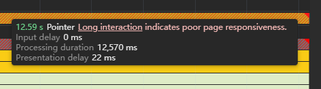


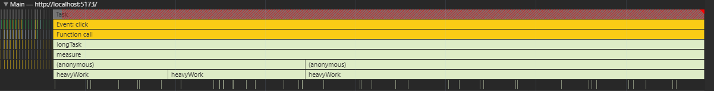

```
Task（红色斜纹 + 右上红角 = Long Task，超过 50ms）
└ Event: click                 ← 用户点击触发
  └ Function call
    └ longTask                 ← main.js 里的函数
      └ measure                ← 你的 measure 包装
        └ (anonymous)         ← for 循环里的箭头函数
          └ heavyWork          ← 真正耗时的函数（3e6 次 sqrt/sin）
```

读法：

- 最上面的 `Task` 一整条宽度约 12 秒，是一个没有被切开的任务。浏览器在这期间不能处理输入、不能渲染。右上角的红色三角和红色斜纹就是 Long Task 警告（超过 50ms 即标记）。

- 往下找最宽的叶子节点：`heavyWork` 重复了 100 次，下面那排细密的竖条就是每次调用。

  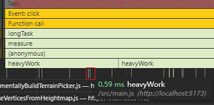

- 这个调用栈直接对应源码：`longTask()` → `measure()` → `for (i<100) heavyWork()`。

  ```js
  // ---------- 场景1：主线程长任务 ----------
  function heavyWork() {
    let s = 0;
    for (let i = 0; i < 3e6; i++) s += Math.sqrt(i) * Math.sin(i);
    return s;
  }
  
  function longTask() {
    if (!optimized) {
      // 问题版：一次性同步执行 → 出现带红角标的 Long Task，页面卡死
      measure("longTask-bad", () => {
        for (let i = 0; i < 100; i++) heavyWork();
      });
      return;
    }
  }
  ```

  


优化版源代码

```js
// ---------- 场景1：主线程长任务 ----------
function heavyWork() {
  let s = 0;
  for (let i = 0; i < 3e6; i++) s += Math.sqrt(i) * Math.sin(i);
  return s;
}

function longTask() {
  if (!optimized) {
  // 优化版：拆成小块，每块之间让出主线程
  performance.mark("longTask-good-start");
  let n = 0;
  const step = () => {
    heavyWork();
    if (++n < 100) setTimeout(step);
    else {
      performance.mark("longTask-good-end");
      performance.measure("longTask-good", "longTask-good-start", "longTask-good-end");
    }
  };
  step();
}
```

好在哪里，以及怎么读出来

| 对比点       | 问题版                             | 优化版                                                       | 在面板哪里读      |
| ------------ | ---------------------------------- | ------------------------------------------------------------ | ----------------- |
| Main 轨道    | 一个约 12 秒的整块 Task            | 约 100 个窄任务，任务之间有缝隙                              | Main 火焰图最上层 |
| Frames 轨道  | 长任务期间没有帧，画面静止         | 整段都有连续的帧，悬浮提示显示 `16.7 ms Partially-presented frame` | Frames 轨道       |
| Screenshots  | 球体画面不变                       | 画面持续变化                                                 | 顶部截图条        |
| Interactions | 一个红色斜纹的 Pointer，长约 12 秒 | 只有一个短橙块，之后是零星的短 `H` 形标记                    | Interactions 轨道 |

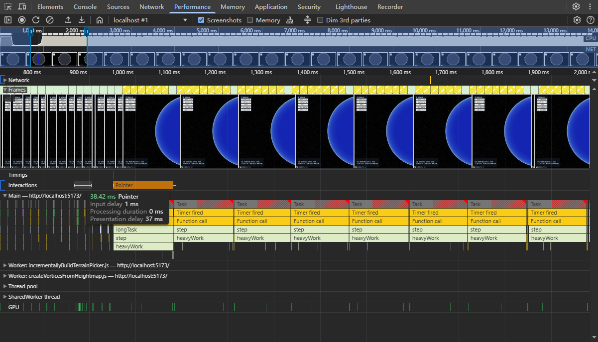

**1. Main 轨道**

- 问题版是一个跨越整个中段的单一 Task。(例子1中第一张图)
- 优化版是密集的黄色小块，每块对应一次 `setTimeout(step)` 的回调。
- 展开后调用栈大致是 `Timer Fired → step → heavyWork`，对应 `main.js` 里的 `step()`。
- 缝隙就是主线程空闲的时刻，浏览器可以在这时处理输入和渲染。

**2. Frames 轨道**

- 这是最直观的证据。有帧就说明浏览器能在任务之间的缝隙里提交画面。
- 但帧很稀疏。约 100 个切片在 13.7 秒里完成，大约每秒 7 次，所以画面是卡顿的，不是流畅的。

**3. Interactions 轨道**

- 问题版里一次点击对应 12 秒的响应时间，INP 极差。
- 优化版里你在运行期间的鼠标操作，每次只需要等当前切片结束，最坏约 125ms。
- 这就是 `H` 形短标记的来源。


### 例子2

| 按钮              | 问题版              | 优化版                     | 在 Performance 里看什么       |
| ----------------- | ------------------- | -------------------------- | ----------------------------- |
| 2. 添加 5000 个点 | 逐个 `entities.add` | `PointPrimitiveCollection` | Scripting 耗时和 Timings 轨道 |

未优化版

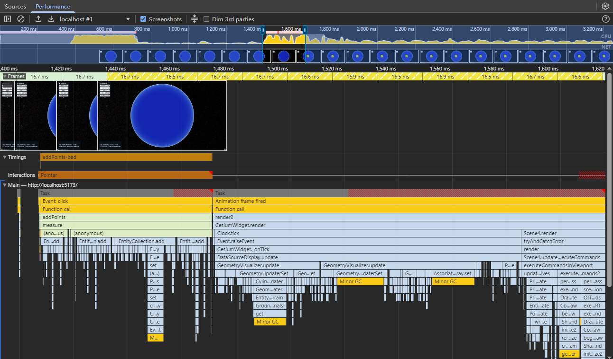

| 区域                  | 看什么                                                       |
| --------------------- | ------------------------------------------------------------ |
| 顶部概览（CPU / NET） | 黄色是 Scripting。拖选一段时间，下面所有内容都只显示这段。   |
| Frames                | 每帧耗时。绿色是正常帧，黄色斜纹是掉帧或部分呈现。           |
| Timings               | 用 `performance.measure()` 打的标记，对应 `addPoints-bad` 这条橙色条。 |
| Interactions          | 点击等交互及其响应时间。右侧红色斜纹表示这次交互慢。         |

Main 轨道上有两个 Task：

1. 第一个 Task（宽约 58ms）：`Event: click → Function call → addPoints → measure → (anonymous)`。这是你点击按钮后同步执行 `viewer.entities.add()` 循环的部分，与 Timings 里的 `addPoints-bad` 条等宽。
2. 第二个 Task（红色斜纹，约 375ms）：`Animation frame fired → Function call → …`。这是下一帧 Cesium 的 `render` 回调。

Minor GC（黄色小块）：Main 轨道上反复出现，说明 5000 个 Entity、Property、Cartesian3 等对象造成了大量内存分配和回收。

红色斜纹和右上角红三角：浏览器把超过 50ms 的任务标为 Long Task，这两个 Task 都被标了。


```js
// ---------- 场景2：大量点 ----------
let entityPoints = [];
let pointCollection = null;
const COUNT = 5000;

function addPoints() {
  clearPoints();
    // 问题版：Entity 逐个添加，每个都触发事件 + 生成 Primitive
    measure("addPoints-bad", () => {
      for (let i = 0; i < COUNT; i++) {
        const [lon, lat] = randomPos();
        entityPoints.push(
          viewer.entities.add({
            position: Cesium.Cartesian3.fromDegrees(lon, lat),
            point: { pixelSize: 5, color: Cesium.Color.YELLOW },
          }),
        );
      }
    });
}
```


优化后

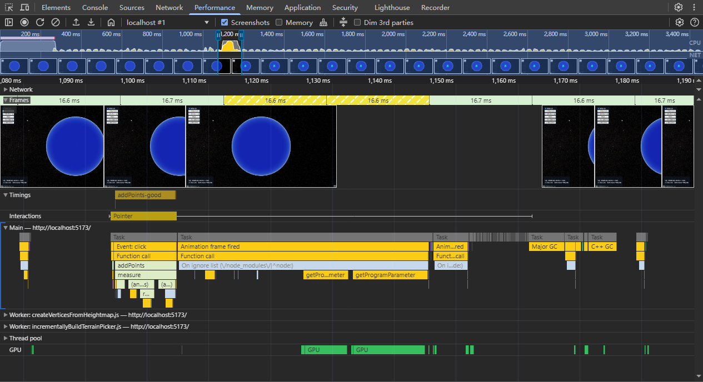

```js
// ---------- 场景2：大量点 ----------
let entityPoints = [];
let pointCollection = null;
const COUNT = 5000;

function addPoints() {
  clearPoints();
    // 优化版：直接用 PointPrimitiveCollection
    measure("addPoints-good", () => {
      pointCollection = viewer.scene.primitives.add(new Cesium.PointPrimitiveCollection());
      for (let i = 0; i < COUNT; i++) {
        const [lon, lat] = randomPos();
        pointCollection.add({
          position: Cesium.Cartesian3.fromDegrees(lon, lat),
          pixelSize: 5,
          color: Cesium.Color.CYAN,
        });
      }
    });
}
```


为什么 `PointPrimitiveCollection` 更快

1. 同步添加阶段(63.5ms 对 10.1ms)

   - 每次 `entities.add` 都要创建 Entity、`ConstantPositionProperty`、`PointGraphics` 和一堆 `ConstantProperty`,还要触发 `definitionChanged` 事件。每个点是十几个对象加一连串事件回调。

   - `pointCollection.add` 只创建一个轻量的 `PointPrimitive`。


2. 第一帧(147.9ms 对 40.6ms)

   - 问题版在第一帧才由 `DataSourceDisplay` 为 5000 个 Entity 逐个创建对应的 Visualizer 和 Primitive,这是一次集中的构建。

   - 优化版只需要把整个集合打包成一次顶点缓冲更新。

   - 问题版第一帧里还有 17ms 的 Minor GC,正是前面大量临时对象造成的。


3. 稳态每帧(5.17ms 对 1.56ms)

   - 问题版每帧更贵的原因是 Entity 体系每帧还要走 Property 求值、Visualizer 更新和可见性检查。

   - `PointPrimitiveCollection` 没有 Property 层,数据没变就不重建,每帧几乎只是提交绘制。


### 例子3

| 按钮            | 问题版                           | 优化版            | 在 Performance 里看什么           |
| --------------- | -------------------------------- | ----------------- | --------------------------------- |
| 4. 强制同步布局 | 循环里先写样式再读 `offsetWidth` | 先批量读,再批量写 | 紫色 Layout 和 Forced reflow 警告 |

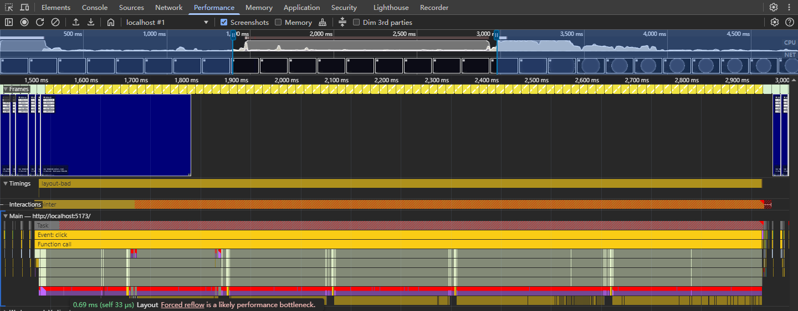

图中Main 轨道的火焰图，紫色表示 Rendering（样式计算和布局），黄色表示 Scripting（JS）。 正常情况下 JS 不应该在自己的调用栈里产生一长串紫色。

代码原因

```js
items.forEach((d) => {
  d.style.width = Math.random() * 200 + "px"; // 写：使布局失效（标记为 dirty）
  d.dataset.w = d.offsetWidth;               // 读：要拿到最新值，必须立刻重算样式并重排
});
```

浏览器默认会攒着样式修改，等帧末再统一布局。但 `offsetWidth` 必须返回最新值，所以读之前要先同步完成 Recalculate style 和 Layout。写、读、写、读交替进行，攒不下来。每轮重排都要处理 4040 个对象，总开销随元素数量近似平方增长。


预期优化

```js
function layoutThrash() {
    // 优化版：先批量读，再批量写
    measure("layout-good", () => {
      const widths = items.map((d) => d.offsetWidth);
      items.forEach((d, i) => {
        const widths = items.map((d) => d.offsetWidth);          // 第 1 步：全部先读，只触发 1 次布局
        items.forEach((d, i) => { d.style.width = ...; d.dataset.w = widths[i]; });  // 第 2 步：全部再写，只标 dirty
      });
    });
  }
}
```

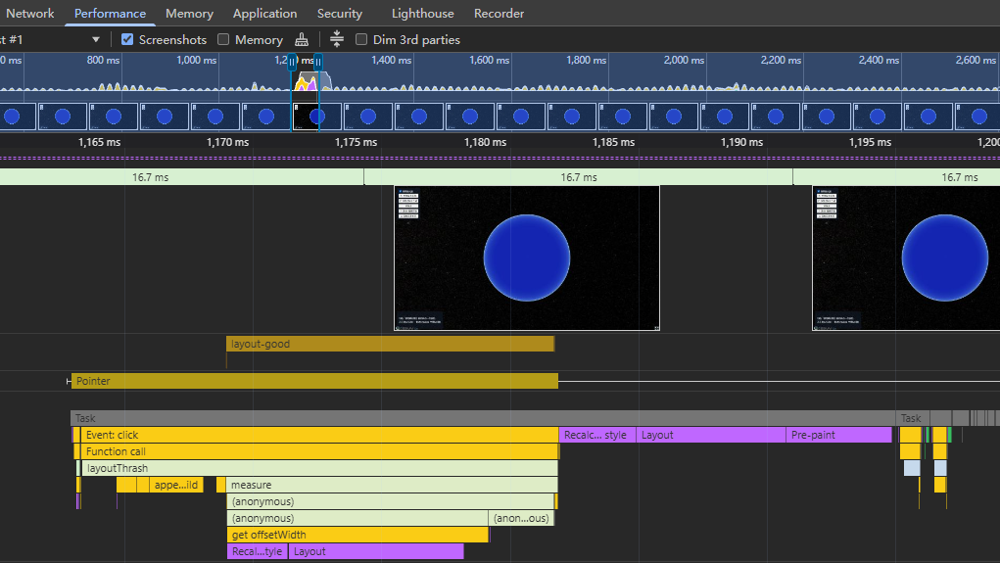
