## 浏览器：文档，事件，接口

## 浏览器环境，规格

主机环境提供了自己的对象和语言核心以外的函数。Web 浏览器提供了一种控制网页的方法。Node.JS 提供了服务器端功能，等等。

 JavaScript 在浏览器中运行时的鸟瞰示意图：

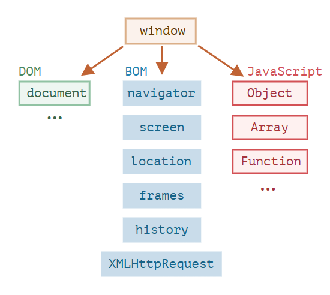

有一个叫做 `window` 的“根”对象。它有两个角色：

1. 首先，它是 JavaScript 代码的全局对象，如 [全局对象](https://zh.javascript.info/global-object) 一章所述。
2. 其次，它代表“浏览器窗口”，并提供了控制它的方法。


# 文档对象模型（DOM）

文档对象模型（Document Object Model）

将所有页面内容表示为可以修改的对象。

我们可以使用它来更改或创建页面上的任何内容。

### DOM树

HTML 文档的主干是标签（tag）。

根据文档对象模型（DOM），每个 HTML 标签都是一个对象。嵌套的标签是闭合标签的“子标签（children）”。

例如，`document.body` 是表示 `<body>` 标签的对象。


**DOM 的例子**

让我们从下面这个简单的文档（document）开始：

```html
<!DOCTYPE HTML>
<html>
<head>
  <title>About elk</title>
</head>
<body>
  The truth about elk.
</body>
</html>
```

DOM 将 HTML 表示为标签的树形结构。它看起来如下所示： 

换行 `/n`也算 `#text` 节点

<svg width="690" height="320"><g transform="translate(20,30)"><path class="link" d="M7,0L7,30L40.333333333333336,30" style="fill: none; stroke: rgb(190, 195, 199); stroke-width: 1px;"></path><path class="link" d="M7,0L7,180L40.333333333333336,180" style="fill: none; stroke: rgb(190, 195, 199); stroke-width: 1px;"></path><path class="link" d="M7,0L7,210L40.333333333333336,210" style="fill: none; stroke: rgb(190, 195, 199); stroke-width: 1px;"></path><path class="link" style="fill: none; stroke: rgb(190, 195, 199); stroke-width: 1px;" d="M40.333333333333336,210L40.333333333333336,240L73.66666666666667,240"></path><path class="link" style="fill: none; stroke: rgb(190, 195, 199); stroke-width: 1px;" d="M40.333333333333336,30L40.333333333333336,60L73.66666666666667,60"></path><path class="link" style="fill: none; stroke: rgb(190, 195, 199); stroke-width: 1px;" d="M40.333333333333336,30L40.333333333333336,90L73.66666666666667,90"></path><path class="link" style="fill: none; stroke: rgb(190, 195, 199); stroke-width: 1px;" d="M40.333333333333336,30L40.333333333333336,150L73.66666666666667,150"></path><path class="link" style="fill: none; stroke: rgb(190, 195, 199); stroke-width: 1px;" d="M73.66666666666667,90L73.66666666666667,120L107,120"></path><g class="node" transform="translate(0,0)" style="opacity: 1;"><rect y="-12.5" x="-5" rx="4" ry="4" height="25" width="280" style="fill: rgb(206, 224, 244); cursor: pointer;"></rect><text dy="4.5" dx="3.5" style="fill: black; pointer-events: none;">▾ </text><text dy="4.5" dx="16.5" style="font: 14px Consolas, &quot;Lucida Console&quot;, Menlo, Monaco, monospace; fill: rgb(51, 51, 51); pointer-events: none;">HTML</text></g><g class="node" transform="translate(33.33333206176758,30)" style="opacity: 1;"><rect y="-12.5" x="-5" rx="4" ry="4" height="25" width="280" style="fill: rgb(206, 224, 244); cursor: pointer;"></rect><text dy="4.5" dx="3.5" style="fill: black; pointer-events: none;">▾ </text><text dy="4.5" dx="16.5" style="font: 14px Consolas, &quot;Lucida Console&quot;, Menlo, Monaco, monospace; fill: rgb(51, 51, 51); pointer-events: none;">HEAD</text></g><g class="node" transform="translate(33.33333206176758,180)" style="opacity: 1;"><rect y="-12.5" x="-5" rx="4" ry="4" height="25" width="280" style="fill: rgb(255, 222, 153); cursor: pointer;"></rect><text dy="4.5" dx="3.5" style="fill: black; pointer-events: none;"></text><text dy="4.5" dx="5.5" style="font: 14px Consolas, &quot;Lucida Console&quot;, Menlo, Monaco, monospace; fill: rgb(51, 51, 51); pointer-events: none;">#text ↵</text></g><g class="node" transform="translate(33.33333206176758,210)" style="opacity: 1;"><rect y="-12.5" x="-5" rx="4" ry="4" height="25" width="280" style="fill: rgb(206, 224, 244); cursor: pointer;"></rect><text dy="4.5" dx="3.5" style="fill: black; pointer-events: none;">▾ </text><text dy="4.5" dx="16.5" style="font: 14px Consolas, &quot;Lucida Console&quot;, Menlo, Monaco, monospace; fill: rgb(51, 51, 51); pointer-events: none;">BODY</text></g><g class="node" transform="translate(66.66666412353516,240)" style="opacity: 1;"><rect y="-12.5" x="-5" rx="4" ry="4" height="25" width="280" style="fill: rgb(255, 222, 153); cursor: pointer;"></rect><text dy="4.5" dx="3.5" style="fill: black; pointer-events: none;"></text><text dy="4.5" dx="5.5" style="font: 14px Consolas, &quot;Lucida Console&quot;, Menlo, Monaco, monospace; fill: rgb(51, 51, 51); pointer-events: none;">#text ↵␣␣The truth about elk.↵</text></g><g class="node" transform="translate(66.66666412353516,60)" style="opacity: 1;"><rect y="-12.5" x="-5" rx="4" ry="4" height="25" width="280" style="fill: rgb(255, 222, 153); cursor: pointer;"></rect><text dy="4.5" dx="3.5" style="fill: black; pointer-events: none;"></text><text dy="4.5" dx="5.5" style="font: 14px Consolas, &quot;Lucida Console&quot;, Menlo, Monaco, monospace; fill: rgb(51, 51, 51); pointer-events: none;">#text ↵␣␣</text></g><g class="node" transform="translate(66.66666412353516,90)" style="opacity: 1;"><rect y="-12.5" x="-5" rx="4" ry="4" height="25" width="280" style="fill: rgb(206, 224, 244); cursor: pointer;"></rect><text dy="4.5" dx="3.5" style="fill: black; pointer-events: none;">▾ </text><text dy="4.5" dx="16.5" style="font: 14px Consolas, &quot;Lucida Console&quot;, Menlo, Monaco, monospace; fill: rgb(51, 51, 51); pointer-events: none;">TITLE</text></g><g class="node" transform="translate(100,120)" style="opacity: 1;"><rect y="-12.5" x="-5" rx="4" ry="4" height="25" width="280" style="fill: rgb(255, 222, 153); cursor: pointer;"></rect><text dy="4.5" dx="3.5" style="fill: black; pointer-events: none;"></text><text dy="4.5" dx="5.5" style="font: 14px Consolas, &quot;Lucida Console&quot;, Menlo, Monaco, monospace; fill: rgb(51, 51, 51); pointer-events: none;">#text About elk</text></g><g class="node" transform="translate(66.66666412353516,150)" style="opacity: 1;"><rect y="-12.5" x="-5" rx="4" ry="4" height="25" width="280" style="fill: rgb(255, 222, 153); cursor: pointer;"></rect><text dy="4.5" dx="3.5" style="fill: black; pointer-events: none;"></text><text dy="4.5" dx="5.5" style="font: 14px Consolas, &quot;Lucida Console&quot;, Menlo, Monaco, monospace; fill: rgb(51, 51, 51); pointer-events: none;">#text ↵</text></g></g></svg>

标签被称为 **元素节点**（或者仅仅是元素），并形成了树状结构：`<html>` 在根节点，`<head>` 和 `<body>` 是其子项

元素内的文本形成 **文本节点**，被标记为 `＃text`。一个文本节点只包含一个字符串。它没有子项，并且总是树的叶子。

例如，`<title>` 标签里面有文本 `"About elk"`。

请注意文本节点中的特殊字符：

- 换行符：`↵`（在 JavaScript 中为 `\n`）
- 空格：`␣`

空格和换行符都是完全有效的字符，就像字母和数字。它们形成文本节点并成为 DOM 的一部分。


如果浏览器遇到格式不正确的 HTML，它会在形成 DOM 时自动更正它。

如果一个 HTML 文件中只有一个单词 “Hello”，浏览器则会把它包装到 `<html>` 和 `<body>` 中，并且会添加所需的 `<head>`


## 遍历DOM

DOM 让我们可以对元素和它们中的内容做任何事，但是首先我们需要获取到对应的 DOM 对象。

对 DOM 的所有操作都是以 `document` 对象开始。它是 DOM 的主“入口点”。从它我们可以访问任何节点。

这里是一张描述对象间链接的图片，通过这些链接我们可以在 DOM 节点之间移动。

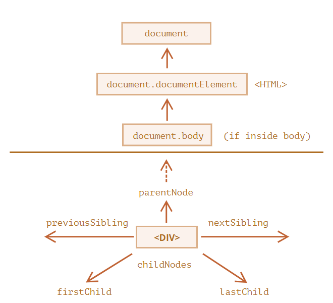

### 顶层

`<html>` = `document.documentElement`

最顶层的 document 节点是 `document.documentElement`。这是对应 `<html>` 标签的 DOM 节点。


`<body>` = `document.body`

另一个被广泛使用的 DOM 节点是 `<body>` 元素 —— `document.body`。


`<head>` = `document.head`

`<head>` 标签可以通过 `document.head` 访问。


### 子节点

两个术语：

- **子节点（或者叫作子）** —— 对应的是直系的子元素。换句话说，它们被完全嵌套在给定的元素中。例如，`<head>` 和 `<body>` 就是 `<html>` 元素的子元素。
- **子孙元素** —— 嵌套在给定元素中的所有元素，包括子元素，以及子元素的子元素等。

**`childNodes` 集合列出了所有子节点，包括文本节点。**

**`firstChild` 和 `lastChild` 属性是访问第一个和最后一个子元素的快捷方式。**

显示了 `document.body` 的子元素：

```html
<html>
<body>
  <div>Begin</div>

  <ul>
    <li>Information</li>
  </ul>

  <div>End</div>

  <script>
    for (let i = 0; i < document.body.childNodes.length; i++) {
      alert( document.body.childNodes[i] ); // Text, DIV, Text, UL, ..., SCRIPT
    }
  </script>
  ...more stuff...
</body>
</html>
```


它们只是简写。如果元素存在子节点，那么下面的脚本运行结果将是 true：

```javascript
elem.childNodes[0] === elem.firstChild
elem.childNodes[elem.childNodes.length - 1] === elem.lastChild
```


还有一个特别的函数 `elem.hasChildNodes()` 用于检查节点是否有子节点。


### DOM集合 遍历

`childNodes` 看起来就像一个数组。但实际上它并不是一个数组，而是一个 **集合** —— 一个类数组的可迭代对象。

可以使用 `for..of` 来迭代它：

```javascript
for (let node of document.body.childNodes) {
  alert(node); // 显示集合中的所有节点
}
```

无法使用数组的方法，因为它不是一个数组

可以使用 `Array.from` 方法来从集合创建一个“真”数组：

```javascript
alert( Array.from(document.body.childNodes).filter ); // function
```


### 兄弟节点,父节点

例如，`<head>` 和 `<body>` 就是兄弟节点：

```markup
<html>
  <head>...</head><body>...</body>
</html>
```

- `<body>` 可以说是 `<head>` 的“下一个”或者“右边”兄弟节点。
- `<head>` 可以说是 `<body>` 的“前一个”或者“左边”兄弟节点。

下一个兄弟节点在 `nextSibling` 属性中，上一个是在 `previousSibling` 属性中。

可以通过 `parentNode` 来访问父节点。

例如：

```javascript
// <body> 的父节点是 <html>
alert( document.body.parentNode === document.documentElement ); // true

// <head> 的后一个是 <body>
alert( document.head.nextSibling ); // HTMLBodyElement

// <body> 的前一个是 <head>
alert( document.body.previousSibling ); // HTMLHeadElement
```


### 纯元素导航

只考虑 **元素节点** 的导航链接

就是**忽略文本节点、注释节点等非元素节点**(即图中黄色部分), 只关注那些用标签（`<div>`, `<p>`, `<ul>` 等）表示的节点。

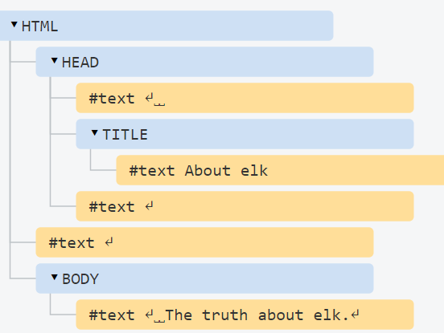

对比

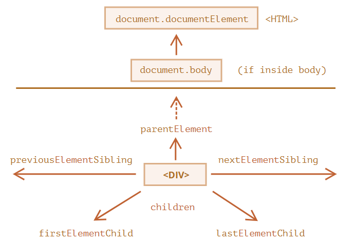

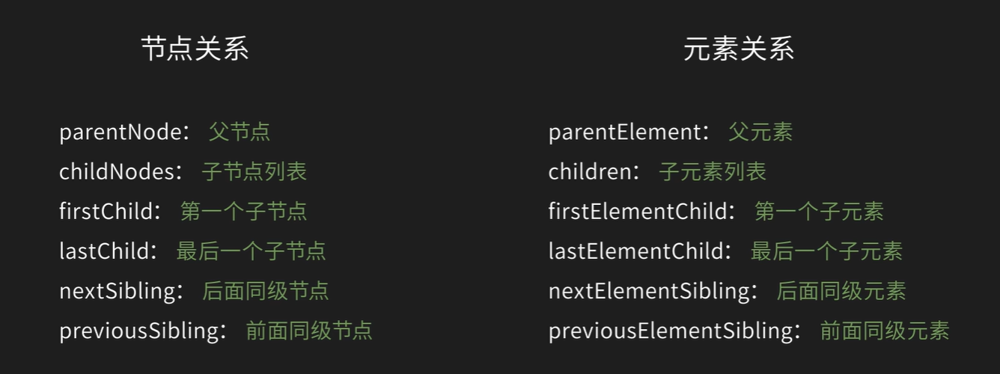

只是在词中间加了 `Element`：

- `children` —— 仅那些作为元素节点的子代的节点。
- `firstElementChild`，`lastElementChild` —— 第一个和最后一个子元素。
- `previousElementSibling`，`nextElementSibling` —— 兄弟元素。
- `parentElement` —— 父元素。


## DOM元素

### document.getElementById

如果一个元素有 `id` 特性（attribute），那我们就可以使用 `document.getElementById(id)` 方法获取该元素，无论它在哪里。

例如：

```html
<div id="elem">
  <div id="elem-content">Element</div>
</div>

<script>
  // 获取该元素
  let elem = document.getElementById('elem');

  // 将该元素背景改为红色
  elem.style.background = 'red';
</script>
```


### 搜索获取 querySelectorAll

到目前为止，最通用的方法是 `elem.querySelectorAll(css)`，它返回 `elem` 中与给定 CSS 选择器匹配的所有元素。

查找所有`ul`标签中 最后一个子元素的 `<li>` 元素：

```html
<ul>
  <li>The</li>
  <li>test</li>
</ul>
<ul>
  <li>has</li>
  <li>passed</li>
</ul>
<script>
  let elements = document.querySelectorAll('ul > li:last-child');

  for (let elem of elements) {
    alert(elem.innerHTML); // "test", "passed"
  }
</script>
```

**也可以使用伪类**

CSS 选择器的伪类，例如 `:hover` 和 `:active` 也都是被支持的。例如，`document.querySelectorAll(':hover')` 将会返回鼠标指针正处于其上方的元素的集合（按嵌套顺序：从最外层 `<html>` 到嵌套最多的元素）。


### 搜索获取 querySelector

`elem.querySelector(css)` 调用会返回给定 CSS 选择器的第一个元素。

结果与 `elem.querySelectorAll(css)[0]` 相同，但是后者会查找 **所有** 元素，并从中选取一个，而 `elem.querySelector` 只会查找一个。**因此它在速度上更快**


**两者区别**

- `querySelector` 返回单个元素，可以直接访问该元素的属性和方法。

  ```js
  const element = document.querySelector('.my-class');
  if (element) {
    element.style.color = 'red';
  }
  ```

- `querySelectorAll` 返回的是一个类数组的 **NodeList**，需要通过索引访问或使用循环遍历。

  ```js
  const elements = document.querySelectorAll('.my-class');
  elements.forEach(el => {
    el.style.color = 'red';
  });
  ```


### 节点移除

想要移除一个节点，可以使用 `node.remove()`。

让我们的消息在一秒后消失：

```html
<script>
  let div = document.createElement('div');
  div.className = "alert";
  div.innerHTML = "<strong>Hi there!</strong> You've read an important message.";

  document.body.append(div);
  setTimeout(() => div.remove(), 1000);
</script>
```

请注意：如果我们要将一个元素 **移动** 到另一个地方，则无需将其从原来的位置中删除。


**所有插入方法都会自动从旧位置删除该节点。**

进行元素交换：

```html
<div id="first">First</div>
<div id="second">Second</div>
<script>
  // 无需调用 remove
  second.after(first); // 获取 #second，并在其后面插入 #first
</script>
```


### 匹配 matches

只会检查 `elem` 是否与给定的 CSS 选择器匹配。它返回 `true` 或 `false`。这个表达式放在分支判断条件里比较好用

```html
<a href="http://example.com/file.zip">...</a>
<a href="http://ya.ru">...</a>

<script>
  // 不一定是 document.body.children，还可以是任何集合
  for (let elem of document.body.children) {
    if (elem.matches('a[href$="zip"]')) {
      alert("The archive reference: " + elem.href );
        console.log(elem.matches('a[href$="zip"]')) //true
    }
  }
</script>
```


### 查找父级 closet

`elem.closest(css)` 方法会查找与 CSS 选择器匹配的最近的祖先

```html
<h1>Contents</h1>

<div class="contents">
  <ul class="book">
    <li class="chapter">Chapter 1</li>
    <li class="chapter">Chapter 2</li>
  </ul>
</div>

<script>
  let chapter = document.querySelector('.chapter'); // LI

  alert(chapter.closest('.book')); // UL
  alert(chapter.closest('.contents')); // DIV

  alert(chapter.closest('h1')); // null（因为 h1 不是祖先）
</script>
```


### getElementsBy*

方法都会返回一个 **实时的（live）** 集合


`elem.getElementsByTagName(tag)` 查找具有给定标签的元素，并返回它们的集合。`tag` 参数也可以是对于“任何标签”的星号 `"*"`。

`elem.getElementsByClassName(className)` 返回具有给定CSS类的元素。

`document.getElementsByName(name)` 返回在文档范围内具有给定 `name` 特性的元素。很少使用。


### 方法一览

| 方法名                   | 搜索方式     | 可以在元素上调用？ | 实时的？ |
| ------------------------ | ------------ | ------------------ | -------- |
| `querySelector`          | CSS-selector | ✔                  | -        |
| `querySelectorAll`       | CSS-selector | ✔                  | -        |
| `getElementById`         | `id`         | -                  | -        |
| `getElementsByName`      | `name`       | -                  | ✔        |
| `getElementsByTagName`   | tag or `'*'` | ✔                  | ✔        |
| `getElementsByClassName` | class        | ✔                  | ✔        |


**在元素上调用?**

`querySelector` 可以查找元素内第一个匹配的元素, 而`getElementById`只能用在document上

```js
const container = document.getElementById('container');

// 在元素上调用 querySelector，搜索范围限制在 container 内
const firstTextInContainer = container.querySelector('.text');
console.log(firstTextInContainer.textContent);  // 输出: 段落1

// 在元素上调用 querySelectorAll，获得 container 内所有 .text 元素
const allTextInContainer = container.querySelectorAll('.text');
console.log(allTextInContainer.length); // 输出: 3

// 在 document 上调用 querySelectorAll，获得页面所有 .text 元素
const allTextInDocument = document.querySelectorAll('.text');
console.log(allTextInDocument.length); // 输出: 4，包含 container 内和外的 .text 元素
```


## DOM节点属性

每个 DOM 节点都属于相应的**内建类**。

层次结构（hierarchy）的根节点是 EventTarget，Node 继承自它，其他 DOM 节点继承自 Node。

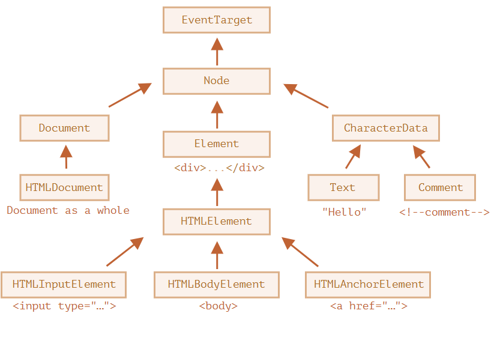

类如下所示：

- [EventTarget](https://dom.spec.whatwg.org/#eventtarget) —— 是一切的根“抽象（abstract）”类。

  该类的对象从未被创建。它作为一个基础，以便让所有 DOM 节点都支持所谓的“事件（event）”，我们会在之后学习它。

- [Node](http://dom.spec.whatwg.org/#interface-node) —— 也是一个“抽象”类，充当 DOM 节点的基础。

  它提供了树的核心功能：`parentNode`，`nextSibling`，`childNodes` 等（它们都是 getter）。`Node` 类的对象从未被创建。但是还有一些继承自它的其他类（因此继承了 `Node` 的功能）。

- [Document](https://dom.spec.whatwg.org/#interface-document) 由于历史原因通常被 `HTMLDocument` 继承（尽管最新的规范没有规定）—— 是一个整体的文档。

  全局变量 `document` 就是属于这个类。它作为 DOM 的入口。

- [CharacterData](https://dom.spec.whatwg.org/#interface-characterdata) —— 一个“抽象”类，被下述类继承：

  - [Text](https://dom.spec.whatwg.org/#interface-text) —— 对应于元素内部文本的类，例如 `<p>Hello</p>` 中的 `Hello`。
  - [Comment](https://dom.spec.whatwg.org/#interface-comment) —— 注释类。它们不会被展示出来，但每个注释都会成为 DOM 中的一员。

- [Element](http://dom.spec.whatwg.org/#interface-element) —— 是 DOM 元素的基础类。

  它提供了元素级导航（navigation），如 `nextElementSibling`，`children`，以及搜索方法，如 `getElementsByTagName` 和 `querySelector`。

  浏览器不仅支持 HTML，还支持 XML 和 SVG。因此，`Element` 类充当的是更具体的类的基础：`SVGElement`，`XMLElement`（我们在这里不需要它）和 `HTMLElement`。

- 最后，[HTMLElement](https://html.spec.whatwg.org/multipage/dom.html#htmlelement) —— 是所有 HTML 元素的基础类。我们大部分时候都会用到它。

  它会被更具体的 HTML 元素继承：

  - [HTMLInputElement](https://html.spec.whatwg.org/multipage/forms.html#htmlinputelement) —— `<input>` 元素的类，
  - [HTMLBodyElement](https://html.spec.whatwg.org/multipage/semantics.html#htmlbodyelement) —— `<body>` 元素的类，
  - [HTMLAnchorElement](https://html.spec.whatwg.org/multipage/semantics.html#htmlanchorelement) —— `<a>` 元素的类，
  - ……等。

还有很多其他标签具有自己的类，可能还具有特定的属性和方法，而一些元素，如 `<span>`、`<section>`、`<article>` 等，没有任何特定的属性，所以它们是 `HTMLElement` 类的实例。

因此，给定节点的全部属性和方法都是继承链的结果。

例如，我们考虑一下 `<input>` 元素的 DOM 对象。它属于 [HTMLInputElement](https://html.spec.whatwg.org/multipage/forms.html#htmlinputelement) 类。

它获取属性和方法，并将其作为下列类（按继承顺序列出）的叠加：

- `HTMLInputElement` —— 该类提供特定于输入的属性，
- `HTMLElement` —— 它提供了通用（common）的 HTML 元素方法（以及 getter 和 setter）
- `Element` —— 提供通用（generic）元素方法，
- `Node` —— 提供通用 DOM 节点属性，
- `EventTarget` —— 为事件（包括事件本身）提供支持，
- ……最后，它继承自 `Object`，因为像 `hasOwnProperty` 这样的“普通对象”方法也是可用的。


### 内容获取

#### innerHTML

`innerHTML`属性允许将元素中的 HTML 获取为字符串形式。

```html
<body>
	<select id="province">
		<option>--选择省--</option>
		<option>河南省</option>
		<option>辽宁省</option>
		<option>山东省</option>
	</select>

  <script>
    let province = document.querySelector('#province')
    console.log(province.innerHTML)
  </script>
 <!-- 
    输出
  	<option>--选择省--</option>
		<option>河南省</option>
		<option>辽宁省</option>
		<option>山东省</option>
-->
</body> 

</body>
```


也可以修改它。因此，它是更改页面最有效的方法之一。

```html
<body>
  <p>A paragraph</p>

  <script>
    alert( document.querySelector('p').innerHTML ); // A paragraph
    document.querySelector('p').innerHTML = 'The new BODY!'; // 替换它
  </script>

</body>
```

**小心：“innerHTML+=” 会进行完全重写**


#### tagName 标签名

nodeName 和 tagName

给定一个 DOM 节点，我们可以从 `nodeName` 或者 `tagName` 属性中读取它的标签名：

例如：

```javascript
alert( document.body.nodeName ); // BODY
alert( document.body.tagName ); // BODY
```

tagName 和 nodeName 之间有什么不同吗？

当然，差异就体现在它们的名字上，但确实有些微妙。

`tagName` 属性仅适用于 `Element` 节点。

`nodeName` 是为任意 `Node` 定义的：

​	对于元素，它的意义与 `tagName` 相同。

​	对于其他节点类型（`text`，`comment` 等），它拥有一个对应节点类型的字符串。


#### outerHTML

获取元素的完整 HTML

下面是一个示例：

```html
<div id="elem">Hello <b>World</b></div>

<script>
  alert(elem.outerHTML); // <div id="elem">Hello <b>World</b></div>
</script>
```


#### data 文本节点

**获取文本节点内容**

读取文本节点和注释节点的内容的示例：

```js
<body>
  Hello
  <!-- Comment -->
  <script>
    let text = document.body.firstChild;
    alert(text.data); // Hello

    let comment = text.nextSibling;
    alert(comment.data); // Comment
  </script>
</body>
```

**变量 `div` 依然引用的是原来的那个被替换掉的 DOM 元素节点**。虽然这个节点已经不在文档树中了，但变量 `div` 仍然指向它。


#### textContent：纯文本

**写入 `textContent` 要有用得多，因为它允许以“安全方式”写入文本。**

假设我们有一个用户输入的任意字符串，我们希望将其显示出来。

- 使用 `innerHTML`，我们将其“作为 HTML”插入，带有所有 HTML 标签。
- 使用 `textContent`，我们将其“作为文本”插入，所有符号（symbol）均按字面意义处理。

比较两者：

```html
<div id="elem1"></div>
<div id="elem2"></div>

<script>
  let name = prompt("What's your name?", "<b>Winnie-the-Pooh!</b>");

  elem1.innerHTML = name;  //Winnie-the-Pooh!
  elem2.textContent = name;  //<b>Winnie-the-Pooh!</b>
</script>
```

1. 第一个 `<div>` 获取 name “作为 HTML”：所有标签都变成标签，所以我们可以看到粗体的 name。
2. 第二个 `<div>` 获取 name “作为文本”，因此可以从字面上看到 `<b>Winnie-the-Pooh!</b>`。


当使用textContent获取元素节点信息时, 仅仅输出文本

```html
  <div></div>
  <script>
    let div = document.querySelector('div')
    console.log(div.innerHTML)  // 
    console.log(div.textContent)  // 输出为空
  </script>
```


### 特性和属性

当浏览器加载页面时，它会“读取”（或者称之为：“解析”）HTML 并从中生成 DOM 对象。对于元素节点，大多数标准的 HTML 特性（attributes）会自动变成 DOM 对象的属性（properties）


#### DOM属性

`console.dir(domElement)` 显示的是该元素的 **DOM对象的属性和方法**


DOM 属性和方法的行为就像常规的 Javascript 对象

可以添加自己的 DOM 属性

```js
//在 document.body 中创建一个新的属性：

document.body.myData = {
  name: 'Caesar',
  title: 'Imperator'
};

alert(document.body.myData.title); // Imperator
```


像下面这样添加一个方法：

```javascript
document.body.sayTagName = function() {
  alert(this.tagName);
};

document.body.sayTagName(); // BODY（这个方法中的 "this" 的值是 document.body
```


#### HTML 特性

在 HTML 中，标签可能拥有特性（attributes）。当浏览器解析 HTML 文本，并根据标签创建 DOM 对象时，浏览器会辨别 **标准的** 特性并以此创建 DOM 属性。

DOM 属性  的部分  就是HTML特性

当一个元素有 `id` 或其他 **标准的** 特性，那么就会生成对应的 DOM 属性。但是非 **标准的** 特性则不会。

例如：

```html
<body id="test" something="non-standard">
  <script>
    alert(document.body.id); // test
    // 非标准的特性没有获得对应的属性
    alert(document.body.something); // undefined
  </script>
</body>
```

请注意，一个元素的标准的特性对于另一个元素可能是未知的。例如 `"type"` 是 `<input>` 的一个标准的特性（`HTMLInputElement`），但对于 `<body>`（`HTMLBodyElement`）来说则不是。规范中对相应元素类的标准的属性进行了详细的描述。

规范中对相应元素类的标准的属性进行了详细的描述。


#### HTML 特性 设置&获取

所以, **如果一个特性不是标准的，那么就没有相对应的 DOM 属性**。就无法通过常规的  对象访问属性的方法  去访问

所有特性都可以通过使用以下方法进行访问：

- `elem.hasAttribute(name)` —— 检查特性是否存在。
- `elem.getAttribute(name)` —— 获取这个特性值。
- `elem.setAttribute(name, value)` —— 设置这个特性值。
- `elem.removeAttribute(name)` —— 移除这个特性。
- `elem.attributes` —— 所有特性的集合。

读取非标准的特性的示例：

```html
<body something="non-standard">
  <script>
    console.log(document.body.getAttribute('something')); // non-standard
  </script>
</body>
```


HTML 特性有以下几个特征：

- 它们的名字是大小写不敏感的（`id` 与 `ID` 相同）。
- 它们的值总是字符串类型的。


下面是一个使用特性的扩展示例：

```html
<body>
  <div id="elem" about="Elephant"></div>

  <script>
    alert( elem.getAttribute('About') ); // (1) 'Elephant'，读取

    elem.setAttribute('Test', 123); // (2) 写入

    // (3) 查看特性是否在 HTML 中（在）
    // <div id="elem" about="Elephant" test="123"></div>
    alert( elem.outerHTML ); 

    // (4) 列出所有
    for (let attr of elem.attributes) { 
      alert( `${attr.name} = ${attr.value}` );
    }
    /**
    id = elem
    about = Elephant
    test = 123
    */
  </script>
</body>
```

1. 可以将任何东西赋值给特性，但是这些东西会变成字符串类型的。所以这里我们的值为 `"123"`。
2. 所有特性，包括我们设置的那个特性，在 `outerHTML` 中都是可见的。
3. `attributes` 集合是可迭代对象，该对象将所有元素的特性（标准和非标准的）作为 `name` 和 `value` 属性存储在对象中。


#### 简略的对比

|      | 属性                                   | 特性                         |
| :--- | :------------------------------------- | :--------------------------- |
| 类型 | 任何值，标准的属性具有规范中描述的类型 | 字符串                       |
| 名字 | 名字（name）是大小写敏感的             | 名字（name）是大小写不敏感的 |


#### 非标准的特性，dataset

非标准特性常常用于将自定义的数据从 HTML 传递到 JavaScript，或者用于为 JavaScript “标记” HTML 元素


##### 自定义特性

像这样：

```html
<!-- 标记这个 div 以在这显示 "name" -->
<div show-info="name"></div>
<!-- 标记这个 div 以在这显示 "age" -->
<div show-info="age"></div>

<script>
  // 这段代码找到带有标记的元素，并显示需要的内容
  let user = {
    name: "Pete",
    age: 25
  };

  for(let div of document.querySelectorAll('[show-info]')) {
    // 在字段中插入相应的信息
    let field = div.getAttribute('show-info');
    div.innerHTML = user[field]; // 首先 "name" 变为 Pete，然后 "age" 变为 25
  }
</script>
```


它们还可以用来设置元素的样式。

这里使用 `order-state` 特性来设置订单状态：

```html
<style>
  /* 样式依赖于自定义特性 "order-state" */
  [order-state="new"] {
    color: green;
  }
</style>

<div order-state="new">A new order.</div>
```


##### data-

但是自定义的特性也存在问题。如果我们出于我们的目的使用了非标准的特性，之后它被引入到了标准中并有了其自己的用途，该怎么办？

为了避免冲突，存在 `data-` 特性。

**所有以 “data-” 开头的特性均被保留供程序员使用。它们可在 `dataset` 属性中使用。**


对于该元素

```html
<div class="radio" data-type="hero_type" data-value="6">辅助</div>
```


通过`data-`特性获取元素,并取得特性值

```js
  // 通过 data-type 获取元素
  const elByType = document.querySelector('div[data-type="hero_type"]')
  // 或者
  const elByType = document.querySelector('[data-type="hero_type"]')

  // 获取两个属性的值
  const dataType = elByType.dataset.type // "hero_type"
  const dataValue = elByType.dataset.value // "6"
```


设置样式

```css
[data-value="6"] {
  background-color: #2196f3;
  color: white;
  padding: 10px;
  border-radius: 4px;
}
```


### 样式

通常有两种设置元素样式的方式：

1. 在 CSS 中创建一个类，并添加它：`<div class="...">`
2. 将属性直接写入 `style`：`<div style="...">`。


首选通过 CSS 类的方式来添加样式。仅当类“无法处理”时，才应选择使用 `style` 属性的方式。

计算元素的坐标，并希望通过 JavaScript 来设置它们，那么使用 `style` 是可以接受的，如下所示：

```javascript
let top = /* 复杂的计算 */;
let left = /* 复杂的计算 */;

elem.style.left = left; // 例如 '123px'，在运行时计算出的
elem.style.top = top; // 例如 '456px'
```

对于其他情况，例如将文本设为红色，添加一个背景图标 —— 可以在 CSS 中对这些样式进行描述，然后添加类（JavaScript 可以做到）。这样更灵活，更易于支持。


#### 杂

```js
let div = document.querySelector('div')
div.onclick = function() {
  this.style.backgroundColor = 'green'
}
```


```js
// 批量设置样式
// 先把要修改的样式放到一个类里面, 再把元素的的类改成样式对应的类
let div = document.querySelector('div')
div.onclick = function() {
  this.className = 'c1'
}
```


 但是,className设置的类名会覆盖原来样式的类名,导致原有样式丢失

```js
// classList
// 能添加  切换类名
let div = document.querySelector('div')

div.onclick = function() {
  // 添加
  this.classList.add('c1')

  // 切换  有就覆盖  没有就添加
  this.classList.toggle('c1')

  // 判断
  console.log(this.classList.contains('c1'))

  //删除
  this.classList.remove('c2')

}
```


排他思想,只有被点击的按钮变色

```html
<body>
  <button>按钮1</button>
  <button>按钮2</button>
  <button>按钮3</button>
  <button>按钮4</button>
  <button>按钮5</button>
    
  <script>
    let btns = document.querySelectorAll('button')

    btns.forEach(element => {
      element.onclick = function() {
        btns.forEach( element => {
          element.style.backgroundColor = ''
        })

        element.style.backgroundColor = 'lightBlue'
      }
    });
  </script>
</body>
```


自定义属性设置 dom元素之间的样式一一对应

```
    // <标签名 data-自定义属性名=值>
    
    // js代码设置标签名 元素对象.dataset.自定义属性名 = 值

    // 获取 : 元素对象.dataset.自定义属性名
    
    // 获取相同自定义属性值的元素
    let value = item.dataset.target
    let div = document.querySelector(`[data-content = ${value}]`)
```


#### classList

 `className` 对完整的类字符串进行操作， `classList` 对单个类进行操作。

```html
<body class="main page">
  <script>
    // 添加一个 class
    document.body.classList.add('article');

    alert(document.body.className); // main page article
  </script>
</body>
```

`classList` 的方法：

- `elem.classList.add/remove(class)` —— 添加/移除类。
- `elem.classList.toggle(class, force)` —— 如果类不存在就添加类，存在就移除它,`force`（布尔值）,为`true`则强制添加，为`false`强制删除
- `elem.classList.contains(class)` —— 检查给定类，返回 `true/false`。


此外，`classList` 是可迭代的，因此，我们可以像下面这样列出所有类：

```html
<body class="main page">
  <script>
    for (let name of document.body.classList) {
      alert(name); // main，然后是 page
    }
  </script>
</body>
```


结合三元表达式,根据条件增减样式

```js
window.addEventListener("scroll", function () {
  header.classList[window.scrollY > 100 ? "add" : "remove"]("active");
});
```


#### 元素样式

`elem.style` 属性是一个对象，它对应于 `"style"` 特性（attribute）中所写的内容。

attribute 是 HTML 元素标签上的特性，比如：

```html
<div id="box" style="color: red; margin: 10px;">...</div>
```

只有写在标签上的内联样式才能同通过`style`对象读取到


`elem.style.width="100px"` 的效果等价   `width:100px` 

对于多词（multi-word）属性，使用驼峰式 camelCase：

```javascript
background-color  => elem.style.backgroundColor
z-index           => elem.style.zIndex
border-left-width => elem.style.borderLeftWidth
```


注意: CSS `width/height` 取决于另一个属性：`box-sizing`，它定义了“什么是” CSS 宽度和高度。


#### 重置样式属性

为了隐藏一个元素，可以设置 `elem.style.display = "none"`。

想要移除 `style.display`

使用 `elem.style.display = ""` 将其赋值为空。


#### 计算样式：getComputedStyle

`style`看不到元素在 **外部样式表上** 计算的样式

**`style` 属性仅对 `"style"` 特性（attribute）值起作用，而没有任何 CSS 级联（cascade）。**

无法使用 `elem.style` 读取来自 CSS 类的任何内容。

语法如下：

```javascript
getComputedStyle(element, [pseudo])
```

- element

  需要被读取样式值的元素。

- pseudo

  伪元素（如果需要），例如 `::before`。空字符串或无参数则意味着元素本身。

```html
<head>
  <style> body { color: red; margin: 5px } </style>
</head>
<body>

  <script>
    let computedStyle = getComputedStyle(document.body);

    // 现在我们可以读取它的 margin 和 color 了

    console.log(computedStyle.marginTop)  //5px
    console.log(computedStyle.color)  //rgb(255, 0, 0)
    console.log(document.body.style.Color)  //undefined
  </script>

</body>
```


####  data-

详情参考:特性和属性→非标准特性


### 其它属性获取

DOM 元素还有其他属性，特别是那些依赖于 class 的属性：

- `value` —— `<input>`，`<select>` 和 `<textarea>`（`HTMLInputElement`，`HTMLSelectElement`……）的 value。
- `href` —— `<a href="...">`（`HTMLAnchorElement`）的 href。
- `id` —— 所有元素（`HTMLElement`）的 “id” 特性（attribute）的值。


console.dir(), 将元素作为对象打印出来, 就可以在控制台里的元素对象中寻找自己需要的属性


## 修改document

DOM 修改是创建“实时”页面的关键。

#### 创建dom节点

要创建 DOM 节点，这里有两种方法：

- `document.createElement(tag)`

  用给定的标签创建一个新 **元素节点（element node）**：

  ```js
  let div = document.createElement('div');
  ```

- `document.createTextNode(text)`

  用给定的文本创建一个 **文本节点**：

  ```js
  let textNode = document.createTextNode('Here I am');
  ```

虽然创建了元素, 但元素尚未在页面中, 因此无法看见


#### 插入DOM节点

为了让 `div` 显示出来，我们需要将其插入到 `document` 中的某处。例如，通过 `document.body` 将其插入到 `<body>` 元素里。

对此有一个特殊的方法 `append`：`document.body.append(div)`。


完整的将元素插入页面的方法:

```js
 // 1. 创建 <div> 元素
let div = document.createElement('div');

// 2. 将元素的类设置为 "div"
div.className = "div";

// 3. 填充消息内容
div.innerHTML = "<strong>Hi there!</strong> You've read an important message.";

document.body.append(div);
```


这里是更多的元素插入方法，指明了不同的插入位置：

- `node.append(...nodes or strings)` —— 在 `node` **末尾** 插入节点或字符串，
- `node.prepend(...nodes or strings)` —— 在 `node` **开头** 插入节点或字符串，
- `node.before(...nodes or strings)` —— 在 `node` **前面** 插入节点或字符串，
- `node.after(...nodes or strings)` —— 在 `node` **后面** 插入节点或字符串，
- `node.replaceWith(...nodes or strings)` —— 将 `node` 替换为给定的节点或字符串。

这些方法的参数可以是一个要插入的任意的 DOM 节点列表，或者文本字符串（会被自动转换成文本节点）。

```html
<ol id="ol">
  <li>0</li>
  <li>1</li>
  <li>2</li>
</ol>

<script>
  ol.before('before'); // 将字符串 "before" 插入到 <ol> 前面
  ol.after('after'); // 将字符串 "after" 插入到 <ol> 后面

  let liFirst = document.createElement('li');
  liFirst.innerHTML = 'prepend';
  ol.prepend(liFirst); // 将 liFirst 插入到 <ol> 的最开始

  let liLast = document.createElement('li');
  liLast.innerHTML = 'append';
  ol.append(liLast); // 将 liLast 插入到 <ol> 的最末尾
</script>
```

所做工作:

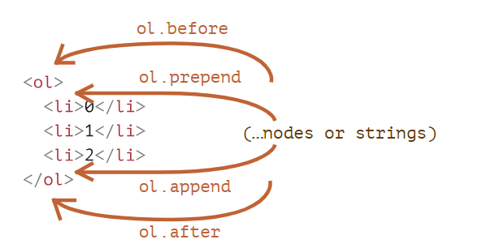

结果:

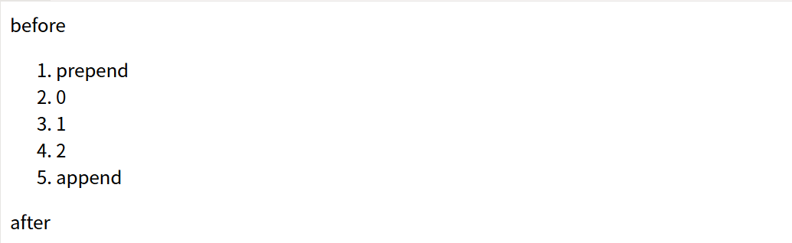


#### 通用插入方法

上面的方法只能用来插入 DOM 节点或文本片段。

**如果要将内容“作为 HTML 代码插入**

为此，我们可以使用另一个非常通用的方法：`elem.insertAdjacentHTML(where, html)`。

该方法的第一个参数是代码字（code word），指定相对于 `elem` 的插入位置。必须为以下之一：

- `"beforebegin"` —— 将 `html` 插入到 `elem` 之前，
- `"afterbegin"` —— 将 `html` 插入到 `elem` 开头，
- `"beforeend"` —— 将 `html` 插入到 `elem` 末尾，
- `"afterend"` —— 将 `html` 插入到 `elem` 之后。

第二个参数是 HTML 字符串，该字符串会被“作为 HTML” 插入。

例如：

```html
<div id="div"></div>
<script>
  div.insertAdjacentHTML('beforebegin', '<p>Hello</p>');
  div.insertAdjacentHTML('afterend', '<p>Bye</p>');
</script>
```

……将导致：

```html
<p>Hello</p>
<div id="div"></div>
<p>Bye</p>
```

插入示意图:

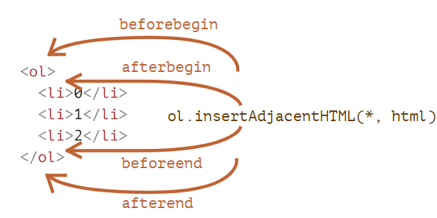


作为文本插入

`elem.insertAdjacentText(where, text)`


插入元素

`elem.insertAdjacentElement(where, elem)`

```js
const div = document.querySelector('div');
const p = document.createElement('p');
p.textContent = '新段落';
div.insertAdjacentElement('beforeend', p);
```


#### 节点移除

想要移除一个节点，可以使用 `node.remove()`。

让我们的消息在一秒后消失：

```html
<script>
  let div = document.createElement('div');
  div.className = "alert";
  div.innerHTML = "<strong>Hi there!</strong> You've read an important message.";

  document.body.append(div);
  setTimeout(() => div.remove(), 1000);
</script>
```

请注意：如果我们要将一个元素 **移动** 到另一个地方，则无需将其从原来的位置中删除。

**所有插入方法都会自动从旧位置删除该节点。**

例如，让我们进行元素交换：

```html
<div id="first">First</div>
<div id="second">Second</div>
<script>
  // 无需调用 remove
  second.after(first); // 获取 #second，并在其后面插入 #first
</script>
```


#### 克隆节点：cloneNode

调用 `elem.cloneNode(true)` 来创建元素的一个“深”克隆 —— 具有所有特性（attribute）和子元素。如果我们调用 `elem.cloneNode(false)`，那克隆就不包括子元素。

一个拷贝消息的示例：

```html
<div class="alert" id="div">
  <strong>Hi there!</strong> You've read an important message.
</div>

<script>
  let div2 = div.cloneNode(true); // 克隆消息
  div2.querySelector('strong').innerHTML = 'Bye there!'; // 修改克隆

  div.after(div2); // 在已有的 div 后显示克隆
</script>
```


#### 老式的 insert/remove 方法

- `parentElem.appendChild(node)`

  将 `node` 附加为 `parentElem` 的最后一个子元素。

下面这个示例在 `<ol>` 的末尾添加了一个新的 `<li>`：

```html
<ol id="list">
  <li>0</li>
  <li>1</li>
  <li>2</li>
</ol>

<script>
  let newLi = document.createElement('li');
  newLi.innerHTML = 'Hello, world!';

  list.appendChild(newLi);
</script>
```


- `parentElem.insertBefore(node, nextSibling)`

  在 `parentElem` 的 `nextSibling` 前插入 `node`。

下面这段代码在第二个 `<li>` 前插入了一个新的列表项：

```
<ol id="list">
  <li>0</li>
  <li>1</li>
  <li>2</li>
</ol>
<script>
  let newLi = document.createElement('li');
  newLi.innerHTML = 'Hello, world!';

  list.insertBefore(newLi, list.children[1]);
</script>
```


如果要将 `newLi` 插入为第一个元素，我们可以这样做：

```javascript
list.insertBefore(newLi, list.firstChild);
```


- `parentElem.removeChild(node)`

  从 `parentElem` 中删除 `node`（假设 `node` 为 `parentElem` 的后代）。

下面这个示例从 `<ol>` 中删除了 `<li>`：

```html
<ol id="list">
  <li>0</li>
  <li>1</li>
  <li>2</li>
</ol>

<script>
  let li = list.firstElementChild;
  list.removeChild(li);
</script>
```


## 元素大小&滚动&坐标

### 几何属性

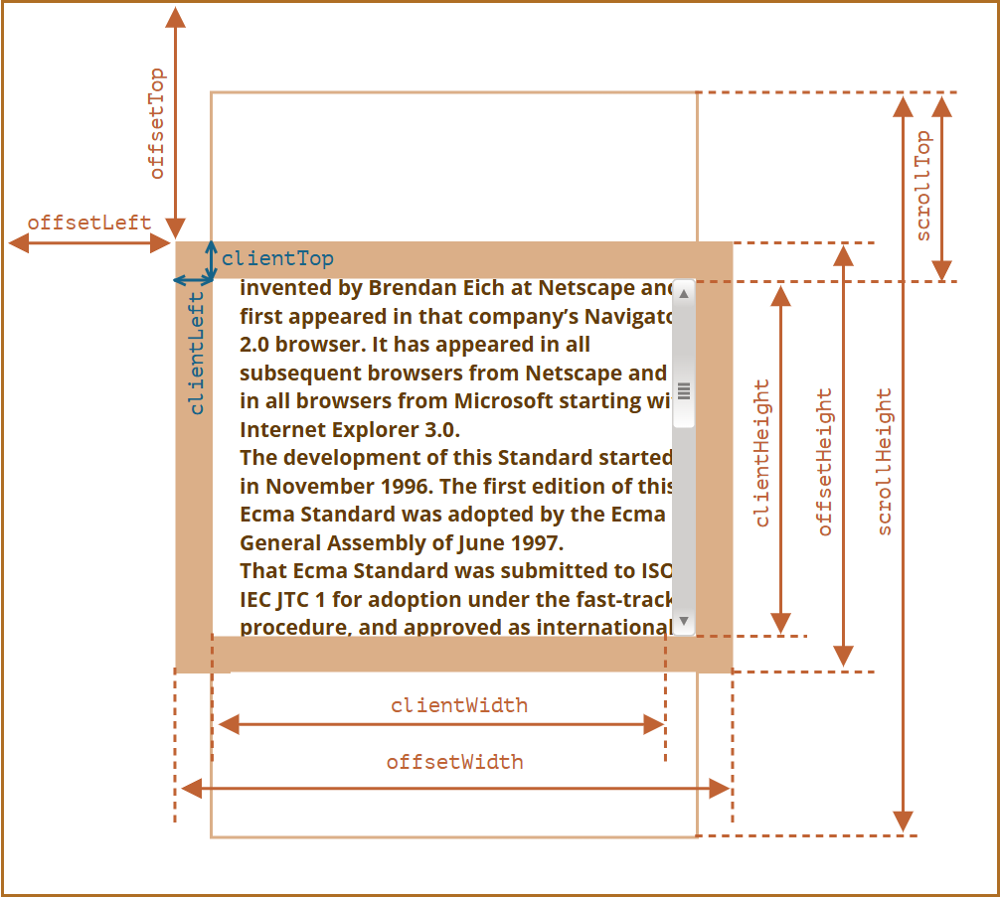

### 大小

#### offsetParent，offsetLeft/Top 元素外部

`offsetParent` 是最接近的祖先（ancestor），在浏览器渲染期间，它被用于计算坐标。

最近的祖先为下列之一：

1. CSS 定位的（`position` 为 `absolute`、`relative`、`fixed` 或 `sticky`），
2. 或 `<td>`，`<th>`，`<table>`，
3. 或 `<body>`。

属性 `offsetLeft/offsetTop` 提供相对于 `offsetParent` 左上角的 x/y 坐标。


```html
<main style="position: relative" id="main">
  <article>
    <div id="example" style="position: absolute; left: 180px; top: 180px">...</div>
  </article>
</main>
<script>
  alert(example.offsetParent.id); // main
  alert(example.offsetLeft); // 180（注意：这是一个数字，不是字符串 "180px"）
  alert(example.offsetTop); // 180
</script>
```

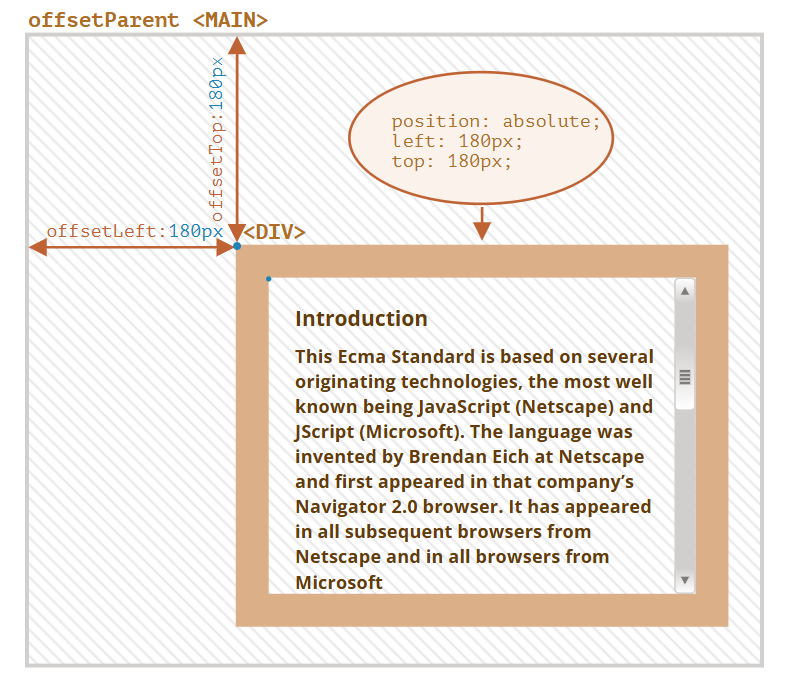


#### offsetWidth/Height 元素本身

- `offsetWidth = 390` —— 外部宽度（width），可以计算为**内部width**（`300px`）加上 **padding**（`2 * 20px`）和 **border**（`2 * 25px`）。
- `offsetHeight = 290` —— 外部高度（height）。

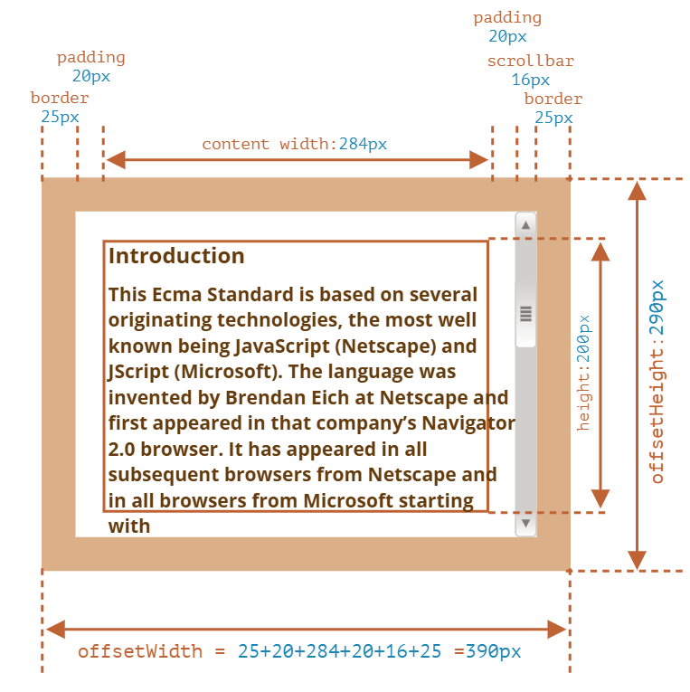


#### clientTop/Left 边框

测量边框（border），可以使用 `clientTop` 和 `clientLeft`。

在我们的例子中：

- `clientLeft = 25` —— 左边框宽度
- `clientTop = 25` —— 上边框宽度

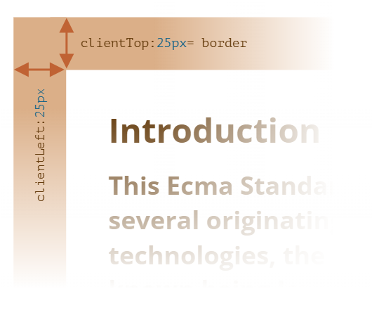

这个宽度会包含滚动条

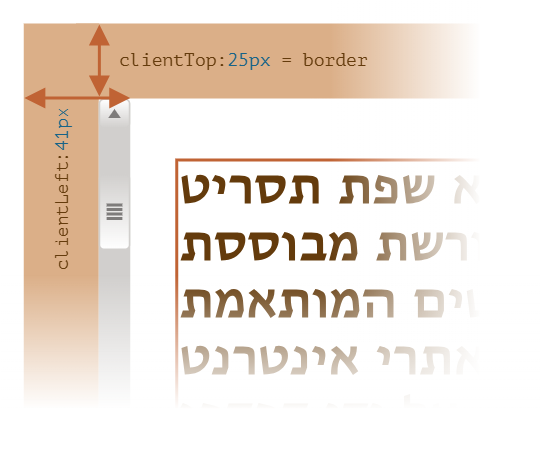

#### clientWidth/Height

包括了 “content width” 和 “padding”，**但不包括滚动条宽度**（scrollbar）：

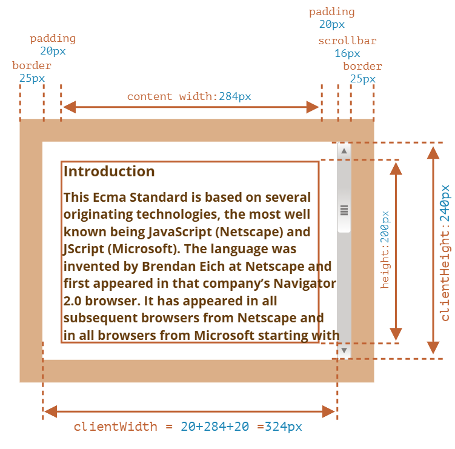

如果强行设置padding为0, 滚动条就会进入content区域

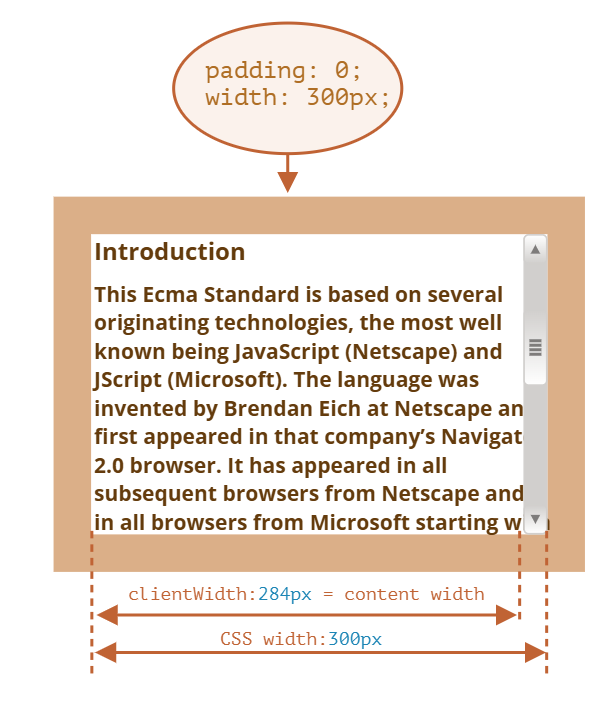


#### 窗口的 width/height

为了获取窗口（window）的宽度和高度，我们可以使用 `document.documentElement` 的 `clientWidth/clientHeight`：

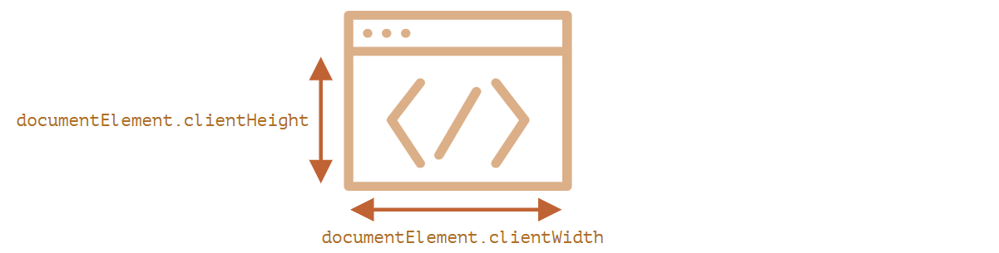

```
document.documentElement.clientWidth
document.documentElement.clientHeight
```

为什么不使用window.innerWidth/innerHeight，因为其不会提供减去滚动条的width/height


### 滚动

#### scrollWidth / Height

获得文档（document）的完整宽度和高度

这些属性就像 clientWidth/clientHeight，但它们还包括滚动出（隐藏）的部分：

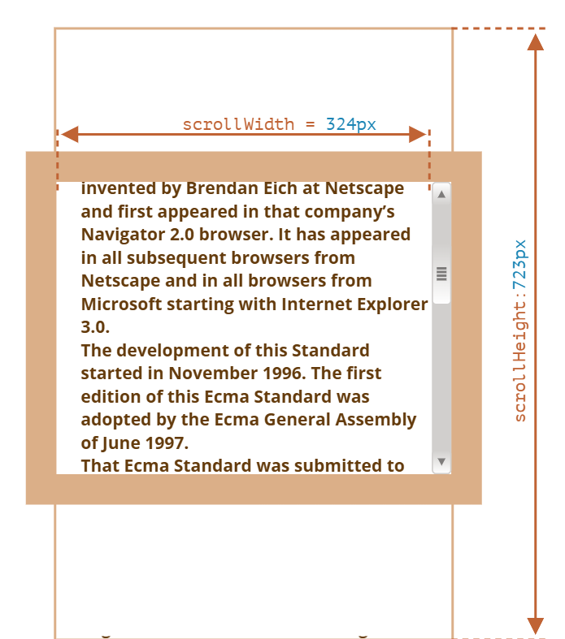

- `scrollHeight = 723` —— 是内容区域的完整内部高度，包括滚动出的部分。
- `scrollWidth = 324` —— 是完整的内部宽度，这里我们没有水平滚动，因此它等于 `clientWidth`。

可以使用这些属性将元素展开

```js
// 将元素展开（expand）到完整的内容高度
element.style.height = `${element.scrollHeight}px`;
```


#### scrollLeft / scrollTop 滚动了多少

属性 `scrollLeft`/`scrollTop` 是元素的隐藏、滚动部分的 width/height。

换句话说，`scrollTop` 就是“已经滚动了多少”。

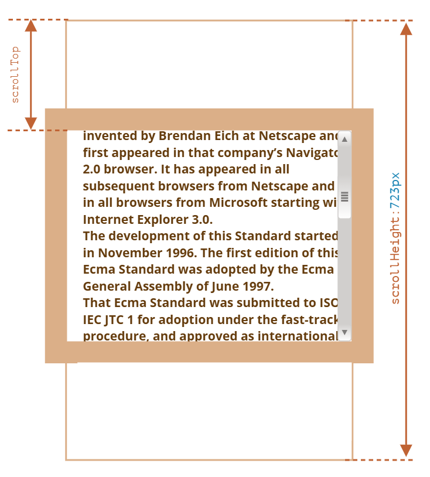

`scrollLeft/scrollTop` **是可修改的**

比如点击元素触发 `elem.scrollTop += 10`, 元素内容就会向下滚动 `10px`。


#### pageXOffset / pageYOffset 获得当前滚动

获得当前滚动

可以从 `window.pageXOffset/pageYOffset` 中获取页面当前滚动信息：

```javascript
console.log('当前已从顶部滚动：' + window.pageYOffset);
console.log('当前已从左侧滚动：' + window.pageXOffset);
```

由于历史原因，存在了这两种属性，但它们是一样的：

- `window.pageXOffset` 是 `window.scrollX` 的别名。
- `window.pageYOffset` 是 `window.scrollY` 的别名。


#### 滚动：scrollTo，scrollBy，scrollIntoView

方法 `scrollBy(x,y)` 将页面滚动至 **相对于当前位置的 `(x, y)` 位置**。例如，`scrollBy(0,10)` 会将当前位置页面向下滚动 `10px`。


方法 `scrollTo(pageX,pageY)` 将页面滚动至 **绝对坐标**，使得可见部分的左上角具有相对于文档左上角的坐标 `(pageX, pageY)`。就像设置了 `scrollLeft/scrollTop` 一样。

要滚动到最开始，我们可以使用 `scrollTo(0,0)`

```
element.scrollTo(x, y);
```


`scrollIntoView`

对 `elem.scrollIntoView(top)` 的调用将滚动页面以使 `elem` 可见。它有一个参数：

- 如果 `top=true`（默认值），页面滚动，使 `elem` 出现在窗口顶部。元素的上边缘将与窗口顶部对齐。
- 如果 `top=false`，页面滚动，使 `elem` 出现在窗口底部。元素的底部边缘将与窗口底部对齐。


#### 禁止滚动

有时候我们需要使文档“不可滚动”。例如，当我们需要用一条需要立即引起注意的大消息来覆盖文档时，我们希望访问者与该消息而不是与文档进行交互。

要使文档不可滚动，只需要设置 `document.body.style.overflow = "hidden"`。该页面将“冻结”在其当前滚动位置上。

恢复滚动:`document.body.style.overflow = ""`


#### 滚动事件

```javascript
window.addEventListener('scroll', function() {
  document.getElementById('showScroll').innerHTML = window.pageYOffset + 'px';
});
```


### 坐标

#### pageY / clientY

从窗口的顶部/左侧边缘计算得出: `clientX`/`clientY`

从文档的顶部/左侧边缘计算得出: `pageX`/`pageY`


当文档滚动了：

- `pageY` —— 元素在文档中的相对坐标保持不变，从文档顶部（现在已滚动出去）开始计算。
- `clientY` —— 窗口相对坐标确实发生了变化（箭头变短了），因为同一个点越来越靠近窗口顶部。

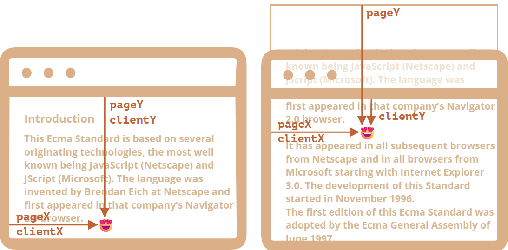


#### 元素坐标：getBoundingClientRect

主要的 `DOMRect` 属性：

- `x/y` —— 矩形原点相对于窗口的 X/Y 坐标，
- `width/height` —— 矩形的 width/height（可以为负）。

此外，还有派生（derived）属性：

- `top/bottom` —— 顶部/底部矩形边缘的 Y 坐标，
- `left/right` —— 左/右矩形边缘的 X 坐标。


`elem.getBoundingClientRect()` 的输出的示意图：

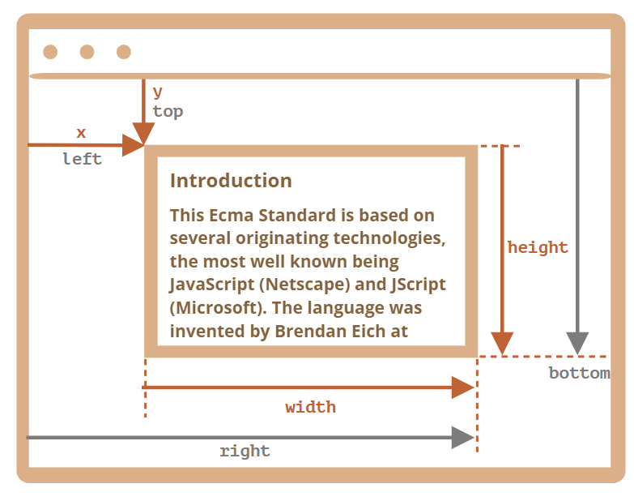


#### elementFromPoint(x, y)

对 `document.elementFromPoint(x, y)` 的调用会返回在窗口坐标 `(x, y)` 处嵌套最多（the most nested）的元素。

语法如下：

```javascript
let elem = document.elementFromPoint(x, y);
```


# 浏览器事件

## 事件使用

### 最有用的 DOM 事件

**鼠标事件：**

- `click` —— 当鼠标点击一个元素时（触摸屏设备会在点击时生成）。
- `contextmenu` —— 当鼠标右键点击一个元素时。
- `mouseover` / `mouseout` —— 当鼠标指针移入/离开一个元素时。
- `mousedown` / `mouseup` —— 当在元素上按下/释放鼠标按钮时。
- `mousemove` —— 当鼠标移动时。

**键盘事件**：

- `keydown` 和 `keyup` —— 当按下和松开一个按键时。

**表单（form）元素事件**：

- `submit` —— 当访问者提交了一个 `<form>` 时。
- `focus` —— 当访问者聚焦于一个元素时，例如聚焦于一个 `<input>`。

**Document 事件**：

- `DOMContentLoaded` —— 当 HTML 的加载和处理均完成，DOM 被完全构建完成时。

**CSS 事件**：

- `transitionend` —— 当一个 CSS 动画完成时。


### 事件绑定

我们可以使用 DOM 属性（property）`on<event>` 来分配处理程序

1. 只有 HTML：

   ```html
   <input type="button" onclick="alert('Click!')" value="Button">
   ```

   

2. HTML + JS：

   ```html
   <input type="button" id="button" value="Button">
   <script>
     button.onclick = function() {
       alert('Click!');
     };
   </script>
   ```

在第一个例子中，`button.onclick` 是通过 HTML 特性（attribute）初始化的，而在第二个例子中是通过脚本初始化的。


动态绑定

```
<button>秋香</button>
  <script>
    // 事件处理
    function myClick() {
      alert('真香')
    }

    // 动态绑定 
    // 先获取按钮对象,再给按钮添加对象的属性
    let btn = document.querySelector('button')
    btn.onclick = myClick
```


### 事件触发

DOM 元素对象提供了快捷方法，可以直接调用来触发事件。

```
element.click() — 触发点击事件
element.focus() — 触发获得焦点事件
element.blur() — 触发失去焦点事件
element.submit() — 触发表单提交事件（仅 form 元素）
```


满足条件时添加事件监听并自动触发事件

```html
<body>

<button id="btn">按钮</button>

<script>
  const btn = document.querySelector('#btn');
  const condition = true;  // 假设这个是你的条件

  if (condition) {
    // 绑定事件
    btn.addEventListener('click', function(event) {
      console.log('按钮被点击（事件触发）');
    });

    // 手动触发点击事件，让事件处理函数执行一次
    btn.click();  // 这是触发 click 事件的快捷方法
  }
</script>

</body>
```


### 事件移除

要移除一个处理程序 —— 赋值 `elem.onclick = null`。


```
  <button onclick="myClick()">秋香</button>
  <script>
    function myClick() {
      alert('真香')
    }
  </script>
```


### 事件函数

事件函数应该用  不加括号  的方式进行复制

```js
js复制const f = foo;  // 把函数 foo 的引用赋值给变量 f
```


```html
<button id="btn">点击我</button>

<script>
function handleClick() {
  alert('按钮被点击');
}

// 绑定事件处理函数：不加括号，传递函数引用
document.getElementById('btn').onclick = handleClick;

// 错误示范：加括号，立即执行函数，返回值赋给 onclick
document.getElementById('btn').onclick = handleClick();
</script>

```


### 访问元素:this

处理程序中的 `this` 的值是对应的元素。就是处理程序所在的那个元素。

下面这行代码中的 `button` 使用 `this.innerHTML` 来显示它的内容：

```html
<button onclick="alert(this.innerHTML)">Click me</button>
```


### addEventListener

可以为单个事件,设置多个处理程序

```html
<input id="elem" type="button" value="Click me"/>

<script>
  function handler1() {
    alert('Thanks!');
  };

  function handler2() {
    alert('Thanks again!');
  }

  elem.onclick = () => alert("Hello");
  elem.addEventListener("click", handler1); // Thanks!
  elem.addEventListener("click", handler2); // Thanks again!
</script>
```


添加处理程序的语法：

```javascript
element.addEventListener(event, handler[, options]);
```

- `event`

  事件名，例如：`"click"`。

- `handler`

  处理程序。

- `options`具有以下属性的附加可选对象：

  - `once`：如果为 `true`，那么会在被触发后自动删除监听器。
  - `capture`：事件处理的阶段。由于历史原因，`options` 也可以是 `false/true`，它与 `{capture: false/true}` 相同。
  - `passive`：如果为 `true`，那么处理程序将不会调用 `preventDefault()`，我们稍后将在 [浏览器默认行为](https://zh.javascript.info/default-browser-action) 一章中介绍。

要移除处理程序，可以使用 `removeEventListener`：

```javascript
element.removeEventListener(event, handler[, options]);
```


#### 对象处理程序：handleEvent

我们不仅可以分配函数，还可以使用 `addEventListener` 将一个对象分配为事件处理程序。当事件发生时，就会调用该对象的 `handleEvent` 方法。

例如：

```html
<button id="elem">Click me</button>

<script>
  let obj = {
    handleEvent(event) {
      alert(event.type + " at " + event.currentTarget);
    }
  };

  elem.addEventListener('click', obj);
</script>
```

正如我们所看到的，当 `addEventListener` 接收一个对象作为处理程序时，在事件发生时，它就会调用 `obj.handleEvent(event)` 来处理事件。


## 事件对象 event

事件触发的时候, 会产生事件对象, 

下面是一个从 `event` 对象获取鼠标指针的坐标的示例：

```html
<input type="button" value="Click me" id="elem">

<script>
  elem.onclick = function(event) {
    // 显示事件类型、元素和点击的坐标
    alert(event.type + " at " + event.currentTarget);
    alert("Coordinates: " + event.clientX + ":" + event.clientY);
  };
</script>
```

`event` 对象的一些属性：

- `event.type`

  事件类型，这里是 `"click"`。

- `event.currentTarget`

  处理事件的元素。这与 `this` 相同，除非处理程序是一个箭头函数，或者它的 `this` 被绑定到了其他东西上，之后我们就可以从 `event.currentTarget` 获取元素了。

- `event.clientX / event.clientY`

  指针事件（pointer event）的指针的窗口相对坐标。


### event.target

- `event.target` —— 是引发事件的“目标”元素，它在冒泡过程中不会发生变化。
- `this` —— 是“当前”元素，其中有一个当前正在运行的处理程序。


仅在from上绑定点击事件

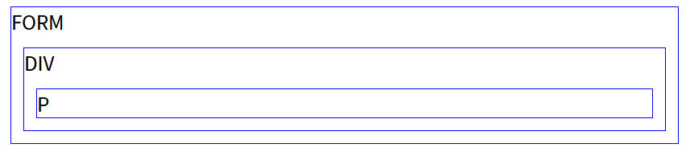

```js
form.onclick = function(event) {
  setTimeout(() => {
    alert("target = " + event.target.tagName + ", this=" + this.tagName);
};
```

点击p元素: target = P, this=FORM

点击div元素: target = DIV, this=FORM

点击form元素: target = FORM, this=FORM

- `this`（=`event.currentTarget`）是 `<form>` 元素，因为处理程序在它上面运行。
- `event.target` 是表单中实际被点击的元素。


### 更多属性

`console.log(event)`查看

`event.preventDefault()` 阻止默认行为

`event.stopPropagation()` 停止冒泡


## 自定义事件

`CustomEvent` 是 JavaScript 原生提供的用于创建和分发“自定义事件”的工具。

 它允许开发者在 DOM 元素间主动“发送消息”或“通知”，并且可以附带自定义数据（通过 `detail` 属性）。这在组件间通信、模块解耦、复杂交互场景等非常有用。


优势

用 `CustomEvent`，只负责“发信号”，具体怎么响应由监听方决定，发起方和响应方互不干扰，代码干净、易维护。


流程：

- 创建：`const evt = new CustomEvent('my-event', { detail: { ... } })`
- 派发：`element.dispatchEvent(evt)`
- 监听：`element.addEventListener('my-event', handler)`

```js
<div id="box">点我触发自定义事件</div>
<script>
  // 监听自定义事件
  document.getElementById('box').addEventListener('hello', function(event) {
    alert('收到了自定义事件，detail内容是：' + JSON.stringify(event.detail));
  });

  // 主动触发（派发）自定义事件
  document.getElementById('box').onclick = function() {
    // 创建一个名为 'hello' 的自定义事件，并携带数据
    const myEvent = new CustomEvent('hello', {
      detail: { msg: '你好，CustomEvent！' }
    });
    this.dispatchEvent(myEvent); // 手动触发事件 this指向 box 元素
  }
</script>
```


## 事件流

1. 捕获阶段（Capturing phase）—— 事件（从 Window）向下走近元素。
2. 目标阶段（Target phase）—— 事件到达目标元素。
3. 冒泡阶段（Bubbling phase）—— 事件从目标元素向根元素传播。

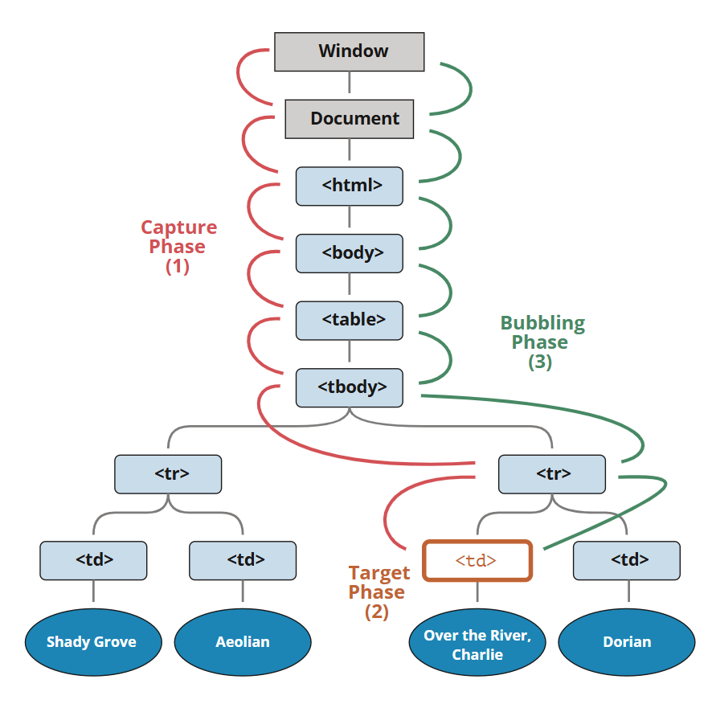

点击 `<td>`，事件首先通过祖先链向下到达元素（捕获阶段），然后到达目标（目标阶段），最后上升（冒泡阶段），在途中调用处理程序。


### 冒泡

在父子元素上注册相同类型的事件处理函数

**当一个事件发生在一个元素上，它会首先运行在该元素上的处理程序，然后运行其父元素上的处理程序，然后一直向上到其他祖先上的处理程序。**

假设我们有 3 层嵌套 `FORM > DIV > P`，它们各自拥有一个处理程序：

```html
<form onclick="alert('form')">FORM
  <div onclick="alert('div')">DIV
    <p onclick="alert('p')">P</p>
  </div>
</form>
```

点击内部的 `<p>` 会首先运行 `onclick`：

1. 在该 `<p>` 上的。
2. 然后是外部 `<div>` 上的。
3. 然后是外部 `<form>` 上的。
4. 以此类推，直到最后的 `document` 对象。

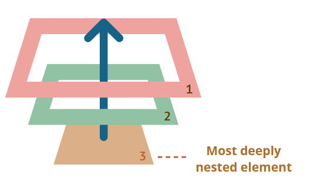

因此，如果我们点击 `<p>`，那么我们将看到 3 个 alert：`p` → `div` → `form`


停止冒泡

 `event.stopPropagation()`

点击 `<button>`，这里的 `body.onclick` 不会工作：

```html
<body onclick="alert(`the bubbling doesn't reach here`)">
  <button onclick="event.stopPropagation()">Click me</button>
</body>
```


### 捕获

为了在捕获阶段捕获事件，我们需要将处理程序的 `capture` 选项设置为 `true`：

```javascript
elem.addEventListener(..., {capture: true})
// 或者，用 {capture: true} 的别名 "true"
elem.addEventListener(..., true)
```

`capture` 选项有两个可能的值：

- 如果为 `false`（默认值），则在冒泡阶段设置处理程序。
- 如果为 `true`，则在捕获阶段设置处理程序。


如果事件在捕获阶段执行,发生的顺序就和冒泡相反

```html
<body>
  <div class="father">
    <div class="son">
    </div>
  </div>

  <script>
    document.querySelector('body').addEventListener('click', function() {
      console.log('body')
    }, true)
    document.querySelector('.father').addEventListener('click', function() {
      console.log('father')
    }, true)
    document.querySelector('.son').addEventListener('click', function() {
      console.log('son')
    }, true)
  </script>
</body>
```

`body` → `father` → `son`


### 事件委托

事件委托给别人,代为处理

就是把事件添加给父类, 把事件处理函数绑定在父类上执行

比如给table设置事件, 当其中的单元格(event.target)触发某种事件时, 交给table执行


给新增元素添加事件

```html
<body>
    <ul>
        <li>aaa</li>
        <li>bbb</li>
        <li>ccc</li>
    </ul>
    <button>新增元素</button>

    <script>
        //需求:给新添加的button按钮绑定点击事件,点击按钮,新增一个li
        document.querySelector('button').addEventListener('click',function(){
            var li = document.createElement('li')
            li.innerHTML = '我是新来的li'
            document.querySelector('ul').appendChild(li)
        })

        //传统方式添加事件的弊端:无法实现新增元素事件的动态绑定,只能给已经存在的元素绑定事件
        /* var lis = document.querySelectorAll('li')
        lis.forEach(function(item){
            item.addEventListener('click',function(){
                alert(this.innerHTML)
            })
        })  */

        //事件委托的好处:可以实现新增元素事件的动态绑定,本质就是事件添加在父类上,新增元素,不影响父类
        var ul = document.querySelector('ul')
        ul.addEventListener('click',function(e){
            alert(e.target.innerHTML)
        }) 
    </script>
</body>
```


#### 标记中的行为

要编写一个有“保存”、“加载”和“搜索”等按钮的菜单。

第一个想法: 是为每个按钮分配一个单独的处理程序。

更优雅:为整个菜单添加一个处理程序，并为具有方法调用的按钮添加 `data-action` 特性（attribute）

```html
<div id="menu">
  <button data-action="save">Save</button>
  <button data-action="load">Load</button>
  <button data-action="search">Search</button>
</div>

<script>
  class Menu {
    constructor(elem) {
      this._elem = elem;
      elem.onclick = this.onClick.bind(this); // (*)
    }

    save() {
      alert('saving');
    }

    load() {
      alert('loading');
    }

    search() {
      alert('searching');
    }

    onClick(event) {
      let action = event.target.dataset.action;
      if (action) {
        this[action]();
      }
    };
  }

  new Menu(menu);
</script>
```

`this.onClick` 在 `(*)` 行中被绑定到了 `this`。这很重要，因为否则内部的 `this` 将引用 DOM 元素（`elem`），而不是 `Menu` 对象

也可以使用 `.action-save`，`.action-load` 类，但 `data-action` 特性（attribute）在语义上更好。


#### “行为”模式

我们还可以使用事件委托将“行为（behavior）”以 **声明方式** 添加到具有特殊特性（attribute）和类的元素中。


## 鼠标&键盘事件

### 鼠标事件


鼠标跟随

```html
<body>
  
  <script>
    const img = document.querySelector('img')
    document.addEventListener('mousemove', function(e) {
      // 让图片偏移值跟鼠标位置保持一直
      img.style.top = e.clientY - 50 + 'px'
      img.style.left = e.clientX - 50 + 'px'
    })
  </script>
</body>
```


#### 事件类型

- `mousedown/mouseup`

  在元素上点击/释放鼠标按钮。

- `mouseover/mouseout`

  鼠标指针从一个元素上移入/移出。

- `mousemove`

  鼠标在元素上的每个移动都会触发此事件。

- `click`

  如果使用的是鼠标左键，则在同一个元素上的 `mousedown` 及 `mouseup` 相继触发后，触发该事件。

- `contextmenu`


​	在鼠标右键被按下时触发。还有其他打开上下文菜单的方式，例如使用特殊的键盘按键，在这种情况下它也会被触	发，因此它并不完全是鼠标事件。

- `dblclick`

  双击事件,事件触发顺序通常是：`mousedown` → `mouseup` → `click` → `mousedown` → `mouseup` → `click` → `dblclick`

  

​	


鼠标按下时: 遵循 `mousedown` → `mouseup` → `click` 的顺序调用处理程序。


#### 鼠标按钮

`event.button` 的所有可能值如下：

| 鼠标按键状态     | `event.button` |
| :--------------- | :------------- |
| 左键 (主要按键)  | 0              |
| 中键 (辅助按键)  | 1              |
| 右键 (次要按键)  | 2              |
| X1 键 (后退按键) | 3              |
| X2 键 (前进按键) | 4              |


#### 坐标

所有的鼠标事件都提供了两种形式的坐标：

1. 相对于窗口的坐标：`clientX` 和 `clientY`。
2. 相对于文档的坐标：`pageX` 和 `pageY`。
3. 相对于事件目标元素的左上角的坐标：event.offsetX / event.offsetY

移动监听鼠标位置

```js
document.addEventListener('mousemove', function (e) {
  console.log(e)

  // client开头: 鼠标在可视区域的x轴 y轴坐标
  console.log(e.clientX, e.clientY)
  // page开头: 表示鼠标在文档区域的x轴 y轴坐标
  console.log(e.pageX, e.pageY)
  // screen开头: 表示鼠标在电脑屏幕的x轴 y轴坐标
  console.log(e.screenX, e.screenY)
})


// event.offsetX / event.offsetY
canvas (0,0)-----------------------------
|                                       |
|        cover (100,100)                |
|        +-----------------+            |
|        |                 |            |
|        |   X <---你点这里|            |
|        |                 |            |
|        +-----------------+            |
|                                       |
-----------------------------------------
此时 offsetX/Y 是10,10，而canvas左上角到这实际是(110,110)。
```


#### 避免按下事件

双击鼠标会有副作用，在某些界面中可能会出现干扰：它会选择文本。

最合理的方式是防止浏览器对 `mousedown` 进行操作。这样能够阻止刚刚提到的两种选择：

```js
Before...
<b ondblclick="alert('Click!')" onmousedown="return false">
  Double-click me
</b>
...After
```


**防止复制**

如果我们想禁用选择以保护我们页面的内容不被复制粘贴，那么我们可以使用另一个事件：`oncopy`。

```html
<div oncopy="alert('Copying forbidden!');return false">
  Dear user,
  The copying is forbidden for you.
  If you know JS or HTML, then you can get everything from the page source though.
</div>
```


#### 移入移出

`mouseover/mouseout`，`relatedTarget`
当鼠标指针移到某个元素上时，`mouseover` 事件就会发生，而当鼠标离开该元素时，`mouseout` 事件就会发生。

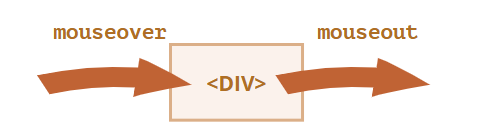

具有 `relatedTarget` 属性

对于 `mouseover`：

- `event.target` —— 是鼠标移入的那个元素。
- `event.relatedTarget` —— 是鼠标来自的那个元素（`relatedTarget` → `target`）。

`mouseout` 则与之相反：

- `event.target` —— 是鼠标离开的元素。
- `event.relatedTarget` —— 是鼠标移动到的，当前指针位置下的元素（`target` → `relatedTarget`）。


非常快地移动鼠标，那么某些 DOM 元素就可能被跳过：

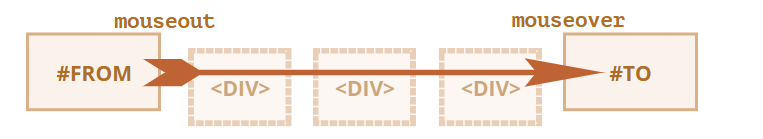


**`mouseenter` 和 `mouseleave`**

事件 `mouseenter/mouseleave` 类似于 `mouseover/mouseout`。它们在鼠标指针进入/离开元素时触发。

但是有两个重要的区别：

1. 元素内部与后代之间的转换不会产生影响。下图中,parent元素进入child元素时,会触发`mouseout`但不会触发`mouseleave`

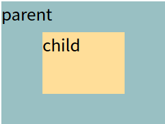

1. 事件 `mouseenter/mouseleave` 不会冒泡。


#### contextmenu

在用户**右键点击**某个元素时触发

可以为任意 HTML 元素监听 `contextmenu` 事件

```html
<div id="myDiv">右键点击我试试</div>
<script>
document.getElementById('myDiv').addEventListener('contextmenu', function(event) {
    event.preventDefault(); // 阻止浏览器默认菜单
    alert('你右键点击了这个DIV!');
});
</script>
```

event.preventDefault() 可以阻止浏览器弹出默认的右键菜单。

这样你就可以自定义自己的右键菜单或执行其他操作。

<hr>

自定义右键菜单

```html
<div id="area" style="width:200px;height:200px;background:#eee;">右键试试</div>
<ul id="menu" style="display:none;position:absolute;list-style:none;padding:8px;background:#fff;border:1px solid #ccc;">
  <li>菜单项1</li>
  <li>菜单项2</li>
</ul>
<script>
const area = document.getElementById('area');
const menu = document.getElementById('menu');

area.addEventListener('contextmenu', function(e) {
    e.preventDefault(); // 阻止默认菜单
    menu.style.display = 'block';
    menu.style.left = e.pageX + 'px';
    menu.style.top = e.pageY + 'px';
});

// 点击其它地方隐藏菜单
document.addEventListener('click', function() {
    menu.style.display = 'none';
});
</script>
```


### 拖放事件

注意： 为了让元素可拖动，需要使用 HTML5 draggable 属性。(draggable=true)

在拖放的过程中会触发以下事件：

在拖动目标上触发事件 (源元素):

  `ondragstart` - 用户开始拖动元素时触发

  `ondrag` - 元素正在拖动时触发

  `ondragend` - 用户完成元素拖动后触发

释放目标时触发的事件:

  `ondragenter` - 当被鼠标拖动的对象进入其容器范围内时触发此事件

  `ondragover` - 当某被拖动的对象在另一对象容器范围内拖动时触发此事件

  `ondragleave` - 当被鼠标拖动的对象离开其容器范围内时触发此事件

  `ondrop` - 在一个拖动过程中，释放鼠标键时触发此事件

注意： 在拖动元素时，每隔 350 毫秒会触发 ondrag 事件。

```html
<body>
  <div class="box1">
    <!-- 加了这个属性 元素才能被拖动 -->
    <p draggable="true">拖放我!</p>
  </div>
  <div class="box2"></div>

  <script>
    let p = document.querySelector('p')
    let box1 = document.querySelector('.box1')
    let box2 = document.querySelector('.box2')

    // 监听元素开始拖动的事件
    p.addEventListener('dragstart', function() {
      console.log('元素开始被拖动')
    })

    // 监听元素正在被拖动的事件
    p.addEventListener('drag', function() {
      console.log('元素正在被拖动')
    })

    // 阻止标签的默认行为(默认不让元素拖动进来)
    // 阻止标签默认不让元素拖动进来的的默认行为
    box1.addEventListener('dragover', function(e) {
      e.preventDefault()
    })
    box2.addEventListener('dragover', function(e) {
      e.preventDefault()
    })

    // 当鼠标释放的时候, 触发的事件
    box2.addEventListener('drop', function() {
      console.log('已经拖动到目的地容器了')

      // 还需要将p元素添加到目的地容器
      box2.append(p)
    })

    // 拖回box1
    box1.addEventListener('drop', function() {
      console.log('已经拖动到目的地容器了')

      // 还需要将p元素添加到目的地容器
      box1.append(p)
    })
  </script>
</body>
```


#### 拖放传递信息

```html
<body>
    <div class="box1">
        <p draggable="true" id="p1">拖放我!</p>
    </div>
    <div class="box2"></div>

    <script>
        /* 
            操作
                给p标签添加一个id属性,值为p1
            需求
                将p标签的id值传递到box2容器中
            解决
                需要用到事件对象的dataTransfer属性
                dataTransfer.setData()方法设置数据类型和拖动的数据
        */
       //获取相关的dom元素
       var p = document.querySelector('p') //被拖动的元素
       var box1 = document.querySelector('.box1') //初始容器
       var box2 = document.querySelector('.box2') //目的地容器

       //监听元素开始拖动的事件
       p.addEventListener('dragstart',function(e){
          console.log('元素开始被拖动')

          //将数据保存到事件对象的dataTransfer属性
          e.dataTransfer.setData('data',e.target.id)
       })

       //监听元素正在被拖动的事件
       p.addEventListener('drag',function(){
          console.log('元素正在被拖动')
       })

       //阻止标签的默认行为(默认不让元素拖动进来)
       box1.addEventListener('dragover',function(e){
         e.preventDefault()
       })
       box2.addEventListener('dragover',function(e){
         e.preventDefault()
       })

       //监听--当鼠标释放的时候触发的事件(将p元素添加到box2下面)
       box2.addEventListener('drop',function(e){
          console.log('已经拖动目的地容器了')

          //还需要将p元素添加到目的地容器
          box2.appendChild(p)

          //获取事件对象中存储的数据
          console.log(e.dataTransfer.getData('data'))
       })
    </script>
</body>
```


#### 添加拖拽样式

```vue
<script setup>
/**
拖拽开始（dragstart）
    记录当前被拖拽元素的索引 draggedIndex。
    清空拖拽悬停索引 dragOverIndex。
    给被拖拽元素添加 .dragging 样式（通过绑定 class，实现视觉反馈） 。


拖拽经过（dragover）
    调用 event.preventDefault() 允许放置操作。
    记录当前鼠标悬停的目标元素索引 dragOverIndex。
    给拖拽目标悬停到的元素添加 .dragover 样式，高亮提示可以放置。


拖拽释放（drop）
    调用 event.preventDefault() 阻止默认行为。
    根据 draggedIndex 和 dropIndex 调整数据顺序，实现拖拽排序。
    清空拖拽状态索引，移除样式。
*/
    
import { ref } from 'vue'

let draggedIndex = null        // 在拖拽开始时，记录被拖拽项的索引 draggedIndex；
const dragOverIndex = ref(null) // 在拖拽经过时，记录当前经过项索引 dragOverIndex；

function onDragstart(event, index) {
  draggedIndex = index
  dragOverIndex.value = null
}

function onDragOver(event, index) {
  event.preventDefault()    // 允许放置
  dragOverIndex.value = index
}

function onDrop(event, dropIndex) {  //dropIndex 代表当前拖拽释放目标的索引
  event.preventDefault()
  // 拖拽逻辑省略
  draggedIndex = null
  dragOverIndex.value = null
}

</script>

<template>
  <ul>
    <li 
      v-for="(todo, index) in todos" 
      :key="todo.id"
      draggable="true"
      @dragstart="event => onDragstart(event, index)"
      @dragover="event => onDragOver(event, index)"
      @drop="event => onDrop(event, index)"
      @dragend="onDragEnd"
      :class="{
        dragging: index === draggedIndex,
        dragover: index === dragOverIndex
      }"
    >
      {{ todo.text }}
    </li>
  </ul>
</template>

<style scoped>
.dragging {
  opacity: 0.5;
  background-color: rgb(0, 136, 255);
  box-shadow: 0 4px 8px rgba(0,0,0,0.3);
  cursor: grabbing;
}

.dragover {
  background-color: #6495ED;
  border: 2px dashed #6495ED;
}
</style>
```

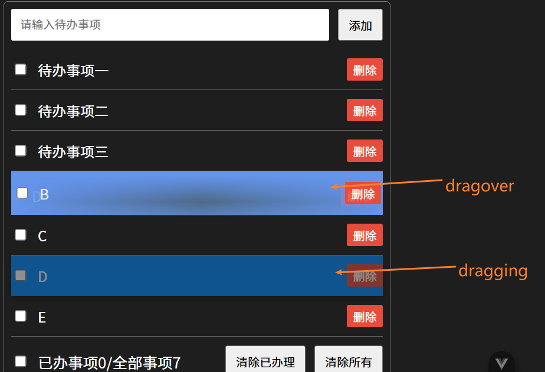


### 随意拖放

原生的拖放事件也有其局限性。例如，我们无法阻止从特定区域的拖动。并且，我们无法将拖动变成“水平”或“竖直”的。还有很多其他使用它们无法完成的拖放任务。并且，移动设备对此类事件的支持非常有限。

**鼠标事件：**

- `click` —— 当鼠标点击一个元素时（触摸屏设备会在点击时生成）。
- `contextmenu` —— 当鼠标右键点击一个元素时。
- `mouseover` / `mouseout` —— 当鼠标指针移入/离开一个元素时。
- `mousedown` / `mouseup` —— 当在元素上按下/释放鼠标按钮时。
- `mousemove` —— 当鼠标移动时。


基础的拖放算法：

1. 在 `mousedown` 上 —— 根据需要准备要移动的元素（也许创建一个它的副本，向其中添加一个类或其他任何东西）。
2. 然后在 `mousemove` 上，通过更改 `position:absolute` 情况下的 `left/top` 来移动它。
3. 在 `mouseup` 上 —— 执行与完成的拖放相关的所有行为。


换句话说, 就是在 `document` 上跟踪 `mousemove`， 鼠标按下时实现鼠标跟随,  鼠标抬起时取消对鼠标跟随事件的监听


下面是拖放一个item元素的实现代码：

```javascript
<script>
// 获取所有的item元素
let items = document.querySelectorAll('.item')
for (let item of items) {
  // 给每个item元素绑定事件
  item.addEventListener('mousedown', function (event) {
    // 准备移动  设置absolute，设置 z-index 确保item在顶部
    item.style.position = 'absolute';
    item.style.zIndex = 1000;


    // 避免在选取item的时候, item突然“跳转”以使其中心位于鼠标指针下方
    // 需要计算被拖动元素相对于鼠标的初始偏移
    // 用鼠标可视区域坐标 减去 元素左上角坐标
    let shiftX = event.clientX - item.getBoundingClientRect().left;
    let shiftY = event.clientY - item.getBoundingClientRect().top;

    // 让item的中心在 (pageX, pageY) 坐标上
    function moveAt(pageX, pageY) {
      item.style.left = pageX - shiftX + 'px';
      item.style.top = pageY - shiftY + 'px';
    }

    // 让item定位在鼠标位置
    moveAt(event.pagx, event.pageY)


    // 在 mousemove 事件上移动item
    document.addEventListener('mousemove', onMouseMove)
    function onMouseMove(event) {
      moveAt(event.pageX, event.pageY)
    }


    // 放下items事件
    item.addEventListener('mouseup', function () {
      // 移除 mousemove 的事件监听
      document.removeEventListener('mousemove', onMouseMove)
      // 移除 mouseup 监听
      item.onmouseup = null
    })

  })
}

</script>
```


关于鼠标指针相对于球的这个偏移

```
item.style.left = pageX - ball.offsetWidth / 2 + 'px';
item.style.top = pageY - ball.offsetHeight / 2 + 'px';
```

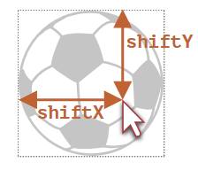


有时候浏览器有自己的对图片和一些其他元素的拖放处理。它会在我们进行拖放操作时自动运行，并与我们的拖放处理产生了冲突。

禁可以用它：

```javascript
ball.ondragstart = function() {
  return false;
};
```


#### 放置目标

球可以被放置（drop）到“任何地方”。在实际中，我们通常是将一个元素放到另一个元素上。


### 键盘事件

按下事件

```js
document.onkeydown = function() {
  console.log('键盘按下')
}

document.onkeyup = function() {
  console.log('键盘松开')
}

document.onkeypress = function() {
  console.log('字母键盘按下')
}
```


监听大小写

```js
//如果想监听大小写,需要用到keypress(keypress对功能键不起作用)
document.addEventListener('keypress',function(e){
    console.log(e.key)
    console.log(e.keyCode)

    //然后就可以根据keyCode的值,判断是否按下了大小写
    if(e.keyCode == 65){
        console.log('按下了大写的A')
    }else if(e.keyCode == 97){
        console.log('按下了小写的a')
    }else{
        console.log('按下了其他键')
    }
})
```


补充

```vue
//回车触发输入框事件
<input @keyup.enter="addTodo"/>
```


## 表单&控件事件

### 焦点事件

```html
<body>
  <input type="text">

  <script>
    let input = document.querySelector('input')
    
    input.onblur = function() {
      console.log('失去焦点')
    }

    input.onfocus = function() {
      console.log('获取焦点')
    }
  </script>
</body>
```


### change事件

**change 事件**：输入框失焦时触发（只有在最终确认内容时触发）

```html
<body>
  <select name="" id="province">
    <option>--选择省--</option>
    <option value="henan">河南省</option>
    <option>辽宁省</option>
    <option>山东省</option>
  </select>

  <script>
    let province = document.querySelector('#province')
    province.addEventListener('change', function() {
      console.log('选项卡切换了')

      console.log(province.value) //获取option的value值,或者标签体的值

      // 返回选项卡索引 selectedIndex
      console.log(province.selectedIndex)
    })
  </script>
</body>
```


### input事件

**input 事件**：输入框内容变化时实时触发（每输入一个字符都会触发）

```html
<body>
  <input type="text">
  <script>
    let input = document.querySelector('input')

    // input里面的内容改变就会触发
    input.addEventListener('input', function() {
      console.log('内容改变了')
    })

    // change事件只有失去焦点 或者按下了回车才会触发
    input.addEventListener('change', function() {
      console.log('内容改变了')
    })
  </script>
</body>
```


## 滚动

监听滚动事件

```javascript
window.addEventListener('scroll', function() {
  document.getElementById('showScroll').innerHTML = window.pageYOffset + 'px';
});
```


防止滚动

在导致滚动的事件上，例如在 pageUp 和 pageDown 的 `keydown` 事件上，使用 `event.preventDefault()` 来阻止滚动。

## 页面加载事件(待总结)

### 页面生命周期

HTML 页面的生命周期包含三个重要事件：

- `DOMContentLoaded` —— 浏览器已完全加载 HTML，并构建了 DOM 树，但像 `` 和样式表之类的外部资源可能尚未加载完成。
- `load` —— 浏览器不仅加载完成了 HTML，还加载完成了所有外部资源：图片，样式等。
- `beforeunload/unload` —— 当用户正在离开页面时。

每个事件都是有用的：

- `DOMContentLoaded` 事件 —— DOM 已经就绪，因此处理程序可以查找 DOM 节点，并初始化接口。
- `load` 事件 —— 外部资源已加载完成，样式已被应用，图片大小也已知了。
- `beforeunload` 事件 —— 用户正在离开：我们可以检查用户是否保存了更改，并询问他是否真的要离开。
- `unload` 事件 —— 用户几乎已经离开了，但是我们仍然可以启动一些操作，例如发送统计数据。


#### load

```html
<body>
  
  <script>
    // 这个时候会报错,因为浏览器加载html页面的时候,从上往下解析
    // 执行js代码的时候,按钮还没加载出来
    // 可以监听window将所需内容load出来,在执行接下来的代码
    let btn = document.querySelector('button')
    console.log(btn)
    btn.addEventListener('click', function() {
      alert('asldfj')
    })
  </script>
  <button>按钮</button>


  <script>
    // 监听window的load事件
    window.addEventListener('load', function () {
      let btn = document.querySelector('button')
      console.log(btn)
      btn.addEventListener('click', function () {
        alert('加载好了')
      })
    })
  </script>
  <button>按钮</button>
</body>
```


# 浏览器对象模型 (BOM)

打开关闭窗口

```js
<script>
    /* 
        open()	打开一个新的浏览器窗口或查找一个已命名的窗口。
        close()	关闭浏览器窗口。
    */
   var newWindow = null

    //打开窗口
    document.querySelector('.btn1').addEventListener('click',function(){
       newWindow =  open('http://www.baidu.com')
    })

    //关闭窗口
    document.querySelector('.btn2').addEventListener('click',function(){
       newWindow.close()//前面省略了window,直接调用的话,就会把当前窗口window关掉
    })

</script>
```


location对象

```html
<body>
    <button class="btn1">跳转到百度</button>
    <button class="btn2">刷新当前页面</button>
    <button class="btn3">获取当前页面的url地址</button>

    <script>
        /* 
            概念
                地址栏对象,可以实现刷新和跳转
            属性
                href属性
                    设置
                        location.href = '新的url地址'  就可以实现跳转
                    获取
                        location.href  可以获取当前页面的url地址
            方法
                reload()  重新载入当前页面(刷新)
        */
       document.querySelector('.btn1').addEventListener('click',function(){
           location.href = 'http://www.baidu.com'
       })
       document.querySelector('.btn2').addEventListener('click',function(){
           location.reload()
       })
       document.querySelector('.btn3').addEventListener('click',function(){
           alert(location.href) 
       })
    </script>
</body>
```


history对象

```html
<body>
    <button>返回到上一个页面(历史页面)</button>

    <script>
        /* 
            需求:自己实现点击按钮,点击之后返回到上一个页面
        */
       document.querySelector('button').addEventListener('click',function(){
          //方式一:使用back()方法
          //back()	加载 history 列表中的前一个 URL
          //history.back()

          //方式二:使用go()方法
          //go()	加载 history 列表中的某个具体页面
          //该参数可以是数字，使用的是要访问的 URL 在 History 的 URL 列表中的相对位置。（-1上一个页面，1前进一个页面)。
          history.go(-1)
       })
    </script>
</body>
```


# 待总结笔记

```js
const target = document.querySelector('.city-panel .province .index-' + l);
target.scrollIntoView({ behavior: 'smooth' }); // 默认会将目标元素滚动到可视区域的“顶部”。

具体来说，scrollIntoView 方法默认参数是：block: 'start'（垂直方向）和inline: 'nearest'（水平方向），即：


target.scrollIntoView({
  behavior: 'smooth', // 平滑滚动
  block: 'start',     // 元素顶部与视口顶部对齐
  inline: 'nearest'   // 水平方向上尽量靠近视口
});

target.scrollIntoView({ behavior: 'smooth', block: 'end' }); // 滚动到可视区域底部
```


js包含两个部分，ecamscript，WebAPI

WebAPI 新笔记体系

WebAPI是浏览器提供的api，用来操作窗口和界面

WebAPI 中包含两个部分：

- BOM：Browser Object Model，浏览器模型，提供和浏览器相关的操作
- DOM：Document Object Model，文档模型，提供和页面相关的操作


HTML内容看成一个树形标签

标签是元素节点，换行(特殊字符换行符)和文本是文本节点

嵌套标签是表示节点之间的父子级关系

```html
<!DOCTYPE HTML>
<html>
<head>
  <title>About elk</title>
</head>
<body>
  The truth about elk.
</body>
</html>
```

用树形标签表示父子关系，#text前缀表示该节点为文本节点：

```code
document
└── <html>
      ├── <head>
      │     ├── #text "\n  "
      │     ├── <title>
      │     │     └── #text "About elk"
      │     └── #text "\n"
      ├── #text "\n"
      └── <body>
            └── #text "\n  The truth about elk.\n"
```


每个节点都是一个对象，对象上的属性通常指向其子节点对象

整个文档对象用**`document`**对象表示，

```js
document          ← 整个文档对象，是树的入口，不是任何标签
  └── <html>      ← document.documentElement
        ├── <head>
        └── <body>  ← document.body （浏览器提供的快捷方式）
```

如果不使用快捷方式，用`document.documentElement.body`也是能够访问到<body>元素的


事件传播机制

```html
<div>
  <button></button>
</div>
```

点击button按钮时

1、浏览器感应到事件,计算"传播路径"：从 window 一路找到目标元素，根据文档树的结构，计算一个从window（在浏览器开发环境中，window既是全局对象也代表了浏览器）到目标节点的路径，于是就建立了一个有序列表`[window, document, html, body, div, button]`

2、从前往后遍历一遍这个列表，依次触发标记为capture=true的监听器（通过`addEventListener('click', callback, true)`注册的监听器）

3、然后反向遍历一遍这个列表，依次触发标记为capture=false的监听器（通过`addEventListener('click', callback)`注册的监听器）

4、在目标元素button上，并不会严格按照先触发capture=true的监听器，接着执行capture=false的监听器，而是会按照注册顺序执行

捕获/目标/冒泡只是对这一次双向遍历贴的标签
