## 前端开发核心

### JavaScript编程本质

```
数据（Data）：变量、对象、数组等存储的业务信息。
状态（State）：数据在某一时刻的全局“快照”，包括界面所需的全部信息。通俗一点讲，就是决定页面当前长什么样子、内容是什么的所有数据集合。
行为（Behavior）：事件、函数、逻辑流转，是对数据和状态的操作与转换。


表面层面：
    变量是数据的载体
    无论是赋值、函数传参、事件回调，底层都是数据的读、写、传递和变换。
    按钮点击->事件触发->函数执行->变量变化->界面更新，整个链路是数据在流动。
    
更本质的角度：“UI = f(状态)”
    把数据状态映射为可见的UI，并根据用户交互或外部数据驱动状态改变，进而变化UI
    JavaScript 的职责，就是管理和变化“状态”，并驱动 UI。（我不理解这里的状态是什么意思）
    例如 React/Vue 等现代框架，核心思想都是“声明式状态驱动UI”。（我学习了vue,并用vue做了业务，还是没有理解这句话,能举个简单的vue例子说下吗）
    
“事件-响应-状态变化”的闭环
	用户操作、服务端数据变化、定时器等事件，触发代码逻辑；
    代码处理这些事件，更新变量/状态；
    状态变化驱动UI更新（DOM变了，页面变了）；
    用户看到变化，新的操作开始，进入下一个循环。
    
底层再抽象一层：“输入-处理-输出”模型
    输入：用户输入、网络请求、定时器等外部事件
    处理：JavaScript 逻辑，处理数据和状态
    输出：界面更新（DOM变化），网络响应，控制台输出等
    


真正的本质，可以这样概括：前端JavaScript编程的本质，是通过变量、函数和事件，来管理和变换数据/状态，从而驱动界面的动态表现，实现人与计算机的信息交互

JavaScript 的第一大作用，是“根据各种数据流（用户、服务端、业务逻辑等），更新和维护状态”。
JavaScript 的第二大作用，负责状态到UI的映射（直接操作 DOM）
```


用一个vue例子来说明上面的例子吧

```vue
<template>
  <div>
    <p>当前计数：{{ count }}</p>
    <button @click="count++">加一</button>
  </div>
</template>

<script setup>
const count = ref(0)

</script>

解释
    count 就是“状态”。
    <p>当前计数：{{ count }}</p> 这行就是“把状态映射为UI”——count是多少页面就显示多少。
    <button @click="count++"> 这行就是“根据用户交互驱动状态改变”——点按钮，count就+1。
    页面会自动根据count的值变化而变化，这就是声明式状态驱动UI。
```


### 核心

前端开发的核心，就是梳理出影响UI的数据（状态），并构建好“状态如何决定UI”的规则，然后让一切交互都通过状态去驱动UI变化。


### 工作流程

```js
根据UI 状态 数据流 的关系确定的前端编写流程

现代前端最佳实践（React/Vue/Angular 通用）：
三步法：先状态→UI→数据流

三步法：先状态→UI→数据流（即你第三种方式）

1.梳理状态
    先根据业务流程、原型稿，梳理出所有“影响UI的状态”。
    用变量/模拟数据占位（甚至先用JS对象模拟接口返回值）。
2.声明UI
    用模板或JSX，把UI和状态做“声明式绑定”。
    UI部分全部以状态变量驱动。
3.实现数据流
	数据流向后拼，比如api请求、用户事件、定时器等，最终都落在“状态的变化”上。
```


### 一点思考

```
前端技术栈何其多，业务何其多，但是要从变中寻找到不变，行业既然存在，就必然有依赖的核心逻辑
很多人能准确的判断行业是否发生了颠覆性变化，可能正是其知道某件事将改变行业的底层逻辑
但前提是需要对行业了解的足够深刻
只有深刻的认识前端行业，才能够明白哪些是真正重要的东西，需要去了解和掌握的东西
看清前路才能缓解自己的焦虑
```


### “变”  中寻找  “不变”

```js
2.1 真正不变的核心
用户输入 → 状态变化 → UI变更
	不管用什么框架、什么工具，这个“输入-状态-视图”三角关系永远不变。
数据驱动UI
	一切UI展示（包括动画、交互、反馈）都由状态、数据决定。
组件化/可复用性
	现代前端追求“拆分、复用、组合”，无论是Vue、React、Web Components，本质都是“低耦合高内聚”的工程思想。
响应式/声明式思想
	让UI自动响应数据变化，减少手动操作DOM的繁琐和出错。
工程化与协作
	自动化构建、测试、持续集成、代码规范，都是为了让前端开发更高效、可控、标准化。

2.2 这些本质，才是不会被颠覆的东西
    只要“网页=用数据和逻辑动态生成界面”这个基本模式不变，核心就不会变。
    技术层面的变革（如从jQuery到React/Vue，再到Svelte/未来的新框架），仅仅是“实现层”在进化。
```


## 引入

内嵌

```html
<!DOCTYPE HTML>
<html>

<body>

  <p>script 标签之前...</p>

  <script>
    alert('Hello, world!');
  </script>

  <p>...script 标签之后</p>

</body>

</html>
```

外部导入 外链导入

如果设置了src属性,标签里面的内容将被忽略

```html
<body>
  <script src="./Js/test.js"></script>
  <script src="/js/script1.js"></script>
  <script src="/js/script2.js"></script>
</body>
```

只有最简单的脚本才嵌入到 HTML 中。更复杂的脚本存放在单独的文件中。

使用独立文件的好处是浏览器会下载它，然后将它保存到浏览器的 [缓存](https://en.wikipedia.org/wiki/Web_cache) 中。

## 注释

单行注释以两个正斜杠字符 `//` 开始。

多行注释以一个正斜杠和星号开始 `“/*”` 并以一个星号和正斜杠结束 `“*/”`。


### 特殊符号

```
&lt; 表示小于号 <

&gt; 表示大于号 >

&amp; 表示和号 &

&quot; 表示引号 "

&nbsp; 表示不断行的空格
```

# 交互

**alert、prompt、console.log 和 confirm**

`console.log()`,在控制台输出

弹框录入

```js
// 弹框录入
let years = prompt('请输入你的年龄')
console.log(years)
```

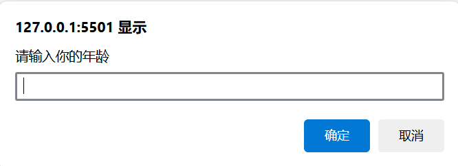

嵌套字符串 模板字符串 

```
`总人数${sum}`
```


**confirm**

语法：

```javascript
result = confirm(question);
```

`confirm` 函数显示一个带有 `question` 以及确定和取消两个按钮的模态窗口。

点击确定返回 `true`，点击取消返回 `false`。

例如：

```javascript
let isBoss = confirm("Are you the boss?");

alert( isBoss ); // 如果“确定”按钮被按下，则显示 true
```


# 基本语法


# 数据类型


## 数组

### 基本

- 数组，存储有序集合。

创建空数组的方法

```js
let arr = new Array();
let arr = [];
let fruits = ["Apple", "Orange", "Plum"];


new Array(n)	创建一个长度为 n 的数组，但元素为空槽（empty slots），不是 undefined
let arr = new Array(3);
console.log(arr. length);        // 3
console.log(arr[0]);            // undefined（但不是赋值的）
console.log(arr. map(x => 1));   // [empty × 3]（map跳过空槽）


new Array(v1, v2, ...)	创建数组并直接用参数值填充,所有参数都被当作数组元素
let arr = new Array(1, 2, 3);
console.log(arr);               // [1, 2, 3]
console.log(arr.length);        // 3
console.log(arr. map(x => x*2)); // [2, 4, 6]
```


Array.from(arrayLike, mapFn)	

从类数组/可迭代对象创建真正的数组

参数：

- arrayLike：类数组或可迭代对象（必须有 length 或 Symbol.iterator）
- mapFn（可选）：映射函数，(element, index) => newElement
- 返回：新的真正数组

```js
// 从类数组对象
let arrayLike = { 0: 'a', 1: 'b', 2: 'c', length: 3 };
let arr1 = Array.from(arrayLike);
console.log(arr1);  // ['a', 'b', 'c']

// 从字符串
let arr2 = Array.from('hello');
console.log(arr2);  // ['h', 'e', 'l', 'l', 'o']

// 从 Set
let arr3 = Array.from(new Set([1, 2, 2, 3]));
console.log(arr3);  // [1, 2, 3]

// 带映射函数
let arr4 = Array.from([1, 2, 3], x => x * 2);
console.log(arr4);  // [2, 4, 6]
```


Array.from({ length: N }, callback)	

- **作用**：根据长度对象和回调函数生成数组，常用于生成初始化数组
- 参数：
  - `{ length: N }`：长度对象（必须有 length 属性）
  - callback：映射函数`(element, index) => newElement`
    - `element`：通常是 undefined（因为对象没有实际元素）
    - `index`：当前索引（0 到 N-1）

```js
// 生成 0 到 4 的数组
let arr1 = Array.from({ length: 5 }, (_, i) => i);
console.log(arr1);  // [0, 1, 2, 3, 4]

// 生成 1 到 10 的数组
let arr2 = Array.from({ length: 10 }, (_, i) => i + 1);
console.log(arr2);  // [1, 2, 3, .. ., 10]

// 生成指定长度的空值数组
let arr3 = Array.from({ length: 3 }, () => null);
console.log(arr3);  // [null, null, null]
```


获取元素：

```javascript
let fruits = ["Apple", "Orange", "Plum"];

alert( fruits[0] ); // Apple
alert( fruits[1] ); // Orange
alert( fruits[2] ); // Plum
```

可以替换元素：修改元素

```javascript
fruits[2] = 'Pear'; // 现在变成了 ["Apple", "Orange", "Pear"]
```

……或者向数组新加一个元素：

```javascript
fruits[3] = 'Lemon'; // 现在变成 ["Apple", "Orange", "Pear", "Lemon"]
```


`length` 属性的值是数组中元素的总个数：数组长度

```javascript
let fruits = ["Apple", "Orange", "Plum"];

alert( fruits.length ); // 3
```


可以储存任何类型的元素

```javascript
// 混合值
let arr = [ 'Apple', { name: 'John' }, true, function() { alert('hello'); } ];

// 获取索引为 1 的对象然后显示它的 name
alert( arr[1].name ); // John

// 获取索引为 3 的函数并执行
arr[3](); // hello
```


### 数组循环

遍历数组最古老的方式就是 `for` 循环：

```javascript
let arr = ["Apple", "Orange", "Pear"];

for (let i = 0; i < arr.length; i++) {
  alert( arr[i] );
}
```


但对于数组来说还有另一种循环方式，`for..of`：(forof)

```javascript
let fruits = ["Apple", "Orange", "Plum"];

// 遍历数组元素
for (let fruit of fruits) {
  console.log(fruit); // 输出每个水果的名称
}
```

`for..of` 不能获取当前元素的索引，只是获取元素值，但大多数情况是够用的。而且这样写更短。


技术上来讲，因为数组也是对象，所以使用 `for..in` 也是可以的：

```javascript
let arr = ["Apple", "Orange", "Pear"];

for (let key in arr) {
  alert( arr[key] ); // Apple, Orange, Pear
}
```

但这其实是一个很不好的想法。会有一些潜在问题存在：

1. `for..in` 循环会遍历 **所有属性**，不仅仅是这些数字属性。

   在浏览器和其它环境中有一种称为“类数组”的对象，它们 **看似是数组**。也就是说，它们有 `length` 和索引属性，但是也可能有其它的非数字的属性和方法，这通常是我们不需要的。`for..in` 循环会把它们都列出来。所以如果我们需要处理类数组对象，这些“额外”的属性就会存在问题。

2. `for..in` 循环适用于普通对象，并且做了对应的优化。但是不适用于数组，因此**速度要慢 10-100 倍**。

### 多维数组

数组里的项也可以是数组。我们可以将其用于多维数组，例如存储矩阵：

```javascript
let matrix = [
  [1, 2, 3],
  [4, 5, 6],
  [7, 8, 9]
];

alert( matrix[1][1] ); // 最中间的那个数
console.log( matrix[2][1] ); // 8
console.log( matrix[0][2] ); // 3
```

循环多维数组

```js
  let matrix = [
    [90, 100, 80],
    [100, 89, 91],
    [60, 76, 88],
  ];

  for (let i = 0; i < matrix.length; i++) {
    let innerArr = matrix[i]
    for (let j = 0; j < innerArr.length; j++) {
      document.write(innerArr[j]+'  ')
    }
  }
```


### 数组是一个对象

 `arr[0]` 实际上是来自于对象的语法。它其实与 `obj[key]` 相同, 其中 `arr` 是对象，而数字用作键（key）

例如，它是通过引用来复制的：

```javascript
let fruits = ["Banana"]

let arr = fruits; // 通过引用复制 (两个变量引用的是相同的数组)

alert( arr === fruits ); // true

arr.push("Pear"); // 通过引用修改数组

alert( fruits ); // Banana, Pear — 现在有 2 项了
```


### 关于 “length”

截断数组

当我们修改数组的时候，`length` 属性会自动更新。准确来说，它实际上不是数组里元素的个数，而是最大的数字索引值加一。

例如，一个数组只有一个元素，但是这个元素的索引值很大，那么这个数组的 `length` 也会很大：

```javascript
let fruits = [];
fruits[123] = "Apple";

alert( fruits.length ); // 124
```


`length` 属性可以被编辑,修改

如果我们手动增加它，则不会发生任何有趣的事儿。但是如果我们减少它，数组就会被截断。该过程是不可逆的，下面是例子：

```javascript
let arr = [1, 2, 3, 4, 5];

arr.length = 2; // 截断到只剩 2 个元素
alert( arr ); // [1, 2]

arr.length = 5; // 又把 length 加回来
alert( arr[3] ); // undefined：被截断的那些数值并没有回来
```

所以，清空数组最简单的方法就是：`arr.length = 0;`。


### pop/push, shift/unshift 方法

- `push` 在末端添加一个元素.(在最后添加一个元素)
- `shift` 取出队列首端的一个元素，整个队列往前移，这样原先排第二的元素现在排在了第一。(取出第一个元素,,并返回,还让整个数组队列往前移动一格)

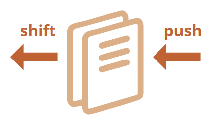

数组还有另一个用例，就是数据结构 [栈](https://en.wikipedia.org/wiki/Stack_(abstract_data_type))。

它支持两种操作：

- `push` 在末端添加一个元素.
- `pop` 从末端取出一个元素.(从数组最后取出一个元素,删除最后一个元素,并返回)

所以新元素的添加和取出都是从“末端”开始的。

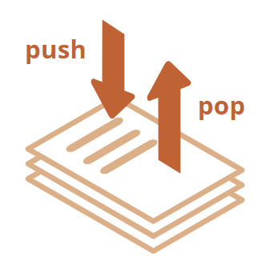


- `pop`

  取出并返回数组的最后一个元素：

  ```js
  let fruits = ["Apple", "Orange", "Pear"];
  
  alert( fruits.pop() ); // 移除 "Pear" 然后 alert 显示出来
  
  alert( fruits ); // Apple, Orange
  ```

  

- `push`

  在数组末端添加元素：

  ```js
  let fruits = ["Apple", "Orange"];
  
  fruits.push("Pear");
  
  alert( fruits ); // Apple, Orange, Pear
  ```


- `shift`

  取出数组的第一个元素并返回它：

  ```js
  let fruits = ["Apple", "Orange", "Pear"];
  
  alert( fruits.shift() ); // 移除 Apple 然后 alert 显示出来
  
  alert( fruits ); // Orange, Pear
  ```

  

- `unshift`

  在数组的首端添加元素：(数组开头添加元素,让其整体后退)

  ```js
  let fruits = ["Orange", "Pear"];
  
  fruits.unshift('Apple');
  
  alert( fruits ); // Apple, Orange, Pear
  ```


- `push` 和 `unshift` 方法都可以一次添加多个元素：

  ```javascript
  let fruits = ["Apple"];
  
  fruits.push("Orange", "Peach");
  fruits.unshift("Pineapple", "Lemon");
  
  // ["Pineapple", "Lemon", "Apple", "Orange", "Peach"]
  alert( fruits );
  ```

​	

### 四种方法性能

`push/pop` 方法运行的比较快，而 `shift/unshift` 比较慢。

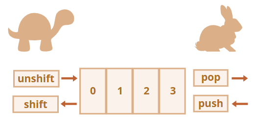

只获取并移除索引 `0` 对应的元素是不够的。其它元素也需要被重新编号。


### 数组对象(方法)

返回以逗号隔开的数组元素

数组有自己的 `toString` 方法的实现，会返回以逗号隔开的元素列表。

例如：

```javascript
let arr = [1, 2, 3];

alert( arr ); // 1,2,3
alert( String(arr) === '1,2,3' ); // true

  let matrix = [
    [90, 100, 80],
    [100, 89, 91],
    [60, 76, 88],
  ];
console.log(String(matrix))  //90,100,80,100,89,91,60,76,88
```


获取最后一个元素

`fruits.at(-1)`：

```javascript
let fruits = ["Apple", "Orange", "Plum"];

// 与 fruits[fruits.length-1] 相同
alert( fruits.at(-1) ); // Plum
```


获取对应范围的随机数 给定区间随机

```js
// 10 - 100   (max-min +1) + min
let x8 = Math.floor(Math.random() * (100 - 10 + 1) ) + 10

document.write(`${x8}<br>`)
```


随机索引获取数组元素

```js
// 获取随机索引[0, arr.length - 1]
let arr = ['张三', '李四', '王五', '赵六']
```


#### 变成字符串 String

数组有自己的 `toString` 方法的实现，会返回以逗号隔开的元素列表。

例如：

```javascript
let arr = [1, 2, 3];

alert( arr ); // 1,2,3
alert( String(arr) === '1,2,3' ); // true
```


#### 添加.删除元素 splice

`arr.splice` 方法可以说是处理数组的瑞士军刀。它可以做所有事情：添加，删除和插入元素。

语法是：

```javascript
arr.splice(start, deleteCount, elem1, ..., elemN)
```

它从索引 `start` 开始修改 `arr`：删除 `deleteCount` 个元素并在当前位置插入 `elem1, ..., elemN`。**最后返回被删除的元素所组成的数组**。

```javascript
let arr = ["I", "study", "JavaScript"];

arr.splice(1, 1); // 从索引 1 开始删除 1 个元素

alert( arr ); // ["I", "JavaScript"]
```

将超过2000的删掉

```js
let salay = [1500, 1200, 2000, 2100, 2200, 1800]
for (let i = 0; i < salay.length; i++) {
  if (arr[i] > 2000) {
    arr.splice(i, 1)
    i-- // 消除删一个元素往前挪动的影响,
  }
}
```


#### 遍历 forEach

`arr.forEach`方法

为数组的每个元素都运行一个函数。

语法：

```javascript
arr.forEach(function(item, index, array) {
  // ... do something with item
});
```

例如，下面这个程序显示了数组的每个元素：

```javascript
// 对每个元素调用 alert
["Bilbo", "Gandalf", "Nazgul"].forEach(alert);
```

而这段代码更详细地介绍了它们在目标数组中的位置：

item 当前正在处理的函数

index  当前元素的索引位置

array 调用 `forEach` 方法的原始数组

```javascript
["Bilbo", "Gandalf", "Nazgul"].forEach((item, index, array) => {
  alert(`${item} is at index ${index} in ${array}`);
});
```

该函数的结果（如果它有返回）会被抛弃和忽略。map方法可以写在 = 右边, 但是foreach不行


#### 搜索索引 indexOf

- `arr.indexOf(item, from)` —— 从索引 `from` 开始搜索 `item`，如果找到则返回索引，否则返回 `-1`。
- `arr.includes(item, from)` —— 从索引 `from` 开始搜索 `item`，如果找到则返回 `true`（译注：如果没找到，则返回 `false`）。

例如：

```javascript
let arr = [1, 0, false];

alert( arr.indexOf(0) ); // 1
alert( arr.indexOf(false) ); // 2
alert( arr.indexOf(null) ); // -1

alert( arr.includes(1) ); // true
```

请注意，`indexOf` 和 `includes` 使用严格相等 `===` 进行比较


#### 对象数组搜索 find 

 `arr.find`  方法。

语法如下：

```javascript
let result = arr.find(function(item, index, array) {
  // 如果返回 true，则返回 item 并停止迭代
  // 对于假值（falsy）的情况，则返回 undefined
});
```

依次对数组中的每个元素调用该函数：

- `item` 是元素。
- `index` 是它的索引。
- `array` 是数组本身。

如果它返回 `true`，则搜索停止，并返回 `item`。如果没有搜索到，则返回 `undefined`。

```js
let users = [
  { id: 1, name: 'Alice' },
  { id: 2, name: 'Bob' },
  { id: 3, name: 'Charlie' }
];

let result = users.find(function(user) {
  return user.id === 1; // 如果条件为 true，返回当前用户
});

console.log(result); // 输出: { id: 1, name: 'Alice' }
```


arr.findIndex方法（与 `arr.find`）具有相同的语法，但它返回找到的元素的索引，而不是元素本身。

- 如果没有找到满足条件的元素，返回 -1

```js
let users = [
  {id: 1, name: "John"},
  {id: 2, name: "Pete"},
];

// 寻找第一个 John 的索引
alert(users.findIndex(user => user.name == 'John')); // 0
```


#### filter 搜索元素

`filter()` 会遍历数组中的每个元素，执行回调函数，将回调函数返回值为 `true` 的元素保留下来，组成一个新数组返回。

```js
 filter() 会将回调函数的返回值转换为布尔值来判断。
 
 // 以下值会被转换为 false（元素被过滤掉）
false, 0, -0, 0n, "", null, undefined, NaN

// 其他所有值都会被转换为 true（元素被保留）
true, 1, "任何非空字符串", [], {}, 等等


const arr = [1, 2, 0, false, '', null, undefined, 'hello', 3];
const result = arr.filter(Boolean);
console.log(result);
// 输出: [1, 2, 'hello', 3]
```


回调函数参数

- `item` 是元素。
- `index` 是它的索引。
- `array` 是数组本身。

```javascript
let results = arr.filter(function(item, index, array) {
  // 如果 true item 被 push 到 results，迭代继续
  // 如果什么都没找到，则返回空数组
});


let users = [
  { id: 1, name: "John" },
  { id: 2, name: "Pete" },
  { id: 3, name: "Mary" }
];
let someUsers = users.filter(function (item) {
  return item.id  < 3
})

console.log(someUsers) //[{id: 1, name: 'John'}, {id: 2, name: 'Pete'}]
```


#### 转换数组 map

`arr.map` 方法是最有用和经常使用的方法之一。

它对数组的每个元素都调用函数，并返回结果数组。

**不会改变原数组**

语法：

```javascript
let result = arr.map(function(item, index, array) {
  // 返回新值而不是当前元素
})
```

把遍历数组每个元素所返回的结果,放到一个数组中返回罢了,下面两个例子看的很明显

富翁身家加倍

```javascript
let arr = [['华浩宇', 1883928], ['曹静', 876540], ['何敏', 1305892]]
let res = arr.map(function (item) {
  return item[1] * 2
})
console.log(res)  //[3767856, 1753080, 2611784]
```

富翁身家加倍

```js
let arr = [['华浩宇',1883928],['曹静',876540],['何敏',1305892]]
let res = arr.map(function(item) {
  return [item[0], item[1] * 2]  //包成数组返回, 就能
})
console.log(res)  //[['华浩宇',3767856],['曹静',1753080],['何敏',2611784]]
```


#### 分割 split

通过给定的分隔符 `delim` 将字符串分割成一个数组。

在下面的例子中，我们用“逗号后跟着一个空格”作为分隔符：

```javascript
let names = 'Bilbo, Gandalf, Nazgul';

let arr = names.split(', '); // ["Bilbo","Gandalf","Nazgul"]
```

`split` 方法有一个可选的第二个数字参数 —— 对数组长度的限制。如果提供了，那么额外的元素会被忽略。但实际上它很少使用：

```javascript
let arr = 'Bilbo, Gandalf, Nazgul, Saruman'.split(', ', 2);

alert(arr); // Bilbo, Gandalf
```


#### 粘合 join

与 `split` 相反。它会在它们之间创建一串由 `glue` 粘合的 `arr` 项。

例如：

```javascript
let arr = ['Bilbo', 'Gandalf', 'Nazgul'];

let str = arr.join(';'); // 使用分号 ; 将数组粘合成字符串

alert( str ); // Bilbo;Gandalf;Nazgul
```


#### every()&some()

every()

用于检测数组所有元素是否是偶数  返回bool类型

```js
let arr = [1, 2, 3, 4, 5, 6]
function everyEven() {
  return arr.every(function (value) {
    return value % 2 == 0
  })
}

everyEven() //false
```


some

用于检测数组中是否有偶数元素

```js
let arr1 = [1, 2, 3, 4, 5, 6]
function isEven() {
  return arr1.some(function (value) {
    return value % 2 == 0
  })
}

isEven() //true
```


#### 反转 reverse()

`arr1.reverse()`


#### 排序 sort()

所有元素都被转换为字符串，然后进行比较。对于字符

要使用我们自己的排序顺序，我们需要提供一个函数作为 `arr.sort()` 的参数。

该函数应该比较两个任意值并返回：

```javascript
function compare(a, b) {
  if (a > b) return 1; // 如果第一个值比第二个值大
  if (a == b) return 0; // 如果两个值相等
  if (a < b) return -1; // 如果第一个值比第二个值小
}
```


```js
let arr1 = [10, 9, 3, 7, 5, 11, 1]

// 升序
arr1.sort(function(a, b) {
  if (a > b) return 1; //如果第一个值比第二个值大
  if (a == b) return 0; //如果两个值相等
  if (a < b) return -1; //如果第一个值比第二个值小
})
console.log(arr1)

// 降序
arr1.sort(function(a, b) {
  if (a > b) return -1;
  if (a == b) return 0;
  if (a < b) return 1;
})
console.log(arr1)
```


升序(简便写法)

```js
var points = [40,100,1,5,25,10];
points.sort(function(a,b){return a-b});
```


降序(简便写法)

```js
var points = [40,100,1,5,25,10];
points.sort(function(a,b){return b-a});
```

`arr.sort(fn)` 方法实现了通用的排序算法。我们不需要关心它的内部工作原理（大多数情况下都是经过 [快速排序](https://en.wikipedia.org/wiki/Quicksort) 或 [Timsort](https://en.wikipedia.org/wiki/Timsort) 算法优化的）。它将遍历数组，使用提供的函数比较其元素并对其重新排序，我们所需要的就是提供执行比较的函数 `fn`。


#### 数组求和 reduce

reduce/reduceRight

根据数组元素计算单个值


语法是：

```javascript
let value = arr.reduce(function(accumulator, item, index, array) {
  // ...
}, [initial]);
```

该函数一个接一个地应用于所有数组元素，并将其结果“搬运（carry on）”到下一个调用。

将上一次函数调用 产生的结果 放到第一个参数`accumulator`中, 然后再当前函数执行的过程里, 将 `accumulator `与第二个参数 `item` 相加, 得到的结果给到下一次函数执行时的参数 `accumulator`,

第一个参数本质上是累加器，用于存储所有先前执行的组合结果。最后，它成为 `reduce` 的结果。

参数：

- `accumulator` —— 是上一个函数调用的结果，第一次等于 `initial`（如果提供了 `initial` 的话）。
- `item` —— 当前的数组元素。
- `index` —— 当前索引。
- `arr` —— 数组本身。


求数组元素的总和

```js
let arr = [1, 2, 3, 4, 5];

let result = arr.reduce((sum, current) => sum + current, 0);

alert(result)  // 15
```

让我们看看细节，到底发生了什么。

1. 在第一次运行时，`sum` 的值为初始值 `initial`（`reduce` 的最后一个参数），等于 0，`current` 是第一个数组元素，等于 `1`。所以函数运行的结果是 `1`。
2. 在第二次运行时，`sum = 1`，我们将第二个数组元素（`2`）与其相加并返回。
3. 在第三次运行中，`sum = 3`，我们继续把下一个元素与其相加，以此类推……


流程如图:

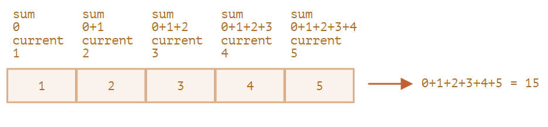


或者以表格的形式表示，每一行代表的是对下一个数组元素的函数调用：

|             | `sum` | `current` | `result` |
| :---------- | :---- | :-------- | :------- |
| 第 1 次调用 | `0`   | `1`       | `1`      |
| 第 2 次调用 | `1`   | `2`       | `3`      |
| 第 3 次调用 | `3`   | `3`       | `6`      |
| 第 4 次调用 | `6`   | `4`       | `10`     |
| 第 5 次调用 | `10`  | `5`       | `15`     |


如果省略初始值, 那么 `reduce` 会将数组的第一个元素作为初始值, 付托第一元素是数组, 函数就会是同toString方法把数组变成字符串, 和后面的item相加

`arr.reduceRight` 和 `arr.reduce` 方法的功能一样，只是遍历为从右到左。


#### 数组链接 concat

例如：

```javascript
let arr = [1, 2];

// 从 arr 和 [3,4] 创建一个新数组
alert( arr.concat([3, 4]) ); // 1,2,3,4

// 从 arr、[3,4] 和 [5,6] 创建一个新数组
alert( arr.concat([3, 4], [5, 6]) ); // 1,2,3,4,5,6

// 从 arr、[3,4]、5 和 6 创建一个新数组
alert( arr.concat([3, 4], 5, 6) ); // 1,2,3,4,5,6
```


## 字符串

### 特殊字符

| 字符       | 描述                                                         |
| :--------- | :----------------------------------------------------------- |
| `\n`       | 换行                                                         |
| `\r`       | 在 Windows 文本文件中，两个字符 `\r\n` 的组合代表一个换行。而在非 Windows 操作系统上，它就是 `\n`。这是历史原因造成的，大多数的 Windows 软件也理解 `\n`。 |
| `\'`, `\"` | 引号                                                         |
| `\\`       | 反斜线                                                       |


### 字符串长度

`length` 属性表示字符串长度：

```javascript
alert( `My\n`.length ); // 3
```

字符串数组排序

```js
const arr = ['2', '0', '3', '4', '1', '5'];

// 默认排序（字典序）
const defaultSorted = [...arr].sort();

const arr = ['2', '0', '3', '4', '1', '5'];
arr.sort();
console.log(arr);  // 输出: ['0', '1', '2', '3', '4', '5']
```


数字字符串数组获取最大值

```js
const arr = ['2', '0', '3', '1'];

// 方法一：使用 map 转成数字，再用 Math.max 找最大值
const maxVal = Math.max(...arr.map(Number));
```


### 常用方法

```js
var str = '有钱人终成眷属,没钱人亲眼目睹'

//判断一个字符串是否包含另一个指定的子字符串
console.log(str.includes('world'))     // true
console.log(str.includes('World'))     // false（区分大小写）
console.log(str.includes('hello'))     // false（区分大小写）
console.log(str.includes('Hello', 1))  // false，从索引1开始找，没有匹配

//查找索引为3的字符
//charAt()	返回在指定位置的字符。
console.log(str.charAt(3))
console.log(str[3])//字符串本质可以看做是字符数组

//查找第一个钱所在的索引
//indexOf()	返回某个指定的字符串值在字符串中首次出现的位置。
console.log(str.indexOf('钱'))

//查找最后一个钱所在的索引
//lastIndexOf()	从后向前搜索字符串，并从起始位置（0）开始计算返回字符串最后出现的位置。
console.log(str.lastIndexOf('钱'))

//将'眷属'截取出来打印
//substr()	从起始索引号提取字符串中指定数目的字符。//string.substr(start,length)
console.log(str.substr(5,2))
//substring() 方法用于提取字符串中介于两个指定下标之间的字符。 substring() 方法返回的子串包括 开始 处的字符，但不包括 结束 处的字符
console.log(str.substring(5,7))

//将第一个'钱'替换成'情'
//replace()	在字符串中查找匹配的子串，并替换与正则表达式匹配的子串。
console.log(str.replace('钱','情'))

//将里面的'人'替换成'的'
//replaceAll()	在字符串中查找匹配的子串，并替换与正则表达式匹配的所有子串。
console.log(str.replaceAll('人','的'))

//将字符串'1,2,3,4,5' ---> 切割成数组
//split()	把字符串分割为字符串数组。
var s = '1,2,3,4,5'
var res =  s.split(',')
console.log(res)

//split应用
var content =  '有人说，人的一生会遇到2920万人，而两个人相爱的概率只有0.000049。在这茫茫人海中，两个人能相遇就值得感激，能相爱更是一种难得。所以，我很庆幸上天让我遇见了你。我希望有个如你一般的人，能看完我写过的所有状态，读完我所有的日志，看完我从小到大的照片，试着听我喜欢的歌。如果可以，甚至陪我去我喜欢的地方，只想弥补错过你的青春_'
var arr = content.split('')
console.log(arr)

//将'xzd'转成大写
//toUpperCase()	把字符串转换为大写。
console.log('xzd'.toUpperCase())

//判断'xxx.jpg'是不是以jpg格式结尾
//startsWith()	查看字符串是否以指定的子字符串开头。
//endsWith()	判断当前字符串是否是以指定的子字符串结尾的（区分大小写）
console.log('xxx.jpg'.endsWith('.jpg'))

//修剪'  xzd  '两端的空白
//trim()	去除字符串两边的空白。
console.log('   xzd   '.trim())
```


## 正则表达式


```
[]方括号:表示符合某一范围内的字符
[12345]:表示出现1-5中的任意一个(像这种连续的,可以简写为[1-5])
[0-9]表示0-9中的任意一个
[^0-9]表示非数字
[a-zA-Z]表示英文单词
[^a-zA-Z]表示非英文单词


数量词:表示它前面的字符出现的次数
[0-9]+ : +代表至少出现一次
[0-9]* : *代表出现任意次(@次,1次,多次)
[0-9]? : ?代表出现0次或者1次
[0-9]{x} : 表示出现x次
[0-9]{x,} : 表示至少出现x次
[0-9]{x,y} : 表示至少出现x次,最多出现y次

[0-9a-fA-F] 表示“匹配一个字符，这个字符是数字0到9，或者小写字母a到f，或者大写字母A到F
```


```
元字符:拥有特殊含义的字符,类似于关键字
\d:表示0-9的数字,和[0-9]的含义是一样的
\D:表示非数字,和[^0-9]的含义是一样的
\w:表示单词字符,和[a-zA-z0-9_]的含义是一样的
\W:表示非单词字符.和[^a-zA-Z0-9 ]的含义是一样的
```

使用

```js
function checkqq(qq) {
    let reg = new RegExp('')
    let res = reg.test(qq)
    return res
}
```


## Math对象

数学对象

```js
let x = Math.PI; // 返回 PI
let y = Math.sqrt(16); // 返回 16 的平方根
```

Math 对象属性

| 属性                                                 | 描述                                                    |
| :--------------------------------------------------- | :------------------------------------------------------ |
| [E                                                   | 返回算术常量 e，即自然对数的底数（约等于2.718）。       |
| [LN2](https://www.runoob.com/jsref/jsref-ln2.html)   | 返回 2 的自然对数（约等于0.693）。                      |
| [LN10](https://www.runoob.com/jsref/jsref-ln10.html) | 返回 10 的自然对数（约等于2.302）。                     |
| [LOG2E                                               | 返回以 2 为底的 e 的对数（约等于 1.4426950408889634）。 |
| [LOG10E                                              | 返回以 10 为底的 e 的对数（约等于0.434）。              |
| [PI                                                  | 返回圆周率（约等于3.14159）。                           |
| [SQRT1_2                                             | 返回 2 的平方根的倒数（约等于 0.707）。                 |
| [SQRT2                                               | 返回 2 的平方根（约等于 1.414）。                       |

对象方法

| 方法             | 描述                                                         |
| ---------------- | ------------------------------------------------------------ |
| abs(x)           | 返回 x 的绝对值。                                            |
| acos(x)          | 返回 x 的反余弦值。                                          |
| asin(x)          | 返回 x 的反正弦值。                                          |
| atan(x)          | 以介于 -PI/2 与 PI/2  弧度之间的数值来返回 x 的反正切值。    |
| atan2(y,x)       | 返回从 x 轴到点 (x,y)  的角度（介于 -PI/2 与 PI/2 弧度之间）。 |
| ceil(x)          | 对数进行上舍入。向上取整                                     |
| cos(x)           | 返回数的余弦。                                               |
| exp(x)           | 返回 Ex 的指数。                                             |
| floor(x)         | 对 x 进行下舍入。 向下取整                                   |
| log(x)           | 返回数的自然对数（底为e）。                                  |
| max(x,y,z,...,n) | 返回 x,y,z,...,n  中的最高值。                               |
| min(x,y,z,...,n) | 返回  x,y,z,...,n中的最低值。                                |
| pow(x,y)         | 返回 x 的 y 次幂。                                           |
| random()         | 返回 0 ~ 1 之间的随机数。0（包含） ~ 1（不包含）             |
| round(x)         | 四舍五入。                                                   |
| sin(x)           | 返回数的正弦。                                               |
| sqrt(x)          | 返回数的平方根。                                             |
| tan(x)           | 返回角的正切。                                               |
| tanh(x)          | 返回一个数的双曲正切函数值。                                 |
| trunc(x)         | 将数字的小数部分去掉，只保留整数部分。                       |


## Date对象

日期对象

```js
// 方式一: 无参数构造,返回当前的时间对象
console.log(new Date()) 
//Thu Jun 19 2025 11:12:34 GMT+0800 (中国标准时间)


// 方式二: 带参构造,穿数字,创建出来的是指定时间对象(月份从0开始算, 0代表1月)
console.log(new Date(2025, 6, 19)) 
//Sat Jul 19 2025 00:00:00 GMT+0800 (中国标准时间)


// 方式三: 使用带参构造(传字符串),创建出来的就是指定时间对象
console.log(new Date('2025-6-19')) 
//Thu Jun 19 2025 00:00:00 GMT+0800 (中国标准时间)


// 获取当前时间对象用方式一, 获取指定时间对象用方式三
```


### 打印 年月日 时分秒

```js
let time = new Date()
console.log( time.getFullYear() )  //年
console.log( time.getMonth() + 1)  //月
console.log( time.getUTCDate() )

console.log( time.getHours() )  //小时
console.log( time.getMinutes() )  //分
console.log( time.getSeconds() )  //秒
```


今天是2025年6月19号,星期四

```js
function getDate() {
  let time = new Date()
  let year = time.getFullYear()
  let month = time.getMonth()
  let day = time.getUTCDate()

  let weekNum = time.getUTCDay() //获取周几  (0 ~ 6)
  let arr = ['星期天', '星期一', '星期二', '星期三', '星期四', '星期五', '星期六']
  let week = arr[weekNum]

  return console.log(`今天是${year}年${month + 1}月${day}号,${week}`)
}

getDate()
```


### 获取当前时间戳

`getTime()` 方法可返回距 1970 年 1 月 1 日之间的毫秒数。 类型为Number

`valueOf()` 获取所有对象原始值 ,d2 在这里是毫秒数对象, 强制转过来之后就是Number, 跟获取时间戳的内容是一样的

计算我从出生到现在过了多少天

```js
let time = new Date('2000-12-7').getTime() //1970 到出生那天的毫秒数
console.log(typeof time)

let timeNow = new Date().valueOf() //1970 到今天的毫秒数
console.log( typeof timeNow)

let daySpan =  Math.ceil( (timeNow - time) / (24 * 60 * 60 * 1000) )
console.log(daySpan)
```

`Date.now()` 相当于 `new Date().getTime()`，但它不会创建中间的 `Date` 对象。因此它更快


### 其它日期应用

```js
获取指定年份和月份的总天数
new Date(year, month, 0)：创建一个日期对象
.getDate()：返回该日期对象是当月的第几天

// 获取2023年2月的天数（2023年不是闰年，2月有28天）
console.log(new Date(2023, 1, 0).getDate()); // 输出 28

// 获取2024年2月的天数（2024年是闰年，2月有29天）
console.log(new Date(2024, 1, 0).getDate()); // 输出 29

// 获取2023年12月的天数（12月有31天）
console.log(new Date(2023, 11, 0).getDate()); // 输出 31


直接查询某年某月第一天是周几
用new Date(year, month - 1, 1).getDay()
```


## Number对象

```js
    // 原始值 -- 基本数据类型
    let num = 7.345
    console.log( typeof num)  // number

    // 将原始值(Number)转换成包装成对象类型
    let obj = new Number(num)
    console.log(obj)  // Number {7.345}
    console.log(typeof obj)  // object

    // 变成对象之后,功能更加强大了
    console.log(obj.toFixed(2))  // 保留两位小数

    // 属性
    console.log(Number.MAX_VALUE)  //可表示的最大的数。
    console.log(Number.MIN_VALUE)  //可表示的最小的数。


    // 方法  是否是整数
    console.log( Number.isInteger(2.3) )  //false
    console.log( Number.isInteger(3) )  // true
```


## JSON方法

JSON（JavaScript Object Notation）是表示值和对象的通用格式。

最初它是为 JavaScript 而创建的，但许多其他编程语言也有用于处理它的库。因此，当客户端使用 JavaScript 而服务器端是使用 Ruby/PHP/Java 等语言编写的时，使用 JSON 可以很容易地进行数据交换。

JavaScript 提供了如下方法：

- `JSON.stringify` 将对象转换为 JSON。
- `JSON.parse` 将 JSON 转换回对象。


 `JSON.stringify` 一个 `student` 对象：

```javascript
let student = {
  name: 'John',
  age: 30,
  isAdmin: false,
  courses: ['html', 'css', 'js'],
  spouse: null
};

let json = JSON.stringify(student);

alert(typeof json); // we've got a string!

alert(json);
/* JSON 编码的对象：
{
  "name": "John",
  "age": 30,
  "isAdmin": false,
  "courses": ["html", "css", "js"],
  "spouse": null
}
*/
```


要解码 JSON 字符串，我们需要另一个方法 `JSON.parse`

语法：

```javascript
let value = JSON.parse(str, [reviver])
```


```js
let userData = '{ "name": "John", "age": 35, "isAdmin": false, "friends": [0,1,2,3] }';

let user = JSON.parse(userData);

alert( user.friends[1] ); // 1
```


## Iterable object（可迭代对象）

### 理念

```
可迭代（Iterable） 对象是数组的泛化。这个概念是说任何对象都可以被定制为可在 for..of 循环中使用的对象。
数组,内建对象,字符串都是可迭代的
对象不是数组，而是表示某物的集合
```


### Symbol.iterator 

```
Symbol.iterator 是一个特殊方法名，专门用来让对象支持 for..of 等迭代语法。

for..of 循环启动时，它会调用这个方法. 这个方法必须返回一个迭代器（iterator） —— 一个有 next 方法的对象。

然后for..of就只适用于被[Symbol.iterator]方法返回的对象

for..of 循环希望取得下一个数值，它就调用这个对象的 next() 方法返回 {done, value}

done=true 时，循环结束

简单流程:
for..of 首先调用 range[Symbol.iterator]() → 迭代器对象，然后不停调用 迭代器对象.next() 取值，直到 done:true。
```


```js
//普通对象                                    // 可迭代对象
let range = {                                let range = {
  from: 1,                                      from: 1,
  to: 5                                         to: 5
};                                            };

                                            // 1. for..of 调用首先会调用这个：
                                            range[Symbol.iterator] = function() {

                                              // ……它返回迭代器对象（iterator object）：
                                              // 2. 接下来，for..of 仅与下面的迭代器对象一起工作，要求它提												供下一个值
                                              return {
                                                current: this.from,
                                                last: this.to,

                                                // 3. next() 在 for..of 的每一轮循环迭代中被调用
                                                next() {
                                                  // 4. 它将会返回 {done:.., value :...} 格式的对象
                                                  if (this.current <= this.last) {
                                                    return { done: false, value: this.current++ };
                                                  } else {
                                                    return { done: true };
                                                  }
                                                }
                                              };
                                            };

                                            // 现在它可以运行了！
                                            for (let num of range) {
                                              alert(num); // 1, 然后是 2, 3, 4, 5
                                            }
```

几个关键点

```
Symbol.iterator 
迭代器标志
	Symbol.iterator 是内置的 symbol 属性，Symbol.iterator 方法就是标志对象是否可迭代的“钥匙”
	当一个对象实现了 Symbol.iterator 方法，这个对象就变成了可迭代对象（iterable）。
	

被迭代对象（iterable）：
	指实现了 Symbol.iterator 方法的对象（比如你的 range）。 提供“迭代能力”的那个对象
迭代器对象（iterator）：
	是 range[Symbol.iterator]() 返回的对象。
```


```js
显式调用迭代器
可以拆分迭代过程：迭代一部分，然后停止，做一些其他处理，然后再恢复迭代。

for (let char of "hello") {
  console.log(char); // 输出每个字符 h e l l o
}

// 显式调用
let str = "hello";
let iterator = str[Symbol.iterator]();
while (true) {
  let result = iterator.next();  // 第一个result = { done: false, value: "h" }
  if (result.done) break;
  console.log(result.value); // // 输出每个字符 h e l l o
}
```


### 可迭代（iterable）和类数组（array-like）

```js
Iterable 是有 Symbol.iterator 方法的对象。
Array-like 是有索引和 length 属性的对象

举例
字符串即是可迭代的（for..of 对它们有效），又是类数组的（它们有数值索引和 length 属性）。

let arrayLike = { // 有索引和 length 属性 => 类数组对象
  0: "Hello",
  1: "World",
  length: 2
};

// Error (no Symbol.iterator)
for (let item of arrayLike) {}
```


### Array.from

```js
Array.from 可以接受一个可迭代或类数组的值，并从中获取一个“真正的”数组
能让我们 使用数组方法操作 可迭代对象和类数组对象 

例子:
let arrayLike = {
  0: "Hello",
  1: "World",
  length: 2
};
console.log(Array.from(arrayLike)); // [ 'Hello', 'World' ]

这个range来自上面的可迭代range
console.log(Array.from(range)); [ 1, 2, 3, 4, 5 ]
```


语法

```js
Array.from(obj[, mapFn, thisArg])
二个参数 mapFn 可以是一个函数，该函数会在对象中的元素被添加到数组前
 thisArg 允许我们为该函数设置 this
 
 
 // 求每个数的平方 这个range还是来自上面的可迭代range
let arr = Array.from(range, num => num * num);
alert(arr); // 1,4,9,16,25
```

`Array.from` 相比于 `str.split` 精简很多


### 总结

```
可以应用 for..of 的对象被称为 可迭代的。

技术上来说，可迭代对象必须实现 Symbol.iterator 方法。
obj[Symbol.iterator]() 的结果被称为 迭代器（iterator）。由它处理进一步的迭代过程。
一个迭代器必须有 next() 方法，它返回一个 {done: Boolean, value: any} 对象，这里 done:true 表明迭代结束，否则 value 就是下一个值。
Symbol.iterator 方法会被 for..of 自动调用，但我们也可以直接调用它。
内建的可迭代对象例如字符串和数组，都实现了 Symbol.iterator。
字符串迭代器能够识别代理对（surrogate pair）。（译注：代理对也就是 UTF-16 扩展字符。）
有索引属性和 length 属性的对象被称为 类数组对象。这种对象可能还具有其他属性和方法，但是没有数组的内建方法。

如果我们仔细研究一下规范 —— 就会发现大多数内建方法都假设它们需要处理的是可迭代对象或者类数组对象，而不是“真正的”数组，因为这样抽象度更高。

Array.from(obj[, mapFn, thisArg]) 将可迭代对象或类数组对象 obj 转化为真正的数组 Array，然后我们就可以对它应用数组的方法。可选参数 mapFn 和 thisArg 允许我们将函数应用到每个元素。
```


## Map and Set（映射和集合）

对象，存储带有键的数据的集合。
数组，存储有序集合。

### Map

```js
Map 是一个带键的数据项的集合，和 Object 一样，不同点是Map允许任何类型的键（key）


初始化格式：new Map([[key1, value1], [key2, value2]])


Map的初始化，取值
创建Map后，可以传入一个带键值对的数组（或其它可迭代对象）来进行初始化
// 键值对 [key, value] 数组
let map = new Map([
  ['1',  'str1'],
  [1,    'num1'],
  [true, 'bool1']
]);
map // Map(3) { '1' => 'str1', 1 => 'num1', true => 'bool1' }
alert( map.get('1') ); // str1


方法和属性
new Map() —— 创建 map。
map.set(key, value) —— 根据键存储值。
map.get(key) —— 根据键来返回值，如果 map 中不存在对应的 key，则返回 undefined。
map.has(key) —— 如果 key 存在则返回 true，否则返回 false。
map.delete(key) —— 删除指定键的值。
map.clear() —— 清空 map。
map.size —— 返回当前元素个数。

例子：
map.set(true, 'bool1'); // 布尔值键
map.set('1', 'str1').set('2', 'str2').set('3', 'str3') // set链式调用
map.get(true)


let john = { name: "John" }; 
let visitsCountMap = new Map()
visitsCountMap.set(john, 123) // 对象为键
visitsCountMap.get(ben) // 234


如果让对象把 对象当作 key, key 会把上面的john变成字符串 "[object Object]"

注意：map[key] 也有效，但这样会将 map 视为 JavaScript 的 plain object
```


### map迭代 / 循环

```js
map.keys() —— 遍历并返回一个包含所有键的可迭代对象，
map.values() —— 遍历并返回一个包含所有值的可迭代对象，
map.entries() —— 遍历并返回一个包含所有实体 [key, value] 的可迭代对象，for..of 在默认情况下使用的就是这个。


例子：
let recipeMap = new Map([
  ['cucumber', 500],
  ['tomatoes', 350],
  ['onion',    50]
]);

recipeMap.keys() //[Map Iterator] { 'cucumber', 'tomatoes', 'onion' }
for (let vegetable of recipeMap.keys()) {
  console.log(vegetable) // cucumber, tomatoes, onion
}

recipeMap.values() //[Map Iterator] { 500, 350, 50 }
for (let vegetable of recipeMap.values()) {
  console.log(vegetable)// 500, 350, 50
}

recipeMap.entries() //[Map Entries] {[ 'cucumber', 500 ], ...}
for (let vegetable of recipeMap) {
  console.log(vegetable) // [ 'cucumber', 500 ] ...
}


用foreach遍历Map
Map.forEach 的约定是 (value, key),第一个参数对应的是值，第二个参数对应的是键
```


### Object.entries：从对象创建 Map

```js
从一个已有的普通对象（plain object）来创建一个 Map

let obj = {
  name: 'Vegetable',
  color: 'Green',
  weight: 500
}
let map = new Map(Object.entries(obj))
map 		     // Map(3) { 'name' => 'Vegetable', 'color' => 'Green', 'weight' => 500 }

因为Object.entries()返回键值对数组： 
[ [ 'name', 'Vegetable' ], [ 'color', 'Green' ], [ 'weight', 500 ] ]


//==========================//
反过来
Object.fromEntries：从 Map 创建对象
给定一个具有 [key, value] 键值对的数组，Object.fromEntries会根据给定数组创建一个对象 
let prices = Object.fromEntries([
  ['banana', 1],
  ['orange', 2],
  ['meat', 4]
]);
// 现在 prices = { banana: 1, orange: 2, meat: 4 }

Map 中存储了一些数据，需要把这些数据传给需要普通对象（plain object）
let map = new Map();
map.set('banana', 1).set('orange', 2).set('meat', 4);
let obj = Object.fromEntries(map);
obj // { banana: 1, orange: 2, meat: 4 }
```


### set

```js
Set 是一个特殊的类型集合 —— “值的集合”（没有键），它的每一个值只能出现一次。

const mySet = new Set([1, 2, 2, 3, 3, 3, 4]);
console.log(mySet);
// 输出: Set(4) { 1, 2, 3, 4 }

console.log(mySet.size);  // 输出: 4（只有4个唯一值）

// 检查是否包含某个值
console.log(mySet.has(2));   // 输出: true
console.log(mySet.has(5));   // 输出: false

// 添加新元素
mySet.add(5);
console.log(mySet);  // 输出: Set(5) { 1, 2, 3, 4, 5 }

// 删除元素
mySet.delete(3);
console.log(mySet);  // 输出: Set(4) { 1, 2, 4, 5 }


Set 自动去重
const s = new Set([1, 2, 2, 3, NaN, NaN, +0, -0]);
console.log([...s]);           // [1, 2, 3, NaN]

在TypeScript中，Set 的泛型写法为 Set<T>，其中 T 表示集合中元素的类型，new Set<string>()：在 TypeScript 中使用泛型 Set<string> 表示集合应只包含 string 类型元素
```


```js
// set迭代/循环
使用 for..of 或 forEach 来遍历 Set：

let set = new Set(['banana', 'orange', 'meat']);

set  // Set(3) { 'banana', 'orange', 'meat' }

for (let value of set) { console.log(value); }

set.forEach(value => { console.log(value); });


set.keys() —— 遍历并返回一个包含所有值的可迭代对象，
// [Set Iterator] { 'banana', 'orange', 'meat' }

set.values() —— 与 set.keys() 作用相同，这是为了兼容 Map，
// [Set Iterator] { 'banana', 'orange', 'meat' }

set.entries() —— 遍历并返回一个包含所有的实体 [value, value] 的可迭代对象，它的存在也是为了兼容 Map。
[Set Entries] {
  [ 'banana', 'banana' ],
  [ 'orange', 'orange' ],
  [ 'meat', 'meat' ]
}
```


# 函数

## 基础

1. **函数创建方式**
   - 声明：`function fn(...) { ... }`（可在前面调用）
   - 表达式：`const fn = function(...) { ... }` / `const fn = (...) => { ... }`
2. **作用域**
   - 函数里 `let/const` 是局部变量，只在函数内可见。
   - 函数能访问外部变量，并可以修改（闭包的基础）。
3. **参数 & 返回值**
   - 形参 = 声明时括号里的变量名；实参 = 调用时传入的值。
   - `return` 返回一个值并结束函数；不写/空 return → `undefined`。
   - 可以有默认参数：`function fn(a = 1) { ... }`
4. **函数是值**
   - 可以赋值给变量：`const fn = sayHi;`
   - 可以当作参数传给别的函数 → 回调函数。
5. **箭头函数**
   - `const fn = (a, b) => a + b;`
   - 单表达式自动 `return`，多行要写 `{}` + `return`。
   - 常用来写回调和小函数。


实参和形参例子

```ts
function add(a, b) {   // a, b 是“形参”（形式参数）
  return a + b;
}

add(1, 2);             // 1, 2 是“实参”（实际传入的值）
```


赋值

```ts
function sayHi(): void {
  console.log('Hi');
}

const fn: () => void = sayHi; // 注意：没有括号

fn();     // Hi
sayHi();  // Hi
```


回调函数

```ts
// 定义回调类型，方便复用
type Callback = () => void;

function ask(question: string, onYes: Callback, onNo: Callback): void {
  const ok: boolean = confirm(question);
  if (ok) {
    onYes();
  } else {
    onNo();
  }
}

ask(
  'Do you agree?',
  () => console.log('Agreed'),
  () => console.log('Canceled')
);
```


## 进阶

1. 递归：函数在更小的同类问题上调用自己，有个“最简单情况”直接返回；调用栈一层层压执行上下文。
2. Rest / Spread：
   - Rest：`(...args)` 收集多余参数为数组；
   - Spread：`fn(...arr)` / `[...arr]` 把数组/可迭代拆开。
3. 闭包：内部函数能记住外部函数的变量（通过词法环境绑定），让变量在函数外还能保持状态。
4. 定时器：`setTimeout` 延迟一次；`setInterval` 周期执行；需要稳定间隔时用“嵌套 setTimeout”。
5. 函数对象：函数有属性（`name、length、自定义属性`），还能用 `new Function` 动态创建（几乎不用）。
6. this 相关：
   - `call/apply`：临时指定 `this` 并立即调用；
   - `bind`：预先固定 `this`/部分参数，返回新函数；
   - 箭头函数没有自己的 `this/arguments`，从外层继承。
7. 透明缓存：给函数包一层，按参数缓存结果，避免重复计算。


**递归**

```ts
// 递归版 pow(x, n)：x 的 n 次方
function pow(x: number, n: number): number {
  if (n === 1) return x;          // 基础情况：最小的、能直接算出来的
  return x * pow(x, n - 1);       // 递归情况：问题变小一点
}

pow(2, 3); // 2 * pow(2, 2) -> 2 * (2 * pow(2,1)) -> 8
```

调用栈直觉：

- 每次 `pow(...)` 调用时，引擎会为它创建一个“执行上下文”：记录当前 `x、n`，以及执行到哪一行
- 当嵌套调用时，执行上下文还会记录回调，当嵌套最底层的函数执行结束时，把值赋值给回调，一层层退回，如果输入的是2，3，例子如下，递归三次，递归深度是3，创建的执行上下文也是3个

- Context: { x: 2, n: 1, at line 1 } call: pow(2, 1)
- Context: { x: 2, n: 2, at line 5 } call: pow(2, 2)
- Context: { x: 2, n: 3, at line 5 } call: pow(2, 3)

<hr>


**Spread**：把一个可迭代对象“拆开来当参数/元素用”

```ts
const arr: number[] = [3, 5, 1];

Math.max(...arr); // 相当于 Math.max(3, 5, 1)
```

<hr>


**词法环境&闭包**

- 执行上下文：这次调用函数时的“现场信息”（当前 `this`、局部变量、作用域链）。
- 词法环境：这个“现场信息”里跟“变量作用域”相关的那一块。

函数定义时，js把定义时的外部环境变量绑定在它身上，以后不管在哪里调用，他都能通过这个绑好的环境访问到当时的外部变量——这就是闭包

闭包：为什么能“记住状态”

```ts
function makeCounter() {
  let count = 0;                 // 外部变量

  return function () {           // 内部函数（闭包）
    count++;
    console.log(count);
  };
}

const counter = makeCounter();   // 此时 makeCounter 执行完了
counter(); // 1
counter(); // 2
```

- `makeCounter()` 结束了按理说 `count` 应该被销毁；
- 但返回的那个内部函数还在用 `count`；
- 引擎发现“还有地方在用这个环境”，就把这块环境（词法环境）留在内存里；
  - 引擎创建一个“词法环境 A”，里面有 `count = 0`，
  - 而返回出去的那个内部函数对象 `counter`在`makeCounter`()使用结束后还活着
  - `counter.[[Environment]]` 里保存着对“词法环境 A”的引用
- 所以多次调用 `counter()`，访问的是**同一个 `count`**，就能“记住状态”。

<hr>


**函数对象 & `call` / `apply` / `bind`**

函数也是对象（能挂属性）

```ts
function sayHi(): void {
  console.log('Hi');
  sayHi.count++;
}

(sayHi as any).count = 0;

sayHi();
sayHi();
console.log((sayHi as any).count); // 2
```


`call` / `apply`：临时指定 `this` 并立刻调用

> `fn.call(obj, a, b)` ≈ 以 `obj` 为 `this`，调用 `fn(a, b)`
> `fn.apply(obj, [a, b])` 一样，只是参数写法不同。

- 第一个参数是 `this` 值；
- `call`：后面跟 **参数列表**；
- `apply`：第二个参数是 **数组 / 类数组**。


`bind`：预先固定 `this`（和部分参数），返回一个新函数

```ts
function greet(this: { name: string }, msg: string): void {
  console.log(`${msg}, ${this.name}`);
}

const user = { name: 'Alice' };

const greetUser = greet.bind(user); // 不调用，只生成一个新函数
greetUser('Hello'); // Hello, Alice
```

# 对象

- 对象创建：字面量 `{}`、构造函数（包含 class）
- 访问属性：`.` 和 `[]`
- 遍历：`for...in` / `Object.keys` / `Object.entries`
- 引用语义：浅拷贝 / 深拷贝
- 构造函数 / class + `new`
- 可选链 `obj?.prop`、空值合并 `??`
- 定时器 / 回调里用到的对象

- `this` 在对象方法里怎么绑定
- `call/apply/bind` 和箭头函数的 `this`
- Symbol（更安全的属性键）
- 属性描述符（只读、不可枚举）和访问器（getter/setter）——知道“概念 + 简单应用场景”就够了
- 对象 → 原始值转换的大致规则（知道有 `toString/valueOf/Symbol.toPrimitive` 即可）


## 创建 访问 遍历


创建对象

```ts
type User = {
  name: string;
  age: number;
  isAdmin?: boolean;
};

// 字面量
const user: User = {
  name: 'John',
  age: 30,
};

// 构造函数 / class
class UserClass {
  name: string;
  age: number;
  constructor(name: string, age: number) {
    this.name = name;
    this.age = age;
  }
}

const u = new UserClass('John', 30);
```

------

访问属性：

```ts
const user = {
  name: 'John',
  age: 30,
};

console.log(user.name);   // 点：属性名必须是“合法标识符”（不含空格、- 等）
console.log(user['age']); // 方括号：属性名是字符串，可以是变量/表达式
```

**真正的区别：**

- `obj.key`：`key` 必须是一个**写死的标识符**（不能是变量）。
- `obj[varKey]`：`varKey` 是一个变量/表达式，运行时决定访问哪个属性。

例子：

```ts
const key = 'first-name';

const person: any = {};
person['first-name'] = 'Nick';  // ✅ 必须用 []，因为有 -
console.log(person['first-name']);

person.key = 'xxx'; // 这是设置 person.key，不是 person['first-name']
```

> - 属性名固定写死 → 用 `.`
> - 属性名是变量/动态字符串 → 用 `[]`

------

遍历对象

```ts
const user = { name: 'John', age: 30, isAdmin: true };

for (const key in user) {
  console.log(key, (user as any)[key]);
}

// 更现代写法（常见）
Object.keys(user).forEach((key) => {
  console.log(key, (user as any)[key]);
});

Object.entries(user).forEach(([key, value]) => {
  console.log(key, value);
});
```


------

## “引用”：拷贝 & 状态管理

**引用**

```ts
const user = { name: 'John' };
const admin = user;      // 复制的是“引用”

admin.name = 'Jack';

console.log(user.name);  // Jack（指向同一个对象）
```

> 原始类型（number/string/boolean）复制的是值；
> 对象复制的是**引用（指针）**。

------

**浅拷贝 & 简单深拷贝**

浅拷贝（只复制第一层）

```ts
const user = { name: 'John', info: { city: 'Beijing' } };

const copy1 = { ...user };          // 浅拷贝
const copy2 = Object.assign({}, user);

copy1.name = 'Jack';                // 不影响 user.name
copy1.info.city = 'Shanghai';       // 会影响 user.info.city（内层对象还是同一个引用）
```

**简单深拷贝（纯对象/数组时）**

最简单（但有局限）的办法：

```ts
const deepCopy = JSON.parse(JSON.stringify(user));
```

更靠谱的是写递归，遍历到原始值一层再进行复制


## 构造函数 / class / `new`

> 构造函数可以创建“类”一样的东西，`new` 会自动创建对象、绑定 `this`、返回实例。

```ts
class User {
  name: string;
  isAdmin: boolean;

  constructor(name: string) {
    this.name = name;
    this.isAdmin = false;
  }

  sayHi(): void {
    console.log(`Hi, I'm ${this.name}`);
  }
}

const u = new User('Jack');
u.sayHi();
```


## 可选链 `?`

核心：避免“中间为 null/undefined 时抛错”，而是直接返回 `undefined`。

```ts
const user: any = {}; // user.address 可能不存在

const street = user?.address?.street; // user 或 address 任一为 null/undefined，则结果为 undefined

// 等价于：
const street2 =
  user && user.address ? user.address.street : undefined;
```

> `obj?.prop` / `obj?.[prop]` / `obj.method?.()`
> 如果 `obj` 是 `null/undefined`，整个表达式直接变 `undefined`，不再往下访问。


## Symbol：安全的“不会冲突”的属性键

1. `Symbol()` 生成一个**独一无二的值**，适合作为对象的**私有键**。
2. 用 Symbol 当属性名时：
   - 不会被普通 `for...in` / `Object.keys` 枚举出来；
   - 不容易被使用者意外覆盖。

```ts
const ID = Symbol('id');

type User = {
  name: string;
  [ID]?: number;
};

const user: User = { name: 'John' };
user[ID] = 123;

console.log(user[ID]);     // 123
console.log((user as any).id); // undefined（普通属性名不存在）

for (const key in user) {
  console.log(key);        // 只会打印 "name"，不会打印 Symbol 属性
}
```

> Symbol 主要用来做“不会跟别人撞名的属性键”，适合在库/框架里存内部信息。


## 属性描述符 & 属性标志

- 属性标志（flags / 属性特性）：
  就是那几个布尔开关（+ value）：
  - `value`
  - `writable`
  - `enumerable`
  - `configurable`
  - （以及访问器时的 `get` / `set`）
- 属性描述符（property descriptor）：
  是一个 *对象*，**把这些标志打包在一起**，用来“描述某个属性”。

<hr>


`Object.getOwnPropertyDescriptor` 看属性细节

```ts
const user = { name: 'John' };

const desc = Object.getOwnPropertyDescriptor(user, 'name');

console.log(desc);
// 输出类似：
/*
{
  value: 'John',
  writable: true,
  enumerable: true,
  configurable: true
}
*/
```

- `writable/enumerable/configurable` 就是“属性标志”
- 整个 `desc` 这个对象，就是“属性描述符”

三个标志的作用：

- `writable`: 能不能改值
- `enumerable`: 能不能被 `for...in` / `Object.keys` 遍历到
- `configurable`: 能不能被 `delete` 或重新定义描述符

<hr>


`Object.defineProperty` 改/建属性

**只读属性：**

```ts
const user: any = {};

Object.defineProperty(user, 'name', {
  value: 'John',
  writable: false,
  enumerable: true,
  configurable: true,
});

user.name = 'Jack'; // 严格模式下报错；非严格模式下静默失败
```

**不可枚举：**

```ts
const user: any = {
  name: 'John',
  toString() {
    return this.name;
  },
};

Object.defineProperty(user, 'toString', {
  enumerable: false,
});

for (const key in user) {
  console.log(key); // 只输出 name，不输出 toString
}
```

> - `getOwnPropertyDescriptor`：看属性三大标志
> - `defineProperty`：创建/修改属性，并设置这些标志
>   常见用法：做“只读常量”、“隐藏属性”。

绝大多数业务代码不会大量用它，但框架/库、工具代码会经常用。


## 访问器属性（getter/setter）：有用但可以少写

**它解决的两个场景**（面试回答够用）：

1. **用属性语法，背后是计算逻辑**（比如根据内部字段拼装字符串、缓存计算值）
2. **拦截某个属性的读写**（比如做校验、触发副作用）


```ts
class User {
  private _firstName: string;
  private _lastName: string;

  constructor(first: string, last: string) {
    this._firstName = first;
    this._lastName = last;
  }

  get fullName(): string {
    return `${this._firstName} ${this._lastName}`;
  }

  set fullName(value: string) {
    const [first, last] = value.split(' ');
    this._firstName = first;
    this._lastName = last ?? '';
  }
}

const u = new User('John', 'Doe');
console.log(u.fullName);   // 访问时，实际上调用 getter

u.fullName = 'Jack Ma';    // 赋值时，实际上调用 setter
console.log(u.fullName);   // Jack Ma
```

> 访问器属性本质是“函数 + 属性语法糖”。
> 简单场景用普通方法就够了；
> 需要拦截读写、做计算属性或保持 API 不变时（比如内部实现改变），getter/setter 会很方便。


## 对象到原始值的转换

hint 规则，只要有这种感觉：

1. **打印对象 / 做字符串拼接** → 调用 `toString()`（或 `Symbol.toPrimitive('string')`）
2. **做算术 / 比较大小** → `valueOf()` 或 `Symbol.toPrimitive('number'/'default')`

```ts
const user = {
  name: 'John',
  money: 1000,
  toString() {
    return `{name: ${this.name}}`;
  },
  valueOf() {
    return this.money;
  },
};

console.log(String(user)); // '{name: John}'  -> 调用 toString
console.log(+user);        // 1000           -> 调用 valueOf
console.log(user + 500);   // 1500           -> valueOf 结果参与加法
```


# 原型、继承

## 必须死记的 5 条规则

每个对象都有一个“隐藏的原型”：
这个原型叫 `[[Prototype]]`，控制台里显示为 `__proto__`。
查不到属性时，就去原型那里找，再找爷爷，一直找到 `null` 为止。

例如，当创建一个数组 `[1, 2, 3]`，在内部会默认使用 `new Array()` 构造器

每个构造函数都有一个对应的 `prototype` 对象（如 `Array.prototype`, `Function.prototype`, `Date.prototype`）

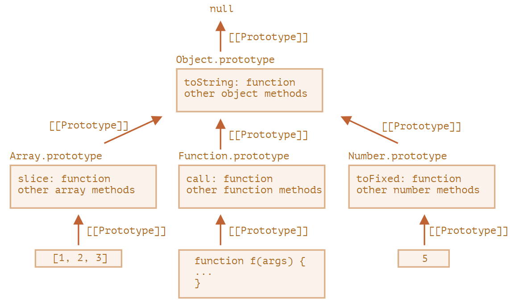


`new F()` 创建的对象，它的原型就是 `F.prototype` 当前指向的那个对象：

```js
function F() {}
const p = new F();
// p.__proto__ === F.prototype
```


写属性/删属性，默认只改“自己身上”，不会改原型链上的原型：

```js
p.x = 1; // 只在 p 上加 x，不会动 F.prototype
```


`for...in` 会遍历“自己 + 原型链上的可枚举属性”；`Object.keys` 只看自己：

```js
for (const k in obj) { ... }          // 自己 + 继承的
Object.keys(obj)                      // 只有自己
obj.hasOwnProperty(k)                 // 判断是不是“自己”的
```


ES6 的 class 本质就是“构造函数 + 原型”的语法糖：

```js
class Person { sayHi() {} }
// 等价于
function Person() {}
Person.prototype.sayHi = function() {};
```


## 对象 / 原型 / 构造函数 / class

从构造函数角度看

```js
function F(name) {
  this.name = name;
}
F.prototype.sayHi = function () {
  console.log('Hi, ' + this.name);
};

const p = new F('Nick');
```

- 构造函数 F ——(prototype 属性)→ F.prototype（原型对象）
- F.prototype.constructor 属性 ——→ 指回 **F**
- 实例 p ——(proto)→ 指向 F.prototype

> 关键记忆：
> `__proto__` 是“实例 → 原型”的箭头；
> `prototype` 是“构造函数 → 原型”的箭头；
> `constructor` 是“原型 → 构造函数”的箭头（只是个约定，不是语言强制）。


从 class 角度看（更贴近你平时写法）

```js
class Person {
  constructor(name) { this.name = name; }
  sayHi() { console.log('Hi, ' + this.name); }
}

const p = new Person('Nick');
```

等价于：

```js
function Person(name) { this.name = name; }
Person.prototype.sayHi = function () { ... };
```

- `p.__proto__ === Person.prototype`
- `Person.prototype.constructor === Person`

> 任何 `class` 定义 = 一个构造函数 + 一个 prototype 对象，
> 方法写在 class 里，其实是挂到 `ClassName.prototype` 上。

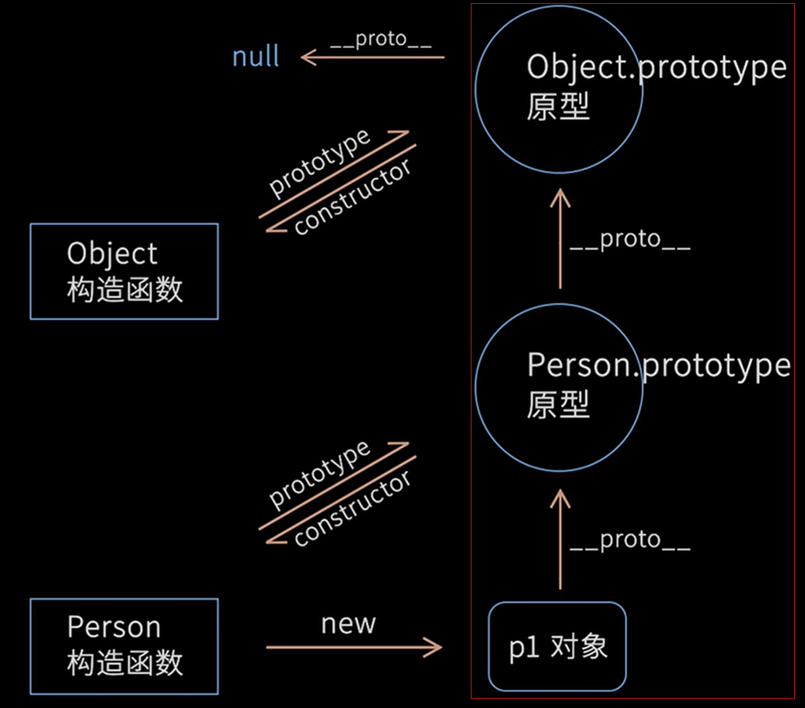


## 原型链怎么工作（查属性、for...in、覆盖）

查属性：从自己往上找，直到 `null`

```js
const animal = { eats: true };
const rabbit = { jumps: true, __proto__: animal };
const longEar = { earLength: 10, __proto__: rabbit };

longEar.earLength; // 先找 longEar 自己 → 10
longEar.jumps;     // 自己没有 → 去 rabbit → true
longEar.eats;      // 自己没有 → rabbit 没有 → 去 animal → true
```

可以把它想成“一个链表”：

```Text
longEar → rabbit → animal → Object.prototype → null
```

- 读属性：沿链向上找；
- 写属性：默认只在当前对象上创建/修改，不会沿链传上去。


覆盖（shadowing）

```js
animal.walk = function() { console.log('Animal walk'); };

rabbit.__proto__ = animal;
rabbit.walk(); // Animal walk

rabbit.walk = function() { console.log('Rabbit walk'); };
rabbit.walk(); // Rabbit walk（就近使用）
```

- 新增 `rabbit.walk` 后，查找时优先用自己的；
- 原型上的同名方法被“遮住了”，但没被删掉。


`for...in` 和 `Object.keys`

```js
for (const key in rabbit) {
  console.log(key);
}

Object.keys(rabbit); // 只返回 rabbit 自己的可枚举属性
```

对比表：

| 写法               | 包含继承属性 | 只看自己的 | 是否受 `enumerable` 影响  |
| ------------------ | ------------ | ---------- | ------------------------- |
| `for...in`         | 是           | 否         | 只遍历 enumerable=true    |
| `Object.keys(obj)` | 否           | 是         | 只拿 enumerable=true 自己 |

经典写法：

```js
for (const key in rabbit) {
  if (rabbit.hasOwnProperty(key)) {
    // 这里是 rabbit 自己的属性
  } else {
    // 这里是它从原型链上“继承来”的属性
  }
}
```


## `F.prototype` /  “解绑” /`constructor` 

`new F()` 做了什么？

```js
function F() {}
const p = new F();
```

引擎内部大致做了 3 步：

1. 创建一个空对象 `p`
2. 设置 `p.__proto__ = F.prototype` 当前的值
3. 以 `p` 作为 `this` 执行 `F` 函数体

结束。

> 关键：只在 `new` 那一刻，读取一次 `F.prototype`，之后实例就和 `F.prototype` 这个对象直接连上了。以后再改 `F.prototype = ...`，老实例不会跟着换爸爸。


“解绑”现象（其实是“一次性赋值”）

```js
function F() {}
const a = new F();               // a.__proto__ 指向“旧的 F.prototype”

F.prototype = { say() { console.log('new proto'); } };
const b = new F();               // b.__proto__ 指向“新的 F.prototype”

a.say; // undefined（它的原型还是旧对象，没有 say）
b.say(); // 'new proto'
```

> `new F()` 只在创建的那一刻，把当时的 `F.prototype` 赋给实例的 `__proto__`。
> 之后怎么改 `F.prototype`，旧实例都不会自动更新，它们已经连到了“原来的那个对象”上。

并不是“解绑”，而是一开始就是**一次性拷贝原型引用**。


`F.prototype.constructor` 的意义

默认情况下，函数的 prototype 是这样的：

```js
function F() {}
console.log(F.prototype);
// { constructor: F }
```

也就是说：

```js
F.prototype.constructor === F; // true
```

这个 `constructor` 纯粹是“约定俗成的便利”：

- 可以从实例的原型上，回到它的构造函数：

  ```js
  const p = new F();
  p.__proto__.constructor === F; // true
  ```

- 一些库/框架会用它来“识别类型”或在继承时调用父类构造。

问题是你一旦**整体替换** `F.prototype`，这个默认的 `constructor` 就没了：

```js
F.prototype = { say() {} };
console.log(F.prototype.constructor); // Object（不是 F 了）
```

> 总结：
>
> - `constructor` 本身没什么魔法，就是个普通属性；
> - 默认值是指向构造函数；
> - 你整体替换 prototype 后，如果在意这个信息，就手动补回来。


## 原型和继承在实际编码里怎么用（class 角度）

共享方法用原型，不要放在构造函数里

```ts
function Person(name: string) {
  this.name = name;
}

// 所有实例共享同一个 sayHi 实现
Person.prototype.sayHi = function () {
  console.log('Hi, ' + this.name);
};

const p1 = new (Person as any)('A');
const p2 = new (Person as any)('B');

console.log(p1.sayHi === p2.sayHi); // true，共享同一函数
```


用 class 继承，让原型链帮你做好“父子关系”

```ts
class Person {
  name: string;
  constructor(name: string) {
    this.name = name;
  }
  sayHi() {
    console.log('Hi, ' + this.name);
  }
}

class Coder extends Person {
  constructor(name: string) {
    super(name);
  }
  icu() {
    return 996;
  }
}

const c1 = new Coder('Nick');
c1.sayHi(); // 来自 Person.prototype
c1.icu();   // 来自 Coder.prototype
```


背后其实是这条链：

```text
c1
  └── __proto__ → Coder.prototype
                     └── __proto__ → Person.prototype
                                            └── __proto__ → Object.prototype → null
```

JS 帮你把“原型链 + 构造函数 + super 调用”都连好了，你只需要理解：

> - 实例可以使用整条原型链上所有的属性 & 方法；
> - 就近原则：子类有的，优先用子类的；
> - 查不到再往父类找。


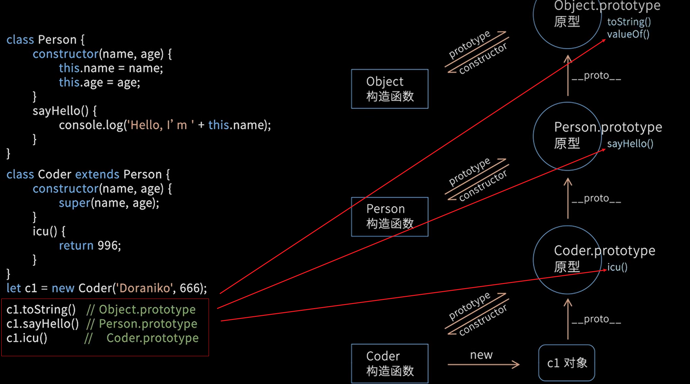


# 类

1. **类 = 构造函数 + 原型方法**，只能 `new` 调用。
2. **继承 = extends + super：**
   - `super(...)` 调父构造
   - `super.method()` 复用父方法
3. **类字段**：`name = 'xxx'` 是简写的实例属性初始化。
4. **静态成员**：`static xxx` 适合“跟具体实例无关的工具/比较/工厂逻辑”。
5. **访问控制：**
   - `_xxx`：约定的内部/受保护字段；
   - `#xxx`：语言级私有，只能在类内部访问。
6. **类型判断：**
   - `instanceof` 看原型链；
   - `Object.prototype.toString.call(x)` 看内建类型。

## 类是什么

基本语法

```ts
class MyClass {
  // 构造函数：new 时自动调用
  constructor(name: string) {
    this.name = name;
  }

  method1(): void { /* ... */ }
  method2(): void { /* ... */ }
}
```


```ts
const obj = new MyClass('Nick');
// 相当于：执行 constructor，把 this 绑定到新对象
```

> `class` 本质还是“构造函数 + 原型方法”的包装，
> 只是写法更统一、更易读。


构造函数 + prototype”的对应关系

等价写法（概念上）：

```ts
function MyClass(this: any, name: string) {
  this.name = name;
}
MyClass.prototype.method1 = function () { /* ... */ };
MyClass.prototype.method2 = function () { /* ... */ };
```

所以：

- `typeof MyClass === 'function'` → 类也是函数。
- `MyClass.prototype.method1` 就是你在类体里写的 `method1()`。


**但有两点不是“纯语法糖”：**

1. `class`定义的东西有一个内部标记`[[IsClassConstructor]]: true`，不能直接当普通函数调用，必须用 `new`：

   ```ts
   MyClass();    // ❌ 会报错
   new MyClass();// ✅
   ```

2. 类体中的方法是**不可枚举的**（不会被 `for...in` 枚举出来），普通构造+prototype 手动挂方法默认是 enumerable=false 也能做到，但 `class` 默认处理好了。


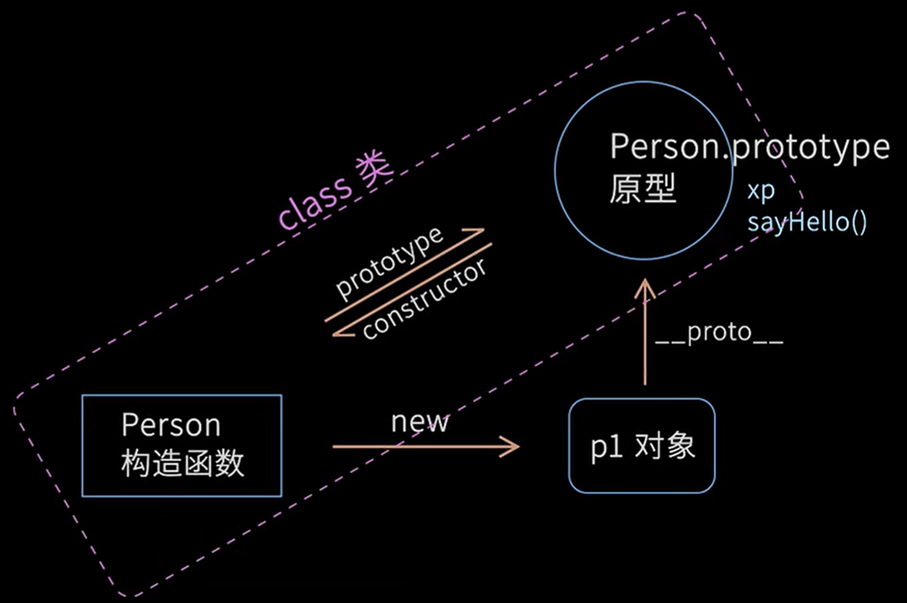


## 类也是“值”：类表达式 / 工厂函数

类和函数一样，可以：

- 赋值给变量；
- 作为参数传入；
- 作为返回值返回。

```ts
const User = class {
  sayHi(): void {
    console.log('Hi');
  }
};

function makeClass(msg: string) {
  return class {
    say(): void {
      console.log(msg);
    }
  };
}

const Greeter = makeClass('Hello');
new Greeter().say(); // Hello
```

> 可以用“类工厂”写出可配置的类，但日常业务用的不是很多


## getter / setter：用“属性语法”包一层逻辑

行为

```ts
class User {
  private _name: string = '';

  constructor(name: string) {
    this.name = name; // 这里实际调用的是 setter
  }

  get name(): string {
    return this._name;
  }

  set name(value: string) {
    if (value.length < 4) {
      throw new Error('Name too short');
    }
    this._name = value;
  }
}

const u = new User('Nick');
console.log(u.name); // 走 getter
u.name = 'Tom';      // 走 setter
```

心里记一句更完整的：

> getter/setter 让你**对外看起来像访问普通属性**，
> 但里面可以加验证、计算、日志、派发事件……
> 等你哪天要从“存字段”改成“算出来”，可以不改任何调用点。

在很多场景（尤其简单业务），直接用 `getXxx()/setXxx()` 一样可以；


## 继承：`extends` / `super` / 原理

最基础的继承

```ts
class Person {
  name: string;
  constructor(name: string) {
    this.name = name;
  }
  sayHi(): void {
    console.log('Hi, ' + this.name);
  }
}

class Student extends Person {
  study(): void {
    console.log(this.name + ' is studying');
  }
}

const s = new Student('Nick');
s.sayHi();  // 继承自 Person
s.study();  // 自己的
```

背后其实是原型链：

```text
s
 └── __proto__ → Student.prototype
                     └── __proto__ → Person.prototype
                                          └── __proto__ → Object.prototype → null
```

> 继承 = JS 帮你把原型链连好，实例能用整条链上的方法。


`super`：复用父类构造 & 父类方法

在构造函数里：`super(...)` 调用父类构造器

```ts
class Student extends Person {
  id: string;

  constructor(name: string, id: string) {
    super(name);       // 调用 Person 的 constructor(name)
    this.id = id;      // 再初始化子类自己的字段
  }
}
```

规则：

- 派生类里如果自己写了 `constructor`，**必须先 `super(...)` 再用 `this`**，否则报错。
- `super(...)` 就是“先让父类把它那一部分初始化好”。


在方法里：`super.method()` 复用父类实现

```ts
class Phone {
  call(): void {
    console.log('Calling...');
  }
}

class NewPhone extends Phone {
  call(): void {
    super.call();           // 先执行父类版 call
    console.log('Video...');// 再加自己的行为
  }
}
```

> 子类重写同名方法时，可以通过 `super.xxx()` 在新方法内部调用“父类版本”的实现，在此基础上做增强/扩展，而不是完全复制父类代码。


箭头函数里的 `super`

> 箭头函数没有自己的 `this/arguments/super`，
> 它里面用到的 `this/super` 都是从**外层函数**借来的。

```ts
class Child extends Person {
  greetLater(): void {
    setTimeout(() => {
      // 这里的 super 和 this 都是从 greetLater 继承来的
      super.sayHi();
    }, 1000);
  }
}
```

如果你在 `setTimeout(function() { ... })` 的普通函数里用 `super`，是不能的，因为那不是类的方法定义体，没 `[[HomeObject]]`。

> **super 只能在“真正的类方法”里直接用**；
> 箭头函数可以“带着外层的 super”一起用。


## 类字段 & 静态成员

类字段（实例字段简写）

就是“可以不写在 constructor 里，直接写在类体上”。

```ts
class User {
  name: string = 'default';    // 实例字段简写
  age: number;                 // 只声明不赋值，在 constructor 里再赋

  constructor(name: string) {
    this.name = name;          // 一样可以通过 this.访问
  }

  sayHi(): void {
    console.log(this.name);
  }
}
```


行为上等价于在构造函数里：

```ts
class User {
  name: string;

  constructor() {
    this.name = 'default';
  }
}
```

1. **类字段是“每个实例各自拥有的属性”**，等于 `this.xxx = ...`；
2. 类方法仍然挂在 `User.prototype` 上，实例通过原型链共享。


静态属性 / 静态方法（`static`）

> 静态成员是挂在“类本身”上的东西，和某个具体实例无关，
> 适合写：全局工具、工厂方法、比较函数、缓存、配置信息等。

例子：

```ts
class Article {
  static publisher: string = 'Nick Press';

  title: string;
  constructor(title: string) {
    this.title = title;
  }

  static compare(a: Article, b: Article): number {
    return a.title.localeCompare(b.title);
  }
}

const articles = [
  new Article('B'),
  new Article('A'),
];

articles.sort(Article.compare);      // 调静态方法，不需要某个具体 article 实例

console.log(Article.publisher);      // 访问静态属性
// const a = new Article('X');
// a.publisher; // ❌ 实例上访问不到
```

- 实例上的方法：用于描述**这个对象自身的行为**；
- 静态方法：用于描述**整个类相关的操作**，比如某种“工厂、比较器、工具方法”。


## 内部/外部接口 & 私有字段

下划线命名约定（受保护/内部接口）

> 下划线 `_xxx` 不是 JS 语法上的私有，只是“约定”，表示“这是内部用的，不要从外面随便动”。

```ts
class CoffeeMachine {
  _waterAmount: number = 0;   // 约定：内部字段
  private _power: number;     // TS 语义上的 private（编译期）

  constructor(power: number) {
    this._power = power;
  }

  set waterAmount(value: number) {
    this._waterAmount = Math.max(0, value);
  }

  get waterAmount(): number {
    return this._waterAmount;
  }
}
```

- 从 JS 角度讲，`obj._waterAmount` 仍然可以直接访问/修改，只是“不建议”。
- 从“类设计”的角度：
  - 对外只暴露 `get/set waterAmount()` （外部接口）；
  - `_waterAmount` / `_power` 只在类内部方法间使用（内部接口）。


真·私有字段：`#field`

是真正语言级别的私有：

```ts
class CoffeeMachine {
  #waterLimit: number = 200;

  #fixWaterAmount(v: number): number {
    return Math.max(0, Math.min(v, this.#waterLimit));
  }

  setWater(v: number): void {
    this.#waterLimit = this.#fixWaterAmount(v);
  }
}

const c = new CoffeeMachine();
// c.#waterLimit = 100;    // ❌ 语法错误，JS 层面也不允许
```

特点：

- **无法从类外部访问**，包括继承类；
- 只能在类声明体里直接用 `#xxx`；
- 可以和同名公开字段共存，比如有 `#waterAmount` 和 `waterAmount`，通过 getter/setter 暴露对私有字段的安全访问。

简单区分：

- `_xxx`：约定上的“受保护/内部”字段（继承类仍可以访问）；
- `#xxx`：语言级别强制的“私有字段”，继承类也访问不到


## 扩展内建类 & `instanceof` / `toString`

扩展内建类

> 继承内建类后，调用内建方法返回的实例类型默认是子类（用 `Symbol.species` 可以改回原生）。

```ts
class PowerArray extends Array<number> {
  isEmpty(): boolean {
    return this.length === 0;
  }

  static get [Symbol.species]() {
    return Array; // 让 map/filter 等返回普通 Array，而不是 PowerArray
  }
}
```

可以扩展 Array、Map 等，默认方法会返回子类实例

<hr>


`instanceof` 工作原理

> `obj instanceof Class` 会沿着 `obj.__proto__` 链往上找，看是否出现 `Class.prototype`。
> 有一层匹配就返回 true；都没有则 false。

伪代码：

```ts
function myInstanceOf(obj: any, Class: Function): boolean {
  let proto = Object.getPrototypeOf(obj);
  while (proto !== null) {
    if (proto === Class.prototype) return true;
    proto = Object.getPrototypeOf(proto);
  }
  return false;
}
```

`Symbol.hasInstance` 只是让你自定义“什么算是我的实例”。

<hr>


`Object.prototype.toString` & `Symbol.toStringTag`

- 每个对象的原型链最终都会到 `Object.prototype`；
- 上面的 `toString` 可以被“借用”来判断各种值的类型：

```ts
const toString = Object.prototype.toString;

toString.call(123);        // [object Number]
toString.call(null);       // [object Null]
toString.call([]);         // [object Array]
toString.call(() => {});   // [object Function]
```

所以这相当于一种“更强版的 typeof”。


`Symbol.toStringTag` 则是允许自定义这块中括号里的名字：

```ts
const obj = {
  [Symbol.toStringTag]: 'MyType',
};

Object.prototype.toString.call(obj); // [object MyType]
```

> 这块更多是库作者/底层工具会用到：
>
> - `Object.prototype.toString.call(x)` 能比较可靠地看出内建类型；
> - 自己也可以通过 `Symbol.toStringTag` 改显示名。


# 在浏览器中存储数据

## 存储对象

Web 存储对象 localStorage 和 sessionStorage 允许我们在浏览器上保存键/值对。

和 cookie 不同，服务器无法通过 HTTP header 操纵存储对象。一切都是在 JavaScript 中完成的。

两个存储对象都提供相同的方法和属性：

- `setItem(key, value)` —— 存储键/值对。
- `getItem(key)` —— 按照键获取值。
- `removeItem(key)` —— 删除键及其对应的值。
- `clear()` —— 删除所有数据。
- `key(index)` —— 获取该索引下的键名。
- `length` —— 存储的内容的长度。

像一个 `Map` 集合（`setItem/getItem/removeItem`），但也允许通过 `key(index)` 来按索引访问。


## localStorage

数据存储在本地存储中

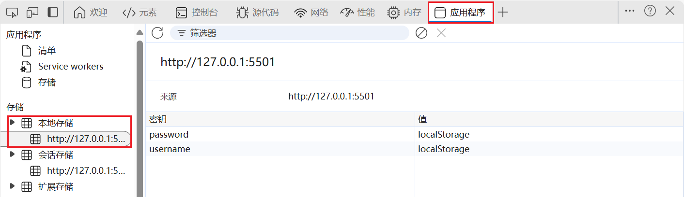


示例

```html
<body>
  <input type="text">
  <button class="btn1">存储数据</button>
  <button class="btn2">获取数据</button>
  <button class="btn3">删除数据</button>
  <button class="btn4">清空数据</button>
  <button class="btn5">新建窗口测试数据</button>

  <script>
    // 读取文本框对象
    let input = document.querySelector('input')

    // 存储数据
    document.querySelector('.btn1').addEventListener('click', function() {
      localStorage.setItem('username', input.value)
      localStorage.setItem('password', input.value)
    })

    // 获取数据
    document.querySelector('.btn2').addEventListener('click', function() {
      console.log(localStorage.getItem('username', input.value)) 
      console.log(localStorage.getItem('password', input.value)) 
    })

    // 删除数据
    document.querySelector('.btn3').addEventListener('click', function() {
      localStorage.removeItem('username', input.value)
    })

    // 清空数据
    document.querySelector('.btn4').addEventListener('click', function() {
      localStorage.clear()
    })

    // 测试数据
    document.querySelector('.btn5').addEventListener('click', function() {
      // 确保ip和端口是一致的才能共享数据
      open('http://127.0.0.1:5501/%E4%B8%AA%E4%BA%BA%E7%AE%80%E5%8E%86.html')
    })
  </script>
</body>
```


## sessionStorage

`sessionStorage` 对象的使用频率比 `localStorage` 对象低得多。

属性和方法是相同的

具有相同页面的另一个标签页中将会有不同的存储。

数据在页面刷新后仍然保留，但在关闭/重新打开浏览器标签页后不会被保留。


数据在会话存储空间

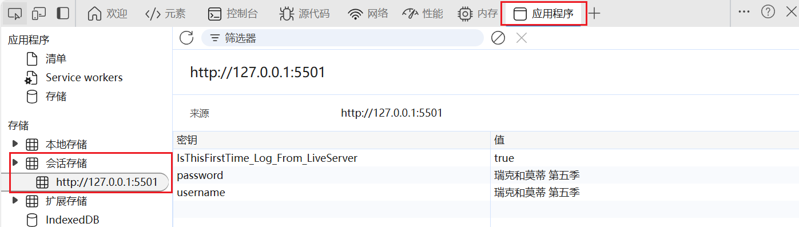


# 错误处理

`try...catch...` 结构的代码是同步执行的

## try…catch…finally

使用目的: 确保程序即使出现了异常, `try…catch…finally` 这部分的后续代码也能继续执行下去,增强程序的健壮性

完整语法如下所示：

```javascript
try {
    ...    //一般会被可能出现异常的代码放到这里,这里也可以做异常的手动抛出
} catch(e) {
    ...    //一般写异常的捕获与处理的代码
} finally {
    ...    //不管有没有异常,都必须要执行的代码
}
```


## try…catch…细节

try部分执行细节

- 没有 error 的例子：显示 `alert` `(1)` 和 `(2)`：

  ```javascript
  try {
  
    alert('开始执行 try 中的内容');  // (1) <--
  
    // ...这里没有 error
  
    alert('try 中的内容执行完毕');   // (2) <--
  
  } catch (err) {
  
    alert('catch 被忽略，因为没有 error'); // (3)
  
  }
  ```

- 包含 error 的例子：显示 `(1)` 和 `(3)` 行的 `alert` 中的内容：

  ```javascript
  try {
  
    alert('开始执行 try 中的内容');  // (1) <--
  
    lalala; // error，变量未定义！
  
    alert('try 的末尾（未执行到此处）');  // (2)
  
  } catch (err) {
  
    alert(`出现了 error！`); // (3) <--
  
  }
  ```


## Error 对象

发生错误时，JavaScript 会生成一个包含有关此 error 详细信息的对象。然后将该对象作为参数传递给 `catch`：

```javascript
try {
  // ...
} catch (err) { // <-- “error 对象”，也可以用其他参数名代替 err
  // ...
}
```


**属性:**

- `name`

  Error 名称。例如，对于一个未定义的变量，名称是 `"ReferenceError"`。

- `message`

  关于 error 的详细文字描述。

还有其他非标准的属性在大多数环境中可用。其中被最广泛使用和支持的是：

- `stack`

  当前的调用栈：用于调试目的的一个字符串，其中包含有关导致 error 的嵌套调用序列的信息。

例如：

```javascript
try {
  lalala; // error, variable is not defined!
} catch (err) {
  alert(err.name); // ReferenceError
  alert(err.message); // lalala is not defined
  alert(err.stack); // ReferenceError: lalala is not defined at (...call stack)

  // 也可以将一个 error 作为整体显示出来
  // error 信息被转换为像 "name: message" 这样的字符串
  alert(err); // ReferenceError: lalala is not defined
}
```


## 手动抛出异常 throw

**“throw” 操作符**

`throw` 操作符会生成一个 error 对象。

语法如下：

```javascript
throw <error object>
```


可以将任何东西用作 error 对象。甚至可以是一个原始类型数据，例如数字或字符串，**但最好使用对象，最好使用具有 `name` 和 `message` 属性的对象**


对于内建的 error，`name` 属性刚好就是构造器的名字。`message` 则来自于参数（argument）

例如：

```javascript
let error = new Error("Things happen o_O");

alert(error.name); // Error
alert(error.message); // Things happen o_O
```


抛出 error 例子

```javascript
let json = '{ "age": 30 }'; // 不完整的数据

try {

  let user = JSON.parse(json); // <-- 没有 error

  if (!user.name) {
    throw new SyntaxError("数据不全：没有 name"); // (*)
  }

  alert( user.name );

} catch(err) {
  alert( "JSON Error: " + err.message ); // JSON Error: 数据不全：没有 name
}
```

在 `(*)` 标记的这一行，`throw` 操作符生成了包含着我们所给定的 `message` 的 `SyntaxError`，与 JavaScript 自己生成的方式相同。`try` 的执行立即停止，控制流转向 `catch` 块。


## 再次抛出（Rethrowing）

在例子中，`try...catch` 旨在捕获“数据不正确”的 error。但实际上，catch 会捕获到 **所有** 来自于 `try` 的 error。如果捕获到了别的 error，但仍然抛出的是同样的 `"JSON Error"` 信息。这是不正确的，并且也会使代码变得更难以调试。


所以, **`catch` 应该只处理它知道的 error，并“抛出”所有其他 error。**


再次抛出（rethrowing）详细步骤为：

1. Catch 捕获所有 error。
2. 在 `catch (err) {...}` 块中，我们对 error 对象 `err` 进行分析。
3. 如果我们不知道如何处理它，那我们就 `throw err`。


**使用“再次抛出”例子**

```javascript
let json = '{ "age": 30 }'; // 不完整的数据
try {

  let user = JSON.parse(json);

  if (!user.name) {
    throw new SyntaxError("数据不全：没有 name");
  }

  blabla(); // 预料之外的 error

  alert( user.name );

} catch (err) {

  if (err instanceof SyntaxError) {
    alert( "JSON Error: " + err.message );
  } else {
    throw err; // 再次抛出 (*)
  }

}
```

1. `let user = JSON.parse(json);` 解析成功，`user = { age: 30 }`
2. `if (!user.name) { ... }` 条件为真，因为没有 `name` 属性。
3. `throw new SyntaxError("数据不全：没有 name");` 抛出异常，**立即停止 `try` 块中后续代码的执行**，跳转到 `catch` 中处理。
4. 如果`if (!user.name) { ... }` 条件为假, 就会捕获到 `blabla()` 抛出的错误,  `err` 是 `ReferenceError`，不是 `SyntaxError`，`if (err instanceof SyntaxError)` 为假，执行 `throw err;`。


