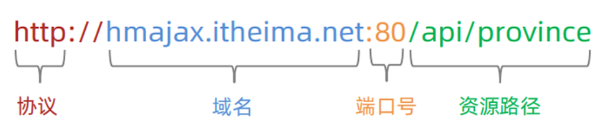
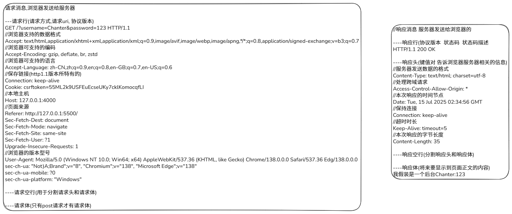
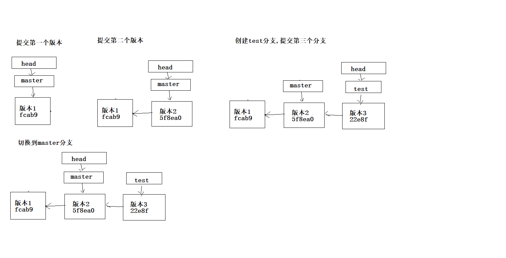
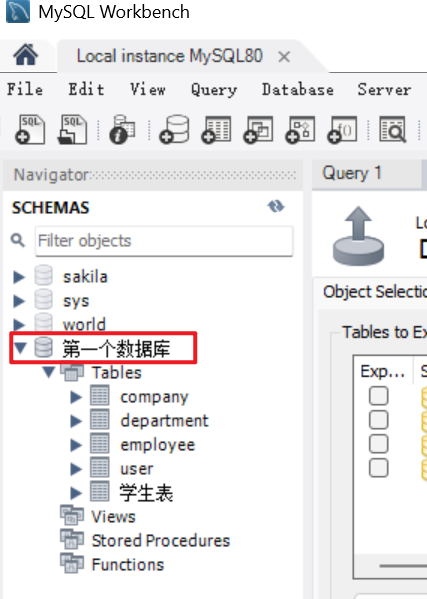

# node.js

## node概念

```
概念
	Node.js 是一个基于 Chrome V8 引擎的 JavaScript 运行环境
作用
	提供一个JavaScript的运行环境
	开发后台,小型网站可以使用node编写
组成
	ECMAScript	
		和js基础语法一样
	内置模块
		fs文件相关
		path路径相关模块
		http服务器相关模块
	第三方模块
		第三方开发,需要下载

JavaScript对比
	js
		ECMAScript + 内置对象 + 对象模型(DOM,BOM)
	node.js
		ECMAScript + 内置模块 + 第三方模块
```


## 模块化

```
模块是遵循固定的规则,把一个大的js文件,拆分成相顾依赖的小文件
类似于js中的函数,函数是对当前代码的封装,只能在当前文件中重用,不能跨文件重用
模块化解决了这个问题,将js代码单独放到一个文件中,需要的时候直接引入,达到跨文件访问函数的效果,

提高代码的复用性和可维护性
实现按需加载,提高效率
```


分类

```
根据来源不同
	内置模块
		node.js自带的模块,fs,path,http等
	用户自定义模块
		由开发者创建的模块
	第三方模块
		通过npm安装,例如express.lodash
```


### 模块化入门

```
1.写一个文件
	其实是创建了一个自定义模块
2.通过require(路径),引入自定义模块
	是引用,不是复制
```

例子

```js
//01.js
console.log('如公园中干涸的湖底')

//02.js
require('./模块化_自定义模块')

//terminal
C:\Data\xzd学习\coding\Js>node 02.js
如公园中干涸的湖底
```


模块作用域

```
概念
	node.js每个文件都可以作为一个独立的模块,默认处于独立的作用域内
	在自定义模块中,变量和函数的定义,只能在当前模块中使用,不能用于其它模块
好处
	避免全局变量污染
```

### 模块间共享

```
module对象
	在每一个自定义模块中,都有一个module对象,它里面存放了当前模块的相关信息
	里面有export此属性,用来导出模块中自定义的变量和函数
	
module.exports对象
	可以用来导出自定义对象或者函数
	
exports对象
	由于module.exports书写比较麻烦,为了简化书写,node提供了一个exports对象,也可以用来导出
	
```

```js
{
  id: '.', 
  path: 'C:\\Data\\xzd学习\\coding\\Js',
  exports: {},
  filename: 'C:\\Data\\xzd学习\\coding\\Js\\模块化_module对象.js',
  loaded: false,
  children: [],
  paths: [
    'C:\\Data\\xzd学习\\coding\\Js\\node_modules',
    'C:\\Data\\xzd学习\\coding\\node_modules',
    'C:\\Data\\xzd学习\\node_modules',
    'C:\\Data\\node_modules',
    'C:\\node_modules'
  ],
  [Symbol(kIsMainSymbol)]: true,
  [Symbol(kIsCachedByESMLoader)]: false,
  [Symbol(kURL)]: undefined,
  [Symbol(kFormat)]: undefined,
  [Symbol(kIsExecuting)]: true
}
```

```
id: 当前路径
path: 当前模块所在目录的绝对路径
exports: 用于导出模块内容的地方, 可以将功能或数据附加到这个对象上，在其他文件中使用require导入。
filename:模块的绝对路径 + \\文件名, 即完整路径。
```


### exports属性

```js
const a = 10;
function eat() {
  console.log('导出模块')
}

//导出部分
module.exports.a = a
module.exports.eat = eat

//打印模块查看exports属性
console.log(module)

// exprots中有值: exports: { a: 10, eat: [Function: eat] },
```

`exports.a = a; exports.eat = eat;` 可直接使用export导出,但是建议使用上面的方法


导出方式

```js
function nowTime() {
  .....
  .....
  return ....
}

// 导出方式一
// 给exports的nowTime属性赋值
module.exports.nowTime = nowTime

// 导出方式二 用字面量对象给module.exports赋值
module.exports = {nowTime: nowTime}

// 导出方式二
// 属性名和属性值一样,可以只写一个
module.exports = {nowTime}
```


exports属性导出后在其它文件导入

```js
const obj = require('./模块化_exports导出')
console.log(obj)

//{ a: 10, eat: [Function: eat] }
```

建议解析导入: `const {a, eat} = require('./模块化_exports导出')`


## 内置模块

### fs模块

概念
Node.js 的文件系统模块（fs模块）提供了丰富的 API，用于读取、写入、删除文件以及执行其他文件系统操作. fs 模块既支持同步方法也支持异步方法，使得开发者可以根据具体需求选择合适的方式来处理文件操作。

```
使用
	1.导入fs模块
	const fs = require('fs')
	2.调用方法
		fs.readdir(path[, options], callback)
		fs.writeFile(file, data[, options], callback)

语法
	fs.readdir(path[, options], callback)
		path:文件路径
		option:编码等可选操作
		callback:读取文件之后使用的回调函数
	
	fs.writeFile(file, data[, options], callback)
		file:写入文件的路径,没有自动创建
		写入的数据
		option:编码等可选操作
		callback:写入文件之后执行的回调函数
```


读取文件

```js
// 导入fs模块
const fs = require('fs')

// 调用fs的readFile方法\
fs.readFile('./wenben.txt', 'utf-8', (err, data) => {
  console.log(err)  //null表示程序没有出现异常
  console.log(data) // 文件中的内容
})
```


写入文件

```js
// 导入fs模块
const fs = require('fs')

let text = '这夕阳最后的光辉也曾照在怒海的万顷波涛上，那是几道穿透西方乱云的光柱，在黑云下的海面上投下几片巨大的金色光斑，像自天国飘落的花瓣，花瓣之外是黑云下暗夜般的世界，暴雨像众神的帷幔悬挂在天海之间，只有闪电不时照亮那巨浪吐出的千堆雪。'

// 调用fs的readFile方法\
fs.writeFile('../file/bbb.txt', text, (err) => {
  if (err) {
    console.log('写入文件失败' + err)
  } else {
    console.log('写入文件成功')
  }
})
```


### path模块

```
概念
	用于处理和操作文件和目录路径,提供跨平台的操作方法

```

不用path

```js
// node 提供一些及路径的简单写法(不使用path)
// 获取当前文件所在的路径
console.log(__filename) //C:\Data\xzd学习\coding\Js\path_使用.js
// 获取当前文件所在目录
console.log(__dirname)  //C:\Data\xzd学习\coding\Js
```


path模块基本用法

```js
const path = require('path')
// 获取目录名
// path.dirname(path)
console.log(path.dirname(__filename)) //C:\Data\xzd学习\coding\Js

// 连接路径
// path.join([...paths])
console.log(path.join(__dirname, './file/today.txt')) //C:\Data\xzd学习\coding\Js\file\today.txt

// 获取拓展名
// path.extname(path)
console.log(path.extname(__filename)) //.js

// 获取文件名 可选参数ext用于去掉拓展名
// path.basename(path[, ext])
console.log(path.basename(__filename))  //path_使用.js
console.log(path.basename(__filename, '.js')) //path_使用
```


### http模块

```js
const http = require('http')

// 创建web服务器
const server = http.createServer()

// 打印
console.log(server)

/**
Server {
  maxHeaderSize: undefined,
  insecureHTTPParser: undefined,
  requestTimeout: 300000,
  headersTimeout: 60000,
  keepAliveTimeout: 5000,
  connectionsCheckingInterval: 30000,
  requireHostHeader: true,
  joinDuplicateHeaders: undefined,
  rejectNonStandardBodyWrites: false,
  _events: [Object: null prototype] {
    connection: [Function: connectionListener],
    listening: [Function: setupConnectionsTracking]
  },
  _eventsCount: 2,
  _maxListeners: undefined,
  _connections: 0,
  _handle: null,
  _usingWorkers: false,
  _workers: [],
  _unref: false,
  _listeningId: 1,
  allowHalfOpen: true,
  pauseOnConnect: false,
  noDelay: true,
  keepAlive: false,
  keepAliveInitialDelay: 0,
  highWaterMark: 16384,
  httpAllowHalfOpen: false,
  timeout: 0,
  maxHeadersCount: null,
  maxRequestsPerSocket: 0,
  [Symbol(IncomingMessage)]: [Function: IncomingMessage],
  [Symbol(ServerResponse)]: [Function: ServerResponse],
  [Symbol(shapeMode)]: false,
  [Symbol(kCapture)]: false,
  [Symbol(async_id_symbol)]: -1,
  [Symbol(kUniqueHeaders)]: null
}

 */
```


## 包

包的概念

```
来源
	根据内置模块和第三方模块不公,包是由第三方个人或者团队开发出来的,免费给其他人使用
好处
	包其实是内置模块封装出来的,地宫一个更高级更方便的api,有助于提高开发效率
网站
	https://www.npmjs.com/
```

nrm镜像管理工具

```
作用
	解决国内网站速度慢等原因,可以使用国内的镜像
	第一次直接使用npm将下载包的连能源设置为淘宝镜像
		npm config set registry https://registry.npmmirror.com/
	查看当前使用的一个镜像
		npm config get registry
	安装镜像管理工具
		npm i nrm -g
	查看所有镜像
		nrm ls
```

npm包管理工具

```
概念
	美国的一家公司提供的,用来管理包的,现在已经被集成到了node.js中
安装
	无需安装,在安装node的时候,已经自动安装好了
查看版本
	npm -v
使用npm下载安装或者移除各种包
	下载及安装 包
		npm i 包名
	移除包
		npm uninstall 包名
```


moment包的使用

```js
// 导入下好的moment包
const moment = require('moment')

console.log(moment()) //Moment<2025-07-14T16:35:14+08:00>
console.log(moment().format())  //2025-07-14T16:35:14+08:00

// 解析日期对象
console.log(moment().format('YYYY-MM-DD'))  //2025-07-14
console.log(moment().format('YYYY-MM-DD HH:mm:ss')) //2025-07-14 16:37:00
console.log(moment().format('YYYY年MM月DD日 HH时mm分ss秒')) //2025年07月14日 16时37分00秒

// 获取星期
console.log(moment().weekday()) //1
```


### 手写包

```
特点
	在node_modules文件夹下
		用于存放所有已经安装到本地的包,require引入第三方包的时候,有限从这个目录中查找
	配置文件(package.json)
		name:包名
		version:版本
		main:包的入口

注意点:
	1.包必须以单独的目录存在
	2.保额顶级目录下,必须包含package.json文件
	3.package.json配置文件中必须要有name,version,main这三个选项
```


手写一个计算器的包

```
计算两个数的加减法

1.创建一个文件夹
    在node_modules文件夹下,创建一个calc文件夹
2.初始化这个文件夹
    使用cd命令进入刚才创建的这个文件夹
    使用npm init -y 初始化这个包,会在calc下自动创建一个package.json的配置文件
3.创建包的目录解构
    1.创建src的文件夹,用于存放源码
    2.创建dist文件夹,作为发布目录
    3.在dist文件夹下,创建一个index.js文件,作为包的入口文件
    4.修改package.json配置文件中的main属性值为dist/index.js
4.编写源码
	在src下创建一个add.js,实现加法操作,并且使用module.exports导出
	在src下创建一个sub.js,实现减法操作,并且使用module.exports导出
5.编写头文件(dist文件夹下的index.js文件)
	先将源码中的单个模块都引入进来,然后统一导出
	好处:使用包的时候,只需要导入一个头文件,其它文件都可以引进来,也可以直接调用其它文件
```


### 包的加载机制

```
步骤
	1.node会假设它是一个内置模块,就会去系统的安装目录下寻找
	2.如果不是内置模块,就会到当前目录下的node-modules中查找
	3.首先看看有没有该名字对应的文件,如果有,直接加载这个文件
	4.如果没有对应的文件,就找对应名称的文件夹
	5.如果有,就进入这个文件,查看该文件夹中的package.json文件中的main属性值,确定该模块的入口文件
	6.如果没有package.json,就会去找index.js
	7,如果连index.js都没有,就会报错

总结
	先查看是否是内置模块
	不是就去node-module模块下查找
	先找同名的js文件
	没有就去找同名文件夹
	没有同名文件夹,没有package.json就找index.js,没有index.js就报错
	有同名文件夹,有package.json,就到main属性指定的文件夹中加载
	
加载注意点
	1.模块在第一次加载后会被缓存起来
	2.不管是哪种加载,都优先从缓存中加载
	3.内置模块是由node.js官方提供的,优先加载级时最高的
```


# 服务器

```
概念
	服务:接收用户请求,做出响应
	服务器:可以接收用户请求,做出相应的机器,本质就是一台电脑,性能要比个人电脑强很多
	服务端:负责存放和对外提供资源的,比如百度服务器..
	客户端:负责获取和消费资源的,比如各种网页页面
	资源:互联网上的页面,视频,音频
	
网络通讯三要素
	ip:设备在网络中的唯一标识
	端口:程序在设备中的唯一标识
	协议:规定了浏览器和服务器之间交换数据的格式
		浏览器发送什么样的数据给服务器,服务器才能解析
		服务器发送什么样的数据给浏览器,浏览器才能解析
		
本地主机的ip:127.0.0.1 对应的域名:localhost
```


url地址

```
概念
	统一资源定位符,通过它可以定位互联网上唯一的一个资源
```

端口号一般会省略掉




## http协议

```
概念
	超文本传输协议
作用
	规定了服务器和浏览器之间进行网络传输所遵循的规范
	浏览器发送什么样的数据给服务器,服务器才会解析
	服务器发送什么样的数据给浏览器,浏览器才能解析
	
特点
	基于请求和相应模型
	必须先有请求,再有响应
	请求和响应是成对出现的
```


请求响应消息

```
请求消息
	概念
		客户端给服务端发送的消息,告诉服务端,我当前浏览器的一些信息
	组成
		请求行
			请求方式 请求URI（Uniform Resource Identifier，统一资源标识符）协议版本
		请求头
			user-agent:浏览器的版本型号
			content-type:浏览器发送给服务器的格式
			accept:浏览器能够支持返回数据的格式
			accept-language:浏览器期望获取自然语言的顺序
		请求体
			只有post请求才有
	
响应消息
	概念
		服务端发送给客户端的信息,告诉客户端 服务器发送消息的类型和特点
	组成
		响应行
			协议版本 状态码 状态码描述
		响应头
			content-type:告诉浏览器,我发送数据的类型和编码
			content-length:告诉浏览器,服务器发送的字节长度
		响应体
			将来要展示到页面正文的内容
		
	常见状态码
		2xx 成功 200
		3xx 重定向 302 304未修改
		4xx 客户端错误 404
		5xx 服务端错误 500 服务器内部错误
```


请求响应对象

```
由于请求消息和响应消息都是纯文本,操作纯文本非常麻烦,node就将请求响应消息封装成请求响应对象,程序员只需要调用这些对象的方法,就可以改变请求响应消息的内容
分类
	请求对象(Request对象)
		封装了请求消息,一般用于获取数据()
	响应对象(Response对象)
		封装了响应消息,一般用来设置消息
```


**HTTP协议就是规定了请求消息和响应消息的格式**



```cmd
请求消息,浏览器发送给服务器

---请求行(请求方式,请求uri, 协议版本)
GET /?username=Chanter&password=123 HTTP/1.1
//浏览器支持的数据格式
Accept: text/html,application/xhtml+xml,application/xml;q=0.9,image/avif,image/webp,image/apng,*/*;q=0.8,application/signed-exchange;v=b3;q=0.7
//浏览器可支持的编码
Accept-Encoding: gzip, deflate, br, zstd
//浏览器可支持的语言
Accept-Language: zh-CN,zh;q=0.9,en;q=0.8,en-GB;q=0.7,en-US;q=0.6
//保存链接(http1.1版本所特有的)
Connection: keep-alive
Cookie: csrftoken=55ML2k9USFEuEcseUKy7cklKomocqfLI
//本地主机
Host: 127.0.0.1:4000
//页面来源
Referer: http://127.0.0.1:5500/
Sec-Fetch-Dest: document
Sec-Fetch-Mode: navigate
Sec-Fetch-Site: same-site
Sec-Fetch-User: ?1
Upgrade-Insecure-Requests: 1
//浏览器的版本型号
User-Agent: Mozilla/5.0 (Windows NT 10.0; Win64; x64) AppleWebKit/537.36 (KHTML, like Gecko) Chrome/138.0.0.0 Safari/537.36 Edg/138.0.0.0
sec-ch-ua: "Not)A;Brand";v="8", "Chromium";v="138", "Microsoft Edge";v="138"
sec-ch-ua-mobile: ?0
sec-ch-ua-platform: "Windows"

----请求空行(用于分割请求头和请求体)

----请求体(只有post请求才有请求体)
```

```cmd
//响应消息 服务器发送给浏览器的

----响应行(协议版本  状态码  状态码描述
HTTP/1.1 200 OK

----响应头(键值对 告诉浏览器服务器相关的信息)
//服务器发送数据的格式
Content-Type: text/html; charset=utf-8
//处理跨域请求
Access-Control-Allow-Origin: *
//本次响应的时间节点
Date: Tue, 15 Jul 2025 02:34:56 GMT
//保持连接
Connection: keep-alive
//超时时长
Keep-Alive: timeout=5
//本次响应的字节长度
Content-Length: 35

----响应空行(分割响应头和响应体)

----响应体(将来要显示到页面正文的内容)
我假装是一个后台Chanter:123
```


## 手写web服务

基本web服务

```
1.导入http模块
2.创建web服务器
3.绑定事件,处理响应
4.设置端口,进行监听
```

解决中文乱码问题

```
前后编码不一致
	服务器发送数据,默认使用的是ISO-8859-1(拉丁文编码),不支持中文
	浏览器接收数据并解析:中文的window默认使用的是GBK(国标)
解决
	使用响应对象,设置一个响应头,统一编码
	res.setHeader('content-type','text/html;charset=utf-8')
	就是告诉服务器,发送数据使用的编码是utf-8,将来浏览器接收到数据之后,就会使用utf-8解码
```


```js
// 导入http模块
const http = require('http')

// 创建web服务器
const server = http.createServer()

// 绑定事件,处理响应
// 为服务器绑定一个request事件,监听客户端发送的请求,做出响应
server.on('request', (req, res) => {  // req请求对象, res响应对象, 只要有请求过来, 服务器就会为这次请求创建一个请求对象和响应对象,然后就可以拿到这两个对象进行操作

  // 设置响应头,处理乱码
  res.setHeader('content-type','text/html;charset=utf-8')

  res.end('<h1>你好</h1>')  //使用响应对象,设置响应体,显示到页面
})
server.listen(3000, function() {
  console.log('服务器启动起来了,访问路径:http://localhost:3000')
})
```


在终端命令行里输入 `netstat -anno`,查找对应端口所对应的pid, 然后再任务管理器中的详细信息里根据pid关掉对应的进程

## 根据不同的url响应不同的内容

（Uniform Resource Locator，统一资源定位符）

```js
1.先通过请求对象request对象中的url属性,获取请求到的url字符串
2.通过url的内置模块解析获取出来的url字符串,得到url对象
3.从url对象中获取pathname属性的值

// 获取请求的url  假如访问的url是 http://localhost:3000/detail?id=10
// console.log(req)可以再控制台上发现,,访问路径/detail在req对象的url属性里,但是内容很多找不到
const urlStr = req.url
console.log(urlStr) // /detail?id=10
// 因此使用内置模块url来解析urlStr
const obj = url.parse(urlStr, true)
console.log(obj)

方式一:
const urlStr = req.url
const obj = url.parse(urlStr)
//下面是打印obj
Url {
  protocol: null,
  slashes: null,
  auth: null,
  host: null,
  port: null,
  hostname: null,
  hash: null,
  search: '?id=10',
  query: 'id=10',
  pathname: '/detail',
  path: '/detail?id=10',
  href: '/detail?id=10'
}

方式二:
第二个参数传true,解析query请求参数,query请求参数中的值是10 (query.id)
const urlStr = req.url
const obj = url.parse(urlStr, true)  //这里加了第二个参数true,前一个没加,默认false
Url {
  protocol: null,
  slashes: null,
  auth: null,
  host: null,
  port: null,
  hostname: null,
  hash: null,
  search: '?id=10',
  query: [Object: null prototype] { id: '10' },
  pathname: '/detail',
  path: '/detail?id=10',
  href: '/detail?id=10'
}
```


```
http://localhost:3000/index  首页
http://localhost:3000/list	列表页
http://localhost:3000/detail?id=10 详情页
http://localhost:3000/qita	页面找不到
```

```js
// 导入http模块
const http = require("http")
// 内置url模块
const url = require("url")

// 创建web服务器
const server = http.createServer()

// 绑定事件,处理响应
// 为服务器绑定一个request事件,监听客户端发送的请求,做出响应
server.on("request", (req, res) => {
  // req请求对象, res响应对象, 只要有请求过来, 服务器就会为这次请求创建一个请求对象和响应对象,然后就可以拿到这两个对象进行操作

  // 设置响应头,处理乱码
  res.setHeader("content-type", "text/html;charset=utf-8")

  /*
  获取请求的url 
  console.log(req)可以再控制台上发现,,访问路径/detail再req对象的url属性里,但是内容很多找不到
  const urlStr = req.url

  因此使用内置模块url来解析urlStr
  const obj = url.parse(urlStr, true)

  获取pathname属性的值
  const pathname = obj.pathname
  */
  
	// 使用一行代码完成上述内容
  const {pathname} = url.parse(req.url, true)
  
  // 判断
  if (pathname == "/" || pathname == "/index") {
    res.end("<h1>首页</h1>")
  } else if (pathname == "/list") {
    res.end("<h1>列表页</h1>")
  } else if (pathname == "/detail") {
    res.end("<h1>详情页</h1>")
  } else {
    res.end("<h1>404页面找不到</h1>")
  }
})
server.listen(3000, function () {
  console.log("服务器启动起来了,访问路径:http://localhost:3000")
})

```


## 获取get请求中的参数

假设访问链接为 `http://localhost:3000/detail?id=10`

请求行里的参数都在query中

```js
const http = require("http")
const url = require("url")
const server = http.createServer()

server.on("request", (req, res) => {
    //解析query
    const {pathname, query} = url.parse(req.url, true)

    // 判断请求方式
    console.log(req)  //'GET'再method属性中
    // 判断
    if(req.method == 'GET') {
      console.log(query)  //[Object: null prototype] { id: '10' }
    }

    res.end("<h1>详情页</h1>")

})
server.listen(3000, function () {
	console.log("服务器启动起来了,访问路径:http://localhost:3000")
})

```


## 获取post请求的参数

```
需要借助表单才能发送post请求
步骤
	1.修改表单提交地址为 http://127.0.0.1:3000 ,提交方法改为post
	2.在跳转首页的路由代码中判断,如果是post请求,进行下一步操作
	3.获取post请求体的数据
	
```


请求体数据获取

    // 需要监听request请求的两个事件
    // data事件:当服务器接收到post数据变化时调用
    // end事件:当服务器接收到post数据完毕的时候调用

html

```html
<form method="post" action="http://127.0.0.1:3000">
    用户名: <input type="text" name="username"><br>  Chanter
    密  码: <input type="password" name="password"><br>	123
    <input type="submit" value="登录">
</form>
```

方式一:

js

```js
const http = require("http")
const url = require("url")
const server = http.createServer()

server.on("request", (req, res) => {
  // 设置响应头,处理乱码
  res.setHeader("content-type", "text/html;charset=utf-8")

  //解析query
  const { pathname, query } = url.parse(req.url, true)

  // 判断
  if (req.method == "POST") {
    // 处理post请求
      // 需要定义一个容器,用来存放接收到的数据
      let postData = ''
      req.on('data', data => postData += data) //data表示每次接收到的数据
      req.on('end', () => {
        console.log(postData) //username=Chanter&password=123 获取到请求体中的数据
      }) 
    console.log("捕获到post请求")
    // console.log(query)  //[Object: null prototype] { id: '10' }
  }

  res.end("<h1>详情页</h1>")
})
server.listen(3000, function () {
  console.log("服务器启动起来了,访问路径:http://localhost:3000")
})

```


方式二:使用内置模块访问

```js
//使用内置模块querystring解析请求体中的数据
const qs = require('querystring')
...

// 需要定义一个容器,用来存放接收到的数据
let postData = ''
req.on('data', data => postData += data) //data表示每次接收到的数据
req.on('end', () => {
    console.log(postData) //username=Chanter&password=123 获取到请求体中的数据
    
    //内置模块解析
    const obj = qs.parse(postData)
    console.log(obj) //[Object: null prototype] { username: 'Chanter', password: '123' }
    console.log(obj.username) //Chanter
    console.log(obj.password) //123
}) 
```


# 接口编程

```
接口文档
	它里面包含了请求数据的俩,参数,输出内容
	是请求后台的数据的依据
	参考接口文件,可以方便的知道接口的作用,以及接口如何调用

接口编程
	前后端按照约定好的规则,进行编程后测试
	前端:主要是发送数据(需要明确 请求的url 请求的方式 请求的参数)
	后端:主要是接收数据(需要明确 响应状态码 状态码描述 以及具体返回的数据)
	
接口编程的好处
	实现一次编写,随时接入,不同的终端设备只需要发送对应的url请求,就可以从后台拿数据
	前后端分离
```


## restful接口设计

```
概念
	一种接口设计风格,主要用于有客户端和服务端交互的软件
六要素
	前端
		资源路径:请求url(http://localhost:80:3000/login)
		http动词:请求的方式(post请求)
		过滤信息:请求的参数(username=chanter&password=123)
	后台
		状态码:200(请求成功)
		错误信息:出错的时候,给出的提示或者异常信息
		返回结果:前端想要的数据(登录成功之后,返回登陆用户想要的信息)
		
常见的http动词(以图书管理系统为例)
	GET:获取资源(获取一个或多个) 	--- 获取所有的图书列表
	POST:新增资源				 --- 新增一本书
	PUT:修改资源				 --- 修改图书信息
	DELETE:删除资源				 --- 删除某一本图书
```


## restful使用

```
json-server
	一个快速成型的	restful接口服务工具, 使用json-server可以快速的搭建一个restful服务端
	程序员只需要提供数据,json-server就可以根据你提供的数据将后台搭建起来
	
搭建json-server服务器
	1.安装json-server(npm i json-server@0.17.4 -g) 全局安装
	2.创建一个data.json文件,作为数据源
	3.启动服务 json-server -w data.json
	
前台发送数据
	再vsCode中安装 rest Client 插件
	
使用rest client模拟 前端向后台请求数据
```

data.json

```json
{
  "users": [
    {"id": 1, "name": "张三", "age": 20},
    {"id": 2, "name": "xiaomei", "age": 18},
    {"id": 3, "name": "xiaopang", "age": 1}
  ]
}
```


### 设置接口

端口 3000 是很多 Node.js 相关开发工具默认使用的端口

更改启动端口

```
json-server --watch data.json --port 4000
```

查询GET请求

```http
###查询所有用户
GET http://localhost:3000/users HTTP/1.1

###查询一个用户(方式一)
GET http://localhost:3000/users?id=1 HTTP/1.1

###查询一个用户(方式二)
GET http://localhost:3000/users/1 HTTP/1.1

###查询多个用户
GET http://localhost:3000/users?id=1&id=2 HTTP/1.1
```

新增POST请求

```http
###新增用户(方式一)
POST http://localhost:3000/users HTTP/1.1
Content-Type: application/x-www-form-urlencoded

name=李四&age=24

###新增用户(模拟json)
POST http://localhost:3000/users HTTP/1.1
Content-Type: application/json

{"name":"王五","age":"25"}
```

修改PUT请求

```http
###修改用户方式一(模拟表单)
PUT http://localhost:3000/users/1 HTTP/1.1
Content-Type: application/x-www-form-urlencoded

name=深渊&age=24

###修改用户方式一(模拟josn)
PUT http://localhost:3000/users/1 HTTP/1.1
Content-Type: application/json

{"name":"元聚","age":"24"}
```

删除DELETE请求

```http
###删除一个用户
DELETE http://localhost:3000/users/5 HTTP/1.1
```


### 用原生ajax从json-server服务器获取数据

搭建json-server服务器挂在后台

使用ajax发送请求即可

```js
xhr.open('GET', 'http://localhost:3000/users/1')
xhr.onreadystatechange = function () {
  if (xhr.readyState == 4 && xhr.status == 200) {
    const obj = JSON.parse(xhr.response) //获取数据对象
  }
}
xhr.send()
```


### 用fetch从json-server服务器获取数据

```json
// 返回的是Promise对象,并且是fulfilled状态,结果属性存的是Response对象
const res = fetch('http://localhost:3000/users')
res.then( response => {
  console.log(response.json())
  return response.json() //调用json()方法将数据序列化出来,但仍然是一个Promise对象,数据存在PromiseResult属性中
}).then(data => { //return将数据传入下一个then
  console.log(data) //获取数据
})
```


### 用axios从json-server服务器获取数据

引入,官网有

npm下载

```
<script src='../node_modules/axios/dist/axios.min.js'></script>
```

请求方法参考 '设置接口' 章节


#### axios请求格式

```
axios({
    url:'',  请求url
    method:'',	请求方式
    params:{},	请求url参数,仅用于get
    data:{},		请求体参数,用于post和put
    timeout:1000	请求超时时长
}).then(回调函数)
```


#### 获取数据

```html
<script>
//请求一个用户
axios.get('http://localhost:3000/users').then(response => {
  console.log(response)
  console.log(response.data)
})

axios.get('http://localhost:3000/users?id=1').then(response => {
  console.log(response.data) //返回数组[{..}]
})
    
    
//请求多个用户
axios.get('http://localhost:3000/users?id=1&id=2').then(response => {
  console.log(response.data)
})
axios.get('http://localhost:3000/users', { params: { id: [1, 2] } }).then(response => {
  console.log(response.data)
})
</script>
```


#### 新增数据

简写

```html
<button>新增用户</button>
<script>
let btn = document.querySelector('button')
btn.addEventListener('click', function () {
  axios.post('http://localhost:3000/users', { "name": "王五", "age": 25 }).then(response => {
    console.log(response.data)
  })
})
</script>
```

如果将axios逻辑单独拎出来执行,会导致死循环反复执行


通用方式

```js
btn.addEventListener('click', function () {
  axios({
    url:'http://localhost:3000/users',
    method:'post',
    data:{"name":"王五五","age":25}
  }).then(res => {
    console.log(res.data)
  })
})
```


#### 修改数据

大部分 RESTful 服务不会根据查询参数来更新指定资源，而是根据路径参数。

所以id信息要放到路径里

```js
  axios({
    url:'http://localhost:3000/users/6',
    method:'put',
    data:{"name":"王五十","age":50},
  }).then(res => {
    console.log(res.data)
  })
```


#### 删除数据

```js
  axios({
    url:'http://localhost:3000/users/6',
    method:'delete',
  }).then(res => {
    console.log(res.data)
  })
```


#### 定义基础url

```js
  axios.defaults.baseURL = 'http://localhost:3000/'
  axios({
    url: 'users',
    method: 'post',
    data: { "name": "王五五", "age": 25 }
  }).then(res => {
    console.log(res.data)
  })
```


#### 基本交互开发流程

思路

```
1.创建文件夹
2.使用npm init -y 生成一个package.json配置文件
3.安装依赖 生成项目所需的包
	npm i axios
	npm i json-server@0.17.4 -D(-D表示开发环境)
4.将数据源文件data.json放到启动json-server服务器的目录下
```

展示界面

```
本质
	使用axios发送get请求,获取所有的用户信息,遍历展示所有用户
步骤
	创建index.html作为页面
	编写index的html
	编写css
	发送axios,获取用户数据
		导入axios包的头文件
		发送axios请求,获取后台数据
		遍历获取到的数据,动态的创建td,填充到tbody下
		使用json-server开启后台服务,测试数据
```

界面添加功能

```
本质
	通过axios发送post请求,将获取到的表单数据,提交到后台完成添加功能
步骤
	1.书写add.html页面
	2.在index.html,为添加用户的a标签绑定跳转连接,点击时,会跳转到相应的功能界面
	3.点击提交按钮的是时候,发送axios的post请求,将获取到的表单数据提交到后台
		导入axios包的头文件
		获取提交按钮,监听他的点击事件
		在点击事件中,获取用户提交的用户名和密码
		发送axios的post请求,实现添加功能
```

实现修改功能

```
本质
	使用axios发送get请求,获取想要修改的那个用户,将要修改的用户信息展示到修改页面上
	点击提交按钮的时候,将修改后的数据,通过put请求发送给后台进行修改
步骤
	1.编写edit.html页面
	2.在index.html页面,为修改的超链接添加链接地址,将要修改用户的id携带过去
	3.在edit.html页面,获取刚刚携带过去的id
	4.发送axios的get请求,获取要修改用户的数据,进行回显操作
	5.
```

实现删除功能

```
本质
	使用axios的delete方法,传入要删除用户的id,发送delete请求
```


## 处理url的查询参数

`URLSearchParams` 是 JavaScript 提供的一个内置对象，用于方便地处理 URL 中的查询参数

```js
const params = new URLSearchParams('?id=1&name=张胜&password=123')
console.log(params)
console.log(params.toString())  //含中文,会进行中文url编码 id=1&name=%E5%BC%A0%E8%83%9C&password=123

// 获取
console.log(params.get('id'))  //1

// 判断
console.log(params.has('name')) //true

// 添加
params.append('number', '10')
console.log(params.toString())  //id=1&name=%E5%BC%A0%E8%83%9C&password=123&number=10

//设置(也可以修改)
params.set('password', '999')
console.log(params.toString())  //id=1&name=%E5%BC%A0%E8%83%9C&password=999&number=10

//删除
params.delete('name')
console.log(params.toString())  //id=1&password=999&number=10
```


yarn pnpm命令

```
yarn 和 pnpm都可以实现包管理
yarn的使用
	安装
		npm i yarn -g 全局安装
	使用
		yarn add 包名
		yarn remove 包名
pnpm的使用
	安装
		npm install -g pnpm
	使用
		pnpm install 安装全部依赖
		pnpm add (-D) 包名 安装指定包
		pnpm remove 包名 移除指定包

npm, pnpm, yarn的区别
	1.npm是默认的包管理工具,安装node会自动安装npm,其它两者需要手动安装
	2.yarn的出现是伪类弥补npm安装速度慢,依赖包不一致的问题
	3.pnpm是高性能的npm,比前两者在性能上有很大提升.可以解决npm和yarn重复文件和复用率的问题
```


## Mock.js

模拟后端接口

```
https://github.com/nuysoft/Mock/wiki/Getting-Started

pnpm install mockjs

要配合 json-server
pnpm i json-server@0.17.4 
json-server 在 0.17.4 及以下版本时，支持使用 JS 文件（导出函数）作为数据源，比如 mock.js 里 module.exports = () => {...}。
但从 0.18.x 及之后的新版起，json-server 默认仅支持 JSON 文件，JS 数据源功能被移除或需要更复杂的配置，因此你用 mock.js 作为数据源会报错或无效。
```

目录结构

```
项目根/
├── mock.js
├── src/
│   └── assets/
│       ├── Wuhan_buildings.json
│       ├── Wuhan_roads.json
│       ├── Wuhan_bridge.json
│       └── Wuhan_events.json
├── package.json
...
```

你的文件 `mock.js`：

```js
jsconst Mock = require("mockjs");
const Wuhan_buildings = require('./src/assets/Wuhan_buildings.json');
const Wuhan_roads = require('./src/assets/Wuhan_roads.json');
const Wuhan_bridge = require('./src/assets/Wuhan_bridge.json');
const Wuhan_events = require('./src/assets/Wuhan_events.json');

module.exports = () => {
  return Mock.mock({
    'Wuhan_buildings': Wuhan_buildings,
    'Wuhan_roads': Wuhan_roads,
    'Wuhan_bridge': Wuhan_bridge,
    'Wuhan_events': Wuhan_events
  });
};
```

在 package.json 设置脚本

```
json"scripts": {
  "mock": "json-server --watch mock.js --port 3001"
}
```

在命令行执行：

```bash
pnpm run mock
```

启动后访问：

```
所有建筑物：http://localhost:3001/Wuhan_buildings
所有道路：http://localhost:3001/Wuhan_roads
所有桥梁：http://localhost:3001/Wuhan_bridge
所有事件：http://localhost:3001/Wuhan_events
json-server 会帮你自动生成 RESTful API，支持 GET/POST/PUT/DELETE。
```


# webpack

```
概念
	Webpack 是一个前端资源加载/打包工具。它将根据模块的依赖关系进行静态分析，
	        然后将这些模块按照指定的规则生成对应的静态资源。
	Webpack 可以将多种静态资源 js、css、less 转换成一个静态文件，减少了页面的请求
使用
	创建一个文件夹
	初始化项目
		npm init -y
	书写源码
		卸载src下的component文件夹下
		还需要在src下书写index.js头文件
	使用webpack打包
		npm i webpack -g
	安装webpack客户端
		npm i webpack -cli
	执行打包命令
		npx webpack
	会在项目下生成一个dist发布目录,里面的main.js就是打包好的代码
```

webpack 会默认支持和转译 ES 模块语法, 可以使用**ES模块（ESM，ECMAScript Modules）规范**的导入导出


# 拦截器

请求拦截器

```
概念
	请求发送之前,进行必要的操作,比如验证和添加请求头
	
语法
	//添加请求拦截器
	axios.interceptors.request.use(function(config) {
		// 发送请求之前做些什么
		return config;
	}, function() {
		// 对请求错误做些什么
		return Promise.reject(error);
	})
用法
	1.可以在用户提交的请求中,对一些不符合服务器要求的信息,做一些修改和删除
	2.可以在每一次发生网络请求的时候,在页面显示一个请求的图标
	3.某些网络请求中,必须携带一些特殊的信息(登录token)
```

响应拦截器

```
概念
	在响应数据之前,对响应体的一些处理,通常是数据的统一处理,比如判断登录是否有效
语法
	// 添加响应拦截器
    axios.interceptors.response.use(function (response) {
        // 对响应数据做点什么
        return response;
      }, function (error) {
        // 对响应错误做点什么
        return Promise.reject(error);
      });
用法
	1,统一处理所有请求成功之后的响应数据的过滤,或者是对一些特殊数据进行处理,其他的正常返回
	2,可以判断服务器返回的登录状态是否有效,如果失效,就需要重新登录
```


例子

```js
import axios from "axios";
// 添加请求拦截器
axios.interceptors.request.use(function (config) {
    // 在发送请求之前做些什么
    console.log('请求拦截器执行了......')
    return config;
}, function (error) {
    // 对请求错误做些什么
    return Promise.reject(error);
});

// 添加响应拦截器
axios.interceptors.response.use(function (response) {
    // 对响应数据做点什么
    return response.data; //只响应data属性中的数据
}, function (error) {
    // 对响应错误做点什么
    return Promise.reject(error);
});

// 发送请求
axios.get(`http://localhost:3000/users`).then(res=>{
    console.log(res)
})

// 发送post新增
axios.post(`http://localhost:3000/users`,{username:'赵六',password:'126'}).then(res=>{
    console.log(res)
})
```


# Git

```
代码备份
版本控制
协同工作
责任追溯

设置个人信息
git config --global user.name "张三"
git config --global user.email "zhangsan@example.com"

产看个人信息
git config --global user.name
git config --global user.email
```


本地仓库

```
工作目录
	代码的存放目录
暂存区
	代码提交到仓库之前的临时存储空间
本地历史仓库
	用于存放不同版本的代码(使用git init命令生成的隐藏目录)

暂存区存在的意义
	用于临时保存用户的修改,一边稍后提交到仓库
	用于选择性提交
	允许对多个文件进行统一的管理,确保一次性提交的文件是希望保存的
```

## 本地操作

命令

```
git init 初始化/创建git本地仓库
git status 查看git的状态
git add 文件名 将本地指定的文件添加到暂存区
git add . 将本地所有的文件都添加到暂存区
git commit -m '备注'提交操作,可以将暂存区中的所有代码提交到本地历史仓库
git log 查看日志
```

操作

```bash
1.创建一个文件夹, 01_git_local,通过vscode打开
2.使用git init, 初始化这个文件夹,这个文件夹就会编程git本地仓库
3.创建一个文件,a.html
4.使用git add . 添加到暂存区
5.使用git commit -m '备注' 将这个文件提交到本地历史记录
6,使用git log 查看日志(历史提交记录)
```

版本切换

```bash
命令
	在上面的基础上创建要给c.html文件
	git reflog 精简版的日志展示(可以展示所有分支上的操作)
	git reset --hard 版本的唯一标识 切换版本
```


分支管理

```
一个分支代表的是一条独立的开发线
能够让多个开发人员并行工作, 开发新功能,修复bug或进行实验,而不影响主代码库
使用分支一位置可以从开发主线上分离开来,,然后再不影响主线的同时继续工作
分支一般用于周期想较长的模块开发或者尝试性的模块开发

命令
显示所有分支
	git branch
创建分支
	git branch 分支名
切换分支
	git switch 分支名(推荐)
	git switch -c 分支名  //创建新分支并切换过去
合并分支
	git merge 要合并的分支名
删除分支
	git branch -d 分支名
```

分支原理图




操作

```
创建一个新的文件夹,通过code打卡
使用git init,初始化本地仓库
创建一个a.html文件,添加到暂存区,并提交(第一个版本) --- 在主分支
创建一个b.html文件,添加到暂存区,并提交(第二个版本) --- 在主分支
创建test分支(git branch test)
切换到test分支(git switch test)
在test分支上,创建一个新的c.html,并在test分支上进行一次提交操作
使用git reflog查看刚才操作记录
安装getlens插件,查看分支结构

切换到主分支上(git switch master)
将test分支合并到master分支上(git merge test)
删除test分支(git branch -d test)
```

远程仓库

创建远程仓库

```
1.登录官网,注册git账户
```


```
创建ssh公钥
a. 打开你的 git bash 窗口

b. 进入 .ssh 目录：cd ~/.ssh

c. 找到 id_rsa.pub 文件：ls

d. 查看公钥：cat id_rsa.pub 或者 vim id_rsa.pub
```

C:\Users\19425\.ssh


#### `git stash` 和 `git stash pop`

stash（藏）

假如我当前工作区中有未提交的修改，比如我正在改动main.js，然后别人先我一步改动了main.js里的代码，此时我拉取代码，如果不进行 git add .  ， git commit这两步将工作区代码提交到本地历史仓库，直接git pull，可能会导致无法拉取，此时可以通过上面两行指令进行操作。


情况一：你的修改和别人的修改**不在同一行**

Git 会**自动合并**，不会出错，你的本地修改会被保留。✅


情况二：你的修改和别人的修改**在同一行或相邻行**

Git 会**直接报错，拒绝 pull**，提示类似：

```bash
error: Your local changes to the following files would be overwritten by merge:
        main.js
Please commit your changes or stash them before you merge.
Aborting
```

**Git 不会强行覆盖你的本地修改**，它会中止操作保护你的代码。


`git stash` 的典型使用场景：

```bash
# 第一步：把当前未提交的修改暂存起来
git stash

# 第二步：拉取远程最新代码
git pull

# 第三步：把之前暂存的修改取出来
git stash pop
```


`git stash pop` 之后可能出现的两种结果：

**自动合并成功** 

- Git 能区分你和别人修改的位置，自动合并，直接继续开发

**产生冲突** 

```bash
Auto-merging main.js
CONFLICT (content): Merge conflict in main.js
```

文件中会出现冲突标记，需要**手动解决**：

```js
<<<<<<< Updated upstream
  // 别人的代码
=======
  // 你的代码
>>>>>>> Stashed changes
```


总结

```
直接 git pull（有未提交修改时）
       │
       ├─ 不同行修改 ──→ 自动合并成功，无影响 ✅
       │
       └─ 同行/相邻修改 ──→ 报错中止，不会丢代码 ❌
                               │
                               ↓
                    git stash → git pull → git stash pop
                               │
                    ┌──────────┴──────────┐
                    ↓                     ↓
               自动合并 ✅          产生冲突，手动解决 ⚠️
```


## 远程仓库操作

新建远程仓库

```
echo "# xzd" >> README.md
创建一个 README.md 文件，并写入内容 # xzd（一般用来介绍项目的说明文档）。>> 表示将内容追加到 README.md 文件，如果文件不存在则创建。

git init
初始化一个新的 Git 仓库（在当前目录生成 .git 文件夹）。

git add README.md
把 README.md 文件添加到 Git 的暂存区（准备提交的文件列表）。

git commit -m "first commit"
把暂存区的内容提交到本地仓库。-m 后面跟提交说明，这里是 "first commit"，即第一次提交。

git branch -M main
将当前分支重命名为 main。以前默认主分支叫 master，现在很多项目用 main 作为主分支名。

如果不改名后面就用
git push -u origin "master"

git remote add origin git@github.com:Clairle/xzd.git
将远程仓库地址添加为 origin。origin 是远程仓库的默认名字，后面跟的是 SSH 形式的仓库地址。

git push -u origin main
将本地 main 分支的代码推送到远程仓库的 main 分支。
-u 参数表示设置本地 main 分支和远程 origin/main 分支的关联，之后可以直接用 git push、git pull 不用加远程分支名。

```

已有远程仓库

```
git remote add origin git@github.com:Clairle/xzd.git
给本地已有仓库添加远程 origin 地址。

git branch -M main
把当前分支重命名为 main。

git push -u origin main
推送本地 main 分支到远程，并建立跟踪关系。
```

删除远程仓库关联（只删除远程地址，不影响本地提交历史）：

```
git remote remove origin
```

总结

```
…or create a new repository on the command line
echo "# xzd" >> README.md
git init
git add README.md
git commit -m "first commit"
git branch -M main
git remote add origin git@github.com:Clairle/xzd.git
git push -u origin main
…or push an existing repository from the command line
git remote add origin git@github.com:Clairle/xzd.git
git branch -M main
git push -u origin main
```


## 实战推送

```
1.node_modules不需要推送到远程仓库(占用体积较大,并且package.json中已经有依赖包的相关信息),可以新建一个 .gitignore 文件, 内容就是node_modules

2.使用git init 初始化 git仓库
3.使用git add . 将文件添加到暂存区, 使用git commit 提交到本地仓库
4.在gitee官网新建一个远程仓库,用于将代码推送进去
5.在本地新建一个文件夹,用于保存克隆过来的
6.使用npm i命令,自动下载package.json中的依赖
```


## 向开源项目提交pr

```
1.在gitee上fork一个项目 关联到自己的账户
2.克隆到本地
3.新建一个分支,并切换到该分支 ---- 一定要新建一个分支,在分支上修改,不能直接在主分支上修改
4.随便在里面新建一个xx.txt文件(相当于做了修改),添加到暂存区,并提交到本地仓库
5.推送到远程仓库,注意使用刚才新建的分支来推送
	git push -u origin test
6.开源项目作者就会看到提交并审核
```


# 简易后端实现

## 后端开发三重架构

```
+---------------------+
|      API层           |
|  (Express处理请求)    |
+-----------+---------+
            |
            v
+---------------------+
|     service层        |
| (业务逻辑处理层)      |
+-----------+---------+
            |
            v
+---------------------+
|      ORM层           |
|  (Sequelize操作数据库) |
+---------------------+
```


```
API层（express）
职责： 负责接收和处理来自前端或客户端的请求。

service层（sequelize）
职责： 处理具体的业务逻辑。

ORM层（操作 MySQL）
职责： 负责与数据库打交道，实现具体的数据增删改查
```


## mysql

```
安装教程
https://blog.csdn.net/m0_52559040/article/details/121843945

判断mysql数据库是否在执行，就打开任务管理器看看mysqld是否有进程

用datagrid连接数据库点击旁边的加号，选择MySQL8或者9

使用datagrid创建表 教程
https://blog.csdn.net/2301_77695569/article/details/139244859
```


## Sequelize

```
Sequelize 是一个基于 promise 的 Node.js ORM 可以用js语言编写，连接到数据库

教程
https://www.sequelize.cn/core-concepts/getting-started

mysql2 是一个用于 Node.js 的 MySQL 数据库驱动库。提供与 MySQL 数据库的底层连接和交互能力。mysql2 就是用来让 Sequelize 能够连接和操作 MySQL 数据库的驱动。
```


### 安装

```
pnpm init
pnpm install --save sequelize
pnpm install --save mysql2
```

我关闭数据库，接着重启数据库，就能连接到正确的数据库了

现在任务管理器中关闭数据库进程

然后再启动：`Win + R` → 输入 `services.msc` → 回车，找到`MySQL80`，右键 → **启动**

### 连接到mysql中的数据库

```js
const { Sequelize} = require('sequelize');
const sequelize = new Sequelize(
  '第一个数据库', // 数据库名称
  'root', // 用户名
  '123456', // 密码
  {
    host: 'localhost', // 4. 数据库服务器地址（host），这里是本机
    dialect: 'mysql', // 5. 数据库类型（dialect），指定使用 MySQL
  }
); 
(async function main() {
  try {
    await sequelize.authenticate(); // authenticate函数测试连接是否成功
    console.log('连接成功')
  } catch (error) {
    console.error('连接失败', error);
  }
})()
```

对应的数据库名称




### 实现对数据库的增删改查

```
Sequelize学习/
├── index.js                  // 项目入口，触发同步与测试插入 通过node ./index.js 执行index文件，进而整个项目
├── models/
│   ├── db.js                 // 创建并导出 sequelize 实例
│   ├── User.js               // 定义并注册 User 模型
│   └── index.js              // 导入模型并执行同步（或导出同步 Promise）
├── services/
│   ├── UsersServices.js      // 封装用户增删改查
│   └── index.js              // 调用服务：构造测试数据并执行 addUser
└── node_modules/             // 依赖（省略）
```


index.js 

项目入口，依次执行数据库同步和用户添加测试代码

```js
// 这会执行 models/index.js 中的同步操作
require('./models/index')

// 这会执行 services/index.js 中的测试代码
require('./services/index')
```


models/db.js

创建并导出 Sequelize 数据库连接实例。

```js
const { Sequelize } = require('sequelize');
const sequelize = new Sequelize(
  '第一个数据库', // 数据库名称
  'root', // 用户名
  '123456', // 密码
  {
    host: 'localhost', // 4. 数据库服务器地址（host），这里是本机
    dialect: 'mysql', // 5. 数据库类型（dialect），指定使用 MySQL
  }
); 
exports.sequelize = sequelize; // 导出 sequelize 实例
// 现在可以在其他文件中通过 require('./models/db') 来使用这个 sequelize 实例
```


models/User.js

定义并注册User用户模型到Sequelize

```js
const { sequelize } = require('./db'); // 修正：需要解构导入
const { DataTypes } = require('sequelize'); // 引入数据类型

// 用户数据表
const User = sequelize.define('User', {
  username: {
    type: DataTypes.STRING,// 字符串类型
    allowNull: false, // 不允许为空
    comment: '用户名', // 注释
    validate: { // 验证规则
      //满足 字符串查高度必须大于6位 里面包含数字和字母
      is: '^(?=.*[A-Za-z])(?=.*\\d)[A-Za-z\\d]{6,}$'
    }
  },
  password: {
    type: DataTypes.STRING,
    allowNull: false,
    comment: '密码',
    validate: {
      // 满足 字符串查高度必须大于6位 里面包含数字和字母
      is: '^(?=.*[A-Za-z])(?=.*\\d)[A-Za-z\\d]{6,}$'
    }
  }
},{
  tableName: 'users', // 指定表名为 'users'
  timestamps: true, // 启用时间戳（createdAt 和 updatedAt）
  paranoid: true // 启用软删除（deletedAt）
})
module.exports = User;
```


models/index.js

导入模型并同步数据库结构（创建或更新表）。

```js
// 导入 sequelize 实例
const { sequelize } = require('./db');

// 导入 User 模型  并执行文件中的代码  现在 User 模型已经注册到 sequelize 实例中了
const User = require('./User');

// 同步数据库
sequelize.sync({ alter: true }).then(() => {
  console.log('数据库同步成功');
})
// User.sync({ alter: true }) - 这将检查数据库中表的当前状态(它具有哪些列,它们的数据类型等),然后在表中进行必要的更改以使其与模型匹配.
```


services/UsersServices.js

封装用户表的增删改查方法

```js
// 封装用户表的增删改查操作

// 导入 User 模型
const User = require('../ORM/User');

// 添加用户
async function addUser(username, password, avatar = null) {
  const user = await User.create({ username: username, password: password, avatar: avatar }); // 创建并保存用户
  return user; // 返回创建的用户对象
}

// 根据用户名查找用户
async function findUserByName(username) {
  const user = await User.findOne({ where: { username: username } }); // 查找用户名匹配的用户
  return user; // 返回找到的用户对象
}

// 根据用户名删除用户 
async function deleteUserByName(username) {
  const result = await User.findOne({ where: { username: username } }); // 查找用户名匹配的用户
  await result.destroy(); // 删除找到的用户
  return result; // 返回被删除的用户对象
}

// 更新用户信息
async function updateUserByName(username, password) {
  const user = await findUserByName(username); // 查找用户名匹配的用户
  user.username = username; // 更新用户名
  user.password = password; // 更新密码
  await user.save(); // 保存更新后的用户信息
  return user; // 返回更新后的用户对象
}

module.exports = {
  addUser,
  findUserByName,
  deleteUserByName,
  updateUserByName
};
```


services/index.js

构造测试用户数据并调用添加用户服务

```js
// 引入用户服务模块方法
const { addUser, findUserByName, deleteUserByName, updateUserByName } = require('./UsersServices.js');
// 测试方法
const User1 = {
  username: 'testUser46',
  password: '12356fd',
  avatar: 'public/testAvatar/test.png'
}
// 测试 1. 添加用户
// addUser(User1.username, User1.password, User1.avatar).then(user => {
//   console.log('Added User:', user.toJSON());
// })

// 测试 2. 根据用户名查找用户
// findUserByName('testUser45').then(user => {
//   console.log('Found User:', user ? user.toJSON() : null);
// })

// 测试 3. 根据用户名删除用户
// deleteUserByName('testUser45').then(user => {
//   console.log('Deleted User:', user ? user.toJSON() : null);
// })

// 测试 4. 更新用户信息
// updateUserByName('testUser46', 'newPassword123').then(user => {
//   console.log('Updated User:', user ? user.toJSON() : null);
// })

// 导入后再次导出，方便其他模块调用
module.exports = {
  addUser,
  findUserByName,
  deleteUserByName,
  updateUserByName
};
```


## express.js

```
pnpm install express


跨域（CORS）中间件
前端（5173端口）请求后端（3000端口）时，后端没有返回 Access-Control-Allow-Origin 响应头，浏览器阻止了请求。
解决方法：
	在你的 Express 服务器入口文件（如 app.js 或 server.js）顶部加：
    // 安装依赖：pnpm install cors
    const cors = require('cors');
    app.use(cors());
    


```


### nodemon

```
当目录中文件发生更改时，其会重新启动Node应用程序

如果使用了全局安装：pnpm install -g nodemon，就可以像node一样使用
使用： node ./index.js  替换成   nodemon ./index.js

pnpm install nodemon --save-dev 需要在 package.json 中配置脚本使用

在package.json中添加
pnpm dev 相当于启动 routes下的index.js文件
"scripts": {
    "dev": "nodemon routes/index.js"
  },
```


### 设置cookie

```
cookie-parser 中间件
cookie-parser 将客户端请求头中的 Cookie 字符串解析成一个可操作的 JavaScript 对象，挂载到 req.cookies 上，方便服务器端代码读取和使用 Cookie。
pnpm install cookie-parser

在express代码中添加
const cookieParser = require('cookie-parser')
app.use(cookieParser()) // 解析 Cookie

在对应的路由中进行设置，res.cookie() 会往响应头里追加 Set-Cookie，让浏览器添加cookie 

比如：
// 给客户端设置一个cookie
res.cookie('user-token', username, { // key: user-token, value: username
  maxAge: 3600 * 1000, // 1小时
  httpOnly: true, // 只能通过服务器修改，客户端无法通过 JS 修改
  domain: 'localhost', // 只在 localhost 下生效
})

响应标头：
set-cookie
user-token=testUser46; Max-Age=3600; Domain=localhost; Path=/; Expires=Thu, 09 Oct 2025 12:40:50 GMT; HttpOnly
```

cookie参数：

- **path**：设置cookie的路径。如果不设置，浏览器会将其自动设置为当前请求的路径。比如，浏览器请求的地址是`/login`，服务器响应了一个`set-cookie: a=1`，浏览器会将该cookie的path设置为请求的路径`/login`
- **domain**：设置cookie的域。如果不设置，浏览器会自动将其设置为当前的请求域，比如，浏览器请求的地址是`http://www.yuanjin.tech`，服务器响应了一个`set-cookie: a=1`，浏览器会将该cookie的domain设置为请求的域`www.yuanjin.tech`
  - 这里值得注意的是，如果服务器响应了一个无效的域，浏览器是不认的
  - 什么是无效的域？就是响应的域连根域都不一样。比如，浏览器请求的域是`yuanjin.tech`，服务器响应的cookie是`set-cookie: a=1; domain=baidu.com`，这样的域浏览器是不认的。
  - 如果浏览器连这样的情况都允许，就意味着张三的服务器，有权利给用户一个cookie，用于访问李四的服务器，这会造成很多安全性的问题
- **expire**：设置cookie的过期时间。这里必须是一个有效的GMT时间，即格林威治标准时间字符串，比如`Fri, 17 Apr 2020 09:35:59 GMT`，表示格林威治时间的`2020-04-17 09:35:59`，即北京时间的`2020-04-17 17:35:59`。当客户端的时间达到这个时间点后，会自动销毁该cookie。
- **max-age**：设置cookie的相对有效期。expire和max-age通常仅设置一个即可。比如设置`max-age`为`1000`，浏览器在添加cookie时，会自动设置它的`expire`为当前时间加上1000秒，作为过期时间。
  - 如果不设置expire，又没有设置max-age，则表示会话结束后过期。
  - 对于大部分浏览器而言，关闭所有浏览器窗口意味着会话结束。
- **secure**：设置cookie是否是安全连接。如果设置了该值，则表示该cookie后续只能随着`https`请求发送。如果不设置，则表示该cookie会随着所有请求发送。
- **httponly**：设置cookie是否仅能用于传输。如果设置了该值，表示该cookie仅能用于传输，而不允许在客户端通过JS获取，这对防止跨站脚本攻击（XSS）会很有用。 


### 代码

```js
// 引入 ORM层 入口文件，执行数据库同步
require('../ORM/index');

// 用户服务模块
const {
  addUser,
  findUserByName,
  deleteUserByName,
  updateUserByName
} = require('../service/index');

const express = require('express'); // 引入 Express 框架
const app = express(); // 创建 Express 应用实例
const port = 3000; // 监听端口

const cors = require('cors'); // 引入 CORS 中间件
app.use(cors({
  origin: 'http://localhost:5173', // 后端 CORS 必须允许凭证且 origin 不能为 *
  credentials: true // 允许携带凭证（如 Cookie）
}));

app.use(express.json()); // 解析 JSON 请求体

//解析cookie的中间件
//加上这个中间件之后 相当于在req对象上添加一个cookies属性 可以获取客户端请求的cookie
//加上这个中间件之后 相当于在res对象 添加了一个cookie的方法 可以设置客户端的cookie
const cookieParser = require('cookie-parser')
app.use(cookieParser()) // 解析 Cookie

// 定义用户相关的 API 路由
// 注册 根据用户对象添加用户 user={ username:'xxx', password:..}
app.post('/register', async (req, res) => { 
  // 从 请求体（req.body）中获取用户数据
  const { username, password } = req.body;

  // 调用服务层的添加用户方法
  const result = await addUser(username, password);

    // 给客户端设置一个cookie
    res.cookie('user-token', username, { // key: user-token, value: username
      maxAge: 3600 * 1000, // 1小时
      httpOnly: true, // 只能通过服务器修改，客户端无法通过 JS 修改
      domain: 'localhost', // 只在 localhost 下生效
    })

  // 返回结果
  res.json({ success: true, message: '注册成功', user: result });
})

// 登录 用户对象提交登录请求
app.post('/login', async (req, res) => {
  const { username, password } = req.body;
  // 查找用户
  const user = await findUserByName(username);
  if (!user) {
    return res.json({ success: false, message: '用户不存在' });
  }
  // 验证密码
  if (user.password === password) {
    // 给客户端设置一个cookie
    res.cookie('user-token', username, {
      maxAge: 3600 * 1000, // 1小时
      httpOnly: true, // 只能通过服务器修改，客户端无法通过 JS 修改
      domain: 'localhost', // 只在 localhost 下生效
    })
    res.json({ success: true, message: '登录成功', user });
  } else {
    res.json({ success: false, message: '密码错误' });
  }
})
// return 的作用只是让函数提前结束，不会直接把数据返回给客户端。真正发送响应的是 res.send() 或 res.json()

// 验证用户是否登录
app.get('/profile', async (req, res) => {
  let token = req.cookies['user-token'] // 通过 cookie 获取 token
  console.log('Token from cookie:', token)
  if (!token) {
    return res.json({ success: false, message: '未登录' })
  } else {
    res.send({ success: true, message: '已登录'})
  }
})

app.listen(port, () => {
  console.log(
    `用户注册：http://localhost:${port}/register, 用户登录：http://localhost:${port}/login`
  )
})

```


### 对应前端axios

```js
import axios from "axios";

axios.defaults.withCredentials = true; // 全局携带 cookie

// 用户注册 userData: { username, password }
async function registerUser(userData) {
  const res = await axios({
    method: "POST",
    url: "http://localhost:3000/register",
    data: userData, // 对应express中的req.body
  })
  return res.data; // res.data 对应express中的res.json()或者res.send()
}

// 用户登录 loginData: { username, password }
async function loginUser(loginData) {
  const res = await axios({
    method: "POST",
    url: "http://localhost:3000/login",
    data: loginData,
  })
  return res.data;
}

// 发送一个请求，判断用户是否登录
async function checkAuth() {  
  const res = await axios({
    method: "GET",
    url: "http://localhost:3000/profile",
    withCredentials: true // 允许携带cookie
  })
  return res.data;
}

export {
  registerUser,
  loginUser,
  checkAuth,
}
```


### 静态资源

把前端项目打包（如 `vite build` 后生成的 `dist` 文件夹）复制到后端项目目录，并用 Express 解析静态资源，就可以实现前后端一体化部署。

```
// 静态资源托管
app.use(express.static(path.join(__dirname, 'dist')));
```


代码

启动express，访问 http://localhost:3000 就能访问到静态页面了

```js
// 静态资源服务 部署html
const path = require('path')
// 前端文件打包目录
const staticPath = path.join(__dirname, '../dist')
app.use(express.static(staticPath)) // 提供静态资源服务
// 监听端口 http://localhost:3000
app.get('/', (req, res) => {
  res.sendFile(path.join(staticPath, 'index.html'))
})
```


# 待总结笔记

package.json中的scripts是中各种选项的作用


# 底部

