vue核心：根据数据，得到界面

ui = render(state)


### 响应式

数据变化时,系统能自动感知并理解更新依赖它的视图或计算结果,无需手动操作实现数据和界面的同步

**数据驱动视图**，不用手工地管理 UI 和状态同步


```js
1. 依赖收集 & 响应式副作用的编码范式
依赖收集（Dependency Collection）：
	在“读取”数据时，把当前需要用到这个数据的副作用（effect）函数收集起来，形成数据到副作用的映射关系。

副作用触发（Effect Triggering）：
	在“写入”数据时，自动把所有依赖于这个数据的副作用函数重新执行一遍，让所有用到这个数据的地方都自动更新。
	


2.思想
    在计算机科学、前端框架领域，这种思想叫做响应式编程（Reactive Programming）。
    在 Vue 3、MobX 等响应式库中，称为响应式依赖收集（Reactive Dependency Tracking），也常叫自动依赖追踪。
    这种机制的核心技术是"观察者模式"（Observer Pattern），但相比传统观察者，响应式依赖自动收集了“谁依赖了谁”，而不是手动注册 （观察者模式是什么）
```


demo代码 ： 在获取值时收集依赖，在设置值时触发副作用

副作用：一个函数或操作除了返回结果，还对外部环境产生了额外影响（即“副作用”）。

```js
<script>
  // 模拟 Vue 的响应式系统
  const bucket = [] // 装执行函数
  let activeEffect = null

  // 代理对象
  function reactive(obj) {
    return new Proxy(obj, {
      get(target, key) {
        if (activeEffect) {
          bucket.push(activeEffect)
        }
        return target[key]
      },
      set(target, key, value) {
        target[key] = value
        bucket.forEach((element) => {
          element()
        })
      },
    })
  }

  const obj = {
    msg: "hello",
  }

  const pobj = reactive(obj)

  function effect(fn) {
    activeEffect = fn  // fn是 effect 的回调函数
    fn()  // 调用effect 中的回调函数 触发代理对象的get捕捉器
    activeEffect = null
  }
  effect(() => {
    document.querySelector("#app").innerText = pobj.msg
  })

  setTimeout(() => {
    pobj.msg = "world"
  }, 1000)
</script>
上面这串代码通过一个全局变量，让我们在获取proxy代理对象值的时候收集依赖，让我们在设置对象值这个操作时产生利用依赖产生的副作用


<script>
  class RefImpl {
    constructor(data) {
      this.dep = []   // 记录当前属性关联的函数（依赖函数）
      this.__v_isRef = true // 标记当前对象是一个 ref 对象
      this.__v_isShallow = false // 标记当前对象是否是浅层响应式
      this._rawValue = data // 记录原始值
      this._value = data // 记录当前值
    }
    get value() {
      if (activeEffect) {
        this.dep.push(activeEffect) // 如果有副作用函数, 将其添加到依赖数组中
      }
      return this._value
    }
    set value(newValue) {
      this._value = newValue
      this.dep.forEach((fn) => {
        fn() // 执行所有关联的函数
      })
    }
  }

  function ref(data) {
    return new RefImpl(data)
  }

  function effect(fn) {
    activeEffect = fn
    fn()
    activeEffect = null
  }

  const count = ref(0)

  effect(() => {
    console.log("count:", count.value)
  })

  setTimeout(() => {
    count.value++
  }, 1000)
</script>
这串代码也是，将普通变量转换成对象：new RefImpl(变量)， 同样是在获取这个对象值的时候收集依赖，设置这个对象值的时候利用依赖产生的副作用
```


### 安装和使用

```
创建文件夹a

pnpm init  多一个文件package.json
pnpm install vue

在a下新建src文件夹
在src下创建html文件

<!-- 引入vue.js -->
<script src="../node_modules/vue/dist/vue.global.js"></script>
```


深色模式

```css
body {
  background-color: #1e1e1e;
  color: #ffffff;
}
```


### 导入和使用

通过打包工具引入

```js
<script src="../node_modules/vue/dist/vue.global.js"></script>
<script type="module">
    const { createApp, ref } = Vue
</script>
```


es模块化的导入

```js
<script type="module">
import { createApp, ref } from 'https://unpkg.com/vue@3/dist/vue.esm-browser.js'
</script>
```

Vue 3 的 ES Module 版本通常在 `vue/dist/vue.esm-browser.js`，这个文件是专门为浏览器的 ES Module 设计的。

`vue.global.js` 通常是给 `<script>` 标签直接引入用的，里面不会有 ES Module 的 `export` 语法


在html页面的普通script中,如果用组合式代码要写在setup()中

```html
<div id="app"></div>
<script>
const { reactive, createApp } = Vue
createApp({
  setup() {
	...
    return {
      ....
    }
  }
}).mount('#app')
</script>
```


### setup()

关于变量

- 它不一定非要定义在 `setup()` 里，也不必定义在组件内部，只要保证组件能访问该变量的引用即可。

```javascript
// 这里外部定义响应式变量
const sharedCount = ref(0)

const app = createApp({
  setup() {
    // 在组件 setup 中返回共享变量
    return { sharedCount }
  }
})
```


### createApp({})

通过 `createApp` 函数创建一个新的 **应用实例**：

应用实例必须在调用了 `.mount()` 方法后才会渲染出来,需要接收一个容器参数

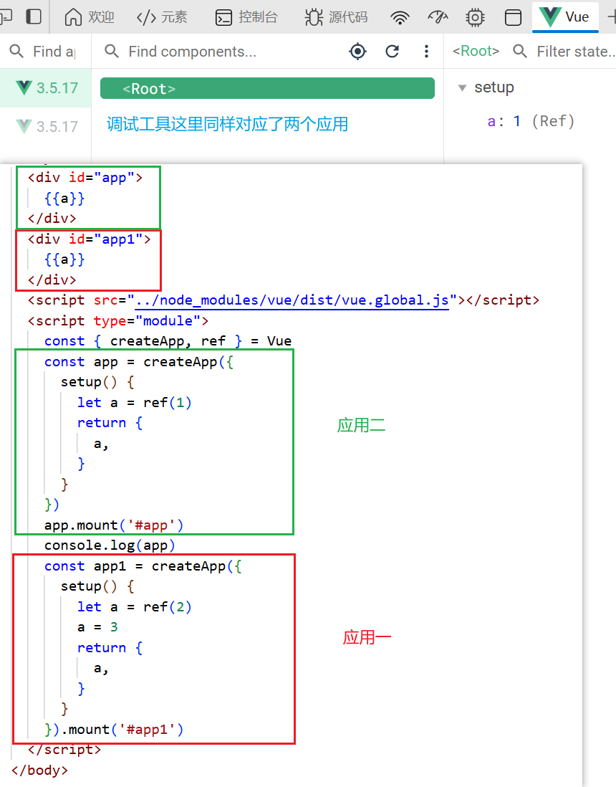

#### app

`console.log(app)`

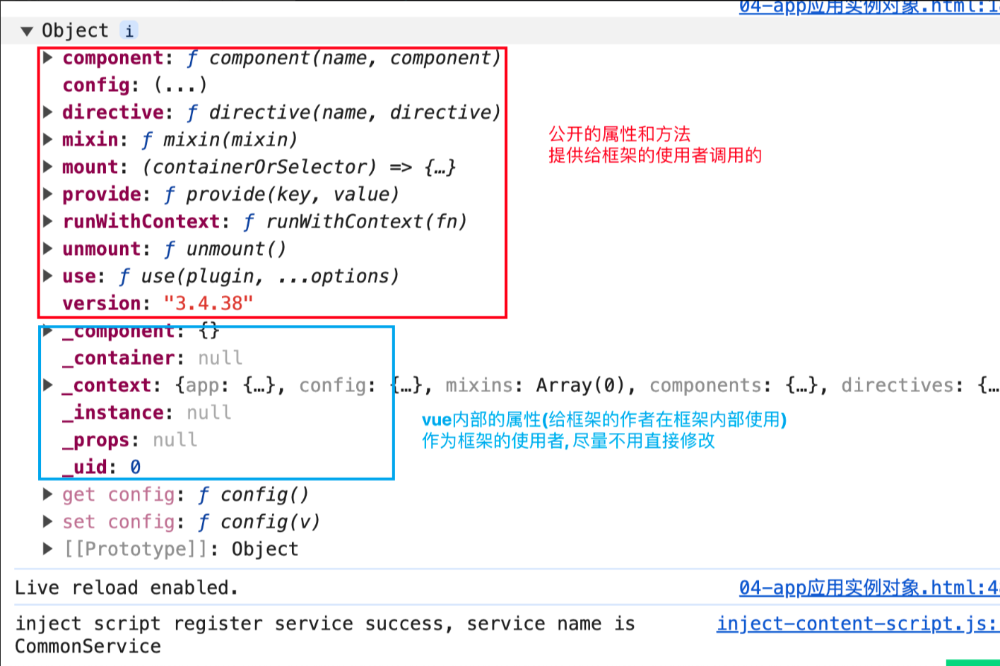

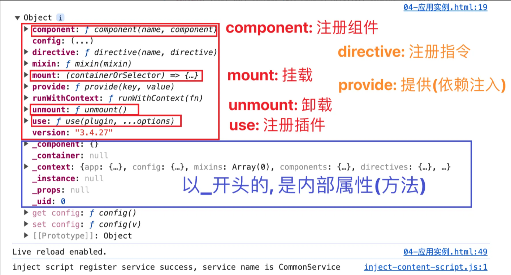


#### `createApp` 的参数

`createApp` 函数接收的第一个参数是一个**根组件选项对象**(应用的根组件)，也就是一个 Vue 组件（Component）的配置对象。

```js
createApp(rootComponent: Component, rootProps?: Record<string, any>): App
```

- **`rootComponent`**：必需，类型是 Vue 组件对象。可以是：
  - 一个普通的选项式组件对象（即含有 `data`, `methods`, `setup` 等的对象）
  - 一个使用组合式 API（`setup()`）的组件对象
  - 也可以是一个函数式组件


- **`rootProps`**：可选，用于给根组件传递初始的 props（属性），是一个对象。


#### 访问组件实例

通过 `getCurrentInstance()` 工具函数获取：

```js
const { createApp, ref, getCurrentInstance } = Vue
const app = createApp({
  setup() {

    const instance = getCurrentInstance()

    function handClick() {
      console.log(instance) //打印出的就是组件实例,即选项式中的this
    }
    return {
      handClick,
    }
  }
})
app.mount('#app')
```


#### Proxy及响应式原理初步

```html
  <div id="app">hello</div>
  <script>
    // Proxy基于普通对象创建一个代理对象
    const obj = {
      name: '张三',
      age: 20,
      tel: '554231'
    }

    // 对普通对象属性的 访问 和 设置 过程是固定的, 没办法改变

    // 而Proxy创建的代理对象,属性的访问和设置过程,可以自定义
    // 假如在改变对象属性的同时,改变dom,就做成了响应式框架
    const pObj = new Proxy(obj, {
      get(target, key) {
        // get函数,返回值,作为pobj的属性值
        return target[key]
      },
      set(target, key, value) {
        // set函数, 在设置的过程中调用,实现自定义操作
        target[key] = value
        // 同步更新dom
        document.querySelector('#app').innerHTML = value
      }
    })
  </script>
```

访问属性

```
console.log(pObj.name) // 访问时，会调用 get，输出：张三
```

修改属性

```
jspObj.name = '李四' 
// 触发 set 拦截
// 执行 target[key] = value; 即 obj.name = '李四'
// 同时 document.querySelector('#app').innerHTML = '李四'
```

这时页面上 id="app" 的元素内容会变成 "李四"。


#### vue选项式响应基本原理

mount函数原理

```html
<body>
  <div id="app"></div>
    <script>
      function createApp(options) {
        const ctx = options.data() //获取data()返回的对象 {msg: 'hello'}

        const app = {
          mount(selector) {
            const el = document.querySelector(selector)
			
            //这里可以理解为p就是ctx对象,p仅仅是加了个包装器,让其读取和设置属性的时候对页面多了些操作
            const p = new Proxy(ctx, {
              get(target, key) {
                // 读取属性的时候,直接返回被包装对象的属性值
                return target[key]
              },
              set(target, key, value) {
                target[key] = value

                // 当设置传过来的对象ctx属性时 更新元素节点的innerHTML
                el.innerHTML = value
                return true
              },
            })
            //页面元素初始化赋值
            el.innerHTML = p.msg
            return p
          },
        }

        return app
      }

      const app = createApp({
        data() {
          return {
            msg: 'hello',
          }
        },
      })
      const instance = app.mount('#app')
      console.log(instance)

      setTimeout(() => {
        //这里只是对加了包装器的ctx的msg属性赋值
        instance.msg = 'world'
      }, 1000)
    </script>
</body>
```


#### Proxy

一个 `Proxy` 对象包装另一个对象并拦截----诸如读取/写入属性和其他操作, 然后自定义这些操作

Proxy 被用于了许多库和某些浏览器框架。

语法：

```javascript
let proxy = new Proxy(target, handler)
```

- `target` —— 是要包装的对象，可以是任何东西，包括函数。
- `handler` —— 代理配置：带有“捕捉器”


##### 本质

创建一个没有任何捕捉器的代理（Proxy）：

```js
let target = {};
let proxy = new Proxy(target, {}); // 空的 handler 对象

proxy.test = 5; // 写入 proxy 对象
console.log(target.test); // 5，test 属性出现在了 target 中！

console.log(proxy.test); // 5，我们也可以从 proxy 对象读取它 
```

本质上,proxy是一个包装器,如果handler为空, 如上所示, proxy就是一个透明包装器

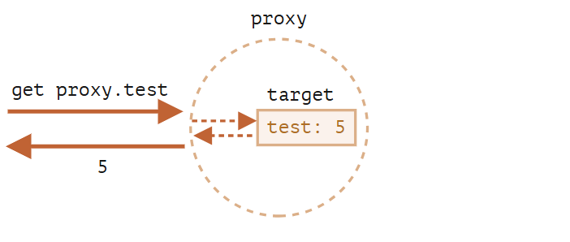

对于对象的大多数操作，JavaScript 规范中有一个所谓的“内部方法”，它描述了最底层的工作方式。例如 `[[Get]]`，用于读取属性的内部方法，`[[Set]]`，用于写入属性的内部方法，等等。这些方法仅在规范中使用，我们不能直接通过方法名调用它们。

Proxy 捕捉器会拦截这些方法的调用。

底下展示部分方法

| 内部方法          | Handler 方法     | 何时触发        |
| :---------------- | :--------------- | :-------------- |
| `[[Get]]`         | `get`            | 读取属性        |
| `[[Set]]`         | `set`            | 写入属性        |
| `[[HasProperty]]` | `has`            | `in` 操作符     |
| `[[Delete]]`      | `deleteProperty` | `delete` 操作符 |
| `[[Call]]`        | `apply`          | 函数调用        |
| `[[Construct]]`   | `construct`      | `new` 操作符    |


##### 不变量

- `[[Set]]` 如果值已成功写入，则必须返回 `true`，否则返回 `false`。
- `[[Delete]]` 如果已成功删除该值，则必须返回 `true`，否则返回 `false`。


##### get捕捉器

 `get(target, property, receiver)` 

- `target` —— 是目标对象，该对象被作为第一个参数传递给 `new Proxy`，
- `property` —— 目标属性名，
- `receiver` —— 如果目标属性是一个 getter 访问器属性，则 `receiver` 就是本次读取属性所在的 `this` 对象。通常，这就是 `proxy` 对象本身


例子

对不存在的数组项目返回0

```js
let numbers = [0, 11, 22];

numbers = new Proxy(numbers, {
  get(target, prop) {
    if (prop in target) {
      console.log(prop)  //1
      return target[prop];
    } else {
      return 0; // 默认值
    }
  }
});
console.log(numbers[1]) // 11
console.log(numbers[123]) // 0(没有这个数组项)
```


##### set捕捉器

当写入属性时 `set` 捕捉器被触发

`set(target, property, value, receiver)`：

- `target` —— 是目标对象，该对象被作为第一个参数传递给 `new Proxy`，
- `property` —— 目标属性名称，
- `value` —— 目标属性的值，
- `receiver` —— 与 `get` 捕捉器类似，


例子

写一个仅允许添加数字元素的数组

```js
let numbers = [];

numbers = new Proxy(numbers, { // (*)
  set(target, prop, val) { // 拦截写入属性操作
    if (typeof val == 'number') {
      target[prop] = val;
      return true;
    } else {
      console.log('该数组仅允许添加对象')
      return false;
    }
  }
});

numbers.push(1); // 添加成功
numbers.push(2); // 添加成功
console.log("Length is: " + numbers.length); // Length is: 2
numbers.push("test")  //该数组仅允许添加对象

然后报错Proxy实验.html:29  Uncaught TypeError: 'set' on proxy: trap returned falsish for property '2'
```


### 模板语法

#### **文本插值**

变量值直接插入html里, msg只会被解释为纯文本

```
<span>Message: {{ msg }}</span>
```


文本插值支持所有JavaScript表达式,仅支持**单一表达式**, 可以合法写在return后面的那种

```vue
{{ number + 1 }}

{{ ok ? 'YES' : 'NO' }}

{{ message.split('').reverse().join('') }}

<div :id="`list-${id}`"></div>

<!-- 这是一个语句，而非表达式 -->
{{ var a = 1 }}

<!-- 条件控制也不支持，请使用三元表达式 -->
{{ if (ok) { return message } }}
```


#### 将html标签插入文本中

```vue
<p>Using text interpolation: {{ rawHtml }}</p>
<p>Using v-html directive: <span v-html="rawHtml"></span></p>
```

Using v-html directive: `<span style="color: red">This should be red.</span>`

Using text interpolation: <span style="color: red">This should be red.</span>


例子,搜索框

当用户输入搜索关键字word时,页面列表中的hero.cname里,关键字部分高亮显示

v-html中可以插入函数

模板

```vue
<span v-html="highlightKeyword(hero.cname, keyword)"></span>
```

高亮函数

```js
function highlightKeyword(name, keyword) {
  if (!keyword) return name
  return name.replaceAll(keyword, `<span style="color: red">${keyword}</span>`)
}
```


#### v-操作

指令Directives

指令是带有 `v-` 前缀的特殊 attribute

`v-bind`、 `v-html` 、`v-for`、`v-on` 和 `v-slot`等


参数 Arguments

在指令名后通过一个冒号隔开做标识

 `v-bind:href="url"` `v-on:click="doSomething"`


修饰符 Modifiers

修饰符是以点开头的特殊后缀，表明指令需要以一些特殊的方式被绑定

`@submit.prevent` 等同于阻止冒泡操作  `event.preventDefault()`


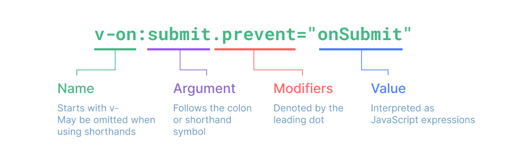

### 模板&渲染

优先级 render() > template  > 容器

```html
<body>
  <script src="../node_modules/vue/dist/vue.global.js"></script>
  <div id="app">
    {{ msg }}
  </div>
  <script>
    // 从vue中解构出响应的API
    const { createApp, ref, h } = Vue
    const app = createApp({
      setup() {
        //声明的变量在模板中使用
        const msg = ref('afeadfad')
        return {
          msg
        }
      },

      // 渲染模板 
      template:`
        <div>
          <p>{{msg}}</p>
        </div>
      `,

      // 渲染函数
      render() {
        //<div><p>afeadfadrender</p></div>
        return h('div', [
          h('p', this.msg + 'render')
        ])
      },
      
    }).mount('#app')
  </script>
</body>
```


这里隐藏着vue的工作原理

```
1. 确定模板(render/template/容器)
2. 编译模板: 将template的字符串 编译成 render函数
3. 调用render函数, 返回 虚拟DOM(VDom/VNode) 对象
4. 根据 虚拟DOM 生成 真实DOM, 替换 挂载点(由mount的参数指定的)
```


### ref() ,reactive()

#### 基本使用

`ref` 会返回一个包裹对象，并在 `.value` 属性下暴露内部值。

Ref 也可以持有对象, 包括任何类型的值，包括深层嵌套的对象,

因为非原始数据类型将通过`reactive()`转换为响应式代理


只有被`ref`()或者`reactive`()包裹的变量(对象), 才是被vue响应式系统用Proxy代理和追踪的对象,能自动监测并响应数据变化, 触发视图更新

才能用{{}}正确的显示上去


ref能应对所有情况

```vue
<script setup>
import { reactive, ref } from 'vue'

const counter = reactive({ count: 0 })
const message = ref('Hello World!')
console.log(message.value) // "Hello World!"
</script>

<template>
  <h1>{{ message }}</h1>
  <p>Count is: {{ counter.count }}</p>
</template>
```


ref与reactive持有对象之间的区别

```javascript
const obj = ref({ a: 1 , b: 2})
const state = reactive({ a: 1, b: 2})

console.log(obj.value.a) // 先访问 ref 的 value，再访问属性 a，输出 1
console.log(state.a)     // 直接访问 reactive 对象的属性 a，输出 1
```

- `ref` 方便包裹基本类型数据，或者单个值；当包裹对象时内部自动转 reactive,对象内部的属性也具备响应式能力
- `reactive` 适合包裹整个对象，方便直接访问属性而不需 `.value`。


`reactive` 能让对象内部的属性具备响应式能力”

- 当你修改对象内部某个属性时（如 `state.count`），
- 使用这个属性的视图区域（模板）会自动同步更新，无需手动刷新。

```vue
<script setup>
import { reactive } from 'vue'

const state = reactive({
  count: 0
})

function increment() {
  state.count++  // 修改 count 属性
}
</script>

<template>
  <div>
    <p>计数器：{{ state.count }}</p>  <!-- 访问 state.count，建立依赖 -->
    <button @click="increment">增加</button>
  </div>
</template>
```


#### 子组件自动订阅ref数据变化

提供的是一个响应式 `ref`，子组件使用它时，会自动订阅它的变化，所以它改变时，子组件自动更新。

父组件通过 props 或 provide 传递给子组件的，是对**同一个**响应式引用对象（`ref` 或 `reactive`）的引用。

换句话说，父子组件共享的是同一个响应式数据的“指针”，而不是数据的副本。


##### Provide

- `ref` 创建响应式引用对象（含 `.value`）。
- `provide` 传递同一个响应式引用。
- `inject` 拿到同一个响应式引用，子组件响应 `.value` 变化自动更新。

------

```vue
<!-- Parent.vue -->
<template>
  <button @click="toggle">切换状态（{{ show.value }}）</button>
  <Child />
</template>

<script setup>
import { ref, provide } from 'vue'
import Child from './Child.vue'

const show = ref(false)
const toggle = () => {
  show.value = !show.value
}
provide('show', show)
</script>


<!-- Child.vue -->
<template>
  <p>子组件显示状态：{{ show.value }}</p>
</template>

<script setup>
import { inject } from 'vue'
const show = inject('show')
</script>
```


##### porps

```vue
<!-- Parent.vue -->
<template>
  <button @click="toggle">切换状态（{{ show.value }}）</button>
  <Child :show="show" />
</template>

<script setup>
import { ref } from 'vue'
import Child from './Child.vue'

const show = ref(false)

const toggle = () => {
  show.value = !show.value
}
</script>


<!-- Child.vue -->
<template>
  <p>子组件显示状态：{{ show.value }}</p>
</template>

<script setup>
import { defineProps } from 'vue'

const props = defineProps({
  show: Object
})
</script>
```


##### 缺陷

但是，直接传递响应式对象给子组件，存在设计缺陷

- **破坏了单向数据流。** Vue 的设计原则是：数据流应该是单向的，父组件通过 props 传数据给子组件，子组件通过事件通知父组件修改数据。
- 当子组件直接修改父组件传来的响应式对象时，父组件的数据是被“偷偷”改了，父组件对数据的控制权减弱。
- 代码维护和调试难度增加，尤其是大型项目：数据变化来源不明确，容易引发难以追踪的副作用。

`v-model` 本质上实现了**受控组件**的双向绑定：

- 父组件通过 props 把数据传给子组件（单向流入）。
- 子组件在需要修改数据时，发出事件（通常是 `update:modelValue`）通知父组件。
- 父组件响应事件，修改自己的状态，从而更新传给子组件的 props。

这就保证了：

- **数据修改是显式且可控的，所有数据变化都发生在父组件中。**
- 组件边界清晰，数据来源和修改路径明确。
- 有利于维护、调试和测试。
- 方便开发者遵循 Vue 的设计理念和最佳实践。


应用场景

| 方式                      | 优点                                 | 缺点                                    | 推荐场景         |
| ------------------------- | ------------------------------------ | --------------------------------------- | ---------------- |
| 传响应式对象给子组件      | 代码简洁，快速双向响应               | 破坏单向数据流，父组件控制权弱，难维护  | 小型、简单场景   |
| 使用 `v-model` + 事件通信 | 遵守单向数据流，数据流向明确，易维护 | 代码稍微繁琐，需要多写事件和 props 定义 | 组件库、复杂项目 |


### v-bind

绑定元素特性attribute,

a标签特性 herf 绑定js中写的变量 obj.url

```html
  <a :href="obj.url">{{obj.name}}</a>

  <script>
    const {createApp, setup, reactive} = Vue
    createApp({
      setup() {
        const obj = reactive({
          url: 'https://www.baidu.com/',
          name: '百度'
        })
        return {
          obj,
        }
      }
    }).mount('#app')
  </script>
```


#### 样式绑定

#### **class绑定**

```html
<div id="app">
  <div class="red">字体颜色</div>
  <!-- v-bind绑定变量 -->
  <div :class="Str">字体颜色</div>
  <!-- 静态数组绑定 -->
  <div :class="['blue', 'border']">字体颜色</div>
  <!-- 动态数组绑定 -->
  <div :class="arr">字体颜色</div>
  <!-- 三元表达式 -->
  <div :class="isActive ? 'red' : 'blue'">字体颜色</div>
</div>
<script>
  const { createApp, setup, ref } = Vue
  createApp({
    setup() {
      let Str = ref('red')
      let arr = ['red', 'border']
      let isActive = false
      return {
        Str,
        arr,
        isActive,
      }
    }
  }).mount('#app')
</script>
```

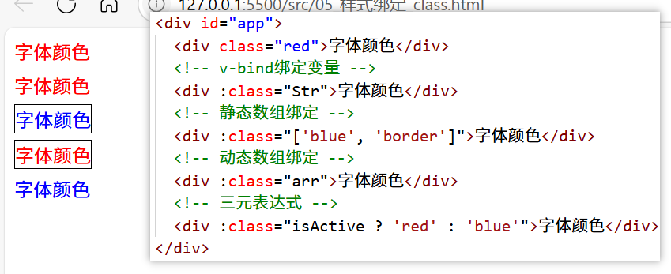


补充

```vue
<div :class="{ active: isActive }"></div>
isActive是true,就是 class="active"


类名本质上是一个数组, 如此编码可以在一个class中塞入多个类名表达式
:class="['left-item', { active: index === mainActiveIndex, disabled: item.disabled }]
```


#### **style绑定**

```html
<div id="app">
  <!-- 原生写法 -->
  <div style="font-size: 32px; color: red;">字体大小 字体颜色</div>
  <!-- style绑定写法 -->
  <div :style="obj">字体大小 字体颜色</div>
</div>
<script>
  const { createApp, setup, ref } = Vue
  createApp({
    setup() {
      const obj = {
        fontSize: '32px',
        color: 'red',
      }
      return {
        obj
      }
    }
  }).mount('#app')
</script>
```

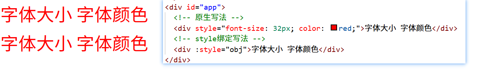


#### 内联css样式

```vue
Vue 内联 CSS 变量的工作原理
这是 CSS 自定义属性（CSS Variables） 与 Vue 的 :style 绑定结合使用的技巧。

关联原理
:style="{ '--card-color': card.color }" 会在该 DOM 元素上生成一个 内联样式，相当于：

HTML
<div style="--card-color: #ff0000;">
而 CSS 中的 var(--card-color) 会就近查找当前元素或其祖先元素上定义的该变量，正好读取到上面注入的值。


<template>
  <div class="card-list">
    <div
      v-for="card in cards"
      :key="card.id"
      class="card"
      :style="{ '--card-color': card.color }"
    >
      {{ card.title }}
    </div>
  </div>
</template>

<script setup>
const cards = [
  { id: 1, title: '苹果', color: '#e74c3c' },
  { id: 2, title: '天空', color: '#3498db' },
  { id: 3, title: '草地', color: '#2ecc71' },
]
</script>

<style>
.card {
  padding: 16px;
  margin: 8px;
  border: 1px solid var(--card-color);  /* 读取当前元素上注入的变量 */
  border-radius: 8px;
  color: var(--card-color);             /* 同一个变量可以多处复用 */
  background-color: color-mix(in srgb, var(--card-color) 10%, white);
}
</style>
```


### v-on

```
1. 内联事件处理器
  v-on:事件名="表达式"
2. 方法事件处理器
  v-on:事件名="函数名"
3. 简写
  @事件名="表达式/函数名"
```


```vue
<div id="app">
    <!-- 内联事件处理器 -->
    <button @click="count++">点击了{{count}}次</button>
    <!-- 方法事件处理器 -->
    <button @click="handClick">点击了{{count}}次</button>
</div>
<script src="../node_modules/vue/dist/vue.global.js"></script>
<script>
const { createApp, setup, ref } = Vue
createApp({
  setup() {
    let count = ref(0);
    function handClick() {
      count.value++
    }
    return {
      count,
      handClick
    }
  }
}).mount('#app')
</script>
```


#### 向方法传入参数的细节

```html
  <div id="app">
    <div>
      <!-- 可以拿到原生js的事件对象 -->
      第一个按钮:
      <button @click="handClick">点击了{{count}}次</button>
    </div>
    <div>
      <!-- 传入实参后就没法拿到事件对象了 -->
      第二个按钮:
      <button @click="handClick2(1, 2)">点击了{{count}}次</button>
    </div>
    <div>
      <!-- 必须在参数列表的末尾添加 事件对象参数 才能拿到事件对象 -->
      第三个按钮:
      <button @click="handClick3(1, 2, $event)">点击了{{count}}次</button>
    </div>
  </div>
  <script src="../node_modules/vue/dist/vue.global.js"></script>
  <script>
    const { createApp, setup, ref } = Vue
    createApp({
      setup() {
        let count = ref(0)
        function handClick(e) {
          console.log(e.target) //<button>点击了0次</button>
        }
        function handClick2(a, b) {
          console.log(a, b) //1 2
        }
        function handClick3(a, b, e) {
          console.log(a, b, e.target)  // 1 2 <button>​点击了0次​</button>​
        }
        return {
          count,
          handClick,
          handClick2,
          handClick3,
        }
      }
    }).mount('#app')
  </script>
```


#### 事件修饰符

- `.stop`
- `.prevent`
- `.self`
- `.capture`
- `.once`
- `.passive`


例子

```html
<div id="app">
  <!-- 阻止默认行为 -->
  <a :href="url" @click.prevent>百度</a>

  <!-- 阻止事件冒泡 -->
  <ul @click="ulClick">
    <li @click.stop="liClick">阻止冒泡</li>
    <li></li>
    <li></li>
  </ul>

  <!-- 点击事件最多被触发一次 -->
    <div @click.once="pay">支付</div>
</div>
<script src="../node_modules/vue/dist/vue.global.js"></script>
<script>
  const { createApp, setup } = Vue
  createApp({
    setup() {
      let url = 'https://www.baidu.com/'
      function ulClick() {
        console.log('ul被点击了')
      }
      function liClick() {
        console.log('li被点击了')
      }
      function pay() {
        console.log('支付成功')
      }
      return {
        url,
        ulClick,
        liClick,
        pay,
      }
    }
  }).mount('#app')
</script>
```


#### 按键修饰符

- `.enter`
- `.tab`
- `.delete` (捕获“Delete”和“Backspace”两个按键)
- `.esc`
- `.space`
- `.up`
- `.down`
- `.left`
- `.right`

```
<!-- 仅在 `key` 为 `Enter` 时调用 `submit` -->
<input @keyup.enter="submit" />
```


#### 例子

按钮增减

```vue
<tr v-for="(book, index) in books" :key="book.id">
  <td>{{book.id}}</td>
  <td>{{book.name}}</td>
  <td>{{book.date}}</td>
  <td>{{formatPrice(book.price)}}</td>
  <td>
  	<!-- 小于1,数量不能继续减少 -->
    <button @click="book.count > 1 ? book.count-- : 1">-</button>
    {{book.count}}
     <!-- 数量加1 -->
    <button @click="book.count++">+</button>
  </td>
  <td>
    <!-- 删除当前项 -->
    <button @click="books.splice(index, 1)">移除</button>
  </td>
</tr>
```


### v-model

在表单输入元素或组件上创建双向绑定。

- **仅限：**
  - `<input>`
  - `<select>`
  - `<textarea>`
  - components


#### 用于input框

输入框会自动显示当前变量值:msg, 修改输入框内容的时候,msg变量的值也随之改变

```html
<div id="app">
  <input type="text" v-model="msg">
  {{msg}}
</div>
<script src="../node_modules/vue/dist/vue.global.js"></script>
<script>
  const { createApp, setup, ref } = Vue
  createApp({
    setup() {
      let msg = ref('hello')
      return {
        msg
      }
    }
  }).mount('#app')
</script>
```


#### 表单数据绑定

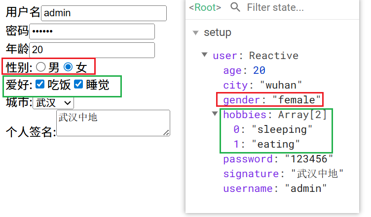

```html
<div id="app">
  <form action="">
    <!-- 绑定输入框 -->
    <label for="username">用户名</label>
    <!-- trim去掉前后空格, lazy等数据输入完毕后再响应数据变化 -->
    <input type="text" id="username" v-model.trim.lazy="user.username">
    <br>
    <label for="password">密码</label>
    <input type="password" id="password" v-model.lazy="user.password">
    <br>
    <label for="age">年龄</label>
    <input type="text" id="age" v-model.number="user.age">
    <br>
    <!-- 绑定单选框 -->
    <label>性别:</label>
    <input type="radio" name="gender" id="gender1" value="male" v-model="user.gender">
    <label for="gender1">男</label>
    <input type="radio" name="gender" id="gender2" value="female" v-model="user.gender">
    <label for="gender2">女</label>
    <br>
    <!-- 绑定复选框 -->
    <label>爱好:</label>
    <input type="checkbox" v-model="user.hobbies" value="eating" id="favor1">
    <label for="favor1">吃饭</label>
    <input type="checkbox" v-model="user.hobbies" value="sleeping" id="favor2">
    <label for="favor2">睡觉</label>
    <br>
    <!-- 绑定下拉菜单 -->
    <label>城市:</label>
    <select v-model="user.city">
      <option value="wuhan">武汉</option>
      <option value="wuhan2">武汉2</option>
      <option value="wuhan3">武汉3</option>
    </select>
    <br>
    <!-- 绑定多行文本 -->
    <label>个人签名:</label>
    <textarea v-model.lazy="user.signature"></textarea>
  </form>
</div>
<script>
  const { createApp, setup, reactive } = Vue
  createApp({
    setup() {
      const user = reactive({
        username: 'admin',
        password: '123456',
        age: 20,
        gender: 'male',
        hobbies: ['eating', 'sleeping'],
        city: 'wuhan',
        signature:'武汉中地',
      })
      return {
        user
      }
    }
  }).mount('#app')
</script>
```


#### 绑定细节详细拆分

##### input

message始终等于文本框中的内容(v-model中的message)

```vue
const message = ref('')
<input v-model="message" placeholder="edit me" />
```


##### textarea

多行文本里面不支持插值表达式

```vue
<!-- 错误 -->
<textarea>{{ text }}</textarea>

<!-- 正确 -->
<textarea v-model="text"></textarea>
```


##### checkbox

多个复选框绑定到同一个数组

可将多个复选框和一个数组中的值进行双向绑定,

- 行为
  - 每当某个复选框被选中时，`value` 会被自动加入数组中
  - 当复选框取消选中时，`value` 会自动从数组中移除

```vue
const checkedNames = ref([])

<div>Checked names: {{ checkedNames }}</div>

<input type="checkbox" id="jack" value="Jack" v-model="checkedNames" />
<label for="jack">Jack</label>

<input type="checkbox" id="john" value="John" v-model="checkedNames" />
<label for="john">John</label>

<input type="checkbox" id="mike" value="Mike" v-model="checkedNames" />
<label for="mike">Mike</label>
```

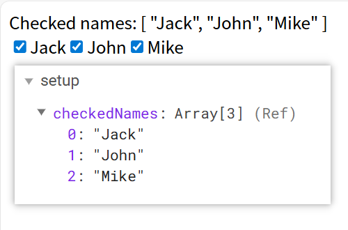


单个复选框绑定一个布尔值

```vue
<input type="checkbox" v-model="checked" />
```

- **绑定的数据类型**：`checked` 是一个布尔值（`true` 或 `false`）。

- 行为

  ：

  - 当复选框选中时，`checked` 的值变为 `true`
  - 当复选框取消选中时，`checked` 的值变为 `false`


##### radio

单选框

当点击单选框的时候,vue会自动把对应单选框中的value赋值给picked


如果picked` 初始值是 `'One', 就会遍历所有绑定了同一个 `v-model="picked"` 的单选框

找到 `value="One"` 的单选框，自动给它加上选中状态

```vue
const picked = ref('One')

<div>Picked: {{ picked }}</div>

<input type="radio" id="one" value="One" v-model="picked" />
<label for="one">One</label>

<input type="radio" id="two" value="Two" v-model="picked" />
<label for="two">Two</label>
```

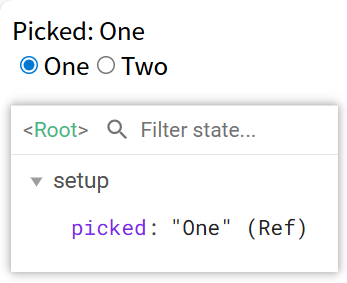


单选框值绑定

```vue
<div id="app">
  <input type="radio" name="fruit" v-model="pick" :value="option1" id="apple">
  <label for="apple">apple</label>
  <input type="radio" name="fruit" v-model="pick" :value="option2" id="banana">
  <label for="banana">banana</label>
</div>
<script>
  const { createApp, setup, ref } = Vue
  createApp({
    setup() {
      const option1 = { id: 1, label: 'Apple' }
      const option2 = { id: 2, label: 'Banana' }
      const pick = ref(option1)

      return { option1, option2, pick }
    }
  }).mount('#app')
</script>
```

这里的选中后赋值给 pick的value值,不再是像前面那种, One Two这种静态变量值, 而是响应式变量

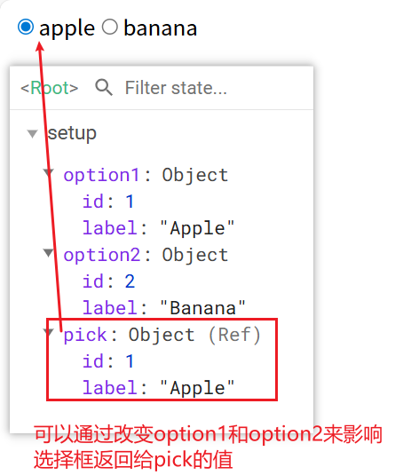


##### select

下拉选择器

1.vue通过`v-model`绑定了变量selected, 同时selected是个响应式变量

- 假如不是响应式变量, 比如`const selected = 'B'`, 那么v-model只会单项赋值给下拉框,导致直接停留在`<option>B</option>`, 但是当视图变化时(下拉框改变选项), 变量selected就不会自动追踪视图的变化

2.页面加载的时候,vue会啊selected.value的值于<select>中所有<option>的value进行匹配, 如果匹配上了, vue就把对应的<option>设置为选中状态   

3.这样,selected的初始值就决定了那个<option>被选中


```vue
const selected = ref()

<div>Selected: {{ selected }}</div>

<select v-model="selected">
   刚开始selected值为空,建议加上一个空option不可选中
  <option disabled value="">Please select one</option>
  <option>A</option>
  <option>B</option>
  <option>C</option>
</select>
```

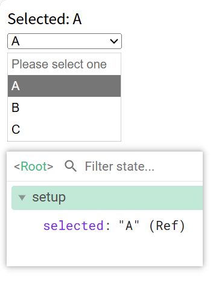


值绑定

```vue
<select v-model="selected">
  <!-- 内联对象字面量 -->
  <option :value="{ number: 123 }">123</option>
</select>
```


#### 关于修饰符

`.lazy`

对于input框 ,从input事件后更新数据, 变成从change事件后更新数据

```
<input v-model.lazy="msg" />
```

`.number`

让用户输入自动转成数字

```
<input v-model.number="age" />
```

`.trim`

自动去除用户输入内容中两端的空格

```
<input v-model.trim="msg" />
```


### v-if, v-show

条件渲染

```html
  <div v-if="flag">我是通过v-if控制的</div>
  <div v-else>我是通过v-else控制的</div>
  <!-- 当一个内容需要切换显示时, 使用v-show -->
  <div v-show="flag">我是通过v-show控制的</div>
  <div v-show="!flag">我是通过v-show控制的</div>
```

当flag为true时, 两个元素都可以显示

当flag为false时, 两个元素都不显示, **区别**是 

- v-if: 不会创建元素, 让元素从dom树上消失
- v-show: 创建元素, 但是display=none
- 频繁切换使用v-show


搭配v-else, v-else-if

```vue
<div v-if="type === 'A'">
  A
</div>
<div v-else-if="type === 'B'">
  B
</div>
<div v-else-if="type === 'C'">
  C
</div>
<div v-else>
  Not A/B/C
</div>
```


如果想要多个元素同时显隐,可以搭配template使用

 `<template>` 只是一个不可见的包装器元素，最后渲染的结果并不会包含这个 `<template>` 元素。

```vue
<template v-if="ok">
  <h1>Title</h1>
  <p>Paragraph 1</p>
  <p>Paragraph 2</p>
</template>
```


### v-for

#### 遍历数组

item是列表值, index是下标

```vue
const items = ref([{ message: 'Foo' }, { message: 'Bar' },{ message: 'header' }])

<tbody>
  <tr v-for="(item, index) in items">
    <td>{{index}}</td>
    <td>{{item.message}}</td>
  </tr>
</tbody>
/**
0	Foo
1	Bar
2	header
*/
```


#### 遍历对象

value属性值, key属性名, index位置索引

```vue
<script setup>
import { createApp, setup, ref } from 'vue'

const myObject = ref({
  title: 'How to do lists in Vue',
  author: 'Jane Doe',
  publishedAt: '2016-04-10'
})
</script>

<template>
    <ul>
      <li v-for="(value, key, index) in myObject">
        {{index}}. {{key}}. {{value}}
      </li>
    </ul>
</template>
/**
0. title. How to do lists in Vue
1. author. Jane Doe
2. publishedAt. 2016-04-10
*/
```


#### `v-for`与`v-if`不要连用

vue3在编译模板时，会优先执行`v-if`，会出现`变量没有定义`的错误.

所以`v-if`不能和`v-for`应用在同一个元素上. 


在遍历元素的时候,想让需要done为false的元素显示

```vue
const todos = ref([
  { id: 1, content: '内容1', done: true },
  { id: 2, content: '内容2', done: false },
  { id: 3, content: '内容3', done: false },
])


<li v-for="item in todos" v-if="!item.done">{{item.content}}</li>
<!-- 报错:Uncaught TypeError: Cannot read properties of undefined (reading 'done') -->
<!-- v-if生效的时候,v-for还未执行,item元素还没有生成 -->
```


同样的在 `<template>` 标签上使用 `v-for` 来渲染一个包含多个元素的块。

通过template, 不要让 `v-for`与`v-if`在同一个元素上, 反正template不会渲染在dom树上

```vue
<ul>
  <!-- <li v-for="item in todos" v-if="!item.done">{{item.content}}</li> -->

  <template v-for="item in todos">
  <li v-if="!item.done">{{item.content}}</li>
  </template>
</ul>
```


#### 双循环

类似于函数作用域, v-for可以访问父级作用域

```vue
<li v-for="item in items">
  <span v-for="childItem in item.children">
    {{ item.message }} {{ childItem }}
  </span>
</li>
```


#### 虚拟dom

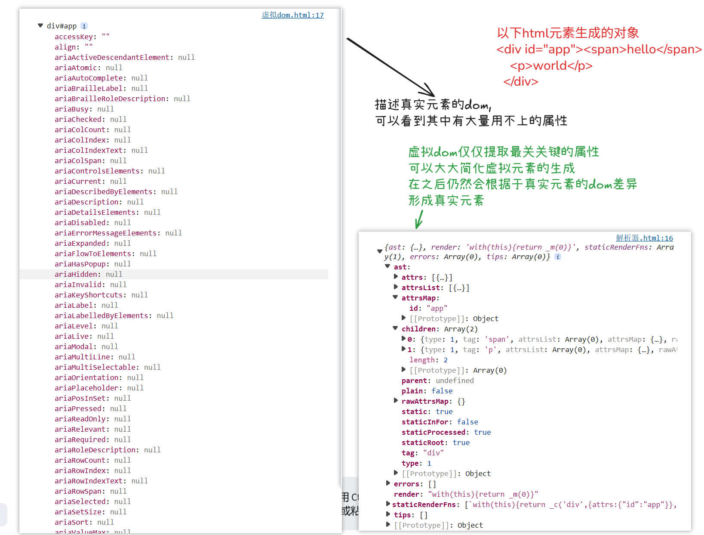


#### 通过key管理状态的必要性

```
<template v-for="todo in todos" :key="todo.name">
  <li>{{ todo.name }}</li>
</template>
```


如前面一个章节的描述

vue中通过v-for渲染的都是用后面一种描述方式生成的虚拟元素,最终要回到dom树上形成真实元素,

这个过程中会进行**对比 **(diff算法) ,

如果不给元素加上key这个唯一标识,在比较和由虚变实的过程中,

就会让vue按照**最少变化  (**diff 算法中会尝试做最小化 DOM 操作以提高性能)  的方式将虚拟元素变成真实元素,造成数据渲染的错位  (**在新旧虚拟DOM对比复用过程中，`key` 用于唯一标识每个虚拟节点，确保 Vue 能准确识别和复用对应的真实DOM，避免因索引位置复用带来的渲染错位和状态混乱。**)

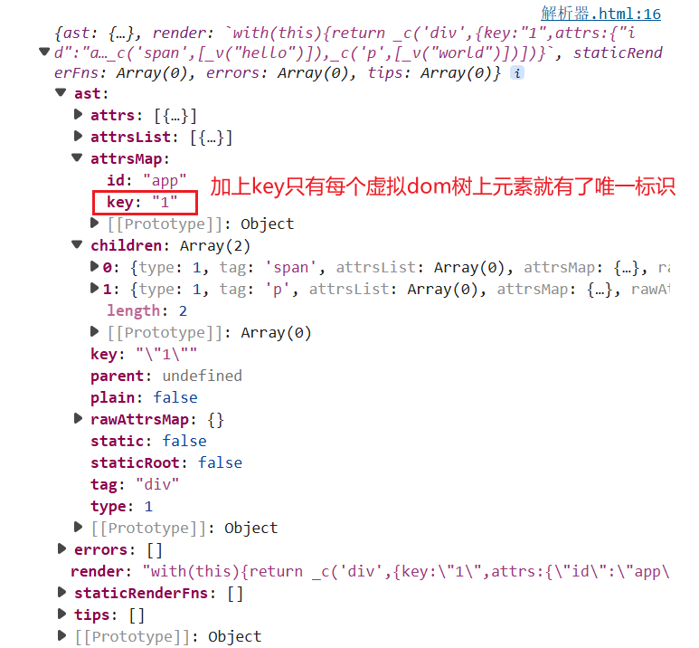

对应过程

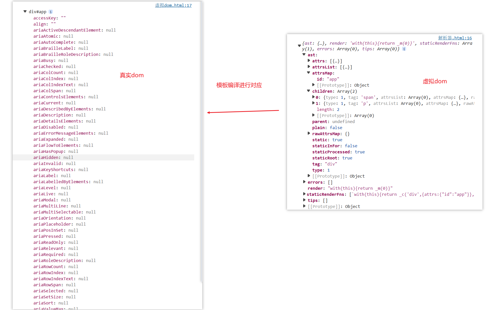


### computed()

```vue
<label for="string">请输入一个字符串:</label>
<input type="text" id="string" v-model="text">
<div class="re">
  反转后字符串:{{textR}}
</div>

<!-- js -->
let text = ref('')
let textR = computed(() => {
  return text.value.split('').reverse().join('')
})
```

`computed()` 方法期望接收一个 `getter` 函数，返回值为一个**计算属性 ref**。和其他一般的 ref 类似，你可以通过 `变量名.value` 访问计算结果。计算属性 ref 也会在模板中自动解包，因此在模板表达式中引用时无需添加 `.value`。

计算属性里的值会被缓存, 除非其依赖的值发生了变化, 才会重新计算, 只要text不变, textR就不会重新计算, 会直接去缓存里拿

所以不要修改计算属性的值,其值应该是只读的,因为这仅仅是个缓存,或者说“临时快照”

但是同样的,它是一个响应式计算结果


#### 计算属性与getter函数

原生js的getter

```javascript
const obj = {
  firstName: 'John',
  lastName: 'Doe',

  get fullName() {       // ← 定义时是"函数"
    return this.firstName + ' ' + this.lastName
  }
}

// 访问时不需要括号，像普通属性一样
console.log(obj.fullName)  // 'John Doe'  ← 使用时是"属性"
```

这是js的属性访问器， get 关键字把一个函数伪装成属性


vue 的 computed 底层就是 getter，在初始化 computed 时，内部大概做了这件事

```javascript
// 编译器里写的
computed: {
  isSpeedDisabled() {
    return this.viewMode === 'fixed'
  }
}

// Vue 内部大概这样处理(简化版)
Object.defineProperty(instance, 'isSpeedDisabled', {
  get() {
    return this.viewMode === 'fixed'
  },
  enumerable: true,
  configurable: true,
})
```

访问 `this.isSpeedDisabled` 时，本质上就是触发了 `Object.defineProperty` 定义的 getter 函数。两者的使用方式是一样的，都是`obj.isSpeedDisabled`

所以虽然在computed中写的是一个函数，但是vue会自动执行它，对外暴露的是函数的返回值，而不是函数本身

所以对于下面这个 `v-bind:class`

```vue
:class="{ 'btn-speed-disabled': isSpeedDisabled }"
```

vue在解析时会对 isSpeedDisabled 求值，得到 `true/false` 然后决定是否添加这个 class


#### 语法使用

```js
绑定到变量
const doubled = computed(() => count.value * 2)

传入已定义函数
function computeSomething() {
  return someReactive.value * 2
}

const result = computed(computeSomething)
```


#### 可写计算属性

- 计算属性必须有一个 `get` 函数，用来“读取”计算属性的值。
- 你可以为计算属性提供一个 `set` 函数，使它能够响应外部给计算属性赋值的操作。当通过赋值修改计算属性时，Vue 会调用你定义的 `set` 方法。

例子

```vue
<script setup>
import { ref, computed } from 'vue';

const firstName = ref('张');
const lastName = ref('三');

const fullName = computed({
  get() {
    return `${firstName.value} ${lastName.value}`;
  },
  set(newValue) {
    const names = newValue.split(' ');
    firstName.value = names[0] || '';
    lastName.value = names[1] || '';
  }
});

// 使用
console.log(fullName.value); // 读取 => "张 三"

fullName.value = '李 四';    // 触发 set
console.log(firstName.value); // 输出 => "李"
console.log(lastName.value);  // 输出 => "四"
</script>
```


### watch()

#### 语法

侦听器

监听的变量发生变化时执行回调函数 语法

```
watch(source, callback, options?)

source：要监听的数据，可以是一个响应式变量、getter 函数、数组（多个数据）。
	getter 函数就是一个用于“获取”某个值的函数，通常写成 () => xxx 这样的箭头函数。

callback：数据变化时执行的函数，参数通常是新值和旧值。

options：可选配置对象，如 { immediate: true, deep: true }。
```

监听单个变量

```js
const count = ref(0)
watch(count, (count, prevCount) => {
  /* ... */
})
count	新值（变化后的值）
prevCount	旧值（变化前的值）
```


监听多个变量

```vue
<div id="app">
  性:<input type="text" v-model="lastName">
  <br>
  名:<input type="text" v-model="fristName">
  <div>
    全名(计算属性):{{fullName}}
  </div>
</div>

<!-- js -->
const lastName = ref('')
const fristName = ref('')
const fullName = ref()
watch([lastName, fristName], ([newLast, newFrist]) => {
  fullName.value = newLast + newFrist
})
```


#### 获取新旧值

oldVal旧值

newVal新值

```
watch([source1, source2], ([newVal1, newVal2], [oldVal1, oldVal2]) => {
  // 代码逻辑
})
```

例子

```vue
<input type="text" v-model="fristName">


const fristName = ref('初始值')
watch(lastName, (newLast, oldLast) => {
  console.log('新值' + newLast)
  console.log('旧值' + oldLast)
})
```


#### 深层次监听

```js
const user = ref({
  name: 'xiaoming',
  age: 20,
  girlfriend: {
    name: 'xiaomei',
    age: 20,
  }
})

// 默认是浅层次侦听,
// 只会监听 user 对象本身的变化（比如 user.value 被替换成新对象）
// 不会监听 user.value 内部属性变化
// 必须加上{ deep: true }
watch(user, function () {
  console.log('user change', user.value)
}, { deep: true })
```


#### 立即回调的侦听器

`{ immediate: true }`

```js
const fristName = ref('初始值')
// 立即回调的侦听器
// 这样可以获取初始数据,然后根据相关状态请求新的数据
watch(
  fristName, 
  (newFrist) => {
    console.log(newFrist) //初始值
  },
  { immediate: true }
)
```


#### 侦听器返回的时机

默认情况下，侦听器回调会在父组件更新 (如有) **之后**、所属组件的 DOM 更新**之前**被调用。

这意味着如果你尝试在侦听器回调中访问所属组件的 DOM，那么 DOM 将处于更新前的状态。

意思就是说：侦听器回调执行时 真实dom树上元素节点 还没更新

```vue
<button @click="count++">点击增加 count</button>
<p>count: {{ count }}</p>
<div ref="box">当前count是：{{ count }}</div>

<!-- js -->
const count = ref(0);
const box = ref(null);

watch(count, (newVal, oldVal) => {
  console.log('默认 flush: "pre" - 侦听器执行时 DOM 文本:', box.value.textContent);
});
```

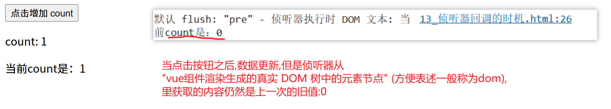

加上了`{ flush: 'post' }`就不一样了

```js
watch(
count, 
(newVal, oldVal) => {
console.log(侦听器执行时 DOM 文本:', box.value.textContent)},
{ flush: 'post' },
);
```

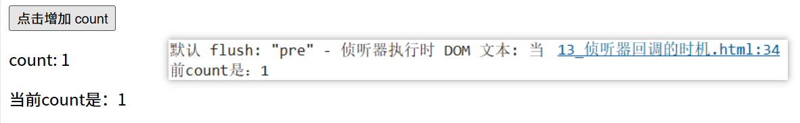


#### watch接收ref的行为

```js
watch(refVar, (newVal, oldVal) => {
  console.log(newVal, oldVal)
})
watch 会自动帮你“解包”这个 ref，监听它的 .value。
打印时无需使用newVal.value 或者 oldVal.value
和直接写 watch(() => refVar.value, ...) 的效果是一样的。
```


### 组件

组件化开发精髓

**可复用、独立、封装良好的组件**，并且用**标签的形式**来使用它们

把纯 HTML 封装成一个标签来用


#### SFC中使用

- 在 `<script setup>` 是编译时语法糖，只要 `import` 了组件，**就自动隐式注册**了，可以直接在模板中使用：

```vue
<template>
<MyCount></MyCount>
<MyAdd/>
</template>

<script setup>
import MyCount from './components/MyCount.vue';
import MyAdd from './components/MyAdd.vue';
</script>
```


通过插槽注册子组件

```vue
<!-- 组件A.vue -->
<template>
  <div class="container">
    <slot />
  </div>
</template>

<!-- 在A组件更上一层组件中 使用组件A -->
<A>
  <B />    <!-- 组件B标签写在组件A标签内，成为插槽内容 -->
  <C />
</A>


运行时，<B /> 和 <C /> 会被渲染到 <slot /> 位置。
A
 ├─ B
 └─ C
即B和C都是A的子组件。
```

**和通过import导入的组件一样, 两者本质上都是父子组件关系，都是组件实例树中的父子节点。**


#### 组件生效流程

1. **定义组件**
   使用 `app.component('组件名', 组件选项对象)` 或局部组件注册。
2. **组件注册**
   - 全局注册：通过 `app.component` 注册后，所有模板都能识别该组件标签。
   - 局部注册：在组件选项的 `components` 中声明。
3. **组件使用**
   在模板中写相应组件标签，Vue 解析模板时，根据组件名匹配对应组件定义。
4. **模板编译**
   Vue 编译模板，生成渲染函数，渲染组件内容。
5. **渲染挂载**
   组件实例挂载到 DOM，生命周期钩子生效，响应式数据生效，页面显示组件 UI。


#### 命名生效规则

| 规则/形式                          | 说明                                                    | 示例                               |
| ---------------------------------- | ------------------------------------------------------- | ---------------------------------- |
| 驼峰命名 (PascalCase 或 camelCase) | 组件定义和注册时常用，如 `MyComponent` 或 `myComponent` | `'MyComponent'` 或 `'myComponent'` |
| 短横线命名 (kebab-case)            | HTML 模板中使用组件标签时推荐，确保浏览器大小写无影响   | `<my-component></my-component>`    |
| 大小写敏感                         | 浏览器解析标签时会自动转小写，导致驼峰组件标签识别失败  |                                    |


语法

#### 全局组件

定义组件

```javascript
app.component('myComponent', {
  template: `<div>我是组件内容</div>`,
  setup() {
    // 响应式数据及逻辑
    return {}
  }
})
```

挂载使用

```vue
<div id="app">
  <my-component></my-component>
</div>
```


组件内部模板绑定数据示例

```js
app.component('countBtn', {
  template: `<button @click="count++">你点了我{{count}}次</button>`,
  setup() {
    const count = ref(0)
    return { count }
  }
})
```


#### 局部组件

指的是在某个父组件内注册,并且只能在父组件模板范围内进行使用

语法

```javascript
// 1.定义子组件
const MyButton = {
  template: `<button @click="handleClick">点击 {{ count }} 次</button>`,
  setup() {
      ...
    return { ... }
  }
}

// 2.在父组件中通过 components 选项注册
//这里的com是一个定义在app上的全局组件
app.component("Com", {
  components: {MyButton},  // 注册
  template: `
			   ...
                <my-button></my-button>  //3. 引用使用
            `
})
```

当父组件(定义的全局组件com)在模板中被使用时, 结构关系如图

```vue
<div id="app">
  <com></com>
</div>
```

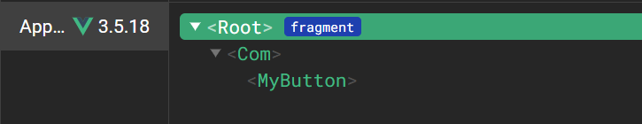


#### 局部与全局的区别

全局组件与注册在跟组件上的局部组件有何区别

```js
const app = createApp({
  components: { MyButton },
  // 这里:MyButton 被注册在了根组件上,只能在根组件的模板里用；
  // 如果根组件有子组件，且子组件模板内想用 MyButton，则该子组件必须再次注册 MyButton，否则无法使用。
  setup() {
    return {}
  },
})


// Com 是注册在app上的全局组件
// 可以在任何模板内使用（包括根组件和所有子组件）；
app.component("Com", {
  components: { MyButton },
  template: `...`,
})

```


组件树

通常一个单页应用(SPA)会以一棵嵌套的组件树的形式来组织

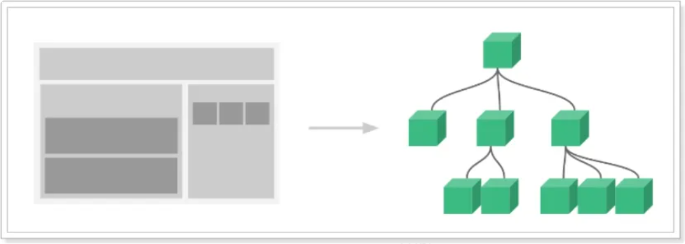

例子示意图

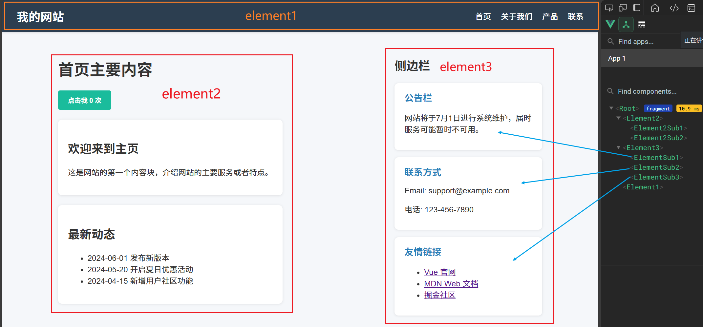

组件树结构示意图

```
App (根实例，挂载于 #app)
│
├── element1 (全局组件)
│
├── element2 (局部注册，App 组件的子组件)
│     │  
│     ├── element2Sub1 (element2 局部注册子组件)
│     │     
│     └── element2Sub2 (element2 局部注册子组件)
│           
│
└── element3 (局部注册，App 组件的子组件)
      |
      ├── element3Sub1 (element3 局部注册子组件)
      │     
      ├── element3Sub2 (element3 局部注册子组件)
      │    
      └── element3Sub3 (element3 局部注册子组件)
            
```


### props

#### SFC中使用

##### 子组件如何接收

用 `defineProps` 宏声明传入的 props

```
const props = defineProps({ title: String }) 
```

`defineProps`语法要点

```js
const props = defineProps({
  propName: {
    type: Xxx,
    required: true/false,
    default: value/function,
    // 还可以有 validator 等
  },
  ...
});
```

- **type:** 指定 prop 的类型，可以是 `String`, `Number`, `Boolean`, `Array`, `Object` 等，或类型数组（多类型）。
- **required:** 是否必传，布尔值，默认 false。
- **default:**(如果没有传值, 默认用default中的值)
  - 对于 **基本类型（String、Number、Boolean）**，可以直接写默认值，如 `default: 0`。
  - 对于**引用类型（Object、Array）**，默认值必须是一个返回该类型的**函数**，这样每个组件实例都会调用这个函数，拿到一个独立的默认值副本，防止多个实例共享同一个引用对象。


##### 子组件如何使用

```js
<script setup>
const props = defineProps({
  title: {
    type: String,
    required: true,
    default: '默认标题'
  },
  count: {
    type: Number,
    default: 0
  }
});
</script>

console.log(props.title); // 打印标题
const double = props.count * 2; // 使用数值型prop
```

模板中如何使用

在 `<template>` 部分，可以直接用 `props` 里定义的属性名（不需要 .props 前缀！）：

```html
<template>
  <div>
    <h1>{{ title }}</h1>
    <p>数量：{{ count }}</p>
    <button @click="sayHello">打招呼</button>
  </div>
</template>
```


##### 父组件如何传递

- **字符串类型**可以直接写：

```html
<MyBlog title="标题" />
```

- **非字符串类型（Number、Boolean、Array、Object）要用v-bind**语法，即`:propName="value"`，以保证传入的是对应类型而非字符串。

 **Vue 模板编译器（template compiler）**，它在编译模板时，识别到以 `:` 开头的属性（即 `v-bind` 指令的缩写），会把引号内的内容当作**JavaScript 表达式**进行解析和求值

比如：

```html
<MyBlog :likes="100" :comment-ids="[1, 2, 3]" />
```

- **Boolean类型的 props**

`<MyBlog is-published />`这种写法等同于：

```html
<MyBlog :is-published="true" />
```

- 如果需要传 `false`，必须写成：

```html
<MyBlog :is-published="false" />
```


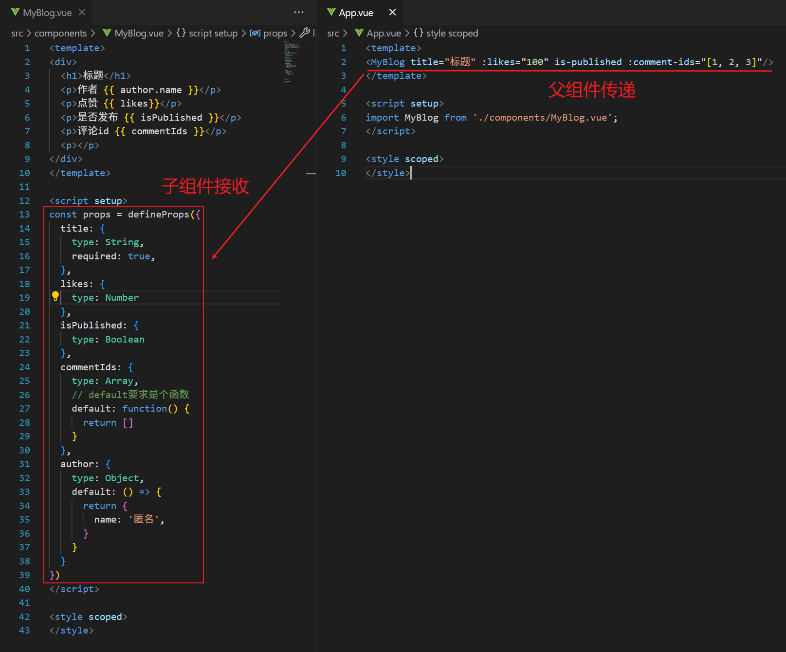


##### 对象绑定传参

```html
<MyBlog v-bind="blog" />
```

父组件中, Vue 会把 `blog` 对象中的所有属性：

```js
{
  title: '标题',
  likes: 100,
  isPublished: true,
  commentIds: [1, 2, 3]
}
```

**逐个展开成单独的 props**，相当于：

```html
<MyBlog
  :title="blog.title"
  :likes="blog.likes"
  :isPublished="blog.isPublished"
  :commentIds="blog.commentIds"
/>
```


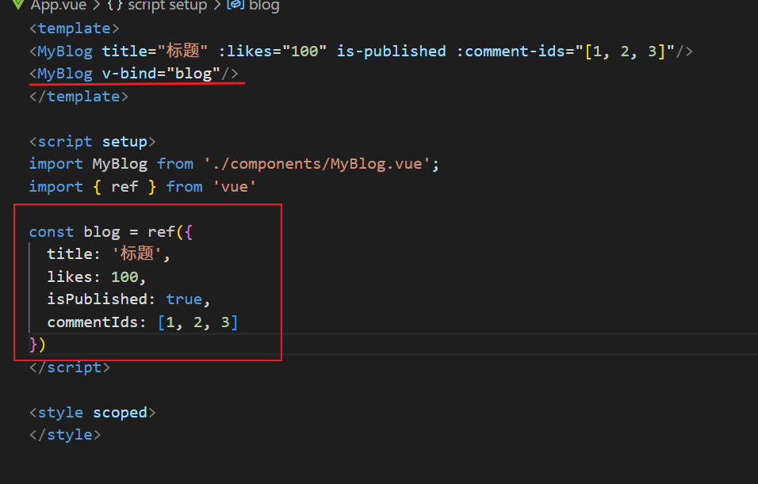


##### props校验

工厂函数

- **字面意思**：工厂函数就是像工厂一样，每次被调用都会**制造**（生成）一个新的对象。
- **特点**：每调用一次，都会返回一个新的独立对象，避免多个变量或实例共享同一个对象引用。

```js
defineProps({
  // 基础类型检查
  // （给出 `null` 和 `undefined` 值则会跳过任何类型检查）
  propA: Number,
  // 多种可能的类型
  propB: [String, Number],
  // 必传，且为 String 类型
  propC: {
    type: String,
    required: true
  },
  // 必传但可为 null 的字符串
  propD: {
    type: [String, null],
    required: true
  },
  // Number 类型的默认值
  propE: {
    type: Number,
    default: 100
  },
  // 对象类型的默认值
  propF: {
    type: Object,
    // 对象或数组的默认值
    // 必须从一个工厂函数返回。
    // 该函数接收组件所接收到的原始 prop 作为参数。Vue 3.4+ 版本中，给 default 函数传入了一个参数，叫做 rawProps，就是组件当前收到的所有 props 的原始对象。
    default(rawProps) {
      return { message: 'hello' }
    }
  },
  // 自定义类型校验函数
  // 在 3.4+ 中完整的 props 作为第二个参数传入
  propG: {
    validator(value, props) {
      // The value must match one of these strings
      return ['success', 'warning', 'danger'].includes(value)
    }
  },
  // 函数类型的默认值
  propH: {
    type: Function,
    // 这里的 default 不是“返回一个函数的函数”，而是传入的函数成为了默认值本身。
    default() {
      return 'Default function'
    }
  }
})
```


#### html文件中使用

父组件向子组件传参

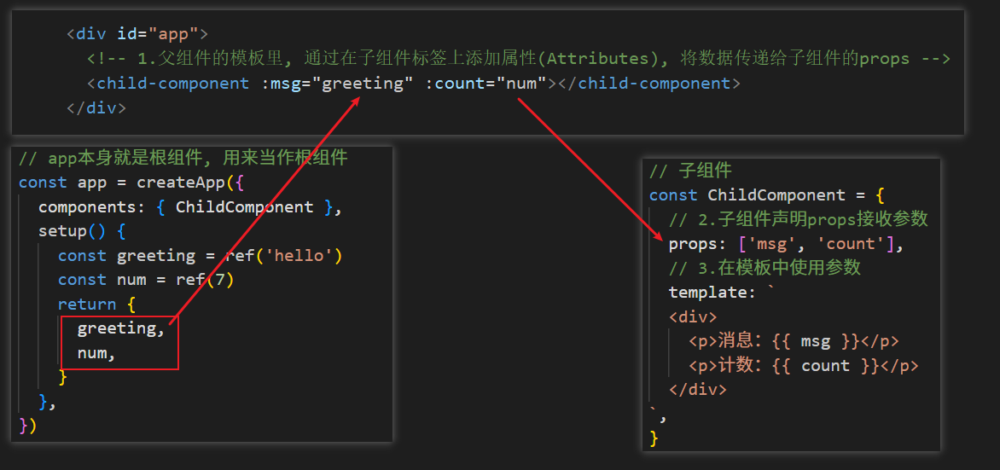

父组件

```html
<body>
  <div id="app">
    <!-- 1.父组件的模板里, 通过在子组件标签上添加属性(Attributes), 将数据传递给子组件的props -->
    <child-component :msg="greeting" :count="num"></child-component>
  </div>
</body>
```

子组件

```js
  <script>
    const { createApp, ref } = Vue
    // 子组件
    const ChildComponent = {
      // 2.子组件声明props接收参数
      props: ["msg", "count"],
      // 3.在模板中使用参数
      template: `
      <div>
        <p>消息：{{ msg }}</p>
        <p>计数：{{ count }}</p>
      </div>
    `,
    }
  </script>
```


v-指令语法也可用在组件标签上

```javascript
// 父组件
const element3 = {
  components: {elementSub1,},// 注册子组件
  template: 
    `
    <div>我是第三个组件: element3</div>
    <element-sub1 
      v-for="(item, index) in arr" 
      :key="index" 
      :title="item.title" 
      :content="item.content"
    ></element-sub1>
    `,
    setup() {
      const arr = ref([
        {title: '标题1', content: '内容块1'},
        {title: '标题2', content: '内容块2'},
        {title: '标题3', content: '内容块3'},
      ])
      return { arr }
    }
}

```


### slot

#### 插槽内容与出口

`<slot>` 元素是一个**插槽出口** (slot outlet)，标示了父元素提供的**插槽内容** (slot content) 将在哪里被渲染。

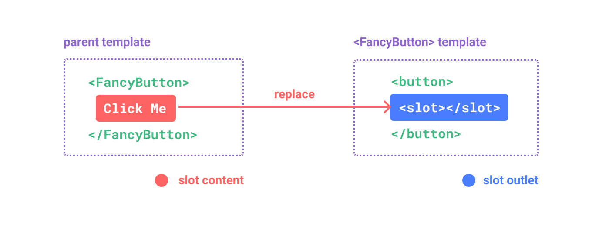

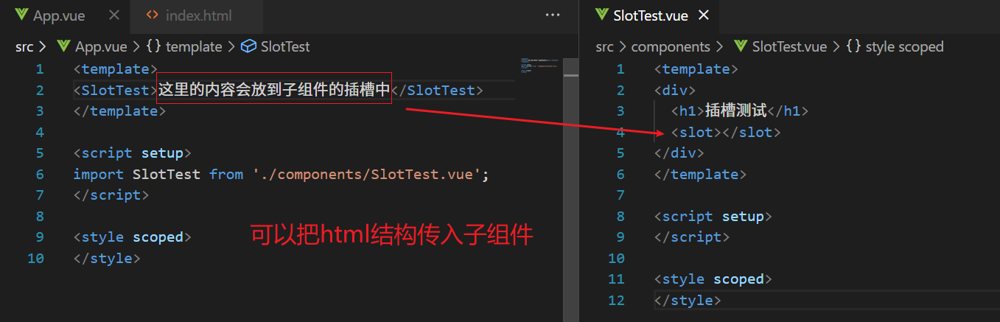

prop传数据

slot传结构


#### 具名插槽

在一个组件中包含多个插槽出口是很有用的

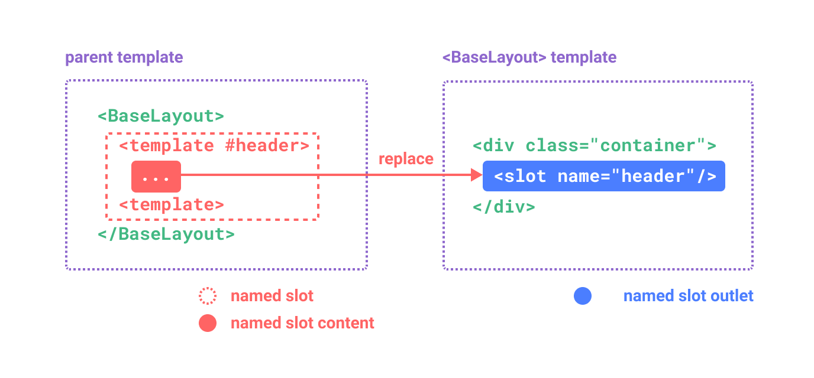

例子

子组件

- 使用 `<slot name="xxx"></slot>` 声明具名插槽。
- 使用无名 `<slot></slot>` 声明默认插槽。

父组件

- 使用 `<template v-slot:插槽名>` 来定义具名插槽的内容。
- 具名插槽外的内容（未包在任何具名插槽模板内）会作为默认插槽内容传递给子组件的默认插槽。
- 默认插槽内容可以是多个元素，都会被渲染。

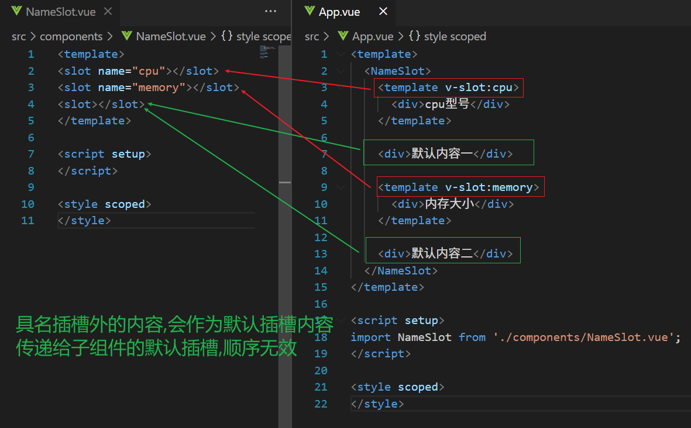


#### 作用域插槽

插槽的内容  可能想要同时使用   父组件域内   和   子组件域内   的数据


像对组件传递 props 那样，向一个插槽的出口上传递 attributes：

通过子组件标签上的 `v-slot` 指令，接收插槽 props 对象

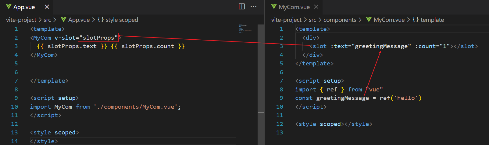


#### 具名作用域插槽

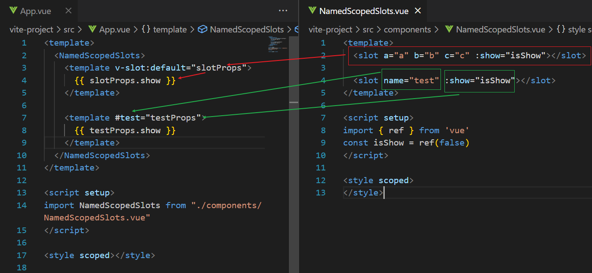

子组件

```vue
<template>
  <!-- 默认插槽，传递多个普通属性和一个响应式变量 show -->
  <slot a="a" b="b" c="c" :show="isShow"></slot>

  <!-- 具名插槽 test，传递响应式变量 show -->
  <slot name="test" :show="isShow"></slot>
</template>
```

- 默认插槽没有 `name`，默认插槽的作用域属性是 `{ a, b, c, show }`。
- 具名插槽 `test` 作用域属性是 `{ show }`

父组件

```vue
<template>
  <NamedScopedSlots>
    <!-- 接收默认插槽作用域 -->
    <template v-slot:default="slotProps">
      {{ slotProps.show }}
    </template>

    <!-- 简写 #test 接收具名插槽 test 的作用域 -->
    <template #test="testProps">
      {{ testProps.show }}
    </template>
  </NamedScopedSlots>
</template>

<script setup>
import NamedScopedSlots from "./components/NamedScopedSlots.vue"
</script>
```

- 父组件通过 `v-slot:default` 或简写 `#default` 来解构默认插槽的作用域数据。
- 父组件通过 `v-slot:插槽名` 或简写 `#插槽名` 来解构具名插槽的作用域数据。


#### 属性透传

父组件在使用子组件时，对于传递给子组件的属性（props）, 如果**子组件没有声明接收或者未使用的属性**

这些属性会被attrs统一管理, 当一个组件以单个元素为根作渲染时，透传的 attribute 会自动被添加到根元素上

父组件

```vue
<template>
  <AttrTest abc="123" class="red"/>
</template>

<script setup>
import AttrTest from './components/AttrTest.vue';
</script>
```

- 给子组件`AttrTest`传递了两个属性:
  - `abc="123"` —— 是子组件声明接收的 **prop**
  - `class="red"` —— 不是子组件声明的 prop，因此属于普通的 HTML attribute

子组件

```vue
<template>
  <div>AttrTest</div>
</template>

<script setup>
const props = defineProps({
  abc: String
})
</script>
```

- `abc` 被 `defineProps` 显式声明并接收
- `class="red"` 没有被声明为 prop，属于“额外属性”
- Vue 默认会将这些“额外属性”自动绑定到子组件根元素（这里是 `<div>`）上,会看到组件渲染的根元素 `<div class="red">AttrTest</div>`


### emit

子组件通过调用`emit`触发父组件中的函数，来达成改变父组件中数据的目标


#### 基本使用

用 `defineEmits` 声明自定义事件及触发事件

```js
const emit = defineEmits(['close']) 
emit('close') 
```

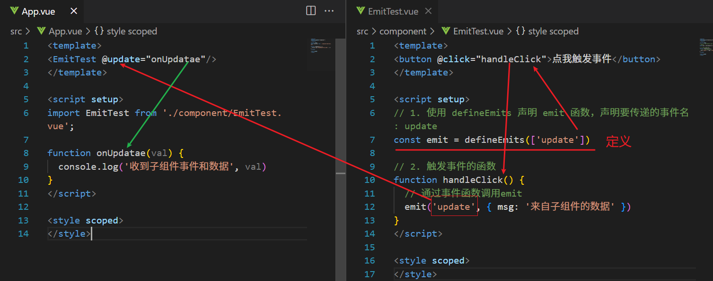


typescript

```
流程，以点击 +1 按钮为例：
1.点击+1按钮，产生click事件
2.Vue为这个按钮注册的监听 @click="addOne" 被调用
3.子组件addOne()执行，其中 emit('increment', 1) 被调用
4.emit 内部查找当前组件的父虚拟节点 VNnode 上是否存在对 increment 的监听，即父模板里的 @increment="handleInc"
5.找到后立即调用父组件中的函数 handleInc(1) 同步执行
6.handleInc 改变 count.value
```

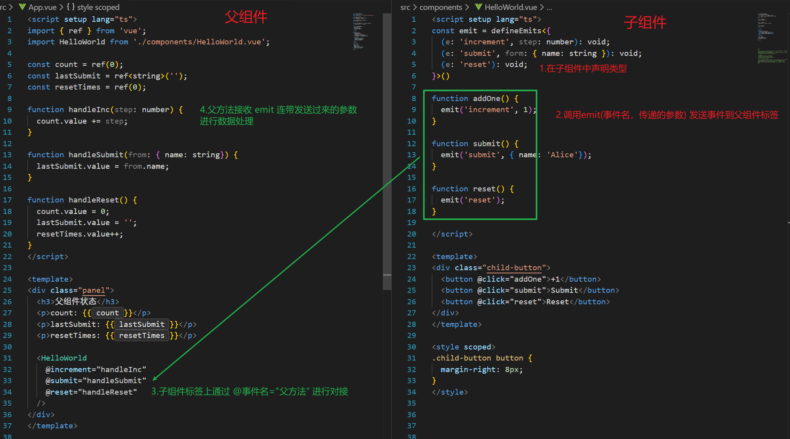


```
泛型：在定义函数、类、接口、类型时先用占位类型参数T,U等，实际使用时再由调用者或编译器推断具体类型，从而让代码再“保持类型安全”的同时更“灵活通用”
也可以显式指定泛型类型参数，如 defineEmits<{ (e: 'increment', step: number): void; }>，表示 emit 事件 increment 携带一个 number 类型参数 step
```


#### 发布订阅模式

核心逻辑

```
1. 新建 dispatcher对象
2. 注册事件监听（on方法）：
     - 如果listeners中还没有该事件类型，创建一个空数组
     - 把回调函数放进该数组
3. 触发事件（emit方法）：
     - 如果listeners有该事件类型
         - 遍历数组，挨个执行回调，把data参数传进去
```

示例代码解释

```js
EventDispatcher 类
│
├─ listeners : {
│     'close':     [回调1, 回调2, ...],
│     'increment': [回调3, ...],
│     ...
│   }
│
├─ on(eventType, callback)   // 注册事件监听
│
└─ emit(eventType, data)     // 触发事件

对应代码:
/**
 * 注册的事件名: 回调函数
 * 'close': [handleClose, handleClose2]
 * 'increment': [handleAdd]
 * ...
 */
class EventDispatcher {
  constructor() {
    this.listeners = {}
  }

  on(eventType, callback) {
    if (!this.listeners[eventType]) {  // 如果没有这个事件 就创建一个空数组
      this.listeners[eventType] = []
    }
    this.listeners[eventType].push(callback)  // 如果有这个事件,就把把回调函数放到事件数组里
  }

  emit(eventType, data) {   // 触发事件
    if (this.listeners[eventType]) {    // 如果有这个事件 就执行这个事件中的每个回调函数
      this.listeners[eventType].forEach((callback) => callback(data))   // 把data传给每个回调函数
    }
  }
}


// 新建事件分发对象
const dispatcher = new EventDispatcher()

// 注册 'close' 事件,并传入第一个回调函数参数（箭头函数）
dispatcher.on('close', (value) => {
  console.log(value)
})

// 注册 'close' 事件的第二个回调函数参数（普通函数）
function handleClose(value) {
  console.log(value)
}
dispatcher.on('close', handleClose)

// 注册 'increment' 事件的回调
function handleAdd(value) {
  console.log(value)
}
dispatcher.on('increment', handleAdd)


注册后，listeners 结构如下：
{
  'close':     [回调1, 回调2],
  'increment': [回调3]
}


// 触发阶段
dispatcher.emit('close', '1111')
dispatcher.emit('increment', '2222')
emit('close', '1111')       emit('increment', '2222')
        │                             │
   ─────┴─────                   ─────┴─────
   遍历 'close' 对应数组           遍历 'increment' 对应数组
   ┌───────────────┐            ┌─────────────────────┐
   │ 回调1('1111') │            │ 回调3('2222')       │
   │ 回调2('1111') │            └─────────────────────┘
   └───────────────┘
1111    // 来自'close'的第一个回调
1111    // 来自'close'的第二个回调
2222    // 来自'increment'的回调
```


#### html文件中使用

子组件向父组件传递数据

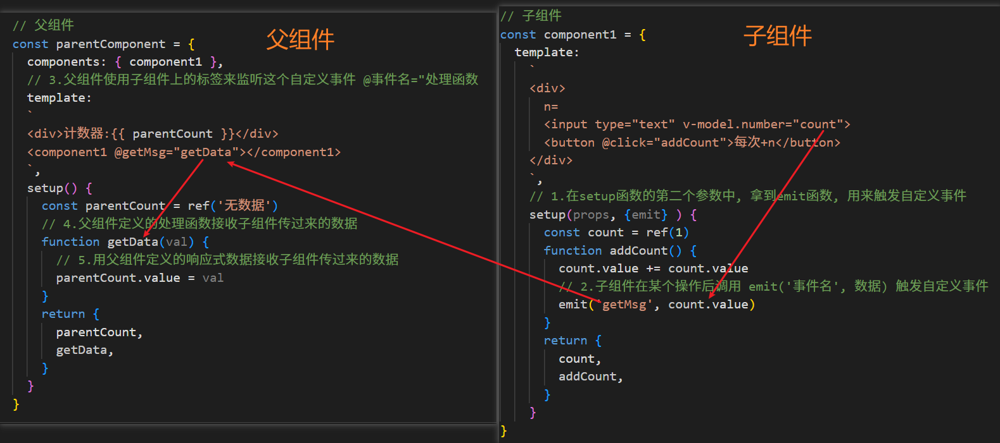

```javascript
// 子组件
const component1 = {
  template:
    `
    <div>
      n=
      <input type="text" v-model.number="count">
      <button @click="addCount">每次+n</button>
    </div>
    `,
    // 1.在setup函数的第二个参数中, 拿到emit函数, 用来触发自定义事件
    setup(props, {emit} ) {
      const count = ref(1)
      function addCount() {
        count.value += count.value
        // 2.子组件在某个操作后调用 emit('事件名', 数据) 触发自定义事件
        emit('getMsg', count.value)
      }
      return { 
        count,
        addCount,
      }
    }
}


// 父组件
const parentComponent = {
  components: { component1 },
  // 3.父组件使用子组件上的标签来监听这个自定义事件 @事件名="处理函数 
  template:
  `
  <div>计数器:{{ parentCount }}</div>
  <component1 @getMsg="getData"></component1>
  `,
  setup() {
    const parentCount = ref('无数据')
    // 4.父组件定义的处理函数接收子组件传过来的数据
    function getData(val) {
      // 5.用父组件定义的响应式数据接收子组件传过来的数据
      parentCount.value = val
    }
    return {
      parentCount,
      getData,
    }
  }
}
```


### Provide / Inject

依赖注入

#### 语法

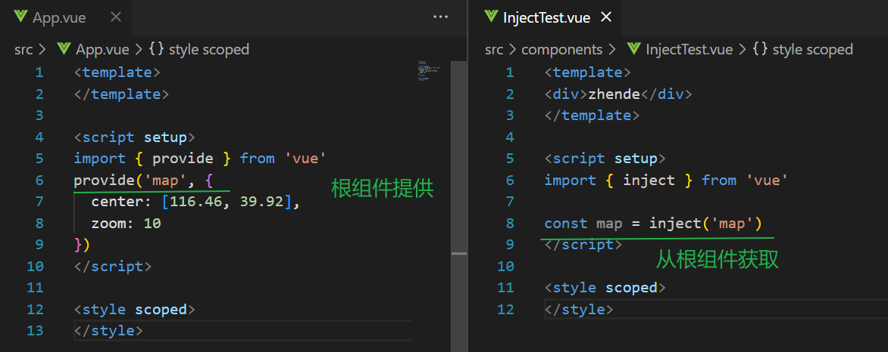


#### 意义

想象一下这样的结构：有一些多层级嵌套的组件，形成了一棵巨大的组件树，而某个深层的子组件需要一个较远的祖先组件中的部分数据。在这种情况下，如果仅使用 props 则必须将其沿着组件链逐级传递下去，这会非常麻烦：

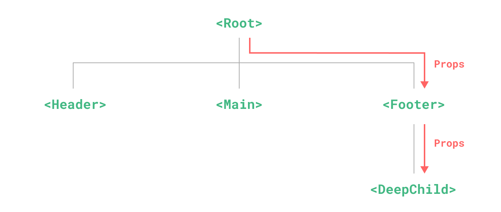

`provide` 和 `inject` 用于实现跨组件传值

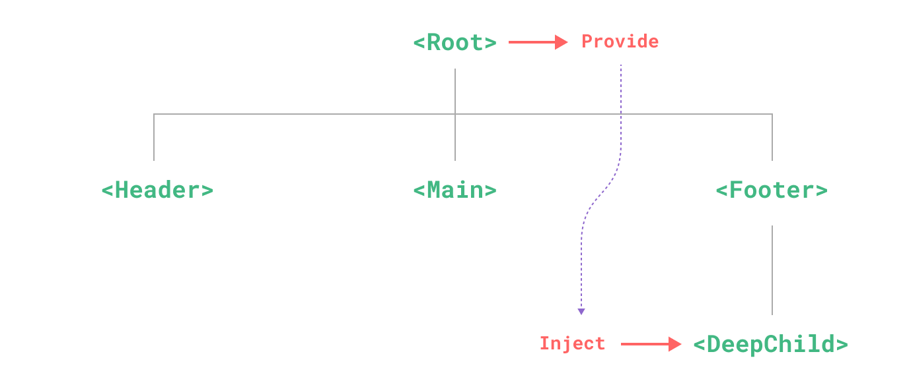


#### 例子

父组件（Provide）

```vue
<script setup>
import { provide } from 'vue'
import InjectTest from './components/InjectTest.vue'

provide('map', {
  center: [116.46, 39.92],
  zoom: 10
})
</script>
```

- 用 `provide('map', {...})` 提供了一个地图配置信息对象

------

子组件（Inject）

```vue
<script setup>
import { inject } from 'vue'

const map = inject('map')
</script>
```

- 用 `inject('map')` 从祖先组件获取名为 `'map'` 的依赖对象
- `map` 变量即为父组件提供的那个对象 `{ center: ..., zoom: ... }`


#### 应用层 Provide

除了在一个组件中提供依赖，我们还可以在整个应用层面提供依赖：

- **通常写法**：在 `main.js` 或根组件 `App.vue` 中提供

```js
// main.js
import { createApp, provide } from 'vue'
import App from './App.vue'

const app = createApp(App)

app.provide('globalConfig', {...})  // 通过 app 实例全局 provide

app.mount('#app')
```

- 或者在 `App.vue` 根组件 `<script setup>` 中提供：

```vue
<script setup>
import { provide } from 'vue'

provide('globalConfig', { theme: 'dark', locale: 'zh-CN' })
</script>
```


与在根组件使用局部provide的区别

- 根组件内部使用局部 `provide`，但其作用域仍然是根组件的后代
- 由于应用只有一个根组件，所以从范围上和“应用层 Provide”差别不大


### defineExposeget、CurrentInstance


`defineExpose` 编译器宏显式暴露属性和方法

```
import { ref } from 'vue'

const count = ref(0)
const increment = () => {
  count.value++
}

defineExpose({
  count,
  increment,
})
```

父组件通过 `useTemplateRef` 获取的子组件实例就有 `.count` 和 `.increment` 可用。


`getCurrentInstance()` 返回当前组件的内部实例对象（不是响应式的 proxy），类似选项式 API 中的 `this`，但更底层。

```vue
import { getCurrentInstance } from 'vue'
const instance = getCurrentInstance()
console.log(instance)
```

- 控制台能看到组件实例的上下文信息，便于调试或理解组件内部状态。


## effect

effect(fn) 是 Vue 底层响应式系统的“副作用函数”注册器：把一个函数 fn 包装成响应式副作用（Reactive Effect），在其执行过程中读取到的所有响应式数据都会被自动收集为依赖；当这些依赖的值改变时，fn 会再次自动执行。

核心特性

1. 立即执行一次，用于依赖收集。
2. 追踪 fn 内部访问的 ref / reactive / computed.value 等。
3. 依赖变更 => 重新执行。
4. 返回一个 runner 函数，手动调用 runner() 可再次执行。

```js
import { ref, effect, stop } from 'vue'

const count = ref(0)

const runner = effect(() => {
  console.log('count changed:', count.value)  // 立马执行一次：count changed: 0
})

count.value++      // 触发重新执行 count changed: 1
runner()           // 手动再次执行 count changed: 1

stop(runner)       // 停止后再改值不会触发
count.value++

//控制台输出
count changed: 0
count changed: 1
count changed: 1
```


## 获取真实元素节点 useTemplateRef

```vue
<script setup lang="ts">
import { onMounted, useTemplateRef } from 'vue';
const h1 = useTemplateRef('title');
onMounted(() => {
  console.log(h1.value);
})
</script>

<template>
 <h1 ref="title">hello vue</h1>
</template>

<style scoped>
</style>
```


## 生命周期

在生命周期过各中, **特定的时间点会被** **自动执行** **的函数**

#### 全生命周期

实例组件从创建到销毁的整个过程

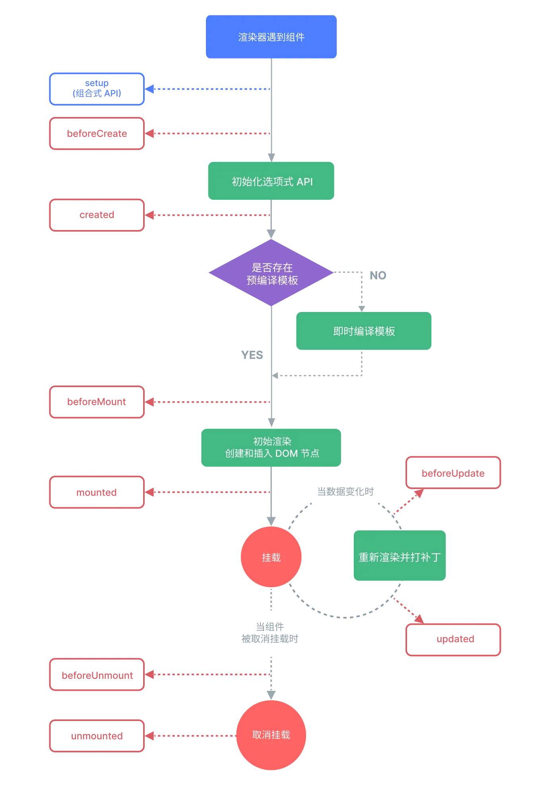


#### 选项式选项对比组合式钩子

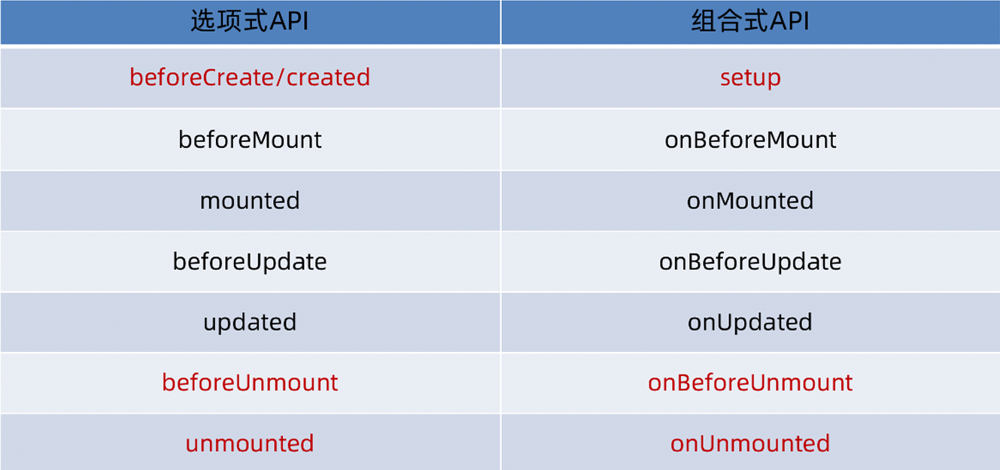

##### 选项式

```html
<body>
  <div id="app">
    {{count}}
  </div>
  <script>
    const {createApp, ref} = Vue
    const app = createApp({
      data() {
        return {
          count: 0,
        }
      },
      beforeCreate() {
        console.log('beforeCreate')  //打印成功
      },
      created() {
        console.log('created')  //打印成功
      },
      beforeMount() {
        console.log('beforeMount')  //打印成功
      },
      mounted() {
        console.log('mounted')  //打印成功
        // 3秒后卸载组件，触发卸载钩子
        setTimeout(() => {
          app.unmount()
        }, 3000)
      },
      beforeUpdate() {
        console.log('beforeUpdata') //打印成功
      },
      updated() {
        console.log('updated')  //打印成功
      },
      beforeUnmount() {
        console.log('beforeUnmount')  //打印成功
      },
      unmounted() {
        console.log('unmounted')
      }
    })
    app.mount('#app')
  </script>
</body>
```

##### 组合式

```html
<body>
  <script>
    const {
      createApp,
      ref,
      onMounted,
      onBeforeMount,
      onBeforeUpdate,
      onUpdated,
      onBeforeUnmount,
      onUnmounted,
    } = Vue
    const app = createApp({
      setup() {
        console.log("setup")
        onBeforeMount(() => {
          console.log("onBeforeMount")
        })
        onMounted(() => {
          console.log("onMounted")
        })
        onBeforeUpdate(() => {
          console.log("onBeforeUpdate")
        })
        onUpdated(() => {
          console.log("onUpdated")
        })
        onBeforeUnmount(() => {
          console.log("onBeforeUnmount")
        })
        onUnmounted(() => {
          console.log("onUnmounted")
        })
      },
    })
    app.mount("#app")
  </script>
</body>
```


#### 创建阶段

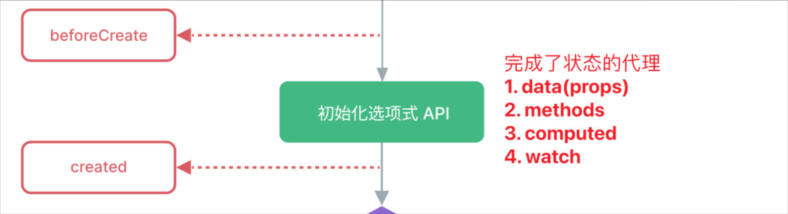

以下内容已经设置完成：响应式数据、计算属性、方法和侦听器。

然而，此时挂载阶段还未开始，因此 $el 属性仍不可用

```js
const app = createApp({
  data() {
    return {
      count: 0,
    }
  },
  beforeCreate() {
    // 组件的响应式数据（即 data 中返回的对象）还没有被初始化
    console.log('beforeCreate', this.count)  //undefined 
  },
  created() {
    // Vue 已经完成了响应式数据的初始化，即 data() 返回的对象已经被 Vue 代理
    console.log('created', this.count)  //0
  },
})
```


#### 挂载阶段

##### 创建到挂载阶段做的事

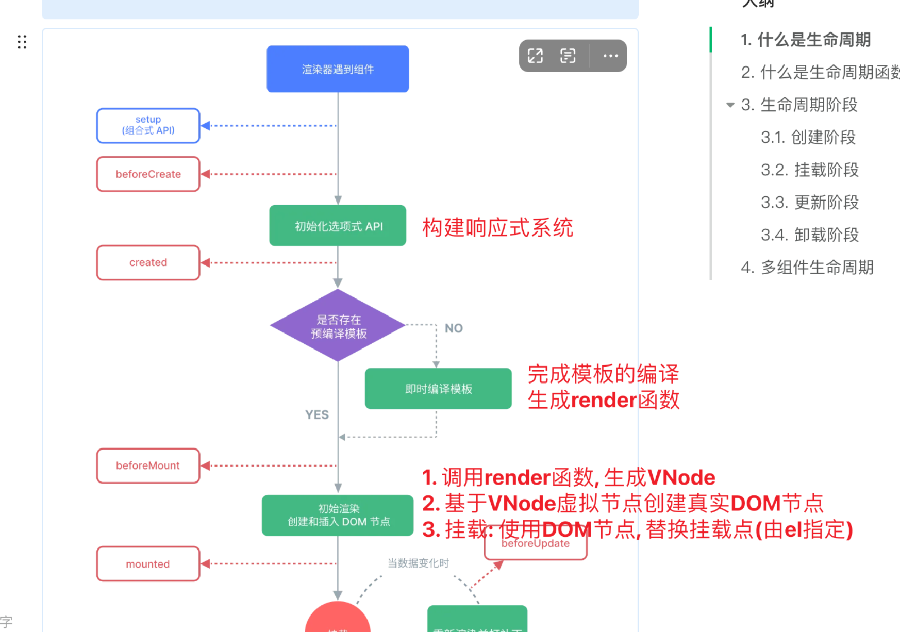

##### 实验代码

template渲染挂载

```html
<body>
  <div id="app">
    {{count}}
  </div>
  <script>
    // Vue的挂载. 把 `模板` 挂载 到 `$el指定的DOM` 上
    // 1. 编译: 把模板编译成渲染函数, render的配置项
    // 2. 挂载: 调用渲染函数, 生成vnode, 再根据vnode生成真实DOM, 挂载到页面上
    const {createApp, ref, h} = Vue
    const app = createApp({
      data() {
        return {
          count: 0,
          msg: 'hello',
        }
      },
      template: '<h1 id="test">{{msg}}</h1>',
      created() {
        console.log('created', this.$el)  //$el是null
      },
      beforeMount() {
        console.log('beforeMount', this.$el)  //$el是null
      },
      mounted() {
        console.log('mounted', this.$el)  //$el是<h1 id="test">hello</h1>
      },
    })
    app.mount('#app')
  </script>
</body>
```


render渲染挂载

```html
<body>
  <div id="app"></div>
  <script>
    function handleClick(e) {
      console.log(e.pageX, e.pageY)
    }
    const { createApp, ref, onMounted, onBeforeUnmount, onUnmounted } = Vue
    const app = createApp({
      setup() {
        onMounted(() => {
          // 在window上绑定了一个全局的事件
          window.addEventListener("click", handleClick)
          // 三秒后自动卸载app
          setTimeout(() => {
            app.unmount()
          }, 3000)
        })

        onBeforeUnmount(() => {
          console.log("onBeforeUnmount")
        })
        onUnmounted(() => {
          // app卸载了之后,事件仍然存在
          // 所以卸载事件触发时,需要在window上解绑了全局的事件
          window.removeEventListener("click", handleClick)
          console.log("onUnmounted")
        })
      },
    })
    app.mount("#app")
  </script>
</body>
```


##### $el

`$el` 是 Vue 组件实例上的一个**只读属性**，指向该组件挂载到页面上的**根 DOM 元素**。

- **`created` 钩子中：**
  组件实例已创建，`data` 数据已初始化，但**DOM 还没有编译和挂载**，所以 `this.$el` 是 `null`。
- **`beforeMount` 钩子中：**
  模板编译成渲染函数，DOM 还未真正挂载，`this.$el` 还是 `null`。
- **`mounted` 钩子中：**
  组件已经渲染并挂载到页面，可以访问 `this.$el`，它指向真实的 DOM 元素。


#### 更新阶段

vue组件渲染生成真实dom树中的元素节点, 方便表述一般成为dom

- **beforeUpdate**: 数据已经更新了, 但是dom还是旧的, 还没有更新
- **updated**: 数据和dom都更新完毕

```html
<body>
  <div id="app">{{msg}}</div>
  <script>
    const {
      createApp,
      ref,
      onBeforeUpdate,
      onUpdated,
    } = Vue
    const app = createApp({
      setup() {
        const msg = ref('hello')

        // 当msg 从 hello -> world
        onBeforeUpdate(() => {
          // 数据已经更新了, 但是dom还是旧的, 还没有更新
          console.log(msg.value)  //world
          console.log(document.getElementById('app').innerHTML) //hello
        })

        onUpdated(() => {
          // 数据和dom都更新完毕
          console.log(msg.value)  //world
          console.log(document.getElementById('app').innerHTML) //world
        })

        return { msg }
      },
    })
    app.mount("#app")
  </script>
</body>
```


#### 卸载阶段

1. 手动调用`app.unmount()`, 触发卸载
2. 切换组件`v-if`
3. 用来清除留下的事件

实验代码

```html
<body>
  <div id="app"></div>
  <script>
    function handleClick(e) {
      console.log(e.pageX, e.pageY)
    }
    const { createApp, ref, onMounted, onBeforeUnmount, onUnmounted } = Vue
    const app = createApp({
      setup() {
        onMounted(() => {
          // 在window上绑定了一个全局的事件
          window.addEventListener("click", handleClick)
          // 三秒后自动卸载app
          setTimeout(() => {
            app.unmount()
          }, 3000)
        })

        onBeforeUnmount(() => {
          console.log("onBeforeUnmount")
        })
        onUnmounted(() => {
          // app卸载了之后,事件仍然存在
          // 所以卸载事件触发时,需要在window上解绑了全局的事件
          window.removeEventListener("click", handleClick)
          console.log("onUnmounted")
        })
      },
    })
    app.mount("#app")
  </script>
</body>
```


#### 多组件生命周期过程

```html
<父组件>
  <子组件1></子组件1>
  <子组件2></子组件2>
</父组件>

初始化阶段（创建 → 挂载）：自顶向下 ⬇️
父组件 beforeCreate
父组件 created
父组件 beforeMount
子组件1 beforeCreate
子组件1 created
子组件1 beforeMount
子组件1 mounted ✓
子组件2 beforeCreate
子组件2 created
子组件2 beforeMount
子组件2 mounted ✓
父组件 mounted ✓


销毁阶段：自底向上 ⬆️
子组件1 beforeDestroy
子组件1 destroyed
子组件2 beforeDestroy
子组件2 destroyed
父组件 beforeDestroy
父组件 destroyed
```


## vite与构建工具

vue框架搭建

```
初始化 创建package.json文件
pnpm init

安装vite 
pnpm i vite -D

pnpm create vite

Project name:
vite-project

Select a framework:
Vue

Select avariant:
0fficial Vue Starter.

Select features to include inyour project:
none

Select experimental features to include in your project
none

Skip all example code and start with a blank Vue project:
Yes

安装所有依赖包
pnpm install
```


pnpm dev启动


## 单文件组件 (SFC) 

### `<script setup>`

`<script setup>` 是在单文件组件 (SFC) 中使用组合式 API 的编译时语法糖。

顶层的绑定会被暴露给模板

当使用 `<script setup>` 的时候，任何在 `<script setup>` 声明的顶层的绑定 (包括变量，函数声明，以及 import 导入的内容) 都能在模板中直接使用, 无需再setup函数中进行return

import 导入的内容也会以同样的方式暴露。

```vue
<script setup>
import { capitalize } from './helpers'

// 变量
const msg = 'Hello!'

// 函数
function log() {
  console.log(msg)
}
</script>

<template>
  <button @click="log">{{ msg }}</button>
  <div>{{ capitalize('hello') }}</div>
</template>
```

### 创建代码片段

快速生成vue文件模板

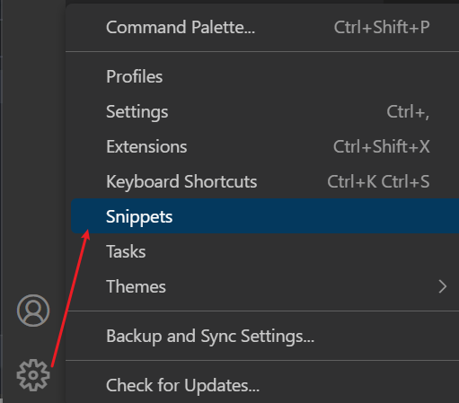

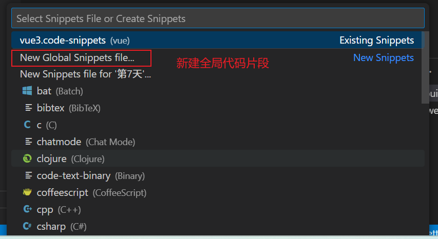

起名后打开

```json
{
	// Place your global snippets here. Each snippet is defined under a snippet name and has a scope, prefix, body and 
	// description. Add comma separated ids of the languages where the snippet is applicable in the scope field. If scope 
	// is left empty or omitted, the snippet gets applied to all languages. The prefix is what is 
	// used to trigger the snippet and the body will be expanded and inserted. Possible variables are: 
	// $1, $2 for tab stops, $0 for the final cursor position, and ${1:label}, ${2:another} for placeholders. 
	// Placeholders with the same ids are connected.
	// Example:
  "Print to console": {
    "scope": "vue",
    "prefix": "<vue",
    "body": [
      "<template>",
      "$1",
      "</template>",
      "",
      "<script setup>",
      "</script>",
      "",
      "<style scoped>",
      "</style>",
    ],
    "description": "vue template"
  }
}
```


ts版本

```json
"Print to console": {
  "scope": "vue",
  "prefix": "<vue",
  "body": [
    "<script setup lang=\"ts\">",
    "</script>",
    "",
    "<template>",
    "$1",
    "</template>",
    "",
    "<style scoped>",
    "</style>",
  ],
  "description": "vue template"
}
```


## `<style scoped>`

```
组件作用域 CSS
当 <style> 标签带有 scoped attribute 的时候，它的 CSS 只会影响当前组件的元素
```

```vue
<style scoped>
.example {
  color: red;
}
</style>

<template>
  <div class="example">hi</div>
</template>
```

转换为：

```vue
<style>
.example[data-v-f3f3eg9] {  这样样式只会影响带有该唯一属性的元素
  color: red;
}
</style>

<template>
  <div class="example" data-v-f3f3eg9>hi</div>
</template>
```


### `::v-deep`

```
::v-deep 是vue提供的一个深度作用的选择器，用于在<style scoped>的情况下，将样式应用到子组件甚至子组件的子组件中的特定元素或类名上

语法上，::v-deep 和 :deep 等价，
```

举例说明：

默认 scoped 下样式穿透无效

```vue
<template>
  <div>
    <child-component />
  </div>
</template>

<style scoped>
.child-btn {
  color: blue;
}
</style>
```

用 `:deep()` 穿透作用

```css
<style scoped>
:deep(.child-btn) {
  color: blue;
}
</style>
```

- `:deep(.child-btn)` 在编译时会被拆解为类似**后代选择器**，Vue 会只在 `:deep` 之前保留 scoped 限定。
- 例如假设当前 scoped id 为 `data-v-a1b2c3d4`，会编译成：

```css
css[data-v-a1b2c3d4] .child-btn {
  color: blue;
}
```


## `<Transition>`

`<Transition>` 组件专门用于包裹带有 `v-if` 或 `v-show` 的元素或组件，实现进入/离开动画效果。

`<Transition>` 是一个内置组件，使用无需注册。

`<Transition>` 会在一个元素或组件进入和离开 DOM 时应用动画

```vue
//template
<button @click="show = !show">Toggle</button>
<Transition>
  <p v-if="show">hello</p>
</Transition>


<style scoped>
/* css原理在下面 */
.v-enter-active,
.v-leave-active {
  transition: opacity 0.5s ease;
}

.v-enter-from,
.v-leave-to {
  opacity: 0;
}
/* 默认情况下，v-enter-to 和 v-leave-from 的 opacity 是 1。 */
</style>
```


一共有 6 个应用于进入与离开过渡效果的 CSS class

1. `v-enter-from`：''生成元素动画'' 的起始状态。在元素插入之前添加，在元素插入完成后的下一帧移除。
2. `v-enter-active`：生成动画的生效状态。
3. `v-enter-to`：生成动画的结束状态。
4. `v-leave-from`：''删除元素动画'' 的起始状态
5. `v-leave-active`：删除动画的生效状态。应用于整个删除动画阶段。
6. `v-leave-to`：删除动画的结束状态。

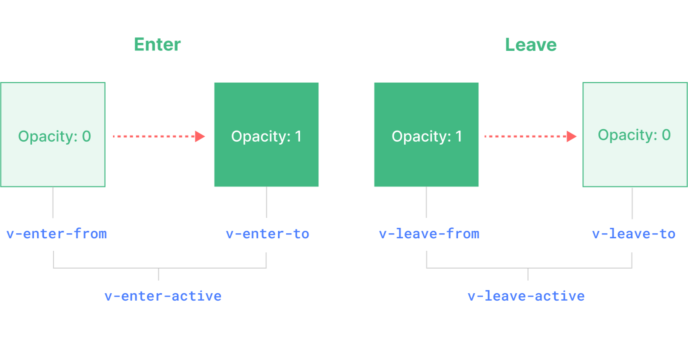


## `<Teleport>`

`<Teleport>` 是一个内置组件，它可以将一个组件内部的一部分模板“传送”到该组件的 DOM 结构外层的位置去,**而不是把子组件渲染在父组件里面**

语法

```vue
<Teleport to="选择器">
  <!-- 需要传送的内容 -->
</Teleport>
```


可以避免子元素的 `z-index` 受限于它的容器元素

对于设置了`position: fixed`的子元素, 不受祖先元素设置了 `transform`、`perspective` 等样式的影响


例子

父元素

```vue
<template>
<TeleportTest />
</template>

<script setup>
import TeleportTest from './component/TeleportTest.vue';
</script>
```

子元素

```vue
<template>
  <button @click="open = true">Open Modal</button>

  <Teleport to="body">
    <div v-if="open" class="modal">
      <p>Hello from the modal!</p>
      <button @click="open = false">Close</button>
    </div>
  </Teleport>
  
</template>

<script setup>
import { ref } from 'vue'

const open = ref(false)
</script>

<style scoped>
.modal {
  position: fixed;
  z-index: 999;
  top: 20%;
  left: 50%;
  width: 300px;
  margin-left: -150px;
}
</style>
```


禁用 `<Teleport>`。举例来说，我们想要在桌面端将一个组件当做浮层来渲染，但在移动端则当作行内组件

```vue
<Teleport :disabled="isMobile">
  ...
</Teleport>
```


## `<Suspense>` 

让整个组件变成异步的

`<script setup>` 变成 `async <script setup>`

作用:

- 等待异步子组件加载或异步数据准备完成，
- 在等待过程中展示一个占位内容（fallback 内容）

父组件

```vue
<template>

  <Suspense>
      
    <SuspenseTest />
    <template #fallback>
      <div>loading...</div>
    </template>

  </Suspense>

</template>

<script setup>
import SuspenseTest from './component/SuspenseTest.vue';
</script>
```

- 包裹了一个异步组件 `<SuspenseTest />`（假设它内部有异步逻辑）
- 当 `<SuspenseTest />` 的异步任务未完成时，显示 `#fallback` 插槽内容 `"loading..."`
- 异步任务完成后，自动切换显示 `<SuspenseTest />` 内容


## 组件v-model

### 基本用法(defineModel)

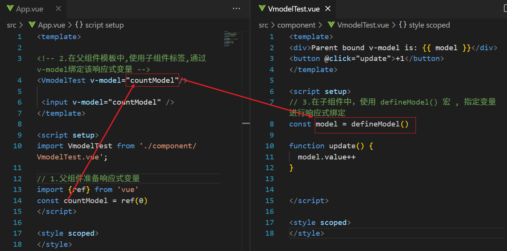


子组件标签里通过 `v-model` 绑定该响应式变量的本质

```vue
<VmodelTest :modelValue="countModel" @update:modelValue="countModel = $event" />

在组件中v-model可以展开成
属性绑定: :modelValue="active"
事件监听: @update:modelValue="active = $event" 相当于 @update:modelValue="function(event) { active = event }"
在dom事件中,event指的是事件对象, 在Vue 自定义事件（$emit）中event就成了第一个事件参数
Vue 官方文档里，所有以 $ 开头的变量名均是 框架预定义特殊属性或变量
```

也就是说，父组件通过 `modelValue` prop 传递数据给子组件，并监听子组件触发的 `update:modelValue` 事件来同步数据。


`defineModel()` 的作用

- 它帮你做了**以下事情**：
  1. 自动声明 `modelValue` prop。
  2. 返回一个响应式的 `ref`（比如你写的 `const model = defineModel()`），该 `ref.value` 其实是 `modelValue` 的读取器/写入器。
  3. 当你写 `model.value = xxx`，会自动触发组件的 `update:modelValue` 事件，通知父组件更新。


### 多个v-model

父组件

```vue
  <UserName
    v-model:first-name="first"
    v-model:last-name="last"
  />
```

子组件

```vue
//UserName.vue
<script setup>
  const firstName = defineModel('firstName')
  const lastName = defineModel('lastName')
</script>
```


### 3.4之前用法

v-model 本质 = prop 传值 + 事件更新 

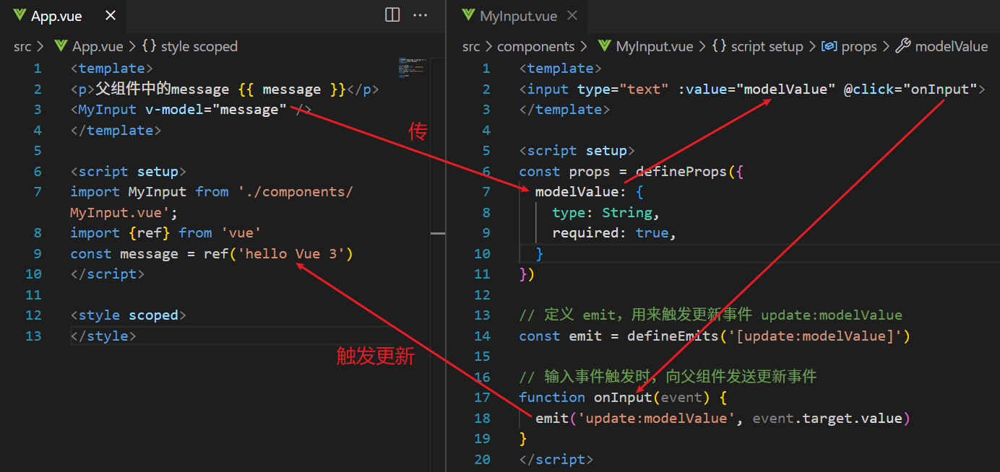

语法糖展开

```vue
<!-- 使用 v-model 的写法 -->
<MyInput v-model="message" />

<MyInput
  :modelValue="message"
  @update:modelValue="val => message = val"
/>
```


## 动态组件

### 基本用法

```vue
<template>
  <!-- 
    <component>是vue内置的动态组件标签
    :is属性绑定了一个变量,决定渲染哪个组件
  -->
  <component :is="views[active]"></component>
</template>

<script setup>
import HomeView from './views/HomeView.vue';
import CateView from './views/CateView.vue';
import CartView from './views/CartView.vue';
import UserView from './views/UserView.vue';

// active 是一个响应式的ref, 表示当前激活的视图索引
// 当active变化时, <component>会自动卸载旧组件 onMounted, 加载渲染新组件 onUnmounted
const active = ref(0)
//views是一个数组,存放了多个组件的引用
const views = [HomeView, CateView, CartView, UserView]

</script>
```


##  `<keep-alive>` 

用 `<keep-alive>` 包裹动态组件，则被切换出去的组件实例不会被销毁，而是被缓存，此时：

- 不会触发 `onUnmounted`，而触发 `onDeactivated`
- 再次激活时触发 `onActivated`


可实验例子: 组件中的数据不会因为切换而丢失

父组件

```vue
<keep-alive>
  <component :is="views[active]"></component>
</keep-alive>
```

子组件

```vue
<template>

<div>
  <h1>首页</h1>
  <button @click="count++">点击: {{ count }}</button>
</div>
</template>

<script setup>
import { ref, onMounted, onUnmounted, onActivated, onDeactivated } from 'vue'

onMounted(() => {
  console.log('挂载')
})
onUnmounted(() => {
  console.log('卸载')
})
    
//仅触发下面两个函数
onActivated(() => {
  console.log('激活')
})
onDeactivated(() => {
  console.log('失活')
})

const count = ref(0)
</script>

<style scoped>
</style>
```


## 集成VueRouter

### 核心

```
Vue 路由的核心流程就是：

配置路由表（管理“路径-组件”关系）——一般在 src/router/index.js
需要导航跳转的地方用 <RouterLink>（或 router.push() 等API）
需要显示路由内容的地方放 <RouterView>

匹配范围越小优先级越高
```


### 基本使用步骤

```
1. 安装 vue-router
    pnpm install vue-router
  或者在选择安装vue框架时:
    Project name:route-demo
    Select aframework:>eSelect avariant:>
    Customize with create-vue 
    然后查看package.json中是否有:"vue-router": "^4.5.1"


2.在 src/views/ 目录下新建页面组件：
	HomeView.vue
	AboutView.vue
	
3. 配置路由规则（src/router/index.js）

4. 集成路由到 Vue 应用（main.js）

5. 在 App.vue 中设置路由出口使用 <RouterLink> 和 <RouterView>
	<RouterLink> 用于导航，不会刷新页面。
	<RouterView> 是路由出口，渲染匹配到的组件。
```


### 基本使用相关代码

- **HomeView.vue**

  ```vue
  <template>
    <h2>主页</h2>
  </template>
  <script setup>
  </script>
  ```

- **AboutView.vue**

  ```vue
  <template>
    <h2>关于</h2>
  </template>
  <script setup>
  </script>
  ```

index.js

```js
//createRouter 创建并返回一个路由实例 router, 通过 <router-view>、router-link 等组件配合使用
//createWebHistory 用来指定路由的“工作模式”，即采用 HTML5 的 history 模式（地址栏没有 #，例如 /home/about）
import { createRouter, createWebHistory } from "vue-router";

const router = createRouter({
  //import.meta.env 是 Vite 提供的内置环境变量对象
  //BASE_URL 表示项目部署的基础路径（根路径）.在vite.config.js中配置
  history: createWebHistory(import.meta.env.BASE_URL),
  routes: [
    { path: '/', component: () => import('@/views/HomeView.vue') },
    { path: '/about', component: () => import('@/views/AboutView.vue') }
  ]
});

export default router; // 一定要有 default 导出
//component: () => import('@/views/HomeView.vue') 是路由懒加载写法。
//路径 @ 代表 src，部分项目需在vite.config.js或webpack配置别名。
```

main.js

```js
import { createApp } from 'vue'
import App from './App.vue'

//import router from './router' 实际上会自动找到 ./router/index.js 文件。
//如果你导入的是一个目录（比如 ./router），模块解析器会自动查找该目录下的 index.js（或 index.ts），把它当做这个目录的默认入口文件。
//ESModule 规范以及多数打包工具（Vite、Webpack）都支持此特性。
import router from './router'  // 这里接收了 index.js 的 router

const app = createApp(App)
app.use(router)
app.mount('#app')
```

App.vue

```vue
<template>
  <nav>
    <RouterLink class="btn" to="/">Home</RouterLink>
    <RouterLink class="btn" to="/about">About</RouterLink>
  </nav>
  <div class="container">
    <RouterView/>
  </div>
</template>
```


### RouterLink 和 RouterView

RouterLink 

```vue
<RouterLink> 的绝对路径用法
    绝对路径以 / 开头，始终从根路径起跳。
示例：
<RouterLink to="/Home/Route">路由</RouterLink>
<RouterLink to="/Home/DynamicRoute">动态路由</RouterLink>
无论你在什么页面，点击后跳转到：
    /Home/Route
    /Home/DynamicRoute
    
    

<RouterLink> 的相对路径用法
    相对路径不以 / 开头，相对于当前页面路径进行拼接。
示例：
<RouterLink to="Home/Route">路由</RouterLink>
<RouterLink to="Home/DynamicRoute">动态路由</RouterLink>
当前在 /，点击 to="Home/Route"，跳转到 /Home/Route（✔️）。
当前在 /Home/Route，点击 to="Home/DynamicRoute"，跳转到 /Home/Home/DynamicRoute（❌，会出错）。
    


<RouterLink> 动态to参数写法
1.静态字符串
<router-link to="/about">关于我们</router-link>

2.动态字符串
    可以绑定数据变量，生成动态路径：
<router-link :to="'/user/' + userId">用户中心</router-link>
<router-link :to="`/article/${article.slug}`">文章</router-link>
    
3.对象写法（推荐用于参数传递）
<router-link :to="{ name: 'user', params: { id: userId } }">用户资料</router-link>
<router-link :to="{ path: '/category/' + category, query: { page: 2 } }">分类</router-link>
    
4.结合事件、计算属性、循环等动态生成
<router-link
  v-for="c in chapters"
  :key="c.id"
  :to="`/chapter/${c.id}`"
>{{ c.title }}</router-link>
```


RouterView

```vue
<RouterView> 嵌套路由中的用法
嵌套路由结构示意图
/	 → HomeView.vue
└── HomeView.vue
    ├── Home/Route           → Route.vue
    ├── Home/DynamicRoute    → DynamicRoute.vue
    └── Home/NestRouting     → NestRouting.vue
/about
└── AboutView.vue
<!-- 基本原理 -->
父路由组件（比如 HomeView.vue）里要放一个 <RouterView />，子路由组件会渲染在这里。
如果还有多级嵌套，子组件里也要放 <RouterView />。
摆放示意图
App.vue
└── <RouterView />  （渲染 HomeView.vue 或 AboutView.vue 等）
HomeView.vue
└── <RouterView />  （渲染 Route.vue、DynamicRoute.vue、NestRouting.vue 之一）
```


### 前端路由 hash模式, history模式的区别(待总结)


### 动态path

#### 基本用法

```js
动态路由允许在URL中匹配可变部分,并作为参数传递给组件
:param 定义一个必须的动态参数；
:param? 是可选参数；
:param(正则) 用于限制参数格式（如只允许数字）；


//举例
1.基本动态路由
{ path: '/test/:id', component: TestView }
	访问 /test/123 时，id 的值就是 123，在组件中用 useRoute().params.id 获取。

2.正则限制参数格式
{ path: '/test/:id(\\d+)', component: TestView }
    :id(\d+) 表示参数 id 只匹配一位或多位数字。  '\\d+'和'/\d+/'匹配正则\d+
    只有形如 /test/123 才能匹配。
    /test/abc 不会匹配到这个路由。
     
3.不同参数名的动态路由
{ path: '/test/:name', component: TestView }
    匹配 /test/xxx，把 xxx 赋给参数 name。
    例如 /test/hello123，params.name 为 hello123。
        
4.可选参数
{ path: '/test/:id?', component: TestView }
    :id? 表示参数 id 可传可不传。
    /test/123，params.id 为 123。
    /test，params.id 为 undefined。
    注意：? 仅适用于路径最后一位参数，否则可能匹配有歧义。
    
5.可重复参数的动态路由
{ path: '/:chapters+', component: ChapterView } || { path: '/:chapters*', component: ChapterView }
    访问 /a/b/c，route.params.chapters = ['a','b','c']
    访问 /hello，route.params.chapters = ['hello']
    访问 /，不匹配（必须有一段）
    如果用 *，访问 / 时，route.params.chapters = []
```


#### useRoute()&route

```vue
<script setup>
import { useRoute } from 'vue-router'  //需要从 vue-router 包中导入：

const route = useRoute()

console.log(route.params.id)
</script>
```


### 路由匹配优先级(待总结)


### 嵌套路由

```vue
1.路由配置（src/router/index.js）
/ (根路径)
└─ HomeView.vue (父路由组件)
   ├─ /Home/Route → Route.vue (子路由组件)
   ├─ /Home/DynamicRoute → DynamicRoute.vue (子路由组件)
   └─ /Home/NestRouting → NestRouting.vue (子路由组件)


2. RouterLink 层级结构
App.vue 中的 <router-view>
└── 根据路径渲染 HomeView 或 AboutView
    HomeView 中的 <router-view>
    └── 根据子路径渲染 Route/DynamicRoute/NestRouting

    
3. RouterView 层级结构
App.vue	<routerLink to="/" >HomeView</routerLink>
|
└── HomeView.vue <RouterLink to="/Home/Route">路由</RouterLink>
    |			<RouterLink to="/Home/DynamicRoute">动态路由</RouterLink>
    |			<RouterLink to="/Home/NestRouting">嵌套路由</RouterLink>
    |
    |
    └── Route.vue,DynamicRoute.vue,NestRouting.vue
```


index.js 嵌套路由代码示例:

```js
const router = createRouter({
  ...
  routes: [
    { 
      path: '/',  
      component: () => import('../views/HomeView.vue') ,
      children: [
        { path: 'Home/Route', component: () => import('../views/Home/Route.vue') },
        { path: 'Home/DynamicRoute', component: () => import('../views/Home/DynamicRoute.vue') },
        { path: 'Home/NestRouting', component: () => import('../views/Home/NestRouting.vue') },
      ]
    },
  ]
})
```


### 404 Not found 路由

```js
const routes = [
  // 将匹配所有内容并将其放在 `route.params.pathMatch` 下
  { path: '/:pathMatch(.*)*', name: 'NotFound', component: NotFound },
  // 将匹配以 `/user-` 开头的所有内容，并将其放在 `route.params.afterUser` 下 捕获所有路由
  { path: '/user-:afterUser(.*)', component: UserGeneric },
]
```


### route和router

route

```js
解析路由,解析路由中传递的参数

1.动态参数（params）
import { useRoute } from 'vue-router'
const route = useRoute()
// 就是 <router-link :to="{ name: 'user', params: { id: userId } }"> 传递的 id
console.log(route.params.id) 


2.查询参数（query）
// 就是 <router-link :to="{ path: '/category/' + category, query: { page: 2 } }"> 传递的 page
console.log(route.query.page)


3.URL 问号 ? 传递查询参数
router.push('/search?keyword=五月天');//改变浏览器地址栏的路由，跳转到 /search 页面，同时带上查询参数 keyword=xxx
import { useRoute } from 'vue-router'
const route = useRoute()
const keyword = route.query.keyword  // 这里拿到的就是URL里的keyword值
```


router

```js
跳转到目标路由

import { useRouter } from 'vue-router'
const router = useRouter()
router.push('/about')
```


### 导航守卫

#### 组件内导航守卫

```vue
<script setup>
import { onBeforeRouteLeave, onBeforeRouteUpdate } from 'vue-router'

onBeforeRouteUpdate((to, from) => { 
  // 在当前路由改变，但是该组件被复用时调用
  
  // 参数 to: 即将要进入的目标路由对象 可以获取path参数
  console.log('to是', to)
  
  // 参数 from: 当前导航正要离开的路由对象
  console.log('from是', from)
})

onBeforeRouteLeave((to, from) => {
  // 在离开当前路由前执行的逻辑
})

</script>
```


#### useLink 组合式函数

父组件中

```js
import AboutDetailView from './AboutDetailView.vue';
<about-detail-view to="/about/3" />
```


子组件：AboutDetailView.vue

```vue
<script setup>

import { RouterLink, useLink } from 'vue-router'
import { computed } from 'vue'

const props = defineProps({
  // 如果使用 TypeScript，请添加 @ts-ignore
  ...RouterLink.props,
  inactiveClass: String,
})

const {
  // 解析出来的路由对象
  route,
  // 用在链接里的 href
  href,
  // 布尔类型的 ref 标识链接是否匹配当前路由
  isActive,
  // 布尔类型的 ref 标识链接是否严格匹配当前路由
  isExactActive,
  // 导航至该链接的函数
  navigate
} = useLink(props)

console.log('route', route.value) 
/**
route { 
  fullPath: '/about/3', 
  hash: '', 
  host: '', 
  hostname: '', 
  href: 'http://localhost:5173/about/3', 
  origin: 'http://localhost:5173', 
  path: '/about/3', 
  port: '5173', 
  protocol: 'http:', 
  query: {}, 
  params: {…}, 
  name: undefined, 
  meta: {…}, 
  matched: Array(1) 
}
 */
console.log('href', href.value) // href /about/3
console.log('isActive', isActive.value)  // isActive true
console.log('isExactActive', isExactActive.value) // isExactActive true


</script>

<template>
  按钮暴露在父组件中，点击跳转到 /about/3 
  <button @click="navigate">Go to About</button>  
</template>
```


#### 全局前置导航守卫（待总结）


### 被切换掉的组件

组件卸载不等于所有 JS 资源自动清理

**Vue 只负责自身的响应式和 DOM 销毁**，不会自动帮你清理你自己在 JS 层创建的“第三方实例对象”（比如地图 map、场景 scene、事件监听、定时器等）。

如果这些对象（如地图、场景等）和事件监听器没有手动清理，它们仍然存在于 JS 内存中，可能继续响应事件、消耗资源，造成内存泄漏或“幽灵事件”。

```
正确做法：在组件销毁前（onBeforeUnmount 钩子里），明确地清理和销毁这些 JS 实例及相关资源。
    具体操作通常包括：
        移除事件监听（如 map.off('eventName', handler)）
        移除 DOM 观察器（如 resizeObserver.disconnect()）
        清除定时器（如 clearInterval(timer)）
        销毁场景/地图（如 scene.destroy()、map.remove()）
        把引用设为 null，便于垃圾回收
```


## 集成axios

### 模拟后台

```
准备数据文件
mock/data.json
{
  "users": [
    {"id": 1, "username": "xiaoming"},
    {"id": 2, "username": "xiaomei"}
  ]
}

安装
pnpm i json-server@0.17.4 -D


package.json
"scripts": {
  "dev": "vite",
  "build": "vite build",
  "preview": "vite preview",
  "mock": "json-server mock/data.json"
},


启动服务
pnpm run mock

pnpm i axios
通用格式
axios({
  method: 'get',          // 请求方法，如 'get', 'post', 'put', 'delete' 等
  url: '/user/12345',     // 请求地址
  params: {               // GET 请求参数（会拼接到url上）
    id: 12345
  },
  data: {                 // POST/PUT 请求体（用于提交数据）
    firstName: 'Zhang',
    lastName: 'San'
  },
  headers: {              // 自定义请求头
    'Authorization': 'Bearer token'
  }
}).then
```


### 封装aixos

```
步骤:
	封装 axios 实例
	封装接口请求方法
	组件中调用

一般目录结构建议
src/
  utils/
    request.js      // 这里写axios封装
  api/
    user.js         // 这里写具体接口调用的函数
```

request.js

```js
/**
 * interceptors 是 axios 提供的“拦截器”机制。
 *    请求拦截器（request）：请求发出去前，可以统一加token、日志等。
 *    响应拦截器（response）：服务器响应回来后，可以统一做数据过滤、错误处理等。
 */
import axios from 'axios';

// 创建一个axios实例
const instance = axios.create({
  baseURL: 'http://localhost:3000',  //当后端发生迁移时,只用在这一处进行接口地址修改
  timeout: 1000,
})
console.log(instance)

// 响应拦截器
instance.interceptors.response.use(
  response => {
    return response.data;  // 只返回 data 字段
  },
  errpr => {
    console.error('请求错误:', errpr);
    return Promise.reject(errpr);
  }
)

// 导出默认实例
export default instance;
```

src/api/User.js

```js
import instance from "@/utils/request";

// 获取所有用户
export function getAllUsers() {
  return instance({
    method: 'get',
    url: '/users'
  })
}

// 根据id获取单个用户
export function getUserById(id) {
  return instance({
    method: 'get',
    url: `/users/${id}`
  })
}

// 创建新用户
export function createUser(userData) {
  return instance({
    method: 'post',
    url: '/users',
    data: userData
  })
}

// 更新用户信息
export function updateUser(id, userData) {
  return instance({
    method: 'put',
    url: `/users/${id}`,
    data: userData
  })
}

// 删除用户
export function deleteUser(id) {
  return instance({
    method: 'delete',
    url: `/users/${id}`
  })
}
```

组件中调用

```vue
<script setup>
import { ref } from "vue"
import { getAllUsers, createUser } from "@/api/user"  //导入

const userList = ref([])

const fetchUsers = async () => {
  userList.value = await getAllUsers()  //获取所有用户数据
}

const addUser = async (userData) => {
  await createUser(userData)  // 创建新用户
  fetchUsers() // 重新获取最新用户列表
}
</script>
```


## 集成Pinia

### 基本使用

```
安装 
pnpm i pinia


结构规范
src/
  stores/         ← 存放所有 Pinia 的 store
    user.js       ← 用户相关的 store
    cart.js       ← 购物车相关的 store
    index.js      ← （可选）统一导出所有store
  api/
  components/
  views/
  ...
  
```


src/main.js

```js
在项目入口注册 Pinia
import { createApp } from 'vue'
import App from './App.vue'      // 引入主组件
const app = createApp(App)

import { createPinia } from 'pinia'
const pinia = createPinia()       // 创建 Pinia 实例
app.use(pinia)                    // 注册 Pinia

app.mount('#app')
```


### setup语法

src/stores/index.ts

```ts
import { defineStore } from 'pinia'
import { ref, computed } from 'vue'

export const useCounterStore = defineStore('counter-adv', () => {
  // 状态
  const count = ref(0)

  // 派生值（无需 getters）
  const double = computed(() => count.value * 2)
  const evenOrOdd = computed(() => (count.value % 2 === 0 ? 'even' : 'odd'))

  // 动作
  const inc = (step = 1) => { count.value += step }
  const reset = () => { count.value = 0 }
  const setTo = (v: number) => { count.value = v }

  // 模拟异步动作
  const incAsync = async (step = 1) => {
    await new Promise(r => setTimeout(r, 300))
    inc(step)
  }

  // 返回：顺序随意
  return { count, double, evenOrOdd, inc, reset, setTo, incAsync }
})
```


vue组件中使用

```vue
<script setup lang="ts">
import { useCounterStore } from '@/stores/counterAdvanced'

const { count, double, evenOrOdd, inc, incAsync, reset } = useCounterStore()
// count / double / evenOrOdd 是 ref / computed，可直接模板使用
</script>

<template>
  <div>
    <p>值: {{ count }} | 两倍: {{ double }} | 奇偶: {{ evenOrOdd }}</p>
    <button @click="inc()">+1</button>
    <button @click="inc(5)">+5</button>
    <button @click="incAsync(10)">异步+10</button>
    <button @click="reset()">重置</button>
  </div>
</template>
```


### storeToRefs 响应式解构

```js
storeToRefs 是 Pinia 提供的一个工具函数，用于将 store 中的 state 属性和 getter 转换为 ref，便于在 Vue 3 组合式 API（setup）中解构使用
```

使用示例

组件示例

```vue
<script setup lang="ts">
import { useCounterStore } from '@/stores/counter'
import { storeToRefs } from 'pinia'

// 获取 store 实例
const counterStore = useCounterStore()

// 响应式解构（state + computed 进入 ref；action 保持原函数）
const { count, double } = storeToRefs(counterStore)
const { inc } = counterStore
</script>

<template>
  <div style="padding:12px; border:1px solid #ccc; width:200px;">
    <p>count: {{ count }}</p>
    <p>double: {{ double }}</p>
    <button @click="inc()">+1</button>
    <button @click="inc(5)">+5</button>
  </div>
</template>
```

Pinia store

```js
import { defineStore } from 'pinia'
import { ref, computed } from 'vue'

export const useCounterStore = defineStore('counter', () => {
  // 1. 基础状态
  const count = ref(0)

  // 2. 派生状态（相当于 getter）
  const double = computed(() => count.value * 2)

  // 3. 动作（action）
  function inc(step = 1) {
    count.value += step
  }

  // 4. 返回：注意这里返回的是 ref / computed / 函数
  return { count, double, inc }
})
```


### 老式用法  定义 Store,  state、actions 与 getters

```js
定义 Store
import { defineStore } from 'pinia'

//  `defineStore()` 的返回值的命名是自由的
// 但最好含有 store 的名字，且以 `use` 开头，以 `Store` 结尾。
// (比如 `useUserStore`，`useCartStore`，`useProductStore`)
// 第一个参数是你的应用中 Store 的唯一 ID。是必须传入的， Pinia 将用它来连接 store 和 devtools
export const useAlertsStore = defineStore('alerts', {
  // 其他配置...
})


可以认为 state 是 store 的数据 (data)，getters 是 store 的计算属性 (computed)，而 actions 则是方法 (methods)。
```


ts

```ts
// src/stores/useUserStore.ts
import { defineStore } from 'pinia'

export const useUserStore = defineStore('user', {
  state: () => ({
    id: 'u1',
    name: '张三',
    age: 20,
    roles: ['admin']
  }),
  getters: {
    isAdult: (state) => state.age >= 18,
    roleCount: (state) => state.roles.length
  },
  actions: {
    setName(name: string) {
      this.name = name
    }
  }
})
```


在组件中读取（Composition API）

Vue

```vue
<script setup lang="ts">
import { useUserStore } from '@/stores/useUserStore'

const userStore = useUserStore()

// 直接访问（保持响应式）
userStore.name        // state
userStore.isAdult     // getter
userStore.setName('李四') // action
</script>

<template>
  <div>
    <p>{{ userStore.name }}</p>
    <p>{{ userStore.age }}</p>
    <p>{{ userStore.isAdult ? '成年人' : '未成年人' }}</p>
  </div>
</template>
```


### 访问其它Store

```js
import { useAuthStore } from './auth-store'
const auth = useAuthStore()

auth.isAuthenticated  //访问了其他 store（auth-store）的 state 属性 isAuthenticated

```


### 数据是否进pinia

```
判断是否进 store 的快速口诀： 共享？跨页面需要？刷新要保留？要被多个地方衍生？未来要缓存？ → 是，则进 store。

只本组件临时使用？仅影响局部交互？ → 留组件。
```


### pinia数据监听

在vue编码的时候，在组件中经常需要监听pinia中数据的变化来做出某种操作

判断方式

- 纯数据派生：computed
- 依赖集合变化触发副作用：watchEffect
- 需要旧值/精细控制/条件：watch
- 复杂参数组合：先 computed 聚合，再 watchEffect / watch

```
只是“值 = 其它值运算” → computed
“依赖变就做副作用，不关心旧值” → watchEffect
“要新旧值 / 精确绑定哪些依赖 / 需要防抖或取消” → watch
“依赖多且将来可能增减” → 先 computed 聚合，再 watch / watchEffect
```


1. 纯数据派生：computed

```vue
纯粹根据 Pinia 数据计算一个新值
只读且自动缓存，依赖变了才重新计算

<template>
  <p>Is even? {{ isEven }}</p>
</template>
<script setup>
import { computed } from 'vue'
import { useCounterStore } from './store'

const store = useCounterStore()

const isEven = computed(() => store.count % 2 === 0)
</script>
```


2. 依赖集合变化触发副作用：watchEffect

```js
特点：自动收集内部用到的响应式依赖；任一依赖变就重新执行；不提供旧值；适合快速原型。
适用：依赖关系简单、无需旧值、无需精确定义依赖列表；例如：根据 adcode+position 自动调用 map 更新。
示例：

watchEffect(() => {
  if (!adcode.value || !position.value) return
  // 副作用：更新地图视图
  updateCityLayer(adcode.value)
  flyTo(position.value)
})
```


3.需要旧值 / 精细控制 / 条件：watch

```js
特点：你显式列出依赖；能拿到新旧值；可以 { immediate, deep, flush } 配置。
适用：
    需要旧值对比（避免重复操作）
    需在特定字段变化才触发（而不是任意依赖）
    异步节流/取消
    示例：监听绘制模式变更，移除旧交互、添加新交互：
    
watch(selectedDraw, (newMode, oldMode) => {
  if (newMode === oldMode) return
  removeInteraction(oldMode)
  addInteraction(newMode)
})
```


4.复杂参数组合：先 computed 聚合，再 watchEffect / watch

```js
当副作用依赖多个散落字段（如 SearchCity + adcode + coord），可以先用 computed 聚成一个对象，减少多个 watch 的维护成本。
示例：

const cityPayload = computed(() => ({
  city: SearchCity.value,
  code: adcode.value,
  coord: coordArray.value
}))

watch(cityPayload, ({ city, code, coord }) => {
  if (!city || !code || coord.length !== 2) return
  updateBoundaryLayer(code)
  centerMap(coord)
}, { immediate: true })
```


## 集成Element Plus

```js
安装
pnpm install element-plus

安装icon的组件包
pnpm install @element-plus/icons-vue

main.js中引入
import { createApp } from 'vue'
import App from './App.vue'
const app = createApp(App)

import ElementPlus from 'element-plus'  // 导入插件
import 'element-plus/dist/index.css'  // 导入样式
app.use(ElementPlus)  // 注册插件

app.mount('#app')
```


按需导入在vite.config.js配置

```js
首先你需要安装unplugin-vue-components 和 unplugin-auto-import这两款插件

shell
npm install -D unplugin-vue-components unplugin-auto-import


vite.config.ts
import { defineConfig } from 'vite'
import AutoImport from 'unplugin-auto-import/vite'
import Components from 'unplugin-vue-components/vite'
import { ElementPlusResolver } from 'unplugin-vue-components/resolvers'

export default defineConfig({
  // ...
  plugins: [
    // ...
    AutoImport({
      resolvers: [ElementPlusResolver()],
    }),
    Components({
      resolvers: [ElementPlusResolver()],
    }),
  ],
})
```


### 水平/垂直 导航栏

```vue
<template>
  <div class="container">
    <!-- 
    水平导航菜单部分：
      el-menu：水平导航菜单容器
      el-menu-item：普通菜单项
      el-sub-menu：带有子菜单的菜单项
      el-menu-item-group：菜单项分组
    -->

    <!-- 水平导航菜单 -->
    <el-menu mode="horizontal" background-color="#545c64" text-color="#fff">
      <!-- 一级菜单项 -->
      <el-menu-item index="1">Processing Center</el-menu-item>
      
      <!-- 带有子菜单的二级菜单 -->
      <el-sub-menu index="2">
        <template #title>Workspace</template>
        <!-- 子菜单项 -->
        <el-menu-item index="2-1">item one</el-menu-item>
        <el-menu-item index="2-2">item two</el-menu-item>
        <el-menu-item index="2-3">item three</el-menu-item>
        
        <!-- 三级嵌套子菜单 -->
        <el-sub-menu index="2-4">
          <template #title>item four</template>
          <el-menu-item index="2-4-1">item one</el-menu-item>
          <el-menu-item index="2-4-2">item two</el-menu-item>
          <el-menu-item index="2-4-3">item three</el-menu-item>
        </el-sub-menu>
      </el-sub-menu>
      
      <!-- 禁用的菜单项 -->
      <el-menu-item index="3" disabled>Info</el-menu-item>
      <!-- 普通菜单项 -->
      <el-menu-item index="4">Orders</el-menu-item>
    </el-menu>


    <!-- 
    垂直导航菜单部分：
      el-menu：垂直导航菜单容器
      el-icon：图标组件
      el-sub-menu：可折叠的子菜单
      el-menu-item：菜单项
      el-menu-item-group：菜单项分组
    -->

    <!-- 垂直菜单布局 -->
    <el-row class="tac">
      <el-col :span="4">
        <h5 class="mb-2">Default colors</h5>
        <!-- 垂直导航菜单 -->
        <el-menu class="el-menu-vertical-demo" background-color="#545c64" text-color="#fff">

          <!-- 带有图标的子菜单 -->
          <el-sub-menu index="1">
            <!-- 子菜单标题 -->
            <template #title>
              <el-icon><location /></el-icon>
              <span>Navigator One</span>
            </template>

            <!-- 菜单项分组 -->
            <el-menu-item-group title="Group One">
              <el-menu-item index="1-1">item one</el-menu-item>
              <el-menu-item index="1-2">item two</el-menu-item>
            </el-menu-item-group>

            <el-menu-item-group title="Group Two">
              <el-menu-item index="1-3">item three</el-menu-item>
            </el-menu-item-group>

            <!-- 嵌套的子菜单 -->
            <el-sub-menu index="1-4">
              <template #title>item four</template>
              <el-menu-item index="1-4-1">item one</el-menu-item>
            </el-sub-menu>
          </el-sub-menu>

          <!-- 带图标的菜单项 -->
          <el-menu-item index="2">
            <el-icon><icon-menu /></el-icon>
            <span>Navigator Two</span>
          </el-menu-item>

          <!-- 禁用的带图标菜单项 -->
          <el-menu-item index="3" disabled>
            <el-icon><document /></el-icon>
            <span>Navigator Three</span>
          </el-menu-item>

          <!-- 另一个带图标的菜单项 -->
          <el-menu-item index="4">
            <el-icon><setting /></el-icon>
            <span>Navigator Four</span>
          </el-menu-item>
        </el-menu>
      </el-col>
    </el-row>
  </div>
</template>

<script setup></script>

<style scoped>
</style>

```


### 登录表单 校验

```vue
<template>
  <!-- 表单 -->
  <el-form 
    style="max-width: 600px; margin: 20px auto" 
    :model="ruleForm"
    ref="ruleFormRef"
    :rules="rules"
  >


    <!-- 输入框 -->
    <el-form-item label="Activity name" prop="name">
      <el-input v-model="ruleForm.name" />
    </el-form-item>


    <!-- 下拉选择框 -->
    <el-form-item label="Activity zone" prop="region">
      <el-select v-model="ruleForm.region" placeholder="Activity zone">
        <el-option label="shanghai" value="shanghai" />
        <el-option label="beijing" value="beijing" />
      </el-select>
    </el-form-item>


    <!-- 日期选择框 -->
    <el-form-item label="Activity time" required>
      <el-col :span="11">
        <el-form-item prop="date1">
          <el-date-picker
            v-model="ruleForm.date1"
            type="date"
            aria-label="Pick a date"
            placeholder="Pick a date"
            style="width: 100%"
          />
        </el-form-item>
      </el-col>
      <el-col class="text-center" :span="2">
        <span class="text-gray-500">-</span>
      </el-col>
      <el-col :span="11">
        <el-form-item prop="date2">
          <el-time-picker
            v-model="ruleForm.date2"
            aria-label="Pick a time"
            placeholder="Pick a time"
            style="width: 100%"
          />
        </el-form-item>
      </el-col>
    </el-form-item>


    <!-- 开关 -->
    <el-form-item label="Instant delivery" prop="delivery">
      <el-switch v-model="ruleForm.delivery" />
    </el-form-item>


    <!-- 分段控制器 -->
    <el-form-item label="Activity location" prop="location">
      <el-segmented v-model="ruleForm.location" :options="locationOptions" />
    </el-form-item>


    <!-- 复选框 -->
    <el-form-item label="Activity type" prop="type">
      <el-checkbox-group v-model="ruleForm.type">
        <el-checkbox value="Online activities" name="type">
          Online activities
        </el-checkbox>
        <el-checkbox value="Promotion activities" name="type">
          Promotion activities
        </el-checkbox>
        <el-checkbox value="Offline activities" name="type">
          Offline activities
        </el-checkbox>
        <el-checkbox value="Simple brand exposure" name="type">
          Simple brand exposure
        </el-checkbox>
      </el-checkbox-group>
    </el-form-item>


    <!-- 单选框 -->
    <el-form-item label="Resources" prop="resource">
      <el-radio-group v-model="ruleForm.resource">
        <el-radio value="Sponsorship">Sponsorship</el-radio>
        <el-radio value="Venue">Venue</el-radio>
      </el-radio-group>
    </el-form-item>


    <!-- 文本框 -->
    <el-form-item label="Activity form" prop="desc">
      <el-input v-model="ruleForm.desc" type="textarea" />
    </el-form-item>

  
    <el-form-item>
      <!-- 提交按钮 -->
      <el-button type="primary" @click="submitForm(ruleFormRef)">
        Create
      </el-button>
      <!-- 重置按钮 -->
      <el-button @click="resetForm(ruleFormRef)">Reset</el-button>
    </el-form-item>
  </el-form>
</template>

<script setup>
import { ref } from "vue"

// 表单绑定数据
const ruleForm = ref({
  name: "Hello",
  region: "",
  count: "",
  date1: "",
  date2: "",
  delivery: false,
  location: "",
  type: [],
  resource: "",
  desc: "",
})

// 活动区域选项
const locationOptions = ["Home", "Company", "School"]

// 校验规则
import { reactive } from "vue"
const rules = reactive({
  name: [
    { required: true, message: 'Please input Activity name', trigger: 'blur' },
    { min: 3, max: 5, message: 'Length should be 3 to 5', trigger: 'blur' },
  ],
  region: [
    {
      required: true,
      message: 'Please select Activity zone',
      trigger: 'change',
    },
  ],
  count: [
    {
      required: true,
      message: 'Please select Activity count',
      trigger: 'change',
    },
  ],
  date1: [
    {
      type: 'date',
      required: true,
      message: 'Please pick a date',
      trigger: 'change',
    },
  ],
  date2: [
    {
      type: 'date',
      required: true,
      message: 'Please pick a time',
      trigger: 'change',
    },
  ],
  location: [
    {
      required: true,
      message: 'Please select a location',
      trigger: 'change',
    },
  ],
  type: [
    {
      type: 'array',
      required: true,
      message: 'Please select at least one activity type',
      trigger: 'change',
    },
  ],
  resource: [
    {
      required: true,
      message: 'Please select activity resource',
      trigger: 'change',
    },
  ],
  desc: [
    { required: true, message: 'Please input activity form', trigger: 'blur' },
  ],
})


const ruleFormRef = ref()
// 表单提交
const submitForm = async (formEl) => {
  if (!formEl) return
  await formEl.validate((valid, fields) => {
    if (valid) {
      console.log('submit!')
    } else {
      console.log('error submit!', fields)
    }
  })
}

// 重置表单
const resetForm = (formEl) => {
  if (!formEl) return
  formEl.resetFields()
}
</script>

<style scoped></style>

```


## 集成Vue ECharts

```js
引入 vue-echarts 之前，必须先安装 echarts。 
pnpm install echarts
引入
pnpm i echarts vue-echarts

main.js中注册全局组件
import { createApp } from 'vue'
import App from './App.vue'
const app = createApp(App)

import VueECharts from 'vue-echarts' 
app.component('v-chart', VueECharts) // 注册全局组件
import 'echarts'  //全部导入，就不需要再组件中按需导入了   

app.mount('#app')


按需导入工具
https://vue-echarts.dev/#codegen

```


在vue中使用

```vue
<template>
  <v-chart class="chart" :option="option"/>   根据之前在main.js中注册的组件名称
</template>

<script setup>
const option = ref({...})   // 表格配置项
</script>

<style scoped>
.chart {
  width: 400px;
  height: 300px;
}
</style>
```


## 自定义指令V-

除了 Vue 内置的一系列指令 (比如 `v-model` 或 `v-show`) 之外，Vue 还允许你注册自定义的指令 (Custom Directives)。

[自定义指令 | Vue.js](https://cn.vuejs.org/guide/reusability/custom-directives#usage-with-script-setup)

在 `<script setup>` 中，任何以 `v` 开头的驼峰式命名的变量都可以当作自定义指令使用。


### 基本示例

直接给相应元素节点添加类名

```vue
<script setup>
// 在模板中启用 v-highlight
const vHighlight = {
  mounted: (el) => {
    el.classList.add('is-highlight')
  }
}
</script>

<template>
  <p v-highlight>This sentence is important!</p>
</template>
```


### 从外部引入

```js
import { vDraggable } from './utils/v-draggable';
```

`vDraggable` 自动注册成了 `v-draggable` 指令（变量名去掉 v 并转成短横线小写）。

在模板里直接用即可：

```html
<div v-draggable>...</div>
```


自由拖动元素的自定义指令，且拖动元素后，若元素没有超过初始位置一定范围，会自动复位到初始位置

```js
// 自由拖动元素的自定义指令
// 拖动元素不超过指定范围，会自动复位
export const vDraggable = {
  mounted(el) {
    let startX = 0; // 鼠标按下时的坐标
    let startY = 0
    let startDragLeft = 0 // 元素开始拖动时的位置
    let startDragTop = 0
    let initLeft = 0 // 元素初始位置
    let initTop = 0
    let dragging = false // 是否正在拖动

    // 获取当前元素在页面呈现成来的最终计算样式
    const style = window.getComputedStyle(el)
    // 记录初始位置
    initLeft = parseInt(style.left) || 0
    initTop = parseInt(style.top) || 0
    // 如果定位方式不是这三种 就设置行内position为relative
    if (!['absolute', 'fixed', 'relative'].includes(style.position)) {
      el.style.position = 'relative'
    }
    // 如果没有初始left 就设置为0
    if (!style.left || style.left === 'auto') {
      el.style.left = '0px'
    }
    // 如果没有初始top 就设置为0
    if (!style.top || style.top === 'auto') {
      el.style.top = '0px'
    }
    

    // 鼠标按下事件
    const onMouseDown = e => {
      dragging = true
      // 记录鼠标按下时的初始位置
      startX = e.clientX;
      startY = e.clientY;
      // 每次按下重新读取当前值，不再用旧的 style 变量
      const cs = window.getComputedStyle(el)
      console.log('down', cs.left, cs.top)
      // 记录元素开始拖动时的位置
      startDragLeft = parseInt(cs.left) || 0
      startDragTop  = parseInt(cs.top)  || 0
      document.addEventListener('mousemove', onMouseMove)
      document.addEventListener('mouseup', onMouseUp)
      // 清除复位过渡效果
      el.style.transition = 'left 0s, top 0s'
    }
    // 鼠标移动事件
    const onMouseMove = e => {
      if (!dragging) return
      // 当前鼠标位置 - 鼠标按下时的位置 = 鼠标移动的距离
      const dx = e.clientX - startX
      const dy = e.clientY - startY
      // 设置元素行内left和top样式，因为计算样式只读
      el.style.left = `${startDragLeft + dx}px`
      el.style.top = `${startDragTop + dy}px`
    }
    // 鼠标抬起事件
    const onMouseUp = () => {
      dragging = false
      // 移除事件监听器
      document.removeEventListener('mousemove', onMouseMove)
      document.removeEventListener('mouseup', onMouseUp)
      // 设置复位过渡效果
      el.style.transition = 'left 0.3s, top 0.3s'
      // 如果拖动距离小于200px 就复位
      if (Math.abs(parseInt(el.style.left) - initLeft) < 200 && Math.abs(parseInt(el.style.top) - initTop) < 200) {
        el.style.left = initLeft + 'px'
        el.style.top = initTop + 'px'
      }
    }
    // 监听鼠标按下事件
    el.addEventListener('mousedown', onMouseDown); 
    // 把事件处理函数的引用存储在元素的__vDraggable__属性上，以便在卸载时移除
    el.__vDraggable__ = onMouseDown

  },
  // 自定义指令生命周期钩子既不用引入，而且会在el这个元素节点被移除时自定调用
  beforeUnmount(el) {
    el.removeEventListener('mousedown', el.__vDraggable__)  // 移除事件监听器
  }
}
```


### 生命周期钩子无需引入

| 用法      | 作用对象 | 是否需要 import | 典型写法                          |
| :-------- | :------- | :-------------- | :-------------------------------- |
| onMounted | 组件     | **需要**        | `import { onMounted } from 'vue'` |
| 指令钩子  | 指令本身 | **不需要**      | `{ mounted(el) {...} }`           |

```js
1.触发时机（Vue3 指令钩子全集）
    created
    beforeMount
    mounted // 现在用的
    beforeUpdate
    updated
    beforeUnmount // 元素将被移除
    unmounted // 元素已从 DOM 移除


2.什么时候自动执行
只要在模板里使用了该指令 (v-draggable) 的那个真实元素被：
    组件销毁
    v-if 切换为 false
    v-for diff 移除 Vue 会按顺序自动调用对应钩子。你无需手动 import beforeUnmount，自然不会单独“调用”它——你只导出整个指令对象 { mounted(){}, beforeUnmount(){} }。
```


## 总结笔记

```
watchEffect()
```


watch监听

```js
父组件
let map = ref(); // 存储高德地图
let AMap = ref(); // 存储高德地图API对象
provide('amapCtx', { map: map, AMap: AMap })


子组件
const mapInstance = inject('amapCtx')
watch(
  mapInstance,
  ...
)
//用 inject('amapCtx')，拿到的是 { map: ref, AMap: ref }，而不是实际的地图对象。
//watch(mapInstance, ...) 实际监控的是 { map: ref, AMap: ref } 这个对象本身，它不会变，所以 newVal 一直是初始值（即 undefined 或空对象）。
    
    
// 但是如果用仍然无用
watch(
  [mapInstance.map.value, mapInstance.AMap.value],
  ...
)
// 因为当写 [mapInstance.map.value, mapInstance.AMap.value] 时，传给 watch 的是“当前的普通值”（可能是 null 或 undefined），这些值本身不是响应式引用，watch 根本没有可追踪的依赖，只会执行一次初始化回调（immediate:true 时立刻，再无后续）
// 当写成 getter函数： () => mapInstance.map.value watch 在内部建立一个 effect，执行这个函数，读取 ref.value 时触发依赖收集；之后 ref.value 变更 → 触发 effect → watch 回调执行。
  
// 应该传“getter函数”让 watch 监听响应式变化：
watch(
  [() => mapInstance.map.value, () => mapInstance.AMap.value],
  ([newMap, newAMap]) => {
    if (newMap && newAMap) {
      map = newMap
      AMap = newAMap
    }
  },
  { immediate: true }
)
```


```
vite.config.js  的作用
```


```ts
在 Vite 配置里把 @ 别名指向 src

修改 vite.config.ts
import { defineConfig } from 'vite'
import vue from '@vitejs/plugin-vue'
import cesium from 'vite-plugin-cesium'
import path from 'path'


// https://vite.dev/config/
export default defineConfig({
  plugins: [vue(), cesium()],
  resolve: {
    alias: {
      '@': path.resolve(__dirname, 'src'),
    },
  },
})


修改 TypeScript 配置（推荐在 tsconfig.app.json 中添加
{
  "extends": "@vue/tsconfig/tsconfig.dom.json",
  "compilerOptions": {
    "tsBuildInfoFile": "./node_modules/.tmp/tsconfig.app.tsbuildinfo",
    "types": ["vite/client"],

    /* Linting */
    "strict": true,
    "noUnusedLocals": true,
    "noUnusedParameters": true,
    "erasableSyntaxOnly": true,
    "noFallthroughCasesInSwitch": true,
    "noUncheckedSideEffectImports": true,

    "baseUrl": ".",
    "paths": {
      "@/*": ["src/*"]
    }
  },
  "include": ["src/**/*.ts", "src/**/*.tsx", "src/**/*.vue"]
}
```


命名路由

- **定义:** 在路由记录里通过 `name` 字段给一条路由起一个唯一标识，例如 `name: 'Home'`。
- **作用:** 允许你通过这个名字而不是路径字符串来跳转或生成链接，解耦路径变化和代码调用处。

```
在 index.ts 已有：
path: '/home', name: 'Home', component: HomePage
模板中用 router-link（声明式）:
<router-link :to="{ name: 'Home' }">首页</router-link>
编程式导航（在组件脚本中）:
router.push({ name: 'Device' }) 或带查询 router.push({ name: 'Search', query: { q: 'abc' } })
```

路由的meta：

- **meta**: `meta` 是路由记录的一个任意对象字段，用于存放与路由相关的自定义元信息（例如页面标题、权限、布局选项等）。框架不会强制使用它，但你可以在导航守卫、组件或 UI 里读取这些信息来控制行为。


## 底部


```
markRaw 是 vue3提供的一个“标记对象为非响应式”的方法，告诉vue对这个对象不要做响应式代理（不追踪，不劫持），保持原样对象的储存和传递
```


# vue2

### 安装 Vue CLI

```ts
pnpm init // 初始化项目
npm i -g @vue/cli // 全局安装vue-cli
vue create my-vue2-app // 创建vue2项目，选择vue2配置
cd my-vue2-app // 进入项目目录
npm run serve // 启动项目
访问地址：http://localhost:8080
```


### 组件写法（Options API）

export default { data, props, computed, methods, watch, created, mounted }

一个组件本质上就是导出一个“选项对象”

data：组件内部状态（必须是函数，返回对象）

props: 父组件传入的数据

computed:基于响应式数据派生的值（有缓存）

methods: 事件处理/业务函数

watch: 监听响应式数据变化，执行副作用

生命周期：created、mounted、beforeDestroy、destroyed


子组件：Demo.vue

```vue
<script>
export default {
  name: "DemoComponent",

  // props：父组件传入的数据
  props: {
    initial: {
      type: Number, // 类型校验
      default: 0 // 默认值
    },
    label: {
      type: String,
      default: 'Demo'
    }
  },

  // data：组件内部状态（必须是函数，返回对象）
  data() {
    return {
      count: this.initial, // props可以用于初始化data(后续别直接盖 props)
      title: this.label
    }
  },

  // computed:基于响应式数据派生的值（有缓存）,依赖变了才重算
  computed: {
    doubleCount() {
      return this.count * 2
    }
  },

  // methods: 事件处理/业务函数
  methods: {
    inc() {
      this.count++
    },
    reset() {
      this.count = this.initial
    }
  },

  // watch: 监听响应式数据变化，执行副作用
  watch: {
    count(newVal, oldVal) { // 监听 count 变化,这里的count是data里的
      console.log(`Count changed from ${oldVal} to ${newVal}`)
    },
    initial(val) {
      this.count = val // 父组件修改initial，更新count
    }
  },

  // 生命周期钩子：创建、挂载、更新、销毁
  created() {
    console.log('DemoComponent created')
  },
  mounted() {
    console.log('DemoComponent mounted')
  },
  beforeDestroy() {
    console.log('组件即将被销毁，执行清理工作')
  },
  destroyed() {
    console.log('DemoComponent destroyed')
  }
}
</script>

<template>
  <div class="demo">
    <h2>{{ title }}</h2>

    <p>count计数: {{ count }}</p>
    <p>doubleCount双倍计数: {{ doubleCount }}</p>

    <button @click="inc">+1</button>
    <button @click="reset">reset</button>
  </div>
</template>

<style scoped>
.demo { padding: 12px; }
</style>
```


父组件：App.vue

```vue
<template>
  <div id="app">
    <DemoComponent :initial="5"/>
  </div>
</template>

<script>
import DemoComponent from './components/Demo.vue'
export default {
  name: 'App',
  components: {
    DemoComponent
  }
}
</script>

<style>
/* 可按需保留/删除 */
</style>
```


点击+1按钮，上面+1，下面+2，reset按钮重置为5和10

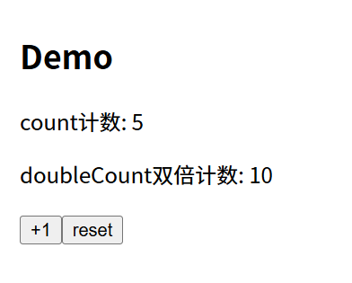


### Vue 2 模板语法

父组件：App.vue

```vue
<template>
  <div id="app">
    <DemoComponent/>
  </div>
</template>

<script>
import DemoComponent from './components/Demo.vue'
export default {
  name: 'App',
  components: {
    DemoComponent
  }
}
</script>
```


#### `v-if / v-else-if / v-else` + `@click`

```vue
<script>
export default {
  name: "DemoComponent",
  data() {
    return {
      status: 'loading'
    };
  },
  methods: {
    toggle() {
      if (this.status === 'loading') {
        this.status = 'error';
      } else if (this.status === 'error') {
        this.status = 'success';
      } else {
        this.status = 'loading';
      }
    },
  }
}
</script>

<template>
  <div class="demo">
    <button @click="toggle">toggle</button>

    <p v-if="status === 'loading'">loading...</p>
    <p v-else-if="status === 'error'">Error</p>
    <p v-else>Success</p>
  </div>
</template>

<style scoped>
.demo { padding: 12px; }
</style>
```

组件效果：点击按钮，依次切换显示loading、error、success状态

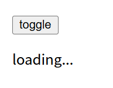


#### `v-for="item in list"` + `:key`

```vue
<script>
export default {
  name: "DemoComponent",
  data() {
    return {
      list: [
        { id: 1, name: 'A' },
        { id: 2, name: 'B' }
      ]
    }
  },
  methods: {
    remove(id) {
      this.list = this.list.filter(x => x.id !== id);
    }
  }
}
</script>

<template>
  <div class="demo">
    <ul>
      <li v-for="item in list" :key="item.id">
        {{ item.id }} - {{ item.name }}
        <button @click="remove(item.id)">remove</button>
      </li>
    </ul>
  </div>
</template>

<style scoped>
.demo { padding: 12px; }
</style>

<!-- 
组件效果：点击remove按钮，可以删除对应的列表项
-->
```

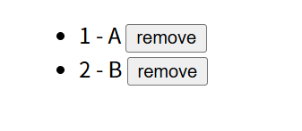


#### `v-model`（表单）+ 表单修饰符 `.trim .number .lazy`

v-model 的作用：双向绑定数据和视图
v-model 修饰符：
.trim：去除输入内容两端空格
.number：将输入内容转换为数字类型
.lazy：在输入框失去焦点或按下回车键时更新数据

```vue
<script>
export default {
  name: "DemoComponent",
  data() {
    return {
      name: '',
      age: 0,
      note: ''
    }
  }
}
</script>

<template>
  <div class="demo">
    <div>
      <label>name (.trim): </label>
      <input v-model.trim="name" placeholder="  hello  " />
      <p>name: "{{ name }}"</p>
    </div>

    <div>
      <label>age (.number): </label>
      <input v-model.number="age" type="number" />
      <p>age: {{ age }} (type: {{ typeof age }})</p>
    </div>

    <div>
      <label>note (.lazy): </label>
      <input v-model.lazy="note" placeholder="change on blur/enter" />
      <p>note: {{ note }}</p>
    </div>
  </div>
</template>

<style scoped>
.demo { padding: 12px; }
</style>

<!-- 
组件效果：
1. name 输入框，输入内容前后有空格时，显示时会自动去除空格
2. age 输入框，输入内容会被转换为数字类型
3. note 输入框，内容只有在失去焦点或按下回车键时才会更新显示
-->
```

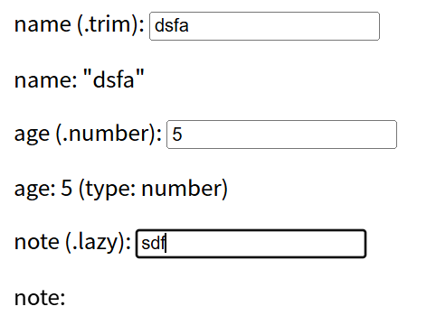


#### `:class`、`:style`（动态绑定）

动态 class 和 style 可以通过绑定对象的方式来实现，根据数据的变化动态应用不同的样式。

```vue
<script>
export default {
  name: "DemoComponent",
  data() {
    return {
      active: false,
      count: 0,
      size: 16
    }
  }
}
</script>

<template>
  <div>
    <button @click="active = !active">toggle active</button>

    <p :class="{ active, danger: count >= 3}">
      class Demo
    </p>

    <button @click="count++">count++</button>
    <p :style="{ color: count >= 3 ? 'red' : '#333', fontSize: size + 'px' }">
      style demo (count={{ count }})
    </p>

    <input type="number" v-model.number="size">
  </div>
</template>

<style scoped>
.active { font-weight: 700; }
.danger { text-decoration: underline; }
</style>

<!-- 
组件效果：点击 ”toggle active“ 按钮切换段落的粗体样式，点击 ”count++“ 按钮增加计数，当计数达到3及以上时，段落文字变为红色并添加下划线。通过输入框可以动态调整段落文字的大小。
-->
```

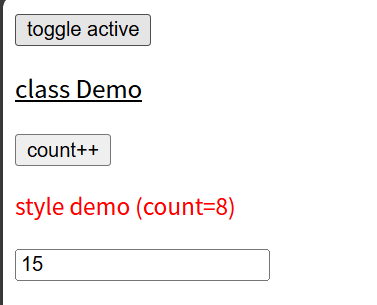


#### 事件修饰符 `.stop .prevent .once`

事件修饰符

.stop 阻止事件冒泡

.prevent 阻止默认行为

.once 事件只触发一次

```vue
<template>
  <div class="outBox">
    <div class="box" @click="onOuter">
      outer (click me)

      <button @click.stop="onInner">inner (.stop)</button>
    </div>

    <a href="https://example.com" @click.prevent="onLink">link (.prevent)</a>

    <button @click.once="onOnce">once (.once)</button>
  </div>
</template>

<script>
export default {
  name: 'DemoComponent',
  methods: {
    onOuter() {
      console.log('outer click')
    },
    onInner() {
      console.log('inner click (stopped)')
    },
    onLink() {
      console.log('prevent default navigation')
    },
    onOnce() {
      console.log('run only once')
    }
  }
}
</script>

<style scoped>
.box { padding: 12px; border: 1px solid #aaa; margin: 10px;}
.outBox { border: 1px solid #aaa; }
</style>


<!-- 

组件效果：点击内层按钮，控制台打印 "inner click (stopped)"，且不会触发外层盒子的点击事件；点击链接，不会跳转页面，控制台打印 "prevent default navigation"；点击 once 按钮，只会在第一次点击时打印 "run only once"，之后的点击不会有任何反应。
-->
```

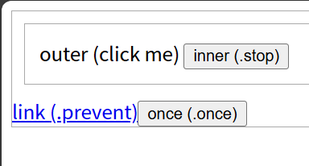


### 父子组件通信

父组件：App.vue

```vue
<template>
  <div id="app">
    <h3>1) Props 下发 + $emit 上报</h3>
    <ChildProps :msg="parentMsg" @update="onChildUpdate"/>

    <h3>2) .sync 示例（update:count）</h3>
    <ChildSync :count.sync="syncCount" />

    <h3>3) 自定义 v-model（value + input）</h3>
    <ChildVModel v-model="modelText" />
    <hr/>
    <p>modelText: {{ modelText }}</p>
  </div>
</template>

<script>
import ChildProps from './components/ChildProps.vue'
import ChildSync from './components/ChildSync.vue'
import ChildVModel from './components/ChildVModel.vue'
export default {
  name: 'App',
  components: {
    ChildProps,
    ChildSync,
    ChildVModel
  },
  data() {
    return {
      parentMsg: 'hello from parent',
      syncCount: 1,
      modelText: 'init'
    }
  },
  methods: {
    onChildUpdate(payload) {
      // 接收子组件上报（示例）
      console.log('parent received update:', payload)
      this.parentMsg = payload
    }
  }
}
</script>

<style>
/* 可按需保留/删除 */
</style>


<!-- 
笔记：
.sync 语法糖，实质上是父组件传入一个 prop，同时监听子组件发出的 update:propName 事件，从而实现双向绑定效果。
-->
```


#### props 下发、 $emit 上报

```vue
<script>
export default {
  name: 'ChildProps',
  props: {
    msg: {
      type: String,
      default: ''
    }
  },
  methods: {
    notifyParent() {
      const newVal = this.msg + ' (updated by child)'
      // 任意事件名均可：用 $emit 向父上报
      this.$emit('update', newVal)
    }
  }
}
</script>

<template>
<div class="childProps">
  <p>child receives prop: "{{ msg }}"</p>
  <button @click="notifyParent">告诉父组件新的值</button>
</div>
</template>

<style scoped>
.childProps {
  border: 1px solid #ccc;
  padding: 10px;
  margin-top: 10px;
}
</style>

<!-- 
组件效果：msg的值由父组件传入，子组件通过点击按钮，使用 $emit 事件向父组件上报新的值，父组件接收后更新传入的 prop, 从而实现父子组件间的数据通信。
每点击一次按钮，子组件中显示的值就会在后面追加 " (updated by child)" 字样。
-->
```


红色父传子，绿色子传父


#### .sync（update:prop）

```vue
<script>
export default {
  name: 'ChildSync',
  props: {
    count: {
      type: Number,
      default: 0
    }
  },
  methods: {
    inc() {
      // .sync 语法糖依赖子组件发 update:propName 事件
      this.$emit('update:count', this.count + 1)
    }
  }
}
</script>

<template>
  <div>
    <p>count (prop): {{ count }}</p>
    <button @click="inc">child++（使用 update:count 通知父组件）</button>
  </div>
</template>

<style scoped>
</style>

<!-- 
组件效果：count 的值由父组件通过 .sync 传入，子组件通过点击按钮，使用 $emit 触发 update:count 事件向父组件上报新的值，父组件接收后更新传入的 prop，从而实现双向绑定效果。
每点击一次按钮，count 的值就会加 1。
-->
```


#### 自定义组件的 v-model

```vue
<script>
export default {
  name: 'ChildVModel',
  props: {
    value: {
      type: String,
      default: ''
    }
  },
  methods: {
    onInput(e) {
      // 把新的值通过 input 事件发回父组件，父组件使用 v-model 接收
      this.$emit('input', e.target.value)
    }
  }
}
</script>

<template>
<div>
  <!-- Vue2 约定：prop 名称为 value，事件为 input -->
  <input :value="value" @input="onInput" />
</div>
</template>

<style scoped>
</style>

<!-- 
组件效果：value 的值由父组件通过 v-model 传入，子组件通过输入框修改内容时，使用 $emit 触发 input 事件向父组件上报新的值，父组件接收后更新传入的 prop，从而实现双向绑定效果。
每修改一次输入框内容，modelText 的值就会相应更新。
-->
```


### $set

Vue2 无法检测到直接赋值添加的新属性，所以需要用 `$set` 来添加响应式属性。

最简单的例子：

```JavaScript
data() {
  return {
    user: {
      name: "张三"
    }
  };
}

// ❌ 这样添加属性，不会触发视图更新
this.user. age = 30;

// ✅ 用 $set 添加属性，会触发视图更新
this.$set(this.user, 'age', 30);

// 或者简写形式
this.$set(this.user, 'age', 30);
```

**两种用法：**

```JavaScript
// 方式1：为对象添加属性
this.$set(this.user, 'email', 'test@example.com');

// 方式2：为数组设置元素（Vue. set 别名）
this.$set(this.list, 0, 'new value');
```

**结果：**

```JavaScript
// 添加前
this.user = { name: "张三" }

// 添加后
this.user = { name: "张三", age:  30, email: "test@example.com" }


data() {
  return {
    list: ['a', 'b', 'c']
  };
}

// 修改前
console.log(this.list);
// 输出: ['a', 'b', 'c']

// 使用 $set 修改数组第一个元素
this.$set(this.list, 0, 'new value');

// 修改后
console.log(this.list);
// 输出: ['new value', 'b', 'c']
```


### $refs

能直接访问dom元素或子组件实例

```vue
<template>
  <div>
    <input ref="myInput" type="text" placeholder="输入内容">
    <button @click="focusInput">聚焦输入框</button>
  </div>
</template>

<script>
export default {
  methods: {
    focusInput() {
      // 通过 $refs 访问 DOM 元素
      this.$refs.myInput.focus();
      console.log(this.$refs.myInput.value); // 获取输入框的值
    }
  }
}
</script>
```


访问子组件实例

能直接调用子组件方法


ref在v-for中，$refs返回的是数组

```vue
<template>
  <div>
    <!-- v-for 中使用动态 ref -->
    <div v-for="(item, idx) in list" :key="item.id">
      <input :ref="'input' + idx" :placeholder="item.name" />
    </div>
    <button @click="checkRefs">查看 $refs</button>
  </div>
</template>

<script>
export default {
  data() {
    return {
      list: [
        { id: 1, name: '苹果' },
        { id: 2, name: '香蕉' },
        { id: 3, name: '橘子' },
      ]
    };
  },
  methods: {
    checkRefs() {
      console.log(this.$refs);
    }
  }
};
</script>
```

点击按钮后，控制台输出

```js
{
  "input0": [ <input placeholder="苹果"> ],   // ← 数组！长度为 1
  "input1": [ <input placeholder="香蕉"> ],   // ← 数组！长度为 1
  "input2": [ <input placeholder="橘子"> ]    // ← 数组！长度为 1
}
```


如果 ref 不在 `v-for` 中

```
<template>
  <div>
    <input ref="myInput" placeholder="单独的输入框" />
    <button @click="checkRefs">查看 $refs</button>
  </div>
</template>

输出
{
  "myInput": <input placeholder="单独的输入框">   // ← 直接是 DOM 元素，不是数组
}
```


### $nextTick

Vue 修改数据后，不会立刻更新 DOM，而是等当前代码执行完后才统一更新。

$nextTick 的作用就是："等 DOM 更新完了，再执行我的代码"。

```vue
<template>
  <div ref="box">{{ message }}</div>
  <button @click="changeMsg">改变消息</button>
</template>

<script>
export default {
  data() {
    return { message: '旧消息' }
  },
  methods: {
    changeMsg() {
      this.message = '新消息';  // 修改数据

      // ❌ 这里立刻读取 DOM，拿到的还是"旧消息"！
      console.log(this.$refs.box.innerText); // 输出：旧消息
    }
  }
}
</script>
```

```vue
<template>
  <div ref="box">{{ message }}</div>
  <button @click="changeMsg">改变消息</button>
</template>

<script>
export default {
  data() {
    return { message: '旧消息' }
  },
  methods: {
    changeMsg() {
      this.message = '新消息';  // 修改数据

      // ✅ 等 DOM 更新完再执行
      this.$nextTick(() => {
        console.log(this.$refs.box.innerText); // 输出：新消息 🎉
      });
    }
  }
}
</script>
```


### Prop对象声明

**Props 对象声明** 定义组件接收的数据，包括类型、是否必传、默认值、自定义验证。

```js
// 最小化例子
props: {
  msg: {
    type: String,           // 期望：字符串
    required: true          // 必传
  },
  age: {
    type: Number,           // 期望：数字
    default: 18             // 默认值
  },
  user: {
    type: Object,           // 期望：对象
    validator(v) {          // 自定义验证
      return v && v.name;   // 必须有 name 属性
    }
  }
}
```

```vue
// ✓ 正确
<MyComp msg="hello" :user="{ name: 'Tom' }" />

// ✗ 报错：msg 未传（required）
<MyComp />

// ✗ 警告：user 没有 name 属性（validator 失败）
<MyComp msg="hi" :user="{ age: 30 }" />
```


验证器写法

```js
// 写法1：对象方法简写（推荐）
validator(v) { return v > 0; }

// 写法2：完整函数
validator: function(v) { return v > 0; }

// 写法3：箭头函数
validator: (v) => v > 0
```


### EventBus（事件总线）

```js
bus.$emit 是 Vue 2 中 EventBus（事件总线） 模式的核心用法，本质是利用一个共享的 Vue 实例来实现"发布-订阅"通信，让任意两个组件（不管有没有父子关系）都可以互相传递数据。
```

场景： 组件 A 有一个按钮，点击后把消息发送给组件 B 显示出来。


第一步：创建事件总线 bus.js

```js
import Vue from 'vue';
export const bus = new Vue(); // 创建一个空的 Vue 实例作为"中间人"
```


第二步：组件 A —— 发送消息（$emit）

```vue
<template>
  <button @click="sendMsg">点我发送消息</button>
</template>


<script>
import { bus } from './bus.js';

export default {
  methods: {
    sendMsg() {
      bus.$emit('say-hello', '你好，我是组件A！'); // 触发事件，并传递数据
    }
  }
}
</script>
```


第三步：组件 B —— 接收消息（$on）

在组件 created 生命周期钩子中，通过`bus.$on`向事件总线 `bus` **注册**一个名为 `say-hello` 的事件监听器，并绑定对应的回调函数。当任意组件通过 `bus.$emit('say-hello', data)` **派发**该事件时，回调函数会被自动调用并接收传入的数据。在组件销毁前的 `beforeDestroy` 钩子中，通过 `bus.$off` **注销**该监听器，解除事件绑定，避免组件实例已销毁但监听器仍驻留内存导致的**内存泄漏**或**回调重复触发**。

```vue
<template>
  <div>收到的消息：{{ message }}</div>
</template>


<script>
import { bus } from './bus.js';

export default {
  data() {
    return { message: '' }
  },
  created() {
    bus.$on('say-hello', (msg) => { // 监听事件，接收数据
      this.message = msg;
    });
  },
  beforeDestroy() {
    bus.$off('say-hello'); // 组件销毁时取消监听，防止内存泄漏
  }
}
</script>
```


`$on` 是**订阅**，`$emit` 是**发布**，`$off` 是**取消订阅**——这本质上是一个标准的**发布-订阅模式（Pub/Sub Pattern）**。


### Vue 2 中以 `_` / `$` 开头属性陷阱


```js
// ❌ 错误写法
export default {
  data() {
    return {
      _timer: null,      // 不会被代理！
      $cache: [],        // 不会被代理！
      count: 0           // ✅ 正常代理
    }
  },
  mounted() {
    console.log(this._timer)  // undefined ← 读不到
    console.log(this.$cache)  // undefined ← 读不到
    console.log(this.count)   // 0 ✅
  }
}
```

ue 2 在初始化 `data` 时，会跳过以 `_` 或 `$` 开头的 key（源码中有明确判断），**不为它们创建 getter/setter 代理**，所以通过 `this.xxx` 永远拿不到值。

