速查

```
盒子上方    → 类名
中间区域    → 属性（字段）
下方区域    → 方法

+   public      可以外部访问
-   private     只能内部访问

──────▷   继承   extends
- - -▷    实现   implements  
◇────     聚合   外部传入 has-a
◆────     组合   内部创建 owns
- - →     依赖   临时使用 use

实线单箭头 ——→	单向关联，A 知道 B
实线双箭头 ←——→	双向关联，A 和 B 互相知道对方
```


每个矩形盒子代表一个类，相当于JavaScript中的class

```js
┌─────────────────┐
│    Document     │  ← 类名（相当于 class Document）
├─────────────────┤
│ - state         │  ← 属性（相当于 this.state）
├─────────────────┤
│ + render()      │  ← 方法（相当于 render(){}）
│ + publish()     │
│ + changeState() │
└─────────────────┘
对应的js代码就是：
class Document {
  constructor() {
    this.state = 'draft';
  },
  
  render() {},
  publish() {},
  changeState() {}
}


+ 和 - 分别表示 public 和 private 的访问权限，public 表示可以在类的外部访问，private 则只能在类的内部访问


箭头关系


1、实线 + 空心三角表示类继承：Draft ──────▷ State
class Draft extends State {}


2、虚线 + 空心三角表示接口实现：Draft - - - -▷ «interface» State
interface State {
  render(): void;
  publish(): void;
}
class Draft implements State {
  render() {...}
  publish() {...}
}
接口只定义接入的类必须实现哪些方法，但是不提供具体的实现细节，如果接入的类中没有写相应的方法，typeScript会直接报错


3、实线 + 空心棱形表示聚合：Document ◇──── State
Document内部有一个State属性，但是State可以独立存在
State = {
  render() {...},
  publish() {...}
}
class Document {
  constructor() {
    this.state = State;
  }
}

            
4、实线 + 实心棱形表示组合：Document ◆──── Page
Document内部创建Page，Document销毁表示Page也销毁
class Document {
  constructor() {
    this.page = new Page();
  }
}
```


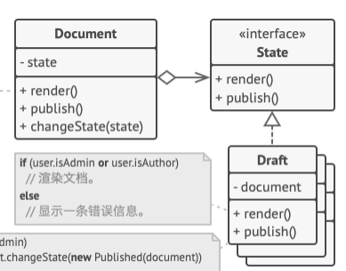

```ts
这张图表示的依赖关系
<<interface>> State: 定义接口
interface State {
  render(): void;
  publish(): void;
}

Draft 实现了 State 接口
class Draft implements State {
  private document: Document;
  render(): void {}
  publish(): void {}
}

Ddcoument 聚合了 State，外部注入
class Document {
  private state: State;  // // 持有一个 state

  render() {
    this.state.render();
  }
  publish() {
    this.state.publish();
  }
  changeState(state: State) {
    this.state = state;
  }
}
```


设计模式

设计模式的本质是**解耦**——把"变化的部分"和"稳定的部分"分开


## 创造型模式

### 工厂方法模式

#### 理解

工厂方法：专门用来创建对象的方法

一个总生产者Creator，将生产产品中稳定的总逻辑都提取到了自己这里，然后变化部分的逻辑，就让不同的具体的生产类ConcreteCreator（继承自Creator）中的方法去处理，形成差异化生产，这样不同的ConcreteCreator就能生产出不同的具体对象（具体产品）

在产品端，`<<interface>> Product`接口也是定义了共有的逻辑，具体产品（Concrete Product）根据自己的特点重写重写`doStuff()`方法，就好像是一家品牌生产处理的不同口味饮料，产品的表现不同，内部的设计思路是相同的

总之就是在生产端和产品端这两端，将稳定的逻辑和变化的逻辑进行分离


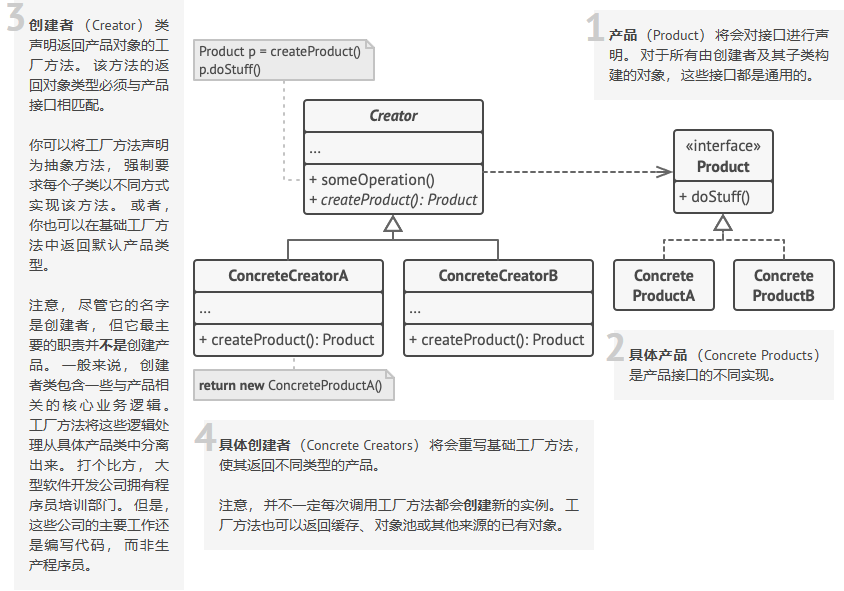


左侧

**Creator（父类）**

- `someOperation()`：具体业务逻辑，内部调用工厂方法生产具体对象，相当于工厂生产不同类型产品的公共步骤
- `createProduct(): Product`：工厂方法，返回类型是 Product 接口


**ConcreteCreatorA / ConcreteCreatorB（子类）**

- 继承 Creator，各自重写 `createProduct()`，相当于不同产品用不同的生产线
- A和B的工厂函数各自返回自己创建的具体产品对象，`Concrete ProductA / Concrete ProductB`


右侧

**Product（接口）**

- 规定了每个产品对象中必须有 `doStuff()` 方法


**oncreteProductA / ConcreteProductB**

- 每个具体产品的类，其中的doStuff()方法可以根据自身需要重写，相当于每个产品的功能不同


#### 举例

比如说对话框。在不同的操作系统下，对话框的功能或许相同，但是样式可能会有差别。windows系统中的对话框在Linux系统上仍然是对话框。

如果使用工厂方法，就不需要为每种操作系统下的对话框重写对话框逻辑，而是在一个基本的对话框类中写入生成对话框功能的逻辑，让两个具体的对话框类继承这个基本的对话框类，具体对话框类将继承基本对话框类的大部分代码，仅仅在工厂函数中根据不同的操作系统生成不同样式的对话框实例即可。


## 结构型模式

## 行为模式

### 状态模式

#### 理解

​	我对状态模式的理解是，上下文类用于创建一个对象，这个对象类似于一个不同状态去完成不同行为的"物体"，这个"物体"会根据自身的不同状态拥有不同的功能，上下文类会把这些功能的实现逻辑全部委托给一个状态类(State)，自身仅仅保留与状态无关的功能，比如状态切换的功能逻辑，这个状态类仅仅是一个接口，从这个状态类会衍生出不同的具体状态类

​	最关键的地方就是，每个具体状态类里面都保有着"物体"在不同状态下对应的功能逻辑，所以上下文类本身直接就把自身不同状态下的功能逻辑全部委托给状态类来实现，又因为每个具体状态类都持有上下文类，所以每个具体状态类又可以调用上下文类中的状态切换方法来自由改变自己的状态，

​	所以上下文类就只用调用自己的方法即可，调用到对应的方法状态会自动变换，然后自身每个方法的逻辑也自动变换，这样就实现了把变化的部分(不同状态下对应的功能逻辑)和不变的部分（上下文本身,即"物体"）分离开来


核心思想图

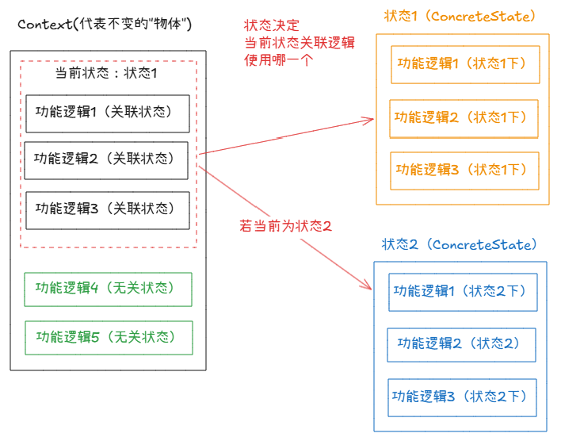


官方教程图

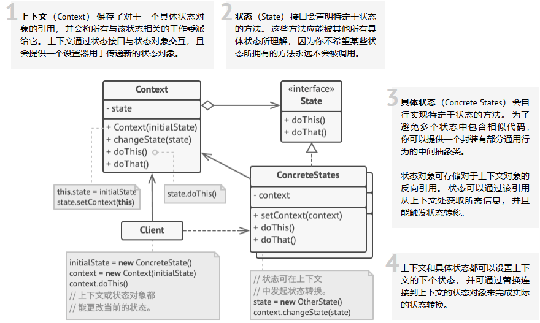


核心：状态知道自己下一步该去哪个状态，不需要外部来指挥，会自己完成状态的切换


#### 代码示例

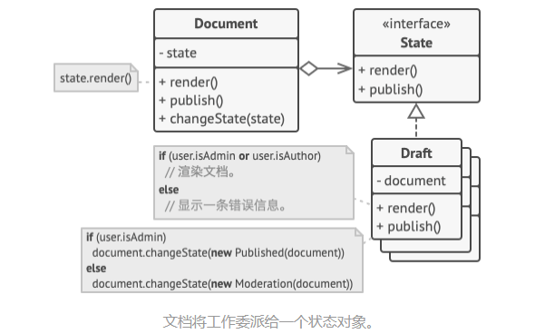

```js


/** 抽象状态类接口 */
interface State {
  render(): void;
  publish(): void;
}

/** 上下文类（Context） */
class Document {
  private state: State;

  constructor() {
    // 初始状态为草稿,并且把上下文对象自身的地址传递给状态对象
    this.state = new Draft(this);
  }

  // 提供给具体状态对象调用的切换方法
  changeState(state: State) {
    this.state = state;
  }

  // 上下文自身不管业务逻辑，具体实现全部委托给状态对象
  render() {
    this.state.render();
  }

  publish() {
    this.state.publish();
  }
}

/** 具体状态类（ConcreteState） */
class Draft implements State {
  private context: Document; // 反向引用上下文

  constructor(context: Document) {
    this.context = context;
  }

  render() {
    console.log("草稿状态渲染中...");
  }

  publish() {
    console.log("草稿发布，提交审核，状态切换到Review");
    // 状态知道自己下一步去哪，主动切换状态
    this.context.changeState(new Review(this.context)); 
  }
}

class Review implements State {
  private context: Document;

  constructor(context: Document) {
    this.context = context;
  }

  render() {
    console.log("审核状态渲染中...");
  }

  publish() {
    console.log("审核通过，发布成功，状态切换到Published");
    this.context.changeState(new Published(this.context));
  }
}

class Published implements State {
  private context: Document;

  constructor(context: Document) {
    this.context = context;
  }

  render() {
    console.log("已发布状态渲染中...");
  }

  publish() {
    console.log("已发布,之后什么也不做");
    // 已经发布了，状态自己决定哪也不去
  }
}


// 客户端使用
const doc = new Document();  // 内部自动是Draft状态

doc.render();   // 【草稿】渲染：显示编辑器，内容可修改
doc.publish();  // 【草稿】发布：草稿提交审核，状态切换到 Review
                // （Draft 内部自动把状态切成了 Review）

doc.render();   // 【审核中】渲染：显示只读预览 + 审核意见栏
doc.publish();  // 【审核中】发布：审核通过，状态切换到 Published
                // （Review 内部自动把状态切成了 Published）

doc.render();   // 【已发布】渲染：显示最终发布页面，不可编辑
doc.publish();  // 【已发布】发布：已经发布了，什么也不做
                // （Published 自己决定不切换）
```


```js
如果不使用聚合 + 委托，代码会变成：

class Document {
  private state: string; // 直接用字符串来表示状态

  // 每次新增状态都要修改这里
  if (this.state === 'draft') {
    // draft状态的渲染逻辑
  } else if (this.state === 'review') {
    // review状态的渲染逻辑 
  } else if (this.state === 'published') {
    // published状态的渲染逻辑
  }
}

典型if-else地狱

或者在上下文对象中进行if-else判断

class AudioPlayer {
  // ❌ 直接依赖具体类
  private state: ReadyState | PlayingState | LockedState;

  clickPlay(): void {
    // ❌ 又回到 if-else 地狱了
    if (this.state instanceof ReadyState) {
      this.state.clickPlay();
    } else if (this.state instanceof PlayingState) {
      this.state.clickPlay();
    }
  }
}
```


`implements` 用于让一个**类声明它实现了某个接口**，TypeScript 会检查该类是否提供了接口要求的所有成员。

```js
interface Mediator {
  notify(sender: object, event: string): void;
}

// 用 implements 声明这个类实现了 Mediator 接口
class ConcreteMediator implements Mediator {
  notify(sender: object, event: string): void {
    // 必须实现 notify 方法，否则 TS 报错
  }
}
```


### 中介者模式

#### 理解

​	我有点理解了，中介者模式中的中介者就像是一个工具箱，具体的组件只是表象，真正的逻辑都在中介者里面实现，每个组件只需要收集输入，并将输入参数传递给中介者，中介者汇总每个组件传入的参数，根据不同的参数执行不同的功能逻辑,

​	组件之间是不用相互通信的，每个组件只需要知道自己的中介者是谁，需要执行逻辑的时候把输入参数传递给中介者就行了，这样每个组件之间都是解耦的，该一个组件的逻辑只需要在中介者里面改，组件挪动到其它地方用，只需要传递给一个中介者就行，如果有定制化需求，只需要改中介者里面的逻辑

​	对于很多组件对象之间相互调用方法的场景非常好用，比如当组件A中的逻辑调用了组件B,那么中介者在自身的组件A逻辑块中调用组件B即可，A和B之间就不用产生直接关联，中介者也不只是一个“收集参数执行逻辑”的工具箱，还是一个不同组件之间的调度中心

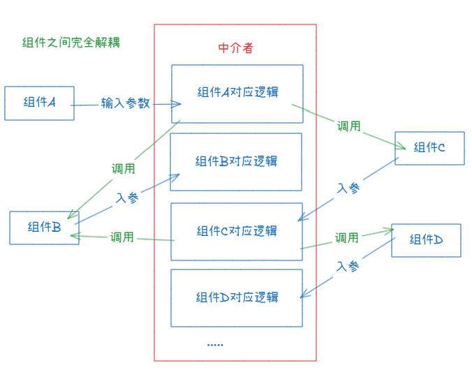


官网教程图

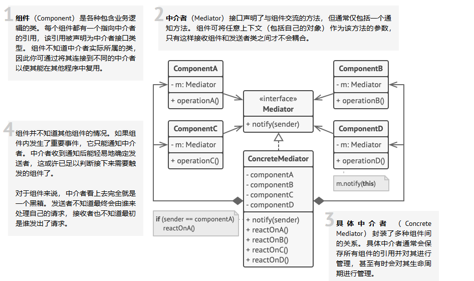


```
修饰符		本类	子类	外部
public		✓	✓	✓
protected	✓	✓	✗
private		✓	✗	✗
```


#### 代码示例

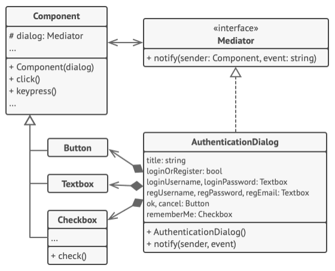


```ts
// 1、中介者接口
interface Mediator {
  notify(sender: object, event: string): void;
}


// 2、组件基类，每个组件只认识中介者，不认识其它组件
class Component{
  protected dialog: Mediator; 
  
  constructor(dialog: Mediator) { // 创建时传入具体中介者，让组件持有，这样组件就能知道中介者是谁
    this.dialog = dialog;
  }

  click() {  // 点击时通知中介者
    this.dialog.notify(this, 'click'); 
  }

  keypress() { // 按键时通知中介者
    this.dialog.notify(this, 'keypress');
  }
}


// 3、具体组件,从Component继承

/** 具体组件：按钮 */
class Button extends Component {
  // click事件已经从Component继承
}

/** 具体组件：文本框 */
class TextBox extends Component {
  value: string = ''; 

  type(text: string) {
    this.value = text; 
    this.keypress(); // 输入时触发keypress通知中介者
  }
}

/** 具体组件：复选框 */
class CheckBox extends Component {
  checked: boolean = false;

  check() {
    this.checked = !this.checked;
    this.dialog.notify(this, 'check'); // 勾选时通知中介者
  }
}


// 4、具体中介者，协调组件之间的交互
/** AuthenticationDialog 实现 Mediator 接口，组合关系：构造函数内部创建所有组件 */
class AuthenticationDialog implements Mediator {

  // 对应UML图中的私有属性
  private title: string = '登录';
  private loginOrRegister: boolean = true; // true=登录，false=注册

  // 创建登录表单的文本框
  private loginUsername: TextBox;
  private loginPassword: TextBox;
  private regUsername: TextBox;
  private regPassword: TextBox;
  private regEmail: TextBox;

  // 创建登录表单的按钮
  private ok: Button;
  private cancel: Button;

  // 创建记住我勾选框
  private rememberMe: CheckBox;

  constructor() {
    // 所有组件都在构造函数中创建，并传入this让中介者和组件建立连接
    this.loginUsername = new TextBox(this);
    this.loginPassword = new TextBox(this);
    this.regUsername = new TextBox(this);
    this.regPassword = new TextBox(this);
    this.regEmail = new TextBox(this);
    this.ok = new Button(this);
    this.cancel = new Button(this);
    this.rememberMe = new CheckBox(this);
  }

  /**
   * notify方法及逆行协调
   * 协调基于 sender 发送者身份 + event 事件类型 来分发逻辑
   */
  notify(sender: object, event: string): void {

    // 协调 1：复用rememberMe 勾选框切换 → 切换登录/注册模式
    if (sender === this.rememberMe && event === 'check') {
      this.loginOrRegister = !this.loginOrRegister; // 切换登录/注册模式
      if (this.loginOrRegister) {
        this.title = '登录';
      } else {
        this.title = '注册';
      }
    }

    // 协调 2：输入框有内容输入 → 根据当前模式对输入框的输入进行处理
    if (sender instanceof TextBox && event === 'keypress') {
      if (this.loginOrRegister) {
        // 登录逻辑链 - 输入账号 → 输入密码
      } else {
        // 注册逻辑链 - 输入账号 → 输入密码 → 输入邮箱
      }
    }

    // 协调 3：确认按钮点击 → 根据当前模式执行登录或注册
    if (sender === this.ok && event === 'click') {
      if (this.loginOrRegister) {
        // 登录逻辑链 - 查找用户 → 验证账号密码 → 登录成功/失败
      } else {
        // 注册逻辑链 - 验证输入 → 创建用户 → 注册成功/失败
      }
    }

    // 协调 4：取消按钮点击 → 清空所有输入并重置
    if (sender === this.cancel && event === 'click') {
      this.loginUsername.value = "";
      this.loginPassword.value = "";
      this.regUsername.value = "";
      this.regPassword.value = "";
      this.regEmail.value = "";
    }
  }

  // 暴露组件引用供外部使用
  getLoginUsername()  { return this.loginUsername; }
  getLoginPassword()  { return this.loginPassword; }
  getRegUsername()     { return this.regUsername; }
  getRegPassword()    { return this.regPassword; }
  getRegEmail()       { return this.regEmail; }
  getOkBtn()          { return this.ok; }
  getCancelBtn()      { return this.cancel; }
  getRememberMe()     { return this.rememberMe; }
}


// 5、客户端
// 只创建中介者，所有组件自动在内部创建完毕
const dialog = new AuthenticationDialog();

// --- 场景 1：登录模式下填写并提交 ---
console.log("--- 用户在登录模式下操作 ---");
dialog.getLoginUsername().type("zhangsan");     // 输入用户名 → 中介者打印状态
dialog.getLoginPassword().type("123456");       // 输入密码   → 中介者打印状态
dialog.getOkBtn().click();                      // 点击确认   → 中介者执行登录

// --- 场景 2：切换到注册模式 ---
console.log("\n--- 用户切换到注册模式 ---");
dialog.getRememberMe().check();                 // 切换模式   → 中介者切换 UI
dialog.getRegUsername().type("lisi");            // 输入用户名
dialog.getRegEmail().type("lisi@example.com");  // 输入邮箱
dialog.getRegPassword().type("abcdef");         // 输入密码
dialog.getOkBtn().click();                      // 点击确认   → 中介者执行注册

// --- 场景 3：取消操作 ---
console.log("\n--- 用户点击取消 ---");
dialog.getCancelBtn().click();                  // 取消       → 中介者清空所有表单
```


### 策略模式

#### 理解

策略结构模式理解：先抓核心，不变的部分是上下文类（Context），保有一个策略接口的引用，要变化的部分是具体策略（Concrete Strategy），和具体策略下上下文类(Context)工作的逻辑，所以上下文只需要持有具体策略的引用，然后将具体执行委托给具体策略类中对应的方法。

和状态模式的不同，改变策略是在客户端代码中手动调用上下文类(Context)的方法来改变策略，而状态模式是由上下文类(Context)自己根据当前状态在某些操作中自动改变状态（State）。所以策略模式更适合于算法的选择，而状态模式更适合于对象状态的管理。

策略模式的状态不持有上下文类的引用，所以相互之间并不知道，而状态模式的具体状态会持有上下文引用，所以状态之间是相互知道对方的存在的


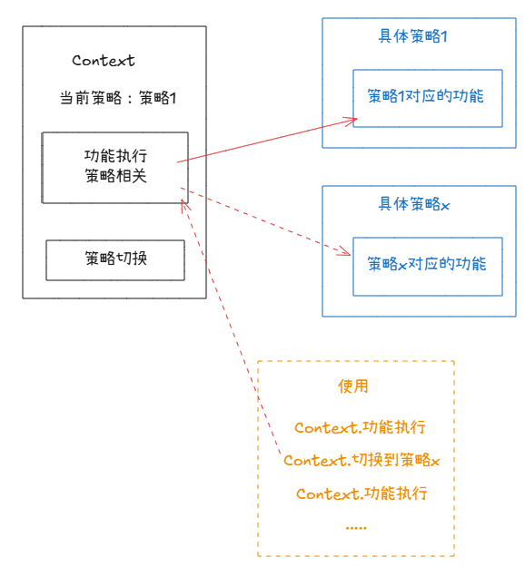


官方教程uml类图

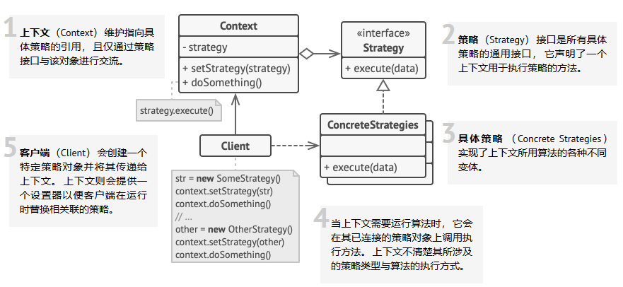


#### 代码示例

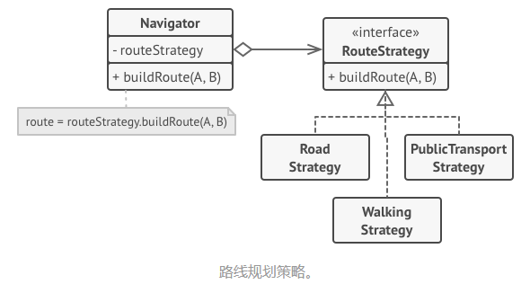

```ts
// 策略接口：创建A -> B 的路线
interface RouteStrategy {
  buildRoute(A: string, B: string): string[];
}


// 具体策略：创建A -> B 的路线
class RoadStrategy implements RouteStrategy {
  buildRoute(A: string, B: string): string[] {
    console.log(`驾车路线：${A} → ${B}`);
    return [A, "高速入口", "收费站", "高速出口", B];
  }
}

class WalkingStrategy implements RouteStrategy {
  buildRoute(A: string, B: string): string[] {
    console.log(`步行路线：${A} → ${B}`);
    return [A, "公园小路", "人行天桥", "商业街", B];
  }
}

class PublicTransportStrategy implements RouteStrategy {
  buildRoute(A: string, B: string): string[] {
    console.log(`公共交通路线：${A} → ${B}`);
    return [A, "公交站", "地铁站", "换乘站", "终点站", B];
  }
}


// 上下文（Context）：使用策略接口来构建路线
class Navigator {
  private routeStrategy: RouteStrategy;

  constructor(strategy: RouteStrategy) {
    this.routeStrategy = strategy;
  }

  setStrategy(strategy: RouteStrategy) {
    this.routeStrategy = strategy;
  }

  buildRoute(A: string, B: string): string[] {
    // 委托给具体策略对象，Navigator 不关心具体逻辑
    return this.routeStrategy.buildRoute(A, B);
  }
}


// 客户端代码：使用不同的策略来构建路线
const navigator = new Navigator(new RoadStrategy());
navigator.buildRoute("A", "B"); // 驾车路线：A → B

navigator.setStrategy(new WalkingStrategy());
navigator.buildRoute("A", "B"); // 步行路线：A → B

navigator.setStrategy(new PublicTransportStrategy());
navigator.buildRoute("A", "B"); // 公共交通路线：A → B
```

